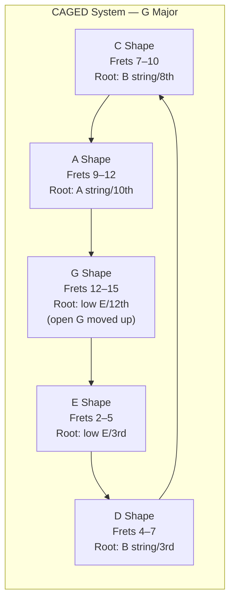

# Guitar Masterclass: Fretboard Mastery, Tone Craft, and Signal Chain Command

## Overview and Learning Roadmap

This masterclass moves through five progressive modules — from posture and physical mechanics to chord architecture, scale fluency, tone shaping, and fault diagnosis. Every concept is immediately playable. Theory appears only where it explains *why* a technique feels or sounds the way it does.

**What you'll master:**

- Left- and right-hand ergonomics that prevent injury and unlock speed
- Open chords, barre chords, and rootless voicings with exact fingerings
- Five CAGED positions across the entire fretboard with connecting runs
- Pentatonic, blues, and modal soloing with phrasing drills
- Signal chain command: pickup selection, gain staging, EQ decisions
- Intonation, action, and nut setup diagnostics with a clear repair protocol
- Acoustic feedback suppression and electrical fault diagnosis

**Equipment you'll use:**

- Acoustic or electric guitar (exercises work on both; electric-specific sections are marked)
- Metronome (hardware, DAW click, or free app — just use one consistently)
- Tuner accurate to ±2 cents minimum (Peterson StroboClip, TC Electronic PolyTune, or similar)
- DAW with spectrum analyzer (Voxengo SPAN is free; any will do)
- Audio interface: 24-bit/48kHz minimum, input impedance ≥1MΩ for direct electric guitar

---

## Module 1: Physical Mechanics — Posture, Hand Position, and Injury Prevention

### 1.1 Seated Position and Guitar Angle

Your posture sets the ceiling on everything else. Bad posture creates tension that limits speed, causes injuries, and produces inconsistent tone.

**Classical position** (recommended for precision work and fingerstyle):
- Guitar body rests on the left thigh (right-handed player)
- Guitar neck angled upward at approximately 45°
- Left elbow hangs freely; wrist naturally aligns with the neck
- Both feet flat on the floor or left foot on a footstool

**Casual/rock position** (guitar on right thigh):
- Guitar neck should still angle slightly upward — never horizontal or pointing down
- A strap even while seated prevents the guitar from drifting forward during chord changes

**Strap height (standing):**
- Position the guitar so your fretting wrist sits in the same relationship to the neck as it does seated
- Too low = wrist bends sharply backward = carpal tunnel risk
- Too high = right arm angle becomes uncomfortable for strumming
- A good starting reference: the guitar body sits at or slightly above your hip bone

### 1.2 Left Hand (Fretting Hand) Mechanics

The single most common beginner injury is fretting-hand tension. These mechanics eliminate it.

**Thumb position:**
- Thumb rests on the back of the neck, roughly opposite the middle finger (not the index)
- Thumb should be vertical or slightly angled — never hooked over the top of the neck (this collapses the wrist and mutes the high strings)
- Exception: deliberate thumb-over technique for muting the low E or playing chord melodies (advanced — establish the standard grip first)

**Wrist alignment:**
- Keep the wrist relatively straight, not curled under the neck
- The knuckles should be roughly parallel to the neck, not tilted away from it
- This positions your fingertips directly above the frets rather than coming in at an angle

**Finger arch:**
- Fingers approach the strings on the fingertip, not the pad
- The first joint (DIP joint) should curve slightly — this prevents adjacent strings from being accidentally muted
- Press the string down just behind the fretwire, not in the middle of the fret space
- Use only as much pressure as needed to produce a clean tone — squeezing harder than necessary burns energy and creates tension

**Fretting-hand drill — the spider crawl:**

This exercise trains each finger independently and builds the arch naturally.

```
Strings: 6  5  4  3  2  1
Fret:    1  1  1  1  1  1   (all index, one per string)
         2  2  2  2  2  2   (all middle finger)
         3  3  3  3  3  3   (all ring finger)
         4  4  4  4  4  4   (all pinky)
```

Play each note cleanly before moving to the next string. Then reverse direction (string 1 → string 6). Then try diagonal patterns (1-2-3-4 starting on different frets per string). Start at **♩= 50 BPM**, advance to **♩= 80 BPM** only when every note rings cleanly with zero buzzing.

### 1.3 Right Hand (Picking Hand) Mechanics

**Pick grip:**
- Hold the pick between the thumb pad and the side of the index finger (not the fingertip)
- 3–5mm of pick tip exposed beyond the fingers
- Light grip pressure — the pick should flex slightly on impact rather than locking rigid
- Wrist anchored lightly on the bridge saddles or floating just above the strings — never resting heavily on the body

**Pick angle (slant):**
- A slight downward slant of the pick (trailing edge tilted toward the floor) reduces resistance on downstrokes and is the natural resting position for most players
- For fast alternate picking, a slight upward slant on the upstroke (trailing edge toward ceiling) produces a more consistent attack in both directions — this is called a "neutral" or "USX" (upstroke escape) position

**Alternate picking mechanics:**
- The motion comes primarily from the wrist, not the elbow
- Keep the motion small and controlled — large sweeping motions introduce latency and inconsistency
- Practice on a single string at **♩= 60 BPM** (16th notes), increasing by 5 BPM increments only when the previous tempo is fully controlled

**Fingerstyle right-hand position:**
- Thumb (p) handles strings 4–6; index (i) string 3; middle (m) string 2; ring (a) string 1
- Plant the thumb slightly ahead of the fingers (toward the neck)
- Fingers pluck upward and slightly inward toward the palm (not outward away from the guitar)
- The nail edge catches the string for brightness; the flesh alone produces a softer tone

---

## Module 2: Open Chords, Barre Chords, and Voicing Architecture

### 2.1 The Essential Open Chord Set

Chord diagrams use this format: `[E A D G B e]` where numbers are fret positions and **x** = muted, **0** = open.

**C Major** — `x 3 2 0 1 0`

```
  E  A  D  G  B  e
  x  3  2  0  1  0

  Fingers:  x  3  2  0  1  0
            (ring)(mid)(   )(idx)(   )
```

Watch: the ring finger on A/3rd fret must arch enough to let the open D and G strings ring free. If D buzzes, your ring finger pad is too flat.

**G Major** — `3 2 0 0 0 3`

```
  E  A  D  G  B  e
  3  2  0  0  0  3

  Fingers: mid  idx  —  —  —  ring  (or pinky on e)
```

Alternate fingering: `2 1 0 0 0 3` (index on A, middle on E, pinky on e) — this voicing makes the transition to Cadd9 (`x 3 2 0 3 3`) instant by keeping the pinky anchored.

**D Major** — `x x 0 2 3 2`

```
  E  A  D  G  B  e
  x  x  0  2  3  2

  Fingers: —  —  —  idx  ring  mid
```

**A Minor** — `x 0 2 2 1 0`

```
  E  A  D  G  B  e
  x  0  2  2  1  0

  Fingers: —  —  mid  ring  idx  —
```

**E Minor** — `0 2 2 0 0 0`

```
  E  A  D  G  B  e
  0  2  2  0  0  0

  Fingers: —  mid  ring  —  —  —
```

**F Major (barre, first position)** — `1 3 3 2 1 1`

```
  E  A  D  G  B  e
  1  3  3  2  1  1

  Fingers: idx(barre)  ring  pinky  mid  idx  idx
```

The F chord is where most players stall. The barre challenge is not strength — it's alignment. Roll your index finger slightly toward the nut (toward the tuning pegs), landing on the bony edge of the finger rather than the flat pad. This straightens the finger and naturally bridges the gap at the 1st fret B string where the finger naturally creases.

**F Major (cheater voicing for beginners)** — `x x 3 2 1 1`

```
  E  A  D  G  B  e
  x  x  3  2  1  1

  Fingers: —  —  ring  mid  idx  idx (mini-barre)
```

This omits the low bass strings and is perfectly usable in a band context where a bassist covers the low F.

### 2.2 Barre Chords: E-Shape and A-Shape

Every open chord shape becomes a movable barre chord. The two most important shapes derive from E major and A major.

**E-Shape Barre Chord (Root on low E string):**

| Fret | Chord |
|------|-------|
| 1    | F     |
| 2    | F#/Gb |
| 3    | G     |
| 5    | A     |
| 7    | B     |
| 8    | C     |
| 10   | D     |
| 12   | E     |

Fingering: `barre(1) — mid(A) ring(D) pinky(G) — —` relative to barre fret. The index barres all six strings; ring and pinky form the 5th-and-6th-string root plus the 4th-string.

**A-Shape Barre Chord (Root on A string):**

| Fret | Chord |
|------|-------|
| 2    | B     |
| 3    | C     |
| 5    | D     |
| 7    | E     |
| 8    | F     |
| 10   | G     |
| 12   | A     |

Fingering: Index barres from A string through high e (or just the top 5 strings). Ring finger barres D, G, B strings two frets up from the index (at fret+2). Some players prefer using ring, pinky, middle in a cluster — both work.

**A-Shape minor barre (Am-shape):** Same as A-shape but remove the ring barre; use index-mid-ring individually on D, G, B.

### 2.3 Chord Transition Drills

The goal is **zero gap** between chords. The technique is **pivot fingers and anticipation**.

**Pivot finger principle:** Identify any finger that stays on the same string/fret between two chords. Keep it planted and move everything else around it.

- G → Cadd9: Both ring and pinky stay on B/e at the 3rd fret. Only index and middle move.
- C → Am: Middle finger stays on D/2nd fret. Index moves from B/1 to G/2 and ring from A/3 to B/2.
- D → G: No shared finger — lift all simultaneously, pre-shape the G in the air before landing.

**Transition drill protocol:**

Pick any two chords. Set metronome to **♩= 60 BPM**. Hold chord 1 for one full bar (4 beats), change on beat 1 of bar 2. Hold chord 2 for one bar. Continue alternating. Increase to **♩= 80 BPM** once changes are clean with no buzz or muting. Then try changing on beat 3 (half-bar changes), then every beat.

Pairs to drill in order of difficulty:

1. Em → Am (easy — index pivot)
2. G → D (medium — no pivot, clean lift required)
3. C → F (hard — barre entry)
4. Am → F (hard — barre from open)
5. Bm → G (hard — A-shape barre to open G)

### 2.4 Power Chords and Shell Voicings

**Power chords** (5th chords) omit the 3rd, making them tonally neutral (neither major nor minor). This is why they cut through distorted guitar without muddiness — the 3rd interval produces heavy intermodulation in overdriven signals.

**E5** (root on low E): `0 2 2 x x x` — open E, A/2, D/2, mute strings 3–1 with the fretting hand.

**Movable 5th chord:** Index on root string, ring on the string below 2 frets up. The pinky doubles the root an octave up on the string below the ring.

```
Root on E string:         Root on A string:
  E  A  D  G  B  e          E  A  D  G  B  e
  idx 2+idx  2+mid           x  idx 2+idx  2+mid
  (1) (1+2) (1+2)            (x) (1) (1+2) (1+2)
```

**Shell voicings** (jazz/R&B — rootless triads and 7th chord fragments):

For rhythm guitar in a band context, a bassist covers the root. These voicings sit in the midrange and voice-lead cleanly:

| Chord  | Strings 4-3-2 (D-G-B) | Description          |
|--------|------------------------|----------------------|
| Cmaj7  | 3-2-0 (fret D/G/B)     | C shape, no A string |
| G7     | 0-0-1                  | Open D-G, B/1st fret |
| Am7    | 0-2-1 (D-G-B)          | Root omitted         |
| Dm7    | 0-2-1 (A-D-G)          | 5-string shell        |

---

## Module 3: Fretboard Fluency — CAGED System and Scale Mastery

### 3.1 The CAGED System: Five Positions, One Fretboard

The CAGED system reveals that the same chord or scale appears in five overlapping shapes across the neck. Each shape is named after the open chord it resembles. The five shapes connect end-to-end and repeat at the 12th fret.

For G major, the five CAGED positions sit at these fret ranges:



**E-shape G major scale (frets 2–5, most common starting position):**

```
String:  e  |--2--3--5--|
         B  |--3--5-----|
         G  |--2--4--5--|
         D  |--2--4--5--|
         A  |--2--3--5--|
         E  |--2--3--5--|
```

Fingering: index = all 2nd fret notes, middle = 3rd fret, pinky = 5th fret. Ring finger handles 4th fret when it appears.

**A-shape G major scale (frets 9–12):**

```
String:  e  |--9--10--12--|
         B  |--10--12-----|
         G  |--9--10--12--|
         D  |--9--10--12--|
         A  |--10--12-----|
         E  |--9--10--12--|
```

**Connecting position drill:** Play the E-shape position ascending, then continue seamlessly into the D-shape without restarting from the low E. This is the key CAGED skill — flowing through positions rather than restarting at each one.

### 3.2 Minor Pentatonic and Blues Scale

The minor pentatonic is the most practical scale in rock, blues, pop, and country. It maps onto the CAGED positions; position 1 (the "box") is built from the E-shape minor chord.

**A minor pentatonic — Position 1 (box):**

```
String:  e  |--5--8--|
         B  |--5--8--|
         G  |--5--7--|
         D  |--5--7--|
         A  |--5--7--|
         E  |--5--8--|
```

Root notes (A) fall at: low E/5th fret, D/7th fret, G/5th fret, B/8th fret, high e/5th fret.

**Blues scale:** Add the ♭5 (flat five, "blue note") to the minor pentatonic:

- In A minor pentatonic position 1, add the ♭5 at D-string/6th fret and G-string/6th fret.

```
String:  e  |--5--8------|
         B  |--5--8------|
         G  |--5--6--7---|  ← 6th fret is the ♭5 blue note
         D  |--5--6--7---|  ← 6th fret is the ♭5 blue note
         A  |--5--7------|
         E  |--5--8------|
```

**Phrasing drill — call and response:**

Blues phrasing lives in short, deliberate phrases with space between them. Practice this pattern at **♩= 70 BPM** (swing feel, 12/8):

```
Bar 1: | A(5) → C(8) → D(10) → bend D up a whole step | rest rest rest |
Bar 2: | A(5) → C(8) → slide C→D | A(5) | rest |
```

The bend on the D note (high e / 10th fret in A) is the defining sound of blues guitar. Push the string upward (toward the ceiling) rather than down. A whole-step bend raises D to E. The pitch target must be exact — verify by fretting the E at the 12th fret of the same string, then bending the 10th fret until they match in pitch.

### 3.3 Major Scale Positions and Modal Thinking

The major scale across all five CAGED positions gives you full-neck coverage. Each position also implies a mode depending on where you hear the root.

**G major scale — all 5 positions summary:**

| Position | Shape | Lowest Fret | Highest Fret | Root Locations           |
|----------|-------|-------------|--------------|--------------------------|
| 1        | E     | 2           | 5            | E string/3, G string/5   |
| 2        | D     | 4           | 8            | D string/5, B string/8   |
| 3        | C     | 7           | 10           | A string/10, e string/8  |
| 4        | A     | 9           | 12           | A string/10, e string/12 |
| 5        | G     | 12          | 15           | E string/15, E string/3  |

**Three-notes-per-string (3NPS) alternative:** More ergonomic for fast runs. Each string gets exactly three notes; the pattern shifts predictably across the neck. The index covers the first note per string, middle the second, pinky the third (with ring as a flex finger on occasional stretches).

G major 3NPS starting from the low E string at the 2nd fret:

```
E:  2-3-5
A:  2-3-5
D:  2-4-5
G:  2-4-5
B:  3-5-7
e:  3-5-7
```

This pattern has a consistent 1-2-4 fingering on most strings (index-middle-pinky), which keeps the hand frame stable.

### 3.4 Connecting Scales to Chord Changes

The critical skill beyond playing scales is tracking the chord underneath and landing on chord tones at phrase endpoints.

**Target-note approach:** When soloing over a chord, aim to land on and linger on the root, 3rd, or 5th of that chord. Scale notes are passing tones between targets.

Over a I–IV–V progression in A (A–D–E):

- Over A major: target A (root), C# (3rd), E (5th) — in A pentatonic, C# is not in the scale, so target A and E strongly
- Over D major: target D (root), F# (3rd), A (5th) — shift your resolution notes to D/A
- Over E major: target E (root), G# (3rd), B (5th) — B and E are in A minor pentatonic; G# is not, use a half-step bend from G

**Chord-tone drill at ♩= 80 BPM:**

Play a simple two-bar phrase over each chord in a I–IV–V. Constraint: the last note of each phrase must be a chord tone of the upcoming chord. Record yourself and check.

---

## Module 4: Rhythm Guitar — Strumming, Travis Picking, and Groove

### 4.1 Strumming Mechanics

The strumming stroke comes from the wrist, not the elbow. The elbow can initiate the motion on wide, slow strums, but all controlled rhythm playing uses a relaxed wrist rotation with a light grip.

**Attack angle:** Hold the pick at a slight angle to the string plane (15–30°, trailing edge tilted toward the floor on downstrokes). This reduces the "click" of the pick catching each string and creates a smoother brush across the strings.

**Muting techniques:**
- **Palm mute:** Right-hand edge rests lightly on the strings just ahead of the bridge saddles. Too far from the bridge = dead thuds; too close = no muting effect.
- **Left-hand release mute:** Lighten fretting pressure between strums without fully lifting fingers — strings go from ringing to muted without any percussive click.
- **Scratch stroke:** Upstroke across muted strings (left hand fully relaxed) creates a percussive "ch" sound that fills rhythmic subdivisions without adding harmonic content.

### 4.2 Core Strumming Patterns

Notation: D = downstroke, U = upstroke, — = rest/mute (keep arm moving in rhythm but don't strike strings)

**4/4 patterns:**

```
Pattern 1
