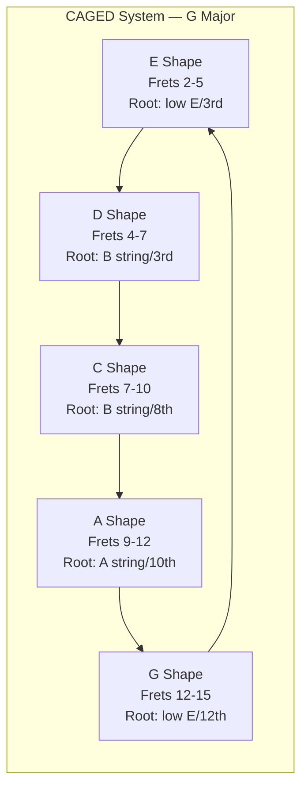
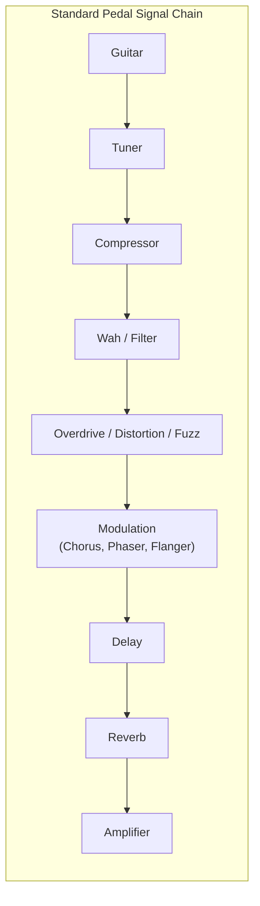

# Guitar Masterclass: Fretboard Mastery, Tone Craft, and Signal Chain Command

## Overview and Learning Roadmap

This masterclass moves through six progressive modules — from posture and physical mechanics to chord architecture, scale fluency, rhythm technique, tone shaping, and setup diagnostics. Every concept is immediately playable. Theory appears only where it explains *why* a technique feels or sounds the way it does.

**What you'll master:**

- Left- and right-hand ergonomics that prevent injury and unlock speed
- Open chords, barre chords, power chords, and shell voicings with exact fingerings
- Five CAGED positions across the entire fretboard with connecting runs
- Pentatonic, blues, and modal soloing with phrasing and bending drills
- Strumming mechanics, Travis picking, and groove-locking with a metronome
- Signal chain command: pickup selection, gain staging, EQ, and amp/pedal order
- Intonation, action, and nut setup diagnostics with a clear repair protocol

**Equipment you'll use:**

- Acoustic or electric guitar (exercises work on both; electric-specific sections are marked)
- Metronome (hardware, DAW click, or free app — just use one consistently)
- Tuner accurate to ±2 cents minimum (Peterson StroboClip, TC Electronic PolyTune, or similar)
- A set of feeler gauges or automotive thin-gauge shims for action/relief diagnostics
- A capo, a 6-inch steel ruler, and a string action gauge (or printable ruler) for setup work
- Audio interface: 24-bit/48kHz minimum, input impedance ≥1MΩ for direct electric guitar

---

## Module 1: Physical Mechanics — Posture, Hand Position, and Injury Prevention

### 1.1 Seated Position and Guitar Angle

Posture sets the ceiling on everything else. Tension in the shoulders, forearm, or wrist caps your speed, causes repetitive strain injuries, and makes your tone inconsistent because a tense fretting hand can't control pressure precisely.

**Classical position** (recommended for precision work and fingerstyle):
- Guitar body rests on the left thigh (right-handed player), typically raised on a footstool
- Neck angled upward at roughly 45°
- Left elbow hangs freely; wrist naturally aligns with the neck, no bend forced at the shoulder
- Both feet can be flat on the floor, but a footstool under the left foot is standard for classical repertoire

**Casual/rock position** (guitar on right thigh):
- Neck should still angle slightly upward — never horizontal or pointing at the floor
- Wear a strap even while seated; it stops the guitar sliding off your thigh during wide chord changes

**Strap height (standing):**
- Set the body height so your fretting wrist has the same relationship to the neck as it does seated
- Too low: wrist bends sharply backward, loading the carpal tunnel
- Too high: picking arm has to lift awkwardly to clear the body
- Starting reference: the bridge sits roughly at your hip bone

### 1.2 Left Hand (Fretting Hand) Mechanics

The single most common beginner injury is fretting-hand tension — gripping the neck like a tool handle instead of using the minimum force needed to stop the string from buzzing.

**Thumb position:**
- Thumb rests on the back of the neck, roughly opposite the middle finger, not the index
- Keep the thumb vertical or slightly angled. Never hook it over the top of the neck — that collapses the wrist and drags the fingers flat onto the strings, muting adjacent ones
- Exception: deliberate thumb-over technique for fretting or muting the low E string in chord-melody playing. Lock in the standard grip first before adding this

**Wrist alignment:**
- Keep the wrist close to straight, not curled under the neck
- Knuckles stay roughly parallel to the neck rather than tilted away from it
- This puts fingertips directly above the frets instead of approaching on an angle, which is what lets the fingertip land cleanly without brushing the neighboring string

**Finger arch:**
- Contact the string with the fingertip, not the pad
- The joint nearest the tip (DIP joint) should curve slightly inward — this arch is what keeps the rest of the finger clear of the strings below it
- Press just behind the fretwire, not in the middle of the fret space — closer to the wire means less pressure is needed for a clean note
- Use only as much pressure as removes the buzz. Squeezing harder wastes energy, builds tension, and is the #1 cause of fatigue in long practice sessions

**Fretting-hand drill — the spider crawl:**

Trains finger independence and builds the arch automatically, because each finger has to work alone without the others collapsing into it.

```
Strings: 6  5  4  3  2  1
Fret:    1  1  1  1  1  1   (all index, one per string)
         2  2  2  2  2  2   (all middle finger)
         3  3  3  3  3  3   (all ring finger)
         4  4  4  4  4  4   (all pinky)
```

Play each note cleanly before moving to the next string. Reverse direction (string 1 → string 6). Then try diagonal patterns (1-2-3-4 starting on a different fret per string, e.g. index on fret 1 of string 6, index on fret 2 of string 5). Start at **♩ = 50 BPM**, advance to **♩ = 80 BPM** only when every note rings with zero buzz.

### 1.3 Right Hand (Picking Hand) Mechanics

**Pick grip:**
- Hold the pick between the thumb pad and the side of the index finger, not the fingertip
- Expose 3–5mm of pick tip beyond the fingers
- Light grip — the pick should flex slightly on impact instead of locking rigid, which softens the attack and reduces fatigue
- Keep the wrist floating just above the strings or lightly anchored on the bridge saddles. Never rest heavily on the body — that kills wrist mobility

**Pick angle (slant):**
- A slight downward slant (trailing edge tilted toward the floor) reduces resistance on downstrokes and is the natural resting position for most players
- For fast alternate picking, angling so the pick escapes upward after an upstroke ("USX," upstroke escape) gives a more consistent attack in both directions by avoiding the string catching the pick's edge

**Alternate picking mechanics:**
- Motion comes from the wrist, not the elbow — the wrist is a smaller, faster lever with less mass to accelerate
- Keep the motion small. Large sweeping strokes add travel time and make the two directions feel uneven
- Practice on a single open string at **♩ = 60 BPM** (16th notes: down-up-down-up), increasing by 5 BPM only once the previous tempo is fully even in volume and timing

**Fingerstyle right-hand position:**
- Thumb (p) covers strings 6–4; index (i) string 3; middle (m) string 2; ring (a) string 1
- Plant the thumb slightly ahead of the fingers, toward the neck, so it doesn't collide with them
- Fingers pluck upward and slightly inward toward the palm, not outward away from the guitar — outward motion snaps the string against the fret and buzzes
- The nail edge catches the string for brightness; flesh alone gives a rounder, softer tone. Most classical and fingerstyle players use a nail-then-flesh combined stroke

---

## Module 2: Open Chords, Barre Chords, and Voicing Architecture

### 2.1 The Essential Open Chord Set

Chord diagrams use the format `[E A D G B e]` where numbers are fret positions, **x** = muted, **0** = open.

**C Major** — `x 3 2 0 1 0`

```
  E  A  D  G  B  e
  x  3  2  0  1  0
  —  ring  mid  —  idx  —
```

Watch: the ring finger on A/3rd fret must arch enough to let the open D string ring freely underneath it. If D buzzes or sounds dead, your ring finger pad is lying too flat and touching the D string.

**G Major** — `3 2 0 0 0 3`

```
  E  A  D  G  B  e
  3  2  0  0  0  3
  mid  idx  —  —  —  ring (or pinky)
```

Alternate fingering: `2 1 0 0 0 3` (index on A, middle on low E, pinky on high e). This frees the ring finger so the transition to Cadd9 (`x 3 2 0 3 3`) becomes instant — the pinky stays anchored on the high e while the ring finger just adds to the B string.

**D Major** — `x x 0 2 3 2`

```
  E  A  D  G  B  e
  x  x  0  2  3  2
  —  —  —  idx  ring  mid
```

**A Minor** — `x 0 2 2 1 0`

```
  E  A  D  G  B  e
  x  0  2  2  1  0
  —  —  mid  ring  idx  —
```

**E Minor** — `0 2 2 0 0 0`

```
  E  A  D  G  B  e
  0  2  2  0  0  0
  —  mid  ring  —  —  —
```

**F Major (barre, first position)** — `1 3 3 2 1 1`

```
  E  A  D  G  B  e
  1  3  3  2  1  1
  idx(barre)  ring  pinky  mid  idx  idx
```

The F chord is where most players stall, and it's rarely a strength problem — it's alignment. Roll your index finger slightly toward the nut, landing on its bony outer edge rather than the flat pad. The bony edge is flatter across its width than the pad, so it seals multiple strings with less squeezing, and it naturally clears the crease line of the first knuckle that otherwise sits right at the dip between strings.

**F Major (cheater voicing for beginners)** — `x x 3 2 1 1`

```
  E  A  D  G  B  e
  x  x  3  2  1  1
  —  —  ring  mid  idx  idx (mini-barre)
```

Omits the low bass strings. Fully usable in a band context where a bassist covers the root.

### 2.2 Barre Chords: E-Shape and A-Shape

Every open chord shape becomes a movable barre chord by sliding the shape up the neck and using the index finger as a mechanical capo for the open strings. The two foundational shapes come from E major and A major because both have open strings below the chord tones that the barre can replace.

**E-Shape Barre Chord (root on low E string):**

| Fret | Chord |
|------|-------|
| 1    | F     |
| 2    | F#/Gb |
| 3    | G     |
| 5    | A     |
| 7    | B     |
| 8    | C     |
| 10   | D     |
| 12   | E     |

Fingering relative to the barre fret: index barres all six strings; middle finger takes the A string one fret up; ring finger takes the D string two frets up; pinky takes the G string two frets up.

**A-Shape Barre Chord (root on A string):**

| Fret | Chord |
|------|-------|
| 2    | B     |
| 3    | C     |
| 5    | D     |
| 7    | E     |
| 8    | F     |
| 10   | G     |
| 12   | A     |

Fingering: index barres from the A string through the high e (or just the top five strings, muting the low E with the underside of the index). Ring finger flat-barres the D, G, and B strings two frets above the index. Some players split this into ring-pinky-middle individually for better intonation control on an acoustic with higher action — both approaches are standard.

**A-shape minor barre (Am-shape):** Identical shape, but drop the ring-finger barre and finger the D, G, B strings individually with index, middle, ring — this lowers the 3rd by a half step to produce the minor quality.

### 2.3 Chord Transition Drills

The goal is **zero gap** between chords. The technique is **pivot fingers and anticipation** — plan the next shape while the current one is still ringing.

**Pivot finger principle:** Find any finger that stays on the same string and fret between two chords. Keep it planted and move only the fingers that change.

- G → Cadd9: ring and pinky stay on B/e at the 3rd fret; only index and middle move.
- C → Am: middle finger stays on D/2nd fret; index moves from B/1 to G/2, ring moves from A/3 to B/2.
- D → G: no shared finger. Lift all fingers simultaneously and pre-shape the G chord in the air before landing — don't let fingers land one at a time.

**Transition drill protocol:**

Pick any two chords. Set the metronome to **♩ = 60 BPM**. Hold chord 1 for a full bar (4 beats), change exactly on beat 1 of bar 2. Hold chord 2 for a bar. Alternate continuously for at least 2 minutes before judging progress. Increase to **♩ = 80 BPM** only once changes are clean with zero buzz or muted strings. Then compress to half-bar changes (every 2 beats), then every beat.

Drill pairs in order of difficulty:

1. Em → Am (easy — index finger pivots from A string to D string, same fret)
2. G → D (medium — no pivot, requires a clean simultaneous lift)
3. C → F (hard — open shape into full barre)
4. Am → F (hard — barre entry from an open shape sharing no fingers)
5. Bm → G (hard — A-shape barre collapsing into an open chord)

### 2.4 Power Chords and Shell Voicings

**Power chords** (5th chords) omit the 3rd, making them tonally ambiguous — neither major nor minor. That ambiguity is exactly why they dominate distorted rhythm guitar: heavy clipping generates intermodulation distortion between closely-spaced harmonics, and the major/minor 3rd interval is close enough to the root and 5th to produce audible beating and mud under distortion. Removing it keeps the chord clean at high gain.

**E5** (root on low E): `0 2 2 x x x` — open E, A/2, D/2, mute strings 3–1 by letting the fretting fingers lightly touch them or angling the picking hand to skip them.

**Movable 5th-chord shape:** Index on the root, ring two frets up on the string below, pinky doubling the root an octave up on the next string below the ring.

```
Root on E string (e.g. fret 3 = G5):     Root on A string (e.g. fret 5 = D5):
  E    A    D    G    B    e               E   A    D    G    B    e
  idx  ring pinky  x    x    x              x   idx  ring pinky  x   x
  (3)  (5)  (5)                                 (5)  (7)  (7)
```

**Shell voicings** (jazz/R&B — rootless triads and 7th-chord fragments):

In a band context with a bassist covering the root, these sit in the midrange and voice-lead smoothly between chords without doubling the bass note:

| Chord  | Strings D-G-B | Fret positions | Description          |
|--------|---------------|-----------------|----------------------|
| Cmaj7  | D-G-B         | 2-0-0           | 3rd-7th-maj7, no root |
| G7     | D-G-B         | 0-0-1           | Open D-G, B/1st fret |
| Am7    | D-G-B         | 0-2-1           | Root omitted         |
| Dm7    | A-D-G         | 0-2-1           | 5-string shell        |

---

## Module 3: Fretboard Fluency — CAGED System and Scale Mastery

### 3.1 The CAGED System: Five Positions, One Fretboard

The same chord or scale appears in five overlapping shapes across the neck. Each shape is named after the open chord it resembles. The shapes connect end-to-end and the whole cycle repeats at the 12th fret, because the fretboard's pitch pattern itself repeats every octave.

For G major, the five CAGED positions sit at these fret ranges:



**E-shape G major scale (frets 2–5, most common starting position):**

```
String:  e  |--2--3--5--|
         B  |--3--5-----|
         G  |--2--4--5--|
         D  |--2--4--5--|
         A  |--2--3--5--|
         E  |--2--3--5--|
```

Fingering: index covers every 2nd-fret note, middle covers every 3rd-fret note, pinky covers every 5th-fret note. Ring finger handles the 4th fret when it appears (G and D strings) — this keeps one finger per fret, the backbone of position playing.

**A-shape G major scale (frets 9–12):**

```
String:  e  |--9--10--12--|
         B  |--10--12-----|
         G  |--9--10--12--|
         D  |--9--10--12--|
         A  |--10--12-----|
         E  |--9--10--12--|
```

**Connecting position drill:** Play the E-shape scale ascending, then without resetting continue directly into the D-shape pattern using the same strings further up the neck. This flow — not restarting at each shape — is the actual payoff of learning CAGED.

### 3.2 Minor Pentatonic and Blues Scale

The minor pentatonic is the most practical scale in rock, blues, pop, and country. It maps onto the CAGED positions — position 1 (the "box") is built from the E-shape minor chord.

**A minor pentatonic — Position 1 (box):**

```
String:  e  |--5--8--|
         B  |--5--8--|
         G  |--5--7--|
         D  |--5--7--|
         A  |--5--7--|
         E  |--5--8--|
```

Root notes (A) fall at: low E/5th fret, D/7th fret, G/5th fret, B/8th fret, high e/5th fret.

**Blues scale:** Add the ♭5 ("blue note") to the minor pentatonic:

```
String:  e  |--5--8------|
         B  |--5--8------|
         G  |--5--6--7---|  ← 6th fret = ♭5 blue note
         D  |--5--6--7---|  ← 6th fret = ♭5 blue note
         A  |--5--7------|
         E  |--5--8------|
```

**Phrasing drill — call and response:**

Blues phrasing lives in short, deliberate phrases with silence between them — the rest is as expressive as the notes. Practice this pattern at **♩ = 70 BPM** with a swing (12/8) feel:

```
Bar 1: A(E/5) → C(E/8) → D(e/10), bend D up a whole step | rest rest rest
Bar 2: A(E/5) → C(E/8) → slide C→D (e string) → A(e/5) | rest
```

The whole-step bend on the e string/10th fret (D bending up to E) is the defining sound of blues guitar. Push the string upward toward the ceiling, using the ring finger reinforced by the middle and index behind it for strength. Verify pitch accuracy by fretting E at the 12th fret of the same string first, memorizing that pitch, then bending the 10th fret until it matches exactly — don't trust your ear alone until you've calibrated it this way a few dozen times.

### 3.3 Major Scale Positions and Modal Thinking

The major scale across all five CAGED positions gives full-neck coverage. Each position implies a different mode depending on which note you treat as the tonal center.

**G major scale — all 5 positions summary:**

| Position | Shape | Lowest Fret | Highest Fret | Root Locations           |
|----------|-------|-------------|--------------|---------------------------|
| 1        | E     | 2           | 5            | E string/3, G string/5   |
| 2        | D     | 4           | 8            | D string/5, B string/8   |
| 3        | C     | 7           | 10           | A string/10, e string/8  |
| 4        | A     | 9           | 12           | A string/10, e string/12 |
| 5        | G     | 12          | 15           | E string/15, E string/3  |

**Three-notes-per-string (3NPS) alternative:** More ergonomic for fast legato or alternate-picked runs because the hand shifts position predictably rather than stretching within one box. Index covers the first note per string, middle the second, pinky the third, with ring as a flex finger on occasional stretches.

G major 3NPS starting from the low E string at the 2nd fret:

```
E:  2-3-5
A:  2-3-5
D:  2-4-5
G:  2-4-5
B:  3-5-7
e:  3-5-7
```

Most strings use a consistent index-middle-pinky (1-2-4) fingering, which keeps the hand frame stable across string changes — you're not re-learning a new finger pattern every string.

### 3.4 Connecting Scales to Chord Changes

The skill beyond playing scales correctly is tracking the chord underneath and landing on chord tones at phrase endpoints, so your lines resolve instead of just running up and down a pattern.

**Target-note approach:** When soloing over a chord, aim to land on and linger on its root, 3rd, or 5th. Treat every other scale note as a passing tone connecting one target to the next.

Over a I–IV–V progression in A (A–D–E):

- Over A major: target A (root) and E (5th) strongly — C# (3rd) isn't in A minor pentatonic, so you'll need a bend or the major pentatonic to hit it cleanly
- Over D major: shift your resolution notes to D (root) and A (5th); F# (3rd) again needs a bend or a scale change
- Over E major: target E (root) and B (5th), both in A minor pentatonic; G# (3rd) isn't, so approach it with a half-step bend from G

**Chord-tone drill at ♩ = 80 BPM:**

Play a two-bar phrase over each chord in a I–IV–V progression. Constraint: the last note of each phrase must be a chord tone of the *upcoming* chord, not the current one — this forces you to think one chord ahead, which is what separates reactive soloing from musical soloing. Record yourself and check against a slowed-down backing track.

---

## Module 4: Rhythm Guitar — Strumming, Travis Picking, and Groove

### 4.1 Strumming Mechanics

The strumming stroke comes from the wrist, with the forearm staying relatively still. The elbow can assist on wide, slow strums, but all controlled rhythm playing at tempo uses a relaxed wrist rotation with a light grip — a stiff wrist can't react fast enough for 8th or 16th note patterns.

**Attack angle:** Hold the pick at a slight angle to the string plane (15–30°, trailing edge tilted toward the floor on downstrokes). This reduces the "click" of the pick's edge catching each string individually and creates a smoother brush across the strings, closer to how a flatpick guitarist gets a warmer strum tone.

**Muting techniques:**
- **Palm mute:** The picking-hand edge rests lightly on the strings just in front of the bridge saddles. Too far from the bridge produces dead thuds with no pitch; too close barely mutes at all. The sweet spot is roughly a fingertip's width from the saddles.
- **Left-hand release mute:** Lighten fretting pressure between strums without lifting fingers off the strings — this turns a ringing chord into a muted "chunk" with no percussive click, useful for ghosting beats in a strum pattern.
- **Scratch stroke:** An upstroke across fully relaxed (not fretted) strings produces a percussive "ch" that fills a rhythmic subdivision without adding pitch — common in funk and reggae strumming.

### 4.2 Core Strumming Patterns

Notation: **D** = downstroke, **U** = upstroke, **(D)/(U)** = ghost stroke (arm keeps moving, pick doesn't strike the strings), used to keep the hand's physical rhythm constant even on beats you're not actually playing.

**Pattern 1 — Basic quarter-note strum (4/4):**
```
Beat:   1   2   3   4
Strum:  D   D   D   D
```
Metronome target: **♩ = 70 → 90 → 110 BPM**. Every downstroke should land exactly on the click, not slightly before or after.

**Pattern 2 — Pop/folk eighth-note pattern (4/4):**
```
Beat:    1    +    2    +    3    +    4    +
Strum:   D    U    D    U    D    U    D    U
```
Keep the wrist moving in continuous 8th notes even when you later add rests — the motion is the metronome, the strings are just where you choose to make contact.

**Pattern 3 — "Island strum" with syncopation (4/4):**
```
Beat:    1    +    2    +    3    +    4    +
Strum:   D   (U)   U    D   (D)   U    D   (U)
```
The skipped downstroke on "2" and the ghost on "3+" create the syncopated pocket common in reggae and island-style folk strumming. Practice the ghost strokes audibly at first (let the pick lightly brush the strings) before muting them completely.

**Pattern 4 — Rock drive pattern (4/4, with palm mute on downstrokes):**
```
Beat:    1    +    2    +    3    +    4    +
Strum:   D    U    D    U    D    U    D    U
Mute:    PM   -    PM   -    PM   -    PM   -
```
Palm-mute only the downbeats (1, 2, 3, 4) and let the "and" upstrokes ring slightly open — this is the foundation of punk and pop-punk rhythm guitar. Metronome target: start at **♩ = 90 BPM**, build to **140 BPM**.

**Drill protocol for all patterns:** Loop a single chord (E minor is easiest — no fretting required) for 2 full minutes per pattern before switching chords. Once the strumming hand is automatic, add chord changes without breaking the strum pattern — the hand should never stop moving even while the fretting hand repositions.

### 4.3 Travis Picking (Fingerstyle Alternating Bass)

Travis picking creates the illusion of two guitars — a steady alternating bassline from the thumb and a melody or arpeggio from the fingers — by assigning each hand a fully independent, simultaneous job.

**The bass pattern (thumb only):** Alternate between the root and the 5th of the chord on beats 1 and 3 (or every beat, depending on the pattern), muting slightly with the palm edge for a percussive "thump."

**Basic Travis pattern over a C chord** (P = thumb, i = index, m = middle):

```
Beat:     1     +     2     +     3     +     4     +
Bass(p):  C/3   —     G/2   —     C/3   —     G/2   —
Treble:   —     G(i)  —     C(m) —     G(i)  —     C(m)
```

String assignment: thumb alternates A string (fret 3 = C) and G string open (= G) for the bass; index plucks the G string, middle plucks the B string for the treble pattern. Practice the thumb alone first at **♩ = 60 BPM** until it's metronomic and automatic, then layer the fingers on top — trying to learn both hands simultaneously from zero is the most common reason students stall on this technique.

**Progressive tempo targets:** ♩ = 60 → 80 → 100 BPM, thumb and fingers independently steady before combining. If the thumb speeds up or slows down when the fingers enter, isolate the thumb pattern again in a separate practice pass.

---

## Module 5: Tone Craft and Signal Chain Command

### 5.1 Pickup Selection and Tonal Character

- **Single-coil pickups** (Strat/Tele-style): bright, articulate, slightly thin low end, prone to 60-cycle hum because the coil is unshielded against electromagnetic interference. Best for funk, country, and bright cleans.
- **Humbucker pickups**: two coils wired out of phase, which cancels hum (hence the name) and produces a thicker, warmer, higher-output tone with less top-end sparkle. Best for rock, metal, and jazz.
- **Pickup position:** neck pickup = warmer, bassier, more "woman tone" because it sits where the string's fundamental has maximum amplitude; bridge pickup = brighter, more aggressive because it's closer to the node where higher harmonics dominate relative to the fundamental.

**Practical selector-switch drill:** Play the same riff on neck, middle, and bridge pickup positions back to back, with identical amp settings, and name the tonal difference out loud (brighter/darker, thinner/fuller). Training your ear to identify pickup position by sound alone is a professional-level skill that pays off instantly in a studio.

### 5.2 Gain Staging and Signal Chain Order

A guitar signal chain has a conventional order because each stage expects a certain kind of signal coming in, and reordering it changes the character, not just the volume:



**Why this order works:**
- Tuner first: needs a clean, unaffected signal to track pitch accurately
- Compressor early: evens out picking dynamics before distortion exaggerates them
- Gain (overdrive/distortion) before modulation and time-based effects: distorting an already-modulated or delayed signal creates mud and intermodulation noise; distorting first then modulating/delaying keeps each repeat or sweep clean
- Delay before reverb: this is the most common exception point — some players reverse these intentionally for a wash-heavy ambient sound, but delay-then-reverb is the default because it keeps delay repeats discrete before they're blurred into the reverb tail

**Practical gain staging check (electric, amp + pedal):**
1. Set amp clean channel volume to the loudest comfortable level for your room — this is your headroom reference
2. Engage one gain pedal at a time, not stacked, and match its output volume to the clean channel so switching it on/off doesn't jump in volume
3. If the tone turns muddy or lacks note definition when the pedal is on, check pedal gain first, then bass/low-mid content — excess low end is the most common cause of pedal mud, more often than too much gain

### 5.3 EQ Decisions for Guitar

| Frequency range | What lives there | Common guitar issue |
|---|---|---|
| 80–150 Hz | Low end, "woof," proximity to bass guitar | Too much here muddies a mix; cut if guitar and bass compete |
| 200–400 Hz | Body, warmth | Boxy/muddy if excessive; common culprit in "bad DI tone" |
| 800 Hz–1.5 kHz | Honk, nasal quality | Cut slightly for cleaner rhythm tone; boost slightly for lead cut-through |
| 2–4 kHz | Pick attack, presence, clarity | Boost for lead lines to cut through a mix; too much = harsh |
| 5–8 kHz | Sparkle, string noise, fret buzz | Cutting here tames harshness from cheap pickups or bright amps |

**Practical EQ drill with a DAW spectrum analyzer:** Record a simple rhythm part dry. Load a spectrum analyzer (Voxengo SPAN or equivalent) and sweep a narrow boost filter slowly across the spectrum while listening. Note where resonant peaks or boxy buildups show up visually as spikes — that's usually where a corrective cut belongs, rather than guessing by ear alone first.

---

## Module 6: Setup Diagnostics and Repair Protocol

### 6.1 Action and Relief Check

**Action** (string height) and **relief** (neck bow) interact directly — too little relief causes buzz in the middle of the neck even with high action at the nut and bridge, because a perfectly straight or back-bowed neck brings the middle frets too close to the vibrating string's widest point of excursion.

**Checking relief:**
1. Fret the low E string at the 1st fret and the 14th fret (or the fret where the neck meets the body) simultaneously, using a capo on the 1st fret if you only have two hands
2. Look at the gap between the string and the 7th or 8th fret (the middle of the span)
3. Target gap: roughly 0.010"–0.012" (about the thickness of a thin guitar pick, or a 0.010" feeler gauge) for most electric setups; slightly more (0.012"–0.015") for acoustics with heavier strings
4. No visible gap (string touching the fret) = too little relief, likely buzzing; large visible gap = too much relief, likely harder to play and sharp intonation on fretted notes

**Adjusting relief (truss rod):**
- Tightening the truss rod (clockwise, viewed from the headstock, on most standard rods) reduces relief, straightening a neck that's bowed away from the strings (back-bow correction is the opposite direction)
- Loosening (counterclockwise) increases relief, correcting a neck that's too straight or back-bowed
- Make quarter-turn adjustments only, then retune and recheck — truss rods respond slowly and overcorrecting cracks the headstock wood or wrecks the rod threads over repeated abuse
- If the truss rod feels gritty, stuck, or requires excessive force, stop — this is a sign of a seized rod or a nut that needs lubrication, not a problem to force through

### 6.2 Intonation Diagnosis

Intonation problems show up as a guitar that's in tune open but drifts sharp or flat as you fret higher up the neck.

**Diagnostic procedure:**
1. Tune the open string precisely with your tuner
2. Fret and check the 12th-fret harmonic note (lightly touch the string exactly over the 12th fret, pluck, release) against the tuner
3. Fret and check the 12th-fret *fretted* note against the same tuner reading
4. If the fretted note reads **sharp** compared to the harmonic, the string's effective length is too short — move the saddle *away* from the neck (lengthening the string) using the bridge saddle's intonation screw
5. If the fretted note reads **flat**, the string is too long — move the saddle *toward* the neck (shortening the string)
6. Repeat for all six strings; retune between every saddle adjustment because tension changes slightly alter pitch on neighboring strings too

### 6.3 Nut Height and String Buzz Diagnosis

| Symptom | Likely cause | Fix |
|---|---|---|
| Buzz only on open strings | Nut slots cut too low | Shim or replace nut; a luthier job for precision, but a temporary fix is a thin strip of paper under the nut |
| Buzz on frets 1–3 only, clean elsewhere | Nut slots too low, or insufficient relief near the nut | Check relief first (cheaper fix); if relief is correct, suspect the nut |
| Buzz on frets 12+ only | Neck heel angle or high frets near the body joint | Check for a raised fret with a notched straightedge; may need a fret level |
| Buzz across the whole neck evenly | Action too low overall, or very low relief | Raise bridge saddle height uniformly, recheck relief |
| String rattles against the fret it was just played on, not the next one | Light touch/incomplete fretting pressure, not a hardware issue | Technique fix — revisit fretting-hand finger arch, Module 1.2 |

**Fault isolation drill:** Before assuming a hardware problem, fret every note chromatically up a single string, one fret at a time, listening for exactly where the buzz starts and stops. A buzz localized to 2–3 frets is almost always a specific raised fret; a buzz that appears and disappears across a wide, even range is almost always relief or action; a buzz only on open strings or only in the first three frets is almost always the nut. This single diagnostic habit resolves the majority of "my guitar buzzes" support questions without a trip to the shop.

### 6.4 Electrical Fault Diagnosis (Electric Guitar)

| Symptom | Likely cause | Diagnostic step |
|---|---|---|
| Crackling when turning volume/tone knob | Dirty or worn potentiometer | Spray electronics-safe contact cleaner into the pot housing, work the knob through its full range 15–20 times |
| Signal cuts out when wiggling the cable at the jack | Loose jack solder connection or worn cable | Swap the cable first (cheapest test); if it persists, the output jack needs resoldering |
| Hum that disappears when you touch any metal part of the guitar | Poor grounding | Check ground wire connections at the bridge and pot housings; a floating ground is a shock and noise risk, not just a tone issue |
| Hum specific to single-coil pickups, disappears in middle (hum-canceling) switch position | Normal single-coil 60-cycle hum | Not a fault — inherent to the pickup type; address with shielding or a noise gate, not a repair |
| One pickup silent, others working | Broken pickup wire or dead pickup coil | Use a multimeter on resistance mode across the pickup leads; an open circuit (no reading) confirms a broken coil wire |
| Dead signal entirely, battery-powered active pickups | Dead 9V battery | Check and replace battery first — the most common "my guitar stopped working" cause by far |

**Multimeter check for passive pickups:** Set the multimeter to resistance (Ω). A healthy humbucker typically reads 7–9kΩ; a single-coil typically reads 5.5–7kΩ. A reading of 0Ω (short) or infinite/no reading (open circuit) confirms a wiring fault rather than a tone or setup issue, and tells you to stop troubleshooting the amp or cable and focus on the guitar's internal wiring.
