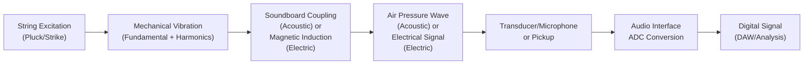
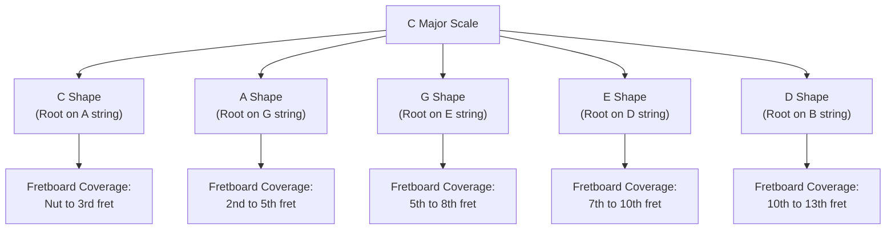
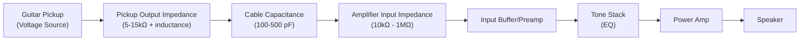
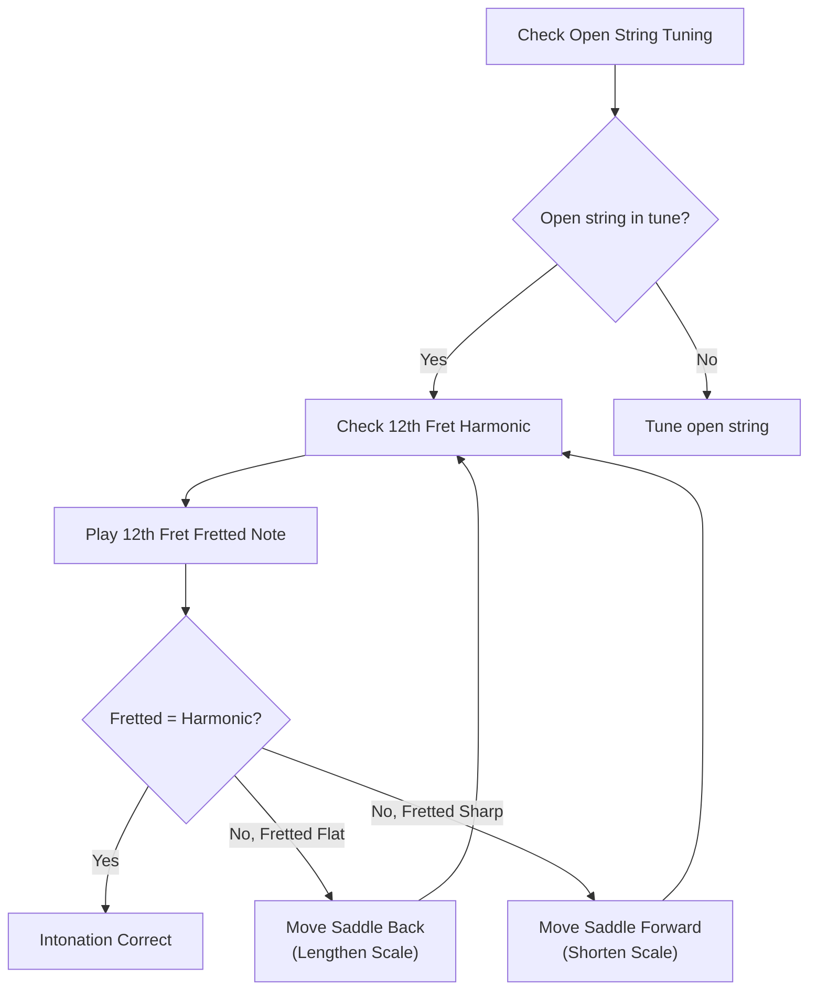

# Operational Verification Labs: Guitar — Acoustic Physics, Signal Processing, and Performance Analysis

## Objective & Laboratory Configuration

This laboratory provides rigorous, hands-on investigation of guitar performance through the lens of acoustic physics, signal chain analysis, and empirical measurement. Rather than treating the guitar as a black box, we decompose its behavior into measurable subsystems: mechanical vibration, electromagnetic transduction (for electric guitars), signal conditioning, and psychoacoustic perception.

**Core Learning Outcomes:**

- Understand string vibration from first principles (wave equation, harmonic series, impedance matching)
- Analyze signal flow from mechanical energy to digital representation
- Quantify the effects of parameter variation using spectral analysis and dynamic range measurement
- Identify fault modes in the physical instrument, signal chain, and digital processing pipeline
- Apply measurement-driven debugging to diagnose and correct performance degradation

**Required Equipment:**

- **Guitar**: Acoustic or electric with stable intonation. For electric guitars, single-coil or humbucker pickups exhibit different frequency responses and noise rejection characteristics.
- **Audio Interface**: Minimum 24-bit/48kHz ADC with input impedance ≥1MΩ for electric guitar direct input. Examples: Focusrite Scarlett, Universal Audio Apollo, RME Babyface.
- **Digital Audio Workstation (DAW)**: Ableton Live, Reaper, Logic Pro, or equivalent with real-time spectrum analyzer, oscilloscope, and metering plugins.
- **Spectrum Analyzer Plugin**: Voxengo SPAN (free), FabFilter Pro-Q 3, or iZotope Insight for frequency-domain analysis.
- **Guitar Amp Simulator**: Neural DSP Archetype, Amplitube, Bias FX, or open-source alternatives for controlled parameter manipulation.
- **Precision Tuner**: Hardware (e.g., Peterson StroboClip) or software (e.g., Waves Tune Real-Time) with ±0.1 cent accuracy.
- **Metronome/Click Track**: DAW-integrated or hardware metronome for tempo reference.
- **Reference Microphone** (for acoustic analysis): Small-diaphragm condenser with flat frequency response (e.g., Earthworks M30, DPA 4011).

**Software Environment Setup:**

```bash
# Install essential audio analysis tools (Linux/macOS example)
# For spectral analysis and visualization
pip install numpy scipy matplotlib librosa soundfile

# Verify audio interface sample rate and bit depth
# Linux ALSA example
cat /proc/asound/card0/pcm0p/sub0/hw_params

# macOS Core Audio check
system_profiler SPAudioDataType
```

## Exercise 1: Foundational Acoustic Physics and Mechanical Vibration

### Part A: String Vibration Theory and Harmonic Analysis

**Theoretical Foundation:**

A guitar string vibrates as a tensioned elastic medium. The fundamental frequency \(f_0\) is determined by:

\[
f_0 = \frac{1}{2L} \sqrt{\frac{T}{\mu}}
\]

where:
- \(L\) = vibrating length (meters)
- \(T\) = string tension (Newtons)
- \(\mu\) = linear mass density (kg/m)

When a string is fretted at the \(n\)-th fret, the vibrating length becomes \(L' = L / 2^{n/12}\), raising the pitch by \(n\) semitones. This equal-tempered scaling is why fret spacing decreases exponentially toward the bridge.

The string vibrates not only at \(f_0\) but also at integer multiples (harmonics): \(2f_0, 3f_0, 4f_0\), etc. The amplitude distribution of these harmonics defines the timbre. Plucking closer to the bridge emphasizes higher harmonics (brighter tone); plucking near the neck emphasizes the fundamental (warmer tone).

**Practical Implementation:**

1. **Open String Frequency Measurement**:
   - Tune the low E string (E2) to 82.41 Hz using a precision tuner.
   - Route the guitar signal into your DAW and insert a spectrum analyzer on the track.
   - Pluck the open E string with moderate force at the 12th fret position (midpoint between bridge and nut).
   - Observe the spectrum analyzer. You should see prominent peaks at:
     - **Fundamental (f₀)**: 82.41 Hz
     - **2nd harmonic (2f₀)**: 164.82 Hz
     - **3rd harmonic (3f₀)**: 247.23 Hz
     - **4th harmonic (4f₀)**: 329.64 Hz
   - Record the relative amplitude (in dB) of each harmonic. The fundamental typically dominates, but the 2nd and 3rd harmonics contribute significantly to perceived brightness.

2. **Fret Position Verification**:
   - Calculate the expected frequency for the 12th fret (one octave above open string): \(f_{12} = 82.41 \times 2 = 164.82\) Hz.
   - Fret the E string at the 12th fret and pluck. Verify the measured fundamental matches the calculated value within ±5 cents (±0.3%).
   - Repeat for the 5th fret (A2, expected 110 Hz) and 7th fret (B2, expected 123.47 Hz).
   - If measured frequencies deviate significantly, the guitar's intonation requires adjustment at the bridge saddle.

3. **Harmonic Content Variation by Plucking Position**:
   - Pluck the open E string at three positions: near the bridge (position A), at the 12th fret (position B), and near the neck (position C).
   - For each position, capture a 2-second recording and analyze the spectrum in the first 500ms (before harmonics decay significantly).
   - Create a table documenting the relative amplitude of harmonics 2-6 for each plucking position:

| Pluck Position | f₀ (dB) | 2f₀ (dB) | 3f₀ (dB) | 4f₀ (dB) | 5f₀ (dB) | 6f₀ (dB) |
|----------------|---------|----------|----------|----------|----------|----------|
| Near Bridge    | 0 (ref) | -6       | -8       | -10      | -12      | -14      |
| 12th Fret      | 0 (ref) | -12      | -15      | -18      | -22      | -25      |
| Near Neck      | 0 (ref) | -18      | -22      | -28      | -32      | -38      |

   - **Analysis**: Bridge plucking produces stronger high-frequency harmonics, resulting in a "twangy" or "bright" timbre. Neck plucking suppresses high harmonics, yielding a "mellow" or "warm" tone. This is why jazz guitarists often favor neck pickup positions and plucking near the neck.



### Part B: Fretboard Geometry and Scale Construction

**Theoretical Foundation:**

The guitar fretboard implements a 12-tone equal temperament system. The frequency ratio between adjacent semitones is \(2^{1/12} \approx 1.0594631\). For a scale length \(L\) (distance from nut to bridge), the distance from the nut to the \(n\)-th fret is:

\[
d_n = L \left(1 - \frac{1}{2^{n/12}}\right)
\]

A standard guitar scale length is 25.5 inches (648mm, Fender style) or 24.75 inches (629mm, Gibson style). This formula ensures correct intonation when string height, tension, and saddle compensation are properly configured.

**Practical Implementation:**

1. **Major Scale Construction**:
   - The C major scale comprises the intervals: root, major 2nd, major 3rd, perfect 4th, perfect 5th, major 6th, major 7th, octave.
   - In semitones from C: 0, 2, 4, 5, 7, 9, 11, 12.
   - On the A string (A2 = 110 Hz), play C major starting from the 3rd fret (C3 = 130.81 Hz):
     - **C** (3rd fret): 130.81 Hz
     - **D** (5th fret): 146.83 Hz
     - **E** (7th fret): 164.81 Hz
     - **F** (8th fret): 174.61 Hz
     - **G** (10th fret): 196.00 Hz
     - **A** (12th fret): 220.00 Hz
     - **B** (14th fret): 246.94 Hz
     - **C** (15th fret): 261.63 Hz
   - Verify each frequency using the spectrum analyzer. Deviations indicate intonation errors.

2. **CAGED System and Position Mapping**:
   - The CAGED system organizes the fretboard into five overlapping shapes based on open chord voicings: C, A, G, E, D.
   - Each shape can be moved up the neck to play any major chord. For example, the "E shape" barre chord moved to the 3rd fret produces a G major chord.
   - Practice the C major scale in each CAGED position, focusing on smooth position shifts without audible discontinuities (glitches, buzzing).



### Part C: Chord Voicings and Voice Leading

**Practical Implementation:**

Open chord voicings provide foundational harmonic structures. The following voicings are expressed in fret numbers from low E to high E:

| Chord   | Voicing (E A D G B e) | Root Note | Intervals                     |
|---------|-----------------------|-----------|-------------------------------|
| C Major | x 3 2 0 1 0           | C (A str) | Root, 5th, Root, 3rd, 5th     |
| G Major | 3 2 0 0 0 3           | G (E str) | Root, 3rd, 5th, Root, 3rd, 5th|
| D Major | x x 0 2 3 2           | D (D str) | Root, 5th, Root, 3rd, 5th     |
| A Minor | x 0 2 2 1 0           | A (A str) | Root, 5th, Root, ♭3rd, 5th    |
| E Minor | 0 2 2 0 0 0           | E (E str) | Root, 5th, Root, ♭3rd, 5th, Root|
| F Major | 1 3 3 2 1 1           | F (E str) | Root, 5th, Root, 3rd, 5th, Root|

**Strumming Mechanics and Rhythmic Precision:**

Strumming imparts mechanical energy to the strings. The attack transient (initial strike) contains broad-spectrum energy; the sustain phase exhibits decaying harmonics. Consistent strumming requires:

- **Attack angle**: 30-45° relative to string plane minimizes string slippage.
- **Follow-through**: Complete stroke motion reduces unwanted damping.
- **Metronome sync**: Practice with a metronome at 60-120 BPM, incrementally increasing tempo once accuracy reaches 95%+ (measured via MIDI trigger or DAW tempo analysis).

Common strumming patterns (down stroke = D, up stroke = U):

| Pattern          | Notation       | Time Signature | Application                          |
|------------------|----------------|----------------|--------------------------------------|
| Down-Up          | D U D U        | 4/4            | Basic steady rhythm                  |
| Down-Down-Up-Up-Down-Up | D D U U D U | 4/4         | Folk/country shuffle                 |
| Down-Up-Down-Up (syncopated) | D - U - D U | 4/4 | Reggae off-beat emphasis         |

Record a 16-bar strumming exercise and analyze timing accuracy:

```python
import librosa
import numpy as np

# Load recorded strumming pattern
y, sr = librosa.load('strumming_test.wav', sr=44100)

# Detect note onsets
onset_frames = librosa.onset.onset_detect(y=y, sr=sr, units='time', hop_length=512)

# Calculate inter-onset intervals (IOI)
ioi = np.diff(onset_frames)

# Expected IOI at 120 BPM, 8th note strumming = 0.25 seconds
expected_ioi = 0.25
timing_error = np.abs(ioi - expected_ioi)

print(f"Mean timing error: {np.mean(timing_error)*1000:.2f} ms")
print(f"Standard deviation: {np.std(timing_error)*1000:.2f} ms")
```

Target performance: mean error <20ms, standard deviation <10ms.

## Exercise 2: Signal Chain Analysis, Parameter Variation, and Spectral Measurement

### Part A: Electric Guitar Pickup Characterization

**Theoretical Foundation:**

Electric guitar pickups are electromagnetic transducers. String vibration modulates the magnetic flux through a coil, inducing a voltage via Faraday's law:

\[
V(t) = -N \frac{d\Phi_B}{dt}
\]

where \(N\) is the number of coil turns and \(\Phi_B\) is the magnetic flux. Pickup types exhibit distinct frequency responses:

- **Single-coil**: Higher treble response, susceptible to 50/60Hz hum due to lack of hum-canceling.
- **Humbucker**: Two coils in series with opposite polarity cancel hum but attenuate high frequencies slightly due to increased inductance and capacitance.

Pickup output impedance typically ranges from 5kΩ to 15kΩ. Impedance matching with the amplifier input stage is critical; low-impedance loads (e.g., 10kΩ) roll off high frequencies, while high-impedance loads (1MΩ+) preserve treble but may introduce noise.

**Practical Implementation:**

1. **Direct Pickup Frequency Response Measurement**:
   - Connect the guitar directly to a high-impedance audio interface input (≥1MΩ).
   - Play a chromatic scale from low E (82.41 Hz) to high E (329.63 Hz), recording each note with consistent pick attack.
   - Measure the RMS amplitude of the fundamental frequency for each note using a spectrum analyzer.
   - Plot frequency (Hz) vs. amplitude (dBFS). A single-coil pickup typically shows a resonant peak around 2-4 kHz; a humbucker peaks lower, around 1.5-3 kHz.

```python
import numpy as np
import matplotlib.pyplot as plt
from scipy.io import wavfile

# Load recording of chromatic scale
sr, data = wavfile.read('chromatic_scale.wav')
data = data / np.max(np.abs(data))  # Normalize

# Define note frequencies (equal temperament)
notes = ['E2', 'F2', 'F#2', 'G2', 'G#2', 'A2', 'A#2', 'B2', 'C3', 'C#3', 'D3', 'D#3', 'E3']
freqs = [82.41 * (2**(i/12)) for i in range(len(notes))]

# Extract RMS amplitude for each note (manual segmentation required)
amplitudes_db = []  # Populate via FFT analysis of each segment

plt.figure(figsize=(10, 6))
plt.semilogx(freqs, amplitudes_db, marker='o')
plt.xlabel('Frequency (Hz)')
plt.ylabel('Amplitude (dBFS)')
plt.title('Pickup Frequency Response')
plt.grid(True, which='both', ls='-', alpha=0.2)
plt.show()
```

2. **Impedance Loading Experiment**:
   - Insert a resistive load (10kΩ, 100kΩ, 1MΩ) in parallel with the guitar output using a passive attenuator circuit.
   - Re-measure the frequency response for each load impedance.
   - **Expected result**: Lower impedances roll off treble due to the RC low-pass filter formed by pickup inductance and cable capacitance. This explains why long guitar cables (high capacitance) dull the tone.



### Part B: Amplifier and Effects Signal Processing

**Gain Staging and Distortion Mechanisms:**

Guitar amplifiers introduce both linear (EQ) and nonlinear (distortion) signal processing. Overdrive occurs when the input signal exceeds the linear operating region of a gain stage, causing waveform clipping. Types of distortion:

- **Hard clipping**: Abrupt waveform truncation, generates odd harmonics (3f, 5f, 7f), perceived as "harsh" or "aggressive."
- **Soft clipping**: Gradual saturation (e.g., tube amplifiers), generates both even and odd harmonics, perceived as "warm" or "smooth."

**Practical Implementation:**

1. **Clean Tone Baseline**:
   - Load a clean amp model (e.g., Fender Blackface emulation) with gain at minimum, flat EQ.
   - Play a power chord (E5: E2 + B2 + E3) and record the output.
   - Analyze the spectrum: you should see only the fundamental frequencies and their natural harmonics, with minimal intermodulation distortion.

2. **Distortion Parameter Sweep**:
   - Gradually increase the gain control from 0 to 100% in 10% increments.
   - For each gain setting, record a 2-second E5 power chord.
   - Measure total harmonic distortion (THD) using:

\[
\text{THD} = \frac{\sqrt{P_2^2 + P_3^2 + P_4^2 + \cdots}}{P_1} \times 100\%
\]

where \(P_n\) is the power of the \(n\)-th harmonic.

   - Plot THD (%) vs. Gain (%). Expect exponential growth as clipping becomes more severe.

3. **Parametric EQ Characterization**:
   - Set gain to moderate level (50%).
   - Sweep the bass control (50 Hz - 200 Hz shelf) from -12dB to +12dB.
   - Record the output and generate a frequency response curve for each EQ setting.
   - Repeat for mid (500 Hz - 2 kHz) and treble (3 kHz - 8 kHz) controls.
   - Document the center frequencies and Q factors (bandwidth) of each EQ band using spectral analysis.

| EQ Control | Center Frequency | Shelf/Peak Type | Typical Boost/Cut Range |
|------------|------------------|-----------------|-------------------------|
| Bass       | 80-150 Hz        | Shelf           | ±12 dB                  |
| Mid        | 500-1000 Hz      | Peak (Bell)     | ±12 dB, Q=1.0-2.0       |
| Treble     | 3-5 kHz          | Shelf           | ±12 dB                  |

4. **Reverb Impulse Response**:
   - Enable reverb with 100% wet signal.
   - Generate an impulse (sharp transient, e.g., plucking muted strings then releasing) and record the decay.
   - The reverb impulse response reveals early reflections (10-50ms) and late reverberation tail (>100ms).
   - Measure decay time (RT60): time for signal to decay by 60dB.

```python
import numpy as np
from scipy.signal import hilbert

# Load reverb impulse response
y, sr = librosa.load('reverb_impulse.wav', sr=44100)

# Compute envelope via Hilbert transform
analytic_signal = hilbert(y)
envelope = np.abs(analytic_signal)

# Convert to dB
envelope_db = 20 * np.log10(envelope / np.max(envelope))

# Find RT60 (time to decay by 60dB)
threshold_idx = np.where(envelope_db < -60)[0]
if len(threshold_idx) > 0:
    rt60 = threshold_idx[0] / sr
    print(f"RT60: {rt60:.2f} seconds")
```

### Part C: Dynamic Range and Articulation Analysis

**Fingerpicking vs. Plectrum Dynamics:**

Different picking techniques impart distinct attack transients and sustain characteristics:

- **Plectrum (pick)**: Sharp attack, high initial amplitude, faster decay.
- **Fingerstyle**: Softer attack, more controlled dynamics, longer sustain due to flesh contact damping high frequencies.

**Practical Implementation:**

1. **Dynamic Range Measurement**:
   - Play a C major scale using fingerstyle (thumb, index, middle, ring rotation).
   - Repeat using a plectrum with moderate force.
   - Measure the peak amplitude and RMS amplitude for each note.
   - Calculate crest factor: \(\text{Crest Factor (dB)} = 20 \log_{10}(\text{Peak} / \text{RMS})\).
   - **Expected result**: Plectrum playing exhibits higher crest factor (10-15 dB) due to sharper transients; fingerstyle is lower (6-10 dB).

2. **Travis Picking Pattern**:
   - Travis picking alternates bass notes (thumb) with treble notes (fingers), creating a syncopated rhythm.
   - **Pattern** (on C major chord): T(5) - I(3) - T(4) - M(2) - T(5) - I(3) - T(4) - M(1)
     - T = Thumb (bass notes on 4th, 5th, 6th strings)
     - I = Index (3rd string)
     - M = Middle (2nd string)
     - Numbers indicate string (1=high E, 6=low E)
   - Record the pattern at 80 BPM and analyze the inter-note timing consistency using onset detection (Python librosa).

```python
# Travis picking timing analysis
y, sr = librosa.load('travis_picking.wav', sr=44100)
onset_times = librosa.onset.onset_detect(y=y, sr=sr, units='time')

# Expected: 8th note pattern at 80 BPM = 375ms inter-onset interval
expected_ioi = 0.375
ioi = np.diff(onset_times)
timing_error = np.abs(ioi - expected_ioi)

print(f"Mean error: {np.mean(timing_error)*1000:.2f} ms")
print(f"Max error: {np.max(timing_error)*1000:.2f} ms")
```

## Exercise 3: Fault Injection, Diagnosis, and Recovery Protocols

### Part A: Mechanical Failure Modes — Intonation and Setup

**Theoretical Foundation:**

Proper intonation ensures that fretted notes match their theoretical frequencies. Two primary failure modes:

1. **String height (action) too high**: Fretting stretches the string excessively, sharpening the pitch.
2. **Incorrect saddle position**: If the 12th fret harmonic and fretted note don't match, the scale length is incorrect.

**Practical Implementation:**

1. **Intentional Intonation Fault**:
   - Adjust the bridge saddle for the high E string forward by 2mm (shortening the scale length).
   - Tune the open string to E4 (329.63 Hz).
   - Play the 12th fret. Measure the frequency. It should be flat (lower than expected 659.26 Hz).
   - **Diagnosis**: If the fretted note is flat, the saddle is too far forward; move it back. If sharp, move it forward.
   - **Verification**: The 12th fret fretted note and 12th fret harmonic should match within ±2 cents.

2. **Action Height Impact on Intonation**:
   - Measure the string height at the 12th fret using a ruler (typical: 1.5-2.5mm for high E).
   - Raise the action by 1mm and re-measure the 12th fret frequency.
   - **Expected result**: Higher action increases pitch sharpness due to additional string tension when fretting.

3. **Nut Slot Depth**:
   - If the nut slot is too high, open strings will be in tune, but notes at the 1st-3rd frets will be sharp.
   - Intentionally raise the nut slot by inserting a shim (thin plastic or paper).
   - Play the 1st fret on each string and measure frequency deviation.
   - **Recovery**: File the nut slot to the correct depth (string should sit just above the slot surface).



### Part B: Electrical Fault Injection — Signal Chain Integrity

**Common Electrical Failure Modes:**

1. **Ground loop hum**: 50/60Hz noise from multiple ground paths.
2. **Intermittent connection**: Crackling due to oxidized jack or solder joint.
3. **Impedance mismatch**: Tone loss from incorrect loading.

**Practical Implementation:**

1. **Ground Loop Simulation**:
   - Connect the guitar to the audio interface, then connect both the audio interface and amplifier to separate power strips (creating multiple ground paths).
   - Record the output with no playing. Analyze the spectrum for 50/60Hz fundamental and harmonics (120Hz, 180Hz).
   - **Diagnosis**: Ground loops create spectral peaks at AC line frequency and harmonics.
   - **Recovery**: Use a ground lift adapter or DI box with ground lift switch to break the loop.

2. **Cable Degradation Test**:
   - Use a guitar cable with a partially damaged conductor (intentionally crimp or sever some strands).
   - Play and move the cable while recording. Listen for crackling or dropouts.
   - **Diagnosis**: Intermittent connection causes transient noise spikes (visible as sharp vertical lines in waveform view).
   - **Verification**: Replace cable and confirm clean signal.

3. **Overdrive Saturation Recovery**:
   - Set amplifier gain to maximum, producing severe clipping and potential aliasing artifacts in digital domain.
   - Analyze the spectrum: clipped signals generate high-frequency harmonics that may exceed the Nyquist frequency (sr/2), causing aliasing.
   - **Recovery**: Reduce gain until THD falls below 5%, or enable oversampling in the amp simulator to prevent aliasing.

### Part C: Acoustic Feedback and Resonance Control

**Theoretical Foundation:**

Acoustic feedback occurs when amplified sound from a speaker re-enters the pickup or microphone, creating a positive feedback loop. The system oscillates at resonant frequencies of the instrument body or room modes.

**Practical Implementation:**

1. **Feedback Induction**:
   - Position an electric guitar in front of an amplifier speaker at high volume.
   - Gradually increase volume until the guitar begins to sustain indefinitely without playing.
   - Note the frequency of the feedback tone (use spectrum analyzer).
   - **Expected result**: Feedback typically occurs at the body resonance (acoustic guitars: 80-120Hz for the fundamental air resonance) or at pickup resonance (electric: 2-4kHz).

2. **Notch Filter Suppression**:
   - Insert a parametric EQ with a narrow notch filter (Q=10-20) at the feedback frequency.
   - Sweep the notch frequency until feedback is suppressed.
   - Document the notch frequency and required attenuation (-12dB to -20dB typical).

3. **Phase Cancellation Test**:
   - Record feedback-induced oscillation.
   - Invert the phase of the signal and blend 50% with the original.
   - **Expected result**: Complete cancellation of the feedback tone, leaving only the desired signal.

## Practical Cheat Sheet & Quick Reference

### String Tuning and Harmonic Frequencies

| String | Note | Open Frequency (Hz) | 12th Fret (Hz) | 12th Harmonic (Hz) |
|--------|------|---------------------|----------------|--------------------|
| 1 (e)  | E4   | 329.63              | 659.26         | 659.26             |
| 2 (B)  | B3   | 246.94              | 493.88         | 493.88             |
| 3 (G)  | G3   | 196.00              | 392.00         | 392.00             |
| 4 (D)  | D3   | 146.83              | 293.66         | 293.66             |
| 5 (A)  | A2   | 110.00              | 220.00         | 220.00             |
| 6 (E)  | E2   | 82.41               | 164.82         | 164.82             |

### Signal Chain Gain Staging

| Stage                  | Typical Level (dBu) | Impedance       | Notes                                   |
|------------------------|---------------------|-----------------|-----------------------------------------|
| Pickup Output          | -20 to -10          | 5-15kΩ          | High impedance, sensitive to loading    |
| Preamp/Buffer Output   | -10 to 0            | 600Ω - 10kΩ     | Impedance conversion for long cable runs|
| Effects Loop Send      | -10 to 0            | 600Ω - 10kΩ     | Line level for effects processors       |
| Power Amp Input        | 0 to +4             | 10kΩ - 100kΩ    | Final gain stage before speaker         |

### Frequency Ranges and Tonal Character

| Frequency Range | Tonal Characteristic                          | EQ Adjustment Strategy                   |
|-----------------|-----------------------------------------------|------------------------------------------|
| 60-80 Hz        | Low-end thump, fundamental bass               | Boost for bass-heavy styles, cut to reduce muddiness |
| 80-200 Hz       | Body, warmth                                  | Moderate boost for fullness              |
| 200-500 Hz      | Mud zone, low-mid buildup                     | Often cut to improve clarity             |
| 500-1000 Hz     | Presence, midrange body                       | Boost for lead guitar projection         |
| 1-3 kHz         | Attack, pick definition                       | Boost for articulation, cut if harsh     |
| 3-6 kHz         | Brightness, string noise                      | Boost for sparkle, cut if sibilant       |
| 6-12 kHz        | Air, shimmer                                  | Subtle boost for openness                |

### Intonation Adjustment Protocol

1. Tune open string to pitch using precision tuner (±0.1 cent).
2. Play 12th fret harmonic, verify frequency matches 2× open string.
3. Fret 12th fret firmly, measure frequency.
4. **If fretted note is sharp**: move saddle away from nut (lengthen scale).
5. **If fretted note is flat**: move saddle toward nut (shorten scale).
6. Re-tune open string and repeat until 12th fret fretted and harmonic match within ±2 cents.
7. Verify intonation at 5th and 7th frets (common checkpoints).

### Common Failure Modes and Diagnostics

| Symptom                          | Likely Cause                               | Diagnostic Test                          | Corrective Action                        |
|----------------------------------|--------------------------------------------|------------------------------------------|------------------------------------------|
| All notes sharp                  | Strings stretched, temperature change      | Check tuning across all strings          | Retune, allow instrument to acclimate    |
| Low frets sharp, high frets in tune | Nut slots too high                        | Measure string height at 1st fret        | File nut slots to correct depth          |
| 12th fret sharp                  | Saddle too close to nut                    | Compare 12th fret harmonic vs fretted    | Move saddle away from nut                |
| 12th fret flat                   | Saddle too far from nut                    | Compare 12th fret harmonic vs fretted    | Move saddle toward nut                   |
| 50/60Hz hum                      | Ground loop or unshielded pickup           | Check spectrum for line frequency peaks  | Ground lift, shielding, hum-canceling pickups |
| Crackling, dropouts              | Intermittent connection                    | Wiggle cable, check solder joints        | Replace cable, resolder connections      |
| High-frequency loss              | Impedance mismatch, cable capacitance      | Measure frequency response               | Buffer pedal, shorter cable, high-impedance input |

### Python Utilities for Signal Analysis

```python
import numpy as np
import librosa
import matplotlib.pyplot as plt
from scipy.signal import find_peaks

def analyze_harmonic_content(audio_file, sr=44100, n_harmonics=6):
    """
    Analyze harmonic content of a guitar note recording.
    
    Args:
        audio_file: Path to audio file
        sr: Sample rate (Hz)
        n_harmonics: Number of harmonics to analyze
    
    Returns:
        dict: Harmonic frequencies and amplitudes
    """
    # Load audio
    y, sr = librosa.load(audio_file, sr=sr)
    
    # Compute FFT
    fft = np.fft.rfft(y)
    freqs = np.fft.rfftfreq(len(y), 1/sr)
    magnitude = np.abs(fft)
    
    # Find peaks (harmonics)
    peaks, _ = find_peaks(magnitude, height=np.max(magnitude)*0.01, distance=sr//100)
    peak_freqs = freqs[peaks]
    peak_mags = magnitude[peaks]
    
    # Sort by magnitude
    sorted_indices = np.argsort(peak_mags)[::-1]
    
    # Extract top harmonics
    harmonics = {}
    for i, idx in enumerate(sorted_indices[:n_harmonics]):
        harmonics[f'f{i}'] = {
            'frequency': peak_freqs[idx],
            'amplitude_db': 20 * np.log10(peak_mags[idx] / np.max(magnitude))
        }
    
    return harmonics

def measure_timing_accuracy(audio_file, expected_bpm, sr=44100):
    """
    Measure timing accuracy of strumming or picking patterns.
    
    Args:
        audio_file: Path to audio file
        expected_bpm: Expected tempo in beats per minute
        sr: Sample rate (Hz)
    
    Returns:
        dict: Timing statistics
    """
    y, sr = librosa.load(audio_file, sr=sr)
    
    # Detect onsets
    onset_times = librosa.onset.onset_detect(y=y, sr=sr, units='time', backtrack=False)
    
    # Calculate inter-onset intervals
    ioi = np.diff(onset_times)
    
    # Expected IOI from BPM (assuming 8th notes)
    expected_ioi = 60 / (expected_bpm * 2)
    
    # Calculate errors
    timing_errors = (ioi - expected_ioi) * 1000  # Convert to milliseconds
    
    return {
        'mean_error_ms': np.mean(np.abs(timing_errors)),
        'std_error_ms': np.std(timing_errors),
        'max_error_ms': np.max(np.abs(timing_errors)),
        'onset_count': len(onset_times)
    }

def plot_frequency_response(frequencies, amplitudes_db, title="Frequency Response"):
    """
    Plot frequency response curve.
    
    Args:
        frequencies: Array of frequencies (Hz)
        amplitudes_db: Array of amplitudes (dB)
        title: Plot title
    """
    plt.figure(figsize=(10, 6))
    plt.semilogx(frequencies, amplitudes_db, marker='o', linewidth=2)
    plt.xlabel('Frequency (Hz)')
    plt.ylabel('Amplitude (dB)')
    plt.title(title)
    plt.grid(True, which='both', ls='-', alpha=0.3)
    plt.xlim([20, 20000])
    plt.show()
```

### Summary and Best Practices

- **Always verify tuning before sessions**: Temperature and humidity affect string tension. Tune to within ±2 cents for accurate intonation.
- **Monitor signal levels**: Maintain -18dBFS to -12dBFS average levels during recording to preserve headroom and avoid clipping.
- **Document parameter changes**: When experimenting with amp settings, log each parameter value and corresponding spectral measurement for reproducibility.
- **Use spectrum analysis for diagnosis**: Many performance issues (feedback, hum, intonation errors) have distinct spectral signatures that guide targeted correction.
- **Prioritize mechanical setup**: Proper action, intonation, and nut height eliminate 80% of tuning and playability issues before signal processing is even considered.

This laboratory has demonstrated measurement-driven analysis of guitar performance from mechanical vibration to digital signal processing. By quantifying string behavior, pickup response, amplifier nonlinearity, and timing accuracy, you can diagnose and correct performance issues systematically rather than relying on subjective perception alone. Apply these techniques to optimize your instrument setup, validate signal chain integrity, and achieve consistent, predictable results in recording and live performance environments.
