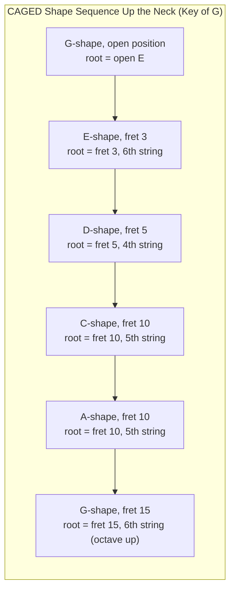
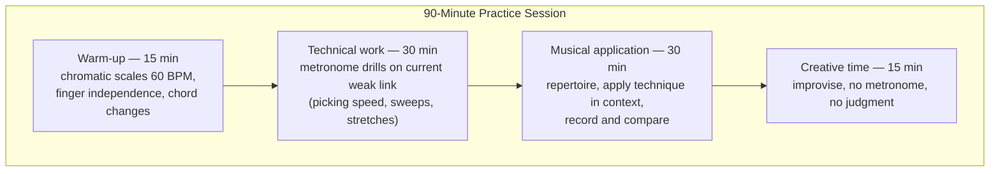

# Guitar Masterclass: Fretboard Mechanics, Right/Left Hand Technique, and Performance Engineering

## 1. How the Guitar Makes Sound (Just Enough Physics to Use It)

A plucked string vibrates at a fundamental frequency set by length, tension, and mass, plus a stack of harmonics above it (2×, 3×, 4× the fundamental). Fretting shortens the string, which raises pitch. The 12th fret is the exact halfway point of the scale length — pressing there produces the octave. This is the one piece of physics you need to internalize, because it governs intonation, fret spacing, and why plucking position changes tone. Everything else in this section is applied, not derived.

**Plucking position controls timbre by filtering harmonics.** Where you pick suppresses whichever harmonic has a node at that point. You don't need the math — you need the ear and hand result:

- **Near the bridge** (ponticello): bright, nasal, cutting. Flamenco rasgueado, metal palm-mute zone.
- **Over the soundhole/pickup**: balanced, the "default" tone.
- **Near the neck** (tasto): warm, flutey, fewer highs. Jazz and lyrical passages.
- **Directly over the 12th fret**: hollow, woody — kills the octave harmonic.

**Drill (2 minutes):** Pick the open low E repeatedly, sliding your picking hand slowly from the bridge to over the 12th fret and back. Keep dynamics constant. Listen only to brightness changing. This is the move you'll make mid-phrase on records to add or remove edge from a note — do it consciously once, then it becomes an instinctive color choice.

**Why intonation adjustments exist:** fretting a string stretches it slightly, sharpening the pitch a few cents. Saddle compensation (moving the saddle a millimeter or two back from the theoretical scale length) corrects this per string. You'll use this directly in Section 6.

---

## 2. Instrument Setup Baseline (Do This Before Anything Else)

You cannot build clean technique on a guitar that fights you. Spend 20 minutes on this checklist before starting any practice plan below.

### 2.1 Action measurement and targets

Measure string height at the 12th fret, string to top of fret, with a precision ruler or feeler gauge.

| Action | High E | Low E | Use case |
|---|---|---|---|
| Low | 1.5 mm | 2.0 mm | Shred, fast legato, light touch |
| Medium | 2.0 mm | 2.5 mm | All-around, most players start here |
| High | 2.5 mm | 3.5 mm | Slide, heavy strumming, bluegrass flatpicking |

**Adjustment, electric (bridge saddle screws):** turn clockwise to lower, counter-clockwise to raise, in quarter-turn increments per saddle. Recheck after every adjustment — don't stack more than two turns before measuring.

**Adjustment, acoustic (bridge saddle):** action change here means removing the saddle and sanding its base flat and even. Removing 0.3 mm of material from the bottom lowers 12th-fret action by roughly 0.3 mm (1:1, unlike the nut). Sand on 220-grit paper on a flat surface, check level with a straightedge across the saddle top, test-fit frequently. This is irreversible in one direction — work in small passes.

### 2.2 Neck relief (truss rod)

Relief is the slight forward bow that keeps strings from buzzing against the fretboard under pick attack in the lower-middle frets.

**Check:** Capo the 1st fret. Fret the high E at the 15th fret with your other hand. Look at the gap between the string and the 7th fret.

- Target gap: 0.25–0.38 mm (a business card is about 0.3 mm — use one as a quick field gauge).
- Gap too big → neck is too bowed → tighten truss rod (clockwise) 1/4 turn.
- Gap near zero or string touches fret → neck too straight/back-bowed → loosen (counter-clockwise) 1/4 turn.

**Rules:** detune strings slightly before adjusting, move in 1/4-turn steps only, wait 15–30 minutes for the wood/metal to settle before rechecking, never force a stuck nut — stop and see a tech.

### 2.3 Intonation

**Check:** tune the open string accurately. Play the 12th-fret harmonic (touch lightly over the fret wire, pluck, lift finger). Compare to the fretted 12th-fret note on a tuner.

- Fretted note sharp vs. harmonic → saddle too far forward → move it back, away from the neck (lengthen the string).
- Fretted note flat → move saddle forward, toward the neck (shorten the string).

Wound strings (low E, A, D, usually G) need more backward compensation than plain strings because they sharpen more when fretted — expect 2.5–3.5 mm of saddle offset versus 2.0 mm on the plain high E and B.

### 2.4 Buzz diagnostic table

| Symptom | Likely cause | Fix |
|---|---|---|
| Buzzes on open strings only | Nut slots cut too low | Shim or replace nut |
| Buzzes frets 1–5 | Not enough relief | Loosen truss rod 1/4 turn |
| Buzzes frets 7–12 specifically | Flat/high spot in neck or a raised fret | Check relief first, then suspect frets needing level |
| Buzzes above 12th fret only | Too much relief or neck heel angle | Tighten truss rod; if unresolved, see a tech about neck angle/fret level |

Do this setup pass monthly if you practice daily, or any time string gauge changes — different tension reshapes the neck.

---

## 3. Left-Hand Mechanics: Posture, Force, and the Fretboard Map

### 3.1 Hand posture (get this right before any speed work)

- **Thumb:** resting on the back of the neck, roughly opposite your middle finger, not wrapped over the top (except for intentional muting/bass-note grabs, covered below). The thumb is a brace, not a clamp — squeezing harder doesn't help your fretting finger, it just tires your forearm.
- **Wrist:** straight, not cocked back sharply. A broken wrist angle under repetitive fretting is the single biggest cause of tendon strain in self-taught players.
- **Fingers:** curved, approaching the string close to perpendicular, contacting with the fingertip, not the pad. Fingertip contact gives a smaller, more precise pressure point and keeps adjacent strings from being muted by accident.
- **Fret placement:** press just behind the fret wire (1–2 mm toward the headstock from it), not in the middle of the fret space. Right behind the fret, the string needs the least force to stop a clean buzz-free note — you're using the fret itself as the stopping edge.

**Required pressure is low.** On a well-set-up guitar you need roughly 0.5–2 N per finger — about the weight of a couple of coins. If your hand aches after ten minutes, you are almost certainly pressing far harder than necessary. Fix: play a note, then consciously back off pressure until it just starts to buzz, then add back the smallest amount that clears it. Repeat on every finger. This recalibrates your "clean note" pressure sense.

### 3.2 Hand-frame positions

In any fixed position, each finger owns one fret, no shifting:

```
5th position:  finger 1 → fret 5
               finger 2 → fret 6
               finger 3 → fret 7
               finger 4 → fret 8
```

**Extension** (reaching finger 1 back a fret, or finger 4 forward a fret) is fine occasionally but shouldn't be your default — repeated extension under tension is a strain risk. If a passage demands constant extension, that's a signal to shift position instead.

**Shifting mechanically:**
1. Pick a guide finger (usually finger 1) to lead the move.
2. Look at the target fret before you move, don't feel around blind.
3. For legato connections, slide the guide finger along the string. For a clean break between phrases, lift and replant.
4. The thumb travels with the hand as one unit — it should never lag behind or anchor you to the old position.

### 3.3 The CAGED system: one shape becomes five

CAGED maps the five open-chord shapes (C, A, G, E, D) as movable templates covering the entire neck. Learn these as *shapes you already know*, just slid up the neck and barred.

**G major, all five CAGED positions, ascending the neck:**

```
G-shape (open, root 6th string open):
e|--3--|
B|--0--|
G|--0--|
D|--0--|
A|--2--|
E|--3--|
Root: open E string

E-shape (barre at fret 3, root 6th string):
e|--3--|
B|--3--|
G|--4--|
D|--5--|
A|--5--|
E|--3--|
Root: 3rd fret, 6th string

D-shape (root 4th string, fret 5):
e|--7--|
B|--8--|
G|--7--|
D|--5--|
A|------
E|------
Root: 5th fret, 4th string (barre not needed, open-style shape)

C-shape (root 5th string, fret 10):
e|---8---|
B|---8---|
G|---9---|
D|--10---|
A|--10---|
E|-------
Root: 10th fret, 5th string

A-shape (root 5th string, fret 10, A-shape fingering):
e|--10--|
B|--12--|
G|--12--|
D|--12--|
A|--10--|
E|------
Root: 10th fret, 5th string
```

Each shape overlaps the next by two or three strings. The chord tones don't change — only the fingering template does.

**Drill (15 min/day):** play G major ascending through G→E→D→C→A→G(octave) shapes, one strum each, let it ring, check for buzz on every string before moving on. Once clean at a crawl, play the sequence in time at 60 BPM, one chord per bar. Change keys weekly — same five shapes, different root.



### 3.4 Thumb-over technique (blues/rock)

Wrapping the thumb over the top edge of the neck to fret or mute the low E is standard in blues/rock rhythm playing (Hendrix-style). It sacrifices classical reach efficiency but lets you grab bass notes while fingers voice chord tones above — essential for solo acoustic blues and funk rhythm comping. Use classical thumb position for scale runs and fast position changes; switch to thumb-over for chord-melody and bass-note muting on the low E/A strings.

---

## 4. Right-Hand Technique: Pick and Fingers

### 4.1 Pick grip and motion

- Grip the pick between thumb pad and the side of the index finger, roughly a 45° angle to the strings.
- Expose 2–3 mm of tip past your fingers. More exposed tip = brighter, sharper attack; less = darker, rounder.
- Motion hierarchy, from large to small: **forearm rotation** (strumming) → **wrist deviation** (the primary engine for single-note alternate picking) → **finger motion** (fine control, rarely the main driver).
- The pick must "escape" the string plane after each stroke — if you feel the pick getting trapped against the next string, your wrist angle is too flat; rotate it slightly.

### 4.2 Alternate picking speed drill

Chromatic exercise, one string, strict down-up alternation:

```
E|--5-6-7-8--5-6-7-8--5-6-7-8--5-6-7-8--|
   ∏ V ∏ V   ∏ V ∏ V   ∏ V ∏ V   ∏ V ∏ V
```

Metronome ladder (16th notes against the click):

| Week | BPM | Notes/min |
|---|---|---|
| 1 | 80 | 320 |
| 2 | 90 | 360 |
| 3 | 100 | 400 |
| 4 | 110 | 440 |
| 5 | 120 | 480 (bluegrass cruising speed) |

**Rule:** only move up a tempo tier after three clean, tension-free repetitions in a row. If tension creeps into your forearm or shoulder, drop 20 BPM immediately and rebuild — speed gained through tension is fake speed that collapses under pressure.

### 4.3 Economy picking (sweeping)

When a passage moves across strings in one direction, sweep the pick through in that direction instead of alternating strictly. Fewer motions, less wasted travel.

**A minor five-string sweep arpeggio:**

```
E|--------------------------------17-|
B|---------------------------17-20---|
G|---------------------17-19---------|
D|--------------17-19----------------|
A|--------17-19-----------------------|
E|--17-20-----------------------------|
   ∏  ∏  ∏  ∏  ∏    V   V   V   V   V
   (sweep down ascending, sweep up descending)
```

**Critical technique points:**
1. Mute each fretted note immediately after it sounds (lift finger pressure right after picking) so notes don't bleed together into mush.
2. Feel the pick rolling through the strings in one continuous arc, not jabbing at each string individually.
3. Start at 40 BPM. Fluid motion first, speed later — sweeping rewards patience and punishes rushing harder than almost any other technique.

**Realistic timeline:** three-string triad sweeps at 60 BPM (months 1–2) → four-string shapes at 80 BPM (months 3–4) → five-string shapes at 100 BPM (months 5–6) → six-string sweeps integrated into solos (months 7–12). This is not a technique that compresses into weeks.

### 4.4 Fingerstyle: rest stroke vs. free stroke

- **Rest stroke (apoyando):** finger plucks through the string and lands resting on the next lower string. Maximum volume and weight — use for melody notes that need to project over accompaniment.
- **Free stroke (tirando):** finger plucks and follows through into open air, not touching the next string. Lighter, used for arpeggios and independent polyphonic lines where you can't afford to dampen an adjacent string.

**p-i-m-a arpeggio pattern (classical basic form):**

```
C major:
e|-----0-------0-----|
B|-------1-------1---|
G|---0-------0-------|
D|--------------------|
A|-3-------3----------|
E|---------------------|
  p   i m a   p i m a
```

Thumb (p) takes the bass note, index (i), middle (m), ring (a) take the top three strings in sequence. Practice at 50 BPM for a full week before increasing tempo — thumb/finger independence breaks down under speed pushed too early.

**Nail care for nail-based tone:** file the nail into a gentle ramp on the string side, polish to 2000-grit or higher (even a glass/crystal nail file works), length 1–2 mm past the fingertip. Test by dragging the nail across a silk scarf or microfiber cloth — it should glide without catching. A catching nail means an audible click on every pluck.

---

## 5. Harmonic Vocabulary You Actually Use on the Neck

### 5.1 Major scale, five positions

C major formula: W-W-H-W-W-W-H. Learn it as five overlapping box shapes so you're never stuck in one patch of the neck.

```
Position I (open):
e|---0---1---3---|
B|---0---1---3---|
G|---0---2-------|
D|---0---2---3---|
A|---0---2---3---|
E|---0---1---3---|

Position II (root area, fret 3):
e|---3---5---7---8---|
B|---3---5---6---8---|
G|---2---4---5-------|
D|---2---3---5-------|
A|---3---5------------|
E|---3---5------------|
```

Continue mapping positions III–V by sliding the same interval skeleton up; each new box starts where the previous one's highest finger left off. **Drill:** one key, all five positions, ascending then descending, 80 BPM eighth notes. Rotate to a new key each week — twelve weeks gets you through every key once.

### 5.2 Modes as color, not just scale spelling

| Mode | Formula vs. major | Character | Where you'll hear/use it |
|---|---|---|---|
| Ionian | 1-2-3-4-5-6-7 | bright | pop, country |
| Dorian | ♭3 ♭7 | minor but open, not sad | funk, Santana, modal jazz |
| Phrygian | ♭2 ♭3 ♭6 ♭7 | dark, Spanish | flamenco, metal |
| Lydian | ♯4 | floating, dreamlike | film score, fusion, Steve Vai |
| Mixolydian | ♭7 | bluesy dominant | blues-rock, Southern rock |
| Aeolian | ♭3 ♭6 ♭7 | natural minor, sad | rock ballads, metal |
| Locrian | ♭2 ♭3 ♭5 ♭6 ♭7 | unstable | rare — avant-garde, some metal |

The move that actually makes modes audible: play the mode over a single-chord drone (loop pedal or backing track holding one chord), and lean hard on the note that differs from the parallel major/minor. For D Dorian over a static Dm chord, that note is B natural (the natural 6th) — hit it on a strong beat and the Dorian color snaps into focus. Without the drone, modes just sound like "the minor scale starting somewhere else" and the ear can't track the difference.

### 5.3 Chords from the scale: triads and 7ths

Triads in C major (stack root-3rd-5th on each scale degree):

| Degree | Chord | Notes | Quality |
|---|---|---|---|
| I | C | C-E-G | major |
| ii | Dm | D-F-A | minor |
| iii | Em | E-G-B | minor |
| IV | F | F-A-C | major |
| V | G | G-B-D | major |
| vi | Am | A-C-E | minor |
| vii° | Bdim | B-D-F | diminished |

Add the 7th (another third stacked on top) for jazz/soul harmony:

| Degree | Chord | Notes |
|---|---|---|
| Imaj7 | Cmaj7 | C-E-G-B |
| ii7 | Dm7 | D-F-A-C |
| V7 | G7 | G-B-D-F |
| vi7 | Am7 | A-C-E-G |

**Progressions worth having under your fingers in every key:**

- I–IV–V–I: `C | F | G | C` — the bedrock rock/blues/folk cadence.
- I–vi–IV–V ("50s progression"): `C | Am | F | G` — doo-wop, "Stand By Me."
- ii–V–I (jazz cadence): `Dm7 | G7 | Cmaj7` — the single most important three-chord unit in jazz vocabulary.

**Drill:** run each progression through all five CAGED positions, picking the closest chord shape to the previous one rather than jumping to the nearest open-position chord — this trains voice-leading (minimal finger movement between chords), which is what makes chord changes sound connected instead of chopped.

### 5.4 Secondary dominants (borrowed tension)

A secondary dominant briefly treats a non-tonic chord as if it were a new tonic, using its own V7 to approach it. Notation: `V7/x` ("five-seven of x").

```
Key of C:  | C  | D7      | G  | C |
            I     V7/V      V    I
```

D7 contains F♯, outside the C major key — that borrowed tension pulls strongly into G, making the arrival on G feel earned rather than just "next chord in the list." Common ones to drill: `A7→Dm` (V7/ii), `D7→G` (V7/V), `E7→Am` (V7/vi). Practice I–V7/V–V–I in every key; it's one pattern transposed twelve times.

### 5.5 Borrowed chords (modal interchange)

Borrowing a chord from the parallel minor key injects a quick shadow of darkness into a major progression.

```
Standard:  | C | F  | G | C |
Borrowed:  | C | Fm | G | C |   (iv borrowed from C minor)
```

Radiohead's "Creep" (in G) does exactly this: `G | B | C | Cm` — the C-to-Cm move (IV to iv) is the entire emotional hook of the song. Take any I-IV-V-I you already play and swap the IV for iv once, listen to the shift, then try ♭VI (Ab in the key of C) or ♭VII (Bb in C) as alternate substitutions in the same slot.

---

## 6. Practice Architecture That Actually Builds Skill

### 6.1 Session template (90 minutes)



Passive repetition without a specific target ("noodling") builds almost no transferable skill — it feels productive because time passes, but the hand isn't being asked to correct anything. Every block above should have a named target before you start the timer.

### 6.2 Error correction loop

1. Identify the exact error (missed note, rushed beat, buzzing string, tonal dropout).
2. Isolate the smallest unit containing it — two to four notes, not the whole phrase.
3. Slow to 50% tempo. Play it perfectly ten times in a row at that speed.
4. Raise 10 BPM. Repeat until clean.
5. Drop the isolated fragment back into the full phrase.

This loop is faster than it feels. Running a bad four-bar passage at full speed twenty times teaches your hand the mistake twenty times; isolating two notes and fixing them at half speed for two minutes actually rewires the motion.

### 6.3 Metronome subdivision ladder

| Week | Subdivision | Click pattern | Focus |
|---|---|---|---|
| 1 | Quarter notes | 1 note/click, 60 BPM | land exactly on the click |
| 2 | Eighth notes | 2 notes/click | even spacing |
| 3 | Triplet eighths | 3 notes/click | true ternary feel, not 2+1 |
| 4 | Sixteenth notes | 4 notes/click | stay relaxed at higher density |
| 5 | Backbeat displacement | click only on 2 & 4 | internalize beats 1 & 3 without hearing them |
| 6 | Mixed subdivisions | quarters→eighths→sixteenths→quarters, 4 beats each | simulate real phrase structure |

Week 5 is the one most players skip and most need — if you can only find the beat when the click is on it, you don't yet have independent time.

### 6.4 Recording as a diagnostic tool

Record weekly with a phone 3–4 feet away, nothing fancier needed at first. Play the target passage three times without stopping, then listen back for: rushing or dragging, uneven note volume, dead/choked notes, mechanical vs. breathing phrasing. Write down two or three specific fixes, drill them for fifteen minutes using the error correction loop, record again, compare.

Record video monthly with both hands in frame, watch with sound muted first. This isolates posture and tension problems your ears normally mask — hunched shoulders, a locked right wrist, a left thumb clamping instead of bracing. These are easy to miss by feel and obvious on video.

---

## 7. Vibrato, Dynamics, and Phrasing

### 7.1 Vibrato

**Classical (longitudinal):** rock the fretting finger along the string's length, toward and away from the nut. Subtle pitch bend, centered, around 5–7 oscillations per second. Used in nylon-string classical repertoire.

**Blues/rock (lateral):** pull the string sideways, perpendicular to the frets, toward floor or ceiling. Wider, more aggressive pitch swing, 3–6 oscillations per second — B.B. King wide vibrato sits at the extreme end of this range.

**Drill:** fret the D on the 3rd string, 7th fret. Rock the finger slowly five times, listening for the pitch rising and returning to center, not dipping flat. Build rate gradually: 2 oscillations/sec → 4 → 6, then try width — narrow shimmer first, wide blues bend second. Apply vibrato to notes that matter (phrase endings, melodic peaks) — vibrato on every note flattens expression instead of adding it.

### 7.2 Dynamics and articulation

| Marking | Meaning | Guitar execution |
|---|---|---|
| p / mp / mf / f | soft → loud | pick/finger attack force, distance from bridge |
| crescendo (<) | gradual louder | gradually increase attack force across a phrase |
| legato | smooth, connected | hammer-ons, pull-offs, slides |
| staccato | short, detached | palm mute or quick finger lift right after the note |
| accent (>) | emphasized | sharper attack on that specific note only |

**Drill:** play a two-octave major scale three ways — flat mf throughout (control baseline), crescendo p→f ascending, then f→p→f with a dip in the middle. Record all three. The notes are identical; only the dynamic shape differs, and that shape is most of what separates "playing the right notes" from "playing music."

### 7.3 Phrasing

Think in musical sentences: an antecedent phrase that creates tension (often landing on V or a non-tonic note) answered by a consequent phrase that resolves (landing on I). "Happy Birthday" is the clearest possible example — the first "happy birthday to you" feels unfinished, the second resolves.

**Drill:** play a two-octave scale as one unbroken run, then replay it split into two phrases with a deliberate breath (slight pause, slight dynamic dip) between the first octave's ending and the second's beginning. Record both. The paused version will sound musical; the unbroken version will sound like a technical exercise, even though the notes are identical. Apply this same breath-finding process to any piece you're learning: mark where the phrases end before you worry about dynamics or tone.

---

## 8. Learning a Piece: A Working Process

**Phase 1 — Analysis, no guitar (10 min):** listen to the recording several times, identify key/time signature/form, flag the technically hard spots, set a realistic target date.

**Phase 2 — Segmentation (20 min):** break the piece into 4–8 bar phrases, work out fingerings for each, map them onto CAGED positions or scale boxes you already know.

**Phase 3 — Slow practice (days 1–7, 30 min/day):** each phrase at 50% tempo, metronome on, accuracy over speed, record daily.

**Phase 4 — Integration (days 8–14):** connect adjacent phrases, raise tempo 10 BPM every two days, isolate any transition that breaks the flow and drill it alone.

**Phase 5 — Interpretation (days 15–21):** add dynamics, refine articulation, adjust tone via pick/finger position, decide where the phrase breathes.

**Phase 6 — Performance readiness (days 22–30):** play from memory, record video or play for someone else to simulate pressure, practice recovering from a slip without stopping, polish weak bars at 90% of final tempo.

This is a four-week framework, not a rulebook — compress or extend phases based on the piece's difficulty, but don't skip Phase 1. Players who go straight to the guitar without analyzing the piece first spend far more total hours getting to the same result.

---

## Summary and Immediate Action Items

1. **Setup first.** Measure action at the 12th fret, check relief with the capo/feeler-gauge method, verify intonation against the 12th-fret harmonic. A guitar fighting you caps every other skill below it.
2. **CAGED, 15 minutes daily.** One key through all five shapes, new key each week.
3. **Every technical drill runs on a metronome**, starting at roughly 60% of target tempo. Add speed only after three clean reps in a row.
4. **Record weekly**, video monthly. Your ears and eyes catch different problems than your hands feel in the moment.
5. **Learn one piece per month** using the six-phase process — deliberate repertoire building beats random practicing.

**Next lesson:** extended jazz harmony (9ths, 11ths, 13ths, altered dominants), genre technique deep dives (blues bending/phrasing, jazz comping, flamenco compás), improvisation frameworks (pentatonic/blues scales, chord-tone soloing, modal improv), and ear-training/transcription method.
