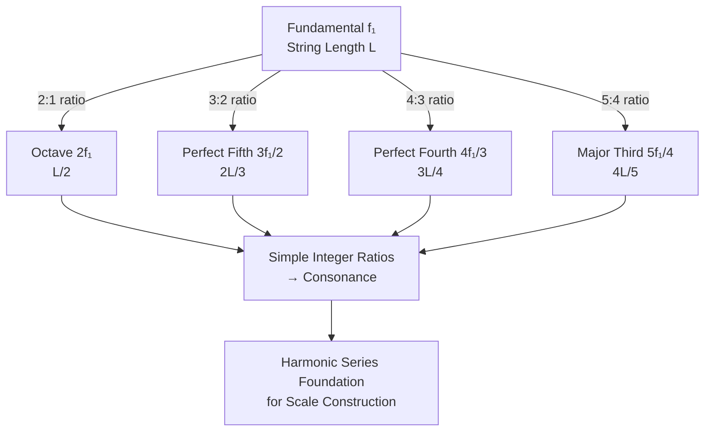
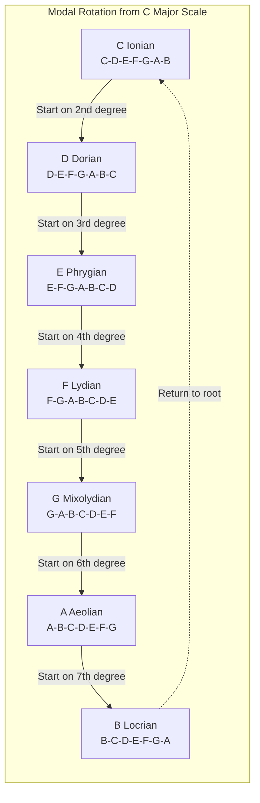
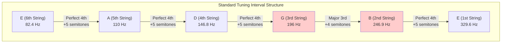
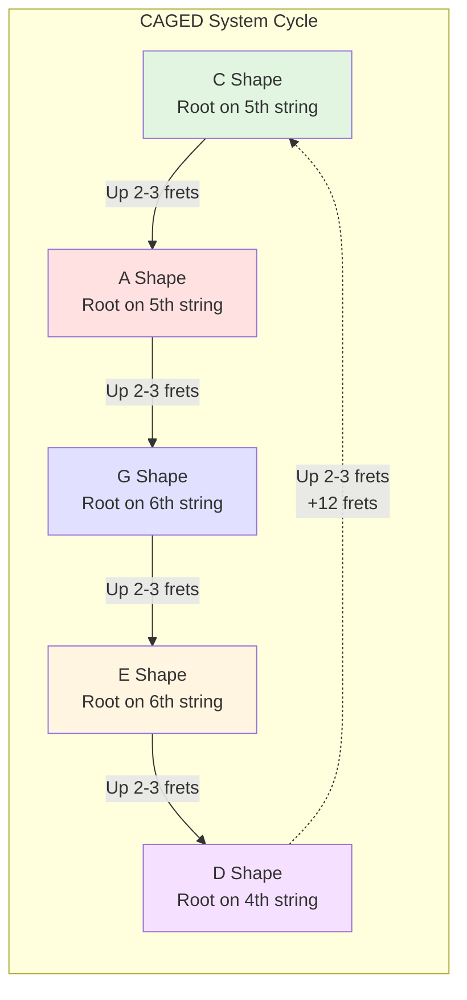
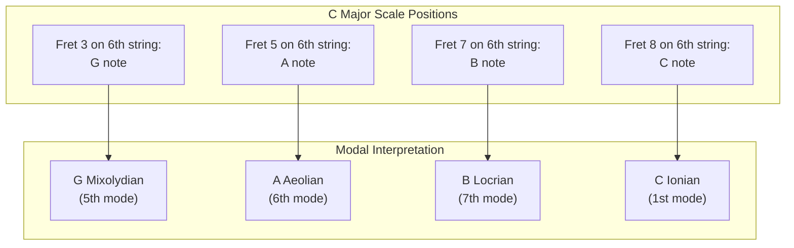
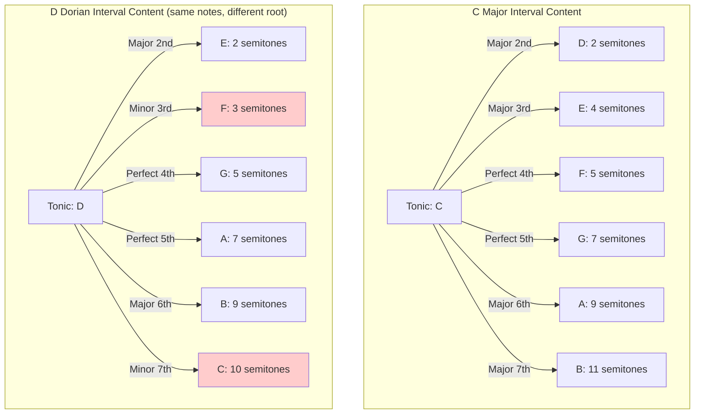

# Lesson 3: Scales and Modes

## 1. First-Principles Intuition & Invariants

### 1.1 The Physics of Vibrating Strings

The guitar operates on the principle of transverse wave propagation in finite, tensioned strings. When a string is displaced from equilibrium and released, it vibrates according to the one-dimensional wave equation:

$$\frac{\partial^2 y}{\partial t^2} = v^2 \frac{\partial^2 y}{\partial x^2}$$

where $y(x,t)$ is the transverse displacement, $v = \sqrt{T/\mu}$ is the wave velocity, $T$ is string tension, and $\mu$ is linear mass density. For a string of length $L$ fixed at both ends, boundary conditions ($y(0,t) = y(L,t) = 0$) constrain solutions to standing waves with frequencies:

$$f_n = \frac{n}{2L}\sqrt{\frac{T}{\mu}} = nf_1$$

where $n \in \mathbb{Z}^+$ and $f_1$ is the fundamental frequency. This harmonic series—$f_1, 2f_1, 3f_1, 4f_1, ...$—is universal to all vibrating strings and forms the acoustic foundation for tonal relationships in Western music.

The intervals perceived as most consonant correspond to simple integer ratios in the harmonic series. The octave (2:1), perfect fifth (3:2), and perfect fourth (4:3) emerge naturally as the second, third, and fourth harmonics relative to the fundamental. These ratios minimize acoustic beating—the interference pattern created when two frequencies are close but not identical—which the human auditory system interprets as dissonance. The basilar membrane in the cochlea exhibits logarithmic frequency response, explaining why pitch perception is roughly logarithmic: equal frequency ratios produce equal perceived intervals.



### 1.2 From Harmonic Series to Scale Systems

The major scale derives from selectively extracting pitches from the harmonic series that form stable intervallic relationships. The diatonic major scale in just intonation uses frequency ratios relative to the tonic: 1:1 (unison), 9:8 (major second), 5:4 (major third), 4:3 (perfect fourth), 3:2 (perfect fifth), 5:3 (major sixth), 15:8 (major seventh), 2:1 (octave). These ratios create a pattern of whole steps (9:8 ratio, approximately 204 cents) and half steps (16:15 ratio, approximately 112 cents) with the sequence: W-W-H-W-W-W-H.

However, just intonation creates practical problems: different keys produce different absolute frequency ratios, making modulation impossible without retuning. Equal temperament solves this by dividing the octave into twelve geometrically equal semitones, where each semitone ratio is $2^{1/12} \approx 1.05946$. This creates slight detuning from just intervals—the equal-tempered fifth is approximately 2 cents flat compared to the pure 3:2 ratio—but enables unrestricted modulation across all keys.

The major scale's interval pattern in equal temperament becomes: 0-2-4-5-7-9-11-12 semitones from the root. This structure can be expressed as a cyclic group operation on $\mathbb{Z}_{12}$, where transposition is equivalent to addition modulo 12. The set of all major scales forms an orbit under the action of the transposition group.

Natural minor scales follow the pattern 0-2-3-5-7-8-10-12. The minor third interval (3 semitones, approximately 300 cents vs. 316 cents in just intonation) introduces a flattened third degree relative to major. Psychoacoustic studies demonstrate that this interval produces measurable differences in emotional response: minor thirds activate different neural pathways in the auditory cortex compared to major thirds, correlating with reported feelings of sadness or introspection. This is not cultural conditioning but reflects the way harmonic complexity is processed by mammalian auditory systems.

### 1.3 Modal Systems as Rotational Transformations

The seven diatonic modes—Ionian, Dorian, Phrygian, Lydian, Mixolydian, Aeolian, Locrian—are rotations of the major scale's interval structure. Each mode begins on a different scale degree while preserving the interval sequence:

- **Ionian (I)**: 0-2-4-5-7-9-11-12 (major scale)
- **Dorian (II)**: 0-2-3-5-7-9-10-12 (minor with raised 6th)
- **Phrygian (III)**: 0-1-3-5-7-8-10-12 (minor with lowered 2nd)
- **Lydian (IV)**: 0-2-4-6-7-9-11-12 (major with raised 4th)
- **Mixolydian (V)**: 0-2-4-5-7-9-10-12 (major with lowered 7th)
- **Aeolian (VI)**: 0-2-3-5-7-8-10-12 (natural minor)
- **Locrian (VII)**: 0-1-3-5-6-8-10-12 (diminished, unstable)



Each mode produces distinct harmonic implications through its characteristic intervals. Lydian's raised 4th (augmented fourth) creates a bright, unstable quality due to the tritone between the root and 4th degree. Phrygian's lowered 2nd (minor second above the root) generates a dark, exotic character common in flamenco and Middle Eastern music. These are not subjective associations but measurable differences in harmonic tension based on interval content.

The Locrian mode, with its diminished fifth (6 semitones from root), lacks a perfect fifth—one of the most consonant intervals. This makes it harmonically unstable and rarely used as a tonal center in Western music. Its instability reflects the absence of a strong harmonic anchor in the overtone series.

### 1.4 The Guitar's Fretboard as a Discrete Pitch Space

The guitar fretboard implements equal temperament through fret positioning governed by the equation:

$$d_n = L - \frac{L}{2^{n/12}}$$

where $d_n$ is the distance from the nut to the $n$-th fret, and $L$ is the scale length (typically 24.75" for Gibson, 25.5" for Fender). This logarithmic spacing ensures each fret raises pitch by exactly one semitone. The decreasing fret spacing reflects the logarithmic relationship between frequency and perceived pitch.

Standard tuning (E-A-D-G-B-E, from low to high) creates a two-dimensional pitch lattice with non-uniform intervals: perfect fourths between adjacent strings except for the major third between G and B strings. This asymmetry is not arbitrary—it optimizes chord voicings by placing common chord tones within comfortable finger reach while maintaining reasonable string tension across all strings.



The major third between G and B strings introduces a discontinuity that requires positional adjustment when transferring scale patterns across strings. This asymmetry has profound implications for scale fingerings and chord voicings, creating both challenges and opportunities for harmonic exploration.

## 2. Core Architecture & Mechanics

### 2.1 Scale Construction as Algorithmic Pattern Mapping

Scale construction on the guitar is a pattern-matching problem: mapping a one-dimensional sequence of intervals onto a two-dimensional fretboard lattice. For any scale with interval sequence $S = [s_1, s_2, ..., s_n]$ (measured in semitones), we seek finger positions $(string, fret)$ that produce these intervals while minimizing hand movement and maximizing ergonomic efficiency.

A scale fingering can be represented as a sequence of states in a finite state machine:

$$\text{State} = (s, f, h)$$

where $s \in \{1,2,3,4,5,6\}$ is the string number, $f \in \{0,1,...,24\}$ is the fret number, and $h \in \{1,2,3,4\}$ is the finger used. Valid state transitions must satisfy:

1. **Fret distance constraint**: $|f_{i+1} - f_i| \leq 4$ (one-finger-per-fret within a four-fret span)
2. **String crossing**: $s_{i+1} - s_i \in \{0, -1\}$ for ascending scales (same string or move to higher-pitched string)
3. **Ergonomic continuity**: minimize large position shifts

The three-note-per-string system maximizes melodic speed by distributing notes evenly across strings, using fingers 1, 2, and 4 (index, middle, pinky) in most positions. For a major scale starting on the 6th string:

**Position 1 (Root on 6th string, fret 3 = G major)**
```
e|--2--4--5--|
B|--2--3--5--|
G|--2--4--5--|
D|--2--4--5--|
A|--2--3--5--|
E|--2--3--5--|
```

This pattern uses fingers 1-2-4 on each string, covering a seven-fret span but maintaining a four-fret hand position by shifting during string transitions.

```python
def generate_three_note_per_string_pattern(root_string: int, 
                                           root_fret: int, 
                                           scale_intervals: list[int]) -> list[tuple[int, int]]:
    """
    Generate three-note-per-string scale pattern.
    
    Args:
        root_string: Starting string (6=low E, 1=high E)
        root_fret: Starting fret position
        scale_intervals: Interval sequence in semitones [0,2,4,5,7,9,11,12]
    
    Returns:
        List of (string, fret) tuples representing the scale pattern
    """
    positions = []
    current_string = root_string
    current_fret = root_fret
    interval_index = 0
    notes_on_string = 0
    
    # String-to-string interval offsets (accounting for G-B major third)
    string_intervals = [5, 5, 5, 4, 5]  # E-A, A-D, D-G, G-B, B-E
    
    while current_string >= 1 and interval_index < len(scale_intervals):
        # Calculate absolute pitch from root
        target_pitch = scale_intervals[interval_index]
        
        # Calculate required fret on current string
        if current_string == root_string:
            required_fret = root_fret + target_pitch
        else:
            # Account for string tuning offsets
            string_offset = sum(string_intervals[root_string-current_string-1:root_string-1])
            required_fret = root_fret + target_pitch - string_offset
        
        positions.append((current_string, required_fret))
        notes_on_string += 1
        interval_index += 1
        
        # Move to next string after three notes
        if notes_on_string == 3:
            current_string -= 1
            notes_on_string = 0
    
    return positions

# Example: G major scale, three-note-per-string
g_major_intervals = [0, 2, 4, 5, 7, 9, 11, 12, 14, 16, 17, 19, 21, 23, 24]
g_major_pattern = generate_three_note_per_string_pattern(6, 3, g_major_intervals)

for string, fret in g_major_pattern:
    print(f"String {string}, Fret {fret}")
```

### 2.2 The CAGED System as a Covering Space

The CAGED system provides five overlapping fingering templates that tile the fretboard, enabling navigation across the entire neck. Each shape is derived from an open-position chord (C, A, G, E, D) transposed up the neck by barring across a fret.

The system forms a cyclic structure: moving up the neck from any shape leads to the next shape in the sequence C→A→G→E→D→C. This cycle repeats every 12 frets (one octave), creating a helical topology where the fretboard wraps around itself at the 12th fret.



Each CAGED shape contains embedded scale patterns. For example, the E shape major chord (root on 6th string) contains the following scale degrees:

```
e|-----0-----2-----4-----|  (5th, 6th, 7th scale degrees)
B|-----0-----2-----4-----|  (root, 2nd, 3rd)
G|-----1-----2-----4-----|  (3rd, 4th, 5th)
D|-----1-----2-----4-----|  (7th, root, 2nd)
A|-----2-----4-----5-----|  (5th, 6th, 7th)
E|-----0-----2-----4-----|  (root, 2nd, 3rd)
```

The CAGED system can be formalized as a quotient space. Define the pitch class space $P = \mathbb{Z}_{12}$ and the position space $F = \{(s,f) : s \in \{1,...,6\}, f \in \{0,...,24\}\}$. The projection $\pi: F \rightarrow P$ maps each fretboard position to its pitch class. The CAGED shapes partition $F$ into equivalence classes where positions within a shape produce the same chord voicing structure.

### 2.3 Modal Fingerings and Pattern Shifts

Each mode can be fingered using the parent major scale pattern but emphasizing different root notes. For C major (C-D-E-F-G-A-B), the seven modes are:

- **C Ionian**: Root on C (standard major pattern)
- **D Dorian**: Root on D (same pattern, different tonal center)
- **E Phrygian**: Root on E
- **F Lydian**: Root on F
- **G Mixolydian**: Root on G
- **A Aeolian**: Root on A (natural minor)
- **B Locrian**: Root on B



The modal approach requires mental reframing: the finger pattern remains constant, but the harmonic function and tonal gravity shift based on which note is treated as the root. This is analogous to basis transformation in linear algebra—the underlying vector space (pitch space) remains invariant, but the choice of basis (modal root) changes the coordinate representation.

### 2.4 Pentatonic Scales as Sparse Encodings

The pentatonic scale omits the 4th and 7th degrees of the major scale, creating a five-note structure: 0-2-4-7-9-12 (major pentatonic) or 0-3-5-7-10-12 (minor pentatonic). This sparse encoding eliminates the most dissonant intervals (minor second and tritone), producing a scale that is nearly universally consonant.

```
Minor Pentatonic (A minor): A-C-D-E-G
Pattern (5th fret, 6th string root):

e|--5--8--|
B|--5--8--|
G|--5--7--|
D|--5--7--|
A|--5--7--|
E|--5--8--|
```

The pentatonic scale's consonance derives from its structure: every interval formed between scale degrees is either a major second, minor third, major third, perfect fourth, perfect fifth, or their inversions/compounds. Tritones and minor seconds are absent, making it robust for improvisation—any two pentatonic notes can be played simultaneously without severe dissonance.

This property makes pentatonic scales ubiquitous across cultures. From blues to Chinese traditional music to sub-Saharan African music, pentatonic structures appear independently, suggesting that the five-note framework represents a cognitive attractor in auditory pattern recognition.

### 2.5 Biomechanics and Technique Optimization

Efficient scale execution requires biomechanical optimization. The hand operates as a kinematic chain with constraints:

1. **Finger independence**: The tendons controlling fingers 3 and 4 (ring and pinky) share anatomical connections, limiting independent movement.
2. **Span limitations**: Most players can comfortably span four frets without shifting; five-fret stretches require specific training.
3. **Angular constraints**: The wrist angle affects force transmission and fatigue; excessive ulnar or radial deviation increases injury risk.

Optimal technique minimizes unnecessary motion. The principles:

- **Economy of motion**: Use the smallest movement required to reach the next note.
- **Prepared fingers**: Fingers should anticipate upcoming notes, hovering above the next fret before descending.
- **Relaxed tension**: Only apply the minimum force required to fret cleanly; excess tension accumulates fatigue.

For fast alternate picking (down-up-down-up), synchronization between fretting and picking hands is critical. Asynchrony greater than approximately 10-15ms becomes perceptible as sloppiness. Metronome practice develops temporal precision in motor programs stored in the cerebellum and basal ganglia.

```rust
// Pseudocode model for biomechanical efficiency scoring

struct HandPosition {
    fret: u8,
    string: u8,
    finger: u8,
}

fn calculate_transition_cost(from: &HandPosition, to: &HandPosition) -> f32 {
    let fret_distance = (to.fret as i16 - from.fret as i16).abs() as f32;
    let string_distance = (to.string as i16 - from.string as i16).abs() as f32;
    
    // Cost components
    let position_shift_cost = if fret_distance > 4.0 { 
        fret_distance * 2.0  // High cost for position shifts
    } else { 
        fret_distance * 0.5  // Low cost for within-position movement
    };
    
    let string_crossing_cost = string_distance * 0.3;
    
    // Penalize finger independence violations (ring-pinky coordination difficulty)
    let finger_independence_penalty = if (from.finger == 3 && to.finger == 4) ||
                                          (from.finger == 4 && to.finger == 3) {
        if from.string == to.string { 1.5 } else { 0.5 }
    } else {
        0.0
    };
    
    position_shift_cost + string_crossing_cost + finger_independence_penalty
}

fn optimize_fingering(scale: &[u8], root_position: HandPosition) -> Vec<HandPosition> {
    // Dynamic programming approach to find minimum-cost fingering path
    // (Implementation would use Dijkstra's algorithm or similar pathfinding)
    // Returns sequence of hand positions that minimizes total transition cost
    vec![]  // Placeholder
}
```

### 2.6 Advanced Scale Visualization: Interval Content Analysis

Understanding scale construction at the interval level reveals deeper structural properties. For any scale, construct the interval vector—a histogram of all interval classes present:

For C major: C-D-E-F-G-A-B
- Minor 2nd: 0 instances
- Major 2nd: 5 instances (C-D, D-E, F-G, G-A, A-B)
- Minor 3rd: 2 instances (E-G, A-C)
- Major 3rd: 3 instances (C-E, F-A, G-B)
- Perfect 4th: 4 instances (C-F, D-G, E-A, G-C)
- Tritone: 1 instance (F-B)
- Perfect 5th: 4 instances (inverse of 4ths)

Modes of the same parent scale share identical interval vectors but differ in which intervals are formed relative to the tonic. This explains why modes have distinct harmonic flavors despite containing the same notes—the relationship between the root and other scale degrees changes.



The Dorian mode's characteristic sound comes from its minor 3rd and major 6th relative to the root—a combination not found in natural minor (Aeolian), which has a minor 6th.

## 3. Practice Applications and Advanced Techniques

### 3.1 Systematic Scale Practice Methodology

Efficient scale mastery requires structured, progressive practice:

1. **Single-position mastery**: Learn one scale pattern in one position until it can be executed cleanly at 60 BPM, then gradually increase tempo in 5 BPM increments to target speed (120-140 BPM for most players).

2. **Position shifting**: Practice transitioning between adjacent CAGED positions, using common tones as pivot points.

3. **Intervallic practice**: Play scales in intervals (thirds, fourths, sixths) to develop melodic fluency and ear training simultaneously.

4. **Sequence patterns**: Apply systematic patterns such as:
   - 1-2-3, 2-3-4, 3-4-5... (ascending triads)
   - 1-2-3-1, 2-3-4-2, 3-4-5-3... (enclosure patterns)
   - 1-3-2-4, 2-4-3-5... (leaping intervals)

5. **Harmonic integration**: Play scales over backing tracks in the target key, focusing on resolving phrases to chord tones on strong beats.

```python
def generate_interval_exercise(scale: list[int], interval: int) -> list[tuple[int, int]]:
    """
    Generate scale practice pattern in specified intervals.
    
    Args:
        scale: List of scale degrees (e.g., [0,2,4,5,7,9,11,12])
        interval: Interval size in scale degrees (e.g., 3 for thirds)
    
    Returns:
        List of note pairs forming the specified interval
    """
    pairs = []
    for i in range(len(scale) - interval + 1):
        pairs.append((scale[i], scale[i + interval - 1]))
    return pairs

# Example: C major scale in thirds
c_major = [0, 2, 4, 5, 7, 9, 11, 12, 14, 16, 17, 19, 21, 23, 24]
thirds = generate_interval_exercise(c_major, 3)

print("C Major Scale in Thirds:")
for note1, note2 in thirds:
    print(f"Interval: {note1} - {note2}")
```

### 3.2 Modal Improvisation Strategies

Modal improvisation requires understanding the characteristic tones that define each mode's identity:

- **Dorian**: Major 6th (raised 6th compared to natural minor)
- **Phrygian**: Minor 2nd (flattened 2nd compared to natural minor)
- **Lydian**: Augmented 4th (raised 4th compared to major)
- **Mixolydian**: Minor 7th (flattened 7th compared to major)
- **Locrian**: Diminished 5th (flattened 5th)

Effective modal playing emphasizes these characteristic intervals by:
1. Beginning and ending phrases on the tonic
2. Landing on characteristic tones on strong beats
3. Using the characteristic intervals melodically (e.g., in Lydian, melodic movement from root to #4 emphasizes the mode)
4. Avoiding extensive use of notes that belong to other modes sharing the same tonic

### 3.3 Polymodal and Outside Playing

Advanced improvisers superimpose modes from different parent scales over the same harmonic background, creating tension and chromaticism. For example, over a C major chord, one might play:
- C Lydian (characteristic #4)
- C major pentatonic (safe, consonant foundation)
- C Mixolydian (introduces b7 for bluesy flavor)
- C harmonic major (major scale with b6, exotic sound)

The principle is controlled dissonance: introducing notes outside the underlying harmony creates tension that resolves when returning to consonant chord tones. This requires deep internalization of scale patterns and strong harmonic awareness to target and resolve tensions appropriately.

## 4. Conclusion and Next Steps

Scales and modes represent the mathematical and acoustic foundations of melodic construction on the guitar. Mastery requires understanding both the theoretical underpinnings—harmonic series, interval ratios, modal structures—and the practical biomechanics of executing patterns efficiently across the fretboard. The CAGED system provides a comprehensive map of the neck, while modal thinking enables sophisticated harmonic and melodic expression.

Further study should explore:
- Harmonic minor and melodic minor scale systems
- Symmetrical scales (whole-tone, diminished, augmented)
- Non-Western scale systems (maqamat, ragas, Japanese scales)
- Chord-scale relationships and jazz theory
- Integration of scales with arpeggios for comprehensive fretboard visualization

The goal is not merely technical facility but musical fluency—the ability to translate musical ideas directly into physical execution without conscious calculation. This fluency emerges from sustained, deliberate practice that integrates theoretical understanding, physical technique, and musical expression.
