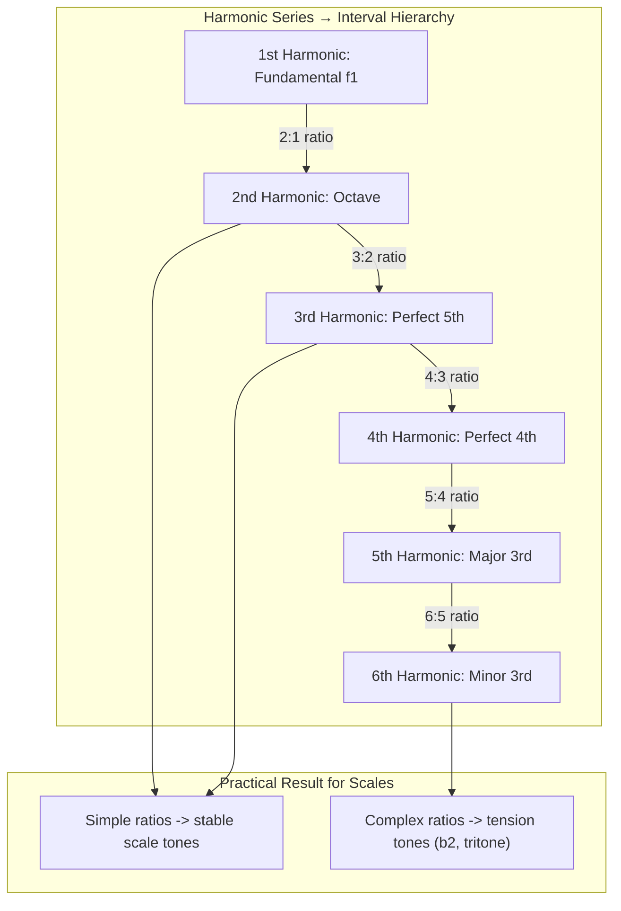
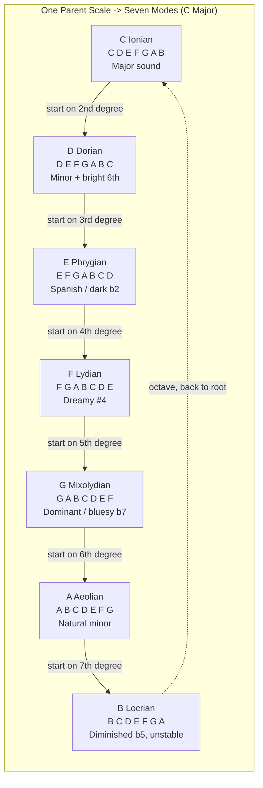
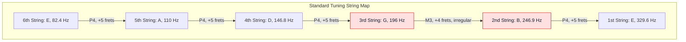
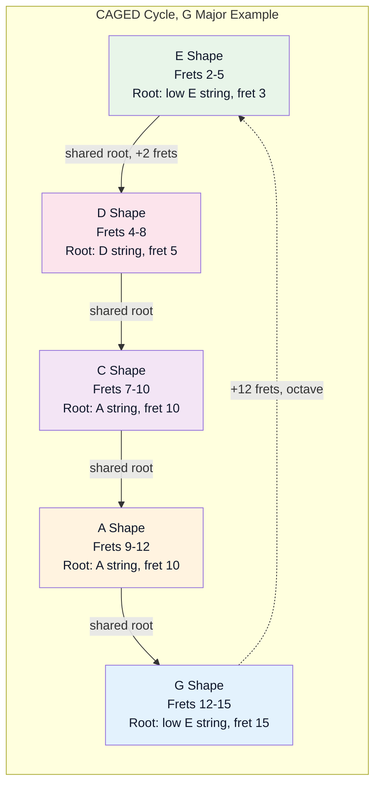
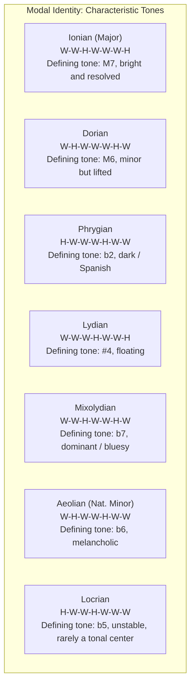
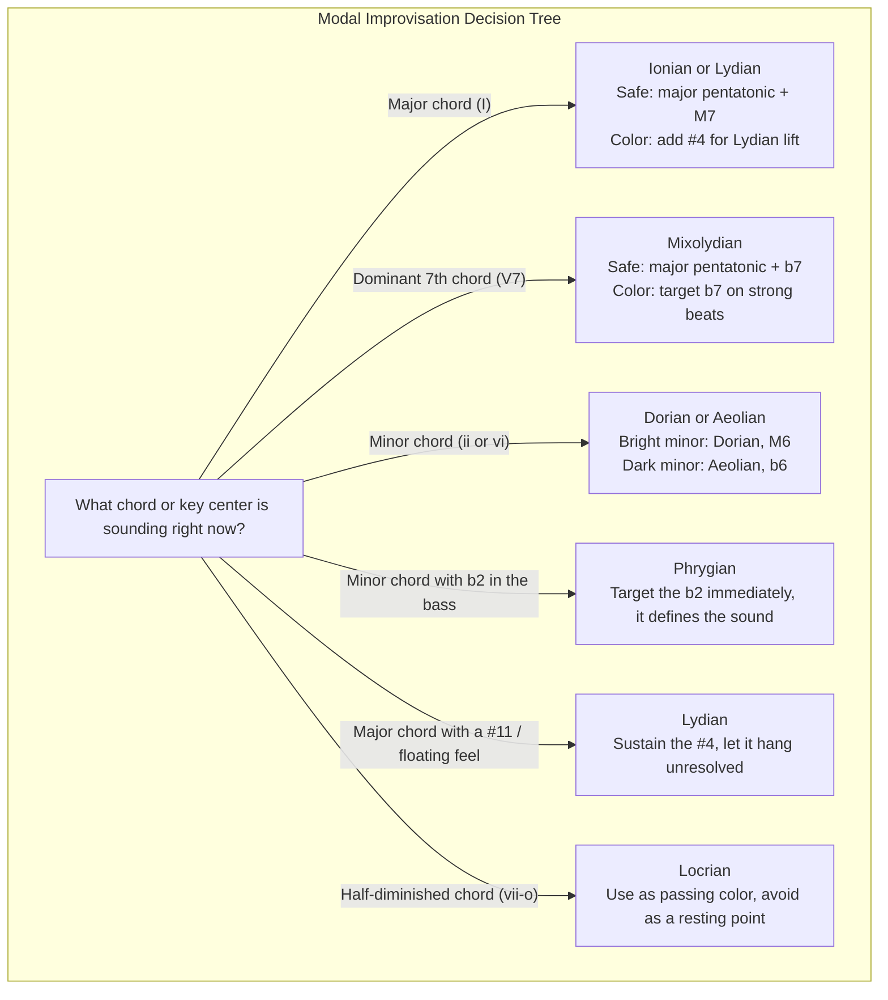

# Lesson 3: Scales, Modes & Fretboard Mastery

## 1. First-Principles Intuition (The 15%)

### 1.1 Why Scales Sound the Way They Do

Every plucked string vibrates at a fundamental frequency plus overtones at integer multiples — 2×, 3×, 4×, 5× the fundamental. The intervals your ear calls "consonant" (octave, perfect 5th, perfect 4th) are just the lowest, strongest members of that overtone stack. Play two notes whose frequencies form a simple ratio and their overtones line up; play two notes with a complex ratio and the overtones clash, producing the acoustic beating we hear as tension.

A scale is a curated set of seven pitches chosen so most pairs stay consonant while a couple of "tension" intervals (the half-step, the tritone) create pull back to the root. The major scale's **W-W-H-W-W-W-H** pattern (whole/half step sequence) is the version of that curation western music settled on.

**Equal temperament**, the tuning your guitar is built around, slightly detunes every interval except the octave so all 12 keys sound equally usable. Each fret = one semitone, a fixed frequency ratio. The payoff for you as a player: a scale shape learned at the 5th fret is identical in shape and sound at the 10th fret, just higher. One fingering, twelve keys.



### 1.2 Modes in One Sentence

The seven diatonic modes are **the same seven notes heard from seven different home bases**. D Dorian and C Ionian share identical pitches, but D Dorian measures everything against D: a minor 3rd (F) and a major 6th (B) above the root. C Ionian measures the same notes against C and gets a major 3rd and major 6th. Identical notes, different center of gravity, different emotional color.



The practical consequence: you already know all seven modes of G major the day you learn the G major scale shapes. The only new skill is learning to *hear* and *target* each mode's characteristic tone, covered in Section 4.

---

## 2. The Fretboard as a Pitch Map

### 2.1 Standard Tuning and the G-B Asymmetry

Standard tuning, low to high, is **E A D G B E**. Every adjacent string pair is a perfect 4th apart (5 frets) except G to B, which is a major 3rd (4 frets). This single irregularity is the number one source of "why does my pattern fall apart on the top two strings" confusion.



**Practical rule:** any box pattern you've worked out on strings 6-5-4-3 shifts **one fret lower** when you cross onto strings 2 and 1, to land on the correct pitch. Say it out loud while you practice until it's automatic: "cross the G-B, drop one fret." This single habit fixes most "wrong note" accidents in lead playing.

### 2.2 The CAGED System: Your Fretboard GPS

CAGED takes five open-position chord shapes — C, A, G, E, D — and shows how each one repeats up the neck as a movable barre shape. The five shapes chain together, each one's top notes overlapping the next shape's bottom notes, covering the full neck before repeating at the octave.



Each shape carries an embedded triad, a pentatonic box, and the full diatonic scale in one hand position. **Learn one shape to completion** — chord grip, scale notes, triad arpeggio — before adding the next. Five incomplete shapes are worth less than one mastered shape.

---

## 3. Scale Shapes: Complete Fingering Reference

> **Reading the grids:** strings run top (high e) to bottom (low E), frets run left to right. Numbers are fretting fingers: 1 = index, 2 = middle, 3 = ring, 4 = pinky. `R` marks a root note.

### 3.1 G Major Scale, Five CAGED Positions

**Position 1: E shape (frets 2-5, root on low E string fret 3)**

```
         Fret:  2    3    4    5
e  |-----|-----|--1--|-----|--3--|
B  |-----|-----|--1--|-----|--3--|
G  |-----|-----|--1--|-----|--3--|
D  |-----|-----|--1--|-----|--3--|
A  |-----|-----|--1--|-----|--3--|
E  |-----|-----|--R--|-----|--3--|
```
Fingering: index covers fret 2, ring covers fret 4-5 depending on string (3NPS variant in §3.4 breaks this into even groups). Roots: low E fret 3, D string fret 5, high e fret 3.

**Position 2: D shape (frets 4-8, root on D string fret 5)**

```
         Fret:  4    5    6    7    8
e  |-----|--1--|-----|--3--|-----|--4--|
B  |-----|--1--|-----|--3--|-----|--4--|
G  |-----|-----|--1--|-----|--3--|--4--|
D  |-----|-----|--R--|-----|--3--|-----|
A  |-----|-----|--1--|-----|--3--|--4--|
E  |-----|-----|--1--|-----|--3--|--4--|
```
Root on D string fret 5; octave root on B string fret 8.

**Position 3: C shape (frets 7-10, root on A string fret 10)**

```
         Fret:  7    8    9    10
e  |-----|--1--|-----|-----|--4--|
B  |-----|--1--|-----|-----|--4--|
G  |-----|-----|--1--|--2--|--4--|
D  |-----|-----|--1--|--2--|--4--|
A  |-----|-----|--1--|--2--|--R--|
E  |-----|--1--|-----|-----|--4--|
```

**Position 4: A shape (frets 9-12, root on A string fret 10)**

```
         Fret:  9    10   11   12
e  |-----|--1--|-----|-----|--4--|
B  |-----|-----|--2--|-----|--4--|
G  |-----|--1--|-----|-----|--4--|
D  |-----|--1--|-----|-----|--4--|
A  |-----|--1--|--R--|-----|--4--|
E  |-----|--1--|-----|-----|--4--|
```

**Position 5: G shape (frets 12-15, root on low E string fret 15)**

```
         Fret:  12   13   14   15
e  |-----|-----|-----|--2--|--4--|
B  |-----|--1--|-----|--2--|-----|
G  |-----|-----|-----|--1--|--4--|
D  |-----|-----|-----|--1--|--4--|
A  |-----|-----|-----|--1--|--4--|
E  |-----|-----|-----|--2--|--R--|
```

**Practice order:** E shape → D shape → C shape → A shape → G shape, each one drilled solo for a week before chaining (Drill 2, §5.3).

### 3.2 A Natural Minor (A Aeolian), Box Positions

**Box 1, root position (5th fret, A string)**

```
         Fret:  5    6    7    8
e  |-----|--1--|-----|--3--|--4--|
B  |-----|--1--|-----|--3--|--4--|
G  |-----|--1--|--2--|-----|--4--|
D  |-----|--1--|--2--|-----|--4--|
A  |-----|--R--|-----|--3--|--4--|
E  |-----|--1--|-----|--3--|--4--|
```
Roots: A string fret 5, G string fret 2, E string fret 5 and fret 17 (octave).

**Box 2, second position (7th fret)**

```
         Fret:  7    8    9    10
e  |-----|--1--|--2--|-----|--4--|
B  |-----|--1--|--2--|-----|--4--|
G  |-----|--1--|-----|--3--|--4--|
D  |-----|--1--|--2--|--3--|-----|
A  |-----|-----|--1--|--2--|--4--|
E  |-----|--1--|--2--|-----|--4--|
```

### 3.3 Minor Pentatonic, All Five Boxes (A Minor)

The core vocabulary of blues, rock, and most lead playing. Learn all five boxes and, more importantly, how they connect into one continuous fretboard map.

**Box 1, root at 5th fret**
```
         Fret:  5    8
e  |-----|--1--|-----|--4--|
B  |-----|--1--|-----|--4--|
G  |-----|--1--|-----|--3--|
D  |-----|--1--|-----|--3--|
A  |-----|--R--|-----|--3--|
E  |-----|--1--|-----|--4--|
```
Notes: A C D E G.

**Box 2, root at 7th fret**
```
         Fret:  7    8    10
e  |-----|--1--|--2--|-----|
B  |-----|--1--|--2--|-----|
G  |-----|-----|--1--|--3--|
D  |-----|-----|--1--|--3--|
A  |-----|-----|--1--|--3--|
E  |-----|--1--|--2--|-----|
```

**Box 3, root at 10th fret**
```
         Fret:  10   12
e  |-----|--1--|-----|--3--|
B  |-----|--1--|-----|--3--|
G  |-----|--1--|-----|--3--|
D  |-----|--1--|-----|--3--|
A  |-----|--1--|-----|--3--|
E  |-----|--1--|-----|--3--|
```

**Box 4, root at 12th fret**
```
         Fret:  12   15
e  |-----|--1--|-----|--4--|
B  |-----|--1--|-----|--4--|
G  |-----|--1--|-----|--3--|
D  |-----|--1--|-----|--3--|
A  |-----|--1--|-----|--3--|
E  |-----|--1--|-----|--4--|
```

**Box 5, 3rd position (wraps back to Box 1 an octave up)**
```
         Fret:  3    5
e  |-----|--1--|-----|--4--|
B  |-----|--1--|-----|--4--|
G  |-----|--1--|-----|--3--|
D  |-----|--1--|-----|--3--|
A  |-----|--1--|-----|--R--|
E  |-----|--1--|-----|--4--|
```

**The full connected neck map** (fret numbers per string, boxes labeled):
```
e  |--5--|--8--|--10--|--12--|--15--|--17--|
B  |--5--|--8--|--10--|--12--|--15--|--17--|
G  |--5--|--7--|--9---|--12--|--14--|--17--|
D  |--5--|--7--|--10--|--12--|--14--|--17--|
A  |--5--|--7--|--10--|--12--|--14--|--17--|
E  |--5--|--8--|--10--|--12--|--15--|--17--|
      B1    B2    B3    B4    B5   B1+oct
```
Run this as a single ascending line, low E string to high e string and back, across all five boxes without stopping. That's the exercise that actually teaches you the neck, not the individual boxes in isolation.

### 3.4 Three-Note-Per-String Patterns (Speed & Legato)

3NPS patterns assign exactly three notes to every string. Because the rhythmic grouping never changes string to string, alternate picking and legato runs stay mechanically even at speed — your picking hand does the same down-up-down motion on every string, with no awkward 2-then-3 switch mid-pattern.

**G major 3NPS, starting low E string fret 3**
```
         Fret:  2    3    4    5
E  |-----|--1--|-----|--3--|--4--|
A  |-----|--1--|-----|--3--|--4--|
D  |-----|--1--|-----|--3--|--4--|
G  |-----|--1--|-----|--3--|--4--|
B  |-----|--1--|--2--|-----|--4--|   <- G-B shift: pattern starts 1 fret lower
e  |-----|--1--|-----|--3--|--4--|
```
Finger assignment is 1-3-4 on most strings. On the B string, the pattern compresses because of the G-B major-3rd gap — this is the same compensation rule from §2.1, now visible inside a single scale pattern rather than between boxes.

---

## 4. Modal Shapes with Characteristic Tones Marked

Knowing a mode's **characteristic tone** — the single note that distinguishes it from the nearest major or minor scale — tells you exactly what to lean on when improvising.



### 4.1 D Dorian: Shape and Characteristic Tone

D Dorian shares every note with C major, rooted on D instead. The major 6th (B natural) is what separates it from D Aeolian, which has Bb. Make that B land on strong beats.

```
D Dorian, 5th-10th position (root on A string fret 5, octave at low E string fret 10)

         Fret:  5    7    8    10
e  |-----|--1--|-----|--3--|--4--|
B  |-----|--1--|-----|--3--|--4--|   <- B natural here is the M6 (star tone)
G  |-----|--1--|--2--|-----|--4--|
D  |-----|--R--|--2--|-----|--4--|
A  |-----|--1--|-----|--3--|--4--|
E  |-----|--1--|-----|--3--|--4--|
```

**Improv cue:** start from the A minor pentatonic box you already know, then add the major 6th (B) and major 2nd (E). Those two additions alone turn "generic minor" into unmistakable Dorian.

### 4.2 G Mixolydian: Shape and Characteristic Tone

G Mixolydian is G major with a flatted 7th: F natural instead of F#. This is the sound of classic rock rhythm parts, country leads, and funk. Target F natural on strong beats over a G7 chord.

```
G Mixolydian, 2nd-5th position (root on low E string fret 3)

         Fret:  2    3    5
e  |-----|--1--|--2--|-----|--4--|
B  |-----|--1--|--2--|-----|--4--|
G  |-----|--1--|--2--|-----|--4--|
D  |-----|--1--|--2--|-----|--4--|
A  |-----|--1--|--2--|-----|--4--|   <- F natural fret 3 is the b7 (star tone)
E  |-----|--1--|--2--|-----|--4--|
```

**Improv cue:** play G major pentatonic (G A B D E), then slide in F natural on beat 1 over a G7 chord. One note recolors the entire phrase.

### 4.3 E Phrygian: Shape and Characteristic Tone

The b2 (F natural against an E root, a minor second above) is the flamenco and metal signature. It sits literally one fret above the open string.

```
E Phrygian, open position (same shape movable from fret 12)

         Fret:  0    1    2    3
e  |--0--|--1--|-----|--3--|
B  |--0--|--1--|-----|--3--|
G  |--0--|-----|--2--|-----|
D  |--0--|--1--|-----|--3--|
A  |-----|--1--|--2--|-----|   <- F natural fret 1 is the b2 (star tone)
E  |--0--|--1--|-----|--3--|
```

---

## 5. Essential Practice Drills

### 5.1 Hand Mechanics First

Nail these before chasing tempo. Speed built on bad mechanics has a low ceiling and causes repetitive strain injuries.

- **Curved fingers, fingertip contact.** Arch over adjacent strings so you don't mute them with the underside of your finger.
- **Thumb position.** Behind the neck, roughly opposite your middle finger, parallel to the frets — not wrapped over the top except for specific blues/rock thumb-muting techniques.
- **Wrist angle.** Slight forward rotation, wrist roughly straight. A sharply bent wrist compresses the carpal tunnel and is the single biggest cause of long-term hand pain in guitarists.
- **Minimum pressure.** Fret a note, then slowly release pressure until it buzzes. That threshold plus a small margin is your target pressure — most players fret far harder than necessary, which slows them down and tires the hand.
- **Finger preparation.** The next finger should already be descending toward its target as the current finger lands. Lifting a finger high and re-dropping it wastes motion and kills speed.

### 5.2 Drill 1: Single-Position Clean Execution

Target shape: G major Box 1 (E shape, frets 2-5).

**Phase 1, synchronization (60 BPM, quarter notes).** Strict alternate picking, down-up-down-up, one note per click. Ascend the full box, then descend. Any buzz or muted note means stop and check finger placement before continuing — don't practice through a wrong sound.

**Phase 2, eighth notes (60 BPM = 120 notes/min).** Two notes per click, even pick strokes. Record a short clip and listen back; timing drift is far easier to catch by ear on playback than while playing.

**Phase 3, tempo ladder.** 60 → 70 → 80 → 90 → 100 → 110 → 120 BPM. Advance only when the current tempo feels effortless, not merely survivable. If you overshoot and get sloppy, drop back two increments and rebuild.

**Phase 4, triplets (70 BPM = roughly 210 notes/min).** Three notes per click shifts which scale degree lands on the downbeat each pass — this is the rhythmic foundation 3NPS legato playing is built from.

### 5.3 Drill 2: Connecting Adjacent Boxes

The goal: zero hesitation and zero dead notes crossing from one CAGED box into the next.

**Pivot-note method:**
1. Play Box 1 (G major, E shape) ascending to its top note.
2. That top note is also the entry note of Box 2 (D shape) — it's the pivot, the shared tone that lets you cross without a gap.
3. Continue ascending into Box 2 without pausing or re-picking the pivot note twice.
4. Descend back through Box 2, pivot again at the bottom, and return through Box 1.

```
Box 1 (frets 2-5) -> pivot at high e string fret 5 -> Box 2 (frets 4-8)

Box 1 exit:   high e string, frets 3-5, ascending
                              |
                         pivot note (shared)
                              |
Box 2 entry:  high e string, frets 5-7, continuing ascent
```

**Tempo targets:** 50 BPM → 70 BPM → 90 BPM, quarter notes. At this stage, zero dead notes matters more than speed — a clean 50 BPM crossing is worth more than a sloppy 90 BPM one.

### 5.4 Drill 3: Intervallic Patterns in Scale

Playing a scale in diatonic intervals (thirds, sixths) instead of straight runs trains your ear to hear harmony living inside a single melodic line, and builds the vocabulary that separates "running scales" from phrasing like a soloist.

**Thirds (skip one scale degree):**
```
G major in ascending thirds: G-B, A-C, B-D, C-E, D-F#, E-G, F#-A

Tab (starting low E string fret 3):
e  |-----|-----|-----|-----|
B  |--2--|--3--|--5--|-----|
G  |-----|--2--|--4--|--5--|
D  |-----|--2--|--4--|--5--|
A  |--2--|--3--|--5--|-----|
E  |--3--|--5--|-----|-----|
     G-B   A-C   B-D   C-E
```

**Sixths (skip four scale degrees):**
```
e  |--2--|--4--|--5--|--7--|
A  |--2--|--3--|--5--|--7--|
     G-E   A-F#  B-G   C-A
```

**Tempo:** start at 50 BPM, quarter notes. The mental tracking load (two simultaneous scale-degree positions) is higher than straight scale runs, so give yourself more time per note before pushing tempo.

### 5.5 Drill 4: Sequence Patterns

Sequences impose a repeating melodic shape on the scale, which trains your fingers to execute actual musical phrases rather than undifferentiated up-down motion.

**Sequence 1, ascending groups of 3 (step up one scale degree each group):**
```
G major: G-A-B, A-B-C, B-C-D, C-D-E, D-E-F#, E-F#-G...

Tab (Box 1, low E string):
E  |--3--5--7--|--5--7--8--|--7--8--10-|
      G  A  B    A  B  C     B  C   D
```
Play as triplets at 60 BPM, each group of three starting on a fresh downbeat.

**Sequence 2, four-note enclosure (pattern: 1-2-3-1, 2-3-4-2, 3-4-5-3...):**
```
G-A-B-G, A-B-C-A, B-C-D-B, C-D-E-C...
```
Sits naturally as 16th notes at 70-90 BPM. This pattern is the backbone of a huge amount of neoclassical and fusion lead vocabulary.

**Sequence 3, descending groups of 4:**
```
...E-D-C-B, D-C-B-A, C-B-A-G
```
Every group resolves downward, which is why this reads as "classic rock shredding" — the ear hears continuous resolution rather than a flat run.

### 5.6 Drill 5: Modal Target Practice

This drill trains you to hear modal color, not just execute a fingering pattern.

**Setup:** loop a static drone or single bass note on the target root — D for D Dorian, a simple sustained power chord or bassline is enough.

**Procedure:**
1. Play the full D Dorian scale slowly: D-E-F-G-A-B-C-D.
2. Hold the characteristic note (B natural, the major 6th) for two full beats. Listen to how it sits against the D drone.
3. Build a 4-bar phrase that begins and ends on D, landing the B natural on beat 1 or beat 3 of at least one bar.
4. Add the minor 3rd (F) as a passing tone on a weak beat — it adds color without destabilizing the Dorian sound.

```
Example D Dorian phrase over a D drone, 4/4:

Beat:   1    +    2    +    3    +    4    +
Note:   D         F         A         F
Degree: R         b3        5         b3

Beat:   1    +    2    +    3    +    4    +
Note:   G         B         A         G    (then resolve to D)
Degree: 4         M6*       5         4

(* = characteristic tone, land it deliberately)
```
Repeat for each mode: same structure, swap the target characteristic tone (b2 for Phrygian, #4 for Lydian, b7 for Mixolydian, b6 for Aeolian).

### 5.7 Drill 6: Pentatonic to Diatonic Expansion

This bridges the comfort of pentatonic playing into full modal fluency by adding one note at a time rather than swapping scales wholesale.

**Step 1.** Play A minor pentatonic Box 1 freely over an Am backing track until it feels automatic.

**Step 2.** Add one note: the major 2nd, B, at A string fret 7. The scale becomes A-B-C-D-E-G, a six-note scale. Notice B adds color without disturbing the minor feel.

**Step 3.** Add the major 6th, F#, at A string fret 9. You now have A Dorian — the pentatonic is still the skeleton, you've accessed two extra tones around it.

**Step 4.** Swap F# for F natural at A string fret 8. You now have A Aeolian. Alternate between F and F# against the drone and listen to how the 6th alone flips the emotional color of the whole scale.

```
Pentatonic -> Dorian/Aeolian expansion (A, 5th-position area):

Pentatonic:    A  C  D  E  G
+ B (step 2):  A  B  C  D  E  G        (6-note)
+ F# (step 3): A  B  C  D  E  F# G     (A Dorian)
swap F (step4):A  B  C  D  E  F  G     (A Aeolian)

A string fret reference:
A = fret 5 (root)   D = fret 10
B = fret 7 (add 1st) E = fret 12
C = fret 8           F = fret 13 (Aeolian b6)
                      F# = fret 14 (Dorian M6, star tone)
                      G = fret 15
```

---

## 6. Putting It Together: Improvisation Framework



### 6.1 Chord-Scale Pairing Reference

| Chord Type | Best Scale | Characteristic Note | Avoid |
|---|---|---|---|
| Cmaj7 | C Ionian or C Lydian | M7 (B) or #4 (F#) | b7 |
| G7 | G Mixolydian | b7 (F) | M7 |
| Dm7 | D Dorian | M6 (B) | M7 |
| Am7 | A Aeolian | b6 (F) | M6 (unless shifting to Dorian) |
| E7sus4 | E Phrygian | b2 (F) | M2 |
| Fmaj7#11 | F Lydian | #4 (B) | P4 |
| Bm7b5 | B Locrian | b5 (F) | Treat as a passing chord, not a destination |

### 6.2 Five-Minute Daily Practice Routine

A sustainable routine beats an occasional marathon session. This covers technique, ear training, and fretboard knowledge every day in five minutes.

```
Minute 1 — Single-position scale, slow and clean (60 BPM, full box ascend/descend)
Minute 2 — Intervallic drill: same box in diatonic thirds (70 BPM)
Minute 3 — Sequence pattern: ascending triads or reverse 4s (60 BPM)
Minute 4 — Position connection: adjacent-box pivot exercise (50 BPM)
Minute 5 — Modal target practice over a drone: 2 bars each, hovering the characteristic tone
```

Rotate the target scale daily: Day 1 G major, Day 2 A minor, Day 3 D Dorian, Day 4 G Mixolydian, then repeat the four-day cycle.

---

## 7. Common Problems and Fixes

| Problem | Cause | Fix |
|---|---|---|
| Scale sounds "off" on B and e strings | Forgetting the G-B major 3rd shift | Move the pattern one fret lower when crossing from the G string to the B string |
| Notes buzz on ring or pinky finger | Shared tendon between fingers 3 and 4 pulling the fretting finger off the string | Drop to 40 BPM; isolate a ring-pinky trill exercise for 2 minutes daily |
| Position shifts sound hesitant | No pivot note identified before the shift | Mark the shared tone between the two boxes; always shift exactly on that note |
| Modes all sound the same | Running patterns instead of targeting characteristic tones | Use the drone drill (§5.6); land the characteristic note on beat 1 deliberately |
| Speed plateau around 100 BPM | The motor pattern hasn't consolidated yet, more repetition won't fix it | Drop to 80 BPM for a week, then re-approach the plateau tempo. Consolidation breaks plateaus, raw repetition at the sticking point doesn't |
| Picking and fretting fall out of sync | Hands aren't starting their motion together | Slow to 50 BPM and click the metronome only on beats 2 and 4. This forces you to feel the pulse instead of chasing each click |

---

## 8. Next Steps

Once G major's five CAGED boxes, A Dorian/Aeolian, and all five minor pentatonic positions are clean at 100+ BPM, the natural progressions are:

- **Harmonic minor** — natural minor with a raised 7th. Adds exotic tension; essential vocabulary for metal and flamenco players. Same CAGED-style box logic, just one note shifted.
- **Melodic minor** — raise the b6 and b7 ascending (classical theory has it revert to natural minor descending, though most modern players use the same raised form both ways). The jazz and fusion cornerstone scale; its modes generate Lydian Dominant and other commonly used "altered" sounds.
- **Symmetrical scales** — whole tone (all major 2nd intervals) and diminished (alternating whole/half steps). These don't map onto CAGED cleanly; instead they repeat in fixed 3-fret or 4-fret patterns that you learn as their own system.
- **Arpeggios inside scale boxes** — superimposing triad and 7th-chord arpeggio shapes within a CAGED position is what turns scalar playing into real melodic construction. This is the next concrete skill to add once the scale shapes themselves are automatic.
- **Outside playing** — once a mode feels like home, deliberately playing a half-step above a target note before resolving into it creates controlled chromatic tension. This only works once "inside" playing is fully internalized; chromaticism without a strong sense of home just sounds lost.

The point of this lesson isn't memorizing diagrams. It's building the loop: **hear the chord → identify the scale/mode that fits → locate a root on the neck → build a phrase from there.** Everything in Sections 3-5 exists to make that loop fast enough to use in real time, while you're actually playing.
