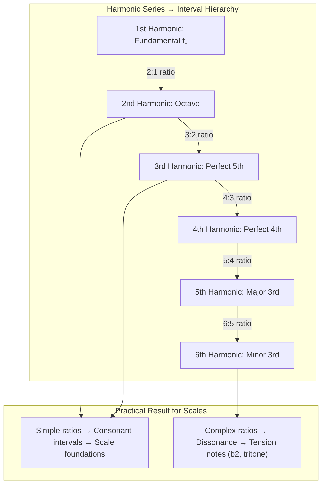
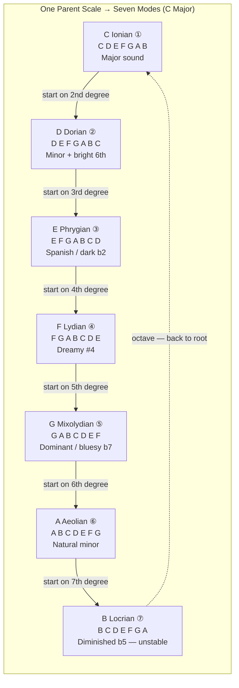
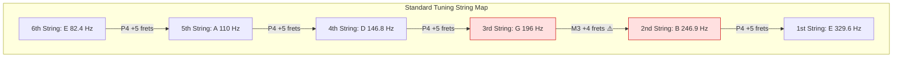
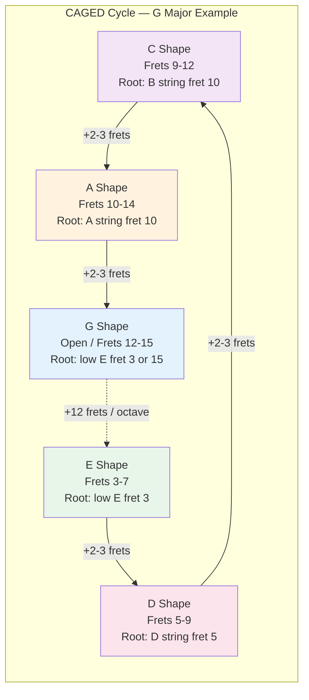
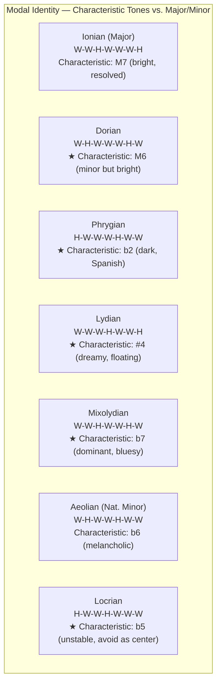
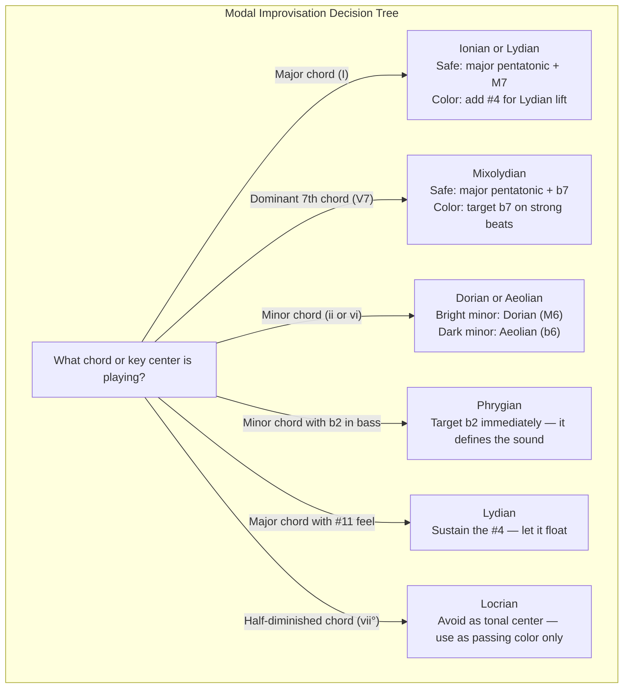

# Lesson 3: Scales, Modes & Fretboard Mastery

## 1. First-Principles Intuition (The 15%)

### 1.1 Why Scales Sound the Way They Do

Every guitar string vibrates at a fundamental frequency plus a cascade of overtones at integer multiples: 2×, 3×, 4×, 5×, and so on. The intervals we hear as most consonant — octave (2:1), perfect fifth (3:2), perfect fourth (4:3) — are simply the strongest, lowest overtones in that series. When you play two notes whose frequencies share a simple ratio, their overtones align and reinforce each other. When the ratio is complex, overtones clash and you hear beating — tension.

Scales are curated collections of pitches selected so that most note pairs maintain simple-enough ratios to feel stable, with just enough dissonance to create forward motion. The major scale's W-W-H-W-W-W-H interval pattern (whole and half steps) is a centuries-refined answer to the question: *what seven pitches give the richest harmonic variety while staying mostly consonant?*

**Equal temperament** — the tuning system your guitar uses — slightly compromises every interval except the octave so that all 12 keys work equally well. Each fret raises pitch by exactly one semitone (a frequency ratio of 2^(1/12) ≈ 1.0595). The practical payoff: every scale pattern you learn works identically at any position on the neck.



### 1.2 Modes in One Sentence

The seven diatonic modes are **the same seven notes heard from seven different tonal centers**. D Dorian and C Ionian use identical pitches. What changes is which note functions as home base — and therefore which intervals the ear measures against that root. D Dorian has a minor 3rd (F) and a *major* 6th (B) above its root. C Ionian has a major 3rd (E) and major 6th (A). Same notes, completely different emotional gravity.



---

## 2. The Fretboard as a Pitch Map

### 2.1 Standard Tuning and the G-B Asymmetry

Standard tuning — **E A D G B E** (low to high) — uses perfect 4th intervals (5 semitones) between every adjacent string pair *except* G to B, which is a major 3rd (4 semitones). This one asymmetry is the single biggest source of confusion when transferring patterns across strings.



**Practical rule:** Any scale box you play on strings 6-5-4-3 shifts *one fret lower* on strings 2 and 1 to stay in tune. Burn this into muscle memory — it corrects 90% of "my pattern sounds wrong on the high strings" problems.

### 2.2 The CAGED System — Your Fretboard GPS

CAGED maps five open-chord shapes across the neck in a continuous cycle. Each shape links to the next moving up the neck, covering all 12 frets before the cycle repeats at the octave.



Each shape gives you an **embedded triad, pentatonic box, and diatonic scale** — all in the same hand position. Learn one shape completely (chord + scale + arpeggios) before moving to the next.

---

## 3. Scale Shapes: Complete Fingering Reference

> **Notation key:** Numbers inside the grid = fretting fingers (1=index, 2=middle, 3=ring, 4=pinky). `R` = root note. Fret numbers shown to the left of each diagram.

### 3.1 G Major Scale — Five CAGED Positions

---

**Position 1: E Shape (Frets 2–5, root on 6th string fret 3)**

```
         Fret: 2   3   4   5
e  |-----|--1--|--2--|-----|--4--|
B  |-----|--1--|--2--|-----|--4--|
G  |-----|--1--|-----|--3--|--4--|
D  |-----|--1--|-----|--3--|--4--|
A  |-----|--1--|--2--|-----|--4--|
E  |-----|--1--|--2--|-----|--4--|
         (open)  R
```

Roots: 6th string fret 3 (G), 4th string fret 5 (G), 1st string fret 3 (G).

---

**Position 2: D Shape (Frets 4–8, root on 4th string fret 5)**

```
         Fret: 4   5   6   7
e  |-----|--1--|--2--|-----|--4--|
B  |-----|--1--|-----|--3--|--4--|
G  |-----|--1--|--2--|-----|--4--|
D  |-----|-----|--R--|-----|-----|
           (slide up — root shifts)
```

Full box:
```
         Fret: 4   5   6   7
e  |-----|--1--|--2--|-----|--4--|
B  |-----|--1--|-----|--3--|--4--|
G  |-----|--1--|--2--|-----|--4--|
D  |-----|--1--|--R--|--3--|-----|
A  |-----|-----|--1--|--2--|--4--|
E  |-----|-----|-----|--2--|--4--|
```

---

**Position 3: C Shape (Frets 7–10, root on 5th string fret 10)**

```
         Fret: 7   8   9   10
e  |-----|--1--|--2--|-----|--4--|
B  |-----|--1--|-----|--3--|--4--|
G  |-----|-----|--1--|--2--|--4--|
D  |-----|-----|--1--|--2--|--4--|
A  |-----|-----|--1--|--2--|--R--|
E  |-----|--1--|--2--|-----|--4--|
```

---

**Position 4: A Shape (Frets 9–12, root on 5th string fret 10)**

```
         Fret: 9   10  11  12
e  |-----|--1--|--2--|-----|--4--|
B  |-----|--2--|-----|-----|--4--|
G  |-----|--1--|--2--|-----|--4--|
D  |-----|--1--|--2--|-----|--4--|
A  |-----|--1--|--R--|-----|--4--|
E  |-----|--1--|--2--|-----|--4--|
```

---

**Position 5: G Shape (Frets 12–15, root on 6th string fret 15 / open G shape)**

```
         Fret: 12  13  14  15
e  |-----|-----|--2--|--3--|--4--|
B  |-----|--1--|--2--|--3--|-----|
G  |-----|-----|--1--|--2--|--4--|
D  |-----|-----|--1--|--2--|--4--|
A  |-----|-----|--1--|--2--|--4--|
E  |-----|-----|--2--|--3--|--R--|
```

---

### 3.2 A Natural Minor (A Aeolian) — Box Positions

**Box 1 — Root Position (5th fret)**

```
         Fret: 5   6   7   8
e  |-----|--1--|-----|--3--|--4--|
B  |-----|--1--|-----|--3--|--4--|
G  |-----|--1--|--2--|-----|--4--|
D  |-----|--1--|--2--|-----|--4--|
A  |-----|--R--|-----|--3--|--4--|
E  |-----|--1--|-----|--3--|--4--|
```

Roots at: A string fret 5, G string fret 2, E string fret 5 and 17.

**Box 2 — 2nd Position (7th fret)**

```
         Fret: 7   8   9   10
e  |-----|--1--|--2--|-----|--4--|
B  |-----|--1--|--2--|-----|--4--|
G  |-----|--1--|-----|--3--|--4--|
D  |-----|--1--|--2--|--3--|-----|
A  |-----|-----|--1--|--2--|--4--|
E  |-----|--1--|--2--|-----|--4--|
```

---

### 3.3 Minor Pentatonic — All Five Boxes (A Minor)

The workhorse of blues, rock, and lead playing. Master all five positions and their connections.

**Box 1 — Root at 5th fret (most common starting point)**

```
         Fret: 5       8
e  |-----|--1--|-------|--4--|
B  |-----|--1--|-------|--4--|
G  |-----|--1--|-------|--4--|  ← shift 1 fret for G-B
D  |-----|--1--|-------|--4--|
A  |-----|--R--|-------|--4--|
E  |-----|--1--|-------|--4--|
```

Notes: A C D E G

**Box 2 — Root at 7th fret (high E string)**

```
         Fret: 7   8       10
e  |-----|--1--|--2--|-------|--4--|
B  |-----|--1--|--2--|-------|--4--|
G  |-----|-----|--1--|-------|--4--|
D  |-----|-----|--1--|--2----|-----|
A  |-----|-----|--2--|-------|--4--|
E  |-----|--1--|--2--|-------|--4--|
```

**Box 3 — 10th position**

```
         Fret: 10      12
e  |-----|--1--|-------|--4--|
B  |-----|--1--|-------|--4--|
G  |-----|--1--|--2----|-----|
D  |-----|--1--|-------|--4--|
A  |-----|--1--|-------|--4--|
E  |-----|--1--|-------|--4--|
```

**Box 4 — 12th position**

```
         Fret: 12      15
e  |-----|--1--|-------|--4--|
B  |-----|--1--|-------|--4--|
G  |-----|--1--|-------|--4--|
D  |-----|--1--|--2----|-----|
A  |-----|--1--|--2----|-----|
E  |-----|--1--|-------|--4--|
```

**Box 5 — 3rd position (connects back to Box 1)**

```
         Fret: 3       5
e  |-----|--1--|-------|--4--|
B  |-----|--1--|-------|--4--|
G  |-----|--1--|--2----|-----|
D  |-----|--1--|-------|--4--|
A  |-----|--1--|-------|--R--|
E  |-----|--1--|-------|--4--|
```

**Connecting the boxes — the full neck view:**

```
e  |--5--|--8--|--10--|--12--|--15--|--17--|
B  |--5--|--8--|--10--|--12--|--15--|--17--|
G  |--5--|--7--|--9---|--12--|--14--|--17--|
D  |--5--|--7--|--10--|--12--|--14--|--17--|
A  |--5--|--7--|--10--|--12--|--14--|--17--|
E  |--5--|--8--|--10--|--12--|--15--|--17--|
      B1   B2    B3    B4    B5    B1+oct
```

---

### 3.4 Three-Note-Per-String Patterns (Speed & Legato)

Three-note-per-string (3NPS) distributes scale notes evenly: 3 notes per string, 2 strings per octave. It enables faster alternate picking and fluid legato runs because each string uses the same rhythmic grouping.

**G Major 3NPS — starting on 6th string, 3rd fret**

```
e  |--2--|--4--|--5--|
B  |--2--|--3--|--5--|
G  |--2--|--4--|--5--|
D  |--2--|--4--|--5--|
A  |--2--|--3--|--5--|
E  |--2--|--3--|--5--|
```

Finger assignment per string: 1-2-4 (most strings) or 1-3-4 where stretch applies.

> **G-B Compensation:** On the B string, the pattern shifts 1 fret lower than you'd expect from pure arithmetic. In the diagram above, B string reads 2-3-5 (not 3-4-6) — that's the compensation built in.

---

## 4. Modal Shapes with Characteristic Tones Marked

Understanding which note defines each mode's personality tells you exactly which notes to target in improvisation.



### 4.1 D Dorian — Shape and Characteristic Tone

D Dorian uses the same notes as C major but roots on D. The major 6th (B natural) is what separates it from D Aeolian (which has Bb). Target that B natural prominently.

```
D Dorian — 10th position (root on 5th string fret 5, also fret 10 on 6th string)

         Fret: 5   7   8   10
e  |-----|--1--|-----|--3--|--4--|
B  |-----|--1--|-----|--3--|--4--|    ← B natural is the ★ M6
G  |-----|--1--|--2--|-----|--4--|
D  |-----|--R--|--2--|-----|--4--|
A  |-----|--1--|-----|--3--|--4--|
E  |-----|--1--|-----|--3--|--4--|
```

**Dorian improv cue:** Play minor pentatonic, then add the major 6th (B) and major 2nd (E). Those two additions shift the sound from generic minor to D Dorian immediately.

### 4.2 G Mixolydian — Shape and Characteristic Tone

G Mixolydian = G major with a flatted 7th (F natural instead of F#). This is the sound of classic rock, country, and funk. Target the F natural on strong beats over a G7 chord.

```
G Mixolydian — 2nd/3rd position

         Fret: 2   3   5
e  |-----|--1--|--2--|-----|--4--|
B  |-----|--1--|--2--|-----|--4--|
G  |-----|--1--|--2--|-----|--4--|
D  |-----|--1--|--2--|-----|--4--|
A  |-----|--1--|--2--|-----|--4--|    ← F♮ at fret 3 is the ★ b7
E  |-----|--1--|--2--|-----|--4--|
     F♮   G
```

**Mixolydian improv cue:** Play the G major pentatonic (G A B D E), then slide in the F natural on beat 1 of a G7 chord. That single note instantly colors the sound.

### 4.3 E Phrygian — Shape and Characteristic Tone

The b2 (F natural over an E root) creates the flamenco/metal sound. It's literally one semitone above the root — a minor second.

```
E Phrygian — open position (also movable from 12th fret)

         Fret: 0   1   2   3
e  |--0--|--1--|-----|--3--|
B  |--0--|--1--|-----|--3--|
G  |--0--|-----|--2--|-----|
D  |--0--|--1--|-----|--3--|
A  |-----|--1--|--2--|-----|    ← F♮ fret 1 is the ★ b2
E  |--0--|--1--|-----|--3--|
      E   F♮
```

---

## 5. Essential Practice Drills

### 5.1 Hand Mechanics First

Before running any scale at speed, establish clean mechanics:

- **Curved fingers:** Fingertips contact strings, not pads. Arch over adjacent strings to avoid muting.
- **Thumb position:** Thumb behind middle finger on the back of the neck, roughly parallel to the frets.
- **Wrist angle:** Slight forward rotation (supination) keeps the wrist clear of the neck edge. No bent-wrist death-gripping.
- **Minimum pressure:** Use just enough force to fret cleanly. Test by gradually releasing pressure until the note buzzes, then apply the minimum beyond that.
- **Prepared fingers:** The next finger hovers and descends *as* the current finger lands — no lifting and replacing.

### 5.2 Drill 1 — Single-Position Clean Execution

Target: G major, Box 1 (E shape, frets 2-5).

**Phase 1 — Synchronization (60 BPM, quarter notes)**
- Pick every note with strict alternate picking: down-up-down-up.
- One note per click. Ascend fully, descend fully.
- If any note buzzes or sounds muted, stop and fix finger placement before continuing.

**Phase 2 — Eighth notes (60 BPM = 120 notes/min)**
- Two notes per click. Maintain even pick strokes.
- Record yourself and listen back. Timing inconsistencies are easier to hear than feel.

**Phase 3 — Tempo ladder**
- 60 → 70 → 80 → 90 → 100 → 110 → 120 BPM
- Only advance when current tempo sounds *effortless*, not just possible.
- If you rush ahead and get sloppy, drop back two increments.

**Phase 4 — Triplet groupings (70 BPM = triplets at ~210 notes/min)**
- Three notes per beat emphasizes different scale degrees on downbeats.
- This is the foundation for 3NPS legato phrasing.

### 5.3 Drill 2 — Connecting Adjacent Boxes

The goal is seamless position shifts — no hesitation, no dead notes during the transition.

**Pivot-note exercise:**
1. Play Box 1 (G major, E shape) ascending to the top note.
2. The top note of Box 1 is *also* the first note of Box 2. Use it as the pivot.
3. Continue ascending in Box 2 (D shape) without pausing.
4. Descend back through Box 2, pivot at the bottom, return through Box 1.

```
Box 1 (frets 2-5) → pivot at e-string fret 5 → Box 2 (frets 4-8)

Box 1 top notes:    ...4-5 (e string frets 4-5)
                              ↕ pivot
Box 2 bottom notes: 4-5... (e string frets 5-7)
```

**Tempo targets:** 50 BPM (quarter notes) → 70 BPM → 90 BPM. Prioritize zero dead notes over speed.

### 5.4 Drill 3 — Intervallic Patterns in Scale

Playing scales in diatonic intervals builds melodic vocabulary and trains the ear to hear harmony inside a single-note line.

**Thirds (skip one scale degree):**
```
G major ascending in thirds from low E:

G-B, A-C, B-D, C-E, D-F#, E-G, F#-A...

Tab (starting 3rd fret, 6th string):
e  |-----|-----|-----|-----|
B  |--2--|--3--|--5--|-----|
G  |-----|--2--|--4--|--5--|
D  |-----|--2--|--4--|--5--|
A  |--2--|--3--|--5--|-----|
E  |--3--|--5--|-----|-----|
     G-B  A-C  B-D  C-E...
```

**Sixths (skip four scale degrees):**
```
e  |--2--|--4--|--5--|--7--|
B  |-----|-----|-----|-----|
G  |-----|-----|-----|-----|
D  |-----|-----|-----|-----|
A  |--2--|--3--|--5--|--7--|
E  |-----|-----|-----|-----|
     G-E  A-F# B-G  C-A
```

**Tempo for intervallic drills:** Start 50 BPM (quarter notes). The mental demand is higher than straight scales, so give the brain time to process.

### 5.5 Drill 4 — Sequence Patterns

Sequences impose rhythmic and melodic structure on a scale, training the fingers to execute *musical* phrases, not just up-down runs.

**Sequence 1 — Ascending triads (groups of 3, step up 1 each time)**

```
G major: G-A-B, A-B-C, B-C-D, C-D-E, D-E-F#, E-F#-G, F#-G-A...

Tab fragment (starting Box 1, 6th string):
E  |--3--5--7--|--5--7--8--|--7--8--10-|...
      G  A  B    A  B  C    B  C   D
```

Play as triplets at 60 BPM. Each group of 3 starts on a new downbeat.

**Sequence 2 — Four-note enclosure (1-2-3-1, 2-3-4-2...)**

```
G-A-B-G, A-B-C-A, B-C-D-B, C-D-E-C...

This pattern sits naturally in 16th notes at 70-90 BPM.
```

**Sequence 3 — Reverse 4s (descending groups of 4)**

```
G: ...E-D-C-B, D-C-B-A, C-B-A-G
Sounds like classic rock shredding because every group resolves downward.
```

### 5.6 Drill 5 — Modal Target Practice

This drill trains your ear to hear modal color, not just run a pattern.

**Setup:** Get a drone or static backing track on the target root (e.g., D for D Dorian). A simple looped power chord or single bass note works fine.

**Procedure:**
1. Play the full D Dorian scale slowly (D-E-F-G-A-B-C-D).
2. Hover on the characteristic note (B natural, the M6) for two full beats. Listen.
3. Build a 4-bar phrase that *begins and ends on D*, with the B natural landing on beat 1 or beat 3 of a bar at least once.
4. Add the minor 3rd (F) on a weak beat as a passing tone — it spices without destabilizing.

```
Example D Dorian phrase (over D drone, 4/4):

Beat: 1  +  2  +  3  +  4  +  | 1  +  2  +  3  +  4  +  |
      D     F     A     F       G     B     A     G     D
      R     b3    5     b3      4   ★M6    5     4     R

Tab (D at 5th fret, A string):
A |--5-----|--8--|--7--|--8-----|-----|
D |--------|-----|-----|--------|--7--|--5--|
              F    A    F          G    B       (B = M6 ★)
```

Repeat this process for each mode: same structure, different characteristic tone target.

### 5.7 Drill 6 — Pentatonic to Diatonic Expansion

This bridges the gap between the safety of pentatonic playing and full modal fluency.

**Step 1:** Play A minor pentatonic Box 1 freely over an Am backing track. Get comfortable.

**Step 2:** Add *one* note — the major 2nd (B, fret 7 on A string). This turns the pentatonic into a 6-note scale (A-B-C-D-E-G). Notice how B adds melodic color without disrupting the minor feel.

**Step 3:** Add the major 6th (F#, fret 9 on A string). Now you have A Dorian. The minor pentatonic is still the backbone — you're just accessing two additional tones.

**Step 4:** Swap the F# for F natural (fret 8). Now you have A Aeolian. Compare how the two 6ths (F vs. F#) feel against the A root.

```
Pentatonic → Dorian expansion (A, Box 1 area, 5th position):

Pentatonic:  A  C  D  E  G
Add B:       A  B  C  D  E  G     (6-note)
Add F#:      A  B  C  D  E  F#  G (A Dorian)
Swap F♮:     A  B  C  D  E  F   G (A Aeolian)

Fret positions (A string as root reference):
A: 5th fret
B: 7th fret  ← add first
C: 8th fret
D: 10th fret
E: 12th fret
F: 13th fret (Aeolian b6)
F#:14th fret (Dorian M6 ★)
G: 15th fret
```

---

## 6. Putting It Together — Improvisation Framework



### 6.1 Chord-Scale Pairing Reference

| Chord Type | Best Scale | Characteristic Note | Avoid |
|---|---|---|---|
| Cmaj7 | C Ionian or C Lydian | M7 (B) or #4 (F#) | b7 |
| G7 | G Mixolydian | b7 (F) | M7 |
| Dm7 | D Dorian | M6 (B) | M7 |
| Am7 | A Aeolian | b6 (F) | M6 (unless Dorian) |
| E7sus4 | E Phrygian | b2 (F) | M2 |
| Fmaj7#11 | F Lydian | #4 (B) | P4 |
| Bm7b5 | B Locrian | b5 (F) | Treat as passing chord |

### 6.2 Five-Minute Daily Practice Routing

This is a sustainable, results-producing routine that covers all the technical bases:

```
Minute 1    — Single-position scale, slow and clean (60 BPM, full Box 1 ascend/descend)
Minute 2    — Intervallic drill: same box in diatonic thirds (70 BPM)
Minute 3    — Sequence pattern: ascending triads or reverse 4s (60 BPM)
Minute 4    — Position connection: Boxes 1-2 pivot exercise (50 BPM)
Minute 5    — Modal target practice over drone: 2 bars each of characteristic tone hovering
```

Rotate the target scale each day: Day 1 G major, Day 2 A minor, Day 3 D Dorian, Day 4 G Mixolydian. Full rotation every four days.

---

## 7. Common Problems and Fixes

| Problem | Cause | Fix |
|---|---|---|
| Scale sounds "off" on B and e strings | Forgetting the G-B major 3rd shift | Move the pattern 1 fret lower when crossing from G to B string |
| Notes buzz on ring/pinky | Shared tendon between fingers 3-4 pulling finger off fret | Slow to 40 BPM; isolate ring-pinky trill exercise 2 min/day |
| Position shifts sound hesitant | No pivot note identified | Mark the common tone between boxes; always shift *on* that note |
| Modes sound identical | Playing patterns, not targeting characteristic tones | Use the drone drill (§5.6); make the characteristic note land on beat 1 |
| Speed plateau around 100 BPM | Motor program not consolidated | Drop to 80 BPM for a week, then re-approach. Consolidation, not repetition, breaks plateaus |
| Picking and fretting out of sync | Hands not starting together | Slow to 50 BPM; click metronome on beats 2 and 4 (backbeat) only. Forces you to feel the beat, not follow it |

---

## 8. Next Steps

Once G major boxes, A minor Dorian/Aeolian, and all five pentatonic positions are fluid at 100+ BPM, the natural progression is:

- **Harmonic minor** (natural minor with raised 7th) — adds exotic tension, essential for metal and flamenco. Same CAGED framework, shifted b7 becomes M7.
- **Melodic minor** (ascending: raise b6 and b7; classical descends as natural minor) — jazz and fusion cornerstone. Generates Lydian Dominant and other powerful altered sounds.
- **Symmetrical scales** — whole tone (all M2 intervals), diminished (alternating W-H), and augmented. These don't fit the CAGED system neatly; they have their own repeating 3-fret or 4-fret patterns.
- **Arpeggios over scales** — superimposing chord arpeggios inside a scale position is what separates scalar playing from genuine melodic construction. Learn triad and 7th chord arpeggio shapes inside each CAGED box.
- **Outside playing** — once a mode feels like home, deliberately play a half-step *above* the target note before resolving. Controlled chromaticism requires deep internalization of "inside" first.

The technical goal of this lesson is not to memorize 35 scale diagrams. It's to hear a chord, know immediately which scale colors are available, find any root on the neck, and start building musical phrases from there. That loop — hear → identify → locate → phrase — is what transforms scale practice into guitar playing.
