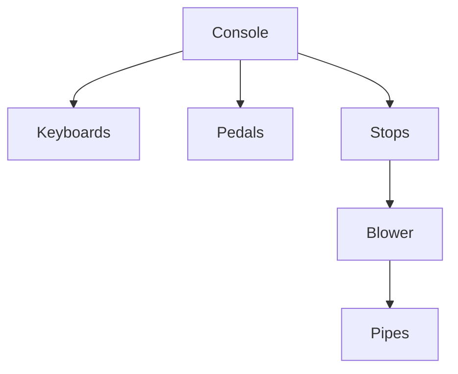

# Beginner Foundation: Organ

## 1. Everyday Intuition & First Principles
Imagine the organ as a giant, musical family. Just like how your family has different members who each play a unique role, the organ has various parts that work together to create beautiful music. The organ is like a musical storyteller, capable of producing a wide range of sounds from soft whispers to thunderous roars. It's a versatile instrument that can evoke different emotions and moods, much like how different voices in a family can express various feelings.

## 2. Foundational Vocabulary & Glossary
- **Pipes:** The organ's "voice." These are long metal or wooden tubes that produce sound when air passes through them.
- **Keyboards:** The organist's interface, similar to piano keys, used to control the flow of air to the pipes.
- **Pedals:** Large keys played with the feet, typically used for bass notes.
- **Stop:** A mechanism that opens or closes the air supply to a set of pipes, allowing the organist to choose which pipes to use.
- **Blower:** A fan or pump that provides the air needed to make the pipes produce sound.
- **Console:** The main control panel where the keyboards, pedals, and stops are located.
- **Diapason:** A type of pipe that produces a full, rich sound, often used as a foundational tone.
- **Reed:** A type of pipe that produces a reedy, vibrant sound, similar to a clarinet or reed organ.

## 3. Visual System Flow
### ASCII Diagram
```
+-------------------+
|     Console       |
|  +-----------+    |
|  |  Keyboards  |    |
|  +-----------+    |
|  +-----------+    |
|  |   Pedals    |    |
|  +-----------+    |
|  +-----------+    |
|  |    Stops    |    |
|  +-----------+    |
+-------------------+
          |
          v
+-------------------+
|     Blower        |
+-------------------+
          |
          v
+-------------------+
|      Pipes        |
+-------------------+
```

### Mermaid Flowchart


## 4. Common Beginner Misconceptions & Mental Traps
- **Misconception:** The organ is too complicated to learn.
  - **Reality:** Like any instrument, the organ has a learning curve, but breaking it down into manageable parts can make it more approachable.
- **Misconception:** You need to be able to play both hands and feet simultaneously to play the organ.
  - **Reality:** While it's ideal, many pieces can be played using just the hands or a combination of hands and feet, depending on the complexity.
- **Misconception:** The organ is only for churches and classical music.
  - **Reality:** The organ is a versatile instrument used in various genres, including jazz, rock, and popular music.

## 5. Socratic Discussion Starters
- What are your initial impressions of the organ, and how do you think it produces its unique sounds?
- How do you think the different stops on the console affect the sound of the organ?
- Can you imagine playing an organ piece with just one hand or one foot? How might that change the music?
- What are some ways the organ can be used in modern music genres besides classical?
- How do you think the size and number of pipes in an organ affect its sound and range?
