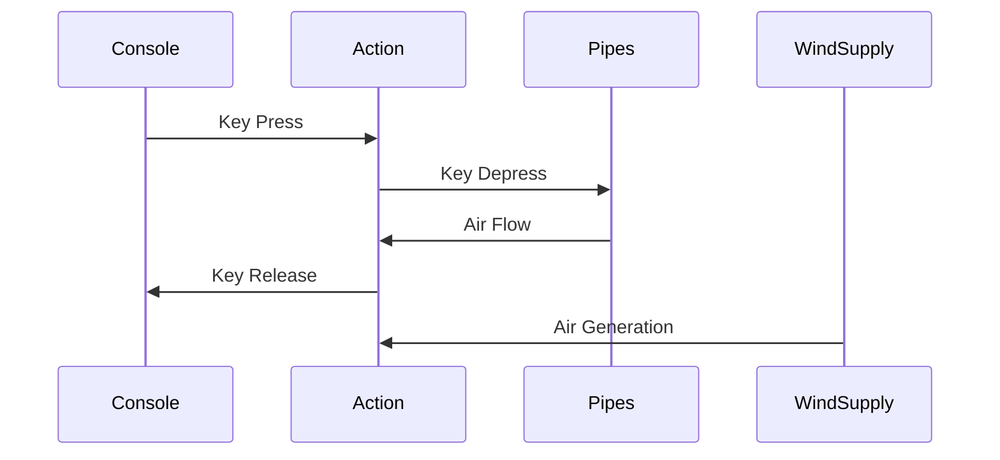

# Intermediate Foundation: Organ
## 1. Architectural Mental Model
The organ is a complex instrument with a rich history, and understanding its architecture is crucial for both performance and maintenance. Building on the foundational knowledge of the organ's components, this section delves into the production architecture, focusing on how these parts interact to produce sound.

### Key Components:
- **Keyboards:** Manual and pedal keyboards that control the pipes.
- **Pipes:** Metal or wooden tubes that produce sound when air passes through them.
- **Action:** Mechanism that connects the keys to the pipes, allowing air to flow.
- **Wind Supply:** System that provides the air to the pipes, typically through bellows.
- **Console:** The control panel where the musician operates the instrument.

### Production Architecture:
The organ's architecture can be visualized as a series of interconnected systems. The musician interacts with the console, which sends signals through the action to the pipes. The wind supply ensures that the pipes receive the necessary air to produce sound. Understanding this architecture helps in troubleshooting and optimizing performance.

## 2. Systems Taxonomy & Component Protocols
The organ's systems can be categorized into several key areas, each with its own protocols and data models that ensure smooth operation.

### Systems Taxonomy:
- **Mechanical Systems:** Includes the action and wind supply.
- **Electrical Systems:** Modern organs often incorporate electronic components for control and amplification.
- **Acoustic Systems:** Focuses on the pipes and their arrangement to produce specific tones.

### Component Protocols:
- **Key Action Protocols:** Define how the keys interact with the pipes.
- **Wind Supply Protocols:** Ensure consistent air flow to the pipes.
- **Electrical Control Protocols:** Govern the use of electronic components in modern organs.

### Data Models:
- **Pipe Configuration Models:** Describe the arrangement and characteristics of the pipes.
- **Key Mapping Models:** Define which keys correspond to which pipes.
- **Wind Supply Models:** Detail the wind pressure and distribution.

## 3. Multi-Component Interaction Flow
Understanding the interaction between components is essential for effective performance and maintenance. Below are detailed ASCII and Mermaid sequence diagrams illustrating the flow of signals and air through the organ.

### ASCII Diagram:
```
+-------------------+       +-------------------+       +-------------------+
|    Console        |       |     Action        |       |      Pipes        |
+-------------------+       +-------------------+       +-------------------+
| Key Press         |------>| Key Depress       |------>| Air Flow          |
|                   |<------| Key Release       |<------|                   |
+-------------------+       +-------------------+       +-------------------+
|                   |       |                   |       |                   |
+-------------------+       +-------------------+       +-------------------+
|    Wind Supply    |       |                   |       |                   |
+-------------------+       +-------------------+       +-------------------+
| Air Generation    |------>|                   |       |                   |
|                   |<------|                   |       |                   |
+-------------------+       +-------------------+       +-------------------+
```

### Mermaid Sequence Diagram:


## 4. Architectural Trade-offs & Production Pitfalls
Designing and maintaining an organ involves numerous trade-offs and potential pitfalls. Here are some key considerations:

### Trade-offs:
- **Mechanical vs. Electronic Action:** Mechanical actions offer a more traditional feel but require more maintenance. Electronic actions are more reliable but can lack the tactile feedback of mechanical systems.
- **Pipe Material:** Metal pipes produce a clearer, more resonant sound but are heavier and more expensive. Wooden pipes offer a warmer, more mellow tone but are more susceptible to changes in humidity and temperature.
- **Wind Supply:** Mechanical bellows provide a more natural wind supply but require more maintenance. Electric blowers are more convenient but can introduce a slight hiss.

### Production Pitfalls:
- **Poor Maintenance:** Neglecting regular maintenance can lead to mechanical failures and degraded sound quality.
- **Improper Wind Supply:** Inconsistent air pressure can cause uneven sound production and pipe damage.
- **Inadequate Acoustic Design:** Poorly designed acoustic spaces can dampen or distort the organ's sound.

## 5. Socratic Discussion Starters
Engaging in thoughtful discussions about the organ's architecture can deepen understanding and foster innovation. Here are some questions to consider:

- **How do the different types of actions (mechanical vs. electronic) affect the organ's sound and performance?**
- **What are the advantages and disadvantages of using metal vs. wooden pipes in an organ?**
- **How does the wind supply system impact the organ's sound quality, and what are the best practices for maintaining it?**
- **In what ways can modern technology be integrated into traditional organ design to enhance performance and accessibility?**
- **What are the key considerations in designing an acoustic space for an organ to ensure optimal sound quality?**

By exploring these questions, engineers and practitioners can gain a deeper understanding of the organ's architecture and improve their performance and maintenance practices.
