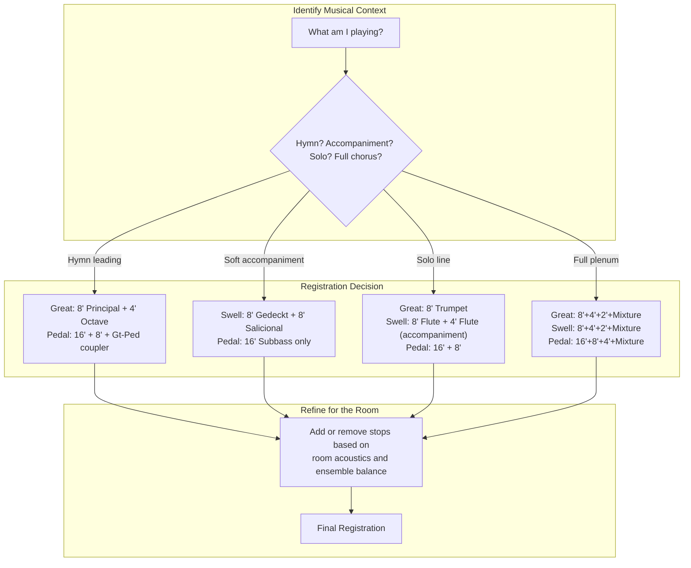
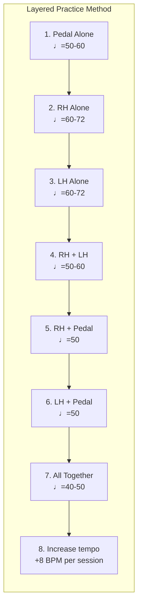

# Organ Performance: Console Technique, Registration, and Coordination Mastery

## Why the Organ Demands a Different Skillset

The pipe organ has no per-note dynamic control. Wind pressure is constant; a pipe speaks at full volume the moment wind is admitted and stops speaking the instant the valve closes. The keyboard does not respond to velocity. There is no sustain pedal. These constraints are not limitations — they define the organist's craft. Expression comes from three sources the piano cannot replicate: precise articulation (the exact duration of and silence between notes), registration (layering stops to build composite timbres and dynamic terraces), and the independence of hands and feet across multiple manuals and a 32-note pedalboard.

This lesson covers the complete organist's toolkit with concrete fingerings, pedaling charts, registration tables, and progressive drills. Everything here is designed to be practiced at a console.

---

## Part I: The Console — Posture, Touch, and Manual Technique

### Console Ergonomics and Bench Setup

The organ bench is your foundation. Before playing a single note, the bench position must be correct or every technique downstream will compensate for a faulty setup.

**Bench Height:** Adjust so that when seated upright, your forearms are approximately parallel to the manual surface, or angled very slightly downward at the elbow. If the bench is too high, your wrists will drop below the keys, collapsing hand arch. If too low, your wrists will rise, creating tension through the forearm.

**Bench Distance from Pedalboard:** Position the bench so your knees are slightly bent when your feet rest on the middle of the pedalboard (around C3-D3 area). You must be able to reach the lowest pedal (C2) and highest (G4) without lifting your hips or sliding forward. If you cannot reach the extremes, move the bench back slightly. If your knees lock straight, move it forward.

**Posture Checklist:**
- Sit on the front third of the bench, not the center
- Weight balanced on the sit bones, not slouched against a backrest (if present)
- Spine elongated, shoulders dropped and relaxed
- Elbows slightly below or at keyboard level, never raised
- Feet placed with heels slightly behind the natural keys, ready for toe-heel technique

**Organ Shoes:** Use dedicated organ shoes — thin leather soles (not rubber), low heel (approximately 1 inch), snug fit. The thin sole lets you feel the pedal edges. Rubber soles stick; leather glides. If you must practice in street shoes, choose the flattest, thinnest-soled pair available. Playing in socks is acceptable for feel but reduces precision on sharps.

### Organ Touch: Why It Differs from Piano

A pianist controls loudness through key velocity. An organist cannot — the pipe receives the same wind pressure regardless of how fast or hard the key is depressed. On a mechanical (tracker) action, the key opens a pallet valve against wind pressure; you feel the pallet "break" open, and the speed of key depression can subtly affect promptness of speech, but not volume. On electro-pneumatic actions, the key simply closes an electrical contact with no tactile feedback from the pipe.

The critical difference: a piano note decays after striking. An organ note sustains at constant amplitude until released. This means the organist controls musical shape entirely through **when notes begin and end**, not through how loud they are.

### Articulation: The Organist's Primary Expressive Tool

Since you cannot shape a note's volume, you shape music through the spaces between notes. There are four primary touch types, each with a specific physical technique:

**Legato:** Depress the next key a fraction of a second before releasing the current key. The goal is zero silence between consecutive notes. Physically, this means overlapping the key actions — your next finger is going down as your previous finger is coming up. Use finger substitution (below) to maintain legato when the hand must reposition.

**Non-Legato (Portato):** Release the current key a fraction of a second before depressing the next. There is a barely perceptible gap — perhaps 10-20 ms — that creates clarity without sounding detached. This is the default touch for most Baroque polyphonic music (Bach fugues, Pachelbel, Buxtehude). The silence between notes is itself musical: it defines the independence of each voice.

**Staccato:** Release the key quickly after playing, creating a clear gap of 50-100 ms. The finger lifts with a quick, relaxed motion from the knuckle joint. Do not press harder to play shorter — the organ does not respond to pressure. Quick release is all that matters.

**Tenuto:** Hold the note for its full notated value, then release cleanly at the last moment. This gives a note full weight and presence. In chorale settings, tenuto on melody notes gives them prominence against the accompaniment.

**Release Technique:** The release is as musical as the attack. A quick, clean release creates a crisp ending. A slow release (gradually lifting the finger) can smooth the transition to the next note in legato passages. In the swell box, combining a slow release with closing the expression pedal creates a fade effect impossible on piano.

### Finger Substitution: The Core Organ Manual Technique

The organ has no sustain pedal. To maintain true legato across passages where the hand must reposition, you substitute one finger for another on a held key without releasing the key. This is the single most important manual technique to master.

**Basic Movement:** Play and hold middle C with finger 2. Without releasing the key, silently slide finger 3 onto the same key beside (or replacing) finger 2. Now finger 2 is free to play the next note while C continues sounding under finger 3.

**Exercise 1: Sequential Substitution (Ascending C Major)**

Play with a metronome. Each note is a quarter note at the target tempo. The goal is seamless legato with no audible gap during substitution.

```
Tempo progression: ♩=50 → 60 → 72 → 84

Step 1:  C(1)  D(2)  E(3)  F(4)
Step 2:  Hold F — substitute finger 3 for finger 4 on F (no release)
Step 3:  G(4) — play G while releasing F with finger 3
Step 4:  Hold G — substitute finger 3 for finger 4 on G
Step 5:  A(4) — play A while releasing G with finger 3
Step 6:  Hold A — substitute finger 3 for finger 4 on A
Step 7:  B(4) — play B while releasing A with finger 3
Step 8:  Hold B — substitute finger 3 for finger 4 on B
Step 9:  C(4) — play C while releasing B with finger 3
```

The pattern: play with finger 4, substitute finger 3 while holding, play the next note with finger 4. This "walks" the hand up the scale maintaining full legato. Practice ascending and descending. The descending version mirrors: play with 3, substitute 4, play next note with 3.

**Exercise 2: Substitution in Two Voices (Chord Hold)**

This simulates real organ repertoire where one voice sustains while another moves.

```
Tempo: ♩=60 → 72 → 84

Left hand holds middle C (finger 2) for 4 beats.
Right hand plays: E(1) F(2) G(1) A(2) — quarter notes, legato
  - Hold E, substitute 2 for 1, play F with 1
  - Hold F, substitute 2 for 1, play G with 1
  - Hold G, substitute 2 for 1, play A with 2
```

**Exercise 3: Substitution with Chord Changes**

Play a four-note chord and sustain it while repositioning fingers for the next chord.

```
Tempo: ♩=50 → 60 → 72

Beat 1: C-E-G-C (fingers 1-2-3-5) — hold through beat 2
Beat 2: Substitute 4 for 3 on G (frees finger 3)
Beat 3: F-A-C-F (fingers 1-2-3-5) — move to next chord, maintaining legato in the outer voices
```

### Thumb Glissando

When two adjacent notes must be played legato but the fingering requires the thumb to cover both, slide the thumb from one key to the next without lifting. This is most common on adjacent naturals (E-F, B-C) or natural-to-adjacent-sharp.

**Exercise 4: Thumb Glissando on E-F**

```
Tempo: ♩=60 → 80 → 100

E(1) — F(1, slide thumb right) — G(3) — F(1) — E(1, slide thumb left) — D(3)
```

The thumb maintains contact with the key surface throughout the slide. Practice both directions (ascending and descending) on all adjacent natural pairs: E-F, B-C, and any natural-to-sharp pair like F-F# or C-C#.

**Exercise 5: Thumb Glissando in Scale Context**

D major scale, applying glissando where the thumb must slide:

```
D(1) E(2) F#(3) G(1) A(2) B(3) C#(1→gliss→) D(3)
```

Here the thumb slides from C# to D (adjacent naturals... actually C# to D is natural-adjacent-sharp-to-natural). The glissando maintains legato where a finger lift would create a gap.

### Finger Crossing: Under and Over

Standard piano fingerings apply, but the organist must plan crossings more carefully because there is no pedal to mask a gap. Cross-unders and cross-overs must be executed with the same overlap technique as substitutions.

**Exercise 6: Cross-Under with Legato**

```
Tempo: ♩=60 → 72 → 84 → 96

C(1) D(2) E(3) — cross 1 under to F(1) — G(2) A(3) — cross 1 under to B♭(1) — C(2)
```

The cross-under must happen with the same timing as a substitution: finger 1 is going down to F as finger 3 is releasing E. No gap.

### Manual Practice Routine Summary

| Drill | Technique | Starting Tempo | Target Tempo | Daily Reps |
|-------|-----------|----------------|-------------|------------|
| Exercise 1 | Sequential substitution (ascending/descending) | ♩=50 | ♩=84 | 4x each direction |
| Exercise 2 | Substitution with held note | ♩=60 | ♩=84 | 3x |
| Exercise 3 | Substitution with chord changes | ♩=50 | ♩=72 | 3x |
| Exercise 4 | Thumb glissando (E-F, B-C) | ♩=60 | ♩=100 | 5x each pair |
| Exercise 5 | Glissando in D major scale | ♩=60 | ♩=96 | 4x |
| Exercise 6 | Cross-under with legato | ♩=60 | ♩=96 | 4x |

---

## Part II: The Pedalboard — Toe-Heel Technique and Navigation

### Pedalboard Layout

The standard AGO (American Guild of Organists) pedalboard has 32 notes spanning C2 to G4. It is concave (higher at the extremes, lower in the center) and radiating (wider at the back than the front). This geometry places every note within comfortable reach of a seated organist without hip movement.

**Natural keys** (white) are on the upper plane. **Sharps/flats** (black) are on the lower plane, projecting toward the player. The arrangement mirrors a piano keyboard but the physical experience is entirely different — you are playing with your feet, and the spatial relationships must be memorized as proprioceptive patterns, not visual ones.

You should rarely look at the pedalboard while playing. Navigation is by feel: the sharps project forward and have distinct edges you can locate with the sole of your shoe. The naturals have a flat surface with a front edge. The gap between B and C, and between E and F (where there is no sharp), creates a tactile landmark.

### The Toe-Heel System

Organ pedal technique uses four playing surfaces:
- **Right Toe (RT):** Ball of the right foot, used for most notes
- **Right Heel (RH):** Heel of the right foot, used for adjacent naturals
- **Left Toe (LT):** Ball of the left foot
- **Left Heel (LH):** Heel of the left foot

**Key Principles:**
1. **Naturals are played with toes and heels.** Adjacent naturals (C-D, D-E, F-G, G-A, A-B) can be played with toe-heel on the same foot.
2. **Sharps are generally played with toes**, not heels, because they are on the lower plane and the heel cannot comfortably reach down to them. Use the opposite foot's toe when the playing foot is already occupied.
3. **Alternate feet for non-adjacent notes.** If notes are more than a second apart, alternate left and right foot toes.
4. **Heels stay close to the keys.** Do not lift the heel high off the pedalboard; this wastes time and breaks legato. The heel should glide along the surface to its next note.

### Pedal Scale Fingerings

**C Major Scale (Ascending) — Standard Toe-Heel**

| Note | C3 | D3 | E3 | F3 | G3 | A3 | B3 | C4 |
|------|-----|-----|-----|-----|-----|-----|-----|-----|
| Foot  | RT  | RH  | LT  | LH  | RT  | RH  | LT  | LH  |

The right foot plays C (toe) then rocks back to D (heel) without lifting off the pedalboard. The left foot then plays E (toe) and rocks back to F (heel). This alternating pattern continues up the scale.

**C Major Scale (Descending)**

| Note | C4 | B3 | A3 | G3 | F3 | E3 | D3 | C3 |
|------|-----|-----|-----|-----|-----|-----|-----|-----|
| Foot  | LH  | LT  | RH  | RT  | LH  | LT  | RH  | RT  |

The descending version reverses the pattern: the foot that ended the ascending scale (left heel on C4) starts the descent.

**G Major Scale (Ascending) — One Sharp**

| Note | G3 | A3 | B3 | C4 | D4 | E4 | F#4 | G4 |
|------|-----|-----|-----|-----|-----|-----|------|-----|
| Foot  | RT  | RH  | LT  | LH  | RT  | RH  | LT   | RT  |

F# is a sharp, played with the left toe. The right toe then plays G — the feet are now crossed (left on F#, right on G). Uncross by moving the left foot to its next position during the next phrase.

**F Major Scale (Ascending) — One Flat**

| Note | F3 | G3 | A3 | B♭3 | C4 | D4 | E4 | F4 |
|------|-----|-----|-----|------|-----|-----|-----|-----|
| Foot  | RT  | RH  | LT  | RT   | LT  | RH  | LT  | LH  |

B♭ is a sharp-position note, played with the right toe (opposite foot from the preceding A, which was left toe). Then the left toe plays C, and the pattern continues.

### Pedal Practice Drills

**Drill 1: C Major Scale (One Octave, Ascending and Descending)**

```
Notes: C3 D3 E3 F3 G3 A3 B3 C4 B3 A3 G3 F3 E3 D3 C3
Pedaling: RT RH LT LH RT RH LT LH LT RH RT LH LT RH RT
Tempo: ♩=50 → 60 → 72 → 84
Articulation: Legato (overlap toe-heel transitions)
Repetitions: 4x ascending, 4x descending, 4x round-trip
```

Practice this until the toe-heel rocking motion is smooth and automatic. The key sensation is the ankle pivot: the toe presses down, then the heel presses down while the toe releases, all on the same foot without lifting off the pedalboard.

**Drill 2: Pedal Arpeggios (C Major Triad)**

```
Notes: C3 E3 G3 C4 G3 E3 C3
Pedaling: RT LT RT LT RT LT RT
Tempo: ♩=50 → 60 → 72 → 84
Notes: All toes (arpeggios span intervals larger than a second, so heels are not used)
Repetitions: 4x ascending, 4x descending, 4x round-trip
```

**Drill 3: Pedal Points with Toe-Heel Alternation**

Hold a low C (RT) for 8 beats. While holding, play the following with the left foot only:
```
Left foot: E3(LT) F3(LH) G3(LT) A3(LH) — quarter notes
Tempo: ♩=60 → 72 → 84
Purpose: Develop independence between feet (one holds, one moves)
Repetitions: 4x
```

**Drill 4: Chromatic Approach Notes**

Pedal walking bass with chromatic approach, a common service-playing pattern:
```
Notes: F#3 G3 — C#4 D4 — G#3 A3
Pedaling: LT RT — LT RT — LT RT
Tempo: ♩=60 → 72 → 84
Purpose: Practice sharp-to-natural resolution with opposite-foot toes
Repetitions: 4x per pattern
```

**Drill 5: Octave Jumps**

```
Notes: C3 C4 C3 C4 — repeat through 4 octaves
Pedaling: RT RT RT RT (same foot, jump the octave)
Tempo: ♩=40 → 50 → 60 → 72
Purpose: Develop distance judgment on the pedalboard without looking
Repetitions: 4x up and down the pedalboard
```

Start slowly. The goal is to land precisely on the octave without looking down. Use the tactile landmarks (E-F and B-C gaps) to orient.

### Pedal Technique Troubleshooting

| Problem | Cause | Fix |
|---------|-------|-----|
| Notes sound muddy or overlap | Releasing too slowly | Lift the toe/heel crisply; practice staccato first, then add legato |
| Cannot reach heel to adjacent natural | Bench too high or shoes too thick | Lower bench; use thinner-soled shoes; practice ankle flexibility |
| Foot cramps during long passages | Tension in ankle | Relax the ankle between notes; the foot should not be rigidly pointed |
| Hitting wrong pedal notes | Looking at hands, not feet | Memorize the tactile map; practice pedal alone with eyes closed |
| Heel catches on sharp keys | Heel dragging too low | Keep heel slightly elevated; it should contact only natural keys |

---

## Part III: Registration — Building and Shaping Sound

### Acoustic Basis: How Stops Produce Different Timbres

Organ pipes fall into two families. **Flue pipes** produce sound the same way a recorder does: wind is directed through a windway against a sharp edge (the labium), creating an oscillating air column. The pipe's diameter-to-length ratio (scaling) determines timbre: wide pipes produce strong fundamental with few harmonics (flute tone), narrow pipes produce rich upper harmonics (string tone), and medium scaling produces balanced spectra (principal tone). **Reed pipes** use a vibrating brass tongue against a brass shallot as the excitation, with a resonator tube shaping the timbre. The reed determines pitch; the resonator colors it.

From the player's perspective: principals are your foundation, flutes are transparent and soft, strings add edge and intensity, and reeds provide color and power. Understanding this taxonomy is enough to make registration decisions; the physical details are the voicer's domain.

### Stop Families and Their Characteristics

| Family | Tone Quality | Typical Stops | Use Case |
|--------|-------------|----------------|----------|
| Principal (Diapason) | Foundational, balanced harmonics | 8′ Principal, 4′ Octave, 2′ Doublette | Core of the organ; hymn leading, chorales |
| Flute | Soft, fundamental-dominant, few upper harmonics | 8′ Gedeckt (stopped), 4′ Flute, 2′ Piccolo | Soft accompaniment, transparent textures |
| String | Narrow scaling, edgy, pronounced upper harmonics | 8′ Salicional, 8′ Viola, 4′ Salicet | Solo accompaniment, ethereal effects |
| Reed | Bold, complex spectrum with formant peaks | 8′ Trumpet, 8′ Oboe, 16′ Fagotto, 4′ Clarion | Solo lines, chorus enhancement, pedal bass |

### Pitch Levels and the Octave System

Organ stop names include a pitch designation in feet (′), derived from the length of the longest pipe in the rank:

| Pitch | Sounding | Function |
|-------|----------|----------|
| 16′ | One octave below unison | Pedal foundation; adds depth to manual chorus |
| 8′ | Unison (written pitch) | Foundational pitch; one 8′ stop is the minimum for solo or accompaniment |
| 4′ | One octave above | Adds brilliance and clarity |
| 2′ | Two octaves above | Brilliance; part of the plenum (chorus) |
| 2⅔′ | Twelfth (octave + fifth) | Mutation stop; adds a fifth-related harmonic for color |
| 1⅗′ | Nineteenth (two octaves + major third) | Mutation; part of mixture breaks |
| Mixture (II–VI ranks) | Crown harmonics (15th, 19th, 22nd, 26th, etc.) | Brilliance and "fire" in the chorus |

Mutation stops (2⅔′, 1⅗′) do not sound at unison pitch — they add specific harmonics that change the timbre without adding fundamental. They are essential for French Classical registration (Jeux de Tierce) and add color to Baroque chorales.

### Practical Registration Tables

These tables cover the most common musical situations. Adjust based on the specific instrument — a 12-stop chamber organ cannot replicate a 60-stop cathedral organ. The principle is the same: build from the foundation outward.

**Registration A: Congregational Hymn (Leading)**

| Division | Stops | Purpose |
|----------|-------|---------|
| Great | 8′ Principal, 4′ Octave, 2′ (if available) | Melodic clarity and projection to lead singing |
| Pedal | 16′ Principal (or Subbass), 8′ Octave, 4′ (optional) | Bass support and rhythmic foundation |
| Couplers | Great to Pedal | Pedal follows Great manual |
| Swell (optional) | 8′ Principal, 4′ | Add for final stanza if more power needed |
| Swell to Great (optional) | — | Add for final stanza |

The Great is the leading manual because it has the most direct, unenclosed sound. Play the hymn melody with the right hand on Great, ensuring it sings above the inner voices. Do not over-register — if the congregation cannot hear themselves sing, the registration is too loud.

**Registration B: Soft Accompaniment (Choir with Organ)**

| Division | Stops | Purpose |
|----------|-------|---------|
| Swell | 8′ Gedeckt, 8′ Salicional (optional) | Transparent, soft accompaniment |
| Pedal | 16′ Subbass (bourdon), 8′ Octave (light) | Gentle bass support |
| Couplers | Swell to Pedal (if weak pedal division) | Support pedal bass |

The Swell is preferred for accompaniment because the expression pedal allows dynamic flexibility to follow the choir. Use the softest 8′ stops available; the goal is to support, not cover.

**Registration C: Solo Trumpet Line**

| Division | Stops | Purpose |
|----------|-------|---------|
| Great | 8′ Trumpet (or 4′ Clarion for higher register) | Solo melodic line |
| Swell | 8′ Gedeckt, 4′ Flute | Accompaniment (played on separate manual) |
| Pedal | 16′ Subbass, 8′ Octave | Bass line support |
| Couplers | Swell to Pedal | Pedal follows accompaniment |

Play the solo on the Great (or whichever division has the Trumpet) and accompany on the Swell. The contrast between the bold reed and soft flutes creates the dialogue effect characteristic of this registration.

**Registration D: Baroque Plenum (Full Chorus)**

| Division | Stops | Purpose |
|----------|-------|---------|
| Great | 8′ Principal, 4′ Octave, 2′ Doublette, Mixture III–IV | Primary chorus |
| Swell (or Positive) | 8′ Principal, 4′ Flute, 2′ Piccolo, Mixture II | Secondary chorus (dialogue, echo) |
| Pedal | 16′ Principal, 8′ Octave, 4′ Superoctave, Mixture | Pedal chorus |
| Couplers | Great to Pedal | Unify the sound |
| Reed (optional) | 8′ Trumpet on Great | Adds edge and definition |

The plenum is built from the 8′ up: add the 8′ first, then 4′, then 2′, then mixture. Each addition should be clearly audible as an addition, not a muddy thickening. If adding a stop does not produce a distinct change, the stop may need voicing or it is redundant.

**Registration E: French Classical Plein Jeu**

| Division | Stops | Purpose |
|----------|-------|---------|
| Great | 8′ Principal, 4′ Octave, 2⅔′ Nazard, 2′ Doublette, 1⅗′ Tierce, Mixture | Characteristic French chorus with Tierce color |
| Pedal | 16′ Montre, 8′ Prestant | Pedal support |
| Couplers | Great to Pedal | — |

The Tierce (1⅗′) is the defining color of the French Classical sound. It sounds the major third two octaves above, giving the chorus its characteristic "buzz" or "fire." This registration is used for French Baroque repertoire (Couperin, de Grigny, Marchand).

### Couplers and Division Management

Couplers allow one division's stops to play from another division's keyboard. They are the organist's tool for expanding sound across the instrument:

| Coupler | Effect | When to Use |
|--------|--------|-------------|
| Swell to Great | Swell stops sound when playing Great | Build a larger chorus on the Great |
| Great to Pedal | Pedal plays the Great's stops | Strengthen pedal bass; unifies sound |
| Swell to Pedal | Pedal plays the Swell's stops | Soft pedal with expression control |
| Octave couplers (4′) | Add the note one octave above | Additional brilliance (use sparingly) |
| Unison Off | Mutes the division's own stops | Play couplers only (advanced) |

**Coupler Caution:** Adding couplers increases the key weight on mechanical action organs and can cause ciphering (stuck notes) on poorly maintained instruments. Add couplers one at a time and listen for unintended consequences.

### The Swell Expression Pedal

The swell box encloses a division's pipes behind louvers (shutters) that open and close, controlling volume dynamically. The expression pedal operates these louvers. This is the organist's closest equivalent to dynamic control.

**Technique:**
- The swell pedal is typically operated by the right foot
- Keep the right heel on the pedalboard and use the right toe for the swell shoe when possible
- Alternatively, play pedal notes with the left foot while the right foot operates the swell
- For extended pedal passages, "park" the swell pedal at a fixed position and resume expression when the right foot is free

**Swell Pedal Drill:**

```
Tempo: ♩=60
Play a sustained C major chord on the Swell (8′ Gedeckt + 4′ Flute) for 8 beats.
  Beats 1-2: Swell closed (pp)
  Beats 3-4: Gradually open to mf
  Beats 5-6: Fully open (f)
  Beats 7-8: Gradually close back to pp
Repeat with right foot on swell pedal, left foot holding C pedal.
Tempo: ♩=50 → 60 → 72
Repetitions: 4x
```

The goal is smooth, continuous dynamic change — no stepping or jerky motion. The swell pedal should feel like a breath, not a switch.



---

## Part IV: Coordination and Independence

### The Layered Practice Method

The organist must coordinate two hands on (potentially) different manuals plus two feet on the pedalboard — four independent limbs. This is the organ's central technical challenge. The solution is systematic layered practice.

**The Golden Rule:** Never practice all parts together until each layer is secure individually and in pairwise combination. Jumping straight to full texture leads to learned errors that are harder to fix than learning it right from the start.

### Practice Sequence for Any New Piece



Steps 5 and 6 are the hardest and most important. Hand-plus-pedal coordination is where most organists struggle, and skipping these layers produces insecure performances.

### Progressive Coordination Drills

**Drill 1: Static Pedal Point (Beginning Level)**

```
Right hand: C major scale ascending, quarter notes, one octave
Left hand: Steady half notes on C (middle C), alternating fingers 1-3-1-3
Pedal: Hold low C (RT) for 8 beats
Tempo: ♩=50 → 60 → 72 → 84
Repetitions: 4x
Purpose: Three-limb independence with minimal pedal complexity
```

**Drill 2: Contrary Motion (Intermediate Level)**

```
Right hand: C major scale ascending, quarter notes
Left hand: C major scale descending (mirror fingering), quarter notes
Pedal: Pedal point C (RT) for 4 beats, then G (LT) for 4 beats
Tempo: ♩=40 → 50 → 60 → 72
Repetitions: 4x
Purpose: Hands move independently while pedal holds steady
```

**Drill 3: Moving Pedal with Static Hands (Intermediate Level)**

```
Right hand: Hold C-E-G chord (C major), whole notes
Left hand: Hold C-E-G chord (lower octave), whole notes
Pedal: C-G-A-F (bass line pattern), quarter notes
Tempo: ♩=50 → 60 → 72
Repetitions: 4x
Purpose: Feet move while hands hold; prevents the common problem of hands following feet
```

**Drill 4: Full SATB Hymn Texture (Intermediate Level)**

Play a simple four-part hymn (e.g., first phrase of "Amazing Grace" in G major):
```
Soprano + Alto (right hand, on Great): melody and inner voice
Tenor (left hand, on Great or Swell): tenor line
Bass (pedal): bass line

Step 1: Learn pedal alone (♩=50)
Step 2: Learn RH alone (soprano + alto, ♩=60)
Step 3: Learn LH alone (tenor, ♩=60)
Step 4: RH + LH together (♩=50)
Step 5: RH + Pedal together (♩=40)
Step 6: LH + Pedal together (♩=40)
Step 7: All together (♩=40)
Step 8: Gradually increase to performance tempo (♩=72-84)
```

**Drill 5: Rhythmic Independence (Advanced Level)**

```
Right hand: Quarter notes (steady pulse)
Left hand: Eighth notes (2x speed of RH)
Pedal: Half notes (0.5x speed of RH)
Key: C major, notes from C major triad
Tempo: ♩=50 → 60 → 72 → 84
Repetitions: 4x each combination
Purpose: Three-way rhythmic independence (1:2:4 ratio)
```

This drill is adapted from keyboard independence exercises in the Hanon/Czerny tradition but adds the pedal dimension unique to organ.

### Hymn Playing as Coordination Practice

Hymn playing is the most practical coordination exercise for service-playing organists. It requires four-voice reading, pedal bass, and registration management simultaneously.

**Hymn Playing Method:**

1. **Read the SATB:** Soprano and alto in the right hand, tenor in the left hand, bass in the pedal. This is the standard SATB-to-organ mapping.
2. **Finger the legato:** Apply finger substitution to maintain legato in each voice. Mark substitutions in the score with small numbers above the notes.
3. **Pedal the bass:** Write toe-heel markings (RT, RH, LT, LH) under each bass note.
4. **Practice in layers:** Follow the layered method above.
5. **Add registration:** Practice engaging and disengaging stops between stanzas while maintaining tempo.

**Practice Hymn: "Amazing Grace" in G Major**

Soprano (melody): G B D G B D B G E D B G
Alto: D G B D G G B G C# B G D
Tenor: B D G B D D D D E D B B
Bass (pedal): G B D G B G D G C# G B G

```
Pedaling for bass line:
G(RT) B(LT) D(RT) G(LT) B(RT) G(LT) D(RT) G(LT) C#(RT) G(LT) B(RT) G(LT)
```

Practice the pedal line alone first at ♩=50, then hands alone at ♩=60, then combine following the layered method.

---

## Part V: Service Playing and Repertoire Application

### Hymn Accompaniment Method

Leading congregational singing is the organist's primary job in most church positions. The technique differs from solo playing in important ways:

**Tempo:** Match the congregation's breathing pace. Most hymns sing well at ♩=66-80 depending on the hymn's character. Marching hymns ("A Mighty Fortress") move at ♩=80-88; contemplative hymns ("Amazing Grace") at ♩=60-66.

**Articulation for Hymns:** Use non-legato for the melody (slight separation between notes for clarity) and legato for the inner voices. The congregation needs rhythmic clarity from the melody, but the harmony should be smooth.

**Breath Points:** Slightly lengthen the note before a phrase break (agogic accent) to signal the breath to the congregation. This is the organist's equivalent of a conductor's breath cue.

**Registration Changes Between Stanzas:**
- Stanza 1: Base registration (Registration A above)
- Stanza 2: Add Swell 4′ for brightness
- Stanza 3: Move to Swell manual with softer registration (reflective stanza)
- Final stanza: Full plenum + reeds + couplers for maximum power

Practice engaging stops without losing the beat. If the organ has thumb pistons or toe studs, set them in advance so a single press changes the registration.

### Choral Accompaniment

When accompanying a choir, the organist must balance support with transparency:

1. **Play the choral parts** (SATB) when the choir is uncertain, reducing to bass + melody when they are confident
2. **Use the Swell** for accompaniment to allow dynamic flexibility with the expression pedal
3. **Double the bass** in the pedal at 16′ for tonal foundation
4. **Do not cover the singers** — use softer stops than you think you need; the organ is louder than it sounds from the console

### Repertoire Preparation Guide

**Beginning Level (1-2 years of organ study):**

| Piece | Key | Technical Focus | Practice Tempo → Performance Tempo |
|-------|-----|-----------------|--------------------------------------|
| Bach, Eight Little Preludes and Fugues (BWV 553-560) — start with BWV 555 (G major) | G major | Independent pedal line, two-voice fugue | ♩=50 → ♩=72 |
| Bach, chorale prelude "Gott durch deine Güte" (BWV 717) | C major | Chorale-based, pedal cantus firmus | ♩=50 → ♩=72 |
| Böhm, chorale prelude "Vater unser im Himmelreich" | G minor | Chorale harmonization, manual only | ♩=60 → ♩=80 |
| Lübeck, Praeludium in C major | C major | Light prelude-bicinium structure | ♩=52 → ♩=76 |

**Practice Guide for BWV 555 (Prelude and Fugue in G major):**

1. Learn the pedal line alone. The pedal has an independent bass line, not just chord roots.
2. Practice the prelude in short 4-measure segments, hands separate then together.
3. The fugue: learn the subject alone, then learn each entrance in order.
4. Layered practice: pedal → RH → LH → RH+LH → RH+P → LH+P → All
5. Articulation: non-legato in the fugue subject (clear separation for polyphonic clarity), legato in the prelude's sequential passages
6. Registration: 8′ Principal + 4′ Octave on Great, 8′ + 4′ on Pedal, Great to Pedal coupler

**Intermediate Level:**

| Piece | Key | Technical Focus | Practice Tempo → Performance Tempo |
|-------|-----|-----------------|--------------------------------------|
| Bach, "Little" Fugue in G minor (BWV 578) | G minor | Four-voice fugue, pedal subject entrance | ♩=52 → ♩=76 |
| Buxtehude, Praeludium in C major (BuxWV 137) | C major | Stylus fantasticus, free sections + fugal | ♩=60 → ♩=80 |
| Pachelbel, Fugue in C minor | C minor | Magnificat fugue, subject inversion | ♩=54 → ♩=72 |
| Brahms, "Es ist ein Ros' entsprungen" (Op. 122, No. 8) | F major | Romantic chorale prelude, expressive | ♩=52 → ♩=66 |

**Advanced Level:**

| Piece | Key | Technical Focus | Practice Tempo → Performance Tempo |
|-------|-----|-----------------|--------------------------------------|
| Bach, Passacaglia in C minor (BWV 582) | C minor | Ostinato bass, 20 variations, fugue | ♩=48 → ♩=66 |
| Bach, Prelude and Fugue in B minor (BWV 544) | B minor | Large-scale, complex fugue | ♩=48 → ♩=60 |
| Franck, Choral No. 1 in E major | E major | Romantic, expressive registration | ♩=40 → ♩=54 |
| Widor, Toccata (Symphony V) | F major | Fast manual octaves, pedal scales | ♩=72 → ♩=100+ |

### National Style Guidelines

Different repertoires demand different approaches to touch and registration:

**German Baroque (Bach, Buxtehude, Pachelbel):**
- Touch: Non-legato for fugue subjects and fast passagework; legato for slow movements and chorale settings
- Registration: Build chorus from principals; add mutations for color; reeds used as solo colors, not in chorus
- Dynamics: Terraced — change manuals or add stops for dynamic shifts, not expression pedal
- Tempo: Steady; agogic accent for important beats but minimal rubato

**French Classical (Couperin, de Grigny, Marchand):**
- Touch: Delicate, precise; inégale (rhythmic unequalization) applies to paired sixteenth notes at moderate tempos
- Registration: Specific fixed combinations — Plein Jeu for grands motets, Jeu de Tierce for color, Grand Jeu for climactic sections
- Dynamics: Terraced with manual changes; swell pedal not available (French Classical organs lacked swell boxes)
- Tempo: Flexibility within sections for inégale; rallentando at phrase ends

**English Cathedral (Stanford, Parry, Howells, Wesley):**
- Touch: Legato throughout; smooth voice leading
- Registration: Romantic palette — 8′ foundations, string stops, soft reeds; swell pedal for dynamic shaping
- Dynamics: Continuous expression through swell pedal; crescendos and decrescendos
- Tempo: Moderate rubato; breathing space between phrases

**French Symphonic (Widor, Vierne, Franck):**
- Touch: Legato with occasional detachment for clarity; heavy finger technique for sustained sound
- Registration: Layered dynamics using the many divisions; swell-to-great couplings build climax; reeds and mixtures for tutti
- Dynamics: Extensive swell pedal work; "spreading" the sound across divisions for gradual build
- Tempo: Broad tempos with expressive rubato

---

## Part VI: Home Practice Setup with Digital Organs

### Why a Digital Practice Organ Matters

Access to a pipe organ is limited. Most organists practice at home on a digital instrument — either a hardware digital organ or a software simulator like Hauptwerk. The goal is not to replicate a pipe organ perfectly but to provide a practice environment with correct keyboard feel, pedalboard, and enough tonal variety to practice registration concepts.

### Hardware Requirements

**Minimum viable practice organ:**

| Component | Minimum | Recommended |
|-----------|---------|-------------|
| Manual 1 (Great) | 61-key MIDI keyboard, unweighted or semi-weighted | 61-key, weighted or semi-weighted with escapement feel |
| Manual 2 (Swell) | 49-key MIDI keyboard | 61-key MIDI keyboard |
| Pedalboard | 13-key MIDI pedalboard (C-C) | 32-key MIDI pedalboard (C-G, AGO spec) |
| Expression pedal | 1 MIDI continuous controller pedal | 2 (one for Swell, one for Crescendo) |
| MIDI interface | Single-port USB MIDI interface | Multi-port (2+ ports for multiple manuals) |
| Audio interface | Built-in or USB, 44.1 kHz | ASIO-compatible, 24-bit/48 kHz, low latency |
| Headphones | Any closed-back | Studio reference closed-back |
| Computer | Dual-core, 8 GB RAM | Multi-core (8+ threads), 16+ GB RAM |

**MIDI Controller Recommendations:**
- Pedalboard: Roland PK-5A (13-note, affordable), Roland DO-200 (32-note, AGO spec), or custom-built 32-note MIDI pedalboard
- Manuals: Any MIDI keyboard with a socket for the expression pedal; disable velocity sensitivity in the software
- Expression pedal: Roland EV-5, M-Audio EX-P, or FV-500L

### Hauptwerk Configuration for Practice

Hauptwerk is the industry-standard software organ simulator. It uses high-quality sampled pipe sets with modeled wind systems, release tails, and tremulants. The free version supports basic practice; the paid version adds larger sample sets and advanced features.

**Setup Procedure:**

1. **Install Hauptwerk** from the developer's website (Hauptwerk 7 or later). Follow the standard installer.

2. **Select a sample set.** Free high-quality options include:
   - Piotr Grabowski's instruments (grabowskiorgan.com) — multiple styles, well-documented stop lists
   - Sonus Paradisi free demos
   - Built-in demonstration organs in Hauptwerk

3. **Configure MIDI mapping:**
   - Open Hauptwerk Settings → MIDI ports
   - Assign Manual 1 keyboard to Great division (MIDI channel 1)
   - Assign Manual 2 keyboard to Swell division (MIDI channel 2)
   - Assign pedalboard to Pedal division (MIDI channel 3)
   - Assign expression pedal to Swell expression (MIDI CC 11 or CC 4)
   - Disable velocity sensitivity on all manuals (organ pipes do not respond to key velocity)

4. **Configure audio:**
   - Set ASIO driver (not WDM/MME) for low latency
   - Buffer size: 256 samples for practice (≈5 ms latency at 48 kHz), 128 for performance
   - Sample rate: 48 kHz
   - Disable any software reverb or effects for transparent practice monitoring

5. **Enable wind model** (if available in the sample set):
   - This simulates pressure drop when many pipes speak simultaneously
   - Essential for understanding how registration affects wind stability

**Practice-Specific Configuration:**

- Set up a "practice" organ with one clear 8′ Principal on Great and 8′ Subbass on Pedal — the minimum registration for manual+pedal coordination drills
- Save registration presets as "combinations" for quick recall during hymn practice
- Use the built-in recorder to capture practice sessions for self-assessment
- Set the metronome in your DAW or use Hauptwerk's built-in tempo display

### Alternative: GrandOrgue (Open Source)

GrandOrgue is a free, open-source alternative that reads Hauptwerk sample set files. It lacks the wind model and some advanced features but is sufficient for technique practice.

```
Installation (Linux example):
sudo apt install grandorgue

Configuration:
1. File → Settings → MIDI — map keyboards and pedal
2. File → Settings -> Audio — set buffer to 256, sample rate to 48 kHz
3. Load an ODF file (Hauptwerk format sample set definition)
4. Assign stops to keyboard divisions
```

### Self-Assessment Recording Workflow

Recording practice sessions is the fastest way to improve. The organist cannot hear accurately from the console — the pipes (or speakers) are too close for objective assessment.

```
Recording Setup:
1. DAW: Reaper (free evaluation), Ableton Live, or Logic Pro
2. Route Hauptwerk audio to DAW via virtual audio cable or hardware loopback
3. Record at 24-bit/48 kHz
4. Listen back on studio headphones or monitors

Assessment checklist:
□ Are all notes speaking? (Check for missed pedals or manual notes)
□ Is the articulation consistent? (Legato where intended, non-legato where intended)
□ Is the tempo steady? (Use DAW tap-tempo on playback)
□ Are registration changes clean? (No gaps or unintended stops)
□ Is the pedal line independent? (Not following the left hand)
□ Are phrase shapes clear? (Agogic accents and releases are audible)
```

---

## Appendix: Quick Reference

### Manual Technique Quick Reference

| Technique | Physical Action | When to Use |
|-----------|----------------|------------|
| Legato | Overlap key depression: next finger down as previous releases | Smooth connected phrases, Romantic repertoire |
| Non-legato | Small gap (10-20 ms) between notes | Baroque polyphony, clarity in fugues |
| Staccato | Quick release, 50-100 ms gap | Light passages, ornamented movements |
| Finger substitution | Replace one finger with another on a held key | Maintaining legato when hand repositions |
| Thumb glissando | Slide thumb between adjacent keys | Legato on adjacent seconds where fingering requires |
| Cross-under | Pass thumb under fingers | Scale passages ascending |
| Cross-over | Pass a higher-numbered finger over the thumb | Scale passages, arpeggios |

### Pedal Technique Quick Reference

| Note Pattern | Recommended Pedaling | Notes |
|--------------|----------------------|-------|
| Adjacent naturals (C-D, D-E, F-G, etc.) | Toe-Heel (same foot) | Rock the ankle, keep foot on pedalboard |
| Natural to sharp (C-C#, F-F#, etc.) | Opposite foot toes | Heels cannot reach sharps |
| Thirds and larger | Alternate foot toes | Switch feet for each note |
| Octave jumps | Same foot toe, jump the distance | Practice with eyes closed for feel |
| Sustained bass note | One foot holds, other foot plays moving notes | Common in hymn bass lines |
| Pedal point | Right toe holds, left foot handles rest | Right foot frees for swell pedal if needed |

### Registration Quick Reference

| Musical Context | Great | Swell | Pedal | Couplers |
|----------------|-------|-------|-------|----------|
| Hymn (standard) | 8′ Prin + 4′ Oct | (optional: add for final stanza) | 16′ + 8′ | Gt-Ped |
| Hymn (final stanza) | 8′ Prin + 4′ Oct + 2′ + Mix | 8′ + 4′ + Mix | 16′ + 8′ + 4′ | Gt-Ped, Sw-Gt |
| Soft accompaniment | — | 8′ Ged + 8′ Sal | 16′ Subbass | Sw-Ped |
| Solo trumpet | 8′ Trumpet | 8′ Ged + 4′ Flute (accomp.) | 16′ + 8′ | — |
| Baroque plenum | 8′ + 4′ + 2′ + Mix | 8′ + 4′ + 2′ + Mix | 16′ + 8′ + 4′ + Mix | Gt-Ped |
| French Plein Jeu | 8′ + 4′ + 2⅔′ + 2′ + 1⅗′ + Mix | — | 16′ + 8′ | Gt-Ped |
| Romantic tutti | 8′ + 4′ + 2′ + Mix + 8′ Trumpet | 8′ + 4′ + 2′ + Mix + 8′ Trumpet | 16′ + 8′ + 4′ + 16′ Fagotto | Gt-Ped, Sw-Gt |

### Daily Practice Checklist

```
Warm-up (10 minutes):
□ Manual technique drills (Exercises 1-6): ♩=50 → target tempo
□ Pedal scale drills (Drills 1-2): ♩=50 → target tempo
□ Coordination drill (Drill 1 or 2): ♩=50 → target tempo

Repertoire (40 minutes):
□ Current piece: layered practice (P → RH → LH → RH+LH → RH+P → LH+P → All)
□ Tempo: 80% of performance speed; increase only when secure
□ Record at least one take for self-assessment

Service Music (10 minutes):
□ One hymn: SATB reading, pedal bass, registration changes between stanzas
□ Practice engaging stops without losing tempo

Cool-down (5 minutes):
□ Play a familiar piece at performance tempo for enjoyment
□ Review what improved today and what needs work tomorrow
