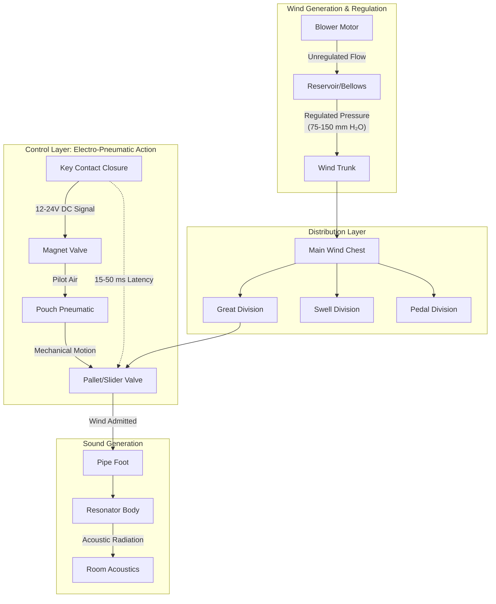

# Operational Verification of the Pipe Organ: Architecture, Acoustics, and Empirical Analysis

## Objective & Laboratory Rationale

The pipe organ represents one of the most complex acoustic-mechanical instruments ever constructed, embodying centuries of refinement in pneumatic engineering, acoustic physics, and tonal architecture. This laboratory provides rigorous hands-on experience with organ verification methodologies spanning three domains: architectural implementation and validation, parametric variation with quantitative acoustic analysis, and failure mode characterization under boundary conditions.

Through both physical and digital approaches, participants will develop competency in verifying organ behavior from first principles—understanding wind system dynamics, pipe acoustics, action mechanisms, and tonal synthesis. The lab emphasizes measurement-driven verification rather than subjective assessment, requiring participants to quantify frequency response, harmonic spectra, transient behavior, and fault recovery characteristics.

This laboratory is structured for advanced students in organology, acoustical engineering, music technology, or historical performance practice who require operational verification skills for instrument restoration, digital modeling validation, or performance optimization.

## Foundational Context: Organ Architecture and Acoustical Principles

### Pneumatic System Architecture

The pipe organ operates as a distributed pneumatic computing system. At its core lies the wind system: a regulated pressure source (traditionally bellows, modernly electric blowers) maintains steady-state pressure in a wind chest (typically 75–150 mm H₂O, or 2.9–5.9 inches, depending on pipe scaling). This pressure reservoir feeds multiple wind chests through carefully dimensioned trunks and conductors designed to minimize pressure drop under dynamic load.

The action mechanism—whether mechanical (tracker), pneumatic (tubular-pneumatic), electro-pneumatic, or direct electric—serves as the control layer, translating key depression into valve states. A mechanical tracker action exhibits a direct physical linkage: key depression opens a pallet valve via a system of squares, rollers, and backfalls, admitting wind to a specific channel in the wind chest. The relationship between key travel distance and pallet opening follows a nonlinear function determined by the lever ratios and spring resistance.

Electro-pneumatic actions decouple control from pneumatics through electromagnets that trigger pneumatic valves. This architecture introduces latency (typically 15–50 ms key-to-speech depending on system pressure and valve design) but enables flexibility in console placement and unified combination actions.

### Pipe Acoustics and Resonance Modes

Organ pipes function as open or stopped cylindrical or conical resonators. For an open cylindrical flue pipe, the fundamental resonant frequency follows:

```
f₀ = c / (2 × L_eff)
```

where `c` is the speed of sound (~343 m/s at 20°C) and `L_eff` is the effective acoustic length, incorporating an end correction of approximately 0.6 × diameter at each open end. A stopped pipe (closed at one end) resonates at half the frequency of an equivalent open pipe, as it supports only odd harmonics:

```
f_stopped = c / (4 × L_eff)
```

Reed pipes employ a different excitation mechanism: a brass reed (tongue) vibrating against a shallot generates a periodic pressure wave that couples to a resonator tube. The reed's physical vibration frequency is tuned by adjusting wire tension and effective length. The resonator shapes the harmonic envelope but does not determine fundamental pitch—a critical distinction from flue pipes.

The harmonic series generated by a flue pipe depends on pipe scaling (diameter-to-length ratio), voicing (cut-up height, nicking, toe hole diameter), and wind pressure. Wide-scaled pipes produce more fundamental energy; narrow scaling emphasizes upper harmonics. The voicer adjusts these parameters to control tonal color within a stop family.



### Tonal Architecture and Registration

An organ's tonal structure follows a hierarchical taxonomy. Each **division** (Great, Swell, Choir, Solo, Pedal) contains multiple **stops**, each controlling a rank of pipes—one pipe per key across the compass. Stops are classified by **pitch** (8′ = unison, 4′ = octave higher, 16′ = octave lower) and **tonal family**:

- **Principal (Diapason)**: Foundational tone with balanced harmonics, forming the organ's structural sound
- **Flute**: Wide scaling, emphasizing fundamental with suppressed upper harmonics
- **String**: Narrow scaling with pronounced upper harmonics, producing sharp attack transients
- **Reed**: Brass tongue excitation, characteristic of Trumpet, Oboe, Fagotto families

Mixture stops contain multiple ranks per note, sounding upper harmonics to reinforce brilliance. A typical III-rank mixture might sound the 12th, 15th, and 19th harmonics (2⅔′, 2′, 1⅗′).

**Registration**—the art of stop combination—exploits additive synthesis principles. Combining 8′, 4′, and 2′ stops from different families creates a composite timbre whose harmonic envelope exceeds that of any single stop. The organist must understand acoustic interference patterns, combination tones, and room reverberation characteristics to achieve clarity in polyphonic textures.

## Required Domain-Specific Tools and Verification Infrastructure

### Physical Organ Access (Primary Method)

Access to a physical pipe organ is strongly preferred for this laboratory. Suitable instruments include:

- **Small mechanical tracker organs** (5–15 stops, 1–2 manuals): Ideal for understanding direct mechanical action and fundamental wind dynamics
- **Electro-pneumatic instruments** (15+ stops, 2–3 manuals): Suitable for latency analysis and complex registration studies
- **Historical instruments or reproductions**: Valuable for understanding pre-standardization pitch, temperament, and wind pressure regimes

### Digital Organ Simulation (Alternative Method)

When physical access is unavailable, high-fidelity sample-based organ simulation provides acceptable verification capabilities:

**Hauptwerk** (v7 or later): The industry standard for physically modeled organ simulation. Uses convolution-based pipe sampling with multiple release layers, tremulant modeling, and authentic wind system simulation. Requires:
- Multi-core CPU (8+ threads recommended)
- 16+ GB RAM for large sample sets
- Low-latency MIDI interface (<10 ms round-trip)
- Full-compass MIDI pedalboard and manual keyboards

**GrandOrgue**: Open-source alternative supporting the Hauptwerk ODF format. Suitable for basic verification tasks but lacks advanced wind modeling.

### Acoustic Measurement and Analysis Tools

**Hardware:**
- **Calibrated measurement microphone**: Earthworks M30 or equivalent omnidirectional condenser with flat response (9 Hz–30 kHz ±1 dB)
- **Audio interface**: 24-bit/96 kHz minimum, with preamp suitable for microphone impedance
- **Sound level meter**: Class 1 or Class 2, for SPL verification and wind pressure correlation studies

**Software:**
- **Room EQ Wizard (REW)**: Open-source acoustic measurement suite providing FFT analysis, waterfall plots, RT60 measurement, and harmonic distortion analysis
- **MATLAB or Python (NumPy/SciPy)**: For custom signal processing, autocorrelation analysis, and statistical verification
- **DAW with spectral analysis**: Ableton Live, Reaper, or Logic Pro with third-party FFT plugins (FabFilter Pro-Q3, Voxengo SPAN)

### Data Visualization and Statistical Analysis

- **Python (Matplotlib/Seaborn)**: For publication-quality frequency response plots, harmonic envelope comparisons, and decay curve analysis
- **Jupyter Notebooks**: For reproducible analysis workflows combining measurement, processing, and visualization
- **gnuplot or pgfplots (LaTeX)**: For highest-quality scientific plotting in technical documentation

## Exercise 1: Foundational Implementation and Acoustic Verification

### Objective

Establish baseline operational verification of an organ system through systematic testing of wind delivery, action response, and tonal output across the instrument's compass. Quantify frequency accuracy, transient response, and harmonic content for selected stops.

### Theoretical Foundation: Expected Acoustic Behavior

A properly functioning organ should exhibit:

1. **Pitch accuracy within ±2 cents** across the compass when properly tuned (1 cent = 1/100 semitone)
2. **Attack transient (key-to-speech) < 100 ms** for flue pipes at normal wind pressure
3. **Harmonic series conforming to pipe scaling theory**: Principal stops with 2nd–8th harmonics present, flute stops with dominant fundamental and suppressed harmonics above the 4th
4. **Amplitude consistency within 2 dB** across adjacent notes in a rank (excluding deliberate voicing variations)

### Physical Organ Verification Procedure

#### Step 1: Wind System Baseline Verification

Before testing pipes, verify wind system regulation:

1. **Static pressure measurement**: Access the wind chest and attach a water manometer or digital pressure gauge to measure standing pressure with no pipes sounding. Record pressure in mm H₂O or inches WC (water column).

2. **Dynamic pressure stability test**: Activate a full-compass chord (e.g., all notes C2–C5 on an 8′ Principal) and monitor pressure drop. A well-regulated system should exhibit <5% pressure drop under full load.

3. **Tremulant verification** (if present): Engage tremulant and measure modulation frequency (typically 5–7 Hz) and depth using pressure gauge. Plot pressure vs. time to verify sinusoidal modulation.

#### Step 2: Action Response Time Measurement

Measure key-to-speech latency using an acoustic trigger and analysis software:

**Setup:**
```python
# Python pseudocode for latency measurement
import sounddevice as sd
import numpy as np
from scipy import signal

# Record MIDI trigger pulse and acoustic response simultaneously
# MIDI trigger connected to audio interface line input
# Measurement microphone captures pipe speech onset

def measure_latency(midi_channel, mic_channel, duration=2.0, fs=48000):
    """
    Measure time delta between MIDI key-on and acoustic onset
    """
    recording = sd.rec(int(duration * fs), samplerate=fs, channels=2)
    sd.wait()
    
    midi_trigger = recording[:, midi_channel]
    acoustic = recording[:, mic_channel]
    
    # Detect MIDI trigger edge
    midi_onset = np.argmax(np.abs(midi_trigger) > 0.1)
    
    # Detect acoustic onset using energy threshold
    envelope = np.abs(signal.hilbert(acoustic))
    threshold = 0.1 * np.max(envelope)
    acoustic_onset = np.argmax(envelope > threshold)
    
    latency_ms = ((acoustic_onset - midi_onset) / fs) * 1000
    return latency_ms
```

**Expected values:**
- Mechanical tracker action: 5–15 ms (essentially instantaneous, dominated by pipe speech transient)
- Electro-pneumatic action: 20–60 ms depending on magnet valve design and wind pressure
- Tubular-pneumatic action: 50–150 ms (historically significant but largely obsolete)

Repeat measurement across compass to identify any mechanical binding or pneumatic leaks causing outlier latency values.

#### Step 3: Frequency Accuracy Verification

Using REW or custom FFT analysis:

1. **Record isolated notes**: Position microphone at approximately 2 meters from pipe mouth (adjust for pedal pipes). Record 3–5 seconds per note with stable speech.

2. **Extract fundamental frequency** using autocorrelation or harmonic product spectrum:

```python
import numpy as np
from scipy.fft import rfft, rfftfreq
from scipy.signal import find_peaks

def extract_fundamental(audio, fs, expected_freq, tolerance=0.1):
    """
    Extract fundamental frequency using FFT peak detection
    with harmonic confirmation
    """
    # Compute FFT
    N = len(audio)
    fft_vals = np.abs(rfft(audio))
    freqs = rfftfreq(N, 1/fs)
    
    # Find peaks in expected region
    search_min = expected_freq * (1 - tolerance)
    search_max = expected_freq * (1 + tolerance)
    mask = (freqs >= search_min) & (freqs <= search_max)
    
    peaks, properties = find_peaks(fft_vals[mask], height=0.01*np.max(fft_vals))
    
    if len(peaks) == 0:
        return None
        
    # Return frequency of highest peak in search region
    peak_idx = peaks[np.argmax(properties['peak_heights'])]
    fundamental = freqs[mask][peak_idx]
    
    return fundamental

def frequency_to_cents(measured_freq, reference_freq):
    """
    Convert frequency deviation to cents
    """
    return 1200 * np.log2(measured_freq / reference_freq)
```

3. **Compare to equal temperament reference**: For A4 = 440 Hz standard, calculate expected frequencies:

```
f(n) = 440 × 2^((n-69)/12)
```

where `n` is MIDI note number (69 = A4). Plot deviation in cents across compass.

4. **Identify tuning drift patterns**: Consistent sharp/flat trends suggest scaling issues or temperature effects (pipes expand/contract with temperature, shifting pitch by ~0.1% per °C).

#### Step 4: Harmonic Spectrum Analysis

Record each stop across representative notes (C2, C3, C4, C5) and extract harmonic content:

```python
def analyze_harmonic_content(audio, fs, fundamental_freq, num_harmonics=16):
    """
    Extract amplitudes of harmonic series components
    """
    fft_vals = np.abs(rfft(audio))
    freqs = rfftfreq(len(audio), 1/fs)
    
    harmonic_amps = []
    for h in range(1, num_harmonics + 1):
        target_freq = fundamental_freq * h
        # Search in ±10 Hz window around theoretical harmonic
        mask = (freqs >= target_freq - 10) & (freqs <= target_freq + 10)
        if np.any(mask):
            harmonic_amps.append(np.max(fft_vals[mask]))
        else:
            harmonic_amps.append(0.0)
    
    # Normalize to fundamental
    harmonic_amps = np.array(harmonic_amps)
    harmonic_amps_db = 20 * np.log10(harmonic_amps / harmonic_amps[0] + 1e-12)
    
    return harmonic_amps_db
```

**Expected harmonic profiles:**

- **8′ Principal (Diapason)**: Harmonics 2–8 present with gradual rolloff (~3–6 dB per octave)
- **8′ Gedeckt (stopped flute)**: Odd harmonics dominate (3rd, 5th, 7th), even harmonics suppressed by >15 dB
- **8′ Salicional (string)**: Strong high harmonics, 8th–16th within 20 dB of fundamental
- **8′ Trumpet (reed)**: Complex spectrum with 10+ significant harmonics, characteristic formant peaks

Plot harmonic spectra using waterfall or stacked bar charts for comparison.

### Digital Organ Verification Procedure (Hauptwerk)

#### Step 1: Installation and Sample Set Configuration

1. Install Hauptwerk 7+ following manufacturer instructions
2. Download a reference-quality sample set with documented specifications (e.g., Piotr Grabowski's freely available instruments or commercial sets from Inspired Acoustics)
3. Configure audio settings:
   - ASIO driver with 128-sample buffer size (≈3 ms latency at 48 kHz)
   - Disable any real-time effects or convolution reverb during verification
4. Configure MIDI settings:
   - Map MIDI keyboard/pedalboard to correct manual divisions
   - Disable velocity sensitivity (organ pipes do not respond to MIDI velocity)
   - Set fixed attack velocity if available

#### Step 2: Baseline Acoustic Response Verification

Record Hauptwerk's audio output directly (bypassing speakers) to eliminate room acoustics:

1. Configure DAW to record from Hauptwerk's audio output (virtual audio routing or hardware loopback)
2. Arm multiple tracks for simultaneous recording
3. Enable one stop (e.g., 8′ Principal) and record C major scale across compass
4. Analyze frequency accuracy using FFT methods described above

**Critical verification**: Hauptwerk sample sets should exhibit <1 cent pitch deviation when properly temperature-compensated in settings.

#### Step 3: Latency and Transient Response Measurement

Hauptwerk introduces both computational latency (audio buffer processing) and sampled transient behavior:

1. **Measure round-trip latency**: Use ASIO latency test or record MIDI trigger simultaneously with audio output. Sum of input buffer + processing + output buffer should match reported ASIO latency.

2. **Verify transient authenticity**: Extract attack transient (first 100–200 ms) and compare envelope shape to expected pipe behavior:

```python
def extract_attack_envelope(audio, fs, attack_duration_ms=200):
    """
    Extract amplitude envelope during attack transient
    """
    from scipy.signal import hilbert
    
    attack_samples = int((attack_duration_ms / 1000) * fs)
    attack_segment = audio[:attack_samples]
    
    envelope = np.abs(hilbert(attack_segment))
    time_ms = np.arange(len(envelope)) / fs * 1000
    
    return time_ms, envelope
```

High-quality sample sets include multiple attack samples with round-robin variation. Verify that repeated note attacks exhibit timbral variation rather than identical waveforms (machine-gun effect).

#### Step 4: Wind System Simulation Verification

Hauptwerk models wind system dynamics including pressure drop under load. Test this feature:

1. Enable wind model in Hauptwerk preferences (if available in sample set)
2. Record sustained chord with gradual note additions
3. Analyze pitch drop as wind pressure decreases under load:

```python
def measure_pitch_sag(audio, fs, expected_freq, window_size=1024, hop_size=512):
    """
    Track fundamental frequency over time to detect wind pressure sag
    """
    num_windows = (len(audio) - window_size) // hop_size
    freqs_over_time = []
    
    for i in range(num_windows):
        start = i * hop_size
        window = audio[start:start + window_size]
        f0 = extract_fundamental(window, fs, expected_freq)
