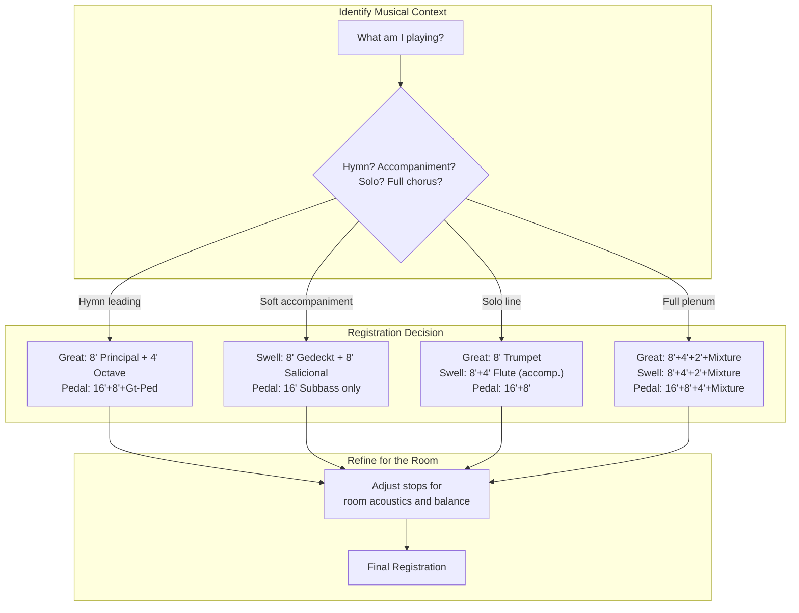
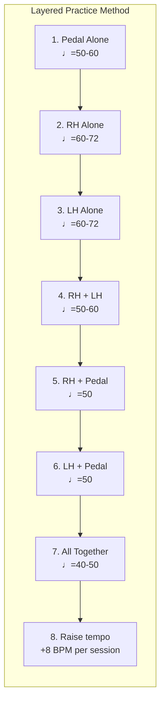

# Organ Performance: Console Technique, Registration, and Coordination Mastery

## Why the Organ Demands a Different Skillset

The pipe organ has no per-note dynamic control. Wind pressure is constant; a pipe speaks at full volume the instant wind is admitted and stops the instant the valve closes. The key does not respond to velocity. There is no sustain pedal. These constraints define the organist's craft rather than limiting it. Expression comes from three sources a pianist never touches: articulation (the exact duration of notes and the silence between them), registration (layering stops to build composite timbres and dynamic terraces), and four-limb independence across multiple manuals and a 32-note pedalboard.

Everything below is built to be practiced at a console, with concrete fingerings, pedalings, registration tables, and metronome-paced drills.

---

## Part I: The Console — Posture, Touch, and Manual Technique

### Bench Setup

Get this right before you play a note. Every technique downstream compensates for a bad setup.

**Height:** Seated upright, forearms should be roughly parallel to the manual surface, or angled very slightly down at the elbow. Too high a bench drops the wrist below the keys and collapses the hand arch. Too low raises the wrist and loads the forearm with tension.

**Distance from the pedalboard:** Knees slightly bent when feet rest near the pedalboard's middle (around C3–D3). You must reach the lowest pedal (C2) and the highest (G4) without lifting the hips or sliding on the bench. Can't reach the extremes — move back. Knees locking straight — move forward.

**Posture checklist:**
- Sit on the front third of the bench, not the center
- Weight on the sit bones, spine long, shoulders dropped
- Elbows at or slightly below keyboard level, never raised
- Heels positioned slightly behind the pedal naturals, ready to rock toe-to-heel

**Shoes:** Dedicated organ shoes — thin leather sole, low heel (~1 inch), snug fit. Leather glides on the pedal edges; rubber grabs and throws off your timing. If you must use street shoes, pick the flattest, thinnest-soled pair you own. Socks improve feel for diagnostic practice but cost you precision on the sharps.

### Why Organ Touch Differs from Piano

A pianist controls loudness with key velocity. An organist can't — the pipe gets the same wind pressure no matter how hard or fast you press. On tracker (mechanical) action you feel the pallet valve break open under the key, and depression speed subtly affects how promptly the pipe speaks, but never how loud. On electro-pneumatic action the key just closes a contact; there's no tactile feedback from the pipe at all.

The consequence: a piano note decays after the strike; an organ note holds constant amplitude until you release it. So all musical shape comes from **when** notes start and stop, never from how hard you hit them.

### Articulation: Your Primary Expressive Tool

Four touch types, each a distinct physical action:

**Legato** — depress the next key a fraction of a second *before* releasing the current one. Zero silence between notes. Your next finger is descending as the previous one lifts. Use finger substitution (below) whenever the hand must reposition mid-phrase.

**Non-legato (portato)** — release the current key a fraction of a second *before* depressing the next, leaving a gap of roughly 10–20 ms. This is the default touch for Baroque polyphony (Bach, Buxtehude, Pachelbel): the gap is what lets independent voices read as independent.

**Staccato** — quick release, 50–100 ms gap, lifting from the knuckle with a relaxed flick. Do not press harder to "shorten" the note — the organ doesn't respond to pressure, only to timing.

**Tenuto** — hold full notated value, release cleanly at the last instant. Gives a note weight and presence; use it on chorale melody notes to project them over the accompaniment.

**The release matters as much as the attack.** A crisp release ends cleanly. A slow, gradual lift smooths a legato transition. Combine a slow release with a closing swell shutter for a fade effect pianos cannot produce.

### Finger Substitution: The Core Organ Technique

With no sustain pedal, true legato through a hand repositioning requires swapping fingers on a key that's still held down. Master this before anything else.

**The basic motion:** Play and hold middle C with finger 2. Without releasing the key, silently slide finger 3 onto the same key next to (or in place of) finger 2. Finger 2 is now free to play the next note while the key continues sounding under finger 3.

**Drill 1 — Sequential substitution, ascending C major**

Metronome progression: ♩=50 → 60 → 72 → 84. Each note a quarter note.

```text
C(1) D(2) E(3) F(4)
— hold F, substitute 3 for 4 (no release) —
G(4) — play G while 3 releases F
— hold G, substitute 3 for 4 —
A(4) — play A while 3 releases G
— hold A, substitute 3 for 4 —
B(4) — play B while 3 releases A
— hold B, substitute 3 for 4 —
C(4) — play C while 3 releases B
```

The hand "walks" up the scale: play with 4, substitute 3 while held, play the next note with 4. Descending mirrors it: play with 3, substitute 4, play next with 3. Practice both directions daily.

**Drill 2 — Substitution in two voices**

Tempo: ♩=60 → 72 → 84.

```text
Left hand holds middle C (finger 2) for 4 beats, unmoving.
Right hand, legato quarter notes:
  E(1) — hold, substitute 2 for 1 — F(1)
  hold, substitute 2 for 1 — G(1)
  hold, substitute 2 for 1 — A(2)
```

This mirrors real repertoire texture: one voice sustains while another moves independently above it.

**Drill 3 — Substitution with chord changes**

Tempo: ♩=50 → 60 → 72.

```text
Beat 1: C-E-G-C (fingers 1-2-3-5), hold through beat 2
Beat 2: substitute 4 for 3 on G, freeing finger 3
Beat 3: move to F-A-C-F (fingers 1-2-3-5), outer voices stay legato through the change
```

### Thumb Glissando

Where two adjacent notes must connect legato but the fingering strands the thumb on both, slide the thumb across without lifting. Most common on E–F, B–C, and natural-to-adjacent-sharp pairs.

**Drill 4 — Thumb glissando, E–F**

Tempo: ♩=60 → 80 → 100.

```text
E(1) → F(1, slide thumb right) → G(3) → F(1) → E(1, slide thumb left) → D(3)
```

Keep the thumb pad in contact with the key surface through the whole slide. Practice both directions on every adjacent natural pair (E–F, B–C) and natural-to-sharp pair (F–F♯, C–C♯).

**Drill 5 — Glissando in scale context (D major)**

```text
D(1) E(2) F#(3) G(1) A(2) B(3) C#(1 — glide — ) D(3)
```

The thumb glides from C♯ into D — a finger lift here would create an audible gap a piano pedal would mask but an organ never does.

### Cross-Unders and Cross-Overs

Standard piano fingering logic applies, but plan crossings more carefully: there's no pedal to disguise a late or early cross.

**Drill 6 — Cross-under with legato**

Tempo: ♩=60 → 72 → 84 → 96.

```text
C(1) D(2) E(3) — cross 1 under to F(1) — G(2) A(3) — cross 1 under to B♭(1) — C(2)
```

Time the cross exactly like a substitution: finger 1 descends to F as finger 3 is releasing E. No gap, no overlap-click.

### Manual Practice Routine Summary

| Drill | Technique | Start | Target | Daily reps |
|---|---|---|---|---|
| 1 | Sequential substitution | ♩=50 | ♩=84 | 4× each direction |
| 2 | Substitution, held note | ♩=60 | ♩=84 | 3× |
| 3 | Substitution with chord change | ♩=50 | ♩=72 | 3× |
| 4 | Thumb glissando (E–F, B–C) | ♩=60 | ♩=100 | 5× each pair |
| 5 | Glissando, D major scale | ♩=60 | ♩=96 | 4× |
| 6 | Cross-under | ♩=60 | ♩=96 | 4× |

---

## Part II: The Pedalboard — Toe-Heel Technique and Navigation

### Layout

The AGO standard pedalboard spans 32 notes, C2–G4. It's concave (higher at the ends, lower in the middle) and radiating (wider at the back than the front), so every note sits within reach without moving your hips. Naturals occupy the upper plane; sharps sit lower, projecting toward you.

Look down as little as possible. Navigate by feel: sharps have a distinct forward-projecting edge; naturals present a flat surface with a front lip. The missing-sharp gaps — between B/C and E/F — are your primary tactile landmarks for orientation without looking.

### The Toe-Heel System

Four contact points:
- **RT** — right toe (ball of right foot), the default for most notes
- **RH** — right heel
- **LT** — left toe
- **LH** — left heel

**Rules:**
1. Adjacent naturals (C–D, D–E, F–G, G–A, A–B) rock on the same foot, toe to heel.
2. Sharps are played with toes only — the heel can't reach the lower plane comfortably. If the playing foot is occupied, use the opposite foot's toe.
3. Notes wider than a second alternate feet, toe to toe.
4. Heels stay low and glide; lifting high wastes time and breaks legato.

### Pedal Scale Fingerings

**C major, ascending**

| Note | C3 | D3 | E3 | F3 | G3 | A3 | B3 | C4 |
|---|---|---|---|---|---|---|---|---|
| Foot | RT | RH | LT | LH | RT | RH | LT | LH |

Right foot plays C (toe), rocks back to D (heel) without lifting; left foot takes over for E (toe), rocks to F (heel); the alternation repeats up the scale.

**C major, descending**

| Note | C4 | B3 | A3 | G3 | F3 | E3 | D3 | C3 |
|---|---|---|---|---|---|---|---|---|
| Foot | LH | LT | RH | RT | LH | LT | RH | RT |

The foot that ended the ascent (left heel on C4) begins the descent.

**G major, ascending (one sharp)**

| Note | G3 | A3 | B3 | C4 | D4 | E4 | F♯4 | G4 |
|---|---|---|---|---|---|---|---|---|
| Foot | RT | RH | LT | LH | RT | RH | LT | RT |

F♯ takes the left toe; the right toe takes the following G, crossing the feet briefly. Uncross on the next phrase's rest or sustained note.

**F major, ascending (one flat)**

| Note | F3 | G3 | A3 | B♭3 | C4 | D4 | E4 | F4 |
|---|---|---|---|---|---|---|---|---|
| Foot | RT | RH | LT | RT | LT | RH | LT | LH |

B♭ sits in sharp position: right toe (opposite the preceding A, which took left toe). Left toe then takes C and the pattern resumes.

### Pedal Practice Drills

**Drill 1 — C major scale, one octave, both directions**

```text
Notes: C3 D3 E3 F3 G3 A3 B3 C4 B3 A3 G3 F3 E3 D3 C3
Feet:  RT RH LT LH RT RH LT LH LT RH RT LH LT RH RT
Tempo: ♩=50 → 60 → 72 → 84
Touch: legato — overlap each toe-heel transition
Reps:  4× up, 4× down, 4× round trip
```

Feel for the ankle pivot: toe presses, then heel presses while the toe lifts, foot never leaving the pedalboard.

**Drill 2 — Pedal arpeggios, C major triad**

```text
Notes: C3 E3 G3 C4 G3 E3 C3
Feet:  RT LT RT LT RT LT RT   (all toes — intervals exceed a second)
Tempo: ♩=50 → 60 → 72 → 84
Reps:  4× up, 4× down, 4× round trip
```

**Drill 3 — Pedal point with moving second foot**

```text
Hold low C (RT) for 8 beats.
Left foot, quarter notes while C sustains:
  E3(LT) F3(LH) G3(LT) A3(LH)
Tempo: ♩=60 → 72 → 84
Purpose: foot independence — one holds, one moves
Reps: 4×
```

**Drill 4 — Chromatic approach notes** (common walking-bass / service-playing figure)

```text
Notes: F#3 G3 — C#4 D4 — G#3 A3
Feet:  LT RT — LT RT — LT RT
Tempo: ♩=60 → 72 → 84
Purpose: sharp-to-natural resolution, opposite-foot toes
Reps: 4× per pattern
```

**Drill 5 — Octave jumps**

```text
Notes: C3 C4 C3 C4 — repeat across 4 octaves
Feet:  RT RT RT RT (same foot, jump the distance)
Tempo: ♩=40 → 50 → 60 → 72
Purpose: distance judgment without looking
Reps: 4× full range, both directions
```

Land precisely on the octave by feel. Use the E–F and B–C gaps as reference points as you travel.

### Pedal Troubleshooting

| Problem | Cause | Fix |
|---|---|---|
| Notes sound muddy or overlap | Releasing too slowly | Lift crisply; drill staccato first, then layer legato back in |
| Can't reach heel to adjacent natural | Bench too high, or thick-soled shoes | Lower bench; switch to thin leather soles; work ankle flexibility |
| Foot cramps on long passages | Rigid, over-pointed ankle | Relax between notes; the foot shouldn't be locked |
| Wrong pedal hit | Looking at hands instead of trusting feel | Drill the tactile map; practice eyes-closed, pedal alone |
| Heel catches a sharp | Heel dragging too low | Keep the heel slightly raised; it should only ever touch naturals |

---

## Part III: Registration — Building and Shaping Sound

### How Stops Produce Different Timbres

Two pipe families. **Flue pipes** work like a recorder: wind crosses a windway and strikes a sharp edge (the labium), setting up an oscillating air column. Scaling — the pipe's diameter relative to its length — sets the timbre: wide scaling gives a strong fundamental with few harmonics (flute tone), narrow scaling gives rich upper harmonics (string tone), medium scaling balances the two (principal tone). **Reed pipes** excite sound with a vibrating brass tongue against a shallot; the reed sets pitch, the resonator shapes color.

Practically: principals are your foundation, flutes are soft and transparent, strings add edge, reeds add color and power. That's enough acoustic grounding to registrate well — the fine voicing detail belongs to the organ builder, not the player.

### Stop Families

| Family | Tone | Typical stops | Use |
|---|---|---|---|
| Principal (Diapason) | Foundational, balanced | 8′ Principal, 4′ Octave, 2′ Doublette | Core organ sound, hymn leading, chorales |
| Flute | Soft, fundamental-heavy | 8′ Gedeckt, 4′ Flute, 2′ Piccolo | Transparent accompaniment |
| String | Narrow, edgy, upper-harmonic rich | 8′ Salicional, 8′ Viola, 4′ Salicet | Solo accompaniment, ethereal color |
| Reed | Bold, formant-rich | 8′ Trumpet, 8′ Oboe, 16′ Fagotto, 4′ Clarion | Solo lines, chorus enhancement, pedal bass |

### Pitch Levels

| Pitch | Sounds at | Function |
|---|---|---|
| 16′ | octave below written pitch | Pedal foundation; depth in a manual chorus |
| 8′ | written pitch (unison) | Minimum requirement for any solo or accompaniment stop |
| 4′ | octave above | Brilliance and clarity |
| 2′ | two octaves above | Brilliance; part of the plenum |
| 2⅔′ | twelfth (octave + fifth) | Mutation — adds a fifth-partial color |
| 1⅗′ | seventeenth (two octaves + major third) | Mutation — the Tierce color |
| Mixture (II–VI ranks) | multiple upper harmonics | Chorus "fire" |

Mutations don't add fundamental pitch — they add a specific harmonic, reshaping timbre without changing pitch center. Essential to French Classical registration (Jeux de Tierce) and useful color in Baroque chorale work.

### Registration Tables

**A — Congregational hymn, leading**

| Division | Stops | Purpose |
|---|---|---|
| Great | 8′ Principal, 4′ Octave, 2′ (if present) | Clear, projecting melody line |
| Pedal | 16′ Principal or Subbass, 8′ Octave | Bass and rhythmic foundation |
| Couplers | Great to Pedal | Pedal follows Great |
| Swell (optional) | 8′ Principal, 4′ | Add for the final stanza |

Melody in the right hand on Great must sing above inner voices. If the congregation can't hear itself sing, you've over-registered.

**B — Soft choral accompaniment**

| Division | Stops | Purpose |
|---|---|---|
| Swell | 8′ Gedeckt, optional 8′ Salicional | Transparent, soft support |
| Pedal | 16′ Subbass, light 8′ Octave | Gentle bass |
| Couplers | Swell to Pedal if pedal division is weak | Reinforce the bass |

Swell's expression pedal gives you dynamic flexibility to track a choir in real time — use the softest 8′ stops you have.

**C — Solo trumpet line**

| Division | Stops | Purpose |
|---|---|---|
| Great | 8′ Trumpet (or 4′ Clarion for a higher register) | Solo melody |
| Swell | 8′ Gedeckt, 4′ Flute | Accompaniment |
| Pedal | 16′ Subbass, 8′ Octave | Bass |
| Couplers | Swell to Pedal | Pedal follows the accompaniment |

The contrast between bold reed and soft flute creates the dialogue effect this registration is known for.

**D — Baroque plenum (full chorus)**

| Division | Stops | Purpose |
|---|---|---|
| Great | 8′ Principal, 4′ Octave, 2′ Doublette, Mixture III–IV | Primary chorus |
| Swell | 8′ Principal, 4′ Flute, 2′ Piccolo, Mixture II | Secondary/dialogue chorus |
| Pedal | 16′ Principal, 8′ Octave, 4′ Superoctave, Mixture | Pedal chorus |
| Couplers | Great to Pedal | Unify the sound |
| Reed (optional) | 8′ Trumpet on Great | Edge and definition |

Build the plenum from 8′ upward — 8′, then 4′, then 2′, then mixture — and each stop added should be a distinctly audible event, not a thickening. If a stop disappears into the texture, it's either misvoiced for this room or redundant here.

**E — French Classical Plein Jeu**

| Division | Stops | Purpose |
|---|---|---|
| Great | 8′ Principal, 4′ Octave, 2⅔′ Nazard, 2′ Doublette, 1⅗′ Tierce, Mixture | Tierce-colored chorus |
| Pedal | 16′ Montre, 8′ Prestant | Support |
| Couplers | Great to Pedal | — |

The Tierce (1⅗′) is the signature color — the major third two octaves up gives this chorus its "buzz." Repertoire: Couperin, de Grigny, Marchand.

### Couplers

| Coupler | Effect | When |
|---|---|---|
| Swell to Great | Swell stops sound from Great keys | Build a bigger chorus on Great |
| Great to Pedal | Pedal plays Great's stops | Strengthen/unify pedal bass |
| Swell to Pedal | Pedal plays Swell's stops | Soft pedal with expression control |
| Octave couplers (4′) | Adds the octave above | Extra brilliance — use sparingly |
| Unison Off | Mutes the division's own pitch | Couplers-only textures (advanced) |

**Caution:** couplers add key weight on tracker organs and can cause ciphering on neglected instruments. Engage them one at a time and listen before stacking more.

### The Swell Expression Pedal

The swell box encloses a division behind louvers; the expression pedal opens and closes them, giving you the organ's closest thing to a piano's dynamic range.

**Technique:**
- Right foot operates the swell shoe by default
- When the right foot is needed on the pedalboard, either keep the heel down and use the toe for the shoe, or swap: left foot plays pedal, right foot works the shoe
- In extended pedal passages, "park" the shoe at a fixed opening and resume dynamic shaping once the right foot frees up

**Drill — swell crescendo/decrescendo**

```text
Sustain a C major chord on Swell (8′ Gedeckt + 4′ Flute) for 8 beats.
Beats 1–2: shutters closed (pp)
Beats 3–4: open gradually to mf
Beats 5–6: fully open (f)
Beats 7–8: close gradually back to pp
Tempo: ♩=50 → 60 → 72
Reps: 4×
```

The motion should feel like breathing, continuous and smooth — never a stepped or jerky motion.



---

## Part IV: Coordination and Independence

### The Layered Practice Method

Two hands on potentially different manuals, two feet on the pedalboard — four independent limbs is the organ's central technical problem, and layered practice is its only reliable solution.

**Golden rule:** never combine all parts until each is secure alone and in every pairwise combination. Jumping to full texture bakes in errors that take far longer to unlearn than to prevent.



Steps 5 and 6 (hand + pedal) are the hardest and the most commonly skipped. Skipping them is the single biggest cause of insecure performances.

### Progressive Coordination Drills

**Drill 1 — Static pedal point (beginner)**

```text
RH: C major scale ascending, quarter notes, one octave
LH: steady half notes on middle C, fingers 1-3-1-3 alternating
Pedal: hold low C (RT) for 8 beats
Tempo: ♩=50 → 60 → 72 → 84
Reps: 4×
```

**Drill 2 — Contrary motion (intermediate)**

```text
RH: C major scale ascending, quarter notes
LH: C major scale descending (mirror fingering), quarter notes
Pedal: point on C (RT) for 4 beats, then G (LT) for 4 beats
Tempo: ♩=40 → 50 → 60 → 72
Reps: 4×
```

**Drill 3 — Moving pedal, static hands (intermediate)**

```text
RH: hold C-E-G, whole notes
LH: hold lower C-E-G, whole notes
Pedal: C-G-A-F bass pattern, quarter notes
Tempo: ♩=50 → 60 → 72
Reps: 4×
Purpose: feet move independently while hands hold — guards against the common fault of hands unconsciously following the feet
```

**Drill 4 — Full SATB hymn texture (intermediate)**

First phrase of "Amazing Grace," G major:

```text
Soprano + alto (RH, Great): melody + inner voice
Tenor (LH, Great or Swell)
Bass (pedal)

1. Pedal alone — ♩=50
2. RH alone (soprano + alto) — ♩=60
3. LH alone (tenor) — ♩=60
4. RH + LH — ♩=50
5. RH + Pedal — ♩=40
6. LH + Pedal — ♩=40
7. All together — ♩=40
8. Build to performance tempo — ♩=72-84
```

**Drill 5 — Rhythmic independence (advanced)**

```text
RH: quarter notes
LH: eighth notes (2× RH speed)
Pedal: half notes (0.5× RH speed)
Key: C major triad tones throughout
Tempo: ♩=50 → 60 → 72 → 84
Purpose: 1:2:4 three-way independence
Reps: 4× per combination
```

Adapted from the Hanon/Czerny independence tradition with the pedal dimension added, since no keyboard-only exercise prepares you for a third independent rhythmic layer under the feet.

### Hymn Playing as Coordination Practice

Hymn playing is the service organist's most practical daily coordination workout — simultaneous four-voice reading, pedal bass, and registration management.

**Method:**
1. Read SATB as soprano + alto in the right hand, tenor in the left, bass in the pedal — the standard SATB-to-organ mapping.
2. Finger for legato: apply substitution wherever the hand repositions; mark substitutions above the notes in pencil.
3. Pedal the bass: write RT/RH/LT/LH under every bass note before you touch the pedalboard.
4. Practice in layers, per the sequence above.
5. Add registration last: rehearse engaging/disengaging stops between stanzas without losing tempo.

**Practice hymn — "Amazing Grace," G major**

```text
Soprano: G B D G B D B G E D B G
Alto:    D G B D G G B G C# B G D
Tenor:   B D G B D D D D E D B B
Bass:    G B D G B G D G C# G B G

Pedal:   G(RT) B(LT) D(RT) G(LT) B(RT) G(LT) D(RT) G(LT) C#(RT) G(LT) B(RT) G(LT)
```

Pedal alone at ♩=50, hands alone at ♩=60, then combine through the full layered sequence.

---

## Part V: Service Playing and Repertoire Application

### Hymn Accompaniment Method

Leading congregational singing is most church organists' primary job, and it demands a different approach than solo repertoire.

**Tempo:** Match the room's breathing pace. Most hymns sit at ♩=66–80. Marching hymns ("A Mighty Fortress") run ♩=80–88; contemplative ones ("Amazing Grace") sit at ♩=60–66.

**Articulation:** Non-legato on the melody (slight separation for rhythmic clarity), legato on inner voices (smooth harmonic support). The congregation needs to feel the beat from the tune; the harmony should just glide underneath.

**Breath points:** Lengthen the note just before a phrase break (an agogic accent) to cue the congregation's breath — this is your equivalent of a conductor's upbeat.

**Registration between stanzas:**
- Stanza 1: base registration (Table A)
- Stanza 2: add Swell 4′ for brightness
- Stanza 3: drop to Swell, softer stops, for a reflective verse
- Final stanza: full plenum, reeds, couplers engaged

Set thumb pistons or toe studs in advance so a registration change is a single press, not a scramble, and you never lose the beat changing stops.

### Choral Accompaniment

1. Play full SATB when the choir is shaky; reduce to bass + melody once they're secure.
2. Accompany on Swell for expression-pedal flexibility.
3. Reinforce the bass at 16′ in the pedal.
4. Register softer than you think you need — the organ is louder in the room than it sounds from the console.

### Repertoire Preparation Guide

**Beginning (1–2 years)**

| Piece | Key | Focus | Tempo arc |
|---|---|---|---|
| Bach, Eight Little Preludes and Fugues — start BWV 555 | G major | Independent pedal line, two-voice fugue | ♩=50 → 72 |
| Bach, "Gott durch deine Güte" BWV 717 | C major | Chorale cantus firmus in pedal | ♩=50 → 72 |
| Böhm, "Vater unser im Himmelreich" | G minor | Chorale harmonization, manuals only | ♩=60 → 80 |
| Lübeck, Praeludium in C | C major | Light prelude-bicinium structure | ♩=52 → 76 |

**Working BWV 555:**
1. Pedal line alone — it's an independent bass voice, not chord roots.
2. Prelude in 4-measure chunks, hands separate then together.
3. Fugue: subject alone, then each entrance in order of appearance.
4. Layered sequence: pedal → RH → LH → RH+LH → RH+P → LH+P → all.
5. Articulation: non-legato on the fugue subject for polyphonic clarity, legato in the prelude's sequences.
6. Registration: 8′ Principal + 4′ Octave (Great), 8′+4′ (Pedal), Great to Pedal.

**Intermediate**

| Piece | Key | Focus | Tempo arc |
|---|---|---|---|
| Bach, "Little" Fugue BWV 578 | G minor | Four-voice fugue, pedal subject entrance | ♩=52 → 76 |
| Buxtehude, Praeludium BuxWV 137 | C major | Stylus fantasticus, free + fugal sections | ♩=60 → 80 |
| Pachelbel, Fugue in C minor | C minor | Magnificat fugue, subject inversion | ♩=54 → 72 |
| Brahms, "Es ist ein Ros' entsprungen" Op. 122/8 | F major | Romantic chorale prelude, expressive shaping | ♩=52 → 66 |

**Advanced**

| Piece | Key | Focus | Tempo arc |
|---|---|---|---|
| Bach, Passacaglia BWV 582 | C minor | Ostinato bass, 20 variations, closing fugue | ♩=48 → 66 |
| Bach, Prelude and Fugue BWV 544 | B minor | Large-scale fugal architecture | ♩=48 → 60 |
| Franck, Choral No. 1 | E major | Romantic expressive registration | ♩=40 → 54 |
| Widor, Toccata (Symphony V) | F major | Fast manual octaves, pedal scales | ♩=72 → 100+ |

### National Style Guidelines

**German Baroque (Bach, Buxtehude, Pachelbel)**
- Touch: non-legato on fugue subjects and fast passagework; legato in slow chorale movements
- Registration: chorus built from principals; mutations for color; reeds as solo voices, not in the chorus
- Dynamics: terraced via manual/stop changes, not expression pedal
- Tempo: steady with agogic accent, minimal rubato

**French Classical (Couperin, de Grigny, Marchand)**
- Touch: precise and delicate; inégale (rhythmic unequalization) on paired sixteenths at moderate tempo
- Registration: fixed named combinations — Plein Jeu, Jeu de Tierce, Grand Jeu
- Dynamics: terraced by manual change; no swell box existed on these instruments
- Tempo: flexible within sections for inégale, rallentando at phrase ends

**English Cathedral (Stanford, Parry, Howells, S.S. Wesley)**
- Touch: legato throughout, smooth voice leading
- Registration: Romantic palette — 8′ foundations, strings, soft reeds; swell pedal shapes dynamics
- Dynamics: continuous swell-pedal crescendo/decrescendo
- Tempo: moderate rubato, breathing space at phrase ends

**French Symphonic (Widor, Vierne, Franck)**
- Touch: legato, occasional detachment for clarity; firm finger weight for sustained tone
- Registration: layered across divisions; Swell-to-Great couplings build climax; reeds and mixtures for tutti
- Dynamics: extensive swell work, "spreading" sound across divisions for gradual build
- Tempo: broad with expressive rubato

---

## Part VI: Home Practice Setup with Digital Organs

### Why It Matters

Pipe organ access is scarce. Most organists practice at home on a digital instrument or software like Hauptwerk or GrandOrgue. The goal isn't a perfect pipe replica — it's correct key feel, a real pedalboard, and enough registration variety to rehearse the decisions above.

### Hardware Requirements

| Component | Minimum | Recommended |
|---|---|---|
| Manual 1 (Great) | 61-key MIDI, unweighted | 61-key, weighted/semi-weighted with escapement feel |
| Manual 2 (Swell) | 49-key MIDI | 61-key MIDI |
| Pedalboard | 13-key MIDI (C–C) | 32-key MIDI, AGO spec (C–G) |
| Expression pedal | 1 MIDI CC pedal | 2 (Swell + Crescendo) |
| MIDI interface | Single-port USB | Multi-port (2+) |
| Audio interface | Built-in/USB, 44.1 kHz | ASIO, 24-bit/48 kHz, low latency |
| Headphones | Closed-back, any | Studio reference closed-back |
| Computer | Dual-core, 8 GB RAM | 8+ threads, 16+ GB RAM |

**Controllers:** Roland PK-5A (13-note, budget) or Roland DO-200 (32-note AGO spec) for pedals; any MIDI keyboard with velocity disabled for manuals; Roland EV-5, M-Audio EX-P, or FV-500L for expression.

### Hauptwerk Setup

1. **Install Hauptwerk** (version 7+) from the developer site.
2. **Load a sample set.** Free, solid options: Piotr Grabowski's instruments (grabowskiorgan.com), Sonus Paradisi demos, or Hauptwerk's built-in demo organ.
3. **Map MIDI:**
   - Settings → MIDI ports
   - Manual 1 → Great, channel 1
   - Manual 2 → Swell, channel 2
   - Pedalboard → Pedal, channel 3
   - Expression pedal → Swell expression, CC 11 or CC 4
   - Disable velocity sensitivity everywhere — pipes don't respond to it
4. **Configure audio:**
   - Driver: ASIO, not WDM/MME
   - Buffer: 256 samples for practice (~5 ms at 48 kHz), 128 for performance
   - Sample rate: 48 kHz
   - Disable any software reverb for honest monitoring
5. **Enable the wind model** if your sample set supports it — it simulates pressure drop under heavy registration, which is essential feedback for learning how registration affects wind stability.

**Practice-specific setup:** build a minimal "practice" combination — one 8′ Principal (Great) and one 8′ Subbass (Pedal) — for coordination drills stripped of registration distraction. Save hymn registrations as recallable combinations. Use the built-in recorder for self-review.

### Alternative: GrandOrgue (open source)

```bash
# Linux
sudo apt install grandorgue
```

```text
1. File → Settings → MIDI — map keyboards and pedal
2. File → Settings → Audio — buffer 256, sample rate 48 kHz
3. Load an ODF (Hauptwerk-format sample set definition)
4. Assign stops to keyboard divisions
```

Lacks the wind model and some advanced features but is fully sufficient for technique drilling.

### Self-Assessment Recording Workflow

The console is the worst seat in the house for objective listening — you're too close. Record every serious practice session.

```text
1. DAW: Reaper, Ableton Live, or Logic Pro
2. Route organ software audio to the DAW via loopback or virtual cable
3. Record 24-bit/48 kHz
4. Review on studio headphones or monitors, not console speakers
```

**Checklist:**
```text
□ Every note speaking? (missed pedal or manual notes)
□ Articulation consistent? (legato/non-legato where intended)
□ Tempo steady? (tap-tempo check on playback)
□ Registration changes clean? (no gaps, no stray stops)
□ Pedal line independent, not shadowing the left hand?
□ Phrase shape audible? (agogic accents, releases)
```

---

## Appendix: Quick Reference

### Manual Technique

| Technique | Physical action | When |
|---|---|---|
| Legato | Overlap: next finger down before previous releases | Smooth phrases, Romantic repertoire |
| Non-legato | 10–20 ms gap | Baroque polyphony, fugal clarity |
| Staccato | Quick release, 50–100 ms gap | Light, ornamented passages |
| Finger substitution | Swap fingers on a held key | Legato through hand repositioning |
| Thumb glissando | Slide thumb between adjacent keys | Legato on adjacent seconds |
| Cross-under | Thumb passes under fingers | Ascending scales |
| Cross-over | Finger passes over thumb | Scales, arpeggios |

### Pedal Technique

| Pattern | Pedaling | Note |
|---|---|---|
| Adjacent naturals | Toe-heel, same foot | Rock the ankle, stay on the board |
| Natural to sharp | Opposite foot's toe | Heels can't reach the lower plane |
| Thirds and wider | Alternate foot toes | Switch feet per note |
| Octave jumps | Same foot toe, jump distance | Train eyes-closed |
| Sustained bass + moving line | One foot holds, other plays | Standard hymn-bass pattern |
| Pedal point | Right toe holds, left handles motion | Frees right foot for swell if needed |

### Registration

| Context | Great | Swell | Pedal | Couplers |
|---|---|---|---|---|
| Hymn, standard | 8′ Prin + 4′ Oct | — | 16′+8′ | Gt–Ped |
| Hymn, final stanza | 8′+4′+2′+Mix | 8′+4′+Mix | 16′+8′+4′ | Gt–Ped, Sw–Gt |
| Soft accompaniment | — | 8′ Ged + 8′ Sal | 16′ Subbass | Sw–Ped |
| Solo trumpet | 8′ Trumpet | 8′ Ged + 4′ Flute | 16′+8′ | — |
| Baroque plenum | 8′+4′+2′+Mix | 8′+4′+2′+Mix | 16′+8′+4′+Mix | Gt–Ped |
| French Plein Jeu | 8′+4′+2⅔′+2′+1⅗′+Mix | — | 16′+8′ | Gt–Ped |
| Romantic tutti | 8′+4′+2′+Mix+8′ Trumpet | 8′+4′+2′+Mix+8′ Trumpet | 16′+8′+4′+16′ Fagotto | Gt–Ped, Sw–Gt |

### Daily Practice Checklist

```text
Warm-up (10 min)
□ Manual drills 1-6, ♩=50 → target
□ Pedal scale drills 1-2, ♩=50 → target
□ One coordination drill, ♩=50 → target

Repertoire (40 min)
□ Current piece: full layered sequence (P → RH → LH → RH+LH → RH+P → LH+P → All)
□ Work at 80% of performance tempo; raise only once secure
□ Record one take for review

Service music (10 min)
□ One hymn: SATB read, pedal bass, stanza registration changes
□ Rehearse stop changes without dropping the beat

Cool-down (5 min)
□ Play something familiar at tempo, for enjoyment
□ Note today's gain and tomorrow's target
```

