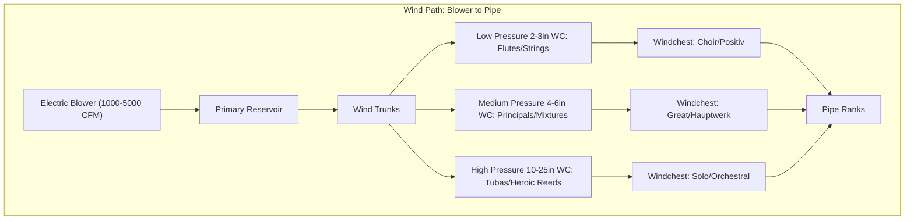
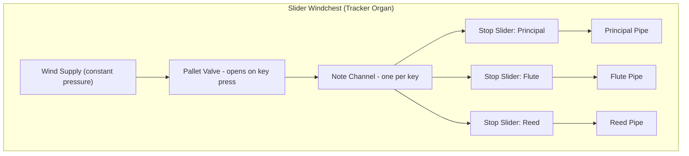
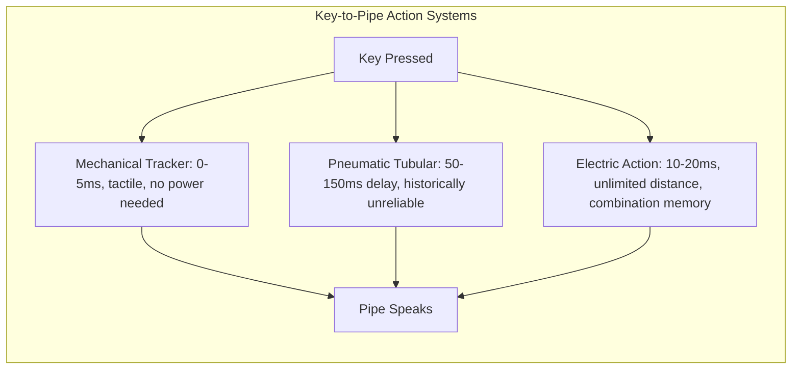
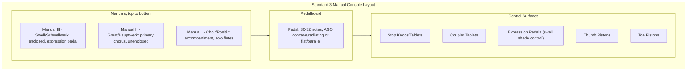
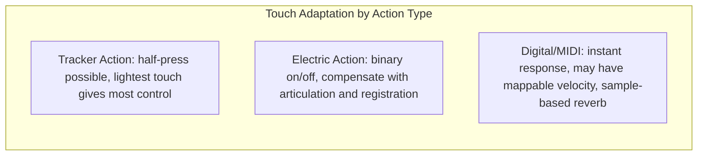
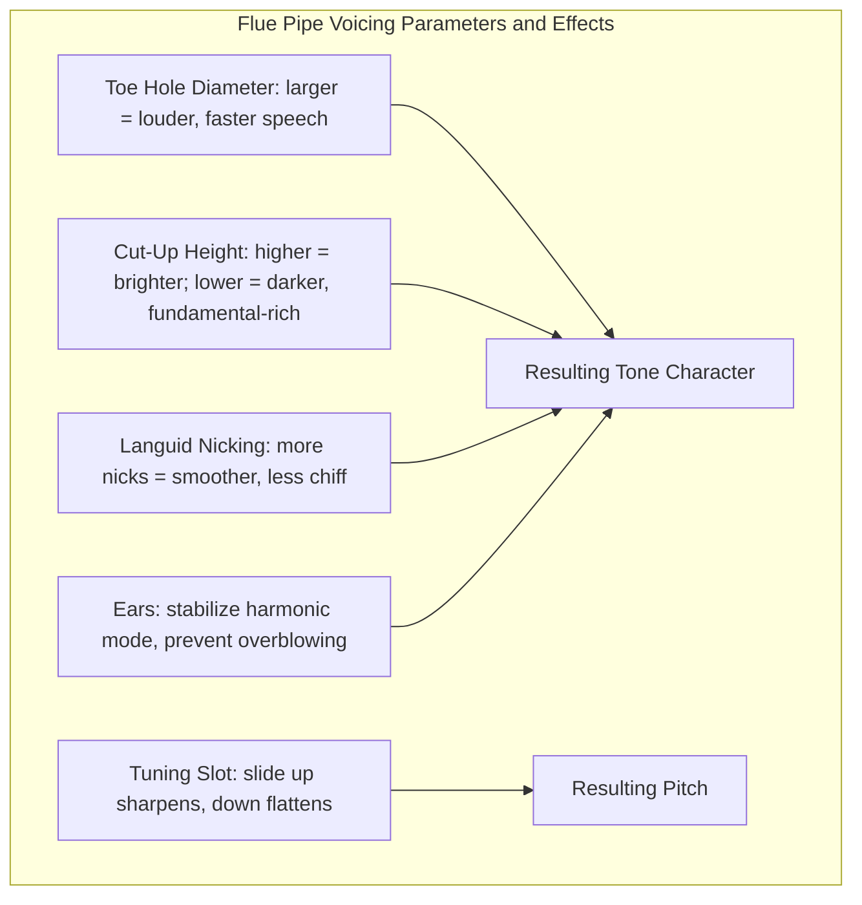
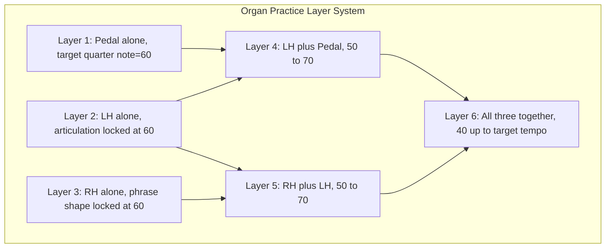

# Organ: Anatomy, Acoustics, and Performance Practice

## Table of Contents

1. [Instrument Architecture and Pipe Acoustics](#1-instrument-architecture-and-pipe-acoustics)
2. [Console Mechanics and Divisional Logic](#2-console-mechanics-and-divisional-logic)
3. [Registration Craft and Stop Palette Mastery](#3-registration-craft-and-stop-palette-mastery)
4. [Keyboard and Pedalboard Technique](#4-keyboard-and-pedalboard-technique)
5. [Articulation, Phrasing, and Touch on the Organ](#5-articulation-phrasing-and-touch-on-the-organ)
6. [Practical Voicing and Instrument Maintenance](#6-practical-voicing-and-instrument-maintenance)
7. [Practice Methodology and Progressive Drills](#7-practice-methodology-and-progressive-drills)
8. [Representative Repertoire and Style Analysis](#8-representative-repertoire-and-style-analysis)
9. [Troubleshooting at the Console: A Field Guide](#9-troubleshooting-at-the-console-a-field-guide)

---

## 1. Instrument Architecture and Pipe Acoustics

### 1.1 Acoustical First Principles (the 15%)

A pipe speaks because a thin sheet of air blown across a mouth edge (flue pipes) or a vibrating brass tongue (reed pipes) excites a standing wave in a resonant tube. You need only one working intuition from this: **length and whether the top is open or stopped determine pitch and color; everything else is detail.**

- **Open pipe:** fundamental = speed of sound / (2 × length). An open 8' C pipe (~65 Hz) is physically close to 8 feet long. Halve the pipe length, the pitch jumps an octave — this is why a 4' stop sits an octave above an 8' stop of the same name.
- **Stopped pipe:** capping the top forces the wave to "fold back," producing a pitch one octave lower than an open pipe of the same length, and favoring odd harmonics only (1st, 3rd, 5th). That's the hollow, covered sound of a Bourdon or Gedackt — and why builders use stopped pipes to fit 16' pitch into an 8'-tall case.

That's the whole physics lesson. Everything below is about what you do with your hands, feet, and ears.

| Pipe Shape | Harmonics Present | Tonal Character | What You'll Recognize by Ear |
|---|---|---|---|
| Open cylinder (Principal) | All harmonics | Full, balanced chorus | The organ's "default" sound — neither bright nor dark |
| Stopped cylinder (Bourdon) | Odd harmonics only | Hollow, flute-like, dark | Covered, slightly woody, blends into silence |
| Open cone (Spitz/Geigen) | Strong upper partials | Stringy, penetrating | Narrow and edgy, cuts through texture |
| Reed + cylindrical resonator | Odd harmonics, bright peaks | Trumpet-like, assertive | Buzzy attack, brassy sustain |
| Reed + conical resonator | Dense, complex spectrum | Oboe, Bassoon character | Nasal, vocal quality |

### 1.2 Pipe Families: What You're Hearing and Why

Every stop knob you pull controls one rank — 56 to 61 pipes, one per key. Knowing the family tells you instantly how a stop will blend and how loud you can push it before it dominates.

**Principal (Diapason) Chorus — the backbone.** Open metal cylinders, moderate scale. Every full registration starts here because this is the sound the room is tuned to absorb evenly across the spectrum.

- 16' Principal/Contrebasse (Pedal) — foundation, almost never alone
- 8' Principal/Open Diapason (Great) — your registration anchor
- 4' Octave — adds clarity without changing character
- 2' Super Octave — brilliance
- Mixture II–VI — several ranks at once, reinforcing the harmonic series; breaks back (jumps down an octave) in the treble to avoid shrillness

**Flute Family — round, fundamental-heavy.** Wide-scaled or stopped pipes, soft and blending.

- 16' Bourdon — stopped wood, standard pedal color
- 8' Gedackt/Flûte Harmonique — the workhorse accompaniment voice
- 4' Rohrflöte — partially stopped, slightly rounder than an open 4' flute
- 2⅔' Nazard — a mutation sounding a 12th above written pitch. **Never alone** — always on top of an 8'+4' foundation
- 2' Block Flute/Flageolet — airy treble color

**String Family — narrow scale, harmonically dense, slow attack.** Use sparingly; too much strings clouds a principal chorus.

- 8' Viola da Gamba — present, assertive string
- 8' Salicional — gentle, recedes into texture
- 8' Voix Céleste — always paired with the Salicional, tuned 1–2 cents sharp or flat to create a slow shimmering beat. This beating is the entire point of the stop — never use it solo.
- 8' Geigenprincipal — a bridge voice between string and principal

**Reed Family — brass tongue vibrating against a shallot.** Most assertive stops on the instrument; the resonator shape, not the reed, determines character.

| Reed Stop | Resonator | Character |
|---|---|---|
| Trompette/Trumpet | Full-length cylindrical | Bright, fanfare |
| Posaune/Trombone | Full-length wide conical | Broad, heroic (Pedal) |
| Hautbois/Oboe | Half-length inverted cone | Reedy, nasal |
| Clarinet | Full-length narrow cylindrical | Smooth, woodwind |
| Vox Humana | Short fractional resonator | Wavy, vocal — pairs with tremulant |
| Tuba Mirabilis | High-pressure wide cylindrical | Overwhelming, solo only |

### 1.3 Wind System Architecture



**What this means for your hands:** draw a heavy reed chorus and play a fast repeated figure, and you may hear a slight pitch wobble. That is a momentary pressure dip under demand, not mistuning. Instruments fight this with **concussion bellows** — small local reservoirs bolted directly to the windchest to absorb the spike. If you hear wavering only on loud, fast passages and it disappears when you play softly, this is the cause — don't ask the tuner to "fix" it.

### 1.4 Windchest Architectures



- **Slider windchest** (tracker): pressing a key opens a pallet that pressurizes a whole note channel; wind reaches a pipe only where the stop slider hole lines up. This produces **chiff** — a tiny consonant-like transient at note onset, caused by the brief moment before the pipe fully speaks. Chiff is a feature in contrapuntal Baroque music: it defines entries and keeps inner voices audible.
- **Unit windchest** (theater organ): each pipe has its own valve, and a single rank can be "borrowed" to sound at 16', 8', and 4' simultaneously. Economical, but one pipe can't serve two roles in the same chord without compromise.
- **Pitman windchest** (Skinner, Aeolian-Skinner, most American 20th-century organs): each pipe gets an individually controlled electro-pneumatic pallet. No chiff, smoother speech, built for Romantic/orchestral literature.

### 1.5 Action Systems — What You Feel Under Your Fingers



On tracker action, key resistance *is* information — you feel the pallet begin to open partway through the key dip, and a trained hand can nudge the timing of speech with the last millimeter of travel. That control disappears on electric action, where the switch is binary: fully open or fully closed. When you move from a tracker instrument to an electric-action instrument (or a digital one), your articulation has to do the work your fingertip used to do. See Section 5.4.

---

## 2. Console Mechanics and Divisional Logic

### 2.1 Standard Console Layout



### 2.2 Divisional Functions and Hierarchy

| Division | German | French | Tonal Function |
|---|---|---|---|
| Great | Hauptwerk | Grand-Orgue | Main chorus anchor |
| Swell | Schwellwerk | Récit | Enclosed, dynamic shading, orchestral reeds |
| Choir | Positiv/Rückpositiv | Positif | Accompaniment, secondary chorus, solo flutes |
| Solo | — | Solo | High-pressure solo colors, Tuba |
| Pedal | Pedal | Pédale | Bass foundation, 32'/16'/8' chorus + reeds |

**Rückpositiv:** in German Baroque instruments this division sits in the rail behind the organist, facing the congregation directly. It creates a genuine spatial effect — sound arrives from a different point in the room than the Hauptwerk above — which Bach and Buxtehude exploit with deliberate antiphonal writing (compare the dialoguing manual changes in Buxtehude's Praeludia).

### 2.3 Coupler Logic

A "Swell to Great 8'" coupler routes every depressed Swell key into the Great windchest at unison pitch, so pressing one key on the Great now sounds both the Great pipe and the corresponding Swell pipe.

```
Swell/Great 16'   - Swell adds sub-octave to Great keys
Swell/Great 8'    - Swell unison added to Great
Swell/Great 4'    - Swell super-octave added to Great
Choir/Great 8'    - Choir unison added to Great
Choir/Great 4'    - Choir octave above added to Great
Swell/Choir 8'    - Swell unison added to Choir
Swell/Pedal 8'    - Swell unison added to Pedal
Great/Pedal 8'    - Great unison added to Pedal (most common coupler on the instrument)
Choir/Pedal 8'    - Choir unison added to Pedal
```

**Beginner trap:** engage Great/Pedal 8' and Swell/Great 8' at the same time, and the Swell is now *also* sounding in the Pedal, chained through the Great. Your bass line suddenly gets louder than you registered it, for no apparent reason. Trace coupler chains before blaming the voicing.

### 2.4 Expression Pedal: Dynamics *and* Timbre

The swell pedal moves wooden shutters forming one wall of the enclosed division's box. It is not a volume knob. Closing it does three things at once:

1. Attenuates loudness, typically 15–18 dB from fully open to fully closed
2. Absorbs high frequencies preferentially when closed, so the tone darkens, not just quiets
3. Changes the perceived room ambience, because less direct sound escapes the box

**Drill:** Draw Swell 8' Oboe + 8' Flûte Harmonique. Hold a sustained chord. Move the pedal from fully closed to fully open over 8 slow beats, then reverse. Listen for the brightening, not just the loudening — that's the real effect you're using when you shape a phrase, not merely "louder here, softer there."

---

## 3. Registration Craft and Stop Palette Mastery

### 3.1 Building a Principal Chorus from the Foundation

Always add ranks bottom-up. Each new rank should reinforce, not compete with, what's already sounding.

```
Step 1: 8' Principal/Open Diapason     -> foundation, unison pitch
Step 2: 4' Octave                      -> clarity, cuts through room reverb
Step 3: 2' Super Octave                -> brilliance
Step 4: 1⅓' Larigot (optional)        -> shimmer, upper spectrum
Step 5: Mixture III-V                  -> full chorus definition
Step 6: 8' Trumpet (optional)          -> power, assertiveness
```

**Diagnostic ear-test:** if the 4' Octave "pokes out" as a separate voice rather than disappearing into the 8', either the pipes are out of scale for the room or they need tuning. A well-balanced chorus should sound like one instrument getting brighter, not like two stops arguing.

**Rule:** never draw a mutation (2⅔' Nazard, 1⅗' Tierce) without an 8' and 4' foundation underneath it. A mutation reinforces a harmonic that's supposed to already be faintly present in the fundamental tone. Without that fundamental, it just sounds like a wrong note a fifth or a third away.

### 3.2 Tonal Pyramid


### 3.3 Registration Recipes You Can Use Today

**Bach chorale prelude (e.g. BWV 659):**
- Great: 8' Principal + 8' Gedackt
- Pedal: 16' Subbass + 8' Principal + Great/Pedal
- Swell: 8' Oboe or Cromorne for the cantus firmus line
- No tremulant, no mixture on accompanying voices

**French symphonic plenum (Vierne, Widor):**
- Great: full principal chorus (16'+8'+4'+2'+Mixture) + Trompette 8'
- Swell: full chorus (8'+4'+2'+Mixture) + Trompette 8', box open
- Choir: 8'+4' Principals, Choir/Great coupled
- Pedal: 32' resultant if available, + 16'+8'+4' Principals + 16' Trombone
- Couplers: Swell/Great, Choir/Great, Great/Pedal, Swell/Pedal

**Soft legato hymn accompaniment:**
- Great: 8' Flûte Harmonique alone
- Pedal: 16' Bourdon + Great/Pedal
- Swell (closed): 8' Salicional + 8' Voix Céleste
- No reeds, no mixtures

**Cornet combination (French solo texture — Couperin, Clérambault):**
- Swell or Choir: 8' Flûte Harmonique + 4' Flûte Douce + 2⅔' Nazard + 2' Flûte + 1⅗' Tierce
- Solo line only, never in polyphonic texture — the Tierce's nasal edge is the identifying color of the French "Cornet"

**Toccata climax (Widor, Reger, Dupré):**
- Great: full principal chorus + Mixture + Trumpet 8'
- Swell/Great coupled, Swell open with Trompette + Plein Jeu
- Pedal: 32'+16'+8'+4' chorus + 16' Trombone + 8' Trumpet
- Tutti piston engaged

### 3.4 Combination Action: Setting Pistons Before You Play

```
Memory Level 1 (general worship service)
P1 -> Soft: Swell Salicional + Céleste, Pedal Bourdon 16'
P2 -> Medium: add Great 8' Principal + Flute, Great/Pedal coupler
P3 -> Full without reeds: Great principals 8'+4'+2'+Mixture, Swell Plein Jeu
P4 -> Full with reeds: add Trompettes (Great + Swell), Pedal 16' Trombone
P5 -> Tutti: everything plus all Mixtures

Memory Level 2 (specific recital piece)
P1-P8 -> Pre-sequenced for the piece, stepped through with Next/Previous
```

**Piston technique:** engage a thumb piston with whichever thumb is not currently needed for a note, timed to the *last beat of the outgoing phrase*, while the other hand is still physically holding its notes down. Never lift both hands to change registration — the gap will be audible and will sound like a mistake, not a musical choice.

---

## 4. Keyboard and Pedalboard Technique

### 4.1 Hand Position: Unlearn Piano Pressure

The organ has **no velocity response.** Pressing a key harder or faster produces no change in volume or tone — the pallet is either fully open or not. This changes everything about hand mechanics.

- Fingers curved, slightly flatter than piano hand shape; organ keys are shallower in dip but wider, so lateral accuracy matters more than depth
- Wrist level — not raised, not dropped
- Forearm roughly horizontal
- Minimal pressure: push only enough to fully depress the key, then stop adding force. The goal is timing precision, not power.
- Thumbs pivot smoothly under or over adjacent fingers for position shifts — this is a core organ-specific skill with no piano equivalent at this frequency

**Most common pianist error:** pressing organ keys with piano-level force. This tenses the hand, slows finger substitution, and makes legato connections sloppy because the extra force makes it harder to feel exactly when a key reaches the bottom of its travel.

### 4.2 Legato: The Default Touch, and Why Milliseconds Matter

Organ tone has no decay — a held note sounds at full volume for its entire duration, then stops instantly when released. Consequences:

- A gap between notes that's inaudible on piano (because of piano's natural decay) is clearly audible on organ.
- True legato means the previous key stays down until the instant the next key reaches the bottom of *its* travel — not a fraction of a second before, not after.

**Finger substitution — the core tool for sustaining a voice while freeing a finger:**

```
Hold note G with finger 3.
Silently slide finger 2 (or 1) onto the same key, no audible change in tone.
Finger 3 is now free to reach the next note.
```

Practice this on a single held note first, completely divorced from any piece: hold middle C with finger 3, substitute to finger 2, substitute to finger 1, substitute back to 3, for two full minutes without a single audible bump or silence. Only once this is silent and automatic should you use it inside real repertoire — it is the technique behind every sustained inner voice in a Bach chorale prelude.

### 4.3 Pedalboard Technique

AGO standard pedalboards are concave and radiating (following the natural arc of the leg from the hip); British pedalboards are flat and parallel. Learn whichever your home instrument uses first, then adapt.

**Foot contact points:**
- **Toe** — the default contact point for most notes, treble and middle register
- **Heel** — used for sustained bass notes and heel-toe legato chains
- **Heel-toe legato** — alternating heel and toe on consecutive notes is how you get a smoothly connected bass line without lifting the whole foot

**Position fundamentals:**
- Feet roughly hip-width apart, ankles tracking below the knees
- Toes pointing forward, not splayed
- Never look down at the pedals during performance — build placement by feel, using the gaps between sharps as physical landmarks

**Notation used below:** `RT` = right toe, `LT` = left toe, `RH` = right heel, `LH` = left heel.

```
C major scale, right foot led:
C  D  E  F  G  A  B  C
RT LT RT LT RT LT LH RT
```

**Pedal progression — practice in this order, each line until comfortable before moving on:**

```
Drill 1 - single foot, whole notes (draw 16' Subbass alone, hands silent on keys)
C (hold 4 beats) D (4) E (4) F (4)      ♩=50, no looking down.

Drill 2 - alternating toes
C  D  E  F  G  A  B  C
RT LT RT LT RT LT RT LT                  ♩=50 -> 70

Drill 3 - heel-toe on one foot
C  D  E  F  G  F  E  D  C
RH RT RH RT RH RT RH RT RH               ♩=50 -> 80

Drill 4 - two-octave scale with crossover (needs hip rotation, not just ankle motion)
C(RT) D(LT) E(RT) F(LT) G(RT) A(LH) B(RT) C(LT) D(RT) E(LT) F(RT) G(LT) A(RT)
♩=40 -> 60
```

### 4.4 Hand-Foot Independence

The central technical problem of organ playing: coordinating two hands on different manuals plus an independent pedal bass line, often in three different rhythms and articulations at once.

```
Pedal:   C --- --- --- G --- --- --- C --- --- --- G --- --- ---   (whole notes, legato)
LH:      C E G E  C E G E  C E G E  C E G E                         (quarters, staccato)
RH:      C D E F  G A B C  ...                                      (melody, legato)

Build order:
Step 1: Pedal alone until perfect.
Step 2: LH + Pedal together until perfect.
Step 3: RH alone until the phrase is musically shaped.
Step 4: All three together: ♩=40 -> 60 -> 80.
```

Do not skip the isolation steps. Combining layers before each one is individually secure doesn't save time — it builds coordination errors that are far harder to undo later than they were to prevent now.

### 4.5 Manual Transfers and Echo Effects

```
Great (mf): 8' Principal + 4' Octave
Choir (pp): 8' Gedackt alone

Play a phrase on Great, repeat it immediately on Choir -> terraced-dynamic echo,
the defining gesture of Baroque "echo" movements.

Smooth transfer mechanics:
1. Hold the last Great note until the Choir-hand is physically in position.
2. Depress the Choir key first, overlapping the Great note by 1-2ms.
3. Release the Great key immediately after.
Result: no audible gap, but an instant tonal color shift.
```

Essential for Italian Baroque (Frescobaldi), French Classical (Couperin, Clérambault), and North German Baroque (Buxtehude) repertoire.

---

## 5. Articulation, Phrasing, and Touch on the Organ

### 5.1 Articulation as the Primary Expressive Tool

With no velocity response and no natural decay, the only thing you control expressively note-to-note is **duration — specifically, how much silence sits between notes.**

| Touch | Description | Typical Use |
|---|---|---|
| Legato | Minimal gap between notes | Chorale melodies, sustained lines |
| Portato | Each note ~80-90% of written value | Default Baroque touch |
| Staccato | Notes clipped to ≤50% value | Brisk rhythmic, scherzando passages |
| Legatissimo | Deliberately overlapping | Romantic/impressionist sustained melody |

**The Baroque default is portato, not legato** — this surprises most pianists arriving at the organ. Bach, Buxtehude, and Frescobaldi expected a natural lift between most notes, giving phrases rhythmic spring without full detachment. Continuous piano-style legato in a reverberant stone church turns contrapuntal lines into mud; the room is already doing the connecting work for you.

### 5.2 Independent Voice Articulation in Polyphony

In a Bach fugue, each voice ideally keeps its own articulation character even while the other hand plays something entirely different.

**BWV 578 ("Little" G minor Fugue), subject entry drill:**

```
Subject (one hand):         G  A  Bb  C | D  Eb — —
Touch:                      P  P  P   P | P  P  hold
                            (P = portato, ~85% of written value)

Countersubject (other hand): D — C  Bb | A  Bb  C  D
Touch:                       L  L  L  L | L   L  L  L
                            (L = full legato, no gap)
```

Practice each hand's articulation alone and exaggerated first — make the portato noticeably short and the legato noticeably connected — before combining. Once combined, dial the portato back toward 85% so it reads as "shaped," not "chopped."

### 5.3 Phrase Shaping Without Dynamics

You can't swell a single note with finger pressure. Phrase shape instead comes from:

1. **A lift at cadences** — a slight breath before the next phrase, not a full stop
2. **Progressive articulation tightening** — open with portato, tighten toward legato as the phrase climbs to its climax
3. **Continuous, not stepped, swell pedal movement** on the Swell division — use it throughout a phrase, not just at the marked crescendo
4. **Registration swells at structural cadences** — piston changes belong at section boundaries, not mid-phrase, unless the score specifically demands it

**Matching rest length to the room:** in a reverberant space (1.5–3 second RT60), a brief lift is absorbed and reads as a natural breath. In a dry room (under 0.8 seconds RT60), the same lift sounds like a hard stop — shorten it or the phrase will sound choppy rather than shaped.

### 5.4 Adapting Touch to Action Type



On tracker action you can feel the pallet begin to open and fine-tune speech timing with fingertip pressure. On electric action that channel is gone — the valve is a switch, not a variable. Compensate by exaggerating articulation slightly and leaning more on registration contrast for expressive effect, since the console itself won't give you that last millimeter of feedback.

---

## 6. Practical Voicing and Instrument Maintenance

This section won't make you a voicer, but it will let you talk intelligently with your organ technician and recognize problems before a performance.

### 6.1 Flue Pipe Voicing Parameters



### 6.2 Reed Pipe Problems and Fixes

| Symptom | Likely Cause | Remedy |
|---|---|---|
| Reed cipher (sounds without a key press) | Tongue touching the shallot | Gently bend tongue tip away from the shallot |
| Reed sharp or flat | Tuning wire position drifted | Slide wire down to flatten, up to sharpen |
| Reed slow/sluggish to speak | Tongue corroded or dirty | Clean shallot and tongue with a soft brush |
| Reed rattles or buzzes | Foreign particle on the tongue | Remove with a penlight inspection; don't force it |
| Reed overblows to the octave | Tongue tip too long or flat | Needs a trained voicer, not a DIY fix |

**Never touch reed tongue curvature with bare fingers** — skin oils corrode brass over time. Use cotton gloves or a wooden tool if you're inspecting a reed.

### 6.3 Cipher Diagnosis — A Note Sounds Without Being Played

```
1. Mechanical cipher (tracker/pallet stuck open)
   Test: does it stop if you slowly press and release that key?
   If yes -> mechanical. Fix: locate the pallet, check for a warped board
   (common after sudden humidity swings).

2. Electric cipher (solenoid stuck engaged)
   Test: did a stop vanish from a combination that used to include it?
   Fix: tap the windchest near the sounding pipe - vibration sometimes
   frees a sticking valve temporarily. Permanent fix needs a technician.

3. Wind cipher (cross-wind or overblowing pipe)
   Test: is the cipher a harmonic of a note currently being played?
   If yes -> likely cross-wind. Check toe-hole voicing and slider alignment.
```

**Mid-performance emergency protocol:** if a cipher starts during a service or recital, pull the stop knob for that entire rank immediately — this silences the whole rank, not just the offending pipe. Keep playing without that stop. Deal with the mechanical cause at intermission, not mid-piece.

### 6.4 Temperature and Tuning Stability

Pipe pitch rises roughly 1.7 cents per 1°C of temperature increase. A stone church swinging from 8°C on a winter morning to 22°C by afternoon can drift pitch by nearly 24 cents — close to a quarter tone. Practical consequences:

- Run the blower for 30 minutes before tuning so pipes reach thermal equilibrium with the room
- Tune reed stops last — they are the most temperature-sensitive
- Never tune cold if the performance will happen in a warm room later — by concert time the whole instrument will sit sharp
- Mutations and mixtures are tuned relative to the fundamental, not to an absolute pitch standard — if the 8' ranks drift with temperature, the upper work should drift proportionally and stay in blend

---

## 7. Practice Methodology and Progressive Drills

### 7.1 Layered Practice System



Register the piece only at Layer 6, once coordination is secure. Registering too early tempts you to rush technique because the piece "sounds finished."

### 7.2 Pedal Progression — 8-Week Curriculum

**Weeks 1–2, single-foot toe exercises:**
```
Right toe, one-octave C major scale, all RT, heel lifted. ♩=40. 10 reps/session.
Repeat left toe only.
```

**Weeks 3–4, heel-toe alternation:**
```
Right heel-toe ascending:  C  D  E  F  G  A  B  C
                            RH RT RH RT RH RT RH RT    ♩=50 -> 70
Repeat with left heel-toe.
```

**Weeks 5–6, two-foot alternation and crossing:**
```
Alternating feet:  C  D  E  F  G  A  B  C
                    RT LT RT LT RT LT RT LT             ♩=60 -> 80

Crossing drill (common Bach bass pattern):
C  B  A  G  F   E  D  C
RT LT RT LT LH  RT LT RT                                ♩=50 -> 70
```

**Weeks 7–8, legato pedal with hands:**
```
LH (Alberti): C E G E  C E G E  F A C A  G B D B
Pedal:        C --- --- --- C --- --- --- F --- --- --- G --- --- ---
              RT              RT              LT              RT
♩=50 -> 80. Add simple stepwise RH melody in week 8.
```

### 7.3 Four-Voice Chorale Drill

```
Soprano (RH):  C  D  E  F  E  D  C
Alto (RH):     G  F  G  A  G  F  E
Tenor (LH):    E  A  C  C  C  A  G
Bass (Pedal):  C  D  C  F  C  D  C

Registration: 8' Principal (Great); 16' Subbass + 8' Principal (Pedal)
Touch: portato throughout, slight separation between successive chords
Tempo: ♩=52 to establish, then ♩=63 (comfortable hymn tempo)
```

**Key rule:** all four voices change together on the beat. There is no "roll" between voices in a chord — every finger and the pedal foot arrive at the same instant.

### 7.4 Articulation Isolation Drill (One Hand, Two Voices)

```
Soprano (held): C --- C --- C --- C ---     (legato, sustained)
Alto (moving):  E  F  G  F  E  F  G  F       (staccato eighths)

Goal: the staccato alto must not disturb the sustained soprano.
♩=60 -> 80 -> 100

Reversed version:
Soprano (moving): C  D  E  F  G  F  E  D    (legato line)
Alto (held):       G --- --- ---  F --- --- ---   (pedal point)

This is the finger-substitution scenario: hold the alto with finger 5,
substitute to finger 4 when the thumb needs to move for the soprano line.
```

### 7.5 Registration Change (Piston) Drill

```
P1 = Soft (8' Flute alone)
P2 = Medium (8' + 4' Principal)
P3 = Full (Principals + Mixture + Trumpet)

Bars 1-4:   play on P1
Beat 4, bar 4: thumb depresses P2 while other hand still holds last chord, pedal continues
Bars 5-8:   new phrase begins immediately on P2
Beat 4, bar 8: depress P3
Bars 9-12:  climax on full registration

Goal: zero audible gap between the piston press and the new phrase.
♩=60. Repeat 20x until the timing is automatic, not deliberate.
```

---

## 8. Representative Repertoire and Style Analysis

### 8.1 German Baroque

**J.S. Bach — Prelude and Fugue in D major, BWV 532**
- Great: full principal chorus 8'+4'+2'+Mixture, no reeds, for the Fugue
- Prelude's heroic opening can take Great 8' Trumpet; remove it for the sustained middle section
- Fugue clarity depends on a clean principal chorus — reeds blur inner-voice entries at ♩=76–84
- Pedal entries carry as much structural weight as manual voices; balance so the pedal is clear without swamping the texture
- Portato default throughout; make subject entries slightly more detached than surrounding material for audibility

**Dieterich Buxtehude — Praeludium in E minor, BuxWV 142**
- Exploits the Rückpositiv for antiphonal dialogue with the Hauptwerk
- Toccata sections: full chorus, manuals coupled or alternating antiphonally
- Contrapuntal sections: reduce to 8'+4' principal for transparency
- Frequent manual changes mid-phrase are characteristic — mark every change in the score during preparation, don't improvise them in performance

### 8.2 French Classical (Grand Siècle)

**François Couperin — Messe pour les Couvents (1690)**
- Specific registrations drawn from French treatises (Nivers, Raison, Boyvin)
- Plein Jeu: Principals 16'+8'+4'+2' + Fourniture + Cymbale
- Grand Jeu: Trompette + Clairon 4' + Cornet V + Tierce + Nazard
- Tierce en Taille: Cornet combination in the tenor register, LH plays the solo melody there while RH accompanies

```
Tierce en Taille setup:
8' Flûte + 4' Flûte + 2⅔' Nazard + 2' Doublette + 1⅗' Tierce
LH: solo melody in tenor range (C3-B3)
RH: Grand-Orgue with Plein Jeu accompaniment
Pedal: 16' Flûte or Bourdon, soft foundation only
```

### 8.3 French Romantic/Symphonic

**Charles-Marie Widor — Symphony No. 5, Toccata (F minor)**
- Written for a Cavaillé-Coll-type instrument or equivalent
- Target tempo ♩=138–152 — faster than many recordings suggest
- Full organ throughout the climax; Récit carries 8' Flûte Harmonique + Voix Humana (with tremulant) in the quieter middle theme
- Relentless pedal-point C alternating with bass motion requires secure heel-toe and both-feet crossing patterns
- **Main technical hurdle:** the LH broken-chord pattern must stay even at full tempo. Isolate LH alone: ♩=80 → 100 → 120 → 138 before adding anything else.

**Louis Vierne — Pièces de Fantaisie, Clair de Lune, Op. 53 No. 5**
- Demands fine continuous swell-pedal control
- Registration: Swell nearly closed, 8' Viole de Gambe + Voix Céleste + 8' Flûte Harmonique
- Move the swell pedal in continuous small increments matching the melodic phrase, never in discrete steps
- Pedal: extremely soft 16' Bourdon only, essentially a harmonic shadow

### 8.4 20th Century

**Olivier Messiaen — La Nativité du Seigneur: Le Verbe (1935)**
- Needs a large 3–4 manual instrument with full resources
- Registrations are specifically notated by Messiaen — follow them, don't substitute by ear
- Characteristic colors: Voix Humana with tremulant, solo Hautbois, full Plein Jeu
- Added-value rhythms and non-retrogradable patterns need deliberate subdivision in slow practice (♩=52) before pushing to performance tempo (♩=72–80)

**Marcel Dupré — Prélude and Fugue in G minor, Op. 7**
- Opens with full principal chorus plus Great reeds from the very first note — theatrical, unambiguous registration
- Double pedal passages (each foot playing an independent voice) require each foot's heel-toe technique to be fully secure alone before combining

```
Double pedal drill:
RH: sustained simple harmony
LH: rest, or simple melody
Pedal: two independent voices
  - right foot: upper pedal line
  - left foot: bass root motion, whole notes
♩=40 -> 52 -> 60
```

---

## 9. Troubleshooting at the Console: A Field Guide

Fast diagnosis under performance pressure, organized by symptom.

```
SYMPTOM: Note sustains after releasing the key
  -> Cipher. Pull that stop's knob immediately. Diagnose per Section 6.3 later.

SYMPTOM: Pitch sounds "wrong" only on one note across every stop
  -> Single pipe out of tune, not a system fault. Flag for the technician;
     avoid exposed solo passages on that note if possible, otherwise continue.

SYMPTOM: Pedal is unexpectedly loud/full relative to what you registered
  -> Check for chain-coupling (Section 2.3) - likely Swell/Great + Great/Pedal
     both engaged, routing Swell into the Pedal unintentionally.

SYMPTOM: A stop you set on a piston isn't sounding
  -> Check coupler status first - the stop may be drawn on a division
     that isn't currently coupled to the manual you're playing.

SYMPTOM: Slight pitch wavering only during loud, fast passages
  -> Wind supply demand spike (Section 1.3), not a tuning problem.
     Reduce registration density if it's objectionable; otherwise ignore.

SYMPTOM: Legato lines sound muddy in a reverberant room
  -> You are likely playing true legato where portato is stylistically
     correct (Section 5.1). Add slight separation, especially in Baroque
     polyphony.

SYMPTOM: Instrument feels "sharp" or "flat" compared to rehearsal
  -> Temperature drift since the last tuning (Section 6.4). Nothing to fix
     mid-performance; note it for the next tuning session.
```

---

## Quick Reference: Console Checklist Before Playing

```
[ ] Bench height: thighs horizontal, feet reach pedals with ankle flexibility
[ ] Confirm correct memory level for the repertoire
[ ] Swell box closed for a soft opening, if that's the intended start
[ ] Test pistons P1-P5 to confirm programming matches your plan
[ ] Check for stray couplers left engaged by the previous player
[ ] Blow wind 10 minutes before playing if the organ has been off
[ ] Listen for ciphers before starting; pull the offending stop if found
[ ] Set the opening registration on each manual before sitting down
[ ] Adjust music rack height so the score is readable without tilting the head
[ ] Cancel all stops, then set your opening registration fresh (don't trust leftovers)
```

## Quick Reference: Stop Footage and Pitch Relationships

```
Footage   Pitch Relationship          Example Stops
  32'     Two octaves below 8'        Sub-Principal, Contra Bourdon, Resultant
  16'     One octave below 8'         Principal, Sub-Bass, Bourdon, Contra Fagotto
   8'     Unison (written pitch)      Principal, Open Diapason, Gedackt, Trompette, Oboe
   4'     One octave above            Octave, Flute 4', Fifteenth, Clairon
 2⅔'      Twelfth                     Nazard, Twelfth - always with 8'+4'
   2'     Two octaves above           Super Octave, Block Flute, Fifteenth
 1⅗'      Seventeenth                 Tierce - always with 8'+4'+2⅔'+2'
 1⅓'      Nineteenth                  Larigot - use sparingly
   1'     Three octaves above         Sifflöte, Mixture component
Mixture   Multiple ranks at once      Mixture, Fourniture, Cymbale, Scharf, Zimbel
```

