# Lesson 1: Organ Anatomy and Acoustical Architecture

## 1. First-Principles Intuition & Invariants

The pipe organ represents one of humanity's most complex acoustic machines, integrating principles from fluid dynamics, wave mechanics, and mechanical engineering into a single coherent instrument. Unlike string or percussion instruments where the vibrating medium is solid, the organ generates sound through controlled aeroacoustic oscillations—the periodic excitation of air columns within resonant cavities.

### Fundamental Physics of Pipe Resonance

A pipe's acoustic behavior derives from the boundary conditions imposed at its termination points. For an open cylindrical pipe, the standing wave pattern requires pressure nodes at both open ends and a pressure antinode at the center. The fundamental resonant frequency f₀ is given by:

```
f₀ = v / (2L)
```

where v is the speed of sound in air (approximately 343 m/s at 20°C) and L is the effective acoustic length of the pipe. The effective length includes end corrections accounting for the radiation impedance at the open termination, typically adding approximately 0.6 times the pipe radius to the physical length.

For a stopped pipe (closed at one end), the boundary conditions change: a pressure antinode forms at the closed end and a node at the open end. The fundamental frequency becomes:

```
f₀ = v / (4L)
```

This explains why a stopped pipe sounds an octave lower than an open pipe of the same physical length—a critical design principle exploited to conserve vertical space in organ chambers.

The harmonic series generated depends fundamentally on pipe geometry. An open cylindrical pipe produces all harmonics (fundamental, 2f₀, 3f₀, 4f₀...), while a stopped cylindrical pipe generates only odd harmonics (fundamental, 3f₀, 5f₀...), yielding a hollow, clarinet-like timbre. Conical pipes, with their gradually expanding bore, emphasize even harmonics and produce a brighter, more penetrating tone.

### Wave Mechanics and Timbre Formation

The spectral envelope—the relative amplitude distribution across the harmonic series—defines a pipe's tonal character. This spectral shaping occurs through multiple mechanisms:

**Resonator Geometry**: The ratio of pipe diameter to length alters the radiation efficiency of different harmonics. Narrow-scaled pipes (small diameter relative to length) emphasize fundamental and low-order harmonics, producing flute-like tones. Wide-scaled pipes radiate higher harmonics more efficiently, creating string-like timbres.

**Mouth Geometry**: In flue pipes, the interaction between the air jet and the labium (the sharp edge at the mouth) generates the initial acoustic disturbance. The standoff distance between flue and labium, the cut-up angle, and the mouth width all influence which harmonics are efficiently excited. A low cut-up (small vertical distance from languid to upper lip) produces fundamental-rich tones, while a high cut-up emphasizes brilliance.

**Voicing and Attack Transients**: The onset characteristics—how quickly harmonics emerge during pipe speech—profoundly affect perceived timbre. Organ voicers manipulate the nicking pattern on the languid edge, the toe hole diameter controlling wind supply, and the ear placement (small metal tabs near the mouth) to shape attack behavior. Aggressive attacks with rapid harmonic buildup sound bold and assertive; gentle attacks with gradual spectral development sound contemplative and distant.

### Invariant Principles Across Design Traditions

Despite vast differences in national building traditions—German Werkprinzip organs emphasizing clarity and contrapuntal texture, French symphonic organs prioritizing orchestral color and dynamic range, English cathedral organs favoring ceremonial grandeur—certain acoustical invariants remain:

**Acoustic Scaling**: The fundamental frequency doubles for each octave, requiring halving the pipe length. A rank spanning 61 notes (five octaves) from low C requires the longest pipe to be 32 times the length of the shortest. An 8' Principal rank (where 8' denotes a pipe sounding at written pitch, with low C approximately 8 feet long) extends from roughly 8 feet to 3 inches.

**Wind Pressure Relationships**: Sound intensity scales with the square of wind pressure, but excessive pressure causes turbulent flow, speech irregularities, and tonal coarseness. Historical organs typically operated at 2-4 inches water column (approximately 50-100 Pa), while symphonic organs reach 10-20 inches for high-intensity reeds and mixtures. The tradeoff between power and refinement remains fundamental.

**Temperature Sensitivity**: Pipe pitch varies with air temperature because sound velocity depends on temperature: Δf/f ≈ Δv/v ≈ ΔT/2T. A 10°C temperature change shifts pitch by approximately 1.7%. This necessitates climate-controlled organ chambers in performance venues and explains the traditional practice of tuning organs to the ambient temperature of their installation environment.

## 2. Core Architecture & Mechanics

The organ constitutes a distributed aeromechanical system where wind generation, distribution, regulation, and controlled delivery to thousands of individual resonators must function with millisecond-level precision across a dynamic range exceeding 60 dB.

### Wind Generation and Regulation

Modern organs employ centrifugal blowers driven by electric motors, typically generating wind at 1000-5000 cubic feet per minute depending on instrument size. The blower feeds one or more reservoirs—large collapsible boxes weighted or spring-loaded to maintain constant pressure despite fluctuating demand. This pressure regulation is critical: variations exceeding ±1-2% cause audible pitch fluctuations and uneven speech.

Multi-pressure systems supply different wind pressures to different divisions or stop families. Low-pressure wind (2-3 inches) serves delicate flute and string stops requiring subtle voicing, while high-pressure wind (15-25 inches) powers heroic reeds like Tubas and Trombas. Concussion bellows—small reservoirs placed immediately before windchests—provide local pressure stabilization and absorb transient disturbances from rapid note repetitions.

The wind trunking system distributes pressurized air from reservoirs to windchests. Trunk design involves fluid dynamics considerations: excessive flow velocity creates turbulence and noise, while undersized trunks cause pressure drops during heavy demand. Well-designed trunking maintains flow velocities below 2000 feet per minute and employs gradual expansions to minimize turbulent losses.

### Windchest Architectures

The windchest is the organ's switching matrix, routing wind to the correct pipe based on key and stop selections. Multiple architectures exist, each with distinct mechanical and tonal characteristics:

**Slider Windchest**: The classical design used since the Renaissance. A grid of channels supplies wind: pallet valves opened by key action admit wind to note channels running perpendicular to the keys, while stop sliders (perforated strips of wood) positioned above the note channels control which ranks receive wind. When a slider is drawn, holes align with pipe feet, allowing wind through. This design produces characteristic chiff (initial consonant) and mechanical noise that many consider musically desirable. The direct mechanical coupling between key and pallet provides immediate tactile feedback.

```mermaid
graph TB
    subgraph sub_slider_windchest_cross_section ["Slider Windchest Cross-Section"]
        Wind[Wind Supply Chamber] -->|"Constant Pressure"| Pallet[Pallet Valve]
        Pallet -->|"Opens on key press"| NoteChannel[Note Channel]
        NoteChannel -->|"Wind flows under sliders"| Grid[Slider Grid]
        Grid -->|"When slider drawn"| Pipe1[Pipe Rank 1]
        Grid -->|"When slider drawn"| Pipe2[Pipe Rank 2]
        Grid -->|"When slider drawn"| Pipe3[Pipe Rank 3]
    end
    
    style Wind fill:#1E2636,stroke:#38BDF8,stroke-width:2px
    style Pallet fill:#0F131C,stroke:#6EE7B7,stroke-width:2px
    style NoteChannel fill:#161D2B,stroke:#38BDF8,stroke-width:2px
    style Grid fill:#0A0D12,stroke:#6EE7B7,stroke-width:2px
```



**Unit Windchest**: Developed in the early 20th century for theater organs, this design assigns each pipe its own valve, allowing a single rank to be playable at multiple pitches simultaneously (unification). An 8' rank can serve as 16', 8', 4', and 2⅔' stops through octave and fifth offsets. While space-efficient and economically attractive, unification sacrifices the classical principle of independent ranks and creates tonal compromises when chords rob themselves of notes.

**Direct-Electric Windchest**: Employs electric solenoid valves or pneumatic pouches controlled by electric signals. This decouples console from pipework entirely, enabling detached consoles and flexible switching. The absence of mechanical linkage eliminates tactile feedback, a loss lamented by many performers accustomed to tracker responsiveness.

### Action Systems: Key to Pipe Communication

The action is the transmission system conveying the organist's intentions from keyboard to windchest. Three primary action types exist:

**Mechanical (Tracker) Action**: Direct physical linkage via wooden rods (trackers), rollers, and squares. Advantages include immediate response, tactile feedback allowing dynamic shading through touch, inherent reliability (no electrical failure modes), and the ability to operate without external power. Disadvantages include limited distance between console and pipes (typically under 30 feet), increasing resistance with distance and multiple ranks, and the need for balanced key weighting.

The relationship between key displacement and pallet opening follows:

```
Pallet_opening = Key_displacement × Lever_ratio × (L_tracker / L_total)
```

where lever ratios in the key action and pallet action provide mechanical advantage. Well-designed tracker actions achieve 40-60 gram key weights at the keyboard despite pallets experiencing several pounds of wind pressure force.

**Pneumatic Action**: Uses compressed air signals transmitted through lead tubing to operate pneumatic motors at the windchest. This enabled late 19th-century organs to grow beyond tracker action limitations, supporting detached consoles and high-pressure windchests. However, pneumatic actions introduce latency (typically 50-100 ms), require complex tubular networks prone to leakage, and consume significant wind.

**Electric Action**: Electric circuits trigger solenoid valves or electric-pneumatic operators. Modern organs overwhelmingly employ this approach due to flexibility, unlimited distance capability, multiple-memory combination actions, and MIDI compatibility. Solid-state multiplex switching has replaced earlier relay systems, dramatically improving reliability. Well-designed electric actions achieve response times under 20 ms, approaching mechanical action immediacy.

```mermaid
graph LR
    subgraph sub_action_type_comparison ["Action Type Comparison"]
        Key[Key Depression] --> Mech[Mechanical Linkage]
        Key --> Pneu[Pneumatic Tube]
        Key --> Elec[Electric Circuit]
        
        Mech -->|Immediate| TrackerPallet[Tracker Pallet]
        Pneu -->|"50-100ms delay"| PneumaticMotor[Pneumatic Motor]
        Elec -->|"10-20ms delay"| Solenoid[Solenoid Valve]
        
        TrackerPallet --> Pipe1[Pipe Sounds]
        PneumaticMotor --> Pipe1
        Solenoid --> Pipe1
    end
    
    style Key fill:#1E2636,stroke:#38BDF8,stroke-width:2px
    style Mech fill:#0F131C,stroke:#6EE7B7,stroke-width:2px
    style Pneu fill:#0F131C,stroke:#E9A568,stroke-width:2px
    style Elec fill:#0F131C,stroke:#3B6DFF,stroke-width:2px
```



### Console Architecture and Control Interfaces

The console integrates multiple subsystems: keyboards (manuals), pedalboard, stop controls, expression pedals, and combination action. Standard configuration includes 2-5 manuals, each spanning 56-61 keys (C to g³ or c⁴), and a 30-32 note pedalboard (C to f¹ or g¹).

**Manual Assignments**: Each manual typically controls a separate division with characteristic tonal resources. Common allocations:

- Manual I (lowest): Hauptwerk/Great, the primary chorus division with principals, mixtures, and reeds
- Manual II: Positiv/Choir, gentler stops suitable for accompaniment
- Manual III: Schwellwerk/Swell, enclosed in shutters for dynamic control
- Manual IV: Solo, powerful solo reeds and orchestral colors
- Pedal: independent bass division with 16', 8', and 4' choruses

**Coupler System**: Mechanical, pneumatic, or electric couplers route signals from one manual to another or to the pedal. A "Swell to Great" coupler causes Swell stops to sound when Great keys are played. Octave couplers (16', 4') transpose the coupled division. Complex registration builds layered textures through strategic coupling, though over-coupling can produce muddy, inarticulate results.

**Combination Action**: Programmable memory system storing stop registrations. Capture-type combination actions allow the organist to set pistons to current stop configurations. Modern systems provide hundreds of memory levels, sequencer advance functions, and MIDI program change integration. The combination action represents the organ's primary interface for real-time registration changes during performance.

### Pipe Construction and Materials

**Flue Pipe Anatomy**: The pipe foot receives wind from the windchest and feeds it through a narrow slot (flue) against the lower lip. The emerging air jet oscillates due to Kelvin-Helmholtz instability, alternately deflecting into and away from the resonator. This oscillation couples with the resonator's acoustic modes, establishing stable oscillation at the resonant frequency. The resonator body, typically cylindrical or conical, determines pitch and harmonic content. The tuning slot near the top allows length adjustment for precise intonation.

**Reed Pipe Anatomy**: A resonator cavity mounts above a brass shallot containing a curved brass reed tongue. Wind pressure flexes the tongue, which vibrates against the shallot opening. Unlike orchestral reeds where the reed frequency determines pitch, organ reed tongues operate at frequencies unrelated to the desired pitch—the resonator selects and amplifies the appropriate harmonic. Tuning occurs via a tuning wire adjusting tongue effective length. Resonator shape profoundly affects tone: cylindrical resonators (Trompette) produce bright, cutting tones; inverted conical resonators (Oboe) yield reedy, pungent sounds; and fractional-length resonators (Regal) create buzzy, almost grotesque timbres.

**Material Selection**: Tin-lead alloys dominate metal pipe construction, with tin content ranging from 20% (common metal) to 99% (spotted metal, producing visible crystalline patterns). Higher tin content yields brighter tone and greater stability. Pure copper serves for high-pressure reeds, while zinc suffices for large pedal pipes where tonal refinement matters less than economy. Wood pipes—typically poplar, oak, or mahogany—produce warm, fundamental-rich tone and resist temperature-induced tuning shifts better than metal.

### Stop Nomenclature and Footage Convention

Stop names encode tonal character and pitch level. The footage designation indicates the sounding pitch relative to an 8' reference (unison pitch at written notation). An 8' stop sounds as written, 4' sounds one octave higher, 16' sounds one octave lower, and 2' sounds two octaves higher. Mutation stops sound at non-octave intervals: 2⅔' sounds a twelfth above written pitch (octave plus fifth), 1⅗' sounds a seventeenth (two octaves plus third).

Principal stops form the organ's foundational chorus: 16', 8', 4', 2', mixtures. Mixture stops contain multiple ranks sounding simultaneously, typically at octave and fifth relationships, breaking back to lower pitches in the treble to maintain manageable pipe lengths. A Mixture IV-V might sound 2', 1⅓', 1', ⅔', and ½' depending on register.

Flute stops emphasize fundamental over upper partials: Bourdon, Gedackt (stopped pipes), Rohrflöte (chimney flute with partial stopper), Spillflöte. String stops, narrow-scaled with higher harmonic content, create shimmering choruses: Viola da Gamba, Salicional, Aeoline. Reed stops model orchestral timbres: Trompette, Posaune, Hautbois, Clarinet, Vox Humana.

## 3. Acoustical Design, Voicing Artistry, and Performance Optimization

The transformation of mechanically stable pipes into musically compelling voices requires the voicer's empirical artistry—an iterative process balancing speech promptness, tonal color, dynamic range, and blend characteristics within the specific acoustic environment.

### Voicing Methodology and Tradeoff Surfaces

Voicing manipulates multiple interdependent parameters simultaneously. Increasing toe hole diameter (wind supply to the pipe) increases volume and speech promptness but can sacrifice tonal refinement and introduce breathiness. Raising the cut-up (vertical distance from languid to upper lip) emphasizes upper harmonics, brightening tone, but excessive cut-up produces weak fundamentals and slow speech. Nicking the languid—making small cuts along the leading edge—smooths speech by suppressing turbulence but removes desirable chiff and articulation when overdone.

The voicer works in context, adjusting each pipe not as an isolated oscillator but as an element within a rank that must speak coherently across its compass, blend with other ranks in the division, and project into the room's acoustic field. This requires understanding room acoustics: reverberation time, frequency-dependent absorption, and positional effects.

### Room Acoustics and Placement Strategy

Organ placement within the performance space determines tonal effectiveness. Direct sound, early reflections (arriving within 50-80 ms), and reverberant field combine to create the listener's experience. Organs benefit from reverberant environments (1.5-3 seconds RT60), which sustain tone, blend registers, and smooth rapid passagework. Dry acoustics (< 1 second RT60) expose mechanical noise, exaggerate articulation gaps, and require more aggressive voicing.

Elevation positions pipes closer to reflective ceiling surfaces, reinforcing sound projection. Chamber enclosures, common in American church organs, provide space efficiency and protection but constrain tonal egress. Carefully designed chambers with ample openings, non-parallel walls to minimize standing waves, and hard reflective surfaces preserve tonal clarity. Poor chamber design—small openings, sound-absorbing materials, long sound paths—muffles the instrument irreparably.

Expression chambers house divisions behind movable shutters (swell shades) operated by pedal. Opening shades increases radiated intensity and brightness; closing shades attenuates volume and filters high frequencies, enabling crescendo and diminuendo effects. The dynamic range achievable depends on chamber design, shutter density, and division wind pressure—typically 10-18 dB amplitude variation and several dB of timbral change.

```mermaid
graph TB
