# Organ: Anatomy, Acoustics, and Performance Practice

## Table of Contents

1. [Instrument Architecture and Pipe Acoustics](#1-instrument-architecture-and-pipe-acoustics)
2. [Console Mechanics and Divisional Logic](#2-console-mechanics-and-divisional-logic)
3. [Registration Craft and Stop Palette Mastery](#3-registration-craft-and-stop-palette-mastery)
4. [Keyboard and Pedalboard Technique](#4-keyboard-and-pedalboard-technique)
5. [Articulation, Phrasing, and Touch on the Organ](#5-articulation-phrasing-and-touch-on-the-organ)
6. [Practical Voicing and Instrument Maintenance](#6-practical-voicing-and-instrument-maintenance)
7. [Practice Methodology and Progressive Drills](#7-practice-methodology-and-progressive-drills)
8. [Representative Repertoire and Style Analysis](#8-representative-repertoire-and-style-analysis)

---

## 1. Instrument Architecture and Pipe Acoustics

### 1.1 Acoustical First Principles (The 15%)

A pipe organ generates sound through **aeroacoustic resonance**: a controlled airstream excites a standing wave inside a resonant cavity. You need this intuition because every tonal decision—choosing a 4' Flute over an 8' Principal, pulling a reed stop, adjusting expression—flows directly from understanding what physics is happening inside the pipe.

Three governing principles:

**Open pipe resonance:** Fundamental frequency f₀ = v / (2L), where v ≈ 343 m/s and L is the effective acoustic length. An open C pipe sounding at 65.4 Hz (8' C) requires L ≈ 2.62 m — close to 8 feet. Halve the length, double the frequency: one octave higher, the 4' register.

**Stopped pipe resonance:** A stopped (closed-top) pipe resonates at f₀ = v / (4L), producing a pitch one octave lower than an open pipe of the same physical length, and speaking only odd harmonics (1st, 3rd, 5th). This hollowness is the characteristic Bourdon/Gedackt sound. Builders exploit this to fit 16' tone in an 8' pipe — critical for instruments in low-ceiling galleries.

**Harmonic content by pipe geometry:**

| Pipe Shape | Harmonics Present | Tonal Character |
|---|---|---|
| Open cylinder (Principal) | All harmonics | Full, balanced chorus |
| Stopped cylinder (Bourdon) | Odd harmonics only | Hollow, flute-like, dark |
| Open cone (Spitz/Geigen) | Bright even harmonics | Stringy, penetrating |
| Reed + cylindrical resonator | Odd harmonics, bright peaks | Trumpet-like, assertive |
| Reed + conical resonator | Rich complex spectrum | Oboe, Bassoon character |

That's enough physics. The rest of this lesson is about how to actually play and register the instrument.

### 1.2 Pipe Families: What You're Hearing and Why

When you sit at a console, every stop drawer you pull triggers a rank of pipes — typically 56–61 pipes, one per note. Knowing the family tells you immediately how that stop will blend, project, and behave under your fingers.

**Principal (Diapason) Chorus — the organ's backbone:**
These are the defining sound of the pipe organ. Open metal cylinders of moderate scale, they produce a full harmonic spectrum neither bright like strings nor dark like flutes. Every complete registration starts here.

- 16' Principal / Contrebasse (Pedal): deep foundation, rarely used without 8' above it
- 8' Principal / Open Diapason (Great/Hauptwerk): unison pitch, your registration anchor
- 4' Octave / Principal: one octave above written pitch, adds clarity and presence
- 2' Super Octave: two octaves up, essential for chorus brilliance
- Mixture II–VI (1⅓', 1', ⅔', ½'): multiple ranks simultaneously, breaks back in treble

**Flute Family — round, fundamental-dominant:**
Wide-scaled or stopped pipes. Soft, blending, harmonic-poor. Great for accompaniment voices and solo cantabile lines.

- 16' Bourdon: stopped wood, essential pedal color
- 8' Gedackt / Flûte Harmonique: accompaniment flute
- 4' Rohrflöte (Chimney Flute): partial stopper adds a subtle 8' harmonic, slightly rounder than open flute
- 2⅔' Nazard: sounds a 12th above written pitch; never use alone — it's a mutation stop, always combine with 8' + 4'
- 2' Block Flute / Flageolet: gentle, airy treble

**String Family — narrow-scale, harmonically rich:**
Thin metal pipes with complex spectra and slow, shimmering attack. Dangerous to over-use; they cloud the principal chorus.

- 8' Viola da Gamba: moderate string with presence
- 8' Salicional: gentle, receding string
- 8' Voix Céleste (undulating stop): **always paired with Salicional** — detuned by 1-2 cents to create the characteristic undulating beat frequency. Ethereal, impressionistic.
- 8' Geigenprincipal: hybrid between string and principal — useful bridge stop

**Reed Family — lip-vibrating brass tongue:**
Most assertive stops on the instrument. The resonator shapes, not the tongue frequency, determines the harmonic profile.

| Reed Stop | Resonator | Character |
|---|---|---|
| Trompette / Trumpet | Full-length cylindrical | Bright, fanfare, orchestral |
| Posaune / Trombone | Full-length wide conical | Broad, heroic (Pedal) |
| Hautbois / Oboe | Half-length inverted cone | Reedy, nasal, plaintive |
| Clarinet | Full-length cylindrical, narrow | Smooth, woodwind-like |
| Vox Humana | Short fractional resonator | Wavy, throat-like, requires tremulant |
| Tuba Mirabilis | High-pressure, wide cylindrical | Overwhelming power, solo only |

### 1.3 Wind System Architecture

```mermaid
graph TD
    subgraph sub_wind_path ["Wind Path: Blower to Pipe"]
        A["Electric Blower\n(1000–5000 CFM)"] --> B["Primary Reservoir\n(Weighted / Spring-loaded)"]
        B --> C["Wind Trunks"]
        C --> D1["Division Reservoir\n(Low Pressure 2–3″ WC)\nFlutes & Strings"]
        C --> D2["Division Reservoir\n(Medium Pressure 4–6″ WC)\nPrincipals & Mixtures"]
        C --> D3["High-Pressure Reservoir\n(10–25″ WC)\nTubas & Heroic Reeds"]
        D1 --> E1["Windchest: Positiv / Choir"]
        D2 --> E2["Windchest: Great / Hauptwerk"]
        D3 --> E3["Windchest: Solo / Orchestral"]
        E1 --> F["Pipe Ranks"]
        E2 --> F
        E3 --> F
    end

    style A fill:#1E2636,stroke:#38BDF8,stroke-width:2px
    style B fill:#0F131C,stroke:#6EE7B7,stroke-width:2px
    style C fill:#161D2B,stroke:#38BDF8,stroke-width:1px
    style D1 fill:#0A0D12,stroke:#6EE7B7,stroke-width:2px
    style D2 fill:#0A0D12,stroke:#38BDF8,stroke-width:2px
    style D3 fill:#0A0D12,stroke:#E9A568,stroke-width:2px
    style E1 fill:#1E2636,stroke:#6EE7B7,stroke-width:2px
    style E2 fill:#1E2636,stroke:#38BDF8,stroke-width:2px
    style E3 fill:#1E2636,stroke:#E9A568,stroke-width:2px
    style F fill:#0F131C,stroke:#FACC15,stroke-width:2px
```



**Practical implication:** When you draw multiple loud stops simultaneously, the reservoir momentarily dips in pressure as demand spikes — this causes slight pitch flattening on fast repeated notes. Good organs combat this with **concussion bellows** (small local reservoirs mounted directly on the windchest). If you're playing a heavy reed chorus and notice slight wavering on fast passages, this is the cause, not a voicing problem.

### 1.4 Windchest Architectures

```mermaid
graph TB
    subgraph sub_slider_windchest ["Slider Windchest (Classic Tracker Organ)"]
        WS["Wind Supply\nunder constant pressure"] --> PV["Pallet Valve\n(opens on key press)"]
        PV --> NC["Note Channel\n(one per key)"]
        NC --> SL1["Stop Slider: Principal\n● open = ranks speaks\n○ closed = rank muted"]
        NC --> SL2["Stop Slider: Flute"]
        NC --> SL3["Stop Slider: Reed"]
        SL1 --> P1["Principal Pipe"]
        SL2 --> P2["Flute Pipe"]
        SL3 --> P3["Reed Pipe"]
    end

    style WS fill:#1E2636,stroke:#38BDF8,stroke-width:2px
    style PV fill:#0F131C,stroke:#6EE7B7,stroke-width:2px
    style NC fill:#161D2B,stroke:#38BDF8,stroke-width:2px
    style SL1 fill:#0A0D12,stroke:#FACC15,stroke-width:2px
    style SL2 fill:#0A0D12,stroke:#FACC15,stroke-width:2px
    style SL3 fill:#0A0D12,stroke:#FACC15,stroke-width:2px
    style P1 fill:#1E2636,stroke:#6EE7B7,stroke-width:2px
    style P2 fill:#1E2636,stroke:#6EE7B7,stroke-width:2px
    style P3 fill:#1E2636,stroke:#E9A568,stroke-width:2px
```



**Slider windchest** (classical, tracker): When you press a key, a pallet opens and pressurizes the note channel. Wind reaches a pipe only where the slider hole aligns. This architecture produces the characteristic **chiff** — a slight consonant at note onset — because there's a brief hydraulic transient before the pipe fully speaks. The chiff is a feature, not a defect: it provides clarity and definition in polyphonic Bach.

**Unit windchest** (theater organ, digital MIDI hybrids): Each pipe has its own valve. One rank of 8' Trompette pipes can be borrowed to play at 16', 8', 4' pitch simultaneously. Economical but tonally compromised in complex chords where a single pipe must simultaneously serve multiple "stops."

**Pitman windchest** (American organ building tradition, Skinner/Aeolian-Skinner): Each pipe gets an individual pallet controlled by an electric pouch. Flexible, reliable, works at large scale. No chiff, smoother speech — favored for orchestral and romantic repertoire.

### 1.5 Action Systems Comparison

```mermaid
graph LR
    subgraph sub_action_comparison ["Key-to-Pipe Action Systems"]
        K["Key Pressed"] --> T["Mechanical Tracker\n• Immediate: 0–5ms\n• Tactile feedback\n• Distance limit ~25 ft\n• No power required"]
        K --> PN["Pneumatic Tubular\n• Delay: 50–150ms\n• Complex tubing network\n• Historically unreliable"]
        K --> EL["Electric Action\n• Delay: 10–20ms\n• Unlimited distance\n• Combination memories\n• MIDI integration"]

        T --> PIP["Pipe Speaks"]
        PN --> PIP
        EL --> PIP
    end

    style K fill:#1E2636,stroke:#38BDF8,stroke-width:2px
    style T fill:#0F131C,stroke:#6EE7B7,stroke-width:2px
    style PN fill:#0F131C,stroke:#E9A568,stroke-width:2px
    style EL fill:#0F131C,stroke:#3B6DFF,stroke-width:2px
    style PIP fill:#1E2636,stroke:#FACC15,stroke-width:2px
```



**What this means for your playing:** On a tracker organ, key weight tells you the pallet state — you can half-press a key to control pipe speech timing. This is unavailable on electric-action instruments. When switching between tracker and electric organs, your articulation technique must adapt. See Section 5 for details.

---

## 2. Console Mechanics and Divisional Logic

### 2.1 Standard Console Layout

```mermaid
graph TB
    subgraph sub_console_layout ["Standard 3-Manual Console Layout"]
        subgraph sub_manuals ["Manuals (top to bottom)"]
            M3["Manual III — Swell / Schwellwerk\n56–61 keys, C–c⁴\nEnclosed: expression pedal controls shades"]
            M2["Manual II — Great / Hauptwerk\n56–61 keys, C–c⁴\nPrimary chorus, unenclosed"]
            M1["Manual I — Choir / Positiv\n56–61 keys, C–c⁴\nCompanion, accompaniment, solo flutes"]
        end
        subgraph sub_pedal ["Pedalboard"]
            PED["Pedal — 30–32 notes, C–f¹ or g¹\nAGO standard: concave/radiating\nBritish standard: flat/parallel"]
        end
        subgraph sub_controls ["Control Surfaces"]
            ST["Stop Knobs / Tablets\n(grouped by division)"]
            CP["Coupler Tablets\nSwell/Great, Choir/Great,\nSwell/Choir, all to Pedal"]
            EXP["Expression Pedals\n(rocker — not a volume knob,\nbut a swell shade controller)"]
            COMB["Combination Pistons\n(thumb pistons below each manual,\ntoe pistons above pedalboard)"]
            TOE["Toe Pistons\nGeneral combinations, Sforzando,\nTutti / Full Organ"]
        end
        sub_manuals --> sub_pedal
        sub_pedal --> sub_controls
    end

    style M3 fill:#0F131C,stroke:#38BDF8,stroke-width:2px
    style M2 fill:#0F131C,stroke:#6EE7B7,stroke-width:2px
    style M1 fill:#0F131C,stroke:#6EE7B7,stroke-width:2px
    style PED fill:#1E2636,stroke:#E9A568,stroke-width:2px
    style ST fill:#0A0D12,stroke:#FACC15,stroke-width:2px
    style CP fill:#0A0D12,stroke:#FACC15,stroke-width:2px
    style EXP fill:#0A0D12,stroke:#3B6DFF,stroke-width:2px
    style COMB fill:#0A0D12,stroke:#38BDF8,stroke-width:2px
    style TOE fill:#0A0D12,stroke:#E9A568,stroke-width:2px
```



### 2.2 Divisional Functions and Hierarchy

| Division | German | French | English | Tonal Function |
|---|---|---|---|---|
| Great | Hauptwerk | Grand-Orgue | Great | Main chorus anchor, full principal chorus |
| Swell | Schwellwerk | Récit | Swell | Enclosed; dynamic shading; orchestral reeds |
| Choir | Positiv / Rückpositiv | Positif | Choir | Accompaniment, secondary chorus, solo flutes |
| Solo | — | Solo | Solo | High-pressure solos; Tuba; orchestral colors |
| Pedal | Pedal | Pédale | Pedal | Bass foundation; 32', 16', 8' chorus + reeds |

**Rückpositiv:** In German Baroque organs, the Positiv division is physically located behind the organist in the rear gallery railing. Its natural acoustic projection toward the audience — separate from the main Hauptwerk above — creates a spatial stereo effect exploited in antiphonal writing (Bach's Passacaglia and Fugue, Buxtehude's Praeludia).

### 2.3 Coupler Logic — Reading a Coupler Specification

A "Swell to Great 8'" coupler routes all depressed Swell keys to the Great windchest at unison pitch. Here's the full matrix:

```
Swell/Great 16'   — Swell adds 16' (sub-octave) to Great keys
Swell/Great 8'    — Swell at unison added to Great
Swell/Great 4'    — Swell adds 4' (super-octave) to Great keys

Choir/Great 8'    — Choir at unison added to Great
Choir/Great 4'    — Choir octave above added to Great

Swell/Choir 8'    — Swell at unison added to Choir
Swell/Pedal 8'    — Swell at unison added to Pedal
Great/Pedal 8'    — Great at unison added to Pedal (most common)
Choir/Pedal 8'    — Choir at unison added to Pedal
```

**Common beginner mistake:** Engaging Great/Pedal 8' and Swell/Great 8' simultaneously without realizing that Swell is now also sounding in the Pedal via the chain. This causes balance problems — the pedal becomes much louder than intended. Chain-coupling requires deliberate registration planning.

### 2.4 Expression Pedals: Dynamics vs. Touch

The expression pedal (swell pedal) moves wooden shutters (swell shades) that form the front wall of an enclosed division box. This is not a volume knob — it simultaneously:

1. Attenuates overall amplitude (up to 15–18 dB)
2. Filters high frequencies when closed (high-frequency energy trapped inside box)
3. Changes the reverberant character perceived by the listener

**Practice this:** Set up Swell division with 8' Oboe + 8' Flute Harmonique. Play a slow sustained chord. Move the swell pedal from fully closed to fully open over 8 beats. Notice the dramatic timbral change — it's not just louder, it's tonally brighter. Then reverse. Use this effect for phrase shaping, not just volume management.

---

## 3. Registration Craft and Stop Palette Mastery

Registration is the art of selecting and combining stops to serve the music's expressive and structural demands. It is the organ's equivalent of orchestration.

### 3.1 The Principal Chorus: Building from the Foundation

Always build a principal chorus from the bottom up. Add ranks in order:

```
Step 1: 8' Principal / Open Diapason        → foundation, unison pitch
Step 2: 4' Octave / Principal               → clarity, cuts through acoustics
Step 3: 2' Super Octave                     → adds brilliance
Step 4: 1⅓' Larigot (optional mutation)    → enriches upper spectrum
Step 5: Mixture III–V                       → full chorus, brightness, definition
Step 6: 8' Trumpet (optional)              → power and assertiveness
```

Each added rank should reinforce the existing sound and increase brilliance without sounding like a separate voice until the full chorus is assembled. If the 4' octave jumps out as noticeably separate from the 8', the voicing is imbalanced or the pipes need tuning adjustment.

**Registration Rule:** Never add a mutation (2⅔' Nazard, 1⅗' Tierce) without at least an 8' and 4' foundation. Mutations reinforce upper partials that already exist in the foundation tone — without that foundation, they sound like an out-of-tune wrong note.

### 3.2 Tonal Families and Their Blending Hierarchy

```mermaid
graph TD
    subgraph sub_tonal_pyramid ["Registration Pyramid: Building from Foundation"]
        A["32' / 16' Pedal Foundation\n(Resultant bass, Sub-Principal, Bourdon 16')"]
        B["8' Unison Layer\n(Principal, Gedackt, Flute Harmonique, Viole)"]
        C["4' Octave Layer\n(Octave, Fifteenth, Flute 4', Spitz 4')"]
        D["2⅔' + 2' Mutation Layer\n(Nazard + Fifteenth, or Larigot + Super Octave)"]
        E["Mixture Ranks\n(Mixture III–VI, Fourniture, Scharf)"]
        F["Reeds (added last)\n(Trumpet 8', Oboe 8', Cromorne 8', Trombone 16')"]

        A --> B --> C --> D --> E --> F
    end

    style A fill:#1E2636,stroke:#E9A568,stroke-width:2px
    style B fill:#0F131C,stroke:#38BDF8,stroke-width:2px
    style C fill:#161D2B,stroke:#38BDF8,stroke-width:2px
    style D fill:#0A0D12,stroke:#6EE7B7,stroke-width:2px
    style E fill:#1E2636,stroke:#6EE7B7,stroke-width:2px
    style F fill:#0F131C,stroke:#E9A568,stroke-width:2px
```



### 3.3 Practical Registration Recipes

**Bach Chorale Prelude (e.g., BWV 659, Nun komm der Heiden Heiland):**
- Great: 8' Principal + 8' Gedackt (or Bourdon 8')
- Pedal: 16' Subbass + 8' Principal + Great/Pedal coupler
- Swell: 8' Oboe or Cromorne for cantus firmus melody
- No tremulant, no mixture on accompaniment voices

**French Symphonic Plenum (Vierne, Widor):**
- Great: Full principal chorus (16' + 8' + 4' + 2' + Mixture) + Trompette 8'
- Swell: Full chorus (8' + 4' + 2' + Mixture) + Trompette 8', swell box open
- Choir: 8' + 4' Principals, Choir/Great coupler
- Pedal: 32' Resultant (if available) + 16' + 8' + 4' Principals + 16' Trombone
- Swell/Great + Choir/Great + Great/Pedal + Swell/Pedal

**Soft Legato Hymn Accompaniment:**
- Great: 8' Flute Harmonique alone (or Gedackt 8')
- Pedal: 16' Bourdon + Great/Pedal coupler
- Swell: Closed box, 8' Salicional + 8' Voix Céleste (undulating pair)
- No reeds, no mixtures

**Cornet Combination (French solo texture, Clérambault, Couperin):**
- Swell or Choir: 8' Flute Harmonique + 4' Flute Douce + 2⅔' Nazard + 2' Flute + 1⅗' Tierce
- Used for single-voice solo lines only — never in polyphonic texture
- The Tierce (1⅗') is the characteristic French couleur; it adds a sweet, slightly nasal edge

**Toccata Climax (Widor, Reger, Dupré):**
- Great: Full principal chorus + Mixture + Trumpet 8'
- Swell/Great coupler, Swell open with Trompette + Plein Jeu
- Pedal: 32' + 16' + 8' + 4' full principal chorus + 16' Trombone + 8' Trumpet
- Tutti piston engaged

### 3.4 Combination Action: Programming and Using Pistons

Modern organs have 128–999 combination memories per level. Here is a systematic approach to setting up combinations before a performance:

```
Memory Level: 1 (service, general worship)
P1 → Soft accompaniment: Swell Salicional + Voix Céleste, Pedal Bourdon 16'
P2 → Medium: add Great 8' Principal, Flute; Great/Pedal coupler
P3 → Full without reeds: principals 8'+4'+2'+Mixture on Great, Swell Plein Jeu
P4 → Full with reeds: add Trompettes Great + Swell, Trombone 16' Pedal
P5 → Tutti: everything plus Mixtures

Memory Level: 2 (specific repertoire, e.g. Bach recital)
P1–P8 → Program in advance, pre-sequence using Next/Previous buttons
```

**Piston technique during performance:** Use thumb pistons with the thumb that is not currently playing. The standard protocol is: set the registration change just before the barline, engage the piston on the last beat of the previous phrase (while the fingers are still depressing notes), then proceed. Never lift hands between piston push and next note onset.

---

## 4. Keyboard and Pedalboard Technique

### 4.1 Hand Position and Ergonomics

The organ keyboard demands a fundamentally different hand posture than the piano. There is **no dynamic control via key velocity** — the organ does not respond to how hard or fast you press a key. Only timing controls the sound.

**Correct hand position:**
- Fingers curved but slightly flatter than piano technique — the keys are shallower (10–12 mm key dip vs. 10 mm piano, but organ keys are wider and require more lateral precision)
- Wrist level, neither raised nor dropped
- Forearm roughly horizontal to keyboard level
- No arm weight transfer — unlike piano, organ keys require only light pressure to depress. The goal is **precision of timing**, not depth of pressure
- Thumbs cross under or over smoothly; pivoting on the thumb for position shifts is standard

**Common error — organ-at-piano pressure:** Many pianists initially press organ keys with far too much force, which causes hand tension and imprecision in legato connections. The organ pallet opens fully at the bottom of key travel whether you press gently or hard.

### 4.2 Legato Technique: The Default Organ Touch

On the organ, silence is articulation. Notes speak the entire duration they are held — there is no decay. This means:

- **Connection between notes must be managed to within milliseconds.** A tiny gap between notes that would be imperceptible on piano is audible and stylistically meaningful on organ.
- **True legato** requires the previous finger to remain depressed until the precise moment the next key reaches the bottom of its travel. Release too early → gap. Release too late → unwanted overlap.

**Finger substitution:** Because the organ sustains indefinitely, substituting fingers on a held key (without audible gap or change) is a primary technical tool:

```
Example: Hold note G with finger 3
         Silently slide/substitute finger 2 (or 1) onto the same key
         Use freed finger 3 to reach the next note
         This allows long sustained voices while navigating complex polyphony
```

Finger substitution is essential for pedal-point passages, Bach chorale preludes, and any texture requiring one voice held while others move.

### 4.3 Pedalboard Technique: Foundational Exercises

The pedalboard is a 30–32 note keyboard played with feet. AGO (American Guild of Organists) standard: concave, radiating design following the natural arc of the leg. British standard: flat and parallel.

**Foot anatomy for pedaling:**
- **Toe** — plays most notes; primary contact point for treble and middle register
- **Heel** — used for sustained bass notes, heel-toe legato, and crossing passages
- **Heel-toe legato** is the foundation technique: alternating heel and toe on successive notes creates smooth connected bass lines

**Basic pedal position rules:**
- Both feet in front of your hip width; ankles roughly below your knees
- Feet parallel (toes pointing forward), not splayed outward
- Never look down — develop pedal muscle memory through deliberate slow practice

**Pedal fingering notation:**
- T = Toe (R = right toe, L = left toe)
- H = Heel (rH = right heel, lH = left heel)

```
C Major Scale in Pedal (Right foot led):
C  D  E  F  G  A  B  C
RT LT RT LT RT LT LH RT

Or heel-toe on right alone (slower passages):
C  D  E  F
RT RH RT RH
```

**Pedal independence drill — Foundational:**

Set up: Pedal 16' Subbass only. Hands rest on keys but play nothing. Practice pedal alone.

```
Exercise 1: Whole notes, single foot (RT only)
C (4 beats) — D (4 beats) — E (4 beats) — F (4 beats)
♩=50 BPM. No looking down. Repeat until 100% accurate placement.

Exercise 2: Alternating toe (RT / LT)
C  D  E  F  G  A  B  C
RT LT RT LT RT LT RT LT
♩=50 → 70 BPM

Exercise 3: Heel-toe (RH / RT)
C  D  E  F  G  F  E  D  C
RH RT RH RT RH RT RH RT RH
♩=50 → 80 BPM

Exercise 4: Two-octave scale with crossover
C (RT) D (LT) E (RT) F (LT) G (RT) A (LH) B (RT) C (LT) D (RT) E (LT) F (RT) G (LT) A (RT)
♩=40 → 60 BPM — requires lateral hip rotation, not ankle flexion alone
```

### 4.4 Hand-Foot Independence: The Core Challenge

The fundamental technical challenge of the organ is coordinating three independent voices: two hands on different manuals + pedal bass line. Each voice may have different rhythms, articulations, and phrase shapes simultaneously.

**Three-layer independence drill:**

```
Pedal:   C — — — G — — — C — — — G — — —    (whole notes, legato)
LH:      C E G E  C E G E  C E G E  C E G E   (quarter notes, Alberti-ish, staccato)
RH:      Melody: C D E F  G A B C  ...        (legato cantabile)

BPM: Start ♩=40.
Step 1: Pedal alone until perfect.
Step 2: LH + Pedal together until perfect.
Step 3: RH alone until phrase is musical.
Step 4: All three together at ♩=40 → 60 → 80.
```

**Always practice layers in isolation before combining.** Combining before each layer is secure wastes time and builds bad coordination habits.

### 4.5 Manual-to-Manual Transfers and Echo Effects

```
Echo Registration Setup:
Great (mf): 8' Principal + 4' Octave
Choir (pp): 8' Gedackt alone

Play phrase on Great. 
Repeat phrase immediately on Choir.
Result: Echo dynamic contrast — Baroque terraced dynamics.

Smooth manual transfer technique:
— Last note of Great phrase: hold until Choir hand is in position
— Depress Choir key first (overlapping by 1–2 ms)
— Release Great key immediately after
— Listener hears no gap, but tonal character shifts
```

This technique is essential for Italian Baroque (Frescobaldi), French Classical (Couperin, Clérambault), and North German Baroque (Buxtehude) repertoire.

---

## 5. Articulation, Phrasing, and Touch on the Organ

### 5.1 Articulation: The Organist's Primary Expressive Tool

Because the organ has no dynamic response to key velocity and no natural decay, **articulation is the primary means of musical expression.** The organist controls note duration — specifically how much silence exists between notes — to shape rhythm, character, and phrase.

**Four primary touch categories:**

| Touch | Symbol | Description | Use |
|---|---|---|---|
| Legato | — | Notes connected with minimal gap | Chorale melodies, sustained voices |
| Portato | ◦ | Each note slightly detached (~80–90% value) | Standard non-legato default for Baroque |
| Staccato | • | Notes clipped to 50% value or less | Brisk rhythmic passages, scherzando |
| Legatissimo | ≈ | Overlapping connections, maximally connected | Romantic sustained melody, impressionist |

**The Baroque default is portato, not legato.** This surprises pianists. Bach, Buxtehude, and Frescobaldi expected a slight separation between most notes — not full staccato, but a natural lifting that gives melodic lines shape and rhythmic spring. Continuous piano-style legato on a tracker organ produces a muddy blur in reverberant acoustics.

### 5.2 Articulaton in Polyphonic Texture: Independent Voice Articulation

In a Bach three-voice invention or fugue, each voice ideally has its own articulation character:

```
Subject (RH): portato — detached 8th notes with spring
Answer (LH):  portato — matching the subject
Countersubject: longer note values, slight legato
Pedal: bass line — legato 16th-note walking motion
```

**Exercise: BWV 578 (Little G minor Fugue), subject entry**

```
Subject (manual): G A Bb C | D Eb — —
Touch:             P  P  P  P | P  P  hold
(P = portato: each note ~85% of its written value)

Countersubject: D — C Bb | A Bb C D
Touch:          L  L  L  L | L  L  L  L
(L = legato: fully connected, no gaps)
```

Playing this correctly requires the two hands to simultaneously maintain different articulation styles — a technique requiring dedicated practice.

### 5.3 Phrase Shaping Without Dynamics: Silence Architecture

Since you cannot swell a single note or add an accent through key velocity, phrase shapes are created by:

1. **Strategic rests / lifts** at phrase cadences — a slight comma breath before a new phrase
2. **Progressive articulation tightening** — beginning a phrase with portato, moving toward legato at the climax
3. **Expression pedal** (swell box only) — the only real dynamic available; use it continuously, not just at marked crescendos
4. **Registration swells** (terraced dynamics) — engage pistons at structural cadences, never mid-phrase unless specifically required

**The architectural rest:** At the end of a phrase, lift the hands slightly — not to full staccato, but enough to create a punctuation. In reverberant acoustics (1.5–3 seconds RT60), this rest is absorbed by the room and becomes a natural breath. In dry acoustics (< 0.8 seconds), you must reduce rest duration or the music sounds choppy.

### 5.4 Adapting Touch to Action Type

```mermaid
graph LR
    subgraph sub_touch_adaptation ["Touch Adaptation by Action Type"]
        TR["Tracker Action\n• Half-press possible\n• Pre-sense pallet opening\n• Lightest touch: greatest control\n• Key dip feedback is musical"]
        EL["Electric Action\n• Binary: fully open or closed\n• Cannot control pipe speech timing\n• Compensation: use registration\n  and articulation instead\n• Faster repeated notes possible"]
        DIG["Digital / MIDI Organ\n• Instant response, no lag\n• Velocity may be mappable\n• Reverb/sample characteristics\n  differ from real pipe acoustics"]
    end

    style TR fill:#0F131C,stroke:#6EE7B7,stroke-width:2px
    style EL fill:#0F131C,stroke:#38BDF8,stroke-width:2px
    style DIG fill:#0F131C,stroke:#E9A568,stroke-width:2px
```



---

## 6. Practical Voicing and Instrument Maintenance

This section gives you enough knowledge to understand what a voicer is doing, to have intelligent conversations with an organ technician, and to identify common problems on instruments you play.

### 6.1 Flue Pipe Voicing Parameters

```mermaid
graph TB
    subgraph sub_voicing_parameters ["Flue Pipe Voicing Parameters and Effects"]
        TOE["Toe Hole Diameter\n↑ larger = more wind = louder, faster speech\n↓ smaller = softer, more refined"]
        CUT["Cut-Up Height\n(languid to upper lip distance)\n↑ higher = brighter, more harmonics\n↓ lower = fundamental-rich, darker"]
        NICK["Languid Nicking\n↑ more nicks = smoother, less chiff\n↓ fewer nicks = more chiff, definition"]
        EAR["Ears (metal tabs)\n• Adjust to prevent overblowing\n• Stabilize harmonic mode"]
        TUNE["Tuning Slot\n• Slide up = sharpen\n• Slide down = flatten\n• Quarter-tone at a time maximum"]

        TOE --> TONE["Resulting Tone Character"]
        CUT --> TONE
        NICK --> TONE
        EAR --> TONE
        TUNE --> PITCH["Resulting Pitch"]
    end

    style TOE fill:#1E2636,stroke:#38BDF8,stroke-width:2px
    style CUT fill:#0F131C,stroke:#6EE7B7,stroke-width:2px
    style NICK fill:#161D2B,stroke:#38BDF8,stroke-width:2px
    style EAR fill:#0A0D12,stroke:#E9A568,stroke-width:2px
    style TUNE fill:#1E2636,stroke:#FACC15,stroke-width:2px
    style TONE fill:#0F131C,stroke:#6EE7B7,stroke-width:3px
    style PITCH fill:#0F131C,stroke:#FACC15,stroke-width:3px
```



### 6.2 Reed Pipe Voicing and Maintenance

Reed stops require periodic maintenance more than flue pipes. Common problems and their causes:

| Symptom | Likely Cause | Remedy |
|---|---|---|
| Reed cipher (note sounds without pressing key) | Reed tongue touching shallot | Gently bend tongue tip away from shallot |
| Reed note sharp or flat | Tuning wire position | Slide wire down (flatten) or up (sharpen) |
| Reed speaks slowly / sluggish | Reed tongue corroded or dirty | Clean shallot and tongue with soft brush |
| Reed rattles or buzzes unmusically | Foreign particle on reed tongue | Remove particle; inspect with penlight |
| Reed overblows to octave | Tongue tip too long or too flat | Voicer adjustment required |

**Never touch the reed tongue curvature with bare hands.** Skin oils corrode the brass. Use clean cotton gloves or wooden tool handles when inspecting reed tongues.

### 6.3 Common Cipher Diagnosis (Notes Sounding Without Key Press)

A cipher — a note sounding continuously — has three possible causes:

```
1. Mechanical cipher: tracker/pallet stuck open
   Test: Does it stop if you press the key and release slowly? → Mechanical
   Fix: Locate the pallet, check for warped wood (humidity change common cause)

2. Electric cipher: solenoid valve stuck engaged
   Test: Check combination action — did a stop suddenly disappear from a piston?
   Fix: Identify the specific solenoid; tap the windchest near the sounding pipe
         (vibration sometimes releases a sticking valve temporarily)
   Permanent fix: Technician replaces solenoid

3. Wind cipher: pipe overblowing or cross-wind
   Test: Is it a harmonic of a note being played? → Likely cross-wind
   Fix: Check toe hole voicing; check slider alignment
```

**Emergency performance protocol:** If a cipher occurs mid-performance, pull the stop drawer for that rank immediately. This cuts wind to the entire rank. Continue playing with that stop silent. Address the mechanical problem in the next break.

### 6.4 Temperature and Tuning Stability

Pipe pitch rises approximately 1.7 cents per 1°C temperature increase. In a stone church that varies from 8°C (winter morning) to 22°C (summer afternoon), pitch can drift nearly 24 cents — almost a quarter-tone. This is why:

- **Allow the organ to blow wind for 30 minutes before tuning** — pipes must reach thermal equilibrium with the building
- **Tune reed stops last** — they are most temperature-sensitive
- **Never tune on a cold morning if the afternoon performance is in a warm room** — the instrument will be sharp by concert time
- **Mutation stops and mixtures are tuned to the fundamental** — if the 8' ranks drift, all upper work drifts with them proportionally, maintaining blend

---

## 7. Practice Methodology and Progressive Drills

### 7.1 The Layered Practice System for Organ

The organ requires a strict layered practice approach because combining three independent limb streams prematurely creates coordination confusion that is very hard to unlearn.

```mermaid
graph TD
    subgraph sub_practice_layers ["Organ Practice Layer System"]
        L1["Layer 1: Pedal alone\nLearn bass line fingering\nAchieve target tempo: ♩=60"]
        L2["Layer 2: LH alone\nLearn left-hand voice\nArticulation set: ♩=60"]
        L3["Layer 3: RH alone\nLearn melody/soprano\nPhrase shapes locked in: ♩=60"]
        L4["Layer 4: LH + Pedal\nCoordinate two layers\n♩=50 → 60 → 70"]
        L5["Layer 5: RH + LH (no pedal)\nManual coordination\n♩=50 → 70"]
        L6["Layer 6: All three\nSlow: ♩=40 → target tempo\nRegistration applied last"]

        L1 --> L4
        L2 --> L4
        L2 --> L5
        L3 --> L5
        L4 --> L6
        L5 --> L6
    end

    style L1 fill:#1E2636,stroke:#E9A568,stroke-width:2px
    style L2 fill:#1E2636,stroke:#38BDF8,stroke-width:2px
    style L3 fill:#1E2636,stroke:#6EE7B7,stroke-width:2px
    style L4 fill:#0F131C,stroke:#E9A568,stroke-width:2px
    style L5 fill:#0F131C,stroke:#38BDF8,stroke-width:2px
    style L6 fill:#0A0D12,stroke:#FACC15,stroke-width:3px
```



### 7.2 Pedal Technique Progression: 8-Week Curriculum

**Week 1–2: Single-foot toe exercises**

```
Exercise A: Right-toe C major scale (one octave)
C D E F G A B C
RT RT RT RT RT RT RT RT  (all right toe, heel lifted)
♩=40 BPM. Never look down. 10 repetitions per session.

Exercise B: Left-toe C major scale
Same as above, left foot only.
♩=40 BPM.
```

**Week 3–4: Heel-toe alternation**

```
Exercise C: Right heel-toe ascending
C  D  E  F  G  A  B  C
RH RT RH RT RH RT RH RT
♩=50 → 70 BPM over two weeks

Exercise D: Left heel-toe
LH LT LH LT LH LT LH LT
Same pitch sequence, left foot.
```

**Week 5–6: Two-foot alternation and crossing**

```
Exercise E: Alternating feet, C major
C  D  E  F  G  A  B  C
RT LT RT LT RT LT RT LT
♩=60 → 80 BPM

Exercise F: Crossing in bass line (Baroque bass common)
C  B  A  G  F  E  D  C
RT LT RT LT  LH RT LT RT
(noticing the LH on F helps navigate the crossover — common Bach Pedal technique)
♩=50 → 70 BPM
```

**Week 7–8: Legato pedal with hands**

```
Exercise G: Alberti bass (LH) + pedal root
LH: C E G E  C E G E  F A C A  G B D B
Pedal: C — — — C — — — F — — — G — — —
       RT        RT        LT        RT
♩=50 → 80 BPM

Add RH melody (simple stepwise) in Week 8.
```

### 7.3 Polyphonic Independence Drills

**Four-voice chorale harmonization drill (target: Bach chorale style):**

```
Soprano (RH):  C  D  E  F  E  D  C
Alto (RH):     G  F  G  A  G  F  E
Tenor (LH):    E  A  C  C  C  A  G
Bass (Pedal):  C  D  C  F  C  D  C

Registration: 8' Principal (Great), 16' Subbass + 8' Principal (Pedal)
Articulation: Portato throughout — slight separation between each chord
♩=52 BPM sustained for comfort, then ♩=63 BPM (comfortable hymn tempo)
```

**Key rule for chorale playing:** All four voices move at once; there must be no note-to-note delay between voices within a chord. The chord changes on the beat and the fingers must arrive simultaneously.

### 7.4 Articulation Isolation Drill

This drill trains independent articulation in two voices played by one hand:

```
RH plays two voices:
  Soprano: C — C — C — C —   (held whole notes, legato)
  Alto:    E F G F E F G F    (8th notes, staccato)

Practice until the sustained soprano note does not interrupt when the staccato alto moves.
♩=60 → 80 → 100 BPM

Then switch:
  Soprano: C D E F G F E D   (legato line)
  Alto:    G — — —  F — — —   (held pedal point)

This is the finger-substitution scenario — hold the alto with RH-5 (pinky),
substitute to RH-4 when thumb needs to move for soprano.
```

### 7.5 Registration Change Drill (Piston Coordination)

```
Setup:
P1 = Soft (8' Flute alone)
P2 = Medium (8' + 4' Principal)
P3 = Full (Principals + Mixture + Trumpet)

Exercise: 4-bar phrases, change registration on beat 4 of bar 4 (last beat before new phrase)
Bar 1–4:   Play phrase on P1 registration
Beat 4 of bar 4: Depress P2 piston with RH thumb (while LH holds the last chord + pedal continues)
Bar 5–8:   New phrase begins on P2 immediately
Beat 4 of bar 8: Depress P3 piston
Bar 9–12:  Climax phrase on full registration

This is the standard performance piston technique. The goal: zero audible gap between registration change and new phrase.
♩=60 target. Practice 20× until piston timing is automatic.
```

---

## 8. Representative Repertoire and Style Analysis

### 8.1 Baroque Repertoire: German North and South

**J.S. Bach — Prelude and Fugue in D major, BWV 532**

Performance considerations:
- North German Werkprinzip registration: Great (Hauptwerk) full principal chorus 8'+4'+2'+Mixture, no reeds for the Fugue
- Prelude: heroic opening benefits from Trumpet 8' on Great; remove for the sustained middle section
- Fugue: clean principal chorus without reeds preserves contrapuntal clarity; individual voices must be clearly audible at ♩=76–84
- Pedal: the pedal entries are as structurally important as manual voices — balance pedal so it speaks clearly but doesn't overwhelm the manual texture
- Articulation: portato default throughout; subject entries slightly more detached for clarity

**Dieterich Buxtehude — Praeludium in E minor, BuxWV 142**

- Exploits Rückpositiv (rear Positiv): antiphonal registration between Hauptwerk and Positiv
- Toccata sections: full principal chorus, both manuals coupled or antiphonal
- Contrapuntal sections: reduce to 8' + 4' principal for transparency
- Characteristic North German feature: frequent manual changes within a single phrase — plan these in advance and mark in the score

### 8.2 French Classical Repertoire (Grand Siècle)

**François Couperin — Messe pour les Couvents (1690)**

- Requires specific French Classical stop combinations, written out in historical treatises (Nivers, Raison, Boyvin)
- Plein Jeu: Foundations 16'+8'+4'+2' Principals + Fourniture + Cymbale (French mixture, top-pitched)
- Grand Jeu: Trompette + Clairon (4' Trumpet) + Cornet V + Tierce + Nazard
- Tierce en Taille: Cornet in tenor register of LH, while RH plays treble melody

```
Tierce en Taille registration (Récit/Positif):
8' Flûte + 4' Flûte + 2⅔' Nazard + 2' Doublette + 1⅗' Tierce
LH plays the solo melody in tenor (C3–B3 range)
RH accompanies on Grand-Orgue with Plein Jeu
Pedal: 16' Flûte or Bourdon, soft foundation only
```

### 8.3 French Romantic/Symphonic Repertoire

**Charles-Marie Widor — Symphony No. 5, Toccata (F minor)**

- Must be played on a large French symphonic organ (Cavaillé-Coll type) or equivalent
- Tempo: ♩= 138–152 (Widor reportedly played it fast — not the funereal tempos of some recordings)
- Registration: Full organ engaged throughout the climax sections; the Récit (Swell) has a critical accompanying role with 8' Flûte Harmonique + Voix Humana (with tremulant) in the quieter middle theme
- Pedal technique: relentless pedal-point C, alternating with bass line motion — requires secure heel-toe and both-feet patterns
- **Main technical challenge:** The LH broken-chord patterns must be absolutely even at speed (♩=138) — isolate and drill LH alone at ♩=80 → 100 → 120 → 138 before combining

**Louis Vierne — Pièces de Fantaisie, Clair de Lune (Op. 53 No. 5)**

- Requires maximum expression pedal control and sensitivity
- Registration: Swell box nearly closed, 8' Viole de Gambe + Voix Céleste (undulating) + 8' Flûte Harmonique
- The swell pedal must move in continuous small increments — not stepped changes — matching the ebb and flow of the melodic phrase
- Pedal: extremely soft 16' Bourdon only — barely audible, purely harmonic bass

### 8.4 20th-Century Repertoire

**Olivier Messiaen — La Nativité du Seigneur: Le Verbe (1935)**

- Requires a large 3–4 manual organ with comprehensive resources
- Registrations are specifically notated by Messiaen and must be followed closely
- Characteristic timbres: Voix Humana with tremulant, solo Hautbois, full Plein Jeu
- Rhythmic complexity: added values and non-retrogradable rhythms require precise internalization — subdivide in practice at ♩=52, work up to ♩=72–80

**Marcel Dupré — Prélude and Fugue in G minor, Op. 7**

- Opening requires full principal chorus with great-work reeds from the first note — Dupré's registration is theatrical and unambiguous
- Double pedal passages (both feet playing independent voices simultaneously): these require that each foot's heel-toe technique is completely secure independently before attempting together
- Double pedal drill:
```
  RH: Sustained harmony (simple chords)
  LH: Rest or simple melody
  Pedal: Two independent voices
  — Right foot: soprano bass line
  — Left foot: bass root motion (whole notes)
  ♩=40 → 52 → 60 BPM
```

---

## Quick Reference: Organ Console Checklist Before Playing

```
□ Check bench height: thighs horizontal, feet reaching pedals with ankle flexibility
□ Confirm memory level is correct for the repertoire
□ Check expression pedals: Swell box closed for soft start
□ Test combination pistons P1–P5 to confirm programming
□ Verify coupler status: unintended couplers engaged from previous player
□ Blow wind for 10 minutes before playing if organ has been off
□ Check for any ciphers (notes sounding without key press) — pull offending stop immediately if found
□ Set initial registration on each manual before sitting down
□ Adjust music rack height so score is readable without tilting head
□ Release all stops to closed position, then set opening registration fresh
```

## Quick Reference: Stop Footage and Pitch Relationships

```
Footage   Pitch Relationship         Example Stop Names
  32'     Two octaves below 8'       Sub-Principal, Contra Bourdon, Resultant (acoustic)
  16'     One octave below 8'        Principal, Sub-Bass, Bourdon, Contra Fagotto
   8'     Unison (written pitch)     Principal, Open Diapason, Gedackt, Trompette, Oboe
   4'     One octave above           Octave, Flute 4', Fifteenth, Clairon
 2⅔'     Twelfth (octave + fifth)   Nazard, Twelfth — ALWAYS use with 8' + 4'
   2'     Two octaves above          Super Octave, Block Flute, Fifteenth
 1⅗'     Seventeenth (2 oct + 3rd)  Tierce — ALWAYS use with 8' + 4' + 2⅔' + 2'
 1⅓'     Nineteenth                 Larigot — use sparingly, adds shimmer
   1'     Three octaves above        Sifflöte, Mixture component
Mixture   Multiple simultaneous      Mixture, Fourniture, Cymbale, Scharf, Zimbel
