# Lesson 2: Basic Playing Techniques

## 1. First-Principles Intuition & Invariants

The pipe organ operates on a deceptively simple physical principle: controlled wind pressure excites standing waves in resonant columns. Every audible tone emerges from the interaction between steady airflow, geometric boundaries, and the fluid dynamics of turbulence. Understanding this foundation reveals why seemingly small design choices—pipe scaling, voicing cuts, windchest pressure—produce dramatic tonal consequences.

### Standing Waves and Pipe Resonance

A pipe's fundamental frequency derives from the boundary conditions imposed by its geometry. For an open cylindrical flue pipe (open at both ends), the fundamental wavelength equals twice the effective length. The speed of sound in air (approximately 343 m/s at 20°C) determines pitch, with an end correction—typically 0.6 times the pipe's radius—accounting for the pressure antinode extending slightly beyond the physical terminus. For wide-scaled pipes, this correction can shift pitch by several cents.

Stopped pipes (closed at one end) support only odd harmonics because the closed end enforces a velocity node. The fundamental wavelength becomes four times the effective length, yielding a pitch an octave lower than an open pipe of the same length. This property is exploited in gedackt and bourdon stops to achieve bass extension without excessive case height.

Reed pipes abandon the standing-wave column model. Here, a thin brass tongue vibrates against a shallot under wind pressure, with the resonator pipe acting primarily to filter and amplify specific overtones rather than determine the fundamental. Tuning a reed involves moving the tuning wire to alter the effective vibrating length, a process requiring immediate auditory feedback because the relationship is nonlinear.

### Voicing and Harmonic Spectra

Voicing—the adjustment of mouth geometry, languid bevel, toe hole diameter, and nicking—shapes the harmonic spectrum by controlling how wind energy couples into pipe resonance. A pipe's timbre is determined by the relative amplitudes of its overtones. Voicers empirically tune this interaction: widening the mouth emphasizes lower harmonics (producing a fluty, fundamental-rich tone), while a narrow mouth with higher wind pressure excites more upper partials (yielding a bright, stringy timbre).

Temperature sensitivity is an invariant constraint. A 1°C temperature change shifts pitch by approximately 0.3 cents per degree. Historic organs in unheated European churches can drift by 10–15 cents over a winter service. Modern organs mitigate this through tuning protocols and, in extreme climates, climate-controlled chambers.

### The Stop System as Timbral Synthesis

Each stop activates a rank—a complete set of pipes spanning the keyboard compass—voiced to a specific timbral character and pitch level. Stop nomenclature encodes two parameters: **timbre** (Principal, Flute, String, Reed) and **pitch level** in feet. The foot measurement derives from the speaking length of the pipe sounding middle C (C4, ~262 Hz). An 8′ stop sounds at written pitch; a 4′ stop sounds an octave higher; a 16′ stop sounds an octave lower.

Mutation stops (e.g., Nazard 2⅔′, Tierce 1⅗′) sound intervals other than octaves above the fundamental, corresponding to specific partials in the harmonic series. A 2⅔′ stop sounds the third harmonic (a perfect twelfth above written pitch), while a 1⅗′ stop sounds the fifth harmonic (a major seventeenth). Combining mutations with foundational 8′ and 4′ stops synthesizes composite timbres through additive acoustics—the baroque plenum or *Werkprinzip* registration exploits this to create a unified, chorus-like texture from discrete ranks.

Mixture stops bundle multiple pipes per key, typically sounding octaves and fifths (e.g., a IV-rank mixture might speak 2′-1⅓′-1′-⅔′). These high-pitched ranks reinforce upper partials, adding brilliance and projection without muddiness. The mixture "breaks back" at intervals up the keyboard to prevent the highest pipes from becoming inaudibly shrill: as you ascend, one or more ranks suddenly drop an octave. Understanding break points is essential for smooth registration changes.

```mermaid
graph TB
    subgraph sub_additive_timbre_synthesis ["Additive Timbre Synthesis via Stops"]
        Fundamental["8′ Principal (f₀)"] --> Composite["Composite Timbre"]
        Octave["4′ Octave (2f₀)"] --> Composite
        Quint["2⅔′ Nazard (3f₀)"] --> Composite
        Superoctave["2′ Superoctave (4f₀)"] --> Composite
        Tierce["1⅗′ Tierce (5f₀)"] --> Composite
    end
    
    Composite --> Ear["Perceived as unified tone"]
    
    style Fundamental fill:#1E2636,stroke:#38BDF8,stroke-width:2px
    style Composite fill:#0F131C,stroke:#6EE7B7,stroke-width:3px
    style Ear fill:#05070C,stroke:#E9A568,stroke-width:2px
```

## 2. Core Architecture & Mechanics

The organ is a distributed system with three primary subsystems: **wind supply**, **action**, and **pipework**. Each subsystem embodies tradeoffs between responsiveness, reliability, and tonal stability.

### Wind Supply: Pressure Regulation and Dynamics

Historic organs used wedge bellows pumped by calcants (bellows operators). Modern organs employ electric blowers feeding one or more reservoirs. The reservoir—a weighted, flexible chamber—smooths pulsations from the blower and establishes a stable static pressure, typically 70–100 mm water column (approximately 0.7–1.0 kPa) for most flue work, higher for reeds (100–150 mm).

Wind pressure directly affects amplitude and timbre. Higher pressure increases loudness but also shifts the harmonic balance toward brighter tones as the jet velocity rises. Some organs employ **expression** via swell boxes (shuttered enclosures around specific divisions) rather than dynamic wind pressure, preserving timbral consistency while varying perceived volume.

Windchests distribute pressurized air to pipes. The two dominant topologies are:

**Slider chest:** A perforated table sits atop the windchest. Each stop controls a slider—a wooden strip with holes corresponding to pipe positions. Pulling a stop slides the strip so its holes align with the table's perforations. When a key is pressed, a pallet valve opens beneath the table, admitting wind to all aligned pipes for that note. This design is mechanically simple and tonally stable but requires careful sealing to prevent ciphers (stuck notes).

**Spring chest (cone chest, Kegelladen):** Each pipe has an individual valve controlled by the action. This topology decouples stops from the key action, enabling more complex registration systems and faster repetition, but introduces more points of mechanical failure.

```mermaid
graph TB
    subgraph sub_wind_system_architecture ["Wind System Architecture"]
        Blower["Electric Blower"] -->|"Trunk Line (wind pressure ~80 mm H₂O)"| Reservoir["Weighted Reservoir"]
        Reservoir -->|"Regulated Wind"| MainWindchest["Main Windchest"]
        MainWindchest --> Division1["Great Division Chest"]
        MainWindchest --> Division2["Swell Division Chest (enclosed)"]
        MainWindchest --> Division3["Pedal Division Chest"]
    end
    
    Division2 --> SwellShutters["Swell Shutters (louvers)"]
    SwellShutters --> Expression["Dynamic Expression Control"]
    
    style Reservoir fill:#0F131C,stroke:#38BDF8,stroke-width:2px
    style MainWindchest fill:#161D2B,stroke:#6EE7B7,stroke-width:2px
    style SwellShutters fill:#1E2636,stroke:#E9A568,stroke-width:2px
```

### Action: Mechanical, Pneumatic, Electric, and Hybrid

The **action** translates key depression into pipe speech. Four paradigms exist, each with distinct latency, touch weight, and failure modes:

**Mechanical (tracker) action:** Direct mechanical linkage via wooden trackers, rollers, and squares. Pressing a key physically pulls open a pallet valve via a system of levers. This offers immediate tactile feedback—the player feels wind resistance—but limits console placement (must be near pipes) and introduces friction in large instruments. Tracker touch weight typically ranges from 50–100 grams per key, scaling with wind pressure and distance.

**Pneumatic (tubular-pneumatic) action:** Key depression opens a small valve, sending a pressure pulse through lead tubing to a pneumatic motor at the windchest, which opens the pallet. This decouples the console from the pipework, enabling flexible placement, but introduces latency (20–50 ms depending on tube length) and requires meticulous leather maintenance. Many early 20th-century organs used this system; most have been replaced due to unreliability.

**Electro-pneumatic action:** Key closure completes an electrical circuit, energizing an electromagnet that opens a pneumatic valve. Response is fast (10–20 ms) and placement is unlimited, but the system is complex: thousands of magnets, switches, and leather pouches. Failure modes include carbon buildup on contacts, leather deterioration, and magnet coil shorts.

**Direct electric action:** Electromagnets directly open pipe valves without pneumatic intermediaries. This is the fastest and most reliable modern system, offering sub-10 ms latency and minimal maintenance, though it sacrifices the tactile feedback of mechanical action.

```mermaid
graph LR
    subgraph sub_tracker_action ["Tracker Action Signal Path"]
        Key["Key Depression"] -->|"Mechanical linkage (trackers)"| Backfall["Backfall"]
        Backfall -->|"Roller"| Square["Square"]
        Square -->|"Sticker"| Pallet["Pallet Valve"]
        Pallet -->|"Wind admitted"| Pipe["Pipe sounds"]
    end
    
    subgraph sub_electro_pneumatic ["Electro-Pneumatic Action"]
        Key2["Key Depression"] -->|"Closes electrical contact"| Magnet["Electromagnet energized"]
        Magnet -->|"Opens pneumatic valve"| Motor["Pneumatic Motor"]
        Motor -->|"Opens pallet"| Pallet2["Pallet Valve"]
        Pallet2 -->|"Wind admitted"| Pipe2["Pipe sounds"]
    end
    
    style Key fill:#0A0D12,stroke:#38BDF8,stroke-width:2px
    style Pallet fill:#161D2B,stroke:#6EE7B7,stroke-width:2px
    style Pipe fill:#1E2636,stroke:#E9A568,stroke-width:2px
```

### Console Layout and Divisional Structure

A console houses one or more **manuals** (keyboards), the **pedalboard**, **stop controls** (drawknobs, tabs, or rocker tablets), and **expression pedals**. Standard manual compass is 61 notes (C–c⁴); the pedalboard typically spans 32 notes (C–g¹), though German Romantic organs often extend to 30 notes and French organs sometimes only 27.

Divisions organize stops by location and function:

- **Great (Hauptwerk):** The primary manual division, unenclosed, featuring principal chorus and foundational flue work.
- **Swell (Oberwerk, Récit):** Enclosed in a swell box with louvers controlled by an expression pedal, enabling dynamic shading. Typically voices emphasize strings and reeds.
- **Positive (Choir, Positif):** A lighter division with delicate flue work, historically placed behind the organist.
- **Solo:** A high-pressure division for solo reeds and orchestral imitations.
- **Pedal:** Provides bass foundation, typically featuring 16′ and 32′ stops.

**Couplers** mechanically or electrically link divisions: an octave coupler duplicates notes an octave higher or lower; a divisional coupler (e.g., Swell to Great) adds the Swell's selected stops to the Great manual. Understanding coupler acoustics is critical: coupling multiple 8′ stops does not simply increase volume—it introduces phase interactions and comb filtering depending on pipe placement.

```mermaid
graph TB
    subgraph sub_four_manual_console ["Four-Manual Console Layout"]
        Manual4["Solo Manual (IV)"] 
        Manual3["Swell Manual (III)"]
        Manual2["Great Manual (II)"]
        Manual1["Choir Manual (I)"]
        Pedalboard["Pedalboard (32 notes)"]
    end
    
    Manual3 --> ExpressionPedal["Expression Pedal (controls swell shutters)"]
    
    Manual2 -.->|"Swell to Great coupler"| Manual3
    Manual1 -.->|"Choir to Great coupler"| Manual2
    Manual2 -.->|"Great to Pedal coupler"| Pedalboard
    
    style Manual2 fill:#161D2B,stroke:#38BDF8,stroke-width:3px
    style Manual3 fill:#1E2636,stroke:#6EE7B7,stroke-width:2px
    style Pedalboard fill:#0F131C,stroke:#E9A568,stroke-width:2px
```

## 3. Hands-On Playing Techniques

### Seating Position and Postural Foundation

Before touching the keys, establish proper seated posture. This is not about formality—it is biomechanical optimization for endurance, accuracy, and injury prevention.

**Bench height:** Adjust so your thighs are parallel to the floor, knees slightly lower than hips. Test by sitting with feet flat on the pedalboard naturals (white keys). Your heels should comfortably reach the sharps (black keys) without excessive ankle dorsiflexion. Too low forces hip flexion strain; too high reduces pedal leverage and destabilizes the pelvis.

**Distance from console:** Sit close enough that your forearms are roughly parallel to the floor when hands rest on the manuals, elbows forming 90–110° angles. Your feet should rest on the pedalboard with the balls of your feet over the naturals, heels suspended or lightly touching.

**Spinal alignment:** Sit on the front half of the bench, allowing your pelvis to tilt slightly forward. This engages core stability and prevents lumbar slouching during long practice sessions. Keep shoulders relaxed and level—chronic elevation leads to trapezius tension.

**Lateral positioning:** Center yourself relative to middle C on the manual you will primarily use. For pedalboard work, center on pedal D (second natural from the left). Adjust as needed when shifting between manuals.

### Manual Technique: Finger Mechanics and Touch Weight

The organ's touch differs fundamentally from the piano. There is no hammer mechanism, no dynamic response to velocity. The pipe begins speaking when the pallet valve opens and stops when it closes. Your only expressive control is **articulation**—the precise timing of attack and release.

**Hand position:** Curve fingers naturally as if holding a tennis ball. Keep wrists level or slightly elevated, never dropped below the keys. The hand should float, supported by forearm weight rather than finger-pushing. This is critical on tracker organs where each key offers tactile resistance proportional to wind pressure.

**Finger motion:** Depress keys with a controlled drop from the knuckle joint, not the fingertip. The motion should be vertical, avoiding lateral sliding. On tracker action, you will feel the valve open—a subtle but distinct resistance point. On electric action, keys offer minimal resistance; develop tactile awareness through slow practice.

**Thumb position:** Unlike piano, the thumb operates perpendicular to the keyboard, playing on its outer edge rather than the tip. This prevents the wrist from collapsing and facilitates smooth scalar passages.

**Finger substitution:** On a held note, silently replace one finger with another to free the hand for the next gesture. Example: hold C with finger 3, then slide finger 4 onto C while lifting 3, freeing 3 for the next note. This is essential for legato on tracker organs where releasing wind causes audible interruption.

### Articulation: Legato, Détaché, Staccato

**Legato (bound playing):** Keys overlap such that one opens before the previous closes, creating seamless wind flow. This requires precise finger coordination: the arriving finger must depress its key completely before the departing finger releases. Practice this on a single manual with a soft 8′ flute—listen for even the slightest wind interruption. In counterpoint, each voice must maintain independent legato while others articulate.

**Détaché (ordinary touch):** The default articulation for most baroque and classical repertoire. Release the previous key 10–30 milliseconds before attacking the next. This allows the pipe to rearticulate without blurring but maintains linear continuity. The gap is too short to perceive as silence yet sufficient to refresh the pipe's transient. Practice with a metronome: at ♩ = 60, a détaché sixteenth note should sound for approximately 220 ms with a 30 ms gap.

**Staccato (short, detached):** Reduce note duration to 1/4 or 1/2 of its written value. Unlike piano staccato, which relies on hammer rebound, organ staccato requires lifting the finger decisively. The pipe stops instantly upon key release (barring the acoustic's residual reverb). Staccato serves structural emphasis, dance character, or contrast in echo passages. Over-staccato playing sounds choppy; under-staccato blurs into détaché.

### Pedal Technique: Biomechanics and Foot Patterns

The pedalboard is a three-octave keyboard played with alternating feet. Efficient pedaling minimizes torso motion, maximizes accuracy, and enables polyphonic independence between hands and feet.

**Foot contact zones:**
- **Toe:** The ball of the foot, just behind the toes, contacts naturals. This is the primary striking zone.
- **Heel:** The rear edge of the shoe heel contacts sharps and sometimes naturals in descending passages or when the toe is occupied.

**Ankle pivot:** The foot pivots at the ankle joint, alternating toe and heel without lifting the entire leg. This conserves energy and maintains balance. For adjacent notes (e.g., C-D-E), use: L toe, L heel, R toe. For wider intervals, employ crossing or repositioning.

**Alternating feet pattern (scalar passages):**
- **Ascending:** L toe, R toe, L toe, R toe (for stepwise motion). Insert heel strikes to reduce repositioning: L toe, L heel, R toe, R heel.
- **Descending:** R toe, L toe, R toe, L toe, or reverse heel-toe: R heel, R toe, L heel, L toe.

**Foot substitution:** Replace one foot with another on a held pedal note to prepare for the next gesture. Example: Hold low C with L toe, silently slide R toe onto C, then lift L. This frees the left foot to play the next note without releasing wind.

**Crossing:** One foot reaches over or under the other to access distant notes. Crossing is unavoidable in wide leaps (e.g., C to A♭). Practice crossing by playing C (L toe), then A♭ (R toe crosses over L), then return to E (L toe). Keep the supporting leg stable—do not twist the pelvis excessively.

**Posture during pedaling:** Engage core muscles to stabilize the torso. Avoid leaning forward or backward; the spine should remain upright with minimal sway. Practice pedal scales with hands resting in lap to isolate foot mechanics and balance.

### Pedal Exercises

**Exercise 1: Chromatic Scale (Heel-Toe Alternation)**
- Start on low C. Ascend chromatically one octave using strict heel-toe alternation: L toe (C), L heel (C♯), R toe (D), R heel (D♯), L toe (E), etc.
- Descend reversing the pattern: R heel (C), R toe (B), L heel (B♭), L toe (A), etc.
- Goal: Smooth, even articulation at ♩ = 60, increasing to ♩ = 80.

**Exercise 2: Scalar Crossing Drill**
- Play C major scale over two octaves: C (L), D (R), E (L), F (R), G (L), A (R cross over L), B (L), C (R), D (L cross over R), E (R), F (L), G (R), A (L), B (R), C (L).
- Focus on seamless crossings—the supporting foot should remain planted until the crossing foot is secure.
- Tempo: ♩ = 50 → 70 → 90 BPM.

**Exercise 3: Wide Interval Leaps**
- Practice octave leaps: C (L toe) to C (R toe), then return. Increase to tenths: C (L) to E (R). Then twelfths: C (L) to G (R).
- Ensure each leap is accurate without looking down—develop proprioceptive memory of pedalboard geography.

**Exercise 4: Sustained Pedal with Manual Independence**
- Hold a pedal note (e.g., low C with L toe) for four beats while playing a simple four-note melody on a manual (e.g., C-D-E-F in the right hand). The pedal must remain unbroken as hands move.
- Advance to pedal points under contrapuntal manual passages (e.g., hold C pedal while playing a two-voice invention).

## 4. Registration: Practical Stop Combinations

Registration is the art and science of combining stops to achieve desired tonal color, balance, and projection. Every organ's stoplist is unique, but underlying principles are universal.

### Foundation Registrations (Building Blocks)

**Solo 8′ Flute (Gedeckt, Bourdon):** Soft, fundamental-rich tone. Use for quiet preludes, cantabile melodies, or accompaniment under a solo manual.

**Principal Chorus (Plenum):** The backbone of organ sound. Basic plenum: 8′ Principal + 4′ Octave + 2′ Superoctave + Mixture. This creates a unified, bright ensemble suitable for hymns, fugues, and festive preludes. Add 16′ Principal for additional gravity in large spaces.

**String Celeste:** Pair two 8′ string stops tuned slightly apart (2–5 cents). The interference creates a shimmering beat. Use for Romantic repertoire or lush accompaniments. Avoid in contrapuntal textures—the beating obscures voices.

**Reed Chorus:** Combine 8′ Trumpet + 4′ Clarion for festive brilliance. Add 16′ Bombarde for maximum power. Reed choruses project over full principal plenum—use for grand processionals or climactic tutti.

### Practical Registration Examples by Repertoire

**J.S. Bach Prelude and Fugue in C Major, BWV 547:**
- **Prelude:** Great: 8′ Principal + 4′ Octave + 2′ Superoctave + Mixture II-IV. Pedal: 16′ Principal + 8′ Octave. Couple Great to Pedal.
- **Fugue:** Reduce to 8′ Principal + 4′ Octave (Great), 16′ Subbass + 8′ Octave (Pedal) for clarity in rapid counterpoint. Add mixture at climactic re-entry if desired.

**César Franck Choral No. 1 in E Major:**
- **Opening:** Swell: 8′ Gedeckt + 8′ Salicional + 8′ Voix Céleste + 4′ Flute (swell box closed). Expression pedal controls dynamics.
- **Climax:** Add Great: 8′ Principal + 8′ Bourdon + 4′ Octave. Couple Swell to Great. Open swell box. Add Pedal 16′ Bourdon + 8′ Flute.
- **Final Choral:** Full organ: All principals and mixtures on Great, all flues and reeds on Swell, 16′ + 8′ + 4′ on Pedal. Couple all divisions.

**Max Reger Chorale Prelude (Romantic chorale cantus firmus style):**
- **Cantus firmus voice (Solo):** Solo 8′ French Horn or Swell 8′ Oboe (solo reed, bright and projecting).
- **Accompaniment (Great/Choir):** 8′ Gedeckt + 4′ Flute (soft, blended foundation).
- **Pedal:** 16′ Bourdon + 8′ Gedeckt (warm bass support without overpowering).

### Registration Troubleshooting

**Problem: Muddy bass, unclear pedal line.**
- **Diagnosis:** Too many low-pitched flue ranks or excessive 16′ foundation in reverberant space.
- **Solution:** Remove 16′ stops or reduce to 16′ Bourdon alone. Add 8′ Octave or 4′ Choral Bass to clarify pitch.

**Problem: Shrill, piercing treble.**
- **Diagnosis:** Mixture breaking too high, or excessive high-pressure reeds.
- **Solution:** Remove mixture or substitute a lower-pitched mixture. Reduce reed stops or enclose them in swell box.

**Problem: Melody lost in texture.**
- **Diagnosis:** Solo voice buried under accompaniment registration of similar timbre/pitch.
- **Solution:** Place melody on a contrasting division (e.g., Swell reed over Great flutes). Use expression pedal to dynamically foreground melody. Alternatively, reduce accompaniment stops to 8′ only.

**Problem: Registration too loud for the acoustic.**
- **Diagnosis:** Over-registration for room size—common when moving from practice organ to performance venue.
- **Solution:** Test registration in the performance space. Reduce foundation stops incrementally: start with 8′ + 4′, add mixture only if needed. Let the room's natural reverb amplify—resist the urge to over-register.

## 5. Manual Independence and Counterpoint

Bach's trio sonatas, Franck's chorales, and French symphonic repertoire demand simultaneous independent voices distributed across two manuals and pedals. This is the organ's unique contrapuntal challenge.

### Two Voices in One Hand

**Exercise:** Play Bach Two-Part Invention No. 1 in C Major (BWV 772) with both voices in the right hand on a single manual.
- Upper voice (soprano): fingers 4-5 primarily.
- Lower voice (alto): fingers 1-2-3.
- Focus: Maintain legato in both voices independently. When the soprano moves, the alto holds; when the alto moves, the soprano sustains.

**Progression:** Once comfortable, transfer to two manuals: soprano on Swell (8′ Principal), alto on Great (8′ Gedeckt). This timbral separation clarifies voices and trains your ear to track independent lines.

### Three-Voice Distribution (Trio Sonata Texture)

**Standard layout:** Right hand plays soprano (manual I), left hand plays alto (manual II), pedals play bass.

**Practice strategy for Bach Trio Sonata No. 1 in E♭ Major, BWV 525, first movement:**
1. **Isolate pairs:** Practice RH + Pedal together (soprano + bass), ignoring LH. Focus on rhythmic coordination and independent articulation.
2. **Add LH incrementally:** Once RH + Pedal are secure, add LH alto voice slowly (half tempo). Listen for balance—no voice should dominate.
3. **Registration:** RH: Swell 8′ Spitzflöte. LH: Great 8′ Gedeckt. Pedal: 8′ Subbass + 4′ Choral Bass. Avoid 16′ pedal stops—they muddy trio texture.

**Common errors:**
- **Pedal too loud:** Trio sonatas require equal voices. If pedal dominates, reduce to 8′ only or use a softer stop.
- **Manual voices blurred:** Détaché articulation is essential. Legato blurs counterpoint. Practice with exaggerated staccato, then relax to détaché.

## 6. Tempo, Phrasing, and Acoustic Considerations

The organ's sustained tone and lack of dynamic inflection shift expressive emphasis to **timing**, **articulation**, and **registration changes**. Additionally, the performance acoustic dramatically affects tempo choices.

### Acoustic Response Time

Every space has a **reverberation time (RT60)**—the time required for sound to decay by 60 dB. A dry practice room might have RT60 = 0.5 seconds; a Gothic cathedral can exceed 6 seconds.

**Practical impact:**
- **Short RT60 (< 1 sec):** Requires brighter registration (add mixtures, reeds) to compensate for lack of natural resonance. Faster tempi are possible because rapid passages remain clear.
- **Long RT60 (> 3 sec):** Slow tempi are mandatory. Rapid passages smear into sonic mud as successive notes overlap in the reverb tail. Reduce registration complexity—fewer stops sound clearer. Allow silence between phrases for decay.

**Test procedure:** Play a loud chord, release, and count seconds until inaudible. Adjust tempo and registration accordingly. As a rule, if RT60 exceeds 3 seconds, reduce tempo by 15–25% from dry-room practice tempi.

### Phrasing and Breathing Points

Unlike sustain-pedal piano playing, the organ has no natural decay. Phrases must be sculpted through **silence**—brief, intentional releases that function as commas and periods.

**Breath marks in Bach chorales:** Lift all voices simultaneously for 50–100 ms at phrase ends. This micro-silence clarifies structure without disrupting momentum. In reverberant acoustics, extend breaths to 150–200 ms.

**Overlapping phrases in legato repertoire (Romantic literature):** Use manual changes or subtle registration shifts to delineate phrases without breaking legato. Example: Franck Choral—shift from Swell to Great at phrase boundary while sustaining the last note of the previous phrase under a new manual attack.

### Agogic Accents

Since the organ cannot dynamically accent, time-based stress (agogic accent) becomes essential. Slightly lengthen important notes—downbeats, cadence resolutions, thematic entrances. A 10–20% duration increase is perceptible without disrupting pulse.

**Agogic accent drill:** Play a C major scale at ♩ = 60, holding every other note (C, E, G, B, C) for 1.5 beats while others remain quarter notes. This exaggerates agogic accent—reduce to 10% lengthening for musical application.

## 7. Advanced Techniques and Extended Performance Practices

### Finger Legato vs. Articulated Legato

**Finger legato:** Keys overlap—one depresses before the previous releases. This is ideal for lyrical flute registrations in acoustics with RT60 < 2 seconds. Overlap duration: 10–30 ms.

**Articulated legato (historic practice):** Keys do not overlap but nearly touch. The micro-gap (5–10 ms) is imperceptible as silence but allows pipe re-articulation, preventing tonal muddiness. Essential on tracker organs with slow speech or in reverberant acoustics.

**Practice method:** Play a legato passage on a single 8′ Principal. Record or have someone listen from the nave. If rapid passages sound blurred, reduce legato overlap or switch to articulated legato.

### Thumb Glissando (Manual Changes)

For rapid manual changes, slide the thumb across adjacent manuals rather than repositioning the hand. Example: Bach Dorian Toccata rapid manual alternations (Great to Choir back to Great) can be executed by keeping the hand stationary and pivoting the thumb between keyboards.

**Drill:** Position the hand over middle C. Play C on Great (thumb), then C on Choir (same thumb, pivot wrist slightly down), then return to Great—all without moving the forearm. Increase speed gradually.

### Sostenuto Effects (Melody Notes Beyond 10ths)

When a melody requires sustained notes beyond hand span, use silent finger substitution combined with pedal coupling. Example: Sustain a high C in the RH while the LH plays accompaniment below. If the LH must cross above middle C, couple Great to Pedal, sustain C with a pedal note, and free both hands.

### Registration Crescendo/Diminuendo

Achieve dynamic arcs through sequential stop additions/subtractions:

**Crescendo progression:**
1. 8′ Gedeckt (pp)
2. + 8′ Principal (p)
3. + 4′ Octave (mp)
4. + 2′ Superoctave (mf)
5. + Mixture (f)
6. + 8′ Trumpet (ff)
7. + 16′ Bombarde + full couplers (fff)

**Execution:** Pre-set pistons (combination action) to each step. Advance pistons at phrase boundaries or during sustained pedal points. Smooth crescendos require practice—abrupt changes distract. Alternatively, use crescendo pedal (if available), a mechanical roller that progressively adds stops.

## 8. Common Failure Modes and Troubleshooting

### Cipher (Stuck Note)

**Symptom:** A pipe continues sounding after key release.

**Causes:**
- Tracker action: Pallet valve stuck open due to debris or warped wood.
- Electric action: Shorted magnet coil or stuck pneumatic pouch.

**Immediate fix:** If a stop affects only one rank, pull that stop off. If the cipher persists across multiple stops (pallet-level issue), avoid that note. Alert the technician immediately.

### Uneven Wind Supply (Tremulant)

**Symptom:** Pitch wavers or amplitude fluctuates, especially on full registrations.

**Cause:** Inadequate reservoir capacity, worn reservoir weights, or blower underpowered for the draw.

**Temporary mitigation:** Reduce registration—pull off mixtures and high-pressure reeds. Avoid full-organ combinations until the technician adjusts wind pressure or reservoir springs.

### Poor Attack/Speech

**Symptom:** Pipes chiff excessively, speak slowly, or fail to speak at all.

**Causes:**
- Voicing issues: Toe hole too small, languid bevel incorrect, nicking worn.
- Wind pressure: Too low for the pipe's design.
- Action latency: Pneumatic action leaks or electric magnets weak.

**Player workaround:** If specific ranks are problematic, avoid those stops. For sluggish speech, increase key-down duration slightly (10–20 ms) to give pipes more time to establish. Report to technician with specific stop names and pitch ranges.

### Dead Notes (No Sound)

**Cause:** Disconnected tracker, broken wire in electric action, or stopped pipe clogged with dust.

**Immediate diagnosis:** If one note fails across all stops, the problem is key-level (action fault). If one note fails on a single stop, it's pipe-level (mechanical obstruction or tuning issue).

**Workaround:** Avoid the dead note. In contrapuntal textures, redistribute voices to omit that pitch. For solos, transpose passages by a semitone if possible.

### Tuning Drift During Performance

**Cause:** Temperature change—pipes expand/contract, shifting pitch.

**Observable pattern:** Sharp pitch rise = temperature increasing (warm air from audience, heating system). Flat pitch drop = cooling (drafts, doors opening).

**Response:** No real-time solution. If the organ drifts sharp, slightly slower tempi may perceptually mask the issue. If solo repertoire allows, choose pieces that avoid sustained unisons or intervals (fifths, octaves) where beating becomes prominent.

## 9. Practice Strategies and Deliberate Skill Acquisition

### Slow Practice with Stop Clarity

Practice hands separately at half tempo on a single 8′ Principal. This exposes every articulation flaw, finger substitution error, and rhythmic unevenness. Use a metronome set to subdivisions: if the passage is in sixteenth notes at ♩ = 120, practice at ♩ = 60 with each sixteenth receiving an audible click.

### Blocked Chords for Polyphonic Accuracy

In contrapuntal works, block all simultaneous voices into chords. Example: Bach Fugue in G Minor (BWV 578)—convert each beat into a block chord containing all active voices. Play these chords at tempo with correct articulation. This drills vertical alignment without the cognitive load of independent lines.

### Pedal-Only Drills

Extract pedal lines from repertoire and practice them in isolation, played on a manual with fingers. This clarifies the musical line independent of foot mechanics. Then transfer to pedals, matching the clarity achieved with hands.

### Incremental Registration Addition

Learn a piece on a single soft 8′ stop (e.g., Gedeckt). Once secure, add 4′. Then 2′. Then mixture. Finally, reeds. Each addition reveals new balance challenges—adjust articulation, tempo, or manual distribution as needed. This trains adaptability across different organs.

### Record and Analyze

Use a portable recorder placed in the nave (not at the console). Playback reveals articulation blur, balance issues, and tempo inconsistencies inaudible from the bench. The console is 5–15 meters from the pipes; what you hear is not what the audience hears. Record every practice session for objective feedback.

## 10. Practical Lab Scenarios

### Lab 1: Manual Fingering and Legato Continuity

**Objective:** Develop seamless legato through finger substitution.

**Task:** Play C major scale ascending two octaves (C4–C6) on a single manual using only fingers 1-2-3 (no 4 or 5). This forces multiple substitutions per octave.

**Registration:** 8′ Gedeckt (soft, forgiving tone).

**Procedure:**
1. Ascend: C (1), D (2), E (3), F (1 substitution on E, then 1 on F), G (2), A (3), B (1 substitution on A, then 1 on B), C (2)...
2. Listen for breaks—if wind interrupts, the substitution was audible. Slow to ♩ = 40 and isolate the substitution.
3. Progress to ♩ = 60, then 80, then 100 BPM.

**Success criterion:** Zero audible interruptions across two octaves at ♩ = 100.

### Lab 2: Pedal Heel-Toe Scalar Fluency

**Objective:** Master alternating heel-toe technique for chromatic and diatonic motion.

**Task:** Play two-octave C major scale (C2–C4) ascending and descending using strict heel-toe alternation.

**Registration:** Pedal 8′ Subbass.

**Procedure:**
1. Ascending: L toe (C), L heel (D), R toe (E), R heel (F), L toe (G), L heel (A), R toe (B), R heel (C)...
2. Descending: R toe (C), R heel (B), L toe (A), L heel (G), R toe (F), R heel (E), L toe (D), L heel (C).
3. Start at ♩ = 50 BPM. Increase by 10 BPM increments to 90 BPM.

**Success criterion:** Even, accurate articulation with no stumbles at ♩ = 90 BPM.

### Lab 3: Three-Voice Trio Texture (Bach BWV 525, I, mm. 1–16)

**Objective:** Coordinate independent voices across RH, LH, and pedals.

**Registration:**
- RH (Swell): 8′ Rohrflöte
- LH (Great): 8′ Gedeckt
- Pedal: 8′ Subbass + 4′ Choral Bass

**Procedure:**
1. **Week 1:** Learn RH + Pedal (soprano + bass) in duet. Practice slowly (♩ = 60), focusing on rhythmic alignment. The two voices must lock metrically.
2. **Week 2:** Add LH (alto) at ♩ = 50. Listen for balance—if any voice dominates, adjust touch weight or registration.
3. **Week 3:** Gradually increase tempo to ♩ = 80, then performance tempo (♩ = 96–108, depending on acoustic).
4. **Registration experiment:** Swap manuals (LH on Swell, RH on Great). Notice how timbral prominence shifts. Choose the version where the soprano (RH) projects most clearly.

**Success criterion:** All three voices audible and rhythmically independent at ♩ = 96 BPM.

### Lab 4: Acoustic-Specific Registration Adjustment

**Objective:** Adapt registration to a reverberant acoustic.

**Setup:** If possible, practice in a church or large hall (RT60 > 2 sec). If unavailable, simulate by adding artificial reverb via a recording.

**Task:** Play Bach Prelude in C Major (BWV 547) first movement.

**Procedure:**
1. **Dry room registration:** 8′ Principal + 4′ Octave + 2′ Superoctave + Mixture III.
2. **Reverberant space:** Remove mixture. Reduce to 8′ Principal + 4′ Octave only.
3. **Tempo adjustment:** If dry-room tempo was ♩ = 120, reduce to ♩ = 100 in reverberant space.
4. **Articulation adjustment:** Switch from legato to articulated legato (5–10 ms gaps) to prevent smearing.

**Success criterion:** Clear, distinct sixteenth-note runs in the reverberant space without blurring.

### Lab 5: Manual-Change Fluency (Toccata Manual Alternations)

**Objective:** Execute rapid manual changes without hand repositioning.

**Task:** Bach Prelude and Fugue in D Minor ("Dorian"), BWV 538—Toccata section with rapid Great/Choir alternations (if score specifies echo effects).

**Registration:**
- Great: 8′ Principal + 4′ Octave (forte)
- Choir: 8′ Gedeckt (piano)

**Procedure:**
1. Isolate a four-measure passage with manual alternations (e.g., echo repetitions).
2. Practice manual changes in isolation: Place hand over middle C. Play C on Great (forte), then immediately C on Choir (piano) by pivoting wrist down without moving forearm.
3. Increase speed incrementally: ♩ = 60 → 80 → 100 BPM.
4. Integrate into full passage.

**Success criterion:** Seamless alternations without rhythmic hesitation or misplaced notes at ♩ = 100 BPM.

---

## Summary

This lesson established the mechanical, acoustic, and biomechanical foundations of organ performance. You now understand:
- How pipes generate tone through standing-wave resonance and reed vibration, and how voicing shapes timbre.
- The organ's three-part architecture: wind supply, action (tracker, pneumatic, electric), and stop organization.
- Proper seated posture, manual finger technique (legato, détaché, staccato, finger substitution), and pedal biomechanics (heel-toe alternation, crossing, substitution).
- Practical registration strategies: foundation stops, principal chorus, mutation and mixture stops, and troubleshooting common balance issues.
- Manual independence for contrapuntal textures (trio sonatas, fugues).
- Acoustic considerations: adapting tempo and registration to reverberation time.
- Common failure modes (ciphers, wind instability, tuning drift) and immediate workarounds.

In the next lesson, you will apply these techniques to intermediate repertoire, study historical performance practices (French Classical, German Baroque, English Cathedral styles), and develop advanced registration strategies for symphonic literature. Continue daily practice of the labs outlined here—fluency at the console is cumulative, built incrementally through deliberate, focused repetition.
