# Lesson 2: Basic Playing Techniques — Manuals, Pedals, and Registration

## 1. First-Principles Intuition: Why the Organ Behaves the Way It Does

The organ has no hammer, no velocity sensitivity, no sustain decay. A pipe is either speaking at full volume or silent — the single lever you control is **when the pallet opens and closes**. Everything about organ technique follows from this one fact: expression is timing, not force.

**Open vs. stopped pipes, in practice.** An open flue pipe's fundamental wavelength is twice its length; a stopped pipe (gedackt, bourdon) is closed at the top, which forces the air column to behave as if it were twice as long — same pitch, half the case height, and only odd harmonics present (hollow, round tone). This is why a 16′ Bourdon fits in a case built for an 8′ open pipe, and why stopped flutes sound "darker" even at identical pitch — they're missing the 2nd, 4th, and 6th harmonics entirely.

**Reed pipes are a different animal.** A brass tongue beats against a shallot; the resonator shapes which overtones of that buzz get reinforced. This is why reeds speak almost instantly (no standing wave has to "build up" the way it does in a flue pipe) but go out of tune easily — the tuning wire changes effective tongue length in a nonlinear way, which is why reed tuning is done by ear, in small increments, never by calculation.

**Why this matters at the console:** flue pipes have a short but real transient (a few milliseconds of "chiff" as turbulence organizes into a standing wave). Reed pipes transient almost instantly. This is why détaché gaps that work for principal choruses can sound choppy on reed stops — the reed doesn't need the recovery time a flue pipe does.

**Temperature and tuning — the one thing you cannot control.** Pipe pitch shifts roughly 0.3 cents per °C. A drafty cathedral can drift 10–15 cents over a three-hour service. You cannot fix this mid-performance. You can choose repertoire that avoids exposed octaves/fifths in solo passages when you know the room is cold and still warming.

### The stop list is additive synthesis you operate with your hands

Every stop name encodes **timbre** (Principal/Diapason, Flute, String, Reed) and **pitch** in feet, where the foot number is the open pipe length that sounds the written note: 8′ sounds as written, 4′ an octave up, 16′ an octave down. Mutations (2⅔′ Nazard, 1⅗′ Tierce) sound *non-octave* harmonics — the 3rd and 5th partials respectively. Draw an 8′ + 4′ + 2⅔′ + 2′ + 1⅗′ together and you are hand-building a harmonic series into a single composite timbre — this combination is literally the overtone recipe for a Baroque cornet or plenum sound.

```mermaid
graph TB
    subgraph sub_additive_timbre ["Additive Timbre Synthesis via Stop Combination"]
        Fund["8′ Principal — f0"] --> Composite["Composite Timbre at the Ear"]
        Oct["4′ Octave — 2×f0"] --> Composite
        Twelfth["2⅔′ Nazard — 3×f0"] --> Composite
        Super["2′ Superoctave — 4×f0"] --> Composite
        Seventeenth["1⅗′ Tierce — 5×f0"] --> Composite
    end
    style Fund fill:#1E2636,stroke:#38BDF8,stroke-width:2px
    style Composite fill:#0F131C,stroke:#6EE7B7,stroke-width:3px
```

**Mixtures break back** — as you ascend the keyboard, one or more ranks of a multi-rank mixture jump down an octave to avoid becoming inaudibly shrill at the top. Practical consequence: a loud chord played high on the keyboard with mixture drawn can sound *thinner* than the same chord an octave lower, because you've crossed a break point. Know your instrument's break points before performing — play a chromatic scale with mixture alone, listen for the timbral "step," and mark the break note in your registration notes.

## 2. Instrument Architecture You Need to Know to Play Well

You don't need to be a technician, but you need to know enough architecture to register intelligently and troubleshoot on the bench.

### Wind supply and why pressure changes tone, not just volume

Modern organs: electric blower → weighted reservoir (smooths pulsation, sets static pressure) → windchest. Typical flue pressure 70–100 mm water column; reeds often run higher (100–150 mm). **Raising wind pressure doesn't just make a pipe louder — it raises jet velocity across the mouth, which excites more upper partials.** This is why a high-pressure Solo division sounds "bigger" than just loud — it's brighter. Swell boxes achieve dynamic range *without* touching pressure, which is why swell-box crescendo preserves timbre while a pressure-based expression system (rare, historic) changes color as it gets louder.

### Windchest types — why ciphers happen

**Slider chest:** one valve (pallet) per note feeds all stops at once; a sliding perforated board selects which ranks are "on." Simple, stable, but a swollen slider or debris under the pallet causes a **cipher** (stuck note).

**Electro-pneumatic / direct electric:** individual valve per pipe, controlled by magnet. Faster repetition, unlimited console placement, more points of electrical failure (shorted coils, dirty contacts).

```mermaid
graph TB
    subgraph sub_wind_system ["Wind System Architecture"]
        Blower["Electric Blower"] -->|"trunk line, ~80 mm H2O"| Reservoir["Weighted Reservoir"]
        Reservoir -->|"regulated static pressure"| Chest["Main Windchest"]
        Chest --> Great["Great Chest"]
        Chest --> Swell["Swell Chest (enclosed)"]
        Chest --> Pedal["Pedal Chest"]
    end
    Swell --> Shutters["Swell Shutters"]
    Shutters --> Expr["Expression Pedal — dynamic shading without pressure change"]
    style Reservoir fill:#0F131C,stroke:#38BDF8,stroke-width:2px
    style Shutters fill:#1E2636,stroke:#E9A568,stroke-width:2px
```

### Action type dictates your touch and your latency budget

| Action | Touch feel | Latency | Practical consequence for you |
|---|---|---|---|
| Mechanical (tracker) | Resistance proportional to wind pressure, 50–100 g/key | ~0 ms | You feel the pallet open — use this feedback for precise attacks |
| Tubular-pneumatic | Light, spongy | 20–50 ms | Play slightly ahead of the beat; rare today, mostly unrestored survivors |
| Electro-pneumatic | Light, uniform | 10–20 ms | Negligible lag; watch for "double articulation" on worn leather |
| Direct electric | Lightest, no mechanical feedback | <10 ms | Fastest repetition; you lose tactile cues, rely on ear |

**Why this matters in practice:** on tracker action, legato finger substitution must be *physically* precise because you can feel the valve begin to close under your finger before it's fully covered by the incoming finger — a premature release is audible as a "blip." On electric action there's no tactile warning at all, so you must develop the habit by ear, not by feel.

### Console layout, divisions, and what to expect on a strange instrument

Standard manual compass: 61 notes, C–c⁴. Pedal: 32 notes, C–g¹ (older German/French organs sometimes 27–30 — check before you sit down, your low notes may not exist).

- **Great:** unenclosed, principal chorus, the structural backbone — your default "full sound" division.
- **Swell:** enclosed in a louvered box, expression pedal controls volume. Strings, reeds, often the most Romantic-voiced division.
- **Choir/Positive:** lighter, historically behind the player, delicate flues — good for inner voices in trios.
- **Pedal:** 16′/32′ foundation.

**Couplers are not simple volume additions.** Swell to Great couples another full set of pipes at a different physical location in the case — two 8′ stops sounding together from different spots produce comb-filtering and phase effects, not a clean doubling. When a passage sounds "muddy" after coupling, the fix is often removing a coupled unison 8′ rather than adding more stops.

```mermaid
graph TB
    subgraph sub_console ["Three-Manual Console Layout"]
        M3["Swell (III)"]
        M2["Great (II)"]
        M1["Choir (I)"]
        Ped["Pedalboard, 32 notes"]
    end
    M3 --> Expr["Expression Pedal"]
    M2 -.->|"Swell to Great"| M3
    M1 -.->|"Choir to Great"| M2
    M2 -.->|"Great to Pedal"| Ped
    style M2 fill:#161D2B,stroke:#38BDF8,stroke-width:3px
    style Ped fill:#0F131C,stroke:#E9A568,stroke-width:2px
```

## 3. Bench Setup and Posture — Get This Right Before You Play a Note

**Bench height:** thighs parallel to the floor or very slightly sloping down toward the knees. Sit and rest feet flat on the pedal naturals — heels should reach the sharps without straining the ankle upward (dorsiflexion). Too low: hip flexors overwork on every pedal stroke. Too high: you lose leverage and your pelvis rocks with each foot movement, destabilizing manual playing above.

**Distance from the console:** forearms roughly horizontal when hands rest on the keys, elbows at 90–110°. Too close and you crowd the pedalboard; too far and you lose pedal reach, forcing you to lean.

**Sit on the front third of the bench**, pelvis tilted slightly forward. This is not optional posture advice — it's what lets your legs move freely for pedaling without rocking your spine. Full-seat sitting locks your hips and sabotages pedal technique.

**Lateral centering:** center your body on middle C of the manual you'll use most for the piece, or on pedal D (second natural from the left) if the piece is pedal-heavy. Re-center when you know you'll spend extended time on a different manual.

**Quick checklist before starting any session:**
1. Feet flat on pedal naturals, ankles neutral — adjust bench height until true.
2. Elbows 90–110° over the manual you'll start on.
3. Front-third seating, pelvis forward.
4. Shoulders down and level — tense traps mean you're gripping, not playing.

## 4. Manual Technique

### Hand position and motion

Curve fingers as if lightly holding a tennis ball. Wrists level, never dropped below key height. The hand floats on forearm weight — you are not pushing keys with finger muscle, you're releasing controlled weight through a curved finger into a vertical drop from the knuckle.

**Thumb plays on its outer edge**, not the pad, keeping the wrist from collapsing inward during scalar passages. This differs from piano thumb technique and feels awkward for the first few weeks — don't skip it; it's what keeps five-finger patterns smooth across black and white keys of equal height (organ keys, unlike piano, have minimal black/white height difference).

### Finger substitution — the core legato tool

Because there's no pedal (sustain) on the organ and release is instant, legato depends entirely on finger overlap and substitution.

**Drill — basic substitution:**
1. Hold middle C with finger 3.
2. Slide finger 4 onto C while finger 3 lifts, with zero gap in wind.
3. Finger 3 is now free for the next note while C continues sounding.

Practice this in isolation on a single 8′ Flute at ♩ = 50 until the substitution is inaudible, then build it into scale fragments.

### Articulation types and how to practice them with a metronome

**Legato (overlapped):** incoming finger fully depresses before the outgoing finger releases. Overlap window: 10–30 ms. Practice on a soft 8′ flute — any audible gap means your substitution timing is off, not your registration.

**Détaché (default Baroque/Classical touch):** release 10–30 ms before the next attack. At ♩ = 60, a quarter note nominally worth 1000 ms is held for roughly 970 ms with a 30 ms gap before the next attack — the ear perceives continuity, not silence.

*Metronome drill:* ♩ = 60, sixteenth notes (250 ms each). Hold each note ~220 ms, release, then attack the next exactly on the click. Progress: 60 → 80 → 100 → 120 BPM, keeping the proportional gap (roughly 10–12% of note value) constant.

**Staccato:** shorten to ¼–½ of written value, finger lifts decisively (no hammer rebound to help you, unlike piano). Used for dance character, echo contrast, and rhythmic clarity in reverberant rooms.

## 5. Pedal Technique

### Foot contact zones

- **Toe:** ball of the foot, primary striking zone for naturals.
- **Heel:** rear edge of the shoe, used for sharps and for naturals when the toe is occupied or in descending runs.

The ankle pivots between toe and heel without lifting the whole leg — this is the single most important efficiency habit in pedal playing. Lifting the leg from the hip for every note wastes energy and destroys accuracy on faster passages.

### Core pedal patterns

**Stepwise ascending (heel-toe alternation):**
L toe (C) → L heel (C♯) → R toe (D) → R heel (D♯) → L toe (E)...

**Stepwise descending (reverse):**
R heel (C) → R toe (B) → L heel (B♭) → L toe (A)...

**Foot substitution** (same principle as fingers): hold low C with L toe, silently slide R toe onto the same key, lift L — frees the left foot for the next gesture without interrupting wind.

**Crossing:** for wide leaps, one foot passes over or under the other. Keep the supporting leg planted and stable; don't let the pelvis twist to compensate — twisting telegraphs into your hands and disrupts manual accuracy simultaneously.

### Pedal Drills with Metronome Targets

**Drill 1 — Chromatic heel-toe, one octave:**
Ascend C to C using strict alternation (L toe, L heel, R toe, R heel...). Descend reversing. Target: clean at ♩ = 60, then 70, then 80.

**Drill 2 — C major scale, two octaves, with crossings:**
C(L) D(R) E(L) F(R) G(L) A(R, crosses over L) B(L) C(R) D(L, crosses under R) E(R) F(L) G(R) A(L) B(R) C(L).
Tempo: 50 → 70 → 90 BPM. The supporting foot stays planted until the crossing foot is fully secure on its key — don't release early.

**Drill 3 — Interval leap ladder:**
Octave leaps (C-L to C-R and back) → tenths (C-L to E-R) → twelfths (C-L to G-R). Do this without looking down. The goal is proprioceptive memory of the pedalboard, not visual tracking — you will need your eyes on the score or the choir director, not your feet, in performance.

**Drill 4 — Sustained pedal with manual independence:**
Hold low C (L toe) for four beats while RH plays C-D-E-F. The pedal note must not waver or re-attack while the hands move. Progress to holding a pedal point under a two-voice manual passage.

## 6. Registration: Building Blocks and Real Combinations

### Foundation vocabulary

- **Soft 8′ Flute (Gedeckt/Bourdon):** fundamental-rich, forgiving tone — the default practice and quiet-prelude stop.
- **Principal Chorus (Plenum):** 8′ Principal + 4′ Octave + 2′ Superoctave + Mixture — the organ's core "full" sound for hymns and fugues. Add 16′ Principal for gravity in large rooms.
- **String Celeste:** two 8′ strings tuned 2–5 cents apart, producing a shimmer from the beating. Avoid in counterpoint — the beating masks independent voices.
- **Reed Chorus:** 8′ Trumpet + 4′ Clarion, add 16′ Bombarde for tutti climaxes. Reeds project *over* a full plenum; use for processionals and final statements.

### Repertoire-specific registration examples

**Bach, Prelude and Fugue in C, BWV 547:**
- *Prelude:* Great 8′ Principal + 4′ Octave + 2′ Superoctave + Mixture II–IV; Pedal 16′ Principal + 8′ Octave; couple Great to Pedal.
- *Fugue:* Reduce to Great 8′ Principal + 4′ Octave, Pedal 16′ Subbass + 8′ Octave for contrapuntal clarity. Reintroduce mixture only at the final climactic entry.

**Franck, Choral No. 1 in E:**
- *Opening:* Swell 8′ Gedeckt + 8′ Salicional + 8′ Voix Céleste + 4′ Flute, box closed — all dynamics from the expression pedal.
- *Climax:* add Great 8′ Principal + 8′ Bourdon + 4′ Octave, couple Swell to Great, open the box, add Pedal 16′ Bourdon + 8′ Flute.
- *Final chorale:* full organ — all principals/mixtures (Great), flues/reeds (Swell), 16′+8′+4′ (Pedal), all couplers engaged.

**Reger-style Romantic chorale prelude (cantus firmus texture):**
- Solo line: Solo 8′ French Horn or Swell 8′ Oboe — a reed voice that cuts through the texture.
- Accompaniment: 8′ Gedeckt + 4′ Flute, soft and blended.
- Pedal: 16′ Bourdon + 8′ Gedeckt — warm but not competing with the solo line.

### Registration troubleshooting reference

| Symptom | Likely cause | Fix |
|---|---|---|
| Muddy, unclear pedal line | Too much 16′ foundation for a reverberant room | Drop to a single 16′ Bourdon, add 8′ Octave or 4′ Choral Bass to sharpen pitch definition |
| Shrill, piercing treble | Mixture breaking too high, or high-pressure reeds overused | Remove mixture, or swap for a lower-pitched one; enclose reeds in the swell box |
| Melody buried in texture | Solo voice shares timbre/pitch with accompaniment | Put melody on a contrasting division/timbre (Swell reed over Great flutes); thin accompaniment to 8′ only |
| Too loud for the room | Over-registered for an unfamiliar venue | Test in the actual space; start 8′+4′ and add mixture only if genuinely needed — let the room's reverb do the amplifying |

## 7. Manual Independence and Contrapuntal Texture

### Two voices, one hand

Practice Bach's Two-Part Invention No. 1 (BWV 772) entirely in the right hand on one manual: soprano in fingers 4–5, alto in fingers 1–2–3. The discipline is holding one voice perfectly still while the other moves — any accidental release in the "held" voice reads as a wrong articulation, since the organ gives you no sustain to hide behind.

Once secure, split the voices across manuals — soprano on Swell 8′ Principal, alto on Great 8′ Gedeckt — to train your ear to track independent lines by timbre as well as by motion.

### Trio texture (Bach-style trio sonata)

Standard distribution: RH = soprano (manual I), LH = alto (manual II), pedal = bass.

**Staged practice for BWV 525/i:**
1. RH + Pedal only, slow tempo, until rhythmically locked.
2. Add LH at half tempo — listen specifically for one voice overpowering; if it does, it's a registration or touch-weight problem, not a "try harder" problem.
3. Registration: RH Swell 8′ Spitzflöte, LH Great 8′ Gedeckt, Pedal 8′ Subbass + 4′ Choral Bass. Skip 16′ in the pedal — it muddies trio clarity by default.

**Common error:** pedal too loud relative to the hands. Trio voices should be equal in weight — drop to 8′ alone in the pedal if it dominates.

## 8. Tempo, Phrasing, and the Acoustic

### Reverberation governs tempo, not the metronome marking in the score

Measure RT60 informally: play a loud chord, release, count seconds until it's inaudible. Dry room (<1 s): you can push tempo and add brightness (mixtures, reeds) to compensate for the room's lack of natural sustain. Reverberant room (>3 s): drop tempo 15–25% from your practice-room tempo and simplify registration — successive fast notes will otherwise smear into each other in the reverb tail.

### Phrasing through silence

The organ has no decay to shape — phrase boundaries are created by brief, intentional silence. Lift all voices together for 50–100 ms at a Bach chorale phrase end; extend to 150–200 ms in a reverberant room. In legato Romantic literature, use a manual or registration change at the phrase boundary instead of a hard release, preserving continuity while still marking the structure.

### Agogic accent — your only "dynamic" tool besides registration and the swell pedal

Since key velocity does nothing, stress important notes (downbeats, cadences, thematic entries) by lengthening them 10–20% rather than shortening the next note's preparation. Drill: play a C major scale at ♩ = 60, exaggeratedly holding every other note 1.5 beats to feel the effect, then scale back to a 10% lengthening for actual musical use.

## 9. Common Failure Modes at the Console

| Problem | Diagnosis | On-the-bench response |
|---|---|---|
| Cipher (note won't stop) | Stuck pallet (tracker) or shorted magnet/pouch (electric) | Pull the offending stop if it's rank-specific; if it persists across stops, avoid the note and flag the technician |
| Wavering pitch/volume on full organ | Reservoir undersized or blower underpowered for the draw | Reduce registration — drop mixtures and high-pressure reeds until adjusted |
| Pipes chiff excessively or speak late | Voicing fault, low wind pressure, or weak action | Avoid the problem rank if isolated; for generally sluggish speech, hold keys 10–20 ms longer than usual |
| Dead note on every stop | Action fault (broken tracker/wire) | Redistribute voices to omit the pitch; transpose solo passages by a semitone if feasible |
| Dead note on one stop only | Pipe-level obstruction (dust, stuck stopper) | Avoid that stop for that note; report stop name and pitch to the technician |
| Pitch drifting sharp/flat mid-performance | Room warming/cooling | No real-time fix — avoid sustained exposed unisons/fifths if you sense drift starting |

## 10. Practice Labs

### Lab 1 — Legato via Forced Substitution

**Goal:** make finger substitution inaudible.
**Registration:** 8′ Gedeckt.
**Task:** play a two-octave C major scale ascending using only fingers 1–2–3 (substituting repeatedly, never using 4 or 5).
**Procedure:** start ♩ = 40, isolate any audible break, then progress 40 → 60 → 80 → 100 BPM.
**Success criterion:** zero audible wind interruptions across two octaves at ♩ = 100.

### Lab 2 — Pedal Heel-Toe Fluency

**Goal:** even chromatic and diatonic pedal technique.
**Registration:** Pedal 8′ Subbass.
**Task:** two-octave chromatic scale, strict heel-toe alternation, both directions.
**Procedure:** 50 → 60 → 70 → 80 → 90 BPM in 10 BPM steps.
**Success criterion:** even articulation, no stumbles, at ♩ = 90.

### Lab 3 — Trio Texture (BWV 525/i, mm. 1–16)

**Registration:** RH Swell 8′ Rohrflöte; LH Great 8′ Gedeckt; Pedal 8′ Subbass + 4′ Choral Bass.
**Procedure:**
- Week 1: RH + Pedal duet, ♩ = 60, lock rhythm.
- Week 2: add LH at ♩ = 50, balance-check continuously.
- Week 3: raise to performance tempo (♩ = 96–108 depending on acoustic). Try swapping manuals (LH/RH) and keep whichever version projects the soprano most clearly.
**Success criterion:** all three voices audible and independent at ♩ = 96.

### Lab 4 — Acoustic-Adaptive Registration

**Task:** Bach Prelude BWV 547/i, first in a dry room, then in a reverberant space (or simulated reverb).
**Procedure:** dry-room registration (8′+4′+2′+Mixture III) at ♩ = 120; in the reverberant space drop to 8′+4′ only, reduce tempo to ♩ = 100, and switch from finger legato to articulated legato (5–10 ms gaps).
**Success criterion:** sixteenth-note runs stay distinct, not blurred, in the reverberant space.

### Lab 5 — Rapid Manual-Change Fluency

**Task:** Bach "Dorian" Toccata (BWV 538) echo-effect manual alternations.
**Registration:** Great 8′ Principal + 4′ Octave (forte); Choir 8′ Gedeckt (piano).
**Procedure:** isolate a four-measure alternating passage; practice the pivot (hand stays over middle C, thumb/wrist pivots between manuals) at ♩ = 60 → 80 → 100.
**Success criterion:** no hesitation or misplaced notes at ♩ = 100.

---

## Summary

You now have the mechanical and acoustic grounding — standing waves, reed vibration, voicing, wind systems, and action types — needed to register and troubleshoot intelligently, plus the physical technique — posture, finger substitution, pedal heel-toe mechanics, and articulation control — needed to execute it. Next lesson applies these tools to intermediate repertoire and historical performance practice (French Classical, German Baroque, English Cathedral styles). Run the five labs above on a fixed weekly rotation; console fluency compounds through repetition, not insight alone.
