# Lesson 2: Basic Playing Techniques

## 1. First-Principles Intuition & Invariants

The pipe organ operates on a deceptively simple physical principle: controlled wind pressure excites standing waves in resonant columns. Every audible tone emerges from the interaction between steady airflow, geometric boundaries, and the fluid dynamics of turbulence. Understanding this foundation reveals why seemingly small design choices—pipe scaling, voicing cuts, windchest pressure—produce dramatic tonal consequences.

### Standing Waves and Pipe Resonance

A pipe's fundamental frequency derives from the boundary conditions imposed by its geometry. For an open cylindrical flue pipe (open at both ends), the fundamental wavelength $\lambda$ equals twice the effective length $L_{\text{eff}}$:

$$f_0 = \frac{v}{2L_{\text{eff}}} = \frac{v}{2(L + \Delta L)}$$

where $v$ is the speed of sound in air (approximately 343 m/s at 20°C) and $\Delta L$ represents the end correction—typically 0.6 times the pipe's radius—accounting for the pressure antinode extending slightly beyond the physical terminus. This correction is not trivial: for a wide-scaled pipe, $\Delta L$ can shift pitch by several cents.

Stopped pipes (closed at one end) support only odd harmonics because the closed end enforces a velocity node. The fundamental wavelength becomes $\lambda = 4L_{\text{eff}}$, yielding:

$$f_0 = \frac{v}{4L_{\text{eff}}}$$

A stopped pipe thus sounds an octave lower than an open pipe of the same length, a property exploited in gedackt and bourdon stops to achieve bass extension without excessive case height.

Reed pipes abandon the standing-wave column model. Here, a thin brass tongue vibrates against a shallot under wind pressure, with the resonator pipe acting primarily to filter and amplify specific overtones rather than determine the fundamental. The reed's natural frequency depends on its dimensions, stiffness, and the tuning wire's position:

$$f_{\text{reed}} \approx \frac{1}{2L_{\text{tongue}}}\sqrt{\frac{E \cdot t^2}{12\rho(1-\nu^2)}}$$

where $E$ is Young's modulus, $t$ is tongue thickness, $\rho$ is density, and $\nu$ is Poisson's ratio. Tuning a reed involves moving the tuning wire to alter the effective vibrating length, a process requiring immediate auditory feedback because the relationship is nonlinear.

### Voicing and Harmonic Spectra

Voicing—the adjustment of mouth geometry, languid bevel, toe hole diameter, and nicking—shapes the harmonic spectrum by controlling how wind energy couples into pipe resonance. A pipe's timbre is determined by the relative amplitudes of its overtones, which in turn depend on the Strouhal number and Reynolds number of the airflow at the mouth:

$$\text{St} = \frac{f \cdot w}{v_{\text{jet}}}$$

where $w$ is the mouth width and $v_{\text{jet}}$ is the jet velocity. Voicers empirically tune this interaction: widening the mouth emphasizes lower harmonics (producing a fluty, fundamental-rich tone), while a narrow mouth with higher wind pressure excites more upper partials (yielding a bright, stringy timbre).

Temperature sensitivity is an invariant constraint. Since $v \propto \sqrt{T}$, a 1°C temperature change shifts pitch by approximately 0.3 cents per degree. Historic organs in unheated European churches can drift by 10–15 cents over a winter service. Modern organs mitigate this through tuning protocols and, in extreme climates, climate-controlled chambers.

### The Stop System as Timbral Synthesis

Each stop activates a rank—a complete set of pipes spanning the keyboard compass—voiced to a specific timbral character and pitch level. Stop nomenclature encodes two parameters: **timbre** (Principal, Flute, String, Reed) and **pitch level** in feet. The foot measurement derives from the speaking length of the pipe sounding middle C (C4, ~262 Hz). An 8′ stop sounds at written pitch; a 4′ stop sounds an octave higher; a 16′ stop sounds an octave lower.

Mutation stops (e.g., Nazard 2⅔′, Tierce 1⅗′) sound intervals other than octaves above the fundamental, corresponding to specific partials in the harmonic series. A 2⅔′ stop sounds the third harmonic (a perfect twelfth above written pitch), while a 1⅗′ stop sounds the fifth harmonic (a major seventeenth). Combining mutations with foundational 8′ and 4′ stops synthesizes composite timbres through additive acoustics—the baroque plenum or *Werkprinzip* registration exploits this to create a unified, chorus-like texture from discrete ranks.

Mixture stops bundle multiple pipes per key, typically sounding octaves and fifths (e.g., a IV-rank mixture might speak 2′-1⅓′-1′-⅔′). These high-pitched ranks reinforce upper partials, adding brilliance and projection without muddiness. The mixture "breaks back" at intervals up the keyboard to prevent the highest pipes from becoming inaudibly shrill: as you ascend, one or more ranks suddenly drop an octave. Understanding break points is essential for smooth registration changes.

```mermaid
graph TB
    subgraph sub_additive_timbre_synthesis ["Additive Timbre Synthesis via Stops"]
        Fundamental["8′ Principal (f₀)"] --> Composite["Composite Timbre"]
        Octave["4′ Octave (2f₀)"] --> Composite
        Quint["2⅔′ Nazard (3f₀)"] --> Composite
        Superoctave["2′ Superoctave (4f₀)"] --> Composite
        Tierce["1⅗′ Tierce (5f₀)"] --> Composite
    end
    
    Composite --> Ear["Perceived as unified tone"]
    
    style Fundamental fill:#1E2636,stroke:#38BDF8,stroke-width:2px
    style Composite fill:#0F131C,stroke:#6EE7B7,stroke-width:3px
    style Ear fill:#05070C,stroke:#E9A568,stroke-width:2px
```



## 2. Core Architecture & Mechanics

The organ is a distributed system with three primary subsystems: **wind supply**, **action**, and **pipework**. Each subsystem embodies tradeoffs between responsiveness, reliability, and tonal stability.

### Wind Supply: Pressure Regulation and Dynamics

Historic organs used wedge bellows pumped by calcants (bellows operators). Modern organs employ electric blowers feeding one or more reservoirs. The reservoir—a weighted, flexible chamber—smooths pulsations from the blower and establishes a stable static pressure, typically 70–100 mm water column (approximately 0.7–1.0 kPa) for most flue work, higher for reeds (100–150 mm).

Wind pressure directly affects amplitude and timbre. Higher pressure increases loudness but also shifts the harmonic balance toward brighter tones as the jet velocity rises. Some organs employ **expression** via swell boxes (shuttered enclosures around specific divisions) rather than dynamic wind pressure, preserving timbral consistency while varying perceived volume.

Windchests distribute pressurized air to pipes. The two dominant topologies are:

**Slider chest:** A perforated table sits atop the windchest. Each stop controls a slider—a wooden strip with holes corresponding to pipe positions. Pulling a stop slides the strip so its holes align with the table's perforations. When a key is pressed, a pallet valve opens beneath the table, admitting wind to all aligned pipes for that note. This design is mechanically simple and tonally stable but requires careful sealing to prevent ciphers (stuck notes).

**Spring chest (cone chest, Kegelladen):** Each pipe has an individual valve controlled by the action. This topology decouples stops from the key action, enabling more complex registration systems and faster repetition, but introduces more points of mechanical failure.

```mermaid
graph TB
    subgraph sub_wind_system_architecture ["Wind System Architecture"]
        Blower["Electric Blower"] -->| "Trunk Line (wind pressure ~80 mm H₂O)" | Reservoir["Weighted Reservoir"]
        Reservoir -->| "Regulated Wind" | MainWindchest["Main Windchest"]
        MainWindchest --> Division1["Great Division Chest"]
        MainWindchest --> Division2["Swell Division Chest (enclosed)"]
        MainWindchest --> Division3["Pedal Division Chest"]
    end
    
    Division2 --> SwellShutters["Swell Shutters (louvers)"]
    SwellShutters --> Expression["Dynamic Expression Control"]
    
    style Reservoir fill:#0F131C,stroke:#38BDF8,stroke-width:2px
    style MainWindchest fill:#161D2B,stroke:#6EE7B7,stroke-width:2px
    style SwellShutters fill:#1E2636,stroke:#E9A568,stroke-width:2px
```

### Action: Mechanical, Pneumatic, Electric, and Hybrid

The **action** translates key depression into pipe speech. Four paradigms exist, each with distinct latency, touch weight, and failure modes:

**Mechanical (tracker) action:** Direct mechanical linkage via wooden trackers, rollers, and squares. Pressing a key physically pulls open a pallet valve via a system of levers. This offers immediate tactile feedback—the player feels wind resistance—but limits console placement (must be near pipes) and introduces friction in large instruments. Tracker touch weight typically ranges from 50–100 grams per key, scaling with wind pressure and distance.

**Pneumatic (tubular-pneumatic) action:** Key depression opens a small valve, sending a pressure pulse through lead tubing to a pneumatic motor at the windchest, which opens the pallet. This decouples the console from the pipework, enabling flexible placement, but introduces latency (20–50 ms depending on tube length) and requires meticulous leather maintenance. Many early 20th-century organs used this system; most have been replaced due to unreliability.

**Electro-pneumatic action:** Key closure completes an electrical circuit, energizing an electromagnet that opens a pneumatic valve. Response is fast (10–20 ms) and placement is unlimited, but the system is complex: thousands of magnets, switches, and leather pouches. Failure modes include carbon buildup on contacts, leather deterioration, and magnet coil shorts.

**Direct electric action:** Electromagnets directly open pipe valves without pneumatic intermediaries. This is the fastest and most reliable modern system, offering sub-10 ms latency and minimal maintenance, though it sacrifices the tactile feedback of mechanical action.

```mermaid
graph LR
    subgraph sub_tracker_action_signal_path ["Tracker Action Signal Path"]
        Key["Key Depression"] -->| "Mechanical linkage (trackers)" | Backfall["Backfall"]
        Backfall -->| "Roller" | Square["Square"]
        Square -->| "Sticker" | Pallet["Pallet Valve"]
        Pallet -->| "Wind admitted" | Pipe["Pipe sounds"]
    end
    
    subgraph sub_electro_pneumatic_action ["Electro-Pneumatic Action"]
        Key2["Key Depression"] -->| "Closes electrical contact" | Magnet["Electromagnet energized"]
        Magnet -->| "Opens pneumatic valve" | Motor["Pneumatic Motor"]
        Motor -->| "Opens pallet" | Pallet2["Pallet Valve"]
        Pallet2 -->| "Wind admitted" | Pipe2["Pipe sounds"]
    end
    
    style Key fill:#0A0D12,stroke:#38BDF8,stroke-width:2px
    style Pallet fill:#161D2B,stroke:#6EE7B7,stroke-width:2px
    style Pipe fill:#1E2636,stroke:#E9A568,stroke-width:2px
```

### Console Layout and Divisional Structure

A console houses one or more **manuals** (keyboards), the **pedalboard**, **stop controls** (drawknobs, tabs, or rocker tablets), and **expression pedals**. Standard manual compass is 61 notes (C–c⁴); the pedalboard typically spans 32 notes (C–g¹), though German Romantic organs often extend to 30 notes and French organs sometimes only 27.

Divisions organize stops by location and function:

- **Great (Hauptwerk):** The primary manual division, unenclosed, featuring principal chorus and foundational flue work.
- **Swell (Oberwerk, Récit):** Enclosed in a swell box with louvers controlled by an expression pedal, enabling dynamic shading. Typically voices emphasize strings and reeds.
- **Positive (Choir, Positif):** A lighter division with delicate flue work, historically placed behind the organist.
- **Solo:** A high-pressure division for solo reeds and orchestral imitations.
- **Pedal:** Provides bass foundation, typically featuring 16′ and 32′ stops.

**Couplers** mechanically or electrically link divisions: an octave coupler duplicates notes an octave higher or lower; a divisional coupler (e.g., Swell to Great) adds the Swell's selected stops to the Great manual. Understanding coupler acoustics is critical: coupling multiple 8′ stops does not simply increase volume—it introduces phase interactions and comb filtering depending on pipe placement.

```mermaid
graph TB
    subgraph sub_four_manual_console_layout ["Four-Manual Console Layout"]
        Manual4["Solo Manual (IV)"] 
        Manual3["Swell Manual (III)"]
        Manual2["Great Manual (II)"]
        Manual1["Choir Manual (I)"]
        Pedalboard["Pedalboard (32 notes)"]
    end
    
    Manual3 --> ExpressionPedal["Expression Pedal (controls swell shutters)"]
    
    Manual2 -.->| "Swell to Great coupler" | Manual3
    Manual1 -.->| "Choir to Great coupler" | Manual2
    Manual2 -.->| "Great to Pedal coupler" | Pedalboard
    
    style Manual2 fill:#161D2B,stroke:#38BDF8,stroke-width:3px
    style Manual3 fill:#1E2636,stroke:#6EE7B7,stroke-width:2px
    style Pedalboard fill:#0F131C,stroke:#E9A568,stroke-width:2px
```

## 3. High-Performance Optimization & Failure Modes

Mastery of the organ demands precise biomechanics, deep knowledge of registration, and anticipation of the instrument's non-idealities.

### Finger Technique and Articulation Control

Unlike the piano, where hammers strike strings instantaneously, organ pipes exhibit **chiff**—the transient burst of turbulent noise as the air jet stabilizes—followed by steady-state resonance. Speech onset typically requires 10–50 ms depending on pipe scaling and wind pressure. The organist cannot alter a note's amplitude after onset; articulation is the sole expressive parameter.

**Legato** playing requires seamless key-to-key transitions without releasing wind. This demands precise finger substitution, where one finger silently replaces another on a held note to free the hand for subsequent passages. Historic fingering systems (e.g., Bach's paired 3-4 and 2-3 fingerings) evolved specifically to facilitate this on tracker organs with unequal key weights.

**Détaché** (ordinary touch) introduces a microscopic silence between notes—typically 20–50 ms—sufficient to allow the pipe to re-articulate without complete decay. This requires a neuromotor timing precision comparable to speech articulation: too short and the notes blur; too long and the line becomes disjointed.

**Staccato** on the organ is fundamentally different from the piano. Because the pipe stops speaking the instant the key is released (barring residual resonance in the case), an organically short note requires precise duration control. A staccato of 1/4 the notated value is standard, but voicing and acoustics modulate this: a bright reed in a reverberant acoustic may require shorter touches than a soft flute in a dry space.

**Finger independence** develops through isolating motions. The fourth and fifth fingers share tendons in the flexor digitorum superficialis; training requires consciously decoupling them via slow, controlled exercises. Practice playing scales with each finger sustaining its note while others articulate—4 holding while 1-2-3-5 play a pattern, then rotate.

### Pedal Technique and Biomechanics

The pedalboard spans nearly three octaves over approximately one meter of lateral space. Efficient pedaling minimizes hip and torso motion while maximizing accuracy and speed.

**Heel-toe alternation** is foundational: the foot pivots at the ankle, alternating heel and toe strikes to minimize repositioning. For ascending scales, a typical pattern is: L toe, L heel, R toe, R heel, repeat. Descending reverses this.

**Substitution** on the pedal replicates finger substitution: silently replacing one foot with another on a held note to prepare for the next gesture. This is essential in contrapuntal bass lines.

**Crossing** occurs when one foot reaches over or under the other to access distant notes. Efficient crossing requires the supporting leg to stabilize the pelvis while the active leg extends smoothly. Practice crossing by playing wide intervals (C to G, then G to C with alternating feet) until the motion becomes reflexive.

**Posture** is biomechanically critical. The bench height should position the thighs parallel to the floor, with knees slightly lower than hips. Sitting too low forces excessive hip flexion; sitting too high reduces pedal leverage. Distance from the console should allow the balls of the feet to rest comfortably on the naturals with heels able to reach the sharps without overextension.

### Registration: Timbral Synthesis and Acoustic Coupling

Registration—the selection and combination of stops—determines not only timbre but also perceived loudness, clarity, and blend. Poor registration renders even flawless technique ineffective.

**Foundation tone** begins with an 8′ principal or diapason, providing harmonic richness without excessive fundamental. Adding a 4′ octave reinforces the second harmonic, brightening without thinning. This 8′+4′ pair forms the backbone of virtually all registrations.

**Mutation and mixture stops** extend the harmonic series. A 2⅔′ adds the third harmonic (perfect fifth above the octave); a mixture supplies the fourth, fifth, and sixth harmonics. Used judiciously, these create the illusion of a louder, more brilliant sound without adding more 8′ ranks. Overuse results in shrillness and loss of pitch definition.

**Reed stops** introduce inharmonicity—the tongue's vibration is not perfectly harmonic due to stiffness and damping. A chorus reed (e.g., 8′ Trumpet) blends with flue work because its resonator filters the spectrum toward harmonic partials. A solo reed (e.g., 8′ French Horn, 16′ Bombarde) retains more inharmonic content, rendering it unsuitable for blending but ideal for melody projection.

**Acoustic coupling** in reverberant spaces introduces comb filtering when identical stops on different divisions are coupled. If two 8′ principals are physically separated by several meters, their wavefronts interfere, creating frequency-dependent amplitude modulation. Experienced organists exploit this, using slight detuning between divisions (a few cents) to create a shimmering celeste effect or avoiding it by favoring stops of different timbres when coupling.

```mermaid
graph TB
    subgraph "Registration Strategy for Bach
