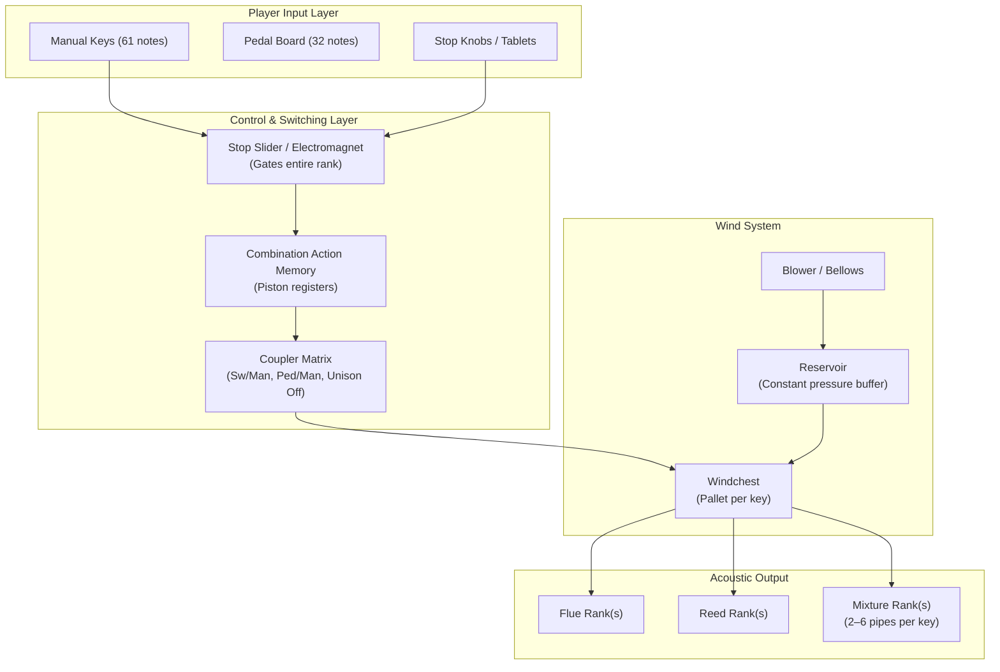
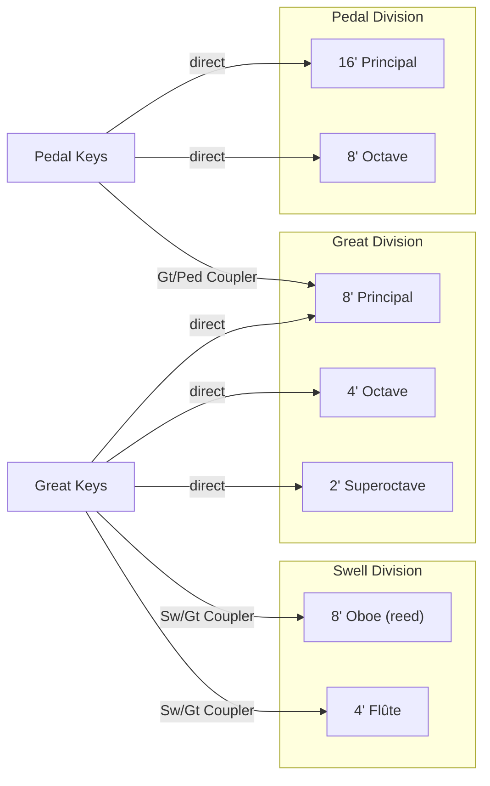

# Lesson 3: Register Combinations — The Organ as Acoustic Synthesizer

## 1. First-Principles Intuition (The 15%)

The pipe organ is additive synthesis in physical hardware. Every stop you draw adds a rank of pipes tuned to a specific harmonic partial of the 8' unison pitch. When you combine stops, you are literally building a composite waveform in air — the same mathematical operation as summing sinusoids in a DAW, except the oscillators are columns of vibrating air and the "mix bus" is the room itself.

The single most important invariant to internalize is **pitch-class notation in feet**:

| Stop Length | Interval Relative to 8' | Harmonic Partial |
|-------------|-------------------------|------------------|
| 32' | Octave below 16' | Sub-fundamental |
| 16' | Octave below | 1st (sub) |
| 8' | Unison | 1st (fundamental) |
| 4' | Octave above | 2nd |
| 2⅔' | Octave + fifth above | 3rd |
| 2' | Two octaves above | 4th |
| 1⅗' | Two octaves + major 3rd | 5th |
| 1⅓' | Two octaves + fifth | 6th |
| 1' | Three octaves above | 8th |

An open pipe's pitch follows `f = v / 2L` (where v ≈ 343 m/s). That's all the physics you need. Everything else — tone color, balance, coherence — flows from understanding which harmonic partial each stop reinforces and whether adjacent harmonics are present to support it.

**The core design rule:** Mutation stops (2⅔', 1⅗', 1⅓') are not standalone voices. They are harmonic colorants. A 2⅔' Nazard drawn alone will sound like a parallel-fifth-above-the-octave ghost. Drawn with 8' + 4' as its foundation, it locks into the third partial of the composite tone and disappears into a rich, clarinet-like timbre. Never draw mutations without octave support.

---

## 2. The Four Stop Families: What They Sound Like and Why

Understanding the physics of pipe construction lets you predict how stops will blend before you draw them.

### 2.1 Principal (Diapason) Stops
Open cylindrical metal pipes scaled to a moderate diameter-to-length ratio. They produce a nearly complete harmonic series with moderate strength across all partials — a bright, centered sound that neither recedes nor dominates. Principals are the structural backbone of any registration. When in doubt, build on 8' Principal.

**Sound character:** Clear, choral, neither flute-hollow nor string-edgy. Analogous to a triangle wave with moderate harmonic decay.

### 2.2 Flute Stops
Wide-scaled or stopped (capped) pipes. Stopped pipes cut off even harmonics, leaving a hollow, clarinet-like sound dominated by odd partials 1, 3, 5. Wide-open flutes (Rohrflöte, Spitzflöte) are rounder and fuller but still lack upper-harmonic complexity. Flutes blend readily with anything because they add warmth without competing in the upper spectrum.

**Sound character:** Round, warm, recedes gracefully under louder stops. Useful as 8' color beneath principals, or as 16' sub-bass to add gravity without weight.

### 2.3 String Stops
Narrow-scaled open metal pipes (Gamba, Viole, Salicional). The narrow bore concentrates energy in upper harmonics, creating a reedy, complex sound with slow attack and prominent beating between partials. String stops add sheen and shimmer but can destabilize a registration if added without attention to spectral balance.

**Sound character:** Thin, intense, cutting in the upper register. Pairs beautifully with a celeste (see Section 5.1 on undulants). Avoid mixing with mutations — the overlapping upper partials create muddy interference.

### 2.4 Reed Stops
A vibrating brass tongue (shallot) drives a resonator tube. The tongue generates a sawtooth-like waveform rich in both odd and even harmonics — a full spectrum stop. Reeds dominate any ensemble they enter. Chorus reeds (Trumpet, Trompette, Posaune) reinforce the full harmonic series. Solo reeds (Oboe, Cromorne, Vox Humana) have idiosyncratic spectra designed for melodic projection.

**Sound character:** Assertive, colorful, slightly nasal. Reeds are the brass section of the organ. Add them last when building a registration, and expect them to reshape the entire ensemble balance.

---

## 3. The Architecture: How Stops Connect to Pipes



### 3.1 Slider Chest Logic
The slider chest implements a physical AND gate. A pipe sounds when — and only when — both conditions are true:

1. The **key pallet** is open (player holds the key)
2. The **stop slider** is drawn (stop knob is out)

```
Pipe sounds = Pallet[key] AND Slider[stop]
```

This two-dimensional matrix (61 keys × N stops per manual) is the entire selection logic of a mechanical organ. Its elegance is that it fails gracefully: a stuck slider silences a whole rank, a stuck pallet silences one key across all ranks — both failures are immediately audible and diagnosable.

### 3.2 Electro-Pneumatic and Direct Electric Action
Modern organs replace the slider with an electromagnet per pipe. The control matrix becomes:

```
Electromagnet[stop × 61 + key] = Stop_enabled[stop] AND Key_pressed[key]
```

This enables combination actions — pistons that recall full stop registrations in a single thumb press — and remote console placement. The tradeoff is mechanical complexity and slower maintenance diagnosis.

### 3.3 Mixture Stop Composition and Breaking
A mixture is not a single pitch — it is 2–6 pipes per key, each at a different high harmonic rank. The composition shifts ("breaks") as you ascend the keyboard to prevent the treble from becoming unplayably shrill.

A typical **Mixture IV** (four ranks) for a Great manual:

| Key Range | Rank 1 | Rank 2 | Rank 3 | Rank 4 |
|-----------|--------|--------|--------|--------|
| C2–B2 | 2' | 1⅓' | 1' | ⅔' |
| C3–B3 | 2⅔' | 2' | 1⅓' | 1' |
| C4–B4 | 4' | 2⅔' | 2' | 1⅓' |
| C5–C6 | 5⅓' | 4' | 2⅔' | 2' |

Notice that in the highest octave, the lowest rank of the mixture is a 5⅓' — a 16th partial — which would be intolerably high if it did not break back down to 2' at the top of the break boundary. This is voicer craft: the mixture adds brilliance at every pitch level without overloading the treble.

---

## 4. Registrational Taxonomy: Building from the Ground Up

The organist's core mental model is **build from the bottom**. Never add a mutation to thin air; never add a reed before the foundation is settled.

### 4.1 The Plenum (Full Principal Chorus)

The plenum is the foundational ensemble of the organ. It is not a registration for color — it is the structural maximum clarity registration. Use it for Bach, contrapuntal textures, and any music where independent voices must project simultaneously.

**How to build it (Great Manual):**

**Step 1 — Foundation**
```
Draw: 8' Principal
```
This is your unison pitch reference. Everything else relates to it.

**Step 2 — Add Octave Reinforcement**
```
Draw: 8' Principal + 4' Octave (Principal 4')
```
The 4' adds the second harmonic, brightening the attack without changing perceived pitch.

**Step 3 — Complete the Lower Harmonic Series**
```
Draw: 8' + 4' + 2' Superoctave
```
Now you have harmonics 1, 2, 4. Full, balanced, almost complete.

**Step 4 — Add the Mixture**
```
Draw: 8' + 4' + 2' + Mixture IV
```
The mixture fills harmonics 8, 10, 12, 16 and beyond, creating the blazing, choral plenum. The ensemble snaps into a new, unified cohesion — this is Rameau's harmonic synthesis principle in action. The ear stops hearing separate pitch layers and hears one complex timbre.

**Step 5 — Add 16' for Weight (Optional, Pedal/Great)**
```
Draw: 16' Principal + 8' + 4' + 2' + Mixture
```
The 16' extends below the fundamental, adding gravity for large spaces.

> **Practical rule:** The plenum should be built or dismantled in sequential steps — not by drawing all stops at once. Each stage creates a valid, complete registration for smaller forces.

### 4.2 The Flute Chorus

Entirely different logic from the plenum. Flutes blend into a unified softness rather than a brilliant choral sound.

```
Soft accompaniment:    8' Bourdon (stopped flute)
Add warmth:            8' Bourdon + 8' Flûte Harmonique
Add gentle brightness: 8' Bourdon + 8' FH + 4' Flûte
Add a celeste shimmer: 8' Bourdon + 8' Voix Céleste + 4' Flûte
```

The celeste (see Section 5.1) lives in the flute and string family, never in the principal chorus.

### 4.3 Cornet and Solo Mutation Combinations

The **Cornet** is a five-rank solo stop drawn from a single control, or assembled from individual stops:

```
Cornet = 8' Open Flute + 4' Flute + 2⅔' Nazard + 2' Flute + 1⅗' Tierce
```

This maps exactly onto harmonics 1, 2, 3, 4, 5. The ear fuses them into a single, brilliant, slightly nasal solo voice — the organ's equivalent of a solo oboe or cornet (brass). Used in French Classical music for cantus firmus statements in the treble.

**Sesquialtera (2-rank solo):**
```
2⅔' + 1⅗' (Nazard + Tierce without 8' or 4' support)
```
This is a niche combination found on English organs, used for pastoral solo lines. The two mutations without octave support create an intentionally reedy, plaintive color. Use sparingly — the missing fundamental makes it harmonically unstable for anything other than a single melodic line.

### 4.4 Reed Registrations

**Solo reed** (single manual line):
```
Melodic line:  8' Trumpet (Great, closed Swell)
Accompaniment: 8' Bourdon + 4' Flute (Swell, softer)
```

**Reed chorus** (full Romantic ensemble):
```
Build:  8' Principal + 4' Principal → add 8' Trumpet → add 16' Trombone
Result: Foundation + Trumpet = enormous, blaze-and-thunder
```

**Rule:** When adding a reed to a plenum, the reed will dominate. If the music requires the reed to be a color within the ensemble rather than a solo voice, draw it at a softer dynamic level (use the enclosed Swell manual) or choose a less assertive reed (Oboe, Cromorne) rather than a Trumpet or Trombone.

---

## 5. Advanced Techniques: Celestes, Couplers, and Pistons

### 5.1 Celeste Tuning and Undulants

A celeste stop is tuned intentionally sharp (or flat) by 2–6 Hz relative to a companion stop of the same pitch rank. When both are drawn, the slight frequency difference creates a beat frequency:

```
f_beat = |f₁ − f₂|
```

At 3 Hz beating, you hear a slow shimmer — the organ's vibrato. At 5–6 Hz it becomes agitated and intense. At 1 Hz it feels like breathing.

**How to use it:**

```
Soft lush pad:     8' Voix Céleste + 8' Salicional (string pair)
Warmer version:    8' Voix Céleste + 8' Flûte Harmonique (flute-string blend)
Ultra-soft:        Céleste alone without companion (some organs allow this, 
                   gives only the sharp rank — thin but haunting)
```

Never add mutations or reeds to a celeste combination — the beating interacts chaotically with the complex spectra of those stops and creates phase-cluttered mud rather than shimmer.

### 5.2 Couplers: Extending Across Divisions

Couplers connect one manual's keydesk to another division's wind chest. Drawing **Swell to Great** means every key on the Great also speaks Swell pipes. This is not simply loudness — it creates a compound timbre blending both divisions' tone colors.



**Common coupler strategies:**

| Coupler | Use Case |
|---------|----------|
| Swell to Great | Add expression pedal control to Great registration; layer Oboe over Principal |
| Choir to Great | Add softer flutes or strings to Great without committing to full Swell weight |
| Great to Pedal | Extend Great bass line into Pedal for smaller organs without large Pedal ranks |
| Swell to Pedal | Bring Swell reeds into Pedal for loud tutti climaxes |
| Unison Off (Great) | Suppress Great's direct response while Sw/Gt is drawn — plays only Swell pipes from Great keys; useful for echo effects |

**Superoctave and suboctave couplers:**
- **Superoctave coupler**: Each key also silently plays the pitch one octave higher in the same division. Instant brilliance without drawing individual 4' stops.
- **Suboctave coupler**: Each key also plays one octave lower. Thickens the bass dramatically. Use with caution on small organs — it doubles airflow demand.

### 5.3 Combination Pistons and Registration Planning

Modern organs provide **thumb pistons** (manual level) and **toe pistons** (pedal level) that recall preset stop configurations. A systematic approach:

```
Piston 1 (pp):   8' Bourdon alone — softest color
Piston 2 (p):    8' Bourdon + 4' Flûte
Piston 3 (mp):   8' Principal + 4' Octave
Piston 4 (mf):   8' + 4' + 2' Principals
Piston 5 (f):    Full Plenum (8' + 4' + 2' + Mixture)
Piston 6 (ff):   Plenum + 16' + 8' Trumpet
Piston 7 (fff):  All foundations + All reeds + 16' Posaune
```

The **General crescendo pedal** (a rotating barrel on the right side of the pedal clavier) automatically adds stops in this sequence as you rock it forward. It is mechanically programmed at the factory, though some instruments allow it to be customized. Use it for Romantic literature (Widor, Vierne, Dupré) where gradual swell is compositionally integral. Avoid it for Baroque music — terraced dynamics require clean stop changes between phrases, not continuous addition.

---

## 6. Historical Registration Practices

Each historical era's registration vocabulary directly reflects its organ-building technology. Knowing this history prevents stylistic anachronisms and reveals why certain combinations work.

### 6.1 North German Baroque — Werkprinzip Plenum
**(Schnitger, Arp — 1650–1720)**

Organs organized in **Werks** (Hauptwerk, Rückpositiv, Brustwerk, Pedal), each with a complete, independent principal chorus. No swell boxes, no expression pedals, no reeds of Romantic weight.

**Characteristic registrations:**

**Plenum (full chorus, main manual):**
```
Hauptwerk: 16' Principal + 8' Principal + 4' Octave + 2⅔' Quinte + 2' Superoctave + Mixture IV-VI + Zimbel II
```

**Contrasting Rückpositiv chorus (softer manual behind player):**
```
Rp: 8' Principal + 4' Octave + 2' Flachflöte + Mixture III
```

**Dialogue texture (Praetorius-style echo):**
```
Phrase A: Hauptwerk plenum
Phrase B: Rückpositiv plenum (immediately softer, no stop change needed — just shift manuals)
```

**Schübler-style cantus firmus:**
```
Right hand (HW): 8' Trompette (solo reed)
Left hand (RP):  8' Flute + 4' Flute (soft accompaniment)
Pedal: 16' Principal + 8' Octave (independent bass)
```

**Key aesthetic:** Terraced, never graduated. Dynamics change by switching manuals or adding/removing entire Werks. This architecture makes Bach's contrapuntal voice-leading transparent — each voice occupies its own spectral space.

### 6.2 French Classical — Grand Jeu / Plein Jeu
**(Clicquot, Thierry — 1680–1760)**

French organs feature rich reed batteries and distinctive mutation stop sets rather than massive mixture ranks. Two fundamental registrations govern the repertoire:

**Plein Jeu (Foundations without reeds):**
```
8' Montre (Principal) + 8' Bourdon + 4' Prestant + Mixture (Fourniture) + Cymbale
No reeds, no mutations. Clear, shimmering, liturgical.
```

**Grand Jeu (Full organ with reeds — the organ's maximum):**
```
8' Montre + 4' Prestant + Cornet V (treble) + 8' Trompette + 8' Clairon 4' + (16' Bombarde if available)
No Plein Jeu mixture — the reeds provide spectral saturation.
```

**Cromorne en taille (tenor solo reed):**
```
Récit: 8' Cromorne (solo reed in middle register, tenor clef)
Grand Orgue: 8' Bourdon + 4' Flûte (soft accompaniment)
```
The Cromorne (a capped brass reed with cylindrical resonator) has a rounded, buzzy character unlike the Trompette's blaze. Used specifically for inner voice solos in pieces marked *en taille*.

**Récit de Nazard (flute mutation solo):**
```
Récit manual: 8' Bourdon + 2⅔' Nazard (+ optionally 2' Doublette)
Grand Orgue: 8' Bourdon only
```
De Grigny and Couperin specify this for pastoral solo passages. The Nazard by itself over a Bourdon creates the Cornet's thirds-harmonic without the full five-rank complex.

### 6.3 Romantic Symphonic — Additive Crescendo
**(Cavaillé-Coll, Willis — 1840–1900)**

High wind pressure (100–250mm WC vs. 70mm Baroque) enables powerful reeds and expressive flue stops. The swell box introduces continuous dynamic shaping impossible in earlier eras.

**Characteristic crescendo build (Franck-style):**
```
pp:  Swell: 8' Voix Céleste + 8' Flûte (box closed)
p:   Add Swell 4' Flûte; open box slightly
mp:  Add Swell 8' Oboe; Great: 8' Principal + 4' Octave
mf:  Swell to Great coupler; add Great 2' + Mixture
f:   Add Great 8' Trumpet; Pedal: 16' + 8' + Great/Pedal coupler
ff:  Add Swell Trompette; open Swell box fully
fff: Full Pedal reeds (16' Bombarde, 8' Trompette); crescendo pedal to maximum
```

**Vierne/Widor toccata registration:**
```
Great: 8' + 4' + 2' Principals + Mixture + 8' Trompette
Swell: 8' + 4' Principals + Oboe, box open
Ped:   16' + 8' + 4' Principals + 16' Trombonne + Gt/Ped coupler
```
This is the "orchestral tutti" — massive, sustained, and brilliant. The enclosed Swell adds shimmer and high-frequency complexity above the Great's structural core.

### 6.4 Neo-Baroque and Modern Eclecticism
**(Flentrop, Fisk, Noack — 1950–present)**

The Orgelbewegung returned to mechanical (tracker) action and lower wind pressures while instrument builders began incorporating both historical and Romantic resources in single instruments. Modern registrations freely mix eras:

**Messiaen "Dieu parmi nous" opening:**
```
Great:  8' + 4' + 2' Principals + Mixture + 8' Trompette (rhythmic drive)
Swell:  Plein Jeu + Mixture + 8' Trombonne (blaze reinforcement)
Pedal:  32' + 16' + 8' Principals + 16' + 8' Reeds (tectonic bass)
Couplers: Sw/Gt, Gt/Ped, Sw/Ped
```

**Messiaen "Le banquet céleste" (slow meditation):**
```
Swell:  8' Flûte Harmonique + 8' Voix Céleste (box nearly closed)
Great:  8' Bourdon only (pp foundation)
Pedal:  16' Bourdon (soft, no reeds)
```
The contrast between these two Messiaen registrations — the same composer, same instrument — illustrates the full dynamic and timbral range that modern instruments support.

---

## 7. Practice Drills: Hands-On Exercises

These drills are designed for sequential, cumulative practice at an organ console. Work through them in order. Each builds on the last.

### Drill 1 — Stop Drawing Choreography (Day 1)
**Goal:** Internalize the physical motion of stop changes without breaking legato.

The challenge: organ stop knobs are on either side of the manual, and you must draw or push them while continuing to play. The technique is to plan changes one measure ahead and execute them on a resting hand during textural gaps.

**Exercise:**
1. Set a simple hymn tune in memory (or use "Old Hundredth" — 4 beats/bar, steady quarter notes).
2. Play through it on 8' Bourdon only. BPM: 60.
3. On the repeat, draw 4' Flûte with your right hand during bar 2 beat 4 rest, return hand before bar 3 beat 1.
4. On the second repeat, draw 8' Principal with left hand during a cadence rest.
5. Progressive target: execute 3 stop changes in a 16-bar piece without an audible break in legato. BPM 60 → 72.

### Drill 2 — Harmonic Series Stack (Day 1–2)
**Goal:** Hear each harmonic partial as you add it.

1. Draw 8' Principal alone. Play middle C. Listen to the fundamental.
2. Draw 4' Octave. Play middle C again. Notice the octave reinforcement — the pitch does not change, but the tone brightens.
3. Draw 2⅔' Quinte. Notice the third harmonic — a slight "horn-like" quality emerges.
4. Draw 2' Superoctave. The fourth harmonic fills in. The sound is now ringing, almost trumpet-like.
5. Draw Mixture. The sound jumps to a new order of brilliance — the plenum locks in.
6. Remove stops in reverse order. At each step, listen to what disappears from the composite tone.

**Target duration:** 10 minutes. This is the most important listening exercise in organ playing.

### Drill 3 — Manual Transfer (Day 2–3)
**Goal:** Seamlessly move melodic lines between manuals with contrasting registrations.

**Setup:**
```
Great: 8' + 4' Principals + Mixture (plenum, full chorus)
Swell: 8' Oboe (solo reed, box half-open)
```

1. Play a Bach chorale melody on Great, hands-together, BPM 60.
2. On the second phrase, shift right hand to Swell for the melody; left hand remains on Great for inner voices.
3. The melody now sings on the Oboe over a Principal accompaniment — an instant color contrast.
4. Return to Great for the final cadence.

**Advanced:** Add Sw/Gt coupler for the final phrase to merge both sounds into a fuller conclusion.

### Drill 4 — Building and Dismantling the Crescendo (Day 3–5)
**Goal:** Execute a Romantic crescendo with correct piston sequencing.

**Setup:** Program pistons 1–6 as described in Section 5.3.

1. Begin a slow, sustained chord progression (I – IV – V – I in D major). BPM 50.
2. On each new chord, advance one piston step with your right thumb between notes.
3. By chord 4, you should be at Piston 5 (mf, plenum).
4. Hold the final chord through a full decrescendo — step pistons backward 6 → 5 → 4 → 3 → 2 → 1 as the chord sustains.

**Target:** Full crescendo + decrescendo cycle over 32 beats without rhythmic disruption. This requires planning piston placement two beats ahead of execution.

### Drill 5 — French Classical Color Matching (Day 5–7)
**Goal:** Execute de Grigny-style registration changes between Plein Jeu and Grand Jeu.

**Setup:**
```
Plein Jeu:  8' Montre + 8' Bourdon + 4' Prestant + Mixture (no reeds) — assign to Piston A
Grand Jeu:  8' Montre + 4' Prestant + 8' Trompette + 4' Clairon — assign to Piston B
```

1. Play the opening of de Grigny's *Plein Jeu* from "Livre d'Orgue" on Piston A.
2. At the double bar, engage Piston B with right thumb.
3. The ensemble transforms from shimmering foundations to blazing reeds — an instant orchestral tutti.
4. Practice the transition until the piston press happens exactly on beat 1 of the new section, not before or after.

**Target BPM:** 60 → 76. The stop change must be inaudible as a separate event — it should feel compositionally inevitable.

---

## 8. Troubleshooting Common Registration Problems

| Problem | Likely Cause | Fix |
|---------|-------------|-----|
| Combination sounds muddy, indistinct | Missing octave stops; too many mutations without foundation | Draw 8' + 4' Principals first; remove mutations one at a time until clarity returns |
| Treble is painfully bright, shrill | Mixture too prominent; no 8' weight | Add 16' or draw stronger 8' Principal; push back Mixture if it's a separate rank |
| Bass sounds boomy, overloads the room | 16' + 32' pedal with no mid-range definition | Draw 8' Pedal Principal to add mid-definition; reduce sub-bass rank or close expression box |
| Celeste shimmer sounds rough, not smooth | Beat frequency too fast (> 6 Hz) | Use only the companion rank without the full celeste; re-tune if the instrument allows |
| Reed sounds disconnected from ensemble | Reed too loud relative to flue foundation | Build more 8' + 4' foundation beneath the reed; use enclosed Swell reed rather than Great Trumpet |
| Mutation sounds like a parallel melody | No octave foundation drawn | Always draw 8' + 4' before any mutation stop |
| Piston change audible as a "clunk" | Stop change happening on a note, not in a rest | Plan changes one full beat early; execute on the final 16th note of the preceding bar |
| Pressure sag when tutti is engaged | Too many stops drawn for the instrument's wind system | Reduce stop count; prioritize quality over quantity — a 5-stop plenum on a small organ > an 18-stop tutti that sags |

---

## 9. Quick Reference: Registration Checklists

### Starting a New Piece — The Registration Protocol

```
1. Read the score. Note dynamic markings, era, composer nationality.
2. Choose manual assignments: melody voice → which manual?
3. Build from 8' up. Never begin with mutations or reeds.
4. If Baroque: build a plenum. If Romantic: plan the crescendo arc.
5. Assign pistons before you begin. Practice the piston changes away from tempo.
6. Play through once at 70% tempo, executing all stop changes.
7. Confirm: does each registration change feel compositionally motivated?
```

### Harmonic Coherence Checklist

Before drawing any mutation or mixture, confirm:
- [ ] 8' unison stop is drawn (Principal or Flute)
- [ ] 4' octave is drawn (unless deliberately omitting for color)
- [ ] Mutation is a recognized harmonic partial of the 8' pitch (2⅔' = 3rd partial, 1⅗' = 5th partial)
- [ ] No "harmonic holes" (e.g., 16' + 2⅔' without 8' + 4')
- [ ] Reed, if present, is added after flue foundation is established

### Era-Specific Quick Reference

| Era | Characteristic Combination | Avoid |
|-----|---------------------------|-------|
| North German Baroque | 16' + 8' + 4' + 2' + Mixture + Zimbel | Reeds in plenum; expression pedal |
| French Classical | Plein Jeu OR Grand Jeu (not mixed) | Mixing reed and foundation choruses |
| English Baroque | 8' + 4' + Cornet (treble solo) | Full Germanic plenum — too heavy |
| Romantic French | Gradual crescendo, Céleste, enclosed Swell | Abrupt Baroque terracing |
| Romantic English/German | Full Swell, strings + reeds | Bare octave stacking without color |
| 20th Century (Messiaen) | Extreme contrasts, full tutti vs. solo flute | Middle-ground mf registrations |
