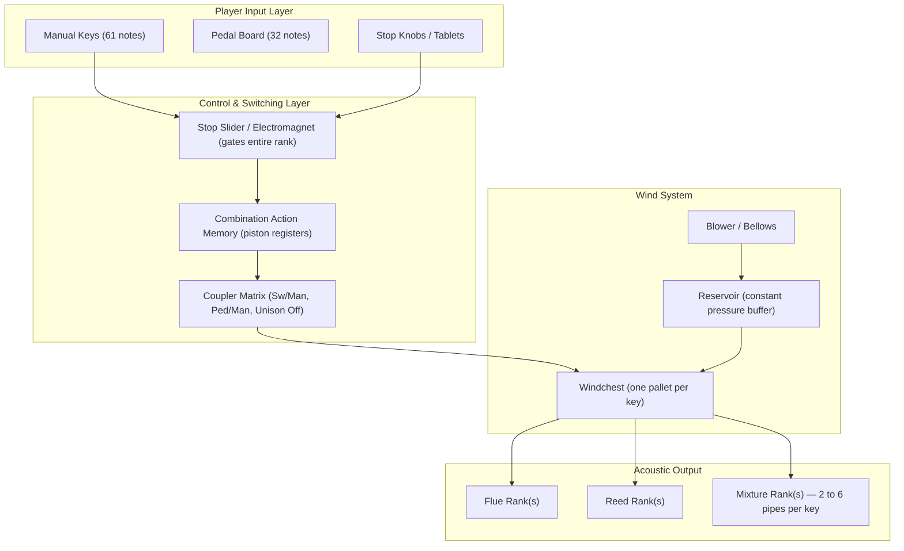
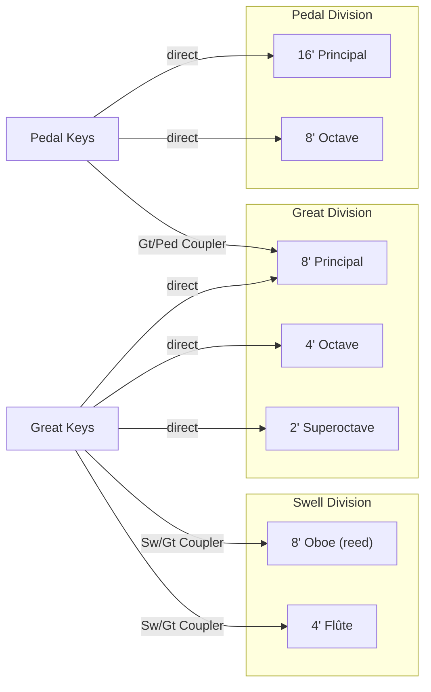

# Lesson 3: Register Combinations — The Organ as Acoustic Synthesizer

## 1. First-Principles Intuition (The 15%)

The pipe organ is additive synthesis built in wood and metal. Every stop you draw adds a rank of pipes tuned to a specific harmonic partial of the 8' unison pitch. Combine stops and you build a composite waveform in air — the same operation as stacking sine oscillators in a synth, except the oscillators are columns of vibrating air and the mix bus is the room itself.

The single invariant you must internalize before touching a stop knob is **pitch-class notation in feet**. "Feet" describes the approximate length of the open pipe sounding the lowest note (C) on the rank — not an arbitrary label, but a physical measurement that directly sets pitch.

| Stop Length | Interval Relative to 8' | Harmonic Partial |
|---|---|---|
| 32' | Two octaves below | Sub-sub-fundamental |
| 16' | Octave below | 1st (sub) |
| 8' | Unison | 1st (fundamental) |
| 4' | Octave above | 2nd |
| 2⅔' | Octave + fifth above | 3rd |
| 2' | Two octaves above | 4th |
| 1⅗' | Two octaves + major 3rd | 5th |
| 1⅓' | Two octaves + fifth | 6th |
| 1' | Three octaves above | 8th |

An open pipe's resonant frequency follows `f ≈ v / 2L` (v ≈ 343 m/s in air). That one line is all the acoustics you need carried into the console. Everything that matters in practice — blend, balance, harmonic coherence — comes from knowing which partial each stop reinforces and whether the partials below it are present to support it.

**The governing rule of registration:** mutation stops (2⅔', 1⅗', 1⅓') are not standalone voices. They are harmonic colorants riding on a fundamental. A 2⅔' Nazard drawn alone sounds like a disembodied fifth floating a twelfth above where you're playing — your ear hears it as a separate, parallel melody. Drawn over 8' + 4', the same pipe locks in as the third partial of one composite tone and vanishes into a reedy, clarinet-like color. **Never draw a mutation without its octave foundation already sounding.** This single rule prevents 90% of beginner registration mistakes.

---

## 2. The Four Stop Families: What They Sound Like and Why

Pipe construction geometry predicts blend behavior before you ever pull a knob.

### 2.1 Principal (Diapason) Stops
Open cylindrical metal pipes at a moderate diameter-to-length (scale) ratio. They generate a nearly complete harmonic series with even strength across partials — bright, centered, neither hollow nor edgy. Principals are the skeleton of every registration that isn't a solo color combination.

**Sound character:** Clear and choral. Closest analog: a sawtooth with moderate high-partial rolloff. **Working rule: when in doubt, build on 8' Principal, not 8' Flute.**

### 2.2 Flute Stops
Wide-scaled open pipes (Rohrflöte, Spitzflöte) or stopped/capped pipes (Bourdon, Gedackt). Capping a pipe halves its effective speaking length *and* cancels all even-numbered harmonics, leaving a hollow sound built from odd partials 1, 3, 5 only — this is why a stopped flute sounds an octave lower than its open length would predict, and why it has that distinctive "woody" hollowness. Open wide-scale flutes keep even harmonics but still favor the fundamental heavily.

**Sound character:** Round, warm, recedes gracefully under anything louder. Use as 8' color beneath principals, or as 16' Pedal weight when you want gravity without aggressive edge.

### 2.3 String Stops
Narrow-scaled open metal pipes (Gamba, Viole, Salicional, Dulciana). The narrow bore starves the fundamental and concentrates energy in upper partials — slow attack, prominent shimmer, audible beating between close partials even on a single rank.

**Sound character:** Thin, intense, cutting above middle C. Pairs beautifully with a celeste rank (Section 5.1). **Do not combine strings with mutations** — both families crowd the same upper-harmonic real estate and the result is interference mud rather than blend.

### 2.4 Reed Stops
A vibrating brass tongue (shallot) excites a resonator tube. The tongue itself produces something close to a sawtooth wave rich in *both* odd and even harmonics — full-spectrum output before the resonator even shapes it. Chorus reeds (Trumpet, Trompette, Posaune, Bombarde) reinforce the entire harmonic series and are built to blend with a plenum. Solo reeds (Oboe, Cromorne, Vox Humana) have deliberately irregular, idiosyncratic spectra built for melodic projection, not blend.

**Sound character:** Assertive, slightly nasal, the organ's brass section. **Add reeds last** — they reshape the whole ensemble's balance the moment they enter, so the foundation must already be settled.

---

## 3. The Architecture: How Stops Connect to Pipes



### 3.1 Slider Chest Logic
The slider (tracker) chest is a physical AND gate. A pipe sounds only when both are true:

1. The **key pallet** is open (you are holding the key down)
2. The **stop slider** is drawn (the knob is pulled out, uncovering the pipe's toe hole)

```
Pipe sounds = Pallet[key] AND Slider[stop]
```

That's the entire selection logic of a mechanical organ: a 61-key × N-stop matrix per manual. It fails gracefully and diagnosably: a stuck slider silences one whole rank across the keyboard; a stuck pallet silences one key across every rank. If you hear a dead note on every stop you try, suspect the pallet or key action, not the stop. If you hear a dead stop across every key, suspect the slider or its action, not the key.

### 3.2 Electro-Pneumatic and Direct-Electric Action
Modern consoles replace the mechanical slider with an electromagnet per pipe:

```
Electromagnet[stop][key] = Stop_enabled[stop] AND Key_pressed[key]
```

This is logically identical to the tracker AND gate, but because it's electrical rather than mechanical, it can be latched into memory — which is what makes combination pistons possible, and what allows the console to sit detached from the pipework (common in large Romantic and modern instruments). Tradeoff: more points of failure, and a dead note now might mean a bad contact, a blown fuse in that stop's circuit, or a solenoid failure rather than a mechanical binding — diagnosis takes longer because you can't see the linkage.

### 3.3 Mixture Composition and Breaking
A mixture is not one pitch. It's 2–6 pipes sounding per key, each tuned to a different high partial. The rank composition *breaks* downward as you ascend the keyboard, so the top octave doesn't scream.

**Typical Mixture IV, Great manual:**

| Key Range | Rank 1 | Rank 2 | Rank 3 | Rank 4 |
|---|---|---|---|---|
| C2–B2 | 2' | 1⅓' | 1' | ⅔' |
| C3–B3 | 2⅔' | 2' | 1⅓' | 1' |
| C4–B4 | 4' | 2⅔' | 2' | 1⅓' |
| C5–C6 | 5⅓' | 4' | 2⅔' | 2' |

At the top of the keyboard, rank 1 jumps *up* to 5⅓' (the 16th partial) rather than continuing to climb — then breaks back down to 2' at the next boundary. Every break point is a deliberate voicer decision: add brilliance at every register without turning the treble into an air-raid siren. When you inherit an unfamiliar organ, play a chromatic scale on 8' + Mixture alone and listen for the break points — they tell you where the ensemble color shifts and where to avoid landing a sustained melody note if you want consistent color.

---

## 4. Registrational Taxonomy: Building From the Ground Up

The organist's core mental model: **build from the bottom, every time.** Never add a mutation to thin air. Never add a reed before the foundation is settled.

### 4.1 The Plenum (Full Principal Chorus)

The plenum is not a color choice — it's the organ's maximum-clarity ensemble. Use it for Bach, any contrapuntal texture, anything where independent voices must stay audible simultaneously.

**Build it in five deliberate steps (Great manual):**

**Step 1 — Foundation**
```
Draw: 8' Principal
```
Your unison pitch reference. Everything else is measured against this.

**Step 2 — Octave reinforcement**
```
Draw: 8' Principal + 4' Octave
```
Adds the 2nd partial. Brightens the attack; pitch center doesn't move.

**Step 3 — Complete the lower series**
```
Draw: 8' + 4' + 2' Superoctave
```
Harmonics 1, 2, 4 now present. Already a complete, usable registration for smaller textures.

**Step 4 — Add the mixture**
```
Draw: 8' + 4' + 2' + Mixture IV
```
Fills in harmonics 8, 10, 12, 16+. The ensemble snaps into a single fused timbre — the ear stops tracking separate pitches and hears one blazing composite color. This fusion point is the plenum's defining moment; if it doesn't happen, your 8'/4' foundation is too weak relative to the mixture (see Section 8).

**Step 5 — Add 16' for weight (optional)**
```
Draw: 16' Principal + 8' + 4' + 2' + Mixture
```
Extends below the fundamental for gravity in large rooms.

> **Practical rule:** build or dismantle the plenum in sequence, not all at once. Every intermediate stage (Step 1, Step 2, Step 3...) is a valid, complete, usable registration on its own — which means you can stop building at any step if the music only needs that much weight.

### 4.2 The Flute Chorus

Opposite logic from the plenum: flutes fuse into a soft unified wash, not a brilliant choral blaze.

```
Soft accompaniment:     8' Bourdon (stopped flute) alone
Add warmth:             8' Bourdon + 8' Flûte Harmonique
Add gentle brightness:  8' Bourdon + 8' Flûte Harmonique + 4' Flûte
Add celeste shimmer:    8' Bourdon + 8' Voix Céleste + 4' Flûte
```

The celeste belongs to the flute/string family only — it never appears in a principal plenum (Section 5.1 explains why).

### 4.3 Cornet and Solo Mutation Combinations

The **Cornet** is a five-rank solo combination, drawn either from one knob or assembled by hand:

```
Cornet = 8' Open Flute + 4' Flute + 2⅔' Nazard + 2' Flute + 1⅗' Tierce
```

Maps directly onto harmonics 1, 2, 3, 4, 5. The ear fuses all five into a single brilliant, slightly nasal solo voice — the organ's answer to a solo oboe or cornet (brass). Standard for cantus firmus statements in the treble in French Classical repertoire.

**Sesquialtera (2-rank solo):**
```
2⅔' Nazard + 1⅗' Tierce — no 8' or 4' foundation
```
A niche English combination for pastoral solo lines. The deliberately *missing* fundamental gives it a plaintive, slightly unstable quality — useful for exactly one melodic line, never for chords. Playing full triads on Sesquialtera alone produces an unintelligible harmonic smear; reserve it for single-note melody only.

### 4.4 Reed Registrations

**Solo reed over soft accompaniment:**
```
Melody (Great, or Swell closed):  8' Trumpet
Accompaniment (Swell, softer):    8' Bourdon + 4' Flûte
```

**Reed chorus (full Romantic weight):**
```
Build:  8' Principal + 4' Principal → add 8' Trumpet → add 16' Trombone
```

**Working rule:** a reed added to a plenum will dominate it, every time, by design — reed pipes are voiced louder per-pipe than flue pipes to project through an ensemble. If you need the reed as a *color inside* the texture rather than a solo on top, either play it on the enclosed Swell with the box partly closed, or choose a milder reed (Oboe, Cromorne) instead of a chorus reed (Trumpet, Trombone).

---

## 5. Advanced Techniques: Celestes, Couplers, and Pistons

### 5.1 Celeste Tuning and Undulants

A celeste rank is deliberately mistuned — sharp or flat by roughly 2–6 Hz at any given pitch — relative to a companion rank of the same pipe length. Sounding both together produces a beat frequency:

```
f_beat = |f₁ − f₂|
```

At ~1 Hz the ensemble seems to breathe. At ~3 Hz you get the classic slow shimmer organists call "celeste." At 5–6 Hz it turns agitated, almost tremulous. Above that it stops sounding musical and starts sounding detuned.

**Practical combinations:**
```
Soft lush pad:   8' Voix Céleste + 8' Salicional         (string pair, classic)
Warmer blend:    8' Voix Céleste + 8' Flûte Harmonique    (flute-string hybrid)
Ultra-soft:      Céleste rank alone, no companion          (thin, haunting — not all instruments permit this)
```

**Never** add mutations or reeds to a celeste combination. Their complex, strong-partial spectra beat chaotically against the celeste's own close-interval beating and the result is phase mud, not shimmer. Keep celestes in their own lane: strings and flutes only.

### 5.2 Couplers: Extending Across Divisions

A coupler routes one manual's key action into another division's windchest. "Swell to Great" means every Great key also opens the corresponding Swell pallets — not a volume boost, but a genuinely new composite timbre blending both divisions.



**Common coupler strategies:**

| Coupler | Use Case |
|---|---|
| Swell to Great | Add expression-pedal control to Great; layer Oboe color over Principal |
| Choir to Great | Add softer flutes/strings to Great without committing to full Swell weight |
| Great to Pedal | Extend Great's bass line into Pedal on organs with a small Pedal division |
| Swell to Pedal | Bring Swell reeds into Pedal for loud tutti climaxes |
| Unison Off (Great) | Mutes Great's direct pipes while Sw/Gt stays drawn — Great keys speak only Swell pipes; used for echo effects |

**Octave couplers:**
- **Superoctave coupler** — each key also silently triggers the same division one octave higher. Instant brilliance without hunting for an individual 4' stop knob mid-piece.
- **Suboctave coupler** — each key also triggers one octave lower. Thickens bass fast. On a small-blower instrument this can starve the wind supply — check for pressure sag (Section 8) before using it in a sustained passage.

### 5.3 Combination Pistons and Registration Planning

Thumb pistons (under each manual) and toe pistons (above the pedal clavier) instantly recall a preset stop combination. Program a graduated sequence:

```
Piston 1 (pp):   8' Bourdon alone
Piston 2 (p):    8' Bourdon + 4' Flûte
Piston 3 (mp):   8' Principal + 4' Octave
Piston 4 (mf):   8' + 4' + 2' Principals
Piston 5 (f):    Full plenum (8' + 4' + 2' + Mixture)
Piston 6 (ff):   Plenum + 16' + 8' Trumpet
Piston 7 (fff):  All foundations + all reeds + 16' Posaune
```

The **General crescendo pedal** — a rocking shoe on the right side of the pedal clavier, separate from the Swell expression pedal — adds stops along a pre-wired sequence as you rock it forward, giving continuous crescendo without individual piston presses. It's factory-set on most organs, though some allow custom programming. Use it for Romantic repertoire (Widor, Vierne, Dupré) where the crescendo is compositionally built into the line. **Avoid it in Baroque repertoire** — terraced dynamics call for discrete stop-block changes at phrase boundaries, not a continuous sweep.

---

## 6. Historical Registration Practices

Each era's registration vocabulary is a direct consequence of its organ-building technology. Knowing the hardware constraints tells you why the combinations exist and keeps you from anachronism.

### 6.1 North German Baroque — Werkprinzip Plenum
*(Schnitger, Arp — 1650–1720)*

Organs built in independent **Werks** (Hauptwerk, Rückpositiv, Brustwerk, Pedal), each with its own complete principal chorus. No swell boxes, no expression pedal, no Romantic-weight reeds.

**Hauptwerk plenum:**
```
16' Principal + 8' Principal + 4' Octave + 2⅔' Quinte + 2' Superoctave + Mixture IV-VI + Zimbel II
```

**Rückpositiv contrast chorus (softer, behind the player):**
```
8' Principal + 4' Octave + 2' Flachflöte + Mixture III
```

**Echo dialogue (Praetorius-style):** alternate full phrases between Hauptwerk plenum and Rückpositiv plenum — the dynamic contrast comes from switching manuals entirely, not from adding or removing single stops.

**Schübler-style cantus firmus:**
```
Right hand (Hauptwerk): 8' Trompette, solo
Left hand (Rückpositiv): 8' Flute + 4' Flute, soft accompaniment
Pedal: 16' Principal + 8' Octave, independent bass
```

**Key aesthetic:** terraced, never graduated. Dynamics change by switching Werks wholesale, not by sliding volume. This is exactly why Bach's independent contrapuntal voices stay audible on these instruments — each voice can occupy its own spectral and physical space.

### 6.2 French Classical — Plein Jeu / Grand Jeu
*(Clicquot, Thierry — 1680–1760)*

French organs are built around rich reed batteries and a distinctive mutation palette rather than large mixture ranks. Two governing registrations cover almost the whole repertoire, and they do not mix:

**Plein Jeu (foundations, no reeds):**
```
8' Montre + 8' Bourdon + 4' Prestant + Mixture (Fourniture) + Cymbale
```
Clear, shimmering, liturgical — used for versets and slow movements.

**Grand Jeu (full organ, reed-dominant):**
```
8' Montre + 4' Prestant + Cornet V (treble) + 8' Trompette + 4' Clairon + 16' Bombarde (if available)
```
No mixture here — the reed battery supplies the spectral density instead.

**Cromorne en taille (tenor solo reed):**
```
Récit:       8' Cromorne, solo, middle register (tenor clef line)
Grand Orgue: 8' Bourdon + 4' Flûte, soft accompaniment
```
The Cromorne — capped, cylindrical resonator — has a round, buzzy tone distinct from the Trompette's blaze. Marked *en taille* calls for exactly this combination for the inner-voice solo.

**Récit de Nazard (flute-mutation solo):**
```
Récit:       8' Bourdon + 2⅔' Nazard (+ optional 2' Doublette)
Grand Orgue: 8' Bourdon alone
```
De Grigny and Couperin specify this for pastoral solos — the Nazard over a bare Bourdon gives you the Cornet's characteristic third-partial color without the full five-rank stack.

### 6.3 Romantic Symphonic — Additive Crescendo
*(Cavaillé-Coll, Willis — 1840–1900)*

High wind pressure (100–250 mm WC, versus roughly 70 mm Baroque) powers heavier reeds and more assertive flue stops. The swell box, now standard, introduces genuinely continuous dynamic shading that no earlier organ could produce.

**Franck-style crescendo build:**
```
pp:  Swell 8' Voix Céleste + 8' Flûte, box closed
p:   add Swell 4' Flûte; open box slightly
mp:  add Swell 8' Oboe; Great 8' Principal + 4' Octave
mf:  engage Swell to Great; add Great 2' + Mixture
f:   add Great 8' Trumpet; Pedal 16' + 8' + Great/Pedal coupler
ff:  add Swell Trompette; open Swell box fully
fff: full Pedal reeds (16' Bombarde, 8' Trompette); crescendo pedal to maximum
```

**Vierne/Widor toccata tutti:**
```
Great:  8' + 4' + 2' Principals + Mixture + 8' Trompette
Swell:  8' + 4' Principals + Oboe, box open
Pedal:  16' + 8' + 4' Principals + 16' Trombone + Gt/Ped coupler
```
The massive sustained "orchestral tutti" — enclosed Swell layered over the Great's structural core adds shimmer without muddying the foundation.

### 6.4 Neo-Baroque and Modern Eclecticism
*(Flentrop, Fisk, Noack — 1950–present)*

The Orgelbewegung revived tracker action and lower wind pressure, but modern instruments freely combine historical and Romantic resources on one console. Modern registration mixes eras deliberately:

**Messiaen, "Dieu parmi nous" (opening, fff rhythmic drive):**
```
Great:    8' + 4' + 2' Principals + Mixture + 8' Trompette
Swell:    Plein Jeu + Mixture + 8' Trombone
Pedal:    32' + 16' + 8' Principals + 16' + 8' Reeds
Couplers: Sw/Gt, Gt/Ped, Sw/Ped
```

**Messiaen, "Le banquet céleste" (slow meditation, pp):**
```
Swell:  8' Flûte Harmonique + 8' Voix Céleste, box nearly closed
Great:  8' Bourdon alone
Pedal:  16' Bourdon, no reeds
```

Same composer, same instrument, opposite extremes — this is the full dynamic range a modern eclectic organ is built to cover, and knowing both registrations tells you the instrument's actual ceiling and floor.

---

## 7. Practice Drills: Hands-On Exercises

Work these in order at a real console. Each builds on the previous drill's skill.

### Drill 1 — Stop-Drawing Choreography (Day 1)
**Goal:** change stops mid-phrase without breaking legato.

Stop knobs sit on both sides of the manuals. You must draw or push them while the other hand (or a resting finger) keeps playing. The technique: plan every change one measure ahead and execute it during a textural gap, not on a beat that needs both hands.

1. Use a simple hymn tune in memory ("Old Hundredth" works well — steady quarters, 4/4).
2. Play through on 8' Bourdon alone. BPM 60.
3. Repeat: draw 4' Flûte with the right hand during the rest on bar 2, beat 4; return the hand before bar 3 beat 1.
4. Next repeat: draw 8' Principal with the left hand during a cadence rest.
5. Progressive target: three clean stop changes across a 16-bar piece with zero audible break in legato. BPM 60 → 72.

### Drill 2 — Harmonic Series Stack (Day 1–2)
**Goal:** hear each partial as it's added — the single most important listening exercise in organ playing.

1. Draw 8' Principal alone. Play middle C. Listen only to the fundamental.
2. Add 4' Octave. Pitch doesn't move; tone brightens — that's the 2nd partial.
3. Add 2⅔' Quinte. A faint horn-like color appears — the 3rd partial.
4. Add 2' Superoctave. The sound rings, almost trumpet-like — 4th partial fills in.
5. Add Mixture. The ensemble jumps to a new order of brilliance and fuses into one timbre — the plenum has locked in.
6. Remove stops in reverse order, one at a time, and name out loud what disappears at each step.

**Target duration:** 10 minutes, done slowly and attentively — speed is not the point here.

### Drill 3 — Manual Transfer (Day 2–3)
**Goal:** move a melodic line between manuals with contrasting colors, seamlessly.

```
Great: 8' + 4' Principals + Mixture (full plenum)
Swell: 8' Oboe, box half-open
```

1. Play a Bach chorale melody hands-together on Great. BPM 60.
2. On the second phrase, shift the right-hand melody to Swell; left hand stays on Great for inner voices.
3. The melody now sings on Oboe over a Principal accompaniment.
4. Return to Great for the final cadence.

**Advanced:** engage Sw/Gt coupler on the final phrase to merge both colors for the close.

### Drill 4 — Building and Dismantling the Crescendo (Day 3–5)
**Goal:** execute a Romantic crescendo arc with correct piston timing.

Program pistons 1–6 from Section 5.3.

1. Play a slow sustained I–IV–V–I progression in D major. BPM 50.
2. Advance one piston per new chord with the right thumb, timed to land exactly as the chord changes.
3. By chord 4 you should be sitting on Piston 5 (mf plenum).
4. Hold the final chord through a full decrescendo, stepping pistons backward 6 → 5 → 4 → 3 → 2 → 1 while the chord sustains.

**Target:** a full crescendo-decrescendo cycle over 32 beats with zero rhythmic disruption. This demands planning each piston press two beats ahead of execution — thumb motion, not reaction.

### Drill 5 — French Classical Color Matching (Day 5–7)
**Goal:** execute a clean Plein Jeu → Grand Jeu transition, de Grigny style.

```
Piston A — Plein Jeu: 8' Montre + 8' Bourdon + 4' Prestant + Mixture (no reeds)
Piston B — Grand Jeu: 8' Montre + 4' Prestant + 8' Trompette + 4' Clairon
```

1. Play the opening of de Grigny's *Plein Jeu* from the *Livre d'Orgue* on Piston A.
2. At the double bar, engage Piston B with the right thumb.
3. The ensemble transforms from shimmering foundations to blazing reeds instantly.
4. Drill the transition until the piston press lands exactly on beat 1 of the new section — not early, not late.

**Target BPM:** 60 → 76. The stop change should feel compositionally inevitable, not like an event you did to the music.

---

## 8. Troubleshooting Common Registration Problems

| Problem | Likely Cause | Fix |
|---|---|---|
| Combination sounds muddy, indistinct | Mutations drawn without octave foundation | Draw 8' + 4' Principals first; remove mutations one at a time until clarity returns |
| Treble painfully bright, shrill | Mixture too prominent relative to foundation | Add 16' or a stronger 8' Principal; check whether the Mixture needs to be drawn at all for this texture |
| Bass boomy, overloads the room | 16'/32' Pedal with no mid-range definition | Add 8' Pedal Principal for mid-definition; reduce sub-bass rank or ease the expression box |
| Celeste shimmer sounds rough, not smooth | Beat rate above ~6 Hz | Drop to the companion rank alone, or have the celeste re-tuned if the instrument allows adjustment |
| Reed sounds disconnected from the ensemble | Reed voiced louder than the flue foundation beneath it | Build more 8' + 4' foundation under the reed; or move the reed to an enclosed Swell and partially close the box |
| Mutation sounds like a parallel melody | No octave foundation drawn beneath it | Always draw 8' + 4' before any mutation — no exceptions |
| Piston change audible as a "clunk" | Change executed on a sounding note, not a rest | Plan the change a full beat early; execute on the last sixteenth of the preceding bar |
| Wind pressure sags when tutti is engaged | Too many stops drawn for the instrument's wind supply capacity | Reduce stop count; a tight 5-stop plenum beats an 18-stop tutti that's starving for wind |

---

## 9. Quick Reference: Registration Checklists

### Starting a New Piece — The Registration Protocol

```
1. Read the score: dynamic markings, era, composer, nationality.
2. Assign manuals: which keyboard carries the melody voice?
3. Build from 8' up. Never start with mutations or reeds.
4. Baroque → build a plenum. Romantic → plan the crescendo arc.
5. Program pistons before you start. Rehearse the piston changes away from tempo.
6. Run the piece once at 70% tempo, executing every stop change for real.
7. Check: does each registration change feel compositionally necessary, or arbitrary?
```

### Harmonic Coherence Checklist

Before drawing any mutation or mixture, confirm:
- [ ] An 8' unison stop is drawn (Principal or Flute)
- [ ] A 4' octave is drawn, unless you're deliberately omitting it for a specific color
- [ ] The mutation is a recognized partial of the 8' pitch (2⅔' = 3rd, 1⅗' = 5th)
- [ ] No harmonic holes exist (e.g. 16' + 2⅔' drawn with no 8' or 4' between them)
- [ ] Any reed is added only after the flue foundation is already settled

### Era-Specific Quick Reference

| Era | Characteristic Combination | Avoid |
|---|---|---|
| North German Baroque | 16' + 8' + 4' + 2' + Mixture + Zimbel | Reeds inside the plenum; any expression pedal |
| French Classical | Plein Jeu *or* Grand Jeu, never blended | Mixing the reed chorus with the foundation chorus |
| English Baroque | 8' + 4' + Cornet (treble solo) | Full Germanic-weight plenum — too heavy for the repertoire |
| Romantic French | Gradual crescendo, Céleste, enclosed Swell | Abrupt Baroque-style terracing |
| Romantic English/German | Full Swell, strings + reeds together | Bare octave stacking with no color stops |
| 20th Century (Messiaen) | Extreme contrast: full tutti vs. solo flute | Comfortable mf middle-ground registrations |
