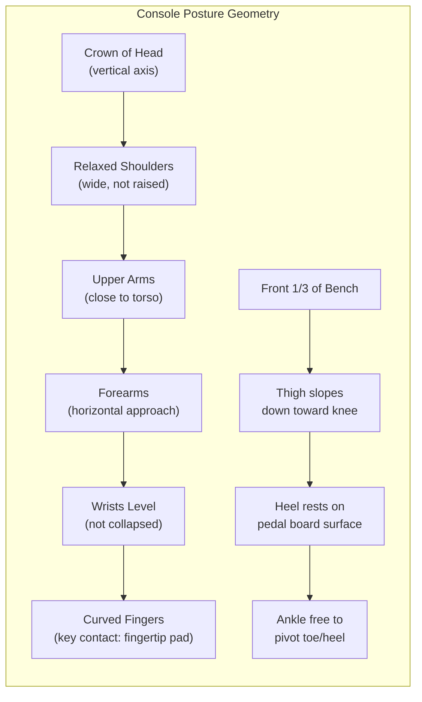
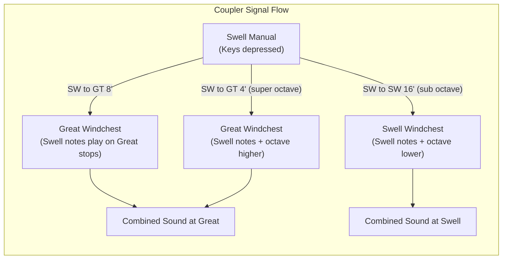
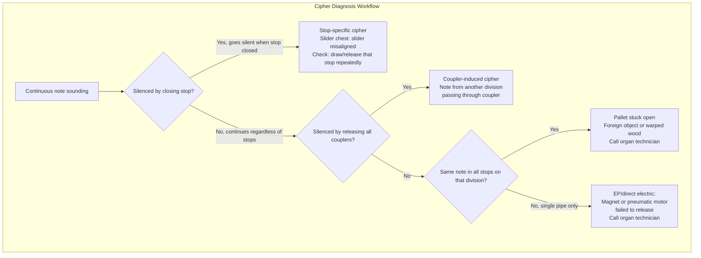
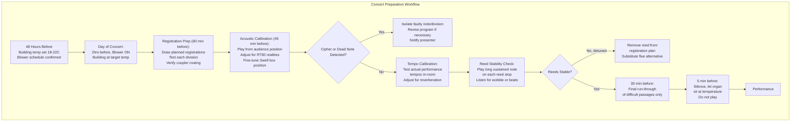

# Organ Masterclass: Performance Practice, Registration & Technique

## Table of Contents
1. [First-Principles Intuition: How Pipes Speak](#1-first-principles-intuition-how-pipes-speak)
2. [Console Geography & Physical Ergonomics](#2-console-geography--physical-ergonomics)
3. [Keyboard & Pedalboard Technique](#3-keyboard--pedalboard-technique)
4. [Registration Craft: Building Sounds from Stops](#4-registration-craft-building-sounds-from-stops)
5. [Articulation & Phrasing Without a Sustain Pedal](#5-articulation--phrasing-without-a-sustain-pedal)
6. [Practical Drills & Progressive Practice Plans](#6-practical-drills--progressive-practice-plans)
7. [Stop Architecture & Windchest Mechanics](#7-stop-architecture--windchest-mechanics)
8. [Environmental Control & Tuning Stability](#8-environmental-control--tuning-stability)
9. [Troubleshooting: Ciphers, Dead Notes & Wind Faults](#9-troubleshooting-ciphers-dead-notes--wind-faults)
10. [Performance Workflow: Concert Preparation](#10-performance-workflow-concert-preparation)
11. [Hymn Playing & Service Craft](#11-hymn-playing--service-craft)
12. [Sight-Reading Open Score & Transposition](#12-sight-reading-open-score--transposition)

---

## 1. First-Principles Intuition: How Pipes Speak

### How a Pipe Speaks

Every organ pipe is an aeromechanical resonator. Pressurized air enters through the toe hole, strikes the languid (a horizontal shelf), splits at the upper lip, and sets an air column vibrating against the mouth edge. That vibrating column — not a speaker cone, not a string — is the sound source. Open flue pipes (Principal, Octave) produce the full harmonic series; stopped pipes (Bourdon, Gedeckt) behave as a closed air column, sounding an octave lower than their physical length and favoring odd harmonics, which is why stopped flutes sound darker and rounder than open principals of the same pitch. Everything in organ technique flows from this physical reality.

**What you need to know as a player (not a builder):** The pipe is binary. It is either speaking at full pressure or silent. There is no velocity sensitivity, no "play harder for louder." Your only dynamic controls are:

- Which stops you draw (timbre + amplitude together)
- Expression pedal position (Swell box shutters)
- Articulation: how long each note sounds within the beat
- Density of texture (number of simultaneous voices/couplers active)

**Stop pitch families at a glance:**

| Stop Name | Pitch | Harmonic | What It Adds |
|---|---|---|---|
| Principal 8' | Unison | 1st | Core foundation tone |
| Octave 4' | Octave above | 2nd | Brightness, projection |
| Nazard 2⅔' | Twelfth above | 3rd | Nasal warmth (never alone) |
| Super Octave 2' | Two octaves above | 4th | Shimmer, cuts through |
| Tierce 1⅗' | Seventeenth above | 5th | Color mutation (use sparingly) |
| Mixture IV | Multiple high partials | 6th–8th | Choral brilliance |
| Trumpet 8' | Unison | Full spectrum | Assertive, cuts ensemble |

**Practical rule:** Mutations (2⅔', 1⅗') never stand alone — they reinforce partials already present in foundation stops. Drawing Nazard 2⅔' with Principal 8' and Octave 4' makes the ensemble shimmer. Drawing it alone produces a hollow, disembodied nasal sound. The ear needs the fundamental to anchor the mutation as a harmonic color.

**Why mixtures "break back":** A Mixture rank does not keep ascending in pitch across the whole keyboard — it would run out of usable frequency range in the treble. Around specific break points (commonly C25, C37, C49 on a typical Mixture IV) the rank drops back down an octave on one or more ranks. Players hear a subtle timbral shift at these breaks; it is normal, not a fault. Knowing your instrument's break points helps you anticipate tonal color changes within a single melodic line played high on the keyboard.

---

## 2. Console Geography & Physical Ergonomics

### Bench Position: The Foundation of Everything

A wrong bench position cascades into tension throughout your entire body. Get this right before touching a key.

**Bench height:** Adjust so your thighs slope gently downward toward your knees when your heels rest on pedal C. If your thighs are level or tilt upward, the bench is too high and you lose leverage over the pedals. Too low, and hip flexors strain during long passages. Target range: **520–540mm** from floor to bench surface.

**Bench distance from pedalboard:** Sit far enough back that you can reach the top octave of the pedalboard (high C, 25th note) with your right toe without leaning. A common error is sitting too close, which prevents full extension and forces awkward ankle angles.

**Spine posture:** Sit on the front third of the bench — not the back. This engages your core and prevents slumping into the keys. Your torso should be upright but not rigid; the sternum is lifted, shoulders relaxed and wide. Think of a string pulling the crown of your head toward the ceiling.

**Arm geometry:** Upper arms hang close to the body, elbows at approximately keyboard height or just below. Forearms approach the keys from a nearly horizontal angle. Wrists stay level or slightly elevated — never collapsed below the keyboard surface. Collapsing wrists blocks forearm weight transfer and causes fatigue within minutes.



### Manual Layout and Hand Geography

The organ console stacks manuals vertically. A typical three-manual instrument has:

- **Great (Hauptwerk):** Bottom manual — principal chorus, main power
- **Swell (Schwellwerk):** Middle manual — enclosed in expression box, widest dynamic range
- **Choir (Positiv/Brustwerk):** Top manual — chamber organ sound, accompanying voices

A four-manual adds **Solo** above Choir: high-pressure melodic reeds (Tuba, French Horn) and orchestral color stops, meant for a single melodic line to project over a full ensemble.

**Practical implication:** The Great is your anchor. Start registrations there. Swell gives you dynamic shape. Choir provides contrast and accompaniment textures.

**Vertical manual-shift mechanics:** Moving between manuals mid-phrase requires a controlled forearm drop or lift, not a wrist flick. The vertical gap between manual surfaces is typically 85–95mm. Practice the shift in isolation: place RH five-finger position on Great, lift the forearm (not just the hand) 90mm, land on the same five-finger shape on Swell, without looking. Do this 20 times slowly before attempting it inside a piece — the muscle memory for manual distance has to be built independently of musical context.

**Stop jambs:** Stops are arranged left and right of the manuals, typically by division. Before any session, run your eye across both jambs and confirm you know which side controls which division. Accidentally pulling a Great stop when you intend Swell is a common error that ruins entrances. On consoles with a combination action, also locate the General Cancel button and your preset pistons (thumb pistons under each manual, toe studs above the pedalboard) before you start — you will need to find them without looking during a concert.

---

## 3. Keyboard & Pedalboard Technique

### Manual Touch: Legato Without a Sustain Pedal

The organ has no damper pedal. Sound continues as long as the key is depressed. This means **your fingers are the dampers.** Legato on the organ is physically different from piano legato:

- On piano: overlap keys freely, sustain pedal handles connection.
- On organ: **the releasing finger must hold its key until the new finger is completely depressed.** Zero gap between notes, zero overlap beyond one or two milliseconds.

This is called **finger legato** and it is the fundamental technical skill of organ playing. Practice it slowly and obsessively before attempting any literature.

**Finger legato drill — C major five-finger position:**

```
Right hand, C4–G4, quarter notes at ♩= 50 BPM:

Fingers: 1  2  3  4  5  4  3  2  1
Notes:   C  D  E  F  G  F  E  D  C

Rule: Do NOT release finger N until finger N+1 is fully depressed.
      Listen for ANY gap. Even a 20ms gap is audible.

BPM targets:
  Week 1: ♩= 50 (slow enough to feel each transfer)
  Week 2: ♩= 60
  Week 3: ♩= 72
  Week 4: ♩= 84 — gaps will creep in; return to 60 and rebuild
```

**Hand posture for legato:** Curved fingers, not flat. The key contact point is the fleshy pad of the fingertip, not the flat of the finger. Flat fingers cannot transfer cleanly between adjacent keys — they create overlaps and smears. Curved fingers allow precise onset and release timing.

### Finger Substitution

Because the organ is legato-dependent, you will frequently need to change fingers on a held key while keeping that key depressed. This is **finger substitution** and it appears constantly in real repertoire.

**Basic substitution drill:**

```
Hold C4 with finger 1. Without releasing C4:
  - Silently slide finger 2 onto C4
  - Confirm C4 is still sounding
  - Release finger 1
  - Continue to next note

Common substitution pairs:
  1→2 on white keys (descending lines)
  2→1 or 3→1 (ascending to a held bass)
  5→4, 5→3 (thumb crosses in inner voices)
```

**Finger crossing without accent:** Organ thumb-unders and finger-overs must happen with zero dynamic bump, since there is no touch sensitivity to mask an uneven crossing on piano. Practice crossings isolated from rhythm first: hold the crossing note, slide the next finger into position while the key is still down, then transfer — listen for a perfectly smooth dynamic line with no audible "thud" from a finger landing too hard.

### Pedalboard Technique: Toe, Heel, and Substitution

The pedalboard is a 32-note concave radiating keyboard played entirely with your feet. AGO standard: 762mm radius, notes angled toward the bench. The two basic strokes are **toe** (ball of foot striking the front of the pedal) and **heel** (heel striking the rear of the pedal, slightly inside).

**Toe-heel exercises — foundation drill:**

```
Both feet, alternating toe-heel on single notes:
Right foot: C3 (toe), C3 (heel), D3 (toe), D3 (heel)...
Left foot:  mirrors on lower octave

BPM targets:
  ♩= 40 (whole beats, feel each heel-toe transfer)
  ♩= 60
  ♩= 80 — accuracy over speed always

Watch for:
  - Ankle collapsing inward on heel strokes
  - Heel striking too far toward the edge of the pedal (slipping)
  - Lifting the entire leg rather than pivoting at the ankle
```

**Pedal scale — G major (one octave):**

```
Right foot leads:
G2  A2  B2  C3  D3  E3  F#3  G3
 T   T   H   T   T   H   T    T
 (T = Toe, H = Heel)

Left foot leads (descending):
G3  F#3  E3  D3  C3  B2  A2  G2
 T   H    T   T   H   T   T   T

Alternate: Toe substitution approach (no heel):
G2(T-R) A2(T-L) B2(T-R) C3(T-L) D3(T-R) E3(T-L) F#3(T-R) G3(T-L)
```

**Pedalboard position memory:** Unlike piano, you cannot look down at your feet during performance without losing your place in the score. Practice **blind pedaling** — feel the gaps between black notes (C–D–E gap, B–C gap) and use them as tactile landmarks. The gap between E and F# is your most useful reference point in the natural position.

**Pedal legato drill with substitution:**

```
Pedal, one foot only, C2 held while changing toe to heel:

1. Depress C2 with right toe
2. Without releasing, pivot the ankle and place right heel on C2
3. Confirm the pipe keeps sounding without a gap (listen, don't look)
4. Lift toe, heel remains, continue to D2 with left toe

This simulates real repertoire where a sustained pedal note must pass
from toe to heel because the next note requires the toe free.
Target: zero audible gap at ♩= 50, then 65, then 80.
```

### Four-Limb Independence: The Organ's Core Challenge

Playing melody on Swell, accompaniment on Great, bass line on Choir (with left hand), and a pedal line simultaneously is the fundamental independence challenge. Build it in layers:

```
Layer 1 — Pedal alone: Root-movement bass line, C major scale,
           ♩= 60, eyes closed, smooth toe-heel

Layer 2 — Pedal + Left Hand (Great): Alberti bass LH + pedal roots
           Alberti: C-G-E-G (C major chord, repeated)
           Pedal: C on beat 1, G on beat 3
           ♩= 50 → 70

Layer 3 — Add Right Hand (Swell): Simple melody, no thumb crossings
           RH melody: C–D–E–F–G (quarter notes, 2 bars)
           LH + Pedal: continue from Layer 2
           ♩= 44 → 60

Layer 4 — Full independence: Add expression pedal movement with RH
           Swell opens on phrase peak (bar 2, beat 3)
           Add this only when Layer 3 is automatic at ♩= 60
```

**Why this layering works:** Each added limb competes for the same attentional bandwidth as the others. Isolating pedal-alone and hand-alone practice first builds each motor pattern into procedural (automatic) memory before combining them. If you try full four-limb coordination from bar 1, you are training all four limbs simultaneously at low competence, which takes far longer to consolidate than sequential layering.

---

## 4. Registration Craft: Building Sounds from Stops

### The Additive Principle: Build from the Bottom Up

Always build registrations from the lowest-pitched stop upward. Never begin with mixtures alone — they have no fundamental to reinforce and will sound thin and disconnected.

**Standard registration-building order:**

```
Step 1: Principal 8'           → Core foundation, always first
Step 2: + Octave 4'            → Adds brightness, reinforces 2nd harmonic
Step 3: + Super Octave 2'      → More shimmer; can omit for softer effect
Step 4: + Mixture III–V        → Choral brilliance; must have 8'+4' already drawn
Step 5: + Trumpet 8' (or Oboe) → Reed cap; adds cutting edge and warmth
```

**Reverse for diminuendo:** Remove in reverse order. Reeds come off first, then mixtures, then upper principals, leaving 8' alone for the softest level.

### Registration by Musical Context

**Bach Trio Sonata (three independent voices, equal weight):**
- Right hand (Swell): Flute 8' + Flute 4' — clear, transparent, slightly warm
- Left hand (Great): Principal 8' — firm, slightly more assertive
- Pedal: Principal 8' + Octave 4' — present but not overwhelming bass

**Romantic Chorale (hymn, full texture):**
- Great: Principal 8' + Octave 4' + Fifteenth 2' + Mixture
- Swell: Oboe 8' + Flute 8' (box half-open)
- Pedal: Principal 16' + Principal 8' + Octave 4'

**French Dialogue (plenum vs. flute, alternating):**
- Plein Jeu: Great full principal chorus + Mixture, no reeds
- Cornet: Swell — Flute 8' + 4' + Nazard 2⅔' + Tierce 1⅗' + Larigot 1⅓' (classic Cornet V combination)
- These two registrations alternate every 2–4 bars in French 17th-century dialogue pieces

**Jazz/Improvisational (theater organ aesthetic):**
- Right hand: Tibia Clausa 8' (pure, wide flute) + Vox Humana 8' (with tremulant)
- Left hand: Tibia 8' + String Celeste (two ranks, slightly detuned — creates chorus shimmer)
- Pedal: Bourdon 16' + Bass Flute 8'
- Engage tremulant on Vox Humana only; too much tremulant muddles ensemble

### Common Registration Errors

**Error 1 — Doubling foundations:** Drawing Principal 8', Diapason 8', and Flute 8' simultaneously on one manual creates acoustic beating and spectral congestion. The partials of three 8' stops interfere, reducing clarity rather than adding fullness. **Fix:** One 8' stop per manual as the foundation; add upper pitch stops for volume.

**Error 2 — Mutations without support:** Nazard 2⅔' drawn without 8' + 4' produces a hollow, nasal ghost tone. The ear has no fundamental to anchor it as a harmonic color. **Fix:** Always confirm Principal 8' and Octave 4' are drawn before adding any mutation.

**Error 3 — Reeds before mixtures:** Trumpet 8' added before Mixture results in reed dominance; the mixture gets swallowed. **Fix:** Always add mixtures before reeds so the chorus provides a spectral bed for the reed to crown.

**Error 4 — Over-drawing Swell for all dynamics:** Beginners use the Swell expression pedal as the only dynamic control, riding it continuously like a volume knob. This produces an unnatural swelling/receding effect detached from phrase architecture. **Fix:** Plan Swell openings to coincide with phrase peaks; use registration changes for structural dynamic shifts.

**Error 5 — Ignoring pedal-to-manual balance:** A full Great registration over a thin pedal (just 16' Bourdon) produces a top-heavy sound with no grounding. **Fix:** Pedal foundation should be perceptibly present but not dominant — roughly matching the combined loudness of one manual's foundation stops, reinforced at 16' and 8' pitch. If you can't clearly hear the bass line under full organ, add Pedal Octave 4' or couple a manual reed to pedal.

### Using the Combination Action (Pistons)

Modern consoles have programmable combination action: thumb pistons under each manual and toe studs above the pedalboard, each storable with a specific stop combination.

```
Practical piston workflow for a recital:

1. Before rehearsal, write out your FULL registration plan bar-by-bar
2. Assign piston numbers in performance order: General 1, 2, 3...
   (Generals change multiple divisions; Divisionals change one manual only)
3. Program pistons at the console (hold "Set" + desired piston while
   stops are drawn — exact procedure varies by console manufacturer)
4. Mark piston numbers directly in your score at the change point,
   ahead of the beat by enough time to execute the thumb/toe motion
5. Rehearse piston changes in isolation: hands on keys, press piston
   on the marked beat, confirm the registration change is audible
   and correctly timed — silent pistons should produce zero
   disruption to the ongoing line

Toe studs: reserve for pedal-foot-free moments, typically during
long sustained pedal notes or rests. Never attempt a toe stud change
while actively playing a pedal line — you will miss the next note.
```

---

## 5. Articulation & Phrasing Without a Sustain Pedal

### The Four Fundamental Touch Types

Because the organ sustains all notes equally regardless of key pressure, articulation is controlled entirely by **how long you hold each key relative to the beat.** These four touch types are your complete dynamic vocabulary within a single registration:

```
1. LEGATO (Full value):
   Note duration = 100% of rhythmic value
   Key held for entire note value, released on the next attack
   Use for: smooth melodic lines, chorale phrases, slow movements

2. PORTATO (Slightly detached, ~80% value):
   Small silence between notes (≈20% of beat)
   Not staccato — notes feel connected but have air between them
   Use for: Baroque dance movements, moderate-tempo melodic lines

3. STACCATO (Half value, ~50%):
   Each note sounds for approximately half its written value
   Creates lightness, metric clarity, dance character
   Use for: Lively Baroque movements, contrapuntal passages in reverberant rooms

4. NON-LEGATO (Variable, 60–70% value):
   Notes are distinct but not dramatically shortened
   The default touch for most Baroque and Classical music
   Creates clarity without rhythmic disruption
```

**Why room acoustics change your touch:** In a space with 4-second reverberation (large stone church), legato playing creates acoustic accumulation — each note's decay overlaps the next attack. The result sounds blurred, harmonic motion obscured. In such spaces, shorten note values to portato or non-legato. The reverberation fills in the apparent gaps, and the ensemble sounds legato to the listener while remaining clear. This is not stylistically inconsistent — it is acoustically correct.

**Quick reverb-correction formula:**

```
If RT60 (reverberation time) > 2.5 seconds:
  → Use portato as default touch (80% value)
  → Reduce tempo by 10–15 BPM below your rehearsal tempo
  → Avoid simultaneous attacks in full-organ climaxes (stagger by 50ms)

If RT60 < 1.5 seconds (dry room):
  → Legato is safe throughout
  → You may need slightly fuller registration for perceived weight
```

### Phrasing: The Breath Mark on a Breath-Free Instrument

The organ does not breathe, but the music must. Phrase shaping on the organ happens through **deliberate micro-silences** at phrase boundaries — a 50–150ms release before the new phrase begins. This creates the perception of musical breathing and prevents the sound from becoming a homogeneous wall.

**Phrasing drill — Bach Chorale "Jesu, Joy of Man's Desiring" opening:**

```
Phrase 1: G4–A4–B4–D5–C5–B4–A4 (bars 1–3)
  → Hold each note full value (legato throughout phrase)
  → Release last note (A4) for approximately one beat duration
  → This silence is the "breath" — do not rush it

Phrase 2: B4–C5–D5–G5 (bar 3–4)
  → Re-enter on a relaxed wrist drop, not a stab
  → The silence before re-entry is part of the music

Practice parameter:
  ♩= 60, Principal 8' only, one manual
  Exaggerate phrase silences first (200ms) then reduce to natural (80ms)
```

### Agogic Shaping Without Dynamics

Since you cannot crescendo through a single note, phrase climax must be shown through **micro-timing**, not volume. Lean fractionally (a few milliseconds) into the metrically strong note of a phrase's peak, and allow the note immediately following a leap to land slightly later than a strict metronome would dictate — this is the organist's equivalent of a string player's bow emphasis. Practice this with a metronome running audibly underneath, deliberately and consciously placing the peak note 10–20ms late, then checking by ear that it still reads as "in time" rather than "sloppy." This agogic accent is the single most important expressive tool organists have beyond registration and articulation.

---

## 6. Practical Drills & Progressive Practice Plans

### Drill 1: Legato Scales with Finger Substitution

```
Setup: Principal 8', Great manual, ♩= 50 BPM

Right Hand — C major, two octaves (C4 → C6 → C4):
  Ascending fingering:  1 2 3 1 2 3 4 1 2 3 1 2 3 4 5
  Descending fingering: 5 4 3 2 1 3 2 1 4 3 2 1 3 2 1

Rules:
  - Zero gap between notes (listen actively)
  - Wrist stays level — no bobbing up at the thumb crossing
  - Thumb crosses UNDER, not over (thumb passes silently under palm)

Progressive targets:
  ♩= 50 → 63 → 76 → 92 → 108
  Add Left Hand in contrary motion at ♩= 72
  Add Octave 4' at ♩= 92 (you will hear every gap more clearly)
```

### Drill 2: Pedal Scales — Alternating Toe

```
Setup: Principal 8' + Octave 4', Pedal, ♩= 40

C major scale, two octaves:
  C2–D2–E2–F2–G2–A2–B2–C3–D3–E3–F3–G3–A3–B3–C4
  R    L   R    L   R   L   R    L  R    L   R   L   R   L   R
  T    T   T    T   T   T   T    T  T    T   T   T   T   T   T

(All toes, alternating feet — no heels yet)

Progressive targets:
  ♩= 40 → 52 → 60 → 72
  At ♩= 72, introduce heel where natural (descending especially):
  C4(T-R) B3(H-R) A3(T-R) G3(T-L) F3(H-L) E3(T-L)...
```

### Drill 3: Four-Limb Coordination — Cantus Firmus Exercise

```
Setup:
  Great:  Principal 8'
  Swell:  Flute 8' (box half open)
  Pedal:  Principal 16' + Principal 8'

Exercise: Hymn "Old Hundredth" (Doxology) — in G major

Pedal (whole notes, every bar):  G2 – G2 – G2 – D2 – G2
LH (Great, half notes):          Chord roots + 5ths
RH (Swell, quarter notes):       Melody line
Expression pedal:                 Opens from 1/3 → 2/3 at bar 3 peak

Week 1 targets:
  LH + Pedal alone: ♩= 50 (perfect synchrony, no gaps)
Week 2:
  Add RH melody: ♩= 44 → 56
Week 3:
  Add Swell pedal movement: ♩= 50 → 66
Week 4:
  Full coordination: ♩= 66 → 80 (performance tempo)
```

### Drill 4: Registration Changes During Performance

A critical performance skill is changing stops mid-piece without disrupting the music. On most organs this requires removing a hand from the keys to reach the stop jambs.

```
Technique: "Dead Hand" Stop Change

Setup: Principal 8' + Octave 4' drawn on Great

Scenario: You hold a chord with both hands. At the fermata, you must
          add Mixture III before the next phrase.

Procedure:
  1. Release LH chord on the fermata beat (LH becomes free)
  2. RH holds remaining top note (or releases if harmony permits)
  3. LH reaches to draw Mixture III — confirm you have the right knob
     by feel (count from top/bottom of jamb)
  4. LH returns to keys before next phrase begins
  5. Total time window: one full beat at ♩= 60 = 1,000ms — plenty of time

Practice this change 10x in isolation before integrating into repertoire.
Blindfold drill: Eyes on score, locate Mixture by feel alone.
```

### Drill 5: Reverberation-Adapted Articulation

```
Setup: Imagine (or test in) a reverberant room (RT60 ≈ 3–4s)
       Registration: Great — Principal 8' + Octave 4' + Mixture

Exercise: Bach "Little" Fugue in G minor (BWV 578), subject only

Default legato (wrong for reverberant space):
  G3(♩)–D4(♩)–Eb4(♩)–D4(♩)–C4(♩)–Bb3(♩)...
  → In 4s reverb this sounds like a blur of mud

Portato correction (correct):
  Hold each note 70–75% of value
  G3(♩-)–rest(16th)–D4(♩-)–rest(16th)–Eb4(♩-)...
  → Reverb fills the gaps; listener perceives smooth line, ear hears clarity

BPM adjustment: Reduce from ♩= 72 (dry room) → ♩= 60 (reverberant room)
```

### Drill 6: Manual-Change Agility Under Tempo

```
Setup: Great — Principal 8', Swell — Flute 8', box fixed half-open

Exercise: Alternate hands between manuals every bar, same melodic
          fragment transposed up a 4th on the second manual

Bar 1 (Great, RH): C4-D4-E4-F4 (quarter notes)
Bar 2 (Swell, RH): F4-G4-A4-Bb4
Bar 3 (Great, RH): C4-D4-E4-F4
Bar 4 (Swell, RH): F4-G4-A4-Bb4

Rule: The manual shift happens DURING the bar-line rest, not after it.
      Forearm lifts 90mm, lands on correct manual, finger 1 ready
      before the downbeat of the new bar.

Progressive targets: ♩= 56 → 72 → 90
Common failure: rushing the first note of the new manual because
the hand arrives late. Fix by practicing the shift 5 beats ahead
of where you think you need to start moving.
```

---

## 7. Stop Architecture & Windchest Mechanics

### The Slider Chest: A Physical Logic Gate

Understanding how air gets from the blower to the pipe helps you diagnose problems and understand why certain stops respond differently.

```mermaid
graph TB
    subgraph sub_slider_chest ["Slider Chest: Two-Axis Gating Matrix"]
        A["Blower\n(Pressurized Air)"] --> B["Windchest Plenum\n(Constant Pressure, 75-150mm H2O)"]
        B --> C["Pallet Box\n(Key-controlled valves)"]
        C -->|"Key depressed opens pallet"| D["Wind Channel\n(Pressurizes per note)"]
        D --> E["Slider\n(Stop drawer, shifts L/R)"]
        E -->|"Holes aligned: stop IS drawn"| F["Pipe Foot\n(Air enters pipe)"]
        E -->|"Holes misaligned: stop NOT drawn"| G["Blocked, no sound"]
        F --> H["Pipe Resonator\n(Sound produced)"]
    end

    subgraph sub_ep_chest ["Electro-Pneumatic Chest"]
        I["Console Key Contact\n(Closes DC circuit)"] --> J["Pitman Magnet\n(Energizes)"]
        J --> K["Pneumatic Motor\n(Inflates, opens valve)"]
        L["Stop Tablet\n(Electric contact)"] --> M["Stop Relay\n(Energizes)"]
        M --> N["Rank Enable Circuit"]
        K --> O["Air to Pipe\n(Latency 20-50ms)"]
        N --> O
    end
```



**Player-relevant implication:** On a slider chest, pulling a stop while a key is depressed causes a momentary pressure drop in that rank as the slider opens. You will hear a brief instability. Best practice: draw stops between phrases, not during sustained notes.

### Action Types and Their Feel

| Action Type | Key Feel | Latency | Player Experience |
|---|---|---|---|
| Mechanical Tracker | Direct, tactile "pluck" | 0ms | Feel the pallet open; intimate connection |
| Suspended Tracker | Springy, slightly heavier | 0ms | Pallet held closed by tracker; different tension |
| Electro-Pneumatic | Uniform, light | 20–50ms | No mechanical feedback; must compensate rhythmically |
| Direct Electric | Lightest, uniform | 5–15ms | Fastest; can feel disconnected |

**Tracker action practice note:** On a tracker organ, you will feel the exact moment each pallet opens — a small "click" or resistance change under the finger. Skilled players exploit this to control chiff (pipe speech onset). A quick, decisive key attack produces a bright chiff transient. A slower, more gradual depression produces a smoother onset. This tactile feedback is unique to mechanical action and central to Baroque performance practice.

**Compensating for electro-pneumatic latency:** On an EP console you lose the tactile pallet feedback that tells your fingers exactly when the pipe will speak. The fix is not mechanical but rhythmic: internalize a consistent 20–30ms "lead" in your attack timing relative to a tracker instrument, so the audible onset still lands on the beat. Practice by recording yourself (phone audio is sufficient), overlaying a metronome click, and checking whether pipe onset — not finger contact — aligns with the beat. Adjust your anticipation until it does.

### Coupler Logic

Couplers route notes from one division to play simultaneously on another. Understanding the signal flow prevents mistakes.



**Common coupler mistake:** Drawing "Swell to Great" and "Swell to Swell 16'" simultaneously creates a three-octave spread from a single key: Swell stops at 16' below + 8' (Swell) + Great stops. For a single note C4, you get C2 (from SW sub coupler on SW) + C3 (Swell 8') + C3 (Great via coupler). The 16' octave doubling gives enormous depth but destroys polyphonic clarity. Reserve it for final climax chords, not running passages.

---

## 8. Environmental Control & Tuning Stability

### Temperature, Pitch, and Player Responsibility

You will not tune the organ — that is the tuner's job. But you need to understand how temperature affects what you hear so you can make intelligent decisions before and during performance.

**The practical rule:** Every 10°C rise in temperature raises flue pipe pitch by approximately 17 cents (roughly 1/6 of a semitone). Reeds change by approximately 25 cents per 10°C. This means in a cold church (10°C) the organ is flat; after two hours of body heat and lights (22°C), it has risen by about 20 cents. **Reeds and flues drift at different rates**, creating internal intonation inconsistency.

**Pre-concert checklist:**

```
□ Organ blower ON minimum 2 hours before rehearsal
  → Circulates air through pipes, stabilizes temperature distribution
□ Building temperature: target 18-22C, locked before arrival
□ Check beat rate between Principal 8' and Octave 4' (listen for wobble)
  → Fast beats (>1 per second) indicate problematic temperature differential
□ Test any exposed reed stops (Trumpet, Trombone) against a stable flue
  → Detuned reed = call the tuner, do not perform with it
□ Note where stage lighting is aimed, direct heat on a reed rank
  means that rank will drift sharp during performance
```

**Humidity effects (practical range: 35–65% RH):**

- Below 40% RH: Wood pipes shrink → sharp, cracks possible
- Above 60% RH: Wood pipes swell → flat, sluggish speech
- Target: 45–55% RH, stable

You cannot fix this day-of. This is building management's responsibility. What you can do: **if the room has been unheated for weeks and was just turned on this morning, expect the organ to be significantly unstable for the first 30 minutes of playing. Build rehearsal time accordingly.**

---

## 9. Troubleshooting: Ciphers, Dead Notes & Wind Faults

### Cipher: Note Sounds Continuously Without Key Pressed

A cipher is the organ's most disruptive failure — an uncontrolled note that cannot be silenced by releasing the key.



**Immediate workaround during performance:** Turn off the blower to that division if individual stop does not silence it. On many instruments, a divisional wind switch is accessible from the console. If not, close the wind regulator (if accessible). Do not attempt to fix a cipher during a performance — isolate it and continue with remaining divisions.

### Dead Note: Key Pressed, No Sound

```
Diagnosis sequence:

1. Does the key feel lighter than normal?
   YES -> Tracker disconnection (mechanical action)
          The tracker has broken or detached from the pallet abstraction
          -> Continue with remaining notes; call technician

2. Does the note work on some stops but not others?
   YES -> Pipe obstruction or individual pipe cipher (coincidentally blocked)
          Check by drawing only the non-working stop -> if silent, pipe issue
          Common cause: wasp nest in summer, pipe toe plug shifted

3. Does NO note work on a whole section of the keyboard?
   YES -> Pallet box depressurization
          Wind supply failure to that portion of windchest
          Check: Is the division's wind indicator (if present) showing pressure?

4. Electric action: Measure DC voltage at the pallet magnet terminals
   (if accessible) - should read 12V or 24V (depending on organ)
   No voltage when key depressed -> console contact or wiring fault
   Voltage present, pipe silent -> magnet or pneumatic motor failure
```

### Wind System Faults

| Symptom | Most Likely Cause | Immediate Action |
|---|---|---|
| All pipes flat, more flat during heavy playing | Blower undersized or belt slipping | Reduce registration; call technician |
| Tremulant producing uneven wobble | Tremulant spring rate wrong or worn | Disable tremulant; continue |
| "Chiff" on every note onset, all stops | Wind pressure too high | Do not adjust; note it for tuner |
| Soft pipes (flutes) slow to speak | Low wind pressure | Check if wind switch is fully open |
| Hum audible at 50/60 Hz | Blower motor vibration coupling to structure | Isolate concern; note for technician |

### Live-Performance Recovery Protocol

When a fault occurs mid-performance, the single worst response is stopping. Organists train specific recovery behaviors:

```
1. A cipher appears on a sustained chord:
   -> Keep playing the remaining voices; let the audience perceive
      it as an unusual sustained pedal point if registration allows
   -> At the next structural break, cut registration on the affected
      division entirely (close that division's expression/wind if
      accessible) and continue on the remaining divisions

2. A dead note appears mid-phrase:
   -> Substitute the adjacent chord tone or octave displacement
      if harmonically plausible (e.g., missing D, play D an octave
      up on the same manual, or omit and let the harmony imply it)
   -> Never stop to "fix" it physically during the piece

3. Registration malfunction (stop fails to engage on piston press):
   -> Have a backup manual draw-knob plan memorized for your 3
      most critical registration changes in the program
   -> If a piston fails, your hand should already know which
      physical knobs to pull as Plan B
```

---

## 10. Performance Workflow: Concert Preparation

### Complete Pre-Performance Protocol



### Tempo Selection for Reverberant Spaces

This is one of the most common errors in live organ performance: playing at the tempo that felt right in a practice room (dry or moderate acoustic) in a live reverberant space.

```
RT60 Correction Table:

RT60 (seconds) | Tempo multiplier | Example: J=80 becomes...
1.0 - 1.5      | x1.00            | J=80  (no change)
1.5 - 2.5      | x0.90            | J=72
2.5 - 3.5      | x0.82            | J=66
3.5 - 5.0      | x0.75            | J=60
> 5.0          | x0.65            | J=52  (Gothic cathedral range)

Apply this correction BEFORE the first rehearsal in a new space.
Trying to slow down after you have internalized a faster tempo
causes rhythmic instability.
```

### Repertoire-Specific Registration Quick Reference

```
BAROQUE (Bach, Buxtehude, Frescobaldi):
  Small-scale works:    Principal 8' alone, pure, transparent
  Trio sonatas:         Differentiated stops on each manual + pedal
                        (no duplicated timbres between voices)
  Full-organ chorale:   Principals 8'+4'+2' + Mixture, no reeds
  Toccatas/Fantasias:   Start light, build by section, reeds for final climax

ROMANTIC (Franck, Vierne, Widor):
  Opening:              Foundations 8'+4', Swell box 2/3 open
  Development:          Add Swell Reeds, open box fully at peak
  Climax:               Full Great + Swell, Reeds both divisions,
                        Pedal 32'+16'+8', all couplers
  Diminuendo:           Remove stops in reverse registration order
  PP ending:            Swell Flute 8', box nearly closed, Pedal off

CONTEMPORARY (Messiaen, Langlais):
  Colors, not choruses: Individual timbres of unusual combinations
  Example Messiaen:     Montee, Swell: Tierce 1 3/5' + Nazard 2 2/3' + Flute 4'
                                  (no foundation stop, deliberately spectral)
                        Pedale: Bourdon 16' + Contrebasse 16' (no octave)
                        Great: Cor de nuit 8' (wide-scaled flute, ghostly)
```

### Practice Session Structure (90-Minute Template)

```
0:00 - 0:10  Physical warm-up
              Legato five-finger patterns, both hands separately
              Pedal alternating-toe scales, C major and G major
              No music, just hands and feet, slow tempo

0:10 - 0:30  Technical drill focus
              Choose ONE drill from Section 6
              Work at 70% target tempo for 10 min
              Increase to 85% for 10 min
              Stop when accuracy degrades, do not push through errors

0:30 - 1:00  Repertoire work
              Difficult passages only, not run-throughs
              Isolate problem bars (typically 2-4 bars around the difficulty)
              Fix articulation, fingering, and registration changes separately
              Combine only after each element is solid alone

1:00 - 1:20  Sight-reading or new material
              Essential for long-term musicianship development
              Easy pieces at slow tempo, no stopping, observe all markings

1:20 - 1:30  Slow, meditative play-through
              One piece you know well, at 60% tempo
              Focus entirely on sound quality and phrase shaping
              No technical goals, just listening to what you produce
```

---

## 11. Hymn Playing & Service Craft

This is the organist's most frequent real-world job and it has its own technical demands distinct from recital repertoire.

### Introductions and Leading Congregational Singing

```
Standard hymn introduction structure:
  - Play the final phrase of the hymn (not the first) as the introduction
    if the congregation knows the tune, OR
  - Play the full first verse if the tune is unfamiliar
  - Tempo of the introduction MUST equal the tempo you intend to lead at
    (a common error is playing the intro faster than the sung tempo
    that follows — the congregation locks onto your intro tempo)

Registration for congregational leading:
  Great: Principal 8' + Octave 4' + Fifteenth 2' (clear, present, not harsh)
  Pedal: Principal 16' + 8' (audible but not overwhelming the voices)
  Avoid heavy reeds for straight congregational accompaniment —
  reeds are for descants, final verses, or instrumental interludes
```

### Breathing with the Congregation

Unlike solo repertoire, hymn playing requires a **slightly early release before each line** (comma breath, ~100–150ms) so singers have time to breathe before the next phrase. This is non-negotiable: failing to leave this gap causes the congregation to rush or drop out at phrase ends. Practice by singing the hymn text aloud yourself first — your own breath points are a reliable guide to where the gap belongs.

### Varying Verses: The Standard Toolkit

```
Verse 1: Full congregation registration (as above), straightforward harmony
Verse 2: Reduce to Swell only (softer, reflective text verses)
Verse 3 (if a descant or alternate harmonization exists):
  - Add Great reed or Solo Trumpet for a soprano descant line
  - Pedal may drop to 16' alone for lighter texture under the descant
Final verse: Full organ, add couplers (Swell to Great, Swell to Pedal),
  add 32' pedal if available, raise registration one further step
  than verse 1 for a clear structural climax
```

---

## 12. Sight-Reading Open Score & Transposition

### Reading Three and Four Staves Simultaneously

Organ repertoire, especially trio sonatas and much modern music, is frequently printed on three staves (two manual staves plus a pedal staff in bass clef, sometimes with a C clef for an inner voice). Fluency here is a distinct skill from piano two-stave reading.

```
Building the skill, progressive drill:

Stage 1: Read pedal line alone, silently, naming notes aloud
          while tapping the rhythm with your foot (no organ needed)
          5 min daily, different excerpts, bass clef only

Stage 2: Play pedal line alone on the instrument while reading
          from the full three-stave texture (eyes trained to
          isolate the bottom stave while hands rest)

Stage 3: Add LH from the lower manual stave, pedal continuing
          Keep tempo slow enough that no errors occur: J=40-50

Stage 4: Add RH from the upper manual stave
          Full three-stave reading, J=40, increase only when
          zero-error runs of 8 consecutive bars are achieved

Progression rule: do not increase tempo until you can sight-read
new unfamiliar material at the current tempo with fewer than
2 errors per page.
```

### Transposition at the Console

Service playing frequently requires on-the-spot transposition (a cantor pitches a verse differently, or an instrumentalist requests a key change). The practical method is interval mapping, not key-signature analysis:

```
Quick method for transposing up a whole step (common request):

1. Identify the key signature shift (e.g., C major -> D major:
   add F# and C# mentally)
2. Do NOT think "add two sharps" in the abstract — instead,
   mentally shift your hand SHAPE up by a major 2nd and let
   muscle memory from the original key carry the fingering pattern
3. Practice shifting a simple hymn tune up a step, then down a
   step, in real time, daily, for 10 minutes, until the shift
   requires no conscious note-naming at all

This is a slow-built skill. Expect several months of daily
short practice before transposition feels reliable under
service pressure. Start with transposing by a 2nd only; add
3rds and other intervals after the 2nd is automatic.
```

---

**Reference Summary: Critical Numbers**

| Parameter | Value | Player Action |
|---|---|---|
| Bench height | 520–540mm | Adjust before every session |
| Manual spacing (vertical) | 85–95mm | Affects forearm angle when shifting manuals |
| Pedalboard radius (AGO) | 762mm | Determines how far back to sit |
| Optimal room temp | 18–22°C | Arrive 2 hrs early; check at the organ |
| Optimal RH | 45–55% | Inform venue management weeks in advance |
| Pitch drift per 10°C | +17 cents (flue), +25 cents (reed) | Monitor reed stability; use flues if suspect |
| Expression pedal dynamic range | 8–12 dB | Supplement with registration changes for larger shifts |
| Flue speech onset | 30–120ms | Account for in polyphonic rhythmic precision |
| Reed speech onset | 10–40ms | Faster than flues — reeds cut through ensemble |
| Finger legato tolerance | < 20ms gap | Audible gaps above this break the legato illusion |
| Hymn phrase-breath gap | 100–150ms | Leave space before each new line for congregational breath |
