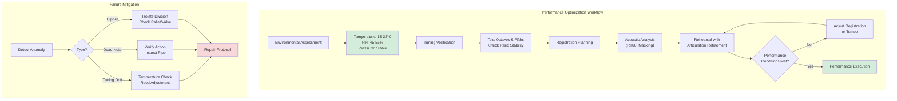

# Lesson 4: Performance Practice

## 1. First-Principles Intuition & Invariants

### The Physics of Pipe Organ Sound Production

The pipe organ generates sound through a controlled aeromechanical system: pressurized air entering resonant tubes excites standing wave patterns whose frequencies depend on pipe length, diameter, and construction. Unlike electronic instruments where sound originates from electrical oscillation, the organ's timbre emerges from physical acoustic phenomena governed by fluid dynamics and wave mechanics.

**Fundamental acoustic invariant**: For open cylindrical flue pipes, the fundamental frequency f ≈ v/(2L), where v is the speed of sound (~343 m/s at 20°C) and L is the effective pipe length. An open pipe of 8 feet (2.44 m) produces middle C (approximately 261.63 Hz). This relationship breaks down for stopped pipes (frequency halved, f ≈ v/(4L)), conical pipes, and reed pipes, where the vibrating element is a brass tongue rather than an air column.

**Airflow dynamics**: Wind pressure in organ systems typically ranges from 75mm to 150mm water gauge (approximately 735-1470 Pa). This pressure must remain remarkably stable—fluctuations of even 5mm will cause audible pitch instability. The voicer's art lies in adjusting the mouth cutup (height of the pipe opening), languid position, and nicking patterns to control the pipe's speech onset time, harmonic spectrum, and dynamic range.

### The Stratified Stop Architecture

The organ's registration system represents a hierarchical sound synthesis model predating electronic additive synthesis by centuries. Stops are organized by pitch families and tonal character:

**Foundation stops** (Principal 8', Diapason 8'): Establish the fundamental pitch with a balanced harmonic series. These constitute the organ's "unity gain" reference—all other stops are additions or modifications to this baseline.

**Mutation stops** (Quint 2⅔', Tierce 1⅗'): Sound pitches from the harmonic series above the played note. A 2⅔' stop sounds the third harmonic (perfect twelfth above), enriching the composite timbre without adding new fundamental pitches. These exploit the psychoacoustic phenomenon where the ear-brain system fuses harmonically related partials into a single percept with enhanced brilliance.

**Mixture stops** (Mixture III-VI, Cornet V): Multiple ranks of high-pitched pipes sounding simultaneously, typically including octaves and fifths. A "Mixture IV" contains four pipes per key, breaking back (shifting down an octave) at specific pitch thresholds to maintain tonal balance across the keyboard compass. The break points are critical tuning decisions affecting the instrument's cohesion.

**Reed stops** (Trumpet 8', Oboe 8', Vox Humana 8'): Employ brass tongues vibrating against brass shallots, coupled to conical or cylindrical resonators. The tongue vibration frequency determines pitch, while the resonator shape sculpts the harmonic envelope. Reed voicing is particularly sensitive to temperature—a 5°C change can detune reeds by several cents relative to flue pipes.

### Psychoacoustic Foundations

The organ's power lies in exploiting auditory masking, combination tones, and the missing fundamental phenomenon. When drawing multiple 8' stops together, organists create acoustic beats and intermodulation products. Drawing mutations without their fundamental (e.g., Quint 2⅔' alone) produces a hollow, nasal quality because the ear synthesizes a "phantom fundamental" an octave and a fifth below.

**Critical bandwidth considerations**: Stops voiced too similarly will exhibit acoustic interference, reducing clarity. The French classical aesthetic exploited this deliberately with tightly-voiced Plein Jeu choruses, while German Baroque organs used differentiated pipe scales to maintain polyphonic transparency.

## 2. Core Architecture & Mechanics

### Windchest Topology and Action Types

The windchest—the pressurized chamber distributing air to pipes—exists in several archetypal configurations, each with distinct acoustic and mechanical properties:

**Slider chest** (17th-19th century standard): Perforated wind channels run perpendicular to perforated sliders. When a stop is drawn, its slider shifts to align perforations, enabling airflow to that rank. When a key is depressed, a pallet valve opens beneath the corresponding channel group. This creates a two-dimensional gating matrix: stop selection (columns) × key activation (rows). Limitation: pulling stops while playing causes momentary pitch instability as the entire rank pressurizes.

**Spring chest** (19th century): Each pipe has an individual spring-loaded valve. Key action and stop action converge mechanically. Eliminates slider chest limitations but introduces complex linkage sprawl and higher mechanical noise.

**Electro-pneumatic chest** (1890s-present): Electric key contacts close circuits energizing small pneumatic motors (pitman valves) that admit air to pipes. Decouples console from chest geography, enabling remote placement and instantaneous coupling. Latency: 20-50ms depending on valve design and distance. Multiple simultaneous notes create current draw spikes requiring robust power regulation.

**Direct electric valve chest** (1970s-present): Solenoid or magnetic valves actuate directly. Fastest response (5-15ms) but highest power consumption and electromagnetic interference risk.

### Mechanical Action Kinematics

Tracker action represents a direct mechanical coupling from key to pallet valve via a system of pivoting trackers (wooden rods), rollers (90° direction changers), and squares (parallel motion converters). The key acts as a first-class lever; depressing the key front rotates it about a fulcrum, pulling down the attached tracker.

**Mechanical advantage ratio**: Typically 1:1 to 1:2 (key travel to pallet opening). A 10mm key depression might open a pallet 5-10mm, admitting wind to 50-100 pipes simultaneously (depending on registration). The force required grows linearly with pressure × pallet area × number of coupled divisions. Drawing multiple divisions (couplers) can increase key weight from 50g to 300g+.

**Critical failure mode—tracker sag**: Wooden trackers suspended horizontally will sag under self-weight and humidity absorption, introducing slack and delay. High-quality actions use carbon fiber or aluminum trackers in long horizontal runs. Temperature differentials between console and windchest cause expansion mismatches—a 10°C gradient across a 5m tracker run produces ~1mm dimensional change (assuming wood α ≈ 5×10⁻⁶ K⁻¹).

**Suspended action vs. ventil chest**: In suspended actions, the pallet rests open by default and is held closed by the tracker; key release admits wind (inverted logic). Ventil systems use a master valve per division—drawing a coupler opens the ventil, pressurizing that division's pallet box. This allows a single key action to control multiple divisions without proportional force increase, at the cost of slight additional latency (ventil opening time).

### Console Ergonomics and Standards

Modern organ console dimensions follow AGO (American Guild of Organists) or ISO standards:

- **Manual width**: 61 keys × 23mm spacing = 1403mm
- **Pedalboard radius**: AGO concave radiating, 32 notes, 762mm radius at playing surface
- **Bench height**: 520-540mm, adjusted so thigh is approximately parallel to floor with heel on C pedal
- **Manual to manual spacing**: 85-95mm vertical

**Coupling mechanisms**: Couplers route notes from one division to another. "Swell to Great" means Swell manual notes also play on Great windchest. In mechanical actions, this requires complex linkage multiplication—each Swell key must also pull Great trackers. In electric actions, it's a simple circuit cross-connection. Sub-octave and super-octave couplers transpose the coupled signal, requiring 2:1 or 1:2 mechanical gearing in tracker systems.

## 3. High-Performance Optimization & Failure Modes

### Environmental Control and Tuning Stability

**Temperature coefficient of pitch**: Air column frequency varies directly with sound velocity, which varies with √T (absolute temperature). For small changes around 20°C, Δf/f ≈ 0.0017 × ΔT(°C). A 10°C rise increases pitch by approximately 17 cents (0.17 semitone). Reed pipes are more sensitive—brass expansion and elasticity changes produce roughly 25 cents per 10°C.

**Optimal stability envelope**:
- Temperature: 18-22°C, stability ±1°C/hour
- Relative humidity: 45-55%, critical for wooden pipe stability
- Barometric pressure: Affects wind pressure calibration; a 20 hPa drop requires ~0.5mm wind adjustment to maintain pitch

**Failure mode—hygroscopic instability**: Wooden pipes (stopped flutes, Gedackt ranks) absorb moisture, expanding radially and lengthening. A 15% RH increase can sharpen a stopped wood pipe by 10-15 cents over 48 hours. Conversely, sudden heating during winter (when heating systems activate) can drop RH to 25%, causing pipes to crack. Mitigation: humidification systems maintaining 50% RH ±5% year-round, plus seasonal micro-retuning.

### Registration Strategy and Acoustic Loading

**Dynamic range management**: Unlike modern instruments with velocity-sensitive keyboards, the organ is fundamentally a binary system (pipe on/off). Dynamic shading is achieved through:

1. **Registration adjustment**: Adding/removing stops changes amplitude and timbre simultaneously
2. **Expression shutters**: Swell divisions enclosed in chambers with louvered fronts controlled by foot pedal. Closing shutters attenuates high frequencies more than low (due to wavelength-dependent diffraction), creating perceived diminuendo plus spectral darkening. Effective dynamic range: 8-12 dB depending on chamber design.
3. **Articulation**: Detached touch (staccato) creates perceived lightness without changing actual amplitude; legato playing produces continuous sound with maximum acoustic energy integration.

**Polyphonic registration principle**: In contrapuntal textures (Bach fugues, etc.), each voice must remain aurally distinct. German Baroque registration achieved this through:
- Differentiated pipe scaling between divisions (narrow scale Oberwerk vs. wide scale Hauptwerk)
- Spatial separation (multiple divisions in different cases)
- Strategic use of mutations and mixtures to create distinct formant profiles

**Common registration failure—mudding**: Over-drawing foundation stops (multiple 8' stops on one manual) creates acoustic beating and intermodulation distortion, obscuring melodic lines. The psychoacoustic "masking" threshold means each added rank contributes decreasing perceptual clarity. Optimization: Use one or two 8' stops maximum; add 4', 2', and mixtures for brightness without congestion.

### Mechanical Maintenance and Troubleshooting

**Cipher (pipe continuously sounding)**: Caused by:
1. Pallet stuck open: Foreign object or warped wood preventing valve closure. Diagnosis: Note sounds across all stops drawing from that pallet.
2. Stuck valve (electro-pneumatic): Magnet or pneumatic motor failing to release. Diagnosis: Single pipe ciphers regardless of registration.
3. Offset: Slider chest slider shifted, creating partial alignment. Diagnosis: Pitch "rumble" or instability rather than clean cipher.

**Dead note**: Pipe doesn't speak when key is pressed:
1. Tracker disconnection: Mechanical separation in action train. Diagnosis: Key feels lighter, no resistance.
2. Pallet regulation failure: Insufficient opening depth. Diagnosis: Pipe sounds weakly on some stops, not others.
3. Pipe obstruction: Dust/debris blocking mouth or languids. Diagnosis: Affects single pipe; others on same note work.

**Wind system instabilities**:
- **Tremulant flutter**: Device varying wind pressure for vibrato effect fails; causes arhythmic pressure oscillation. Specification: Tremulant should produce 4-6 Hz sinusoidal modulation at ±8-12mm H₂O.
- **Blower hunting**: Single-phase electric blower motors with worn bearings or unbalanced fan wheels create 50/60 Hz or sub-harmonic pressure ripple. Mitigation: Three-phase motors, precision-balanced fans, vibration isolation mounts.

### Advanced Performance Techniques

**Phrasing and articulation in mechanical action**: Tracker organs provide tactile feedback—the player feels the pluck of the pallet opening, creating an intimate mechanical connection. Subtle key release timing controls chiff (initial transient). Quick release creates a crisp cutoff; slow release allows the pipe to decay naturally before the pallet closes, avoiding abrupt termination. This requires 10-20ms discrimination timing—beyond typical human reaction speed but achievable through proprioceptive training.

**Registration crescendo management**: When building to a climax, add stops in order of increasing harmonic density: 8' → 4' → mixtures → reeds. Adding reeds before mixtures creates imbalance, as reeds dominate the spectral envelope. For decrescendo, reverse order. On organs with multiple expression divisions, layer crescendi across divisions for seamless dynamic expansion.

**Acoustic reverberation integration**: In spaces with 3-6 second reverberation (typical for large stone churches), sound decays overlap with subsequent attacks. At ♩= 60, a quarter note decays for 3-4 subsequent beats. Registration must account for this: clarity requires reduced legato (shorter note durations) and lighter registration. French Romantic literature was composed for highly reverberant acoustic spaces and relies on this integration; German Baroque literature assumes shorter RT60 (1.5-2.5s) with sharper articulation.

### Quantitative Performance Metrics

**Speech onset time**: The delay between key depression and audible sound onset. Varies by pipe type:
- Flue pipes (Principal): 30-80ms
- Wide-scaled flutes: 50-120ms  
- Reed pipes: 10-40ms (faster attack, critical for clarity in polyphony)
- Mixtures: 20-50ms (high pressure aids prompt speech)

Voicing adjustments (nicking depth, languid position, toe hole diameter) tune this parameter. Fast speech aids clarity; slower speech provides a more "vocal" quality.

**Wind consumption**: A typical large organ might have:
- Total pipe count: 3000-5000 pipes
- Full organ wind consumption: 1500-3000 cubic feet per minute (CFM) = 42-85 m³/min
- Blower motor: 15-30 HP (11-22 kW)

Playing full organ fortissimo in a resonant space produces sustained SPL of 100-110 dB at 10m, with transient peaks reaching 115-120 dB—equivalent to a full symphony orchestra.

**Thermal stability time constant**: After a 5°C ambient temperature change, a large organ requires 6-12 hours to thermally equilibrate. Metal pipes respond in 2-4 hours; wooden structures (windchests, cases) require 8-24 hours. This necessitates pre-performance climate conditioning when preparing for recordings or concerts in temperature-variable spaces.
