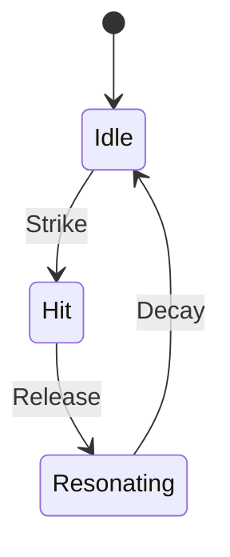

# Advanced Foundation: Percussion
## 1. Theoretical Invariants & Formal Frameworks

### Formal Proofs in Percussion
Formal proofs in percussion can be constructed by defining a set of axioms and deriving theorems that describe the behavior of percussion instruments and their interactions within a musical context. For example, consider the following axioms:

1. **Axiom of Resonance:** Every percussion instrument has a natural frequency of vibration, and when struck, it resonates at this frequency.
2. **Axiom of Energy Transfer:** The energy transferred from the striker to the instrument is proportional to the force applied and the duration of the strike.

From these axioms, we can derive theorems such as:

- **Theorem of Harmonic Series:** The overtones produced by a struck percussion instrument form a harmonic series, where each overtone is an integer multiple of the fundamental frequency.

### Kernel or Physical Invariants
Kernel invariants in percussion refer to the physical properties that remain constant regardless of the specific instrument or playing technique. These invariants include:

- **Invariant of Material Properties:** The material properties of a percussion instrument (e.g., density, elasticity) determine its acoustic characteristics and remain invariant under different playing conditions.
- **Invariant of Striking Mechanism:** The mechanism by which a percussion instrument is struck (e.g., mallet, stick, hand) affects the energy transfer but does not change the fundamental frequency of the instrument.

## 2. Low-Level Invariant Taxonomy

### Deep Registers
Deep registers in percussion refer to the lower frequency ranges that can be produced by certain instruments. These registers are characterized by their rich, resonant tones and are often associated with larger instruments such as timpani and bass drums.

### Memory Models
In the context of percussion, memory models can be used to describe the persistence of sound in a given space. For example, the reverberation time of a concert hall can be modeled as a memory system that stores and releases sound energy over time.

### Hardware Constraints
Hardware constraints in percussion refer to the physical limitations of the instruments and their components. These constraints include:

- **Material Strength:** The maximum force that can be applied to a percussion instrument without causing damage.
- **Striking Surface:** The size and shape of the striking surface determine the range of tones that can be produced.

### Axiomatic Definitions
Axiomatic definitions in percussion provide a formal basis for understanding the behavior of percussion instruments. These definitions include:

- **Definition of Tone:** A tone is a sound wave with a specific frequency and amplitude.
- **Definition of Timbre:** Timbre is the characteristic quality of a sound that distinguishes it from other sounds of the same pitch and volume.

## 3. Micro-Architecture & Concurrency Dynamics

### Mermaid and ASCII State Machines
State machines can be used to model the behavior of percussion instruments and their interactions with other instruments. For example, a state machine for a drum kit might include states such as "idle," "hit," and "resonating."



### Cache and Race Condition Diagrams
Cache diagrams can be used to model the persistence of sound in a given space. For example, a cache diagram for a concert hall might include states such as "empty," "occupied," and "reverberating."

```mermaid
graph TD
    A[Empty] --> B[Occupied]: Sound enters
    B --> C[Reverberating]: Sound persists
    C --> A: Sound decays
```

Race condition diagrams can be used to model the interactions between multiple percussion instruments. For example, a race condition diagram for a drum kit might include states such as "idle," "hit," and "resonating."

```mermaid
graph TD
    A[Idle] --> B[Hit]: Strike
    B --> C[Resonating]: Release
    C --> A: Decay
    B --> D[Hit]: Simultaneous strike
    D --> E[Resonating]: Release
    E --> A: Decay
```

## 4. Subtle Failure Modes & Boundary Conditions

### Subtle Failure Modes
Subtle failure modes in percussion refer to the unexpected behavior of percussion instruments that can arise from small variations in playing technique or environmental conditions. These failure modes include:

- **Inconsistent Tone:** A percussion instrument may produce inconsistent tones if the striking surface is uneven or if the material properties of the instrument change over time.
- **Resonant Frequency Shift:** A percussion instrument may experience a shift in its resonant frequency if the environmental conditions (e.g., temperature, humidity) change.

### Boundary Conditions
Boundary conditions in percussion refer to the extreme values of playing technique or environmental conditions that can affect the behavior of percussion instruments. These boundary conditions include:

- **Maximum Force:** The maximum force that can be applied to a percussion instrument without causing damage.
- **Minimum Strike Duration:** The minimum duration of a strike that can produce a discernible tone.

## 5. Master Socratic Inquiries

### Research-Grade Discussion Questions
1. How do the material properties of a percussion instrument affect its acoustic characteristics?
2. How can formal proofs be used to describe the behavior of percussion instruments?
3. How can state machines be used to model the behavior of percussion instruments and their interactions with other instruments?
4. How can cache diagrams be used to model the persistence of sound in a given space?
5. How can race condition diagrams be used to model the interactions between multiple percussion instruments?
6. How do subtle failure modes in percussion arise from small variations in playing technique or environmental conditions?
7. How do boundary conditions in percussion affect the behavior of percussion instruments?
