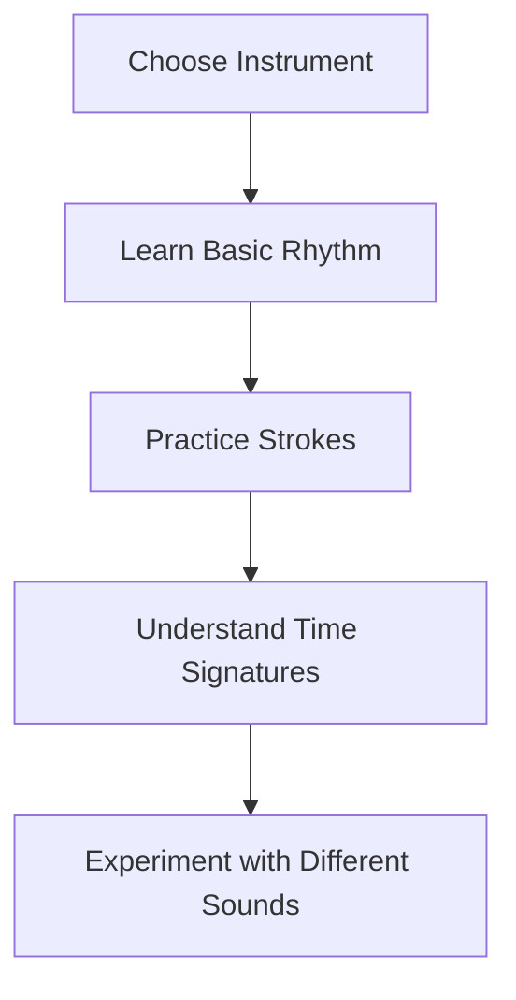

# Beginner Foundation: Percussion
## 1. Everyday Intuition & First Principles
Imagine you're in a kitchen, and you have a variety of pots and pans. When you tap them with a spoon, each one makes a different sound. Percussion is like that, but with a wider range of instruments and techniques. Just as you can use pots and pans to create a rhythm or a melody, percussion instruments are used to add texture, depth, and timing to music. The kitchen is your stage, and the pots and pans are your instruments. Percussion is the art of making music with these instruments, creating a symphony of sounds that can be as simple as a tap or as complex as a drum solo.

## 2. Foundational Vocabulary & Glossary
- **Percussion Instrument:** Any instrument that produces sound when struck, shaken, rubbed, or scraped. Examples include drums, cymbals, and xylophones.
- **Rhythm:** The pattern of sounds and silences in music. It's the heartbeat of the music, providing a sense of movement and flow.
- **Stave:** In music notation, the five horizontal lines on which musical notes are written. Percussion instruments often have their own staves or use special symbols.
- **Time Signature:** A notational convention used in Western musical notation to specify how many beats (pulses) are to be contained in each measure and which note value is to be given one beat. For example, 4/4 means four beats per measure, with the quarter note getting one beat.
- **Cymbal:** A round, thin, metal disc that is struck with a stick or mallet to produce a bright, ringing sound. Cymbals are used in various genres of music to add crashes, rides, and fills.
- **Drum:** A membranophone consisting of a stretched membrane (head) over a hollow body (shell). Drums are struck with hands, sticks, or mallets to produce sound. They are fundamental in many musical genres, providing the backbone of the rhythm section.

## 3. Visual System Flow
### ASCII Diagram
```
+-------------------+
|   Choose Instrument|
+-------------------+
             |
             v
+-------------------+
|   Learn Basic Rhythm|
+-------------------+
             |
             v
+-------------------+
|   Practice Strokes |
+-------------------+
             |
             v
+-------------------+
|   Understand Time  |
|     Signatures     |
+-------------------+
             |
             v
+-------------------+
|   Experiment with  |
|   Different Sounds |
+-------------------+
```

### Mermaid Flowchart


## 4. Common Beginner Misconceptions & Mental Traps
- **Misconception:** Percussion is only about drums. **Reality:** Percussion includes a wide variety of instruments, each with its unique sound and technique.
- **Misconception:** Percussion is easy to learn. **Reality:** Like any instrument, percussion requires practice and dedication to master. It involves understanding rhythm, timing, and technique.
- **Misconception:** You need expensive instruments to start. **Reality:** Many percussion instruments can be made from household items, and there are affordable options available for beginners.

## 5. Socratic Discussion Starters
- What are some examples of percussion instruments you've heard in music?
- How do you think rhythm affects the mood and energy of a piece of music?
- Can you describe the difference between a cymbal and a drum?
- How do you think time signatures influence the way you play percussion?
- What are some ways you can practice percussion without spending a lot of money on instruments?
