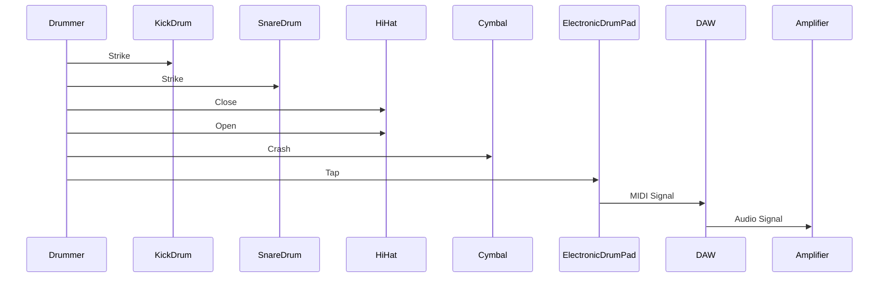

# Intermediate Foundation: Percussion
## 1. Architectural Mental Model
In the realm of percussion, the architectural mental model extends beyond the basic understanding of individual instruments and their techniques. It involves the systematic arrangement and interaction of various percussion elements to create a cohesive and dynamic musical landscape. This includes the selection of instruments, their placement, and the integration of electronic and acoustic components to achieve the desired sound palette.

### Key Components:
- **Instruments:** Drums, cymbals, percussion kits, electronic drums, and auxiliary percussion.
- **Techniques:** Striking, scraping, rubbing, and other methods to produce sound.
- **Acoustics:** Understanding how sound waves interact with different materials and spaces.
- **Electronic Integration:** Use of amplifiers, samplers, and digital audio workstations (DAWs) to enhance and manipulate sound.

### Production Architecture:
- **Layering:** Combining different percussion elements to create depth and texture.
- **Rhythm Section:** Coordination with bass and other rhythm instruments to establish a solid foundation.
- **Dynamic Range:** Utilizing varying intensities and articulations to convey emotion and mood.

## 2. Systems Taxonomy & Component Protocols
A systematic approach to percussion involves understanding the taxonomy of instruments and the protocols that govern their interaction within a musical system.

### Taxonomy of Percussion Instruments:
- **Membranophones:** Drums, kettledrums, tambourines.
- **Idiophones:** Cymbals, bells, xylophones.
- **Chordophones:** Balalaikas, banjos (with percussive elements).
- **Aerophones:** Didgeridoos, conch shells (with percussive elements).

### Standard Interfaces and Protocols:
- **MIDI (Musical Instrument Digital Interface):** Standard protocol for electronic instruments and controllers.
- **Audio Interfaces:** Connecting electronic drums and other audio equipment to DAWs.
- **Sampling:** Using digital samplers to create and manipulate sound libraries.

### Data Models:
- **Sound Libraries:** Organized collections of sampled sounds for use in electronic percussion setups.
- **Performance Data:** MIDI data representing note timing, velocity, and other performance parameters.

## 3. Multi-Component Interaction Flow
Understanding how different percussion components interact is crucial for creating complex and engaging rhythms.

### ASCII Sequence Diagram:
```
[Drummer] -> [Kick Drum]: Strike
[Drummer] -> [Snare Drum]: Strike
[Drummer] -> [Hi-Hat]: Close
[Drummer] -> [Hi-Hat]: Open
[Drummer] -> [Cymbal]: Crash
[Drummer] -> [Electronic Drum Pad]: Tap
[Electronic Drum Pad] -> [DAW]: MIDI Signal
[DAW] -> [Amplifier]: Audio Signal
```

### Mermaid Sequence Diagram:


## 4. Architectural Trade-offs & Production Pitfalls
When designing a percussion system, it's essential to consider the trade-offs and potential pitfalls that can arise.

### Trade-offs:
- **Acoustic vs. Electronic:** Acoustic drums offer a natural, organic sound but require more space and maintenance. Electronic drums provide flexibility and portability but may lack the warmth of acoustic instruments.
- **Layering vs. Simplicity:** Adding multiple layers can create a rich, detailed sound but can also lead to clutter and confusion. Balancing complexity with clarity is key.

### Production Pitfalls:
- **Overcomplication:** Avoid adding unnecessary elements that can detract from the overall musicality.
- **Poor Acoustics:** Ensure that the performance space is treated to minimize unwanted reflections and reverberations.
- **Inconsistent Timing:** Maintaining precise timing is crucial for a cohesive rhythm section.

## 5. Socratic Discussion Starters
Engaging in thoughtful discussions can deepen understanding and foster creativity.

### Questions:
- How can the integration of electronic percussion enhance the dynamic range of a live performance?
- What are the advantages and disadvantages of using sampled sounds in a live drum kit?
- How does the placement of percussion instruments in a performance space affect the overall sound?
- In what ways can percussion be used to create tension and release in a musical composition?
- How can a drummer effectively communicate with other musicians to ensure a cohesive rhythm section?
