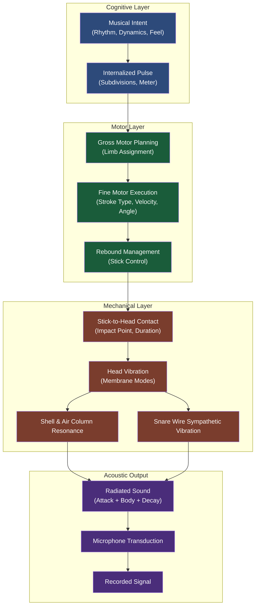
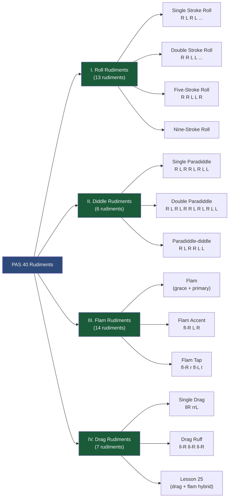
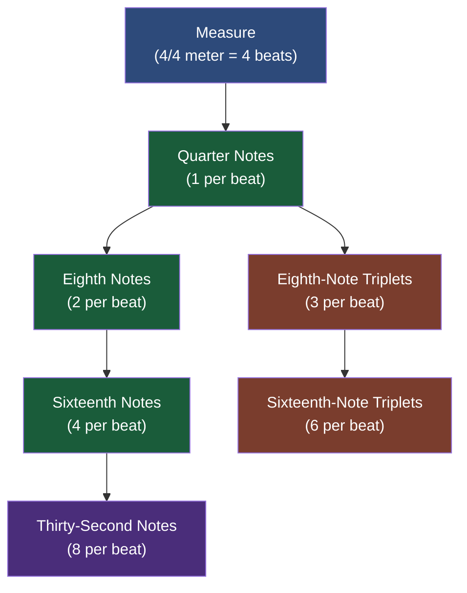

# Operational Verification Labs: Percussion

## Preface & Pedagogical Framework

This laboratory manual applies a systematic, first-principles approach to percussion pedagogy. Each exercise is structured around three phases that mirror engineering verification methodology: *baseline implementation* (establishing correct mechanical form), *parameter variation* (isolating variables to build empirical intuition), and *fault injection* (deliberately introducing errors to develop diagnostic acuity). This structure reflects how professional drummers actually internalize technique — not through passive repetition, but through controlled variation and active listening.

The labs assume no prior drum set experience but demand intellectual rigor. A student who completes all exercises will understand not just *what* to do, but *why* specific mechanics produce specific acoustic outcomes, and *how* to self-diagnose deviations from intended results.

---

## Foundational Physics: Why Percussion Works the Way It Does

Before executing a single stroke, understanding the physical substrate transforms rote practice into informed experimentation.

**Membrane acoustics.** A struck drumhead is a circular membrane under radial tension. Its vibration modes are described by Bessel functions — mathematical solutions to the wave equation in cylindrical coordinates. The fundamental mode (the lowest pitch) involves the entire head moving up and down. Higher-order modes involve nodal circles and diameters. Unlike a string, whose overtone series is harmonic (integer multiples of the fundamental), a circular membrane produces inharmonic overtones. This is why drums do not produce a clearly defined pitch the way strings do, though they produce a *center pitch* — the perceived fundamental — that varies with tuning tension.

**The role of the resonant head.** A two-headed drum (such as a snare or tom) has a batter head (struck) and a resonant head (bottom). The air column between the heads couples the two membranes. When the batter head moves inward, it compresses the internal air, which pushes the resonant head outward. This coupling extends sustain, colors the timbre, and determines the drum's overall pitch. Tuning both heads to the same pitch produces a pure, focused tone; tuning them apart produces a complex, evolving decay. Neither is inherently correct — they serve different musical contexts.

**Snare mechanism.** The snare drum's distinctive "crack" comes from the snare wires: typically 8–42 strands of steel wire stretched across the resonant head. When the batter head is struck, the vibrating resonant head causes the snare wires to rattle sympathetically. The tension of the snare wires (controlled by the strainer) determines the sensitivity and articulation of this response. High tension produces a dry, crisp response with little rattle on quiet strokes; low tension produces a loose, buzzy sound with ghost-note sensitivity.

**Stick mechanics and rebound.** A drumstick strikes the head and rebounds. This rebound is not incidental — it is the biomechanical engine of efficient drumming. The head's tension provides the restoring force that launches the stick back to its rest position. Resisting this rebound (burying the stick into the head) dampens the drum's vibration, kills sustain, and forces the arm muscles to do work that the drum's natural elasticity would otherwise perform for free. The foundational insight of all advanced technique is: *work with the drum's rebound, not against it.*

**Cymbal acoustics.** Cymbals are complex curved metal plates with no defined nodal structure — their vibrational modes are chaotic and densely packed, producing the characteristic "wash" of frequencies. A ride cymbal is thicker and more lathed, emphasizing high, articulate partials (the "ping") while damping lower wash. A crash cymbal is thinner, with more pronounced bow curvature, allowing the lower wash frequencies to dominate quickly after a strike. A hi-hat produces two distinct timbres: open (the two cymbals separated, producing a full wash) and closed (the cymbals clamped together, producing a dry, cutting chick). The foot controls a continuous spectrum between these extremes.

---

## Lab Setup & Equipment Specification

### Acoustic Drum Configuration

A standard five-piece drum set consists of one snare drum, one bass drum, one hi-hat (two cymbals on a stand), one ride cymbal, one crash cymbal, two rack toms, and one floor tom. The following specifications represent professional practice baselines:

| Component | Standard Diameter | Typical Tuning Range | Primary Function |
|---|---|---|---|
| Snare Drum | 14" (depth 5"–8") | High tension (crisp crack) | Backbeat, accent |
| Bass Drum | 20"–22" | Low tension (deep thud) | Downbeat, pulse |
| Hi-Hat | 13"–14" | Medium-high (top), medium (bottom) | Subdivision, texture |
| Rack Tom 1 | 10"–12" | Medium-high | Fills, color |
| Rack Tom 2 | 13"–14" | Medium | Fills, color |
| Floor Tom | 16" | Medium-low | Fills, low-end color |
| Ride Cymbal | 20"–22" | N/A (lathed bronze) | Timekeeping articulation |
| Crash Cymbal | 16"–18" | N/A (thin bronze) | Accent, transition |

### Grip Systems: Technical Comparison

Two primary grip systems exist in Western percussion: **matched grip** and **traditional grip**. The choice is not purely aesthetic — each has distinct biomechanical properties.

In **matched grip**, both hands hold the stick identically, with the stick resting in the fulcrum between thumb and index finger, supported by the remaining fingers. The wrist rotates to drive the stroke. This grip is symmetric and transfers naturally from one hand to the other, making it the dominant choice for drum set, marching tenor, and mallet instruments.

In **traditional grip** (originally called "German grip" in military drumming), the left hand holds the stick differently: the stick rests in the webbing between thumb and index finger, with the ring and middle fingers supporting it from below, and the thumb and index finger guiding it from above. The wrist supinates (rotates palm-up) to drive the stroke. This grip evolved historically from playing a rope-tensioned snare drum hung at an angle from the drummer's side, where a matched grip would have been mechanically awkward. It remains common in jazz and rudimental drumming and produces a subtly different sound character due to the different wrist mechanics.

### Recording Environment

For analytical exercises, a minimal but functional recording chain suffices:

```
Dynamic microphone (e.g., Shure SM57) → XLR cable → Audio Interface → 
  DAW (e.g., Reaper, Logic Pro, Ableton Live) → 24-bit / 48 kHz session
```

A 24-bit, 48 kHz recording provides more than sufficient dynamic range (144 dB theoretical) and frequency response (0–24 kHz) to capture all acoustically relevant percussion content. Higher sample rates (96 kHz, 192 kHz) offer no perceptible benefit for this application.

Position the SM57 (or equivalent) approximately 2–3 inches above the rim of the snare drum, angled at approximately 30–45° toward the center of the head. This placement captures the fundamental attack and body of the drum while minimizing bleed from the hi-hat. For analytical listening, headphone monitoring is preferred over speakers in an untreated room.

---

## Conceptual Architecture: The Percussion Performance Model

The following diagram models the full signal and control flow from the drummer's intent to the recorded acoustic output. Understanding this architecture clarifies which variables are under conscious control, which are biomechanical, and which are purely physical.



Each layer introduces its own failure modes. Cognitive errors (miscount, lost pulse) manifest as timing deviations. Motor errors (tense grip, locked wrist) manifest as dynamic inconsistency and injury risk. Mechanical errors (poor tuning, damaged heads) manifest as tonal problems independent of technique. Fault injection exercises target specific layers deliberately.

---

## Rudiment Taxonomy

The Percussive Arts Society (PAS) defines 40 essential rudiments, organized into four families. The exercises in this lab address the most foundational members of each family.



The notation convention throughout this lab uses `R` for right hand primary stroke, `L` for left hand primary stroke, `r` and `l` for grace notes (quiet secondary strokes), and `fl-R` / `fl-L` for flam strokes (grace note preceding the primary).

---

## Exercise 1: Foundational Practical Implementation

### Exercise 1.1: Core Rudiments — Mechanics and Execution

#### Conceptual Prerequisite: The Four Stroke Types

Before practicing rudiments as patterns, master the four fundamental stroke types that constitute all rudimental vocabulary. Each type is defined by the starting height and ending height of the stick:

**Full stroke (F):** Starts high (~12 o'clock position, stick nearly vertical), strikes the drum, and returns to high position. Used for maximum-volume accents where the following note is also accented.

**Down stroke (D):** Starts high, strikes the drum, and stops low (~3–4 o'clock position, stick nearly parallel to head). Used for accented notes followed immediately by an unaccented note — the stick is already in position for a soft tap without requiring active lowering.

**Tap (T):** Starts low and returns low. Used for unaccented notes — minimal movement, minimal volume.

**Up stroke (U):** Starts low, strikes the drum, and returns to high position. Used for unaccented notes that must be followed immediately by an accented note — the return to high prepares the next accent without an extra lifting motion.

This system, formalized by Joe Morello and codified by John Riley and others, explains why experienced drummers can execute extreme dynamic contrasts at high speed with apparent effortlessness. The stick's position after each stroke is not arbitrary — it encodes the volume and type of the *next* stroke.

#### Single Stroke Roll

The single stroke roll alternates strictly: R L R L R L R L. At the mechanical level, each stroke is an independent, complete motion. The critical variable is **stick height consistency**: both hands must strike from the same height to produce equal volume. Any asymmetry between dominant and non-dominant hand appears immediately as a tonal irregularity.

Execution procedure:

1. Set the metronome to 60 BPM. Play one stroke per beat (quarter notes), matched grip.
2. Verify that both hands produce audibly identical volume and tone. Record 30 seconds and perform spectral analysis in your DAW (compare peak levels of R vs. L strokes).
3. Advance to eighth notes (two strokes per beat). Maintain volume equality.
4. Advance to sixteenth notes. At this density, 60 BPM = 240 strokes per minute, which is a moderate practice tempo.
5. Increase BPM in 10-BPM increments. Document the BPM at which either hand begins to degrade in consistency. This is your current *ceiling* — the target of future practice.

The eventual goal is to execute the single stroke roll in a closed roll (notes so close together they blend into a continuous sound). Professional orchestral snare drummers typically achieve this between 150–180 BPM at sixteenth note subdivision.

#### Double Stroke Roll

The double stroke roll executes two consecutive strokes per hand before alternating: R R L L R R L L. The first stroke of each pair is a free stroke (driven by the wrist or arm). The second stroke uses the stick's rebound — the wrist *stops* rather than driving a second full stroke, allowing the head's elasticity to provide the return energy.

This rebound-based second stroke is called a **moeller stroke** (after Sanford Moeller, whose 1925 technique manual first codified it systematically). The key insight is that the second stroke in each pair is not a voluntary muscular action — it is the stick bouncing off the head, guided but not powered by the hand. At slow tempos (below ~80 BPM at sixteenth notes), the double stroke is executed as two deliberate wrist strokes. At higher tempos, the rebound mechanism takes over. The transition between these two modes is the technical crux of the double stroke roll and requires deliberate practice.

#### Single Paradiddle

The paradiddle pattern is: R L R R L R L L (one measure of sixteenth notes at a 4/4 meter). The embedded "diddle" (double stroke) on beats 3 and 7 means the hands alternate except at those two moments.

The paradiddle's pedagogical value is not merely pattern memorization — it is the development of **sticking independence**. The right hand leads on beats 1 and 2 (R L R R), the left hand leads on beats 3 and 4 (L R L L). This creates a natural four-beat cycle where accent placement alternates between hands. When accents are added (accenting only the first note of each four-stroke group), the paradiddle becomes a training ground for simultaneous accent/tap coordination.

The extended family includes the double paradiddle (R L R L R R L R L R L L) and triple paradiddle (R L R L R L R R), each extending the leading sequence before the diddle resolution.

#### Flam

A flam consists of a **grace note** immediately preceding a **primary note**. The grace note is struck very quietly, from a low stick height (1–2 inches off the head), followed immediately by the primary note at full volume from a high stick height. The two sticks strike nearly simultaneously but not exactly simultaneously — the slight offset (the "spread" of the flam) is what distinguishes a flam from a unison. The hands alternate: right-hand primary flam = left grace note + right primary (written `lR`); left-hand primary flam = right grace note + left primary (written `rL`).

The critical variable is the grace note's volume and timing relative to the primary. Too loud and it sounds like two equal notes (a rim shot or an accent, not a flam). Too separated in time and it sounds like two distinct strokes. The target is a distinctive "splat" — the grace note barely audible but physically present, creating a slight textural thickening before the primary attack.

---

### Exercise 1.2: Basic Timekeeping and Four-Limb Coordination

#### The Metronome as Reference, Not Master

A widespread pedagogical error is treating the metronome as the source of the beat, with the drummer reacting to it. This creates a reactive relationship that introduces systematic latency. Instead, internalize the metronome click as a *reference confirmation point* — the drummer generates the pulse internally and uses the click to verify alignment. This reframing, advocated by Jim Chapin and later expanded by Peter Erskine, produces a qualitatively more stable time feel.

Practical implementation: before playing, listen to the metronome for four full measures (16 beats at 60 BPM = 16 seconds). Conduct internally — feel the downbeats as physical events. Only then begin playing. The click should feel redundant, not commanding.

#### Subdivision Architecture

Rhythmic subdivision is a hierarchical system. The measure contains beats; beats contain subdivisions. The relationships are fixed and must be internalized as physical sensations, not calculated consciously.



The binary branch (quarter → eighth → sixteenth → thirty-second) and the ternary branch (quarter → triplet → sextuplet) are independent subdivision systems that coexist within the same metric framework. The ability to switch between binary and ternary subdivisions within a single measure — or to superimpose them between limbs — is a defining skill of professional drumming and jazz performance.

#### Four-Limb Coordination: First Exercise

The standard entry-point for four-limb coordination is the following pattern at 60–80 BPM:

- **Right foot (bass drum):** Quarter notes (beats 1, 2, 3, 4)
- **Left foot (hi-hat):** Quarter notes (beats 1, 2, 3, 4) — both feet in unison
- **Right hand (hi-hat or ride cymbal):** Eighth notes (beats 1-and-2-and-3-and-4-and)
- **Left hand (snare drum):** Half notes (beats 2 and 4) — the backbeat

This pattern is the foundational rock beat in its most reduced form. The left foot on the hi-hat is the often-neglected fourth limb — it grounds the tempo physically and provides audible reference points for the two-beat (the "chick" of the closed hi-hat). Its omission at slow tempos is acceptable; its integration is the target.

The coordination challenge is not motor complexity per se but **attentional distribution**. Each limb is executing an independent rhythmic stream. The novice experiences this as four things to remember simultaneously. The intermediate player experiences it as one composite pattern. The advanced player experiences it as a conversation between voices, each retaining its independence within the whole.

---

## Exercise 2: Parameter Variation and Empirical Analysis

### Exercise 2.1: Stroke Zone Mapping

The playing surface of a drumhead is not acoustically uniform. Three primary zones produce measurably distinct timbres:

**Center (bullseye):** Striking the exact center of the head activates the fundamental membrane mode most strongly, producing maximum fundamental frequency content, maximum sustain, and a "full" or "dark" tone. The fundamental mode (where the entire head moves as one unit) has its maximum displacement at the center.

**Mid-zone (approximately 1/3 to 1/2 of the radius from center):** A balance of fundamental and upper partial content. This is the standard playing zone for most snare drum technique — it provides a full tone without the exaggerated low-frequency thump of dead-center and without the thin, cutting tone of the edge.

**Edge (1–2 inches from the rim):** Striking near the edge activates higher-order membrane modes disproportionately, producing a thinner, brighter, more cutting tone with less fundamental and faster decay. It is also more sensitive to rim artifacts and inconsistent contact.

**Rimshot:** The stick simultaneously strikes the head and the metal hoop (rim). This creates a sharp, high-SPL crack by coupling the membrane's vibration with the rigid resonance of the metal hoop. The characteristic "rimshot crack" of rock and pop snare drums is produced this way. It is distinct from a "cross-stick" or "side-stick," where the tip of the stick rests on the head and the shaft strikes the rim — producing a dry, woodblock-like articulation used in ballads and bossa nova.

#### Systematic Stroke Zone Experiment

Execute the following protocol with a consistent stroke (matched grip, identical stick height, 80 BPM quarter notes). Record each condition for 8 beats.

| Condition | Strike Zone | Expected Tonal Character |
|---|---|---|
| A | Dead center | Full, dark, long sustain |
| B | Mid-zone (standard) | Balanced attack and body |
| C | Edge (1" from rim) | Bright, cutting, short sustain |
| D | Rimshot (mid-zone + rim) | Maximum attack, high SPL, metallic crack |
| E | Cross-stick | Dry, woodblock-like, no membrane tone |

In your DAW, examine each recording with a spectrum analyzer. Measure the frequency of the most prominent partial (the perceived fundamental) for conditions A, B, and C. Document whether the perceived pitch changes with strike position. The fundamental should remain approximately constant (it is set by head tension, not strike position), but the overtone balance will shift — higher-order inharmonic partials dominate closer to the edge.

### Exercise 2.2: Stick Material and Geometry Variables

Drumsticks vary along several dimensions, each affecting the acoustic and physical properties of the stroke:

**Wood species:** Hickory is the most common choice — high shock absorption, good rebound, durability. Maple is lighter, with less mass and more flexibility, producing a lighter attack and a more pronounced high-frequency content. Oak is denser and heavier than hickory, producing more low-frequency content and greater durability, used frequently in high-volume applications (metal, marching).

**Tip geometry:** The stick tip is the contact point and determines the character of the attack on cymbals and drums. A round nylon tip produces a bright, articulate sound on ride cymbals — the smooth, hard nylon transmits a narrow, well-defined impact. A round wood tip produces a warmer, rounder cymbal sound. An acorn tip (wider, teardrop-shaped) produces a broader contact area and a fuller, darker cymbal sound. These differences are most pronounced on ride cymbals, where articulation matters most, and less significant on drums.

**Diameter and length:** Thicker sticks (e.g., 5A vs. 7A) carry more mass and produce more low-frequency energy per stroke, project better in loud environments, and fatigue the hand more quickly in extended play. Longer sticks provide greater leverage (less force required for a given velocity) at the cost of less precise control.

**Standard sizing (Vic Firth / Pro-Mark convention):** The letter designation (A, B, S) historically indicated application: A for orchestra, B for band, S for street (marching). The number indicates diameter, with lower numbers indicating thicker sticks (a 2B is thicker than a 7A). These conventions are not universal across manufacturers — always verify physical dimensions when comparing across brands.

### Exercise 2.3: Tempo Scaling and Its Mechanical Implications

As tempo increases, the biomechanical mechanism underlying each stroke type changes. This is not merely a matter of moving faster — the motor program itself transitions between qualitatively different modes.

At slow to moderate tempos (up to ~100 BPM for sixteenth notes), arm weight and large wrist strokes dominate. There is sufficient time for a full range of motion. At moderate-to-fast tempos (~100–160 BPM for sixteenth notes), the wrist range of motion contracts and finger control supplements it. At very high tempos (>160 BPM for sixteenth notes), finger control dominates — the fingers act as micro-levers to squeeze additional velocity and rebounce control from minimal wrist motion.

This three-stage velocity architecture implies that practicing *only* at comfortable tempos will not develop the finger control required for high-speed playing. Conversely, practicing *only* at target tempos without establishing correct large-motion mechanics first produces ingrained technical inefficiencies.

#### Protocol: Tempo Scaling Experiment

For the single stroke roll and the single paradiddle, perform the following:

1. Establish a stable performance at 60 BPM (sixteenth notes). Record 16 beats.
2. Increase to 80 BPM. Record 16 beats.
3. Increase in 20 BPM increments, recording at each step, until accuracy degrades perceptibly.
4. At the first tempo where degradation appears, record 32 beats and label this your **current ceiling**.
5. Drop back to 10 BPM below the ceiling. Practice at this "sub-maximal" tempo — the most efficient practice zone — for 5 minutes.
6. Retest at the ceiling tempo.

Document the BPM ceiling for each rudiment across multiple practice sessions over two weeks. The ceiling should advance measurably if sub-maximal practice is consistent.

---

## Exercise 3: Fault Injection and Stress Testing

Fault injection in percussion technique means deliberately introducing specific mechanical errors to accomplish two things: (1) develop the diagnostic listening skill to identify what a specific error sounds like, and (2) understand the error's root cause well enough to self-correct. A drummer who cannot identify their own technical errors from listening cannot self-direct their practice.

### Exercise 3.1: Rudiment Fault Injection — Taxonomy of Common Errors

The following taxonomy maps error types to their acoustic and kinetic signatures. Each error is a parameter deviation from the baseline established in Exercise 1.

```mermaid
flowchart TD
    E["Technical Error Categories"]

    E --> H["Stick Height Errors"]
    E --> G["Grip Errors"]
    E --> T["Timing Errors"]
    E --> A["Angle Errors"]

    H --> H1["Dominant hand too high\n→ R strokes louder than L"]
    H --> H2["Both hands too low\n→ Loss of volume ceiling,\nno dynamic range"]
    H --> H3["Stroke height inconsistent\n→ Uneven dynamics within\na single-hand run"]

    G --> G1["Grip too tight\n→ Stick burial, killed rebound,\narm fatigue, tendinitis risk"]
    G --> G2["Grip too loose\n→ Stick slip, inconsistent\ncontact point, dropped sticks"]
    G --> G3["Fulcrum position wrong\n→ Reduced leverage,\nabnormal wear pattern"]

    T --> T1["Rushing (ahead of pulse)\n→ Accelerating tempo,\ncompressed subdivisions"]
    T --> T2["Dragging (behind pulse)\n→ Decelerating tempo,\nexpanded subdivisions"]
    T --> T3["Flam spread too wide\n→ Two audible separate notes\ninstead of flam character"]
    T --> T4["Double stroke second note\ntoo late → Uneven RR pattern,\naudible gap"]

    A --> A1["Stick angled toward rim\n→ Partial rim contact,\ntonal inconsistency"]
    A --> A2["Stick angled too steeply\n→ Excessive downward force,\nhead damping"]

    style E fill:#2d4a7a,color:#fff
    style H fill:#7a3d2d,color:#fff
    style G fill:#7a3d2d,color:#fff
    style T fill:#1a5c3a,color:#fff
    style A fill:#4a2d7a,color:#fff
```



#### Fault Injection Protocol: Single Stroke Roll

Execute each of the following deliberate errors for 8 beats, record the result, then immediately return to correct form for 8 beats. The juxtaposition makes the error's acoustic signature unmistakable.

**Error 1 — Grip too tight:** Squeeze the sticks firmly, resisting the rebound. Expected result: the stick buries into the head, producing a dull, choked sound with significantly reduced sustain. Volume drops even though muscular effort increases. This directly demonstrates that volume comes from rebound and stick height, not grip pressure.

**Error 2 — Right hand stick height 50% higher than left:** Strike the drum from approximately 8–10 inches with the right hand and 3–4 inches with the left. Expected result: clearly audible right-left-right-left volume alternation. This is the most common asymmetry in beginning players and the primary cause of a "limp" or uneven roll.

**Error 3 — Rushing:** While playing the single stroke roll at 80 BPM (sixteenth notes), gradually accelerate without the metronome accelerating. Expected result: the recorded audio diverges from the click track, with strokes landing progressively earlier relative to the beat. Listen for the subjective feeling of "floating ahead" — this is the sensation of rushing, which many players confuse with playing "in the pocket."

**Error 4 — Stick angle tilted toward far rim:** Tilt the tip of each stick toward the far rim, away from the standard 30° angle, so the stick contacts the head at an oblique angle. Expected result: inconsistent tonal character, possible partial rim contact, reduced transmission of force to the membrane. The sound becomes inconsistent and bright on some strokes, muted on others.

#### Fault Injection Protocol: Flam

**Error 1 — Grace note too loud:** Play the grace note from a 6–8 inch height rather than 1–2 inches. Expected result: the flam sounds like two equal, unrelated notes rather than a single composite attack. The flam's characteristic "splat" disappears, replaced by a diddle or accent figure.

**Error 2 — Grace note delayed:** Intentionally add 50–100ms of delay between the grace note and the primary note (at slow tempos, this is achievable consciously). Expected result: the flam sounds like a grace note plus a beat — an ornament followed by a measure rest — rather than a single rhythmic event.

**Error 3 — Both hands striking simultaneously:** Execute the flam so both sticks hit at exactly the same instant (zero spread). Expected result: a single unison note with slightly increased volume but no flam character. The two membranes struck simultaneously simply produce a single attack event.

### Exercise 3.2: Timekeeping Fault Injection

#### Tempo Drift Analysis

Tempo drift is the systematic acceleration or deceleration of a performer's internal pulse over time. It is distinct from random timing variation (jitter). Professional drummers exhibit drift well under 1 BPM over multi-minute performances; beginners often exhibit 10–20 BPM drift in a single 2-minute take.

**Protocol:**

1. Turn off the metronome.
2. Record yourself playing a consistent quarter-note pulse on the bass drum for 2 full minutes.
3. Import the recording into your DAW. Set the DAW's tempo to your intended BPM (e.g., 100 BPM) and display the grid.
4. Zoom in and examine where your bass drum hits fall relative to the grid lines. If your hits progressively move earlier relative to the grid, you are rushing. If progressively later, you are dragging.
5. Use the DAW's beat detection or warp markers to measure the actual BPM at the start, 1-minute mark, and 2-minute mark. Document the drift in BPM per minute.

**Fault injection — inducing controlled drift:** Set the metronome to 100 BPM. Begin playing in time, then deliberately attempt to rush by 5 BPM without losing awareness that you are drifting. The goal is not to successfully rush but to develop the perceptual awareness of what drift *feels like from the inside* — the sensation that the music is "pulling forward" or "falling back." Most players who rush chronically are unaware they are doing it because the kinesthetic sensation of rushing is indistinguishable from the sensation of playing in time until a reference point (the click, a recording) exposes the drift.

#### Four-Limb Coordination Fault Injection

The following exercises deliberately break individual limbs' independence to map the dependency architecture of coordination.

**Error 1 — Right-hand hi-hat locks to bass drum:** Play the standard coordination pattern (Exercise 1.2) and deliberately synchronize every bass drum stroke with an additional accent in the right hand. Expected result: the hi-hat eighth-note stream develops a lurch on beats 1 and 3 (or wherever the bass drum falls), breaking its independence. This is called "mirroring" or "coupling" and is a primary technical deficiency in intermediate players.

**Error 2 — Snare on the wrong beats:** Displace the snare to beats 1 and 3 instead of beats 2 and 4. Expected result: the groove's rhythmic identity inverts. This exercise trains the ability to place the snare exactly where intended regardless of motor habit. It is surprisingly difficult — the kinesthetic "gravity" of the learned pattern resists displacement.

**Error 3 — Remove the left foot entirely:** Play the full coordination pattern with the left foot (hi-hat pedal) completely still. Expected result: a subtle but audible loss of rhythmic density and grounding. The hi-hat chick on beats 2 and 4 is gone, removing a rhythmic anchor that most listeners hear subconsciously. Reintroducing the left foot after several measures demonstrates the difference between groove patterns with and without active left-foot hi-hat.

---

## Exercise 4: Integration and Performance Assessment

### Exercise 4.1: The Basic Rock Beat — Full Implementation

Having established the components separately, assemble the standard rock groove:

```
Right hand (hi-hat):  x . x . x . x . x . x . x . x .   (sixteenth notes)
Left hand (snare):    . . . . o . . . . . . . o . . .    (beats 2 and 4)
Right foot (bass):    o . . . . . o . . . . . . . . .    (beats 1 and 2-and)
Left foot (hi-hat):   . . . . x . . . . . . . x . . .    (beats 2 and 4)
```

Legend: `o` = primary stroke, `x` = hi-hat (closed), `.` = silence

The right-hand hi-hat plays continuous sixteenth notes. The snare plays backbeats on 2 and 4. The bass drum plays beats 1 and the "and" of 2 — a half-time feel bass pattern. The left foot closes the hi-hat on the backbeats, reinforcing the snare.

Practice this at 70 BPM until it feels automatic. Document the BPM at which any limb begins to decouple. Record a 4-minute take at a comfortable tempo and analyze the drift using the protocol from Exercise 3.2.

### Exercise 4.2: Groove Variations and Idiomatic Styles

The following table documents the characteristic rhythmic architecture of five foundational styles. Each represents a different distribution of pulse, accent, and subdivision across the limbs.

| Style | Hi-Hat Pattern | Snare Placement | Bass Drum Character | Defining Feature |
|---|---|---|---|---|
| Rock | Eighth or sixteenth notes, closed | Beats 2 and 4 | Strong beats 1 and 3, or syncopated | Drive, simplicity, power |
| Funk | Sixteenth notes, mixed open/closed | Beat 3 (or displaced) | Highly syncopated, sparse | Ghost notes on snare, groove in the negative space |
| Jazz (ride cymbal) | Ride: long-short-long (swing) | Loose hi-hat on 2 and 4 | Sparse, responsive | Swing ratio, comping, conversation |
| Bossa Nova | Left hand: cross-stick pattern | No strong backbeat | Foot pattern derived from samba | Clave-based rhythmic independence |
| Samba | Right hand: sixteenth triplets | Rim of snare (rim click) | Surdo pattern adaptation | High-speed foot independence, layered cells |

Each of these styles requires qualitatively different four-limb coordination architectures. The jazz ride pattern, for example, is typically articulated as a swing ratio of approximately 2:1 to 3:1 (the first eighth note of each pair is 2–3× longer than the second), which is not notated precisely in standard notation but is transmitted by listening to recordings. The correct jazz swing feel cannot be derived from reading notation alone.

### Exercise 4.3: Self-Assessment Rubric

Apply the following rubric to recordings made during all exercises. Each criterion is assessed on a 1–5 scale:

| Criterion | 1 (Deficient) | 3 (Developing) | 5 (Proficient) |
|---|---|---|---|
| Stroke volume consistency | >6 dB L/R variation | 3–6 dB variation | <3 dB variation |
| Tempo stability | >10 BPM drift over 2 min | 5–10 BPM drift | <2 BPM drift |
| Flam character | Grace note inaudible or too loud | Audible but inconsistent spread | Consistent "splat," defined spread |
| Double stroke evenness | Audible gap between beats 1 and 2 of each pair | Slight unevenness | Both notes equal in volume and spacing |
| Four-limb independence | Coupling evident | Occasional coupling on transitions | No audible coupling |
| Dynamic range | Plays at single dynamic level | 2–3 dynamic levels | Full range (ppp to fff) with control |

A score of 3 or above across all criteria represents a functional baseline for ensemble participation. A score of 5 across all criteria represents the minimum standard for professional session work.

---

## Appendix A: Notation Reference

The following standard notation conventions are used throughout this lab. Percussion notation is written on a five-line staff but uses note head position and shape to indicate instrument, not pitch.

```
Staff position (top to bottom) for a standard 5-piece kit:
 ___________
  x  x    x      ← Crash (space above staff), Hi-hat (top line), Ride (top line, different head)
 ___________
 |  |  |  |      
  o        o     ← Hi-tom (space 1), Ride (line 1)
 ___|__|___|_
  o    o         ← Mid-tom (line 2), Hi-hat (foot) (line 2, x head)
 ___|__|_
        o        ← Floor tom (space 3), Snare (space 3)
 ___|__|_
                 ← Bass drum (bottom line, x head or note head)
```

Standard articulation marks relevant to these exercises:

- `>` above a note head: accent (play louder than surrounding notes)
- `o` above a note head: open hi-hat
- `+` above a note head: closed hi-hat (or muted)
- `^` or diamond note head: rimshot (simultaneous head and rim contact)
- Parenthetical note head: ghost note (very soft, often barely audible)

---

## Appendix B: Equipment Maintenance and Tuning Protocol

**Drumhead replacement indicators:** A drumhead should be replaced when it exhibits visible dents or deformation at the center (indicating membrane fatigue), when it no longer holds tension consistently across its surface (audible pitch variation when tapping different points around the circumference), or when the coating wears through on a coated head.

**Tuning procedure (single drum):**

1. Finger-tighten all lugs evenly, working in a star pattern (opposite pairs) rather than clockwise, to seat the head evenly on the bearing edge.
2. Using a drum key, increase tension one half-turn per lug in the same star pattern. Tap 1–2 inches from each lug and listen for pitch consistency.
3. Continue in half-turn increments until the desired pitch is reached. For a snare drum, the batter head is typically tuned higher than the resonant head to maximize crack and sensitivity.
4. Final verification: use a small mallet to tap 2 inches from each lug around the circumference. All positions should produce identical pitch. Any flat spot indicates a lug that is under-tensioned relative to its neighbors.

**Snare wire adjustment:** With the drum mounted, engage the strainer and tap the head at medium volume. The snare response should be immediate and sensitive across the full dynamic range (from very soft ghost notes to full-volume accents). If the snares buzz on adjacent strokes (sympathetic resonance without being struck), the tension is too low. If soft notes produce no snare response, the tension is too high. The ideal tension is the minimum necessary to prevent unwanted buzzing.

---

## Appendix C: Recommended Listening and Study Scores

Understanding percussion technique in musical context requires active listening with analytical attention. The following recordings represent foundational reference performances:

**Rudimental and orchestral:** Joseph Schwantner's *Velocities* (performed by John Beck) demonstrates the application of rudimental technique in a virtuosic concert setting. Vic Firth's pedagogical videos, available through the Percussive Arts Society (PAS), provide visual models of correct form.

**Rock and pop:** John Bonham's playing on Led Zeppelin's *When the Levee Breaks* (from *Led Zeppelin IV*, 1971) is the canonical example of a large-room drum sound and commanding groove. Bonham's use of the Ludwig acrylic kit in the Headley Grange stairwell, recorded with ambient microphones placed 20 feet from the kit, produced a room sound that defined the sonic aesthetic of stadium rock.

**Jazz:** Elvin Jones with the John Coltrane Quartet (*A Love Supreme*, 1964) demonstrates the jazz ride pattern, polyrhythmic layering, and the concept of "implied time" — where the groove is suggested rather than explicitly stated across all four limbs. Tony Williams on Miles Davis's *E.S.P.* (1965) demonstrates extreme four-limb independence and rhythmic displacement.

**Funk:** Clyde Stubblefield's performance on James Brown's *Funky Drummer* (1970) is the most sampled drum break in recorded history and the textbook example of sixteenth-note groove architecture with space and ghost notes. Bernard Purdie's "Purdie Shuffle" (heard on Steely Dan's *Babylon Sisters* from *Gaucho*, 1980) demonstrates the application of ghost notes to create a distinctive triplet-feel groove within a sixteenth-note framework.
