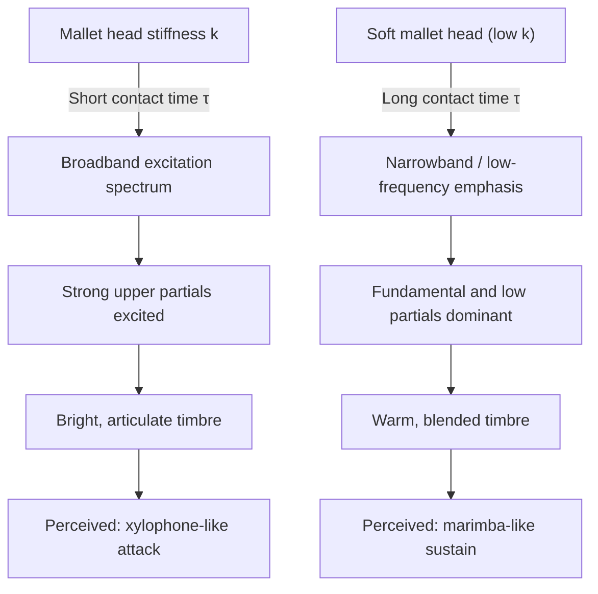
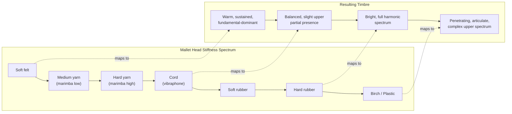
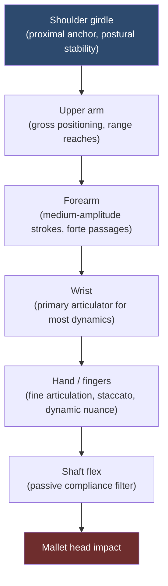
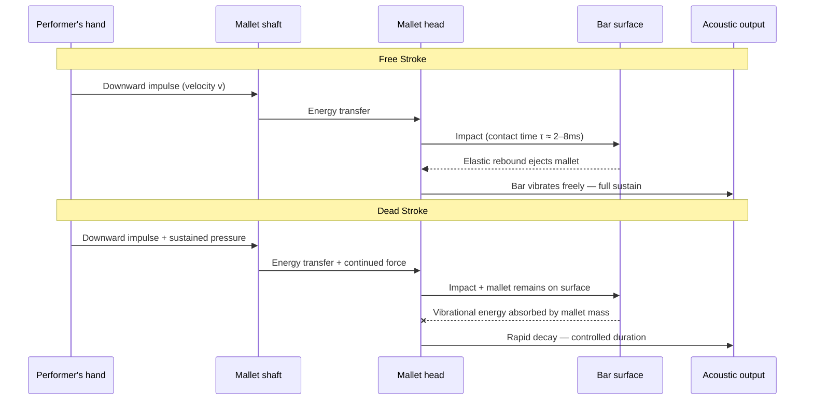
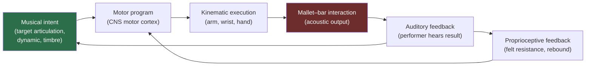
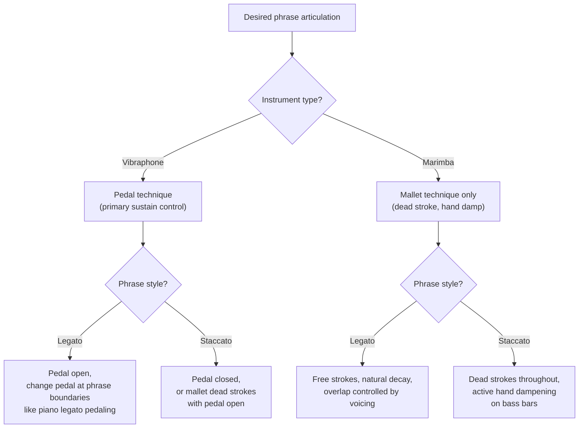
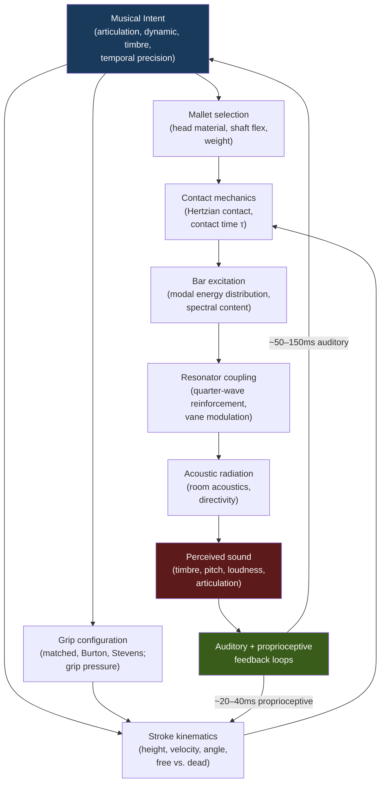

# Lesson 1: Mallet Techniques — From First Principles to Mastery

## Preface

This lesson treats mallet technique as a rigorous physical and acoustic discipline. The goal is not to prescribe fingering positions by rote, but to build a causal model: understanding *why* each mechanical choice produces a specific sonic outcome. A performer who internalizes these principles can adapt intelligently to any instrument, any hall, any musical context. The original lesson's DSP metaphor has been retained but grounded in real acoustic physics and replaced where the analogy was misleading.

---

## 1. First-Principles Acoustics: How a Struck Surface Makes Sound

### 1.1 The Vibrating Bar — Exact Physics

Mallet keyboard instruments (marimba, xylophone, vibraphone, glockenspiel) produce sound primarily from struck bars. Unlike strings, which are one-dimensional, bars are two- or three-dimensional elastic bodies, and their vibration modes do not form a simple harmonic series.

For a free-free bar (supported at its nodal points, as in all keyboard percussion), the resonant frequencies satisfy the **Euler–Bernoulli beam equation**. The natural frequencies of a uniform bar of length *L*, cross-section second moment *I*, elastic modulus *E*, and linear density *ρA* are:

```
fₙ = (πCₗκ / 8L²) · βₙ²
```

where *Cₗ = √(E/ρ)* is the longitudinal wave speed, *κ* is the radius of gyration of the cross-section, and *βₙ* are the dimensionless frequency coefficients for mode *n*:

| Mode | βₙ (free-free bar) | Ratio to f₁ |
|------|-------------------|-------------|
| 1    | 3.0112            | 1.000       |
| 2    | 5.0000            | 2.757       |
| 3    | 7.0000            | 5.404       |
| 4    | 9.0000            | 8.933       |

This is the critical architectural fact that separates bars from strings: **the overtone series is inharmonic by default.** The second partial of an unmodified bar sounds approximately a minor seventh above the fundamental's octave — an acoustically unacceptable dissonance. Instrument builders correct this by **undercut tuning**: removing material from the underside of the bar in an arch profile, which lowers the pitch of the lower partials selectively. A well-tuned marimba bar has its first overtone tuned to the second harmonic (one octave above), and often the second overtone tuned to the third harmonic (a twelfth). This is why bar undercuts differ across the instrument's range and why mallet choice interacts so profoundly with timbre — a harder mallet excites more upper partials, exposing tuning decisions the bar maker made in those higher modes.

### 1.2 Resonator Physics

Below the bar hangs a cylindrical resonator tube, closed at the bottom, open at the top. This is a **quarter-wave resonator**: the tube length *L_res* is set so that

```
L_res = c / (4 · f₀)
```

where *c ≈ 343 m/s* (speed of sound in air at 20°C) and *f₀* is the bar's fundamental. The tube couples acoustically to the bar, reinforcing the fundamental through constructive interference. This adds apparent sustain and projects the sound into the hall. On vibraphones, a motor-driven rotating disc (the **vane**) periodically opens and closes the resonator mouth, amplitude-modulating the resonator's contribution and producing the characteristic tremolo effect. The tremolo rate is typically 3–7 Hz, placing it in the range where the auditory system perceives it as rhythmic pulsation rather than pitch modulation.

### 1.3 Contact Time and Spectral Content

When a mallet head strikes a bar, the **contact duration** *τ* is the single most important variable controlling spectral content. Softer mallet heads deform on impact, extending *τ*, which acts as a low-pass filter on the excitation impulse. Harder heads have shorter *τ*, passing more high-frequency energy into the bar.

The relationship is approximated by Hertzian contact mechanics. For a spherical mallet head of radius *R* and elastic modulus *E_m* striking a flat surface:

```
τ ≈ 2.94 · (m/F_max)^(1/5) · (δ_max)^(2/5)
```

A practically useful rule: **doubling the softness of the mallet head (halving its effective stiffness) roughly doubles contact time, dropping the spectral cutoff by approximately one octave.** This is why switching from a hard yarn marimba mallet to a soft felt mallet on a vibraphone produces such a dramatic timbral shift — not primarily because of "warmth" in some vague sense, but because you are physically changing the low-pass filter cutoff applied to the bar's excitation.



---

## 2. Mallet Taxonomy and Material Science

### 2.1 Head Materials and Their Acoustic Signatures

The mallet market offers a spectrum of head materials, each occupying a distinct position in the stiffness-damping space. These are not arbitrary aesthetic preferences — they correspond to measurable differences in contact dynamics.

**Wound yarn (soft, medium, hard wraps):** The most common marimba mallet type. The core (typically cork or rubber) is wound with yarn of varying thickness and tension. The effective stiffness is dominated by the yarn winding: tighter, thinner windings are harder. Yarn mallets produce a gradual force onset on impact, which translates to a smooth spectral rolloff. At low dynamic levels, yarn mallets are nearly silent in upper partials; at fortissimo, the yarn compresses, the core dominates, and the sound brightens noticeably. This **dynamic-dependent timbre shift** is one of the most important properties of yarn mallets and distinguishes them from rubber or plastic.

**Felt (timpani, bell mallets):** Felt head mallets are common on vibraphone, timpani, and orchestral bells. Felt is viscoelastic — its stiffness increases nonlinearly with compression rate. At slow approach speeds (soft dynamics), felt is very compliant; at high impact velocities (loud dynamics), it stiffens markedly. This gives felt mallets a compressed dynamic response — they do not brighten as dramatically as yarn mallets at high dynamic levels, which contributes to the vibraphone's characteristic evenness across its dynamic range.

**Rubber (hard, medium, soft):** Rubber heads have higher stiffness than yarn but lower than wood or plastic. Hard rubber mallets on marimba produce a xylophonic attack; they are rarely used below the mid-range on a full-size instrument because the upper partial energy they inject can overwhelm the fundamental in lower bars. Medium rubber is a standard choice for xylophone and marimba bass octave.

**Wood and plastic (bare handles, rattan, birch shafts):** Direct wood-on-wood or bare rattan produces the highest stiffness contact interaction and is the standard for xylophone, woodblock, and temple blocks. Contact time is in the sub-millisecond range, producing a characteristic bright, percussive click.

**Hard and cord vibraphone mallets:** Cord-wound balls (similar to yarn but wound with thread rather than thick yarn) are stiffer than soft yarn and are preferred for vibraphone chord voicing because they emphasize upper partials that help chords project in a mix. Hard rubber or plastic vibraphone mallets are used for articulate, penetrating solos.



### 2.2 Shaft Material and Flex

The shaft material affects both grip ergonomics and the **mechanical impedance** of the system between the performer's hand and the head. Rattan shafts are slightly flexible, which introduces a small phase delay between the hand impulse and the head impact — experienced performers use this passive compliance to soften attacks and to perform rapid single-alternating strokes with less muscular effort (the shaft's spring return assists the upswing). Fiberglass shafts are stiffer, offering more direct control at the cost of feel. Birch shafts are the stiffest common option, used for hard-mallet work where precise articulation outweighs ergonomic flexibility.

---

## 3. Biomechanics: The Kinematic Chain

### 3.1 Grip Taxonomy

Mallet grip is not a single prescribed position but a family of techniques, each representing a different tradeoff in the stiffness-compliance-reach parameter space. The two primary families are:

**Matched grip (traditional/German):** Both hands orient the mallet similarly, palm mostly facing down. The mallet rests in the fulcrum formed by the index finger and thumb, with the remaining fingers providing variable damping and spring. This grip maximizes wrist-driven stroke power and is preferred for single-line melodic playing where consistent tone production is paramount.

**Burton grip (Gary Burton's four-mallet technique):** The two mallets in each hand are crossed, with the outer mallet held between index and middle fingers and the inner mallet between middle and ring fingers. The thumb anchors from above. This grip enables rapid interval adjustment (spreading or closing the mallets changes the interval in real time) and is the standard for four-mallet vibraphone. It sacrifices some power on the inner mallet in favor of interval flexibility.

**Stevens grip (Leigh Stevens):** The mallets are held with the shaft running approximately parallel to the back of the hand, with both mallets held between adjacent fingers in a fan configuration. The palm faces primarily downward. Stevens grip maximizes the spread between the two mallets and enables extremely rapid cross-stickings in four-mallet technique on marimba. It is less common for vibraphone because the interval range exceeds what vibraphone chord voicings require.

**Musser/McMillan grip:** A variant between matched and Burton, used by many marimba soloists for two-mallet playing with an emphasis on wrist rotation as the primary power source.

### 3.2 The Kinematic Chain: Shoulder to Mallet Head

Every stroke originates in the musculoskeletal chain: shoulder girdle → upper arm → forearm → wrist → hand → shaft → head. The critical insight is that this chain operates as a **compound pendulum system** in which the natural frequency of each segment must be coordinated with the tempo and dynamic demands of the passage.



The practical implication of compound pendulum mechanics: **the most energy-efficient stroke uses the lowest segment in the chain that can generate sufficient amplitude.** A pianissimo passage on vibraphone should be driven entirely from the fingers and wrist — bringing the forearm or shoulder into the motion wastes energy and degrades control. A fortissimo marimba low-C, conversely, requires forearm and shoulder engagement because the wrist alone cannot generate sufficient head velocity while maintaining a free, unforced sound.

### 3.3 Stroke Mechanics: Free Stroke vs. Dead Stroke

This distinction is mechanically precise and has direct acoustic consequences:

**Free stroke (rebounding stroke):** The mallet head contacts the bar and immediately rebounds, leaving the bar free to vibrate. The key mechanical requirement is that the mallet must leave the bar before the second half of the bar's vibration cycle returns energy to the contact point. For a marimba C4 bar (approximately 262 Hz), this means the mallet must clear the bar within roughly 1.9 ms of initial contact. This happens naturally if the performer applies no downward force through the stroke — the elastic rebound of the bar itself ejects the mallet. Free stroke preserves maximum sustain.

**Dead stroke (piston stroke, staccato stroke):** The mallet head remains in contact with the bar immediately after impact, absorbing the vibrational energy. This requires the performer to actively resist the rebound by continuing to press gently downward through the stroke. Dead strokes produce note durations that are independent of the bar's natural decay — the performer controls duration exactly. This is not merely a stylistic technique; it is the primary mechanism of **articulation** on mallet instruments, which have no key-up mechanism for stopping sound.



### 3.4 Stroke Angle and Tonal Color

The point of contact on the bar's surface affects which modes are excited. Striking at the **center** (antinodal point for the fundamental) maximally excites the fundamental and suppresses odd-numbered higher modes. Striking toward the **end** of the bar excites more upper partials, producing a brighter, more complex tone. Striking directly over a **nodal point** of a higher mode suppresses that mode specifically. These are not theoretical curiosities — experienced performers use off-center striking deliberately to adjust tonal color without changing mallet hardness.

---

## 4. Dynamic Control: Physics and Perception

### 4.1 Velocity, Force, and Loudness

The perceived loudness of a struck bar is primarily determined by the **head velocity at impact**, not by the total muscular force applied. This is because the bar's initial vibrational energy is proportional to the square of the head velocity at the moment of contact:

```
E_bar = ½ · m_eff · v_impact²
```

where *m_eff* is an effective mass term combining the bar and mallet. This quadratic relationship has a critical practical implication: to double perceived loudness (approximately +10 dB), you must increase head velocity by a factor of approximately 3.16. The common teaching error of associating "playing louder" with "pressing harder" is physically wrong — pressing harder after contact does not add energy to a struck bar; it only damps its vibration. Force is relevant only in the brief contact window; velocity is the primary control variable.

### 4.2 The Performer as a Feedback Control System

A more accurate model than the original lesson's "DSP system" analogy is the performer as a **closed-loop control system** (in the control-theory sense), not a signal processing chain:



The two feedback paths — auditory and proprioceptive — operate at different latencies. Proprioceptive feedback from the hand and wrist arrives at the CNS within approximately 20–40 ms, fast enough to influence individual strokes in moderately fast passages. Auditory feedback has a round-trip latency of approximately 50–150 ms depending on room acoustics and monitoring conditions, making it useful for phrase-level corrections but too slow for note-by-note real-time adjustment above approximately 6–8 strokes per second. This is why **kinesthetic muscle memory**, developed through deliberate practice, must do most of the control work in fast passages — the auditory loop is simply too slow.

---

## 5. Multi-Mallet Technique: Architecture and Coordination

### 5.1 Four-Mallet Independence

Four-mallet playing introduces a **combinatorial coordination problem**: each hand controls two mallets, the interval between which must be set before the stroke. This requires planning ahead in the kinematic sequence — the interval for a chord must be set during the upswing, not at the point of contact. The motor system must solve for:

1. The position of both mallets horizontally (which bars to strike)
2. The interval between the two mallets in each hand
3. The relative velocity of inner vs. outer mallet (voicing dynamics)
4. Whether each of the four mallets executes a free or dead stroke
5. The timing of each mallet within the chord (arpeggiation vs. block)

The inner mallet in Burton grip is mechanically disadvantaged — it must pass between two fingers and tends to have a weaker stroke. Skilled performers compensate by deliberately increasing inner-mallet approach velocity or by adjusting grip pressure asymmetrically. In Stevens grip, both mallets have more equal mechanical access, but the angle of the outer mallet's shaft requires a rotational wrist component in the stroke.

### 5.2 Dampening as an Acoustic Control Mechanism

On vibraphone, the sustain pedal (a felt strip pressed against bar undersides by foot action, or lifted away from them) is equivalent to the sustain pedal on piano in function but opposite in mechanics: **pressing the vibraphone pedal lifts the felt bar dampers, allowing bars to ring freely.** This is the default "open" position for most playing. The foot pedal is a primary articulation tool, not an afterthought.

On marimba, there is no pedal mechanism. The only dampening tools are the mallets themselves (dead strokes), the hand/arm, or the natural decay of the instrument. Bass marimba notes can sustain for 5–8 seconds in a resonant hall, requiring active mallet dampening in legato passage work where overlapping pitches would create harmonic dissonance.



---

## 6. High-Performance Optimization and Failure Mode Analysis

### 6.1 Technique Optimization: Principles Over Prescriptions

The goal of technical practice is to shift conscious control mechanisms into unconscious motor programs, freeing attentional resources for musical expression. The key optimization targets are:

**Stroke economy:** Every wasted motion — over-preparation height, excessive shoulder involvement at low dynamics, re-gripping between strokes — adds latency and reduces maximum sustainable tempo. The minimum effective stroke height for a given dynamic level is the optimal height. This is not "smaller is better" as a dogma; a fortissimo stroke that travels 15 cm is not wasteful. A pianissimo stroke that travels 15 cm because the performer has no smaller motor program is a failure mode.

**Relaxed distal segments:** Grip tightness beyond what is needed to control the mallet adds stiffness to the hand-shaft interface, transmitting vibrations back into the hand as noise and obscuring proprioceptive feedback. A common teaching heuristic: "hold the mallet as if you are holding a small bird — firm enough that it cannot fly away, loose enough that you do not crush it." The mechanical reason this works is that partial grip relaxation restores the shaft's passive compliance contribution, enabling the rattan flex to operate as an energy buffer.

**Anticipatory positioning:** The mallet must be in position over the target bar before the stroke begins, not during it. Lateral motion and vertical stroke motion should be sequenced, not simultaneous. Performers who move horizontally during the downstroke produce inconsistent contact-point angles and unpredictable tonal results.

### 6.2 Failure Mode Taxonomy

The following are the primary technical failure modes, their mechanical causes, and their acoustic consequences:

| Failure Mode | Mechanical Cause | Acoustic Consequence | Correction |
|---|---|---|---|
| Buried stroke (involuntary dead stroke) | Excess grip pressure, wrist lock, pressing through contact | Choked, dead tone; loss of sustain | Relax distal grip; focus on rebound sensation |
| Uneven alternating strokes | Asymmetric wrist rotation, unequal follow-through | Accent pattern where none intended; "limp" vs. "strong" hand differentiation | Isolate each hand; practice single-hand rolls to equalize |
| Rim shots / edge contact | Insufficient horizontal pre-positioning | Distorted pitch (edge contact excites inharmonic modes); harsh click | Deliberate pre-position practice; slow the transition speed |
| Tension buildup in extended passages | Insufficient micro-pauses in muscular effort; gripping harder as fatigue increases | Progressive loss of dynamic range (can't play pianissimo when tired); increased error rate | Build in phrase-shape breathing; conscious grip reset between phrases |
| Inner mallet underprojection (four-mallet) | Burton grip mechanical disadvantage; insufficient inner-mallet velocity compensation | Top voices dominate, inner voices disappear; harmonic balance lost | Isolate inner-mallet strokes; consciously increase inner mallet velocity |
| Phase lag in fast passages | Attempting auditory feedback control above 6–8 notes/sec | "Chasing" the music; progressive drift from tempo | Practice at tempi where proprioceptive control alone is sufficient; build up gradually |

### 6.3 Practice Architecture for Skill Acquisition

Effective mallet technique development follows the **desirable difficulty** framework from motor learning research (Robert Bjork, University of California). Three principles apply directly:

**Interleaved practice over blocked practice:** Practicing multiple mallet types, stroke techniques, and dynamic levels within a single session produces slower immediate gains but far superior long-term retention and transfer than practicing each in isolation. The mechanism is that interleaving forces the motor system to retrieve and reconstruct the motor program on each trial, strengthening the retrieval path.

**Variable practice over constant practice:** Varying the tempo, dynamic, and room acoustics of a practiced passage makes the resulting motor program more robust and generalizable. A performer who always practices at the same tempo on the same instrument in the same room acquires a motor program that is brittle under performance conditions.

**Spaced repetition:** Distributing practice across multiple sessions with rest intervals produces better consolidation than massed practice. The underlying mechanism is memory consolidation during sleep and rest, which is as relevant to motor memory as to declarative memory.

---

## 7. Instrument-Specific Considerations

### 7.1 Marimba

The modern concert marimba spans 4.3 or 5 octaves (C2–C7 or A2–C7 on a 4-octave instrument). The lowest bars are large wooden slabs (often rosewood, padauk, or synthetic material like Kelon) where the fundamental can be as low as 65 Hz. At these low frequencies:

- The resonator tubes approach 130 cm in length, requiring the instrument to be tilted in the lower register in some designs
- The natural decay time is long (5–8 seconds in live halls), making active dampening essential in fast passages
- Mallet choice is critical: a mallet too hard for the low register will produce a "clunk" because the contact time is short relative to the bar's vibration period

The high register (above C6) requires the opposite attention: bars are short and stiff, decay times are very short, and the performer must use harder mallets to inject sufficient energy for the fundamental to project.

### 7.2 Vibraphone

Vibraphone bars are aluminum, which has a much lower damping coefficient than wood. This makes vibraphone bars ring considerably longer than marimba bars and makes the pedal an indispensable articulation tool rather than an optional color choice. The vane motor speed is variable and is a performance parameter — slower tremolo (3 Hz) has a warmer, more expansive quality; faster tremolo (6–7 Hz) can suggest urgency or anxiety in an expressive context. Many contemporary vibraphone soloists perform with the motor off entirely, producing a "dead" (undamping) sustain that resembles bowed marimba or electric guitar sustain.

### 7.3 Xylophone

Xylophone bars are made from rosewood or synthetic materials and have significantly shorter sustain than marimba. The instrument's range is typically 3.5 octaves (F4–C8). Because the decay is fast, the xylophone's attack transient dominates its perceived sound. Hard rubber or plastic mallets are standard; yarn mallets are rarely used because the contact time extension they provide reduces the characteristic "bite" of the instrument. The xylophone is essentially a staccato instrument by nature — legato on xylophone is an illusion created by tempo, phrasing, and consistent attack rather than by sustained tones.

### 7.4 Glockenspiel and Orchestra Bells

Steel or brass bars in the glockenspiel have extremely high elastic moduli, making them effectively rigid on the timescale of normal mallet contact. Contact times are sub-millisecond. The instrument's forte is in its penetrating projection through a full orchestra. The standard "brass mallet" for glockenspiel is not literally solid brass in performance settings but typically a hard plastic or delrin head; actual metal mallets are rarely used due to bar wear. The glockenspiel's natural decay at A6 (1760 Hz) is several seconds, creating harmonic accumulation in rapid passages that must be managed through deliberate note selection and, where available, manual bar damping.

---

## 8. Summary: A Causal Model of Mallet Performance

The following diagram synthesizes the full causal chain from performer intent to perceived sound:



The core invariants that govern all mallet technique, regardless of instrument or style:

1. **Contact time determines spectral content.** Mallet hardness is a low-pass filter on bar excitation. Harder = shorter contact time = more upper partials = brighter timbre.
2. **Head velocity at impact determines loudness.** Post-contact force controls sustain (dead stroke), not volume.
3. **Free stroke preserves sustain; dead stroke controls duration.** These are the two fundamental articulation primitives. Everything else is a combination or variation.
4. **The motor program, not real-time auditory feedback, executes fast passages.** Above approximately 6–8 strokes/second, the auditory feedback loop is too slow to correct individual strokes. Practice builds the motor program; performance executes it.
5. **Bar geometry determines available tuning.** Undercut tuning aligns the overtone series toward harmonicity. Mallet choice that emphasizes poorly tuned upper partials exposes instrument quality limitations.
6. **Every grip and stroke choice is an engineering tradeoff.** There is no universally correct technique — only technique that is well-matched to the acoustic goal, the instrument's physical properties, and the performer's physiology.
