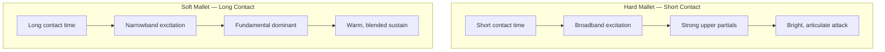
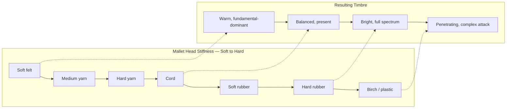
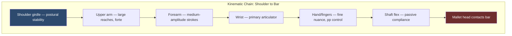
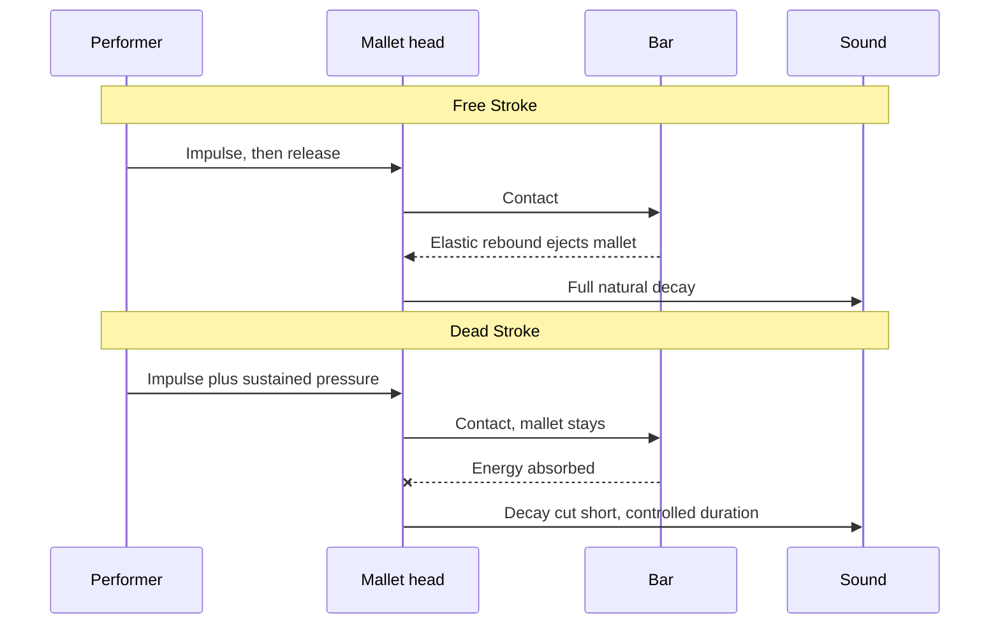
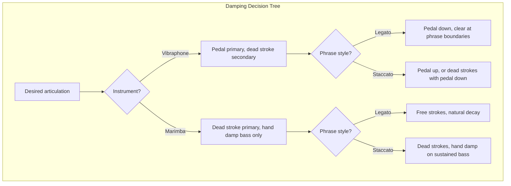
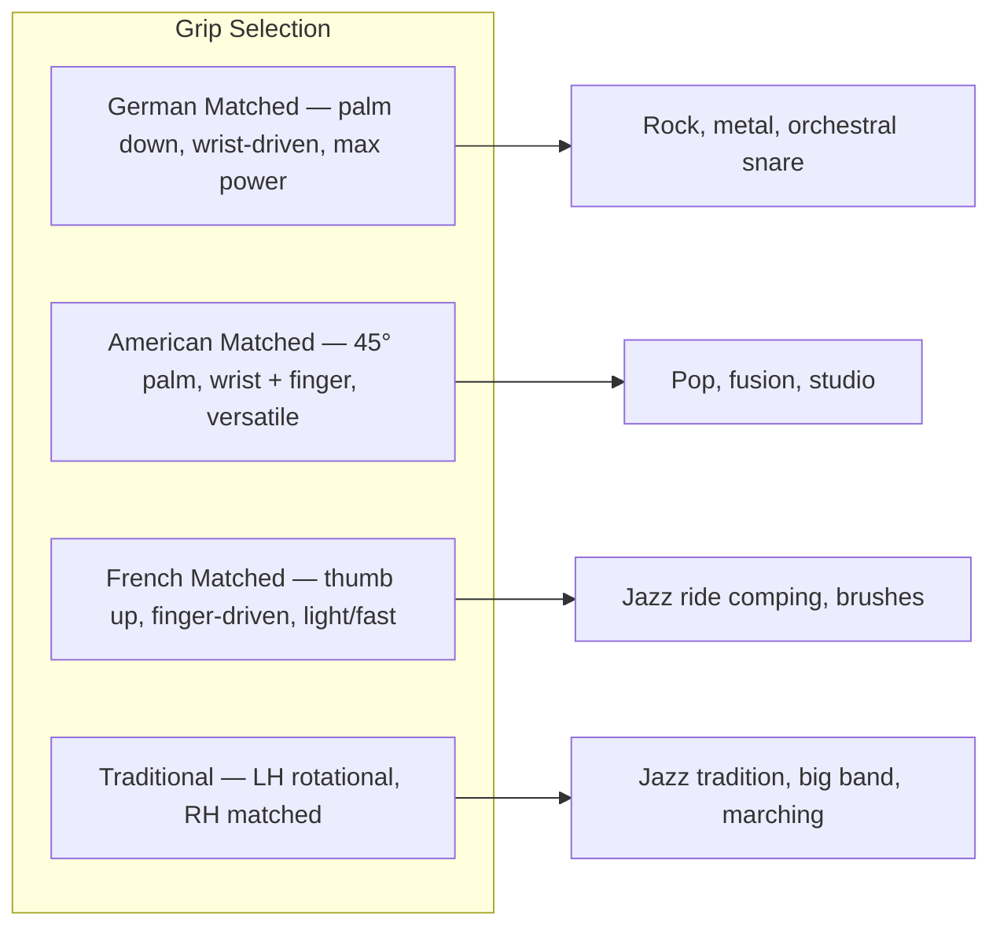
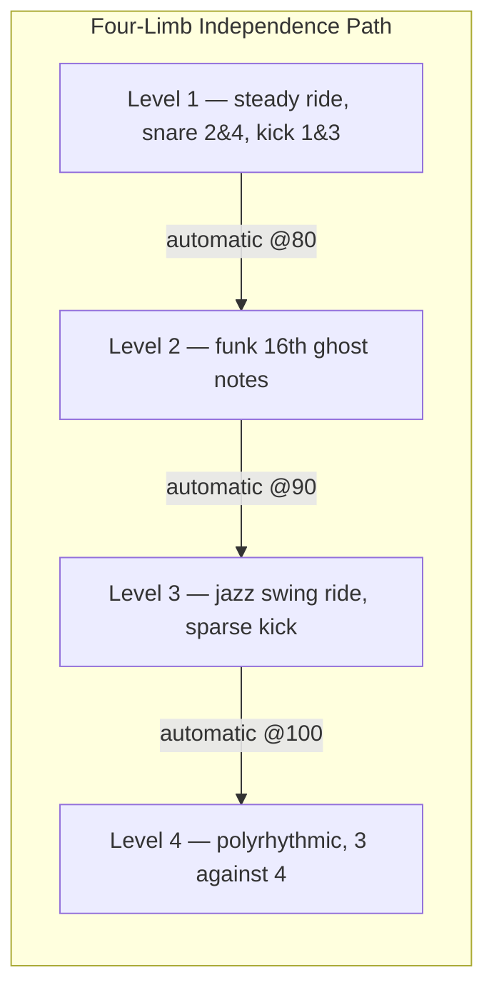

# Percussion Masterclass: Mallet Technique, Drumset Independence, Rudimental Foundation & Multi-Instrument Mastery

## Preface

This masterclass treats percussion as a unified physical discipline spanning mallet keyboard instruments, drumset, orchestral snare, and hand percussion. Every section moves from why a technique works to exactly how to drill it, with grip positions, stroke mechanics, metronome targets, and the specific failure signs you'll hear and how to fix them. Theory shows up only where it changes a physical decision — mallet choice, stroke height, grip angle. It never replaces time with the stick in your hand.

---

## Part I — Mallet Keyboard Technique

### 1. Acoustic Foundation: What Happens When Mallet Meets Bar

#### 1.1 Why Mallet Choice Is an Acoustic Decision, Not a Comfort One

Struck bars are inharmonic by nature — a raw bar's second partial doesn't land on a clean octave. Makers correct this with an undercut arch carved into the underside of the bar, which pulls the first two overtones into near-harmonic alignment with the fundamental (roughly an octave and a twelfth above it). That tuning only lives in a specific, narrow frequency band.

This is why mallet hardness matters beyond feel: a hard mallet injects energy into high partials that sit outside the carefully tuned region, so you get clang and noise instead of pitch. A soft mallet concentrates energy in the fundamental and first overtone, where the instrument was actually tuned to sound good. **Match mallet hardness to how much upper spectrum you want to expose, not to how loud you need to play** — loudness is stroke height, not mallet hardness.

#### 1.2 Resonators and the Vibraphone Fan

Each bar sits above a tube closed at the bottom, tuned to reinforce the bar's fundamental by resonance — this is why a marimba or vibraphone note has more body than the bar alone would produce. On vibraphone, a motor-driven fan rotates inside the resonator mouths, periodically blocking and opening them. That's the tremolo. It isn't decorative — it's your only real-time timbral control besides mallet choice and stroke.

**Motor speed as a performance control:**

| Fan setting | Sound | When to use it |
|---|---|---|
| Off | Pure sustain, no pulse | Ballads, solo rubato, anything needing clarity over wash |
| Slow (~3 Hz) | Warm, lazy pulse | Lyrical comping, ballad accompaniment |
| Medium (~5 Hz) | Standard shimmer | Default ensemble setting, big band |
| Fast (~6–7 Hz) | Agitated, urgent | High-energy solos, dramatic underscoring |

Reach over and change it mid-tune. It's a knob, use it like one.

#### 1.3 Contact Time Is Your Built-In EQ

The single biggest variable you control at the moment of impact is how long the mallet head stays in contact with the bar. Soft heads deform and cling longer, which acts like a low-pass filter on the strike — you excite mostly low partials. Hard heads bounce off fast, passing more high-frequency energy into the bar.

Practical rule: **moving one step softer in mallet hardness (e.g., medium yarn → soft yarn) is roughly like dropping a tone control by an octave of brightness.** You don't need EQ pedals for a marimba — you need a second pair of mallets.



---

### 2. Mallet Selection Guide

#### 2.1 Head Materials and What They Actually Do in Your Hands

**Wound yarn (soft / medium / hard):** The marimba workhorse. Tighter, thinner winding = harder. Yarn's defining trait is that it brightens as you play louder — at piano the yarn absorbs the impact and you hear mostly fundamental; at fortissimo the yarn compresses and the harder core underneath starts contributing, so the tone opens up. This is why the same pair of yarn mallets can sound warm in a ballad and cut through a forte tutti — use that instead of fighting it with a mallet change mid-piece.

**Felt:** Standard on vibraphone and timpani. Felt stiffens with impact speed but far less dramatically than yarn brightens, so tone stays even across the dynamic range. This evenness is part of why vibraphone sounds "controlled" compared to marimba — pick felt when you want consistency over expressive brightening.

**Rubber (soft/medium/hard):** Stiffer than yarn at a given nominal hardness. Hard rubber in the marimba bass register is an aggressive, almost xylophonic attack — a specific effect, not a general-purpose bass mallet. Medium rubber is the default xylophone mallet.

**Cord-wound:** Stiffer than soft yarn, standard for vibraphone chord voicing — projects clearly in a section without disappearing.

**Birch / plastic / bare wood:** Hardest, shortest contact time available. Standard for xylophone and glockenspiel; the "bite" of these instruments comes directly from that short contact time, not from anything in the bar itself.



#### 2.2 Shaft Material

Rattan flexes slightly — that spring assists the upswing in fast alternating passages, meaning your muscles do less work per stroke and attacks soften naturally. Fiberglass is stiffer and more direct, trading away some of that free assist for precision. Birch is stiffest of all, chosen when articulation must be exact and you're willing to supply all the control yourself.

**Selection matrix:**

| Application | Head | Shaft |
|---|---|---|
| Marimba bass (C2–C4) | Soft-medium yarn | Rattan |
| Marimba mid-high (C4–C7) | Medium-hard yarn | Rattan or fiberglass |
| Vibraphone, chordal | Cord-wound | Rattan |
| Vibraphone, articulate solo | Hard rubber | Fiberglass |
| Xylophone | Hard rubber or birch | Birch |
| Glockenspiel | Hard plastic (Delrin) | Aluminum or birch |
| Timpani | Felt, medium-hard | Bamboo or wood |

---

### 3. Grip Mechanics and Hand Posture

#### 3.1 Two-Mallet Matched Grip

The foundation for every single-line melodic passage.

**Setup, right hand (mirror left):**
1. Rest the shaft in the groove between the base of your index finger and the first thumb joint — this is your fulcrum.
2. Thumb presses lightly **from above**, not pinching from the side.
3. Middle, ring, and pinky curl loosely under the shaft, providing variable spring and damping — not a clamp.
4. Palm faces mostly down.
5. Wrist stays neutral, slightly arched — no lateral crank.

**Posture check:** at rest position above the bar, forearm, wrist, and shaft should form a near-straight line viewed from above. Any sideways wrist bend here is a tension leak that will show up as fatigue within twenty minutes of playing.

#### 3.2 Four-Mallet Grips

**Burton Grip (vibraphone standard):**
- Outer mallet (M2): between index and middle fingers, shaft along the back of the hand.
- Inner mallet (M1): between middle and ring fingers.
- Thumb anchors from above on the outer shaft.
- Shafts cross behind the thumb; that crossing point is your fulcrum for interval changes.
- Rotate the wrist outward (supination) to **open** the interval, inward (pronation) to **close** it — adjustable mid-air, mid-phrase.

**Known weak point:** the inner mallet has less leverage because it's pinned between two fingers rather than braced against the thumb. It will sound weaker unless you deliberately increase its approach velocity. In four-mallet voicing work, assume the inner voice needs extra attention or it vanishes in an ensemble mix.

**Stevens Grip (marimba standard):**
- Both mallets in a fan, shafts roughly parallel to the back of the hand.
- Outer mallet between index/middle, inner between middle/ring, similar to Burton, but with less crossing and a wider maximum span.
- More even power between the two mallets than Burton gives you.
- Better for wide-interval marimba writing; usually too wide a default span for tight vibraphone voicings.

**Burton vs. Stevens:**

| Criterion | Burton | Stevens |
|---|---|---|
| Primary instrument | Vibraphone | Marimba |
| Typical interval range | 2nd–8th | Up to 10th+ |
| Inner mallet power | Weaker, needs compensation | More equal |
| Interval-change speed | Very fast | Moderate |

**Grip-switch drill:** hold a major triad (root–3rd–5th) in each grip on the same three bars, alternating hands R-L-R-L at ♩=60. If one grip feels noticeably more stable, that's the one to default to for that repertoire, not a sign you're doing the other one wrong.

---

### 4. Stroke Mechanics: The Core Vocabulary

#### 4.1 The Kinematic Chain



**Rule: use the smallest, most distal segment that can generate the needed amplitude.** Pianissimo on vibraphone is wrist-and-fingers only. Fortissimo on low marimba C requires forearm and shoulder fully engaged. Bringing the shoulder into a pp stroke wastes motion and loses control; trying to play ff from the wrist alone produces a choked, forced tone because you physically can't get the head moving fast enough that way.

#### 4.2 Free Stroke vs. Dead Stroke

The fundamental articulation binary on every mallet instrument.

**Free stroke:** mallet strikes and immediately rebounds off the bar's own elastic energy — zero downward pressure after contact. Bar rings at full natural decay. Default for legato.

**Dead stroke:** mallet strikes and stays, held with light downward pressure. The mallet head's mass absorbs the vibration. Duration is now entirely under your control instead of the bar's natural decay — this is how mallet players get staccato since there's no damper mechanism built in.

**Drill — Free vs. Dead Isolation** (single bar, marimba C4 or vibraphone A4):
1. 8 free strokes at ♩=60 — feel the rebound eject the mallet; the stick should jump back in your hand.
2. 8 dead strokes at ♩=60 — feel the bar go silent under your mallet immediately.
3. Alternate 1 free / 1 dead at ♩=60. This contrast is what makes the mechanical difference obvious in your hand.
4. Move to ♩=80 once the contrast is clean and repeatable.



#### 4.3 Stroke Height and Dynamics

Loudness comes from head velocity at impact, which comes from stroke height, not from squeezing harder after contact.

**Dynamic-to-height reference (single mallet, marimba midrange):**

| Dynamic | Height above bar | Primary driver |
|---|---|---|
| ppp | 2–3 cm | Fingers |
| pp | 4–5 cm | Fingers + light wrist |
| mp | 7–9 cm | Wrist |
| mf | 10–13 cm | Wrist + forearm |
| f | 14–18 cm | Forearm |
| ff | 20–25 cm | Forearm + shoulder |
| fff | 25–30 cm | Full arm |

Treat these as a starting calibration, not law — instrument size, register, and mallet weight shift them. Calibrate by ear, then lock in the height that produces the dynamic you want consistently.

#### 4.4 Contact Point as a Tone Control

- **Bar center:** maximizes fundamental, suppresses odd upper modes — warmest, roundest tone.
- **Toward the bar end:** more upper-partial energy — brighter, more complex.
- **On a specific node:** suppresses that mode selectively.

Use contact point as a live EQ you don't need to stop and adjust with a mallet change: slide toward center for extra warmth in a quiet passage, toward the end for projection in a loud ensemble tutti.

---

### 5. Damping and Pedal Technique

#### 5.1 Vibraphone Pedal

The pedal lifts a felt damper bar away from the bar undersides. Pressing the pedal **opens** the bars to ring — opposite logic from a piano sustain pedal, where down means more sound happens either way, but here down literally means "not damped." Default resting position for most playing is pedal down (bars ringing); you lift it to clear harmony, separate phrases, or get a crisp stop.

**Drills:**

1. **Legato phrase pedaling:** play a diatonic scale, one note per beat, ♩=60, pedal held down throughout. At the barline, lift briefly to clear the previous harmony, then press again on the new downbeat. If notes from adjacent phrases are bleeding together, your clearing point is late — lift earlier, right on the last note of the old phrase.
2. **Staccato with pedal open:** play a chromatic run using dead strokes while keeping the pedal down. The notes stop despite the open pedal — this decouples articulation from pedal position and frees your foot for purely harmonic/expressive use.
3. **Syncopated pedaling (jazz comping):** Cmaj7 → Am7 → Dm7 → G7, one chord per bar. Lift the pedal on the "and" of beat 2, press again on beat 3. This is the standard jazz vibraphone approach — keeps harmony from smearing without killing sustain entirely.

#### 5.2 Marimba Hand Damping

No pedal exists on marimba — dead strokes and direct hand contact are your only tools.

**Hand damp:** after a low bar (C2–C3), lay the flat side of the index or middle finger of the free hand lightly on the bar. Firm enough to stop the vibration, light enough not to produce its own thump. Drill on isolated bass notes at ♩=60 before folding it into an actual bass-register melodic line.



---

### 6. Practice Drills: Mallet Keyboard

#### 6.1 Fundamental Alternating Stroke Drill

**Purpose:** equalize hands in tone, timing, and velocity.

```text
Exercise 1A — Single Pitch Alternating
Marimba or vibraphone, C4 or A4, metronome on.

[♩= 60]  R L R L R L R L
[♩= 80]  R L R L R L R L
[♩=100]  R L R L R L R L

Listen for equal tone and duration — no accent on the dominant hand.
Fail sign: every other note is slightly louder or brighter.
Fix: drop to ♩=50, exaggerate the weaker hand until both sound identical,
then bring the tempo back up.
```

```text
Exercise 1B — Dynamic Arc, Single Pitch
Tempo ♩=72. 8-beat crescendo, 8-beat decrescendo.

Beats 1–8:  pp → p → mp → mf → f → ff → fff → ff
Beats 9–16: ff → f → mf → mp → p → pp → ppp → pp

Stroke height should visibly track the dynamic.
If you can't reach true ppp on beat 15, your minimum stroke isn't small
enough — drop to pure finger motion, mallet head barely 2 cm off the bar.
```

#### 6.2 Four-Mallet Chord Voicing Drill (Burton Grip)

```text
Exercise 2A — Interval Ladder, right hand, then left, then both
Tempo ♩=60. Marimba C4–C5, bars C–E–G–C.

Beat 1: M1 on C4, M2 on E4   (major 3rd)
Beat 2: M1 on E4, M2 on G4   (minor 3rd)
Beat 3: M1 on G4, M2 on C5   (perfect 4th)
Beat 4: hold / reset

Both mallets must land simultaneously. If the outer mallet consistently
arrives first, your wrist rotation is driving it more than the inner —
deliberately lead with the inner mallet until arrival is simultaneous.
```

```text
Exercise 2B — Four-Mallet Block Chords
Tempo ♩=60 → 80.

Beat 1: LH [C3–G3] + RH [E4–C5] = Cmaj7 (open voicing)
Beat 2: LH [D3–A3] + RH [F4–D5] = Dm7
Beat 3: LH [G3–D4] + RH [F4–B4] = G7
Beat 4: LH [C3–G3] + RH [E4–C5] = Cmaj7

Voicing target: top note (RH outer) = melody = loudest.
Inner voices = harmony = softer. Bass (LH outer) = medium weight.
If inner voices disappear, isolate inner mallets alone and drill at
♩=50 until they project at mf without strain.
```

#### 6.3 Roll Technique Drill

A roll is alternating strokes fast enough to blur into continuous tone at your dynamic and the listener's distance.

```text
Exercise 3A — Roll Speed Ladder, single pitch C4
♩= 60  8th notes  (2 strokes/sec)
♩= 80  8th notes
♩=100  8th notes
♩=100  16th notes (6.7 strokes/sec)
♩=120  16th notes

Blur threshold shifts with dynamic: at ppp, continuous tone emerges around
5–6 strokes/sec. At ff, the bar's longer decay means you need 8–10
strokes/sec to hide gaps between attacks. Test and know your own
threshold on each instrument you regularly play.
```

---

## Part II — Drumset Technique and Independence

### 7. Physical Setup and Ergonomic Foundation

#### 7.1 Throne Height and Posture

**Hip-knee angle:** thighs roughly parallel to the floor or angled 5–10° downward, putting the hip at about 100–110°. Too low, and your hip flexors fight to hold the leg up the whole time, fatiguing fast and degrading pedal control as fatigue sets in. Too high, and the foot does extra unnecessary travel to reach the pedal, costing you nuance.

**Kick pedal distance:** with the beater resting on the head, the ball of your right foot sits naturally over the footboard, ankle neutral, knee slightly bent — not locked straight, not deeply crouched.

**Snare height/angle:** batter head at roughly the height of your relaxed forearm resting on your thigh. Tilt the near edge down 3–5° so strokes land without wrist deviation — too high forces ulnar deviation at the wrist, too low forces the elbows out.

**Cymbal angles:** hi-hat nearly flat, maybe 5–10° toward you. Crashes tilted 10–20° so the stick gets a glancing blow instead of a flat smack — flat smacking is the number one cause of cracked cymbals. Ride at snare height or slightly above, tilted 5–15°.

#### 7.2 Grip Choices

**Matched grip:**
- **German:** palms down, wrist-and-forearm driven. Maximum power — the default for rock, pop, orchestral snare.
- **American:** palms at ~45°, blends wrist rotation with finger motion. Versatile, all-purpose.
- **French:** palms facing in (thumbs up), finger-driven. Best control at low dynamics — brushes, fast jazz ride work.

**Traditional grip** (left hand only differs): shaft rests in the groove between thumb and index's first joint, supported by the third finger's first segment; wrist motion becomes rotational (forearm supination/pronation) rather than up-down. Originated for marching snares carried on a sling tilted left-down. On a flat drumset snare it gives no mechanical advantage, but many jazz players keep it for its characteristic tone and feel.



---

### 8. Stroke Taxonomy: The Four Core Strokes

If you can't execute all four cleanly in isolation, everything built on top of them — rudiments, Moeller, ghost-note grooves — will inherit the weakness.

**Full stroke:** starts high (~30 cm), ends high. Full dynamic swing, used for accents and opening strokes in diddle patterns.

**Down stroke:** starts high, ends low (1–3 cm) and freezes — you catch the stick rather than let it rebound. Used for an accent followed immediately by a soft note.

**Tap stroke:** starts low, ends low, minimal motion, finger-controlled rebound. This is your ghost note.

**Up stroke:** starts low, taps, and rebounds up to full height, preparing for the next accent.

```text
Four Core Strokes Drill — snare only
Tempo ♩=60, right hand first, then left, then alternating

Beat 1: Full  [HIGH → strike → HIGH]
Beat 2: Down  [HIGH → strike → FREEZE LOW]
Beat 3: Tap   [LOW  → strike → LOW]
Beat 4: Up    [LOW  → tap   → HIGH]

The down-stroke freeze is the hardest part. If the stick bounces back up
after the hit, you aren't catching it — tighten your grip fractionally
right at the moment of impact, then release again.
```

---

### 9. The Moeller Stroke: Speed Without Fatigue

Moeller is a whipping motion that pulls multiple notes out of one arm impulse by exploiting rebound.

**Mechanics:** a forearm-driven downward whip strikes the drum; as the stick rebounds, the forearm keeps traveling upward in an arc, and the hand/stick lag behind on inertia, arriving high again ready for the next stroke. One whip produces: accent (the whip strike) → tap (finger rebound) → up (return to high), a three-note sequence from one muscular impulse.

```text
Drill 9A — Single-Hand Moeller Foundation
Tempo ♩=60, right hand on snare

Step 1 — isolate the whip:
   Let the forearm drop under gravity, don't push. Let the stick hit and
   rebound fully back to starting height. 8 reps. If it doesn't return
   high, you're gripping too hard on impact — loosen the fingers right
   after contact.

Step 2 — add the finger tap:
   Whip down; as the stick rebounds upward, add a light finger tap at
   mid-arc. One arm motion → two notes (accent + tap).
   8 reps at ♩=60, then 72, then 84.

Step 3 — full sequence (accent–tap–up):
   Identify three events: arm whip = ACCENT, finger tap = ghost-level
   soft note, stick arriving high = ready position for the next accent.
   Apply to triplets, Moeller driving beats 1 and 2 of each group.
```

---

### 10. Bass Drum Technique

#### 10.1 Heel-Down vs. Heel-Up

**Heel-down:** full foot stays on the board, ankle dorsiflexes to lift the beater, gravity brings it down. Good for jazz, low-volume playing, finesse in ppp–mp. Limited top-end power.

**Heel-up:** heel off the board, only the ball of the foot contacts it; the whole leg drives the stroke. More power and speed. Standard for rock, metal, double bass patterns.

**Slide technique:** heel-up variant where the foot slides forward after initial contact, using friction to pull the beater back off the head fast — extends single-pedal speed range significantly.

#### 10.2 Articulation

- **Free beater:** springs back after contact, head resonates fully — open, full kick sound.
- **Buried beater:** stays pressed against the head — punchy, dry, controlled thud.

```text
Drill 10A — Kick Accuracy Grid, ♩=80, 4/4, 8 bars each

Pattern 1 (quarters):    K - - -  K - - -  K - - -  K - - -
Pattern 2 (1 & 3):        K - - -  - - K -  K - - -  - - K -
Pattern 3 (all four):     K - K -  K - K -  K - K -  K - K -
Pattern 4 (syncopated):  K - - K  - K - -  K - - K  - K - -

(K = kick, - = rest; hi-hat or ride steady on all beats throughout)
Target: identical volume and rock-solid timing on every kick. No rushing beat 1.
```

---

### 11. Hi-Hat Technique

#### 11.1 Chick Control

**Tight chick:** fast, sudden press — bright, dry, minimal air between cymbals.
**Loose chick:** slower, controlled press — a slight swish, warmer, more sustain.

#### 11.2 Open/Closed Range

```text
Hi-Hat Articulation Drill, ♩=80
Right hand steady 8th notes on hi-hat, left foot articulating:

Beat 1: fully closed
Beat 2: slightly open — faint "ts"
Beat 3: half open — "tssh"
Beat 4: fully open — full wash
Repeat, then reverse the arc (open → closed).

Once smooth at ♩=80, add snare on beats 2 and 4 simultaneously with the
left foot chick — a classic independence benchmark.
```

---

### 12. Four-Limb Independence: Coordination Grids

Independence is a motor-program acquisition problem, solved by systematic layering, not raw talent.

#### 12.1 Build Order

1. Right hand alone.
2. Left hand alone.
3. Right hand + left foot.
4. Right hand + right foot.
5. Left hand + both feet (three limbs).
6. Add the fourth limb.

**Never add a limb until the current combination is automatic** — meaning you can hold a conversation while playing it. If you have to think about it, it isn't automatic yet.

#### 12.2 Level 1 — Beginner (♩=70)

```text
RH Ride:     R    -    R    -    R    -    R    -
LF Hi-hat:   -    -    H    -    -    -    H    -
RF Kick:     K    -    -    -    K    -    -    -
LH Snare:    -    -    S    -    -    -    S    -
```

#### 12.3 Level 2 — Intermediate (♩=80), Funk 16ths

```text
RH Hi-hat:   R    r    r    r    R    r    r    r   (R=accent, r=ghost)
LF Hi-hat:   -    -    H    -    -    -    H    -
RF Kick:     K    -    -    K    -    -    K    -
LH Snare:    -    -    S    -    s    -    S    -   (s=ghost snare)

Ghost notes ≈ pp, 1–2 cm stroke height. If audible across the room, too loud.
```

#### 12.4 Level 3 — Advanced (♩=90–110), Jazz Ride

```text
RH Ride:     R    -    r    R    -    r    R    r   (swung, triplet feel)
LF Hi-hat:   -    -    H    -    -    -    H    -   (beats 2 & 4)
RF Kick:     K    -    -    -    -    K    -    -   (sparse, melodic)
LH Snare:    -    -    -    s    -    -    s    -   (brush-like ghosts)

Swing the ride as a triplet subdivision ("1-trip-let 2-trip-let"), not a
straight 8th feel. Click on 2 & 4 only (like a hi-hat chick), never on
the downbeats — clicking downbeats trains a straight feel that fights
the swing you're trying to build.
```



---

### 13. Essential Rudimental Vocabulary

#### 13.1 Single Stroke Roll

```text
R L R L R L R L   (all equal dynamic)

Pyramid drill: ♩=60 8ths → accelerate to ♩=120 over 16 bars → decelerate back.
Any note louder than its neighbors flags tension in that hand — isolate and
equalize before continuing.
```

#### 13.2 Double Stroke Roll

```text
R R L L  R R L L   (16th notes, each pair = one beat)

♩=60: Full-Full / Tap-Tap, muscled deliberately.
♩=80: same pattern, starting to feel the second stroke want to rebound.
♩=100: the second stroke of each pair MUST be rebound-driven, not muscled,
        or your wrists fatigue within four bars.

Around ♩=80–90 is the "unlock point" — stop controlling the second stroke
and let the rebound do it. Most players who plateau on doubles are still
muscling that second note.
```

#### 13.3 Paradiddle

```text
R L R R   L R L L
>       >     >       >   (accent on first note of each group)

Kit mapping: R = snare, L = hi-hat (or floor tom); doubles stay on the
same surface as the single that preceded them. Try voicing the double
onto the snare for an instant musical fill pattern.

Tempo target: ♩=60 → 80 → 100 → 120, 16th notes (4 per beat).
```

#### 13.4 Flam

```text
lR  rL  lR  rL    (lowercase = grace note, uppercase = primary)

Grace note height: 2–3 cm. Primary: 20–25 cm (f) or 10–12 cm (mf).
Grace note arrives 50–100ms ahead of the primary — a hair, not an 8th note.
If it sounds like two equal notes, the grace note is too loud or too early.

Drill: lR - rL - lR - rL at ♩=60, then 80, then 100.
```

#### 13.5 Ghost Notes and Dynamic Stratification

```text
Three-layer model:
  ACCENT (ff): full strokes, rim shots, backbeats
  NORMAL (mf): standard strokes, ride attacks
  GHOST  (pp): tap strokes, 1–2 cm, nearly inaudible at distance

Three-Level Snare Drill, ♩=80, 16ths:
Beat:   1  e  +  a   2  e  +  a   3  e  +  a   4  e  +  a
Snare:  -  g  -  -   S  g  -  g   -  g  -  -   S  g  -  g
        (g = ghost, S = accent, - = rest)

Target: ghosts audible up close, felt rather than heard once the band comes in.
```

---

## Part III — Orchestral Snare and Hand Percussion

### 14. Orchestral Snare Technique

Concert snare demands a dynamic range wider than most drumset playing ever asks for — genuine ppp that's barely audible to nearby players, up through a fortissimo that must cut over a full orchestra.

#### 14.1 Stroke Mechanics

**Rim shot:** stick tip and shaft hit rim and head simultaneously — sharp, cutting crack for sforzando/fortissimo.

**Rim click (cross-stick):** tip anchored on the head, shaft strikes the rim — dry, wood-like, less common in orchestral writing than jazz/pop but used in some contemporary scores.

**Center vs. edge:** center strikes are fuller and more resonant; edge strikes are drier and thinner. Standard orchestral technique favors striking 2–3 cm in from the rim for a balanced tone.

**Snare tension:** too tight chokes the buzz and kills definition on ghost-level strokes; too loose produces uncontrolled flapping on every stroke. Correct tension responds clearly to ghost-level strokes without excess buzz — check by playing at pp and listening for clean, immediate snare response.

#### 14.2 Dynamic Range Drill

```text
Concert Snare Dynamic Mapping, ♩=60, alternating R-L

ppp: height 1–2 cm, fingers only, barely audible
pp:  3–4 cm, slight wrist
p:   6–8 cm, wrist-driven
mp:  10 cm, wrist + forearm
mf:  13 cm, forearm
f:   18–20 cm, forearm + shoulder
ff:  25 cm, full arm, rim shot optional
fff: rim shot from full height

8-step continuous crescendo ppp→fff (2 beats per level), then back down.
No jumps — smooth gradation only. Record and review: the two spots players
jump most are mp→mf (where "normal" playing kicks in by default) and
pp→p (where fine motor control first starts to break down).
```

---

### 15. Hand Percussion: Cajón and Djembe Fundamentals

#### 15.1 Cajón Stroke Zones

**Bass:** center of the face, flat fingers plus palm base, heel making light contact. Full, low thud — your kick equivalent.

**Slap:** upper corner, fingers curled loosely, fingertips snap back fast. Dry, cutting crack — your snare backbeat equivalent.

**Open tone:** upper area, relaxed flat fingers, immediate bounce-back. Mid-range tone, moderate sustain.

```text
Cajón Basic Groove, ♩=70

Beat:   1    +    2    +    3    +    4    +
Zone:   Bass -    Slap -    Bass -    Slap -
Hand:   RH   -    LH   -    RH   -    LH   -

Once automatic, add open tones on the "and" beats:
Zone:   Bass Open Slap Open Bass Open Slap Open
Hand:   RH   LH   RH   LH   RH   LH   RH   LH
```

#### 15.2 Djembe Fundamentals

**Bass:** flat open hand, center of head, fingers closed, held briefly after contact rather than bounced off immediately.

**Tone:** 2–3 cm in from the rim, four fingers together (not fanned), immediate bounce. Clear mid-range "ping."

**Slap:** same position as tone, but fingers relaxed and slightly fanned — tips snap down and rebound immediately for a high, dry crack.

```text
Djembe Tone Check:
  Bass sounds like a slap → hand isn't fully open/flat.
  Tone sounds like a thud → hand too tense, relax the fingers.
  Slap sounds like a tone → fingers not relaxed enough to snap back;
    isolate the finger-snap motion (like flicking water off your fingers)
    before putting it back on the drum.
```

---

## Part IV — Failure Mode Quick Reference

Use this as a diagnostic lookup when something sounds wrong but you can't tell why.

| Symptom | Likely Cause | Fix |
|---|---|---|
| One hand sounds brighter/louder on alternating strokes | Grip or stroke-height asymmetry | Isolate weak hand at half tempo, match height and tone before recombining |
| Can't get a true ppp | Minimum stroke height too large | Drop to pure finger motion, 1–2 cm, no wrist |
| Doubles fatigue the wrist by bar 4 | Muscling the second stroke instead of letting it rebound | Drop tempo to ♩=70–80, let the stick fall off the rebound, don't push it |
| Moeller stick doesn't return to full height | Gripping too hard on impact | Loosen fingers immediately after contact, let rebound do the lifting |
| Ghost notes audible across the room | Stroke height too large for ghost dynamic | Cap height at 1–2 cm, tap-stroke only, no wrist |
| Inner mallet (4-mallet grip) disappears in chords | Weak mechanical leverage, under-driven | Consciously increase inner mallet approach velocity; isolate-drill inner voice alone |
| Vibraphone harmony smears between phrases | Pedal lift timing late | Lift pedal on the last note of the old phrase, not after the new one starts |
| Marimba bass notes ring into the next phrase | No hand damping used | Add hand damp on sustained bass bars before the next attack |
| Flam sounds like two equal notes | Grace note too loud or too early | Drop grace note height to 2–3 cm, tighten the gap to near-simultaneous |
| Jazz ride feels stiff/mechanical | Click trained on downbeats instead of 2 & 4 | Retrain with click only on 2 & 4, swing subdivision as triplets |
