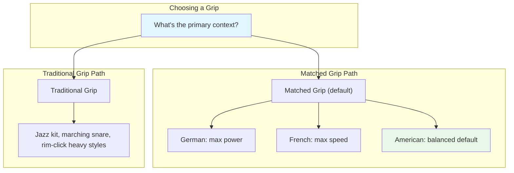
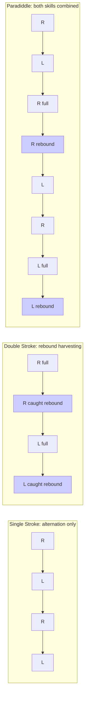

# Lesson 2: Stick Technique — Grip, Rebound, and Rudimental Control

## 1. Why This Works: The Physics You Actually Need

Every drum sound is a stick giving up its energy to a membrane in about 1-2 milliseconds. That's the entire transaction. Everything in this lesson — grip choice, stroke height, finger pressure — exists to control that transaction more precisely.

**Strike location changes tone, not just volume.** Center strikes excite the fundamental and produce a full, round tone — this is why your main backbeat strikes should land center-head. Edge strikes suppress the fundamental and favor higher partials, producing the thinner, "ticky" sound used for ghost notes and texture. Use this on purpose: move strike position as a tone control, not just stick height.

**Contact time controls brightness.** A shorter stick-head contact passes more high-frequency energy; a longer, "mushier" contact (soft mallet, relaxed stick pressed into the head) emphasizes lows and kills brightness. This is why press rolls and dead strokes sound darker than open strokes — you're lengthening contact time and choking the attack.

**The wrist is your speed multiplier.** The arm-wrist-stick chain is a compound lever, and the wrist sits at the far end of it. A small wrist rotation translates into large stick-tip velocity because the wrist is the last link before the tip — the same reason a fly-fishing rod tip moves faster than the angler's hand. This is why fast, quiet playing comes from tiny wrist and finger motions, not big arm swings. Big arm swings are for volume and accents, not speed.

**Rebound is free energy — use it.** After impact, the head's elastic restoring force shoots the stick back upward. If you grip tightly through that rebound, you fight your own return stroke and burn muscle energy you didn't need to spend. If you relax the grip at the moment of impact, the stick rises almost on its own. This single idea — relax on the bounce, don't fight it — is the mechanical root of the Moeller technique, the double-stroke roll, and basically every "it got so much easier once I stopped trying so hard" breakthrough you'll have.

That's the whole theory section. Everything from here is hands-on.

---

## 2. Grip Setup: Get This Right Before Anything Else

### Matched Grip — the default for kit drumming

Both hands do the same thing. The stick lies in the fulcrum formed by thumb and the first knuckle of the index finger, roughly one-third of the way up from the butt end — this is the stick's natural balance point, and gripping here means the stick needs the least muscular effort to control. Middle, ring, and pinky fingers curl loosely underneath, ready to add power on strokes and to catch/damp the rebound.

**Checkpoints:**
- Fulcrum pressure: pinch only enough to keep the stick from flying out of your hand. If you can't wiggle the stick's tip slightly with your other fingers, you're gripping too hard.
- Back three fingers stay in light contact with the stick at rest — not clamped, not floating off it.
- Wrist stays in line with the forearm at rest. No wrist crank.

**The three pronation variants** (how much you rotate the forearm so the palm faces down):

| Variant | Forearm pronation | Primary wrist motion | Best for |
|---|---|---|---|
| German | ~45°, palms down | Side-to-side (radial/ulnar deviation) | Power, backbeats, loud rock/metal |
| French | ~0°, palms facing each other | Up-down (flexion/extension) | Speed, finger control, jazz ride/soloing |
| American | ~20-30°, in between | Mixed | General kit playing — the practical default |

Start every new student on American grip. It's the forgiving middle ground: enough pronation for power, enough neutrality for speed. Switch toward German when you need raw volume (arena rock backbeats), toward French when you need rapid single-hand finger technique (jazz ride patterns, fast single-stroke bursts).

### Traditional Grip — for snare drum tradition, jazz, and marching contexts

Left hand only differs from the right. The stick rests in the crook between thumb and index finger and lies across the top of the ring finger's middle knuckle; the middle finger curls on top of the stick for control.

**Setup drill:**
1. Hold left palm up, fingers relaxed and slightly curled.
2. Lay the stick diagonally across the hand so it rests in the web of the thumb and crosses the ring finger's top knuckle.
3. Rotate the hand so the palm faces roughly 45° — not fully up, not fully sideways.
4. Middle finger rests lightly on top of the stick. Thumb and index pinch gently at the fulcrum point.
5. The stick moves by rotating the forearm and flexing the fingers underneath it — there's no symmetric "wrist snap" like the right hand uses.

Traditional grip costs you weeks of extra left-hand development to match right-hand power, but it gives unmatched access to rim clicks, cross-stick, and a particular looseness prized in jazz comping. Skip it unless your style calls for it (jazz kit, drum corps/marching snare, some funk players). For most modern kit playing, matched grip is the correct default.



---

## 3. The Stroke Types: Your Four Building Blocks

Every pattern you'll ever play on a kit is built from four stroke types. Learn to switch between them deliberately — this is the single highest-leverage technical skill in drumming.

| Stroke | Start height | End height | Use |
|---|---|---|---|
| **Full stroke** | High (~15-20cm) | High | Accents, loud playing |
| **Down stroke** | High | Low (~2-5cm) | Accent followed immediately by a quiet note |
| **Tap/low stroke** | Low | Low | Ghost notes, soft consecutive notes |
| **Up stroke** | Low | High | Quiet note followed immediately by an accent |

**Drill: Four-Stroke Switching**
```
Tempo: 60 BPM, quarter notes, right hand only on practice pad
Bar 1: Full stroke x4 (high-high-high-high)
Bar 2: Down stroke, tap, tap, up stroke (high→low, low→low, low→low, low→high)
Bar 3: Tap x4 (low-low-low-low)
Bar 4: Up stroke, full, down stroke, tap
Repeat with left hand.
Progress: 60 → 70 → 80 BPM over two weeks, only advancing when heights are visually consistent (check in a mirror).
```

This drill looks trivial and is not. Most "uneven" playing at speed traces back to a player defaulting to full strokes for everything instead of selecting the right stroke type for what comes next.

---

## 4. Rudiments: Mechanics and Drills

### Single Stroke Roll (R L R L...)

Hands alternate, each hand getting a full prep cycle while the other strikes. This is why single strokes can go faster than either hand could manage alone — you're time-sharing the workload.

**Drill ladder:**
```
Pad, metronome, sixteenth notes, hands RLRL throughout.
Week 1: 80 BPM — focus: identical stick height both hands (use mirror)
Week 2: 90 BPM
Week 3: 100 BPM
Week 4: 110 BPM — focus: wrist-driven, not arm-driven
Week 5: 120 BPM
Week 6: 130 BPM — if strokes become uneven, drop 10 BPM and rebuild for 3 days before pushing again
```
Rule of thumb: never grind at a tempo that breaks your stroke evenness. Five minutes of clean 100 BPM beats twenty minutes of sloppy 130 BPM — the sloppy reps are what you'll actually play back under pressure.

### Double Stroke Roll (R R L L...)

First stroke of each pair is a full, active stroke. The second is a **caught rebound** — you let the head's elastic kickback do the work and simply close your fingers at the top to stop the stick at the right height, rather than actively re-striking.

**Isolating the rebound — the single most important double-stroke drill:**
```
Pad, one hand at a time, tempo 70 BPM quarter notes.
1. Drop the stick from ~15cm (let gravity do it, don't push).
2. Let it bounce once off the pad on its own — don't touch it.
3. Catch it at the top of that natural bounce by closing your fingers.
4. That bounce height is your "free" second stroke height. Match your active second stroke to feel the same as that free bounce.
5. Once the feel is internalized, play RR continuously: full stroke, caught rebound, full stroke, caught rebound.
6. Switch hands. Progress 70 → 80 → 90 BPM over three weeks, both hands separately before combining into RRLL.
```
**Common failure:** the second stroke is quieter than the first because the player lets the stick die out instead of catching it at a controlled height. Fix: exaggerate the catch — consciously stop the stick at the same height as stroke one until the volumes match, then relax back to efficient technique.

### Paradiddle (R L R R | L R L L)

The genius of the sticking is that both the single-stroke-alternation skill and the double-stroke-rebound skill get used in the same pattern. Notes 1-2 are a single-stroke pair (full alternation); notes 3-4 are a double on one hand (rebound-catch).

**Drill:**
```
Pad, tempo 80 BPM, sixteenth notes: R L R R L R L L (continuous)
Phase 1 (weeks 1-2): all notes even volume — isolates the sticking pattern itself
Phase 2 (weeks 3-4): accent note 1 of each group of four (>R L R R >L R L L) — this is how paradiddles get used musically, as an accent pattern around the kit
Phase 3 (weeks 5-6): move the accented note around the kit (snare→tom1→tom2→floor tom) while unaccented notes stay on snare — this is the classic paradiddle fill vocabulary
Tempo target: 100 BPM by end of week 6
```



---

## 5. Flams, Drags, and Ghost Notes — Ornament Control

### Flams

Two strokes landing almost together: a quiet grace note (low height, ~2-5cm) immediately before a full-volume primary stroke (~15cm), roughly 20-30ms apart. The ear hears it as one "fat" note, not two separate hits.

**Drill:**
```
Tempo 80 BPM, quarter notes, pad.
Right flam: L grace (low, quiet) lands just before R primary (full height, full volume)
Left flam: R grace just before L primary
Alternate every beat: right flam, left flam, right flam, left flam.

Progression:
Weeks 1-2: 80 BPM, exaggerate the gap so you can hear two distinct notes, then tighten
Weeks 3-4: 90 BPM, tighten gap until it reads as one thick note, not two separate ones
Weeks 5-6: 100 BPM, apply to toms — flam accents moving around the kit
```
**Common failure:** grace note creeps up in volume until it's a double stroke roll instead of a flam. Fix: practice the grace note alone first, at 1/5 the height of the primary stroke, until your hand "knows" that height without looking.

### Drags

Two very fast, very quiet grace notes (a controlled double-bounce, 2-10ms apart) followed by a full primary stroke. Think of it as a mini buzz feeding into an accent.

**Drill:**
```
Tempo 70 BPM, quarter notes, pad.
Right drag: L-L rapid quiet double-bounce → R primary full stroke
Left drag: R-R rapid quiet double-bounce → L primary full stroke

Weeks 1-2: isolate drags with a full beat of rest between each — don't chain them yet
Weeks 3-4: 80 BPM, chain drags continuously (drag-drag-drag...)
Weeks 5-6: 90 BPM, insert into fills — e.g., drag on tom 1 leading into snare accent
```
Key technique: let the grace notes come from a controlled finger bounce, not two separate wrist strokes. If you can't get a clean double-bounce from the fingers alone (like bouncing a ball twice with one push), slow down until you can.

### Ghost Notes

Very quiet strokes (roughly 15-20% of accent volume) played from minimal height (1-2cm), used to fill rhythmic space without disrupting the groove's main pulse. This is the backbone of funk, hip-hop, and shuffle feels.

**Drill — the funk pocket builder:**
```
Tempo 90 BPM
Pattern: R L R L (sixteenth notes), hands alternating
Dynamics: ghost - ACCENT - ghost - ghost (accent on beat 2 and 4 positions within each grouping)
Stick heights: ghosts 1-2cm, accents 15cm

Week 1: 80 BPM, two-bar phrases with a bar of rest between — don't fatigue into sloppy ghosts
Week 2: 90 BPM, continuous four-bar phrases
Week 3: 100 BPM, apply directly to a basic rock beat: kick on 1 and 3, snare accent on 2 and 4, snare ghosts on the "e" and "a" of each beat
Week 4: 110 BPM, add hi-hat eighth notes with foot/other hand — full groove integration
```
**Common failure:** ghost notes accidentally get louder as tempo increases because the player can't shrink stick height enough at speed. Fix: practice ghosts in isolation at target tempo before adding the accent — the height judgment has to become automatic, not something you think about mid-groove.

---

## 6. Grip Pressure: Finding the Zone and Fixing the Death Grip

Too loose and the stick flies out of your hand on an accent. Too tight and you choke your own rebound, burn out your forearm, and your fast passages fall apart. The zone you want: light enough that the stick can still bounce freely, firm enough that you control where it goes.

**Calibration drill — do this before every fast session:**
```
Pad, 80 BPM quarter notes, one hand at a time.
1. Play 2 minutes gripping as lightly as possible — stick should feel loose, almost uncontrolled
2. Play 2 minutes gripping moderately — note the difference in control
3. Play 2 minutes gripping hard — note your forearm tightening within seconds
4. Return to light grip — it will feel dramatically more relaxed by contrast
5. Settle on the lightest grip that still gives you full control — that's your working zone
```

**Death grip symptoms:** forearm burning out in minutes, stick rebound feels "dead," accidental loss of speed ceiling, and — the tell — your knuckles visibly whiten on the stick. Death grip is almost always caused by trying to force a tempo or pattern you haven't earned yet. The fix is never "grip harder," it's drop the tempo and rebuild with a relaxed grip at a speed where control doesn't require tension.

**Fix-it protocol:**
```
Week 1: single strokes, 80 BPM, deliberately light grip, 5 min continuous. If tension creeps in, stop, shake hands out, restart.
Week 2: same grip feel, 8 min continuous.
Week 3: same grip feel, raise to 90 BPM.
Week 4: same grip feel, raise to 100 BPM.
Week 5: add dynamics (soft to loud) while holding the same relaxed baseline grip.
Week 6: mix in doubles and paradiddles at 100 BPM without the grip tightening up.
```

---

## 7. Stick Height, Tempo Ceilings, and Why Fast = Quiet

Height determines volume because it determines how much energy the stick has when it arrives. But height also costs time — the higher you lift, the longer the full stroke cycle takes. At some tempo, physics forces a trade: you cannot play both very loud and very fast, because there isn't enough cycle time left for a big lift.

Rough practical reference (sixteenth notes, single strokes):
- Under 120 BPM: full dynamic range available, heights from 2cm to 40cm all playable
- Around 180 BPM: max practical height drops to roughly 8-10cm
- Around 240 BPM: max practical height drops to roughly 4-5cm

This is why blast-beat and fast-metal drumming sounds compressed in dynamics compared to a slow ballad groove — it's not a stylistic limitation, it's a mechanical one. Plan your dynamics around this: don't try to crescendo into a passage that's about to double in speed, because the height you need for the crescendo won't physically fit in the time available.

**Height-matching drill:**
```
Mirror, pad, 70 BPM quarter notes.
1. Play RLRL at a fixed 10cm target height, watching both hands in the mirror
2. Close your eyes for 8 strokes, open and check — are both sticks still matching?
3. Alternate 8 eyes-open / 8 eyes-closed cycles for 10 minutes
Progress: extend the eyes-closed block to 16, then 32 strokes as your kinesthetic sense improves.
```

**Tempo ceiling drill — building speed the right way:**
```
Pad, metronome, single strokes.
1. Play 2 minutes at your current comfortable tempo.
2. Raise 4 BPM. Play 2 minutes.
3. If strokes stay even (check heights, listen for volume consistency), raise again.
4. The moment quality drops — uneven heights, rushing, tension — drop back to the last clean tempo and stop there for the session.
5. Log the clean ceiling. Repeat 3x per week.
Expect roughly +8-12 BPM per two weeks early on, slowing to +4-8 BPM as you approach your current ceiling.
```

Don't grind blindly past a breakdown point hoping it'll "click." It won't — you'll just be rehearsing bad technique at high speed, which is worse than not practicing at all because it's harder to undo later.

---

## 8. Rebound Control: Killing Unwanted Buzz, Controlling Wanted Buzz

After any stroke, the stick wants to keep bouncing. Sometimes you want that (buzz rolls); most of the time you don't (clean single notes).

**To kill unwanted secondary bounces (note clarity on single strokes):**
Close your fingers around the stick immediately after the stroke lands, absorbing the leftover bounce energy into your grip instead of letting it rattle the head. This is especially necessary on tight, high-tension snares with coated heads, which rebound more and buzz more easily than looser heads.

**To control a buzz roll on purpose:**
```
Pad or snare, tempo 60 BPM, whole notes.
1. Press the stick down with just enough pressure to sustain a multi-bounce buzz, not a single clean strike.
2. Aim for roughly 6-8 bounces per buzz — consistent density, not a ragged rattle.
3. Hold the buzz for the full duration of the whole note, cut it off sharply on the next downbeat.
Progression:
Week 1: 60 BPM whole notes
Week 2: 70 BPM whole notes
Week 3: 70 BPM half notes (two buzzes per bar)
Week 4: 80 BPM half notes
Week 5: 80 BPM quarter notes (four buzzes per bar) — this is where it starts sounding like a real press roll
```
The difference between a musical buzz roll and sloppy, uncontrolled rattle is consistency of bounce density under even pressure. If the bounce count varies wildly beat to beat, you're gripping inconsistently — slow down and rebuild the pressure sense before pushing tempo again.

---

## 9. Wrist Health: Playing for Decades, Not Just This Gig

The wrist's neutral position — hand in line with the forearm — is the safest position for tendons. Every grip variant pulls you slightly off neutral in some direction; the goal isn't zero deviation (impossible) but avoiding sustained extremes.

- German grip stresses radial/ulnar deviation (side to side) most.
- French grip stresses flexion/extension (up and down) most.
- American grip spreads the load between both, which is part of why it's the common professional default for high-volume playing.

**Warm-up before every session (5 minutes, non-negotiable at fast tempos or long sessions):**
```
1. Wrist circles — 10 each direction, both hands
2. Finger spreads — spread wide, hold 5 sec, relax, x10
3. Light taps on pad at 1cm height, 60 BPM, 2 minutes — wakes up fine motor control before loading the wrist
```

**During long sessions:** take a 5-minute break every 45 minutes. Stretch wrist extensors (arm out, palm down, gently pull fingers toward you) and flexors (arm out, palm up, gently pull fingers down) for 30 seconds each side.

**Warning signs to stop immediately and rest:** sharp pain (versus normal muscle fatigue), tingling or numbness in the fingers (possible nerve compression), or pain that persists into the next day. These are not "push through it" signals — repetitive wrist injuries in drummers are usually caused by ignoring early warnings while chasing a tempo goal.

---

## 10. The 60-Minute Practice Session (Intermediate Level)

Unstructured practice — noodling without targets — produces slow, inconsistent gains. This session has a clear objective in every block.

**Warm-up (12 min)**
```
0-3 min: Finger taps, 2cm height, 60 BPM, each finger isolated, both hands — wakes up fine motor control
3-6 min: Single strokes RLRL, 8cm height, 90 BPM — wrist-only motion, arm stays still
6-9 min: Double strokes RRLLRRLL, 80 BPM — focus entirely on matching rebound volume to first stroke
9-12 min: Accented singles, 100 BPM — alternate accent-every-4th-note and accent-every-3rd-note groupings, 15cm accents / 5cm unaccented
```

**Technical block (20 min)**
```
12-17 min: Tempo ceiling push — single strokes, +4 BPM every 2 min until form breaks, log the ceiling, descend back down
17-22 min: Paradiddles at 70% of your single-stroke ceiling — 2 min accented, 2 min even volume, 1 min crescendo/decrescendo
22-27 min: Flams at 80 BPM — alternate right-lead and left-lead flams, 20-30ms grace spacing
27-32 min: Buzz rolls at 60 BPM — whole notes, then halves, then quarters, 6-8 bounce target
```

**Musical application (20 min)**
```
32-37 min: Basic rock groove with ghost notes, 90 BPM — kick 1&3, snare accent 2&4, sixteenth-note ghosts between
37-42 min: Fill construction, 100 BPM — 3 bars groove + 1 bar fill, rotating through paradiddle fills, flam fills, double-stroke fills
42-47 min: Play along to a song at or near practice tempo — lock with the kick/bass, keep ghost intensity consistent, clean fills without rushing
47-52 min: Free improvisation at 100 BPM incorporating today's technical focus — translate drill vocabulary into musical phrasing
```

**Cool-down (8 min)**
```
52-55 min: Free, quiet, no-metronome playing — focus on how relaxed, efficient motion physically feels
55-57 min: Wrist extensor and flexor stretches, 30 sec each, finger spreads x10
57-60 min: Log entry — tempo ceiling reached, biggest breakthrough or sticking point, next session's focus
```

### Practice Log Template

```
Date: _______  Duration: _____ min  Level: Beginner / Intermediate / Advanced

WARM-UP
Exercise: __________  Tempo: _____ BPM  Notes: ______________________

TECHNICAL BLOCK
Exercise: __________  Tempo range: _____–_____ BPM
Clean tempo ceiling reached: _____ BPM
Consistency (1–10): _____
Breakthrough or sticking point: ____________________________________

MUSICAL APPLICATION
Pattern/song: __________  Tempo: _____ BPM
Integration quality (1–10): _____
Notes: _______________________________________________________________

COOL-DOWN
Stretches done: Y / N    Physical state: Relaxed / Fatigued / Tension where: _______

NEXT SESSION FOCUS: _________________________________________________
```

---

## 11. Tracking Progress Without a Spreadsheet Fetish

You don't need software to track practice, but if you want a simple, persistent log instead of a paper notebook, this is a minimal, genuinely runnable tool — not a toy demo. It's a command-line practice logger in Python using nothing but the standard library, storing sessions in a local SQLite file.

```python
#!/usr/bin/env python3
"""
drum_log.py — minimal practice session tracker for stick technique work.

Usage:
    python drum_log.py add --exercise "single_strokes" --tempo 120 --ceiling 134 --consistency 8 --notes "clean, slight rush above 130"
    python drum_log.py history --exercise "single_strokes"
    python drum_log.py ceiling --exercise "single_strokes"
"""
import argparse
import sqlite3
import sys
from datetime import datetime
from pathlib import Path

DB_PATH = Path.home() / ".drum_practice_log.sqlite3"

SCHEMA = """
CREATE TABLE IF NOT EXISTS sessions (
    id INTEGER PRIMARY KEY AUTOINCREMENT,
    timestamp TEXT NOT NULL,
    exercise TEXT NOT NULL,
    tempo_bpm INTEGER NOT NULL,
    ceiling_bpm INTEGER,
    consistency INTEGER CHECK(consistency BETWEEN 1 AND 10),
    notes TEXT
);
"""

def get_conn():
    conn = sqlite3.connect(DB_PATH)
    conn.execute(SCHEMA)
    return conn

def add_entry(args):
    conn = get_conn()
    conn.execute(
        "INSERT INTO sessions (timestamp, exercise, tempo_bpm, ceiling_bpm, consistency, notes) "
        "VALUES (?, ?, ?, ?, ?, ?)",
        (
            datetime.now().isoformat(timespec="seconds"),
            args.exercise,
            args.tempo,
            args.ceiling,
            args.consistency,
            args.notes or "",
        ),
    )
    conn.commit()
    print(f"Logged: {args.exercise} @ {args.tempo} BPM (ceiling {args.ceiling})")

def show_history(args):
    conn = get_conn()
    rows = conn.execute(
        "SELECT timestamp, tempo_bpm, ceiling_bpm, consistency, notes "
        "FROM sessions WHERE exercise = ? ORDER BY timestamp DESC LIMIT 20",
        (args.exercise,),
    ).fetchall()
    if not rows:
        print(f"No entries for '{args.exercise}' yet.")
        return
    for ts, tempo, ceiling, consistency, notes in rows:
        print(f"{ts}  tempo={tempo:>4}  ceiling={ceiling or '-':>4}  "
              f"consistency={consistency or '-':>2}  {notes}")

def show_ceiling_trend(args):
    conn = get_conn()
    rows = conn.execute(
        "SELECT timestamp, ceiling_bpm FROM sessions "
        "WHERE exercise = ? AND ceiling_bpm IS NOT NULL ORDER BY timestamp",
        (args.exercise,),
    ).fetchall()
    if not rows:
        print(f"No ceiling data for '{args.exercise}' yet.")
        return
    print(f"Tempo ceiling progression for '{args.exercise}':")
    for ts, ceiling in rows:
        bar = "#" * (ceiling // 5)
        print(f"{ts[:10]}  {ceiling:>4} BPM  {bar}")
    first, last = rows[0][1], rows[-1][1]
    print(f"\nNet change: {last - first:+d} BPM over {len(rows)} logged sessions")

def main():
    parser = argparse.ArgumentParser(description="Drum practice session logger")
    sub = parser.add_subparsers(dest="command", required=True)

    p_add = sub.add_parser("add", help="log a practice entry")
    p_add.add_argument("--exercise", required=True)
    p_add.add_argument("--tempo", type=int, required=True)
    p_add.add_argument("--ceiling", type=int, default=None)
    p_add.add_argument("--consistency", type=int, default=None)
    p_add.add_argument("--notes", type=str, default="")
    p_add.set_defaults(func=add_entry)

    p_hist = sub.add_parser("history", help="show recent entries for an exercise")
    p_hist.add_argument("--exercise", required=True)
    p_hist.set_defaults(func=show_history)

    p_ceil = sub.add_parser("ceiling", help="show tempo ceiling trend for an exercise")
    p_ceil.add_argument("--exercise", required=True)
    p_ceil.set_defaults(func=show_ceiling_trend)

    args = parser.parse_args()
    args.func(args)

if __name__ == "__main__":
    sys.exit(main())
```

Run it after each session:
```bash
python drum_log.py add --exercise single_strokes --tempo 120 --ceiling 132 --consistency 8 --notes "clean to 128, rushed above"
python drum_log.py ceiling --exercise single_strokes
```
The `ceiling` command gives you an honest bar chart of whether your tempo ceiling is actually moving over weeks — the only metric that matters for speed development, and one most players badly misjudge from memory alone.

---

## 12. Where to Go From Here

You now have the four stroke types, the core rudiments built on single-stroke alternation and double-stroke rebound harvesting, grip calibration, and injury-aware practice structure. The path forward:

1. **Record yourself monthly.** Audio alone catches volume inconsistency; video catches height and tension issues your ears miss.
2. **Chase clean ceilings, not impressive ones.** A 120 BPM single-stroke roll with dead-even volume beats a wobbly 140 BPM roll every time it's actually used in music.
3. **Push one variable at a time** — tempo, dynamics, or complexity, never all three simultaneously when learning something new.
4. **Rotate focus across weeks** — a week emphasizing grip relaxation, a week on tempo ceilings, a week on musical fill vocabulary — rather than hammering the same drill into staleness.

Technique exists to disappear. The entire point of grinding through height-matching drills and rebound isolation is so that, in the middle of a song, you're not thinking about any of it — your hands already know.
