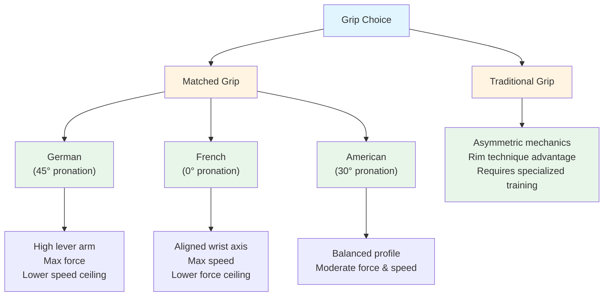
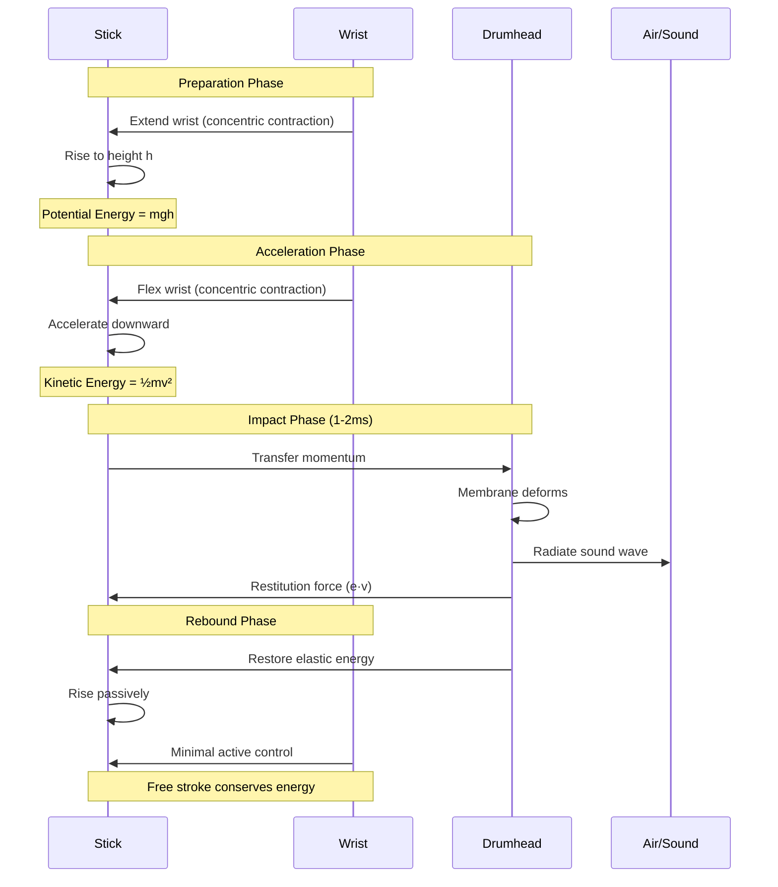
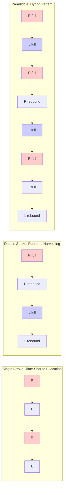

# Lesson 2: Stick Techniques

## 1. First-Principles Intuition & Invariants

Drumming is fundamentally a study in controlled energy transfer. When a stick strikes a drumhead, kinetic energy converts to vibrational energy in the membrane, which then couples to the surrounding air column to produce sound. Understanding this energy cascade from first principles reveals why certain techniques produce specific timbres and why seemingly small adjustments in grip, angle, or velocity yield dramatic acoustic changes.

### The Physics of Membrane Vibration

A drumhead is a two-dimensional tensioned membrane that exhibits complex modal behavior. When struck, it vibrates in multiple modes simultaneously—fundamental and overtones—each contributing to the perceived timbre. The fundamental frequency $f_0$ of a circular membrane is governed by:

$$f_0 = \frac{2.405}{2\pi r}\sqrt{\frac{T}{\rho}}$$

where $r$ is the membrane radius, $T$ is the tension per unit length, and $\rho$ is the surface density. This equation reveals why larger drums produce lower pitches (inverse relationship with radius) and why tightening the head raises pitch (square root relationship with tension).

The strike location determines which modes are excited. A center strike emphasizes the fundamental and symmetric modes, producing a full, round tone. An edge strike suppresses the fundamental and excites higher asymmetric modes, yielding a brighter, thinner sound. This principle—that strike position selectively filters the modal content—is the acoustic basis for tonal variation in drumming.

### Stick-Drumhead Contact Mechanics

The contact event between stick and head lasts approximately 1-2 milliseconds. During this interval, the stick's momentum transfers to the membrane, creating a localized deformation that propagates outward as a flexural wave. The contact force profile follows a roughly Hertzian distribution, with peak force occurring at maximum compression.

The stick tip geometry critically affects this contact. A spherical tip (as on most wooden sticks) concentrates force over a small area, producing high peak pressures and exciting high-frequency harmonics. A broader tip (as on felt mallets) distributes force over a larger area, reducing peak pressure and emphasizing lower frequencies. The material hardness also matters: harder tips produce shorter contact times and brighter attacks, while softer tips lengthen contact and smooth transients.

### Biomechanical Lever Systems

The arm-wrist-stick system operates as a series of compound levers. The shoulder acts as a first-class lever (fulcrum between effort and load), the elbow as a third-class lever (effort between fulcrum and load), and the wrist as a second-class lever (load between fulcrum and effort). Each joint contributes to the final stick velocity through its angular contribution:

$$v_{tip} = r_1\omega_1 + r_2\omega_2 + r_3\omega_3$$

where $r_i$ are the effective lever arms from each joint to the stick tip and $\omega_i$ are the angular velocities. This summation explains why small wrist movements can produce high stick velocities: the wrist's distal position multiplies its angular contribution by the longest lever arm.

The grip point on the stick creates another lever system. Holding the stick at its balance point (typically one-third from the butt) maximizes control while minimizing effort. The fulcrum effect at the grip allows the stick's rebound energy to assist in the upstroke, reducing muscular work and enabling higher tempos. This is the mechanical basis for the "Moeller technique," which exploits gravitational and elastic rebound forces rather than relying solely on muscular contraction.

### Invariant Principles

Certain principles hold regardless of style or instrument:

**Energy conservation dictates dynamic limits.** The maximum velocity (and thus volume) achievable is constrained by the available kinetic energy from the arm system. No grip or technique can violate this conservation law.

**Rebound mechanics determine tempo ceilings.** The drumhead's restoring force provides rebound energy. Faster tempos require either harvesting this rebound (single-stroke rolls) or using multiple sticks/limbs (double-stroke rolls, four-way coordination) to distribute the temporal load.

**Contact time inversely relates to pitch content.** Shorter contacts excite broader bandwidth, including high frequencies. Longer contacts filter high frequencies, emphasizing fundamentals. This trade-off cannot be circumvented—it arises from the Fourier relationship between time and frequency domains.

## 2. Core Architecture & Mechanics

### Grip Taxonomies and Mechanical Implications

Grip choice fundamentally alters the kinematic chain from shoulder to stick tip. The two primary grip families—matched and traditional—differ in their lever configurations and degrees of freedom.

**Matched Grip (German, French, American Variants)**

In matched grip, both hands employ identical mechanics. The stick rests in the web between thumb and index finger (the fulcrum), with remaining fingers providing control and rebound damping. Variants differ in forearm pronation angle:

- **German grip**: Forearm pronated ~45°, palms facing down. Maximizes leverage for powerful strokes. The wrist moves primarily in radial/ulnar deviation (side-to-side), limiting speed but increasing force.
- **French grip**: Forearm nearly neutral, palms facing each other. Wrist moves in flexion/extension (up-down), enabling rapid finger technique. Sacrifices power for speed and precision.
- **American grip**: Intermediate pronation (~30°). Balances power and speed, allowing flexible wrist motion in multiple planes.

The mechanical advantage varies with pronation. German grip's higher pronation increases the effective lever arm for downward force, making it preferable for loud, forceful playing. French grip's neutral position aligns the wrist's natural flexion axis with the strike motion, reducing antagonistic muscle activation and enabling faster repetition rates (>16 Hz for skilled players).

**Traditional Grip**

Traditional grip evolved from military drumming, where a sling suspended the drum at an angle. The left hand cradles the stick between thumb and index finger, with the stick resting on the ring finger's middle phalanx. This creates an asymmetric system: the right hand uses matched grip while the left employs a fundamentally different kinematic chain.

The traditional grip's unique geometry offers advantages for certain patterns. The underhand orientation allows the left hand to execute rim clicks and cross-stick patterns without wrist contortions required in matched grip. However, it requires more training to achieve power parity between hands, as the biomechanical configuration is less mechanically efficient for generating downward force.



### Stroke Mechanics and Energy Management

A stroke consists of three phases: preparation (upstroke), impact, and rebound. Each phase involves distinct muscle groups and energy transformations.

**Preparation Phase**

The stick rises via concentric contraction of wrist extensors (extensor carpi radialis, extensor carpi ulnaris) and elbow flexors (biceps, brachialis). Simultaneously, the grip fingers modulate tension to control stick angle. The preparation height determines potential energy:

$$E_p = mgh$$

where $m$ is the effective mass (stick plus coupled arm mass), $g$ is gravitational acceleration, and $h$ is the height above the drumhead. Higher preparation yields more available energy but increases cycle time, limiting tempo.

**Impact Phase**

During the downward acceleration, wrist flexors (flexor carpi radialis, flexor carpi ulnaris) and elbow extensors (triceps) convert potential energy to kinetic energy. At the moment before contact, kinetic energy is:

$$E_k = \frac{1}{2}mv^2$$

where $v$ is the stick tip velocity. The impact converts this kinetic energy to elastic deformation in the drumhead and stick, with some loss to heat and sound radiation.

The coefficient of restitution $e$ between stick and head determines rebound efficiency:

$$e = \frac{v_{rebound}}{v_{impact}}$$

Typical values range from 0.6-0.9 depending on stick hardness and head tension. Higher rebound coefficients enable faster playing by reducing the muscular work needed for the next preparation phase.

**Rebound Phase**

The drumhead's restoring force propels the stick upward. Skilled players relax the grip during rebound, allowing the stick to rise passively. This "free stroke" technique minimizes antagonistic muscle activation (co-contraction of flexors and extensors), reducing fatigue and enabling higher sustained tempos.

The Moeller technique formalizes this rebound exploitation. By initiating strokes with a "whip" motion from the elbow or shoulder, the technique generates velocity while keeping the wrist relaxed. The stick rebounds naturally, and the wrist simply guides the return, storing energy for the next stroke. This approach shifts metabolic load from small forearm muscles to larger proximal muscles, dramatically improving endurance.



### Rudiment Mechanics: Single Stroke, Double Stroke, and Paradiddles

Rudiments are elemental patterns that exploit specific biomechanical advantages. Understanding their mechanical basis illuminates why certain patterns suit certain musical contexts.

**Single Stroke Roll (RLRLRLRL...)**

The single stroke alternates hands, distributing the temporal load evenly. Each hand executes one stroke per cycle, halving the required repetition rate per limb. At 200 BPM sixteenth notes (13.3 Hz), each hand operates at 6.65 Hz—well within sustainable rates.

The single stroke's efficiency comes from time-sharing: while one hand strikes, the other prepares. This parallelism eliminates the rebound constraint that limits single-hand speeds. The theoretical maximum single-stroke roll rate is approximately double the maximum single-hand rate, limited ultimately by limb alternation coordination (~25-30 Hz for elite players).

**Double Stroke Roll (RRLLRRLL...)**

The double stroke executes two hits per hand before alternating. The first stroke is a "full" stroke from maximum height. The second stroke is a "rebound" stroke, harvesting the stick's natural bounce with minimal active input. This rebound exploitation allows higher overall note rates while reducing metabolic cost.

The mechanical advantage arises from the rebound phase's passive nature. After the first stroke, the stick rebounds to approximately 60-90% of the original height (depending on $e$). The second stroke requires only minor height adjustment rather than full preparation, reducing cycle time. Elite players achieve clean double strokes at 15-20 Hz per hand (30-40 Hz overall rate).

The key constraint is consistency: the two strokes must produce equal volume despite different mechanical origins. This requires precise rebound control, typically achieved through grip pressure modulation. The fingers "catch" the rebound at the desired height, converting excess kinetic energy to grip tension rather than allowing uncontrolled stick motion.

**Paradiddle (RLRR LRLL)**

The paradiddle combines single and double strokes in a four-note pattern. This hybrid structure provides rhythmic variety while maintaining mechanical efficiency. The pattern's genius lies in its limb alternation: primary strokes alternate (R-L-R-L), while secondary strokes cluster (RR, LL), allowing both hands to use the efficient double-stroke rebound technique.

The paradiddle also enables polyrhythmic layering. The primary accents (first note of each grouping) occur at a 4:1 ratio with the overall subdivision, creating an implicit pulse against the surface rhythm. This property makes paradiddles useful for metric modulation and rhythmic displacement.



### Advanced Techniques: Flams, Drags, and Ghost Notes

**Flams**

A flam consists of two nearly simultaneous strokes, one slightly preceding the other (5-30 ms delay). The leading stroke (grace note) is played quietly from low height, while the primary stroke follows at full volume. This creates a "thickened" attack, adding percussive weight without the harshness of a single loud stroke.

The mechanical challenge is coordination at millisecond resolution. The grace note must not influence the primary stroke's timing, requiring independent height control for each hand. Advanced players modulate flam spacing expressively, widening the gap for laid-back grooves or tightening it for aggressive accents.

**Drags**

A drag consists of two rapid grace notes followed by a primary stroke (LLR or RRL). The grace notes are executed as a controlled double bounce, producing a "buzzing" ornament. Drag spacing is tighter than flams (2-10 ms between grace notes), requiring high finger control to maintain the double stroke rebound while keeping the grace notes quiet.

Drags exploit the stick's longitudinal resonance. The rapid grace notes excite higher-frequency vibrations in the stick itself, which then damp suddenly at the primary stroke, creating a distinctive timbral quality. This stick resonance is most prominent in longer, thinner sticks with lower longitudinal stiffness.

**Ghost Notes**

Ghost notes are extremely quiet strokes (10-20% of full volume), used to add rhythmic texture without disrupting the primary pulse. The mechanical implementation involves minimal stick height (1-2 cm) and relaxed grip, allowing the stick to "tap" the head with minimal force.

The challenge is dynamic isolation: maintaining low volume while preserving clear articulation. This requires precise control of the stick's terminal velocity, achieved through abbreviated wrist motion. The wrist flexes only partially, limiting acceleration and thus final velocity. Simultaneously, the fingers damp the stick's rebound to prevent unintended secondary bounces.

Ghost notes are fundamental to shuffle, funk, and hip-hop styles, where they create the "pocket"—a layered rhythmic texture with distinct foreground (accents) and background (ghosts) elements.

## 3. High-Performance Optimization & Failure Modes

### Grip Pressure Optimization

Grip pressure exists on a U-shaped performance curve. Too little pressure causes stick slippage and loss of control; too much pressure restricts motion and accelerates fatigue. The optimal grip pressure varies dynamically with tempo and volume.

For moderate playing, optimal grip pressure is approximately 15-25% of maximum voluntary contraction (MVC). This provides secure control while allowing finger motion for rebound control. At higher volumes, grip pressure increases to 30-40% MVC to prevent stick ejection during forceful impacts. At lower volumes (ghost notes), grip pressure may drop below 10% MVC to enable the subtle touch required.

Elite players modulate grip pressure continuously, tightening at impact to control the stroke and relaxing during rebound to conserve energy. This "pulse grip" technique reduces average muscle activation while maintaining peak control during critical phases. Electromyography (EMG) studies show that skilled players exhibit 40-50% lower forearm muscle activation than novices for identical playing tasks, attributable largely to superior grip pressure management.

**Failure Mode: Death Grip**

Excessive grip pressure ("death grip") is the most common technical failure. Sustained high grip pressure (>50% MVC) causes:

- Premature fatigue due to continuous muscle activation
- Reduced stick velocity due to antagonistic co-contraction
- Suppressed rebound, requiring more active upstroke work
- Increased injury risk (tendonitis, compartment syndrome)

The death grip often arises from anxiety or attempting passages beyond current technical capability. The player unconsciously increases tension in an attempt to force control, creating a positive feedback loop: more tension → worse control → more tension.

**Mitigation: Conscious Relaxation and Progressive Loading**

Breaking the death grip requires conscious attention to proprioception. Effective exercises include:

- **Grip pressure scales**: Play scales at fixed grip pressures (e.g., 20%, 40%, 60% MVC), noting how each feels and sounds. This builds sensory calibration.
- **Drop-catch drills**: Completely release the stick after each stroke, then catch it before the next. This forces cyclical relaxation.
- **Long-tone endurance**: Play sustained notes (e.g., whole notes at 60 BPM) at minimal sustainable volume. This builds low-tension control.

Progressive loading gradually increases technical demands while maintaining optimal grip pressure. Begin with slow tempos and low dynamics, ensuring relaxed technique. Incrementally increase tempo or volume, immediately backing off if tension creeps in. This trains the neuromuscular system to maintain efficient patterns under increasing load.

### Stick Height and Dynamic Control

Stick height directly determines dynamic range via the potential-kinetic energy relationship. However, height control involves trade-offs with tempo and consistency.

At slow to moderate tempos (<120 BPM), stick height can vary widely (5-40 cm) for expressive dynamics. At fast tempos (>180 BPM), height must decrease to maintain cycle time. The maximum sustainable height $h_{max}$ at tempo $T$ (in BPM) for subdivision $n$ (e.g., 4 for sixteenth notes) is approximately:

$$h_{max} \approx \frac{v_{max}^2}{2g} \cdot \left(\frac{60}{nT}\right)^2$$

where $v_{max}$ is the player's maximum sustainable stick velocity. For typical values ($v_{max}$ ≈ 5 m/s), this yields:

- At 120 BPM sixteenths: $h_{max}$ ≈ 20 cm
- At 180 BPM sixteenths: $h_{max}$ ≈ 9 cm
- At 240 BPM sixteenths: $h_{max}$ ≈ 5 cm

These constraints explain why fast passages necessarily compress dynamic range. Physical law prohibits both high volume (requiring high stick height) and high tempo (requiring short cycle time) simultaneously.

**Failure Mode: Inconsistent Stick Heights**

Inconsistent stick heights produce volume irregularities, destroying the rhythmic clarity. This failure typically manifests as accidental accents—unintended loud notes disrupting the intended pattern. Common causes include:

- Inadequate visual feedback (not watching stick heights)
- Excessive tempo (exceeding sustainable control)
- Fatigue (degraded motor control)

**Mitigation: Height Matching Drills**

Height matching drills build kinesthetic awareness of stick positions:

- **Mirror strokes**: Play single strokes while watching in a mirror, adjusting heights until visually matched. This links proprioception to visual feedback.
- **Height limit exercises**: Mark a ceiling height (e.g., 10 cm) with a ruler or hand, playing patterns without exceeding the limit. This builds spatial precision.
- **Recording analysis**: Record practice sessions, then analyze the audio for dynamic inconsistencies. This provides objective feedback on subjective efforts.

### Wrist Angle and Injury Prevention

Wrist angle critically affects both performance and injury risk. The wrist's neutral position (hand aligned with forearm) minimizes stress on tendons and ligaments. Deviation from neutral—either radial/ulnar deviation or flexion/extension—increases tendon strain and risk of repetitive stress injuries.

The matched grip variants differ in their deviation profiles:

- **German grip**: Primarily radial/ulnar deviation. Moderate flexion/extension.
- **French grip**: Primarily flexion/extension. Minimal radial/ulnar deviation.
- **American grip**: Balanced deviation in both planes.

No grip entirely avoids deviation, but the American grip's balanced profile distributes stress more evenly, reducing peak loading on any single structure. This explains its popularity among professionals requiring high playing volumes.

**Failure Mode: Tendonitis and Carpal Tunnel Syndrome**

Repetitive extreme deviation causes inflammation of the wrist tendons (tendonitis) or compression of the median nerve (carpal tunnel syndrome). Symptoms include pain, weakness, and numbness. These injuries can be career-ending if not addressed early.

Risk factors include:

- Extreme grip angles (very German or very French)
- High practice volume without adequate rest
- Forceful playing with poor technique
- Pre-existing anatomical factors (narrow carpal tunnel)

**Mitigation: Neutral Posture and Recovery Protocols**

Injury prevention requires maintaining neutral wrist posture as much as possible and implementing structured recovery:

- **Posture audits**: Periodically photograph or video playing position, checking for extreme wrist angles. Adjust grip or drum height to minimize deviation.
- **Warm-up protocols**: Begin sessions with low-intensity, small-motion patterns (finger exercises) before high-intensity work. This increases blood flow and prepares tissues.
- **Recovery intervals**: Implement 5-10 minute breaks every 45-60 minutes. Perform stretches (wrist extensors, flexors) and apply ice if inflammation signs appear.
- **Strengthening**: Perform eccentric wrist exercises (slowly lowering weight held in hand) to build tendon resilience. Strong, conditioned tendons resist injury better than deconditioned ones.

### Rebound Control and Note Clarity

Note clarity depends on controlling unwanted stick rebound. After the intended stroke, the stick must not produce secondary bounces that create "ghost hits"—unintended quiet notes blurring the rhythm.

Secondary bounces occur when rebound energy exceeds the threshold for membrane excitation. This is most problematic on drums with high tension and high rebound coefficient (e.g., tight snare drums with coated heads). The stick bounces multiple times before damping fully, each bounce producing a faint secondary note.

Rebound control involves actively damping the stick after each intended note. Techniques include:

- **Finger damping**: After stroke, close fingers around stick to absorb rebound energy. This stops stick motion without gripping tightly during the stroke itself.
- **Muted strokes**: Land the stroke and immediately press stick into head, preventing rebound. Used for staccato or isolated notes.
- **Matched rebound harvesting**: For double strokes, catch the rebound at the exact desired height for the second stroke, converting excess energy to grip tension.

**Failure Mode: Uncontrolled Buzz**

Uncontrolled buzz occurs when multiple bounces merge into a continuous rattle, particularly on press rolls (buzz rolls). While controlled buzz is musically useful (creating sustained tones from discrete strikes), uncontrolled buzz muddies articulation.

The distinction lies in consistency. Controlled buzz maintains even pressure and consistent bounce frequency. Uncontrolled buzz varies erratically due to inconsistent grip pressure or stick angle.

**Mitigation: Buzz Roll Control Exercises**

Develop controlled buzz through systematic exercises:

- **Sustained buzz tones**: Play long buzz rolls (whole notes) at fixed volume, focusing on evenness. Use a metronome to ensure consistent start/stop times.
- **Buzz duration control**: Play buzz rolls of varying durations (quarter, eighth, sixteenth notes) at a steady tempo. This builds precise control of buzz onset and release.
- **Single-hand buzz**: Practice buzz with one hand while the other plays a steady pulse. This isolates buzz control from coordination tasks.

### Tempo Ceilings and Efficiency Barriers

Every player encounters a tempo ceiling—the maximum rate at which they can execute a pattern cleanly. This ceiling is determined by neural conduction velocity, muscle contraction rate, and technique efficiency.

The absolute physiological limit for discrete voluntary movements is approximately 10-12 Hz per limb. Beyond this, movements merge into continuous oscillation (tremor) lacking discrete motor unit recruitment. However, technique can extend effective rates through strategies:

- **Limb alternation**: Single stroke rolls reach 25-30 Hz by time-sharing between hands.
- **Rebound exploitation**: Double strokes reach 15-20 Hz per hand by reducing active control requirements.
- **Finger technique**: French grip finger control reaches 18-22 Hz per hand by using faster distal muscles.

**Failure Mode: Tempo-Induced Degradation**

Attempting to exceed sustainable tempo causes technique breakdown: strokes become uneven, ghost notes disappear, accents unravel. This failure often manifests as a "break point"—a sharp tempo threshold above which quality collapses.

The break point typically occurs when cycle time approaches the minimum required for complete stroke execution (preparation + impact + rebound). Players "rush" the cycle, cutting phases short and losing control.

**Mitigation: Incremental Tempo Building**

Extend tempo ceilings through systematic incremental training:

- **Metronome progression**: Practice patterns at 60-70% of break-point tempo until effortless. Increase tempo by 2-4 BPM. Stabilize. Repeat.
- **Efficiency analysis**: Record practice at various tempos, analyzing where technique changes occur. Identify which elements break down first (usually grip relaxation or rebound control), then target those specifically.
- **Subdivision shifting**: Practice patterns at target tempo but halving subdivision (e.g., eighth notes instead of sixteenths). This maintains tempo-related challenges while reducing note density, allowing technique refinement.
- **Burst training**: Play short bursts (2-4 measures) at 110-120% of current ceiling, then rest. This briefly exposes the neuromuscular system to supramaximal rates, gradually extending capacity.

### Cross-Training and Transferable Skills

Stick technique benefits from cross-training with related motor skills. Pianists' finger independence, guitarists' left-hand dexterity, and martial artists' relaxed power generation all transfer to drumming.

The neuroscientific basis lies in motor program generalization. The brain learns abstract patterns (alternate limb coordination, rebound timing, dynamic control) that apply across tasks. Training one task strengthens the shared neural circuits, improving related tasks.

Effective cross-training exercises:

- **Hanon exercises on practice pad**: Piano finger exercises (Hanon, Czerny) translate to sticks. The finger independence and evenness required directly improve stick control.
- **Typing drills**: Fast, accurate typing shares coordination requirements with drumming: limb alternation, finger independence, and error monitoring.
- **Juggling**: Juggling teaches throw-catch timing similar to stick rebound control. It also builds hand-eye coordination and bilateral limb independence.
- **Pencil tapping**: Practice rudiments by tapping pencils on a desk during non-drum time. This maintains neuromuscular patterns without requiring drum access.

## 4. Production-Grade Implementation: Practice Routine Architecture

Effective practice requires structured routines that systematically address technical, musical, and performance objectives. Random, unfocused practice yields minimal improvement; deliberate, structured practice drives rapid skill acquisition.

### Warm-Up Protocol (10-15 minutes)

The warm-up prepares the neuromuscular system for intensive work, reducing injury risk and accelerating learning.

**Phase 1: Low-Intensity Finger Control (3-5 minutes)**

Begin with minimal-motion exercises at slow tempos (60-80 BPM):

```
Exercise 1: Single-finger taps
R-index, R-middle, R-ring, R-pinky (4x each)
L-index, L-middle, L-ring, L-pinky (4x each)

Exercise 2: Finger combinations
R-index+middle, R-middle+ring, R-ring+pinky (4x each)
L-index+middle, L-middle+ring, L-ring+pinky (4x each)

Exercise 3: Alternating fingers
R-index/R-middle alternation (16x)
L-index/L-middle alternation (16x)
```

These exercises isolate finger muscles, preparing them for rebound control and grip modulation.

**Phase 2: Wrist Isolation (3-5 minutes)**

Progress to wrist-driven strokes at low stick heights (5-10 cm), moderate tempo (90-110 BPM):

```
Exercise 1: Single strokes (RLRLRLRL)
- Focus: Wrist motion only, arm stationary
- 2 minutes continuous

Exercise 2: Double strokes (RRLLRRLL)
- Focus: Rebound control, even volume
- 2 minutes continuous

Exercise 3: Paradiddles (RLRRLRLL)
- Focus: Smooth height transitions
- 2 minutes continuous
```

These patterns activate the wrist flexors and extensors, increasing blood flow and preparing tendons.

**Phase 3: Dynamic Integration (4-5 minutes)**

Integrate dynamics and arm motion at moderate tempos (110-130 BPM):

```
Exercise 1: Dynamic scales
Play single strokes, crescendo from pp to ff over 8 measures, diminuendo back to pp over 8 measures.
Repeat 2x.

Exercise 2: Accent patterns
Play single strokes with accent every 3rd note (R L R L R L...)
Move accent through pattern (every 4th, every 5th, every 7th)
1 minute each pattern

Exercise 3: Mixed sticking
Paradiddle -> Double stroke -> Single stroke (4 bars each)
2x through cycle
```

This phase integrates finger, wrist, and arm coordination, preparing for full-range playing.

### Technical Development Block (20-30 minutes)

This block targets specific technical weaknesses identified through self-assessment or instructor feedback.

**Week 1-2 Focus: Grip Consistency**

```
Exercise 1: Grip pressure scales
Play long tones at 20%, 40%, 60%, 80% perceived grip pressure.
Note volume and fatigue for each.
Identify optimal pressure (typically 20-30%).

Exercise 2: Sustained single strokes
Play single strokes at optimal grip pressure, 90 BPM, 5 minutes continuous.
Monitor for tension creep.
If tension appears, stop, relax, resume.

Exercise 3: Progressive loading
Single strokes at optimal pressure:
- 2 min at 90 BPM
- 2 min at 100 BPM
- 2 min at 110 BPM
- 2 min at 120 BPM
Return to 90 BPM for 2 min (should feel effortless)
```

**Week 3-4 Focus: Rebound Control**

```
Exercise 1: Double stroke evenness
Play RRLLRRLL at 80 BPM.
First stroke from 20cm height, second stroke from rebound only.
Adjust grip to match volumes exactly.
5 minutes.

Exercise 2: Buzz roll consistency
Sustain buzz on each hand for whole note at 60 BPM.
Count bounces (should be 5-8 for typical snare).
Ensure consistent bounce count across trials.
5 minutes.

Exercise 3: Mixed rebound/full strokes
Paradiddle with primary strokes full, secondary strokes rebound.
Gradually increase tempo from 80 to 140 BPM over 10 minutes.
```

**Week 5-6 Focus: Tempo Extension**

```
Exercise 1: Tempo pyramid (single strokes)
Start at 100 BPM, play 8 bars.
Increase by 4 BPM, play 8 bars.
Continue until break point reached.
Decrease by 4 BPM back to 100 BPM.
Note break point tempo.

Exercise 2: Burst training
Play 4 bars at 110% of break point tempo.
Rest 30 seconds.
Repeat 10x.

Exercise 3: Subdivision shifting
Play pattern at target tempo (e.g., 180 BPM):
- 2 min quarter notes
- 2 min eighth notes
- 2 min eighth note triplets
- 2 min sixteenth notes (if achievable)
This builds comfort at tempo while gradually increasing note density.
```

### Musical Application Block (15-20 minutes)

Technical skills must transfer to musical contexts. This block applies techniques to groove patterns, fills, and musical phrasing.

```
Exercise 1: Groove variation
Select a basic groove (e.g., rock beat: bass on 1&3, snare on 2&4, hi-hat eighths).
Play for 4 bars.
Add ghost notes on snare between backbeats.
Play for 4 bars.
Add hi-hat variations (open on offbeats).
Play for 4 bars.
Repeat cycle, focusing on technical consistency.

Exercise 2: Fill construction
Create 1-bar fill using target rudiment (e.g., paradiddle).
Play groove for 3 bars + fill for 1 bar.
Vary fill dynamics and phrasing across repetitions.
10 minutes.

Exercise 3: Song application
Select a song excerpt requiring target technique.
Play along with recording, focusing on:
- Tempo consistency
- Dynamic matching
- Technical efficiency
10 minutes.
```

### Cool-Down and Reflection (5 minutes)

End with low-intensity playing and deliberate reflection.

```
Exercise 1: Free playing
Play freely at low volume, no metronome.
Focus on sensation of relaxed, efficient motion.
3 minutes.

Exercise 2: Stretching
Wrist extensors: Arm extended, palm down, gently pull fingers toward body.
Wrist flexors: Arm extended, palm up, gently pull fingers toward floor.
Hold each 30 seconds per side.

Exercise 3: Journaling
Note what felt good, what broke down, observed tempos.
Set specific objective for next session.
```

### Practice Routine Implementation in Code

For those integrating practice into digital systems (apps, adaptive learning platforms), here is a production-grade implementation in Rust:

```rust
use std::time::{Duration, Instant};
use std::collections::HashMap;

#[derive(Debug, Clone)]
enum Exercise {
    SingleStrokes { tempo: u16, duration_secs: u32 },
    DoubleStrokes { tempo: u16, duration_secs: u32 },
    Paradiddles { tempo: u16, duration_secs: u32 },
    DynamicScale { tempo: u16, bars: u8 },
    TempoRamp { start_tempo: u16, end_tempo: u16, increment: u16, bars_per_tempo: u8 },
    BurstTraining { tempo: u16, bars: u8, repetitions: u8, rest_secs: u32 },
}

#[derive(Debug)]
struct PracticeSession {
    date: chrono::DateTime<chrono::Utc>,
    exercises: Vec<(Exercise, PerformanceMetrics)>,
}

#[derive(Debug, Clone)]
struct PerformanceMetrics {
    completed: bool,
    perceived_difficulty: u8, // 1-10 scale
    tempo_ceiling_reached: Option<u16>,
    notes: String,
}

struct PracticeRoutine {
    name: String,
    warm_up: Vec<Exercise>,
    technical_block: Vec<Exercise>,
    musical_block: Vec<Exercise>,
    cool_down: Vec<Exercise>,
}

impl PracticeRoutine {
    fn new_beginner_week_1() -> Self {
        Self {
            name: "Beginner Week 1: Grip & Single Strokes".to_string(),
            warm_up: vec![
                Exercise::SingleStrokes { tempo: 60, duration_secs: 180 },
            ],
            technical_block: vec![
                Exercise::SingleStrokes { tempo: 80, duration_secs: 300 },
                Exercise::SingleStrokes { tempo: 90, duration_secs: 300 },
                Exercise::SingleStrokes { tempo: 100, duration_secs: 300 },
            ],
            musical_block: vec![
                Exercise::SingleStrokes { tempo: 90, duration_secs: 600 },
            ],
            cool_down: vec![
                Exercise::SingleStrokes { tempo: 60, duration_secs: 120 },
            ],
        }
    }

    fn new_intermediate_week_5() -> Self {
        Self {
            name: "Intermediate Week 5: Tempo Extension".to_string(),
            warm_up: vec![
                Exercise::SingleStrokes { tempo: 90, duration_secs: 120 },
                Exercise::DoubleStrokes { tempo: 80, duration_secs: 120 },
                Exercise::Paradiddles { tempo: 90, duration_secs: 120 },
            ],
            technical_block: vec![
                Exercise::TempoRamp { 
                    start_tempo: 100, 
                    end_tempo: 180, 
                    increment: 4, 
                    bars_per_tempo: 8 
                },
                Exercise::BurstTraining { 
                    tempo: 200, 
                    bars: 4, 
                    repetitions: 10, 
                    rest_secs: 30 
                },
            ],
            musical_block: vec![
                Exercise::SingleStrokes { tempo: 160, duration_secs: 600 },
            ],
            cool_down: vec![
                Exercise::SingleStrokes { tempo: 80, duration_secs: 120 },
            ],
        }
    }

    fn execute(&self) -> PracticeSession {
        let mut session = PracticeSession {
            date: chrono::Utc::now(),
            exercises: Vec::new(),
        };

        println!("Starting Practice Routine: {}", self.name);
        println!("===========================================\n");

        println!("WARM-UP");
        for exercise in &self.warm_up {
            let metrics = self.run_exercise(exercise);
            session.exercises.push((exercise.clone(), metrics));
        }

        println!("\nTECHNICAL BLOCK");
        for exercise in &self.technical_block {
            let metrics = self.run_exercise(exercise);
            session.exercises.push((exercise.clone(), metrics));
        }

        println!("\nMUSICAL APPLICATION");
        for exercise in &self.musical_block {
            let metrics = self.run_exercise(exercise);
            session.exercises.push((exercise.clone(), metrics));
        }

        println!("\nCOOL-DOWN");
        for exercise in &self.cool_down {
            let metrics = self.run_exercise(exercise);
            session.exercises.push((exercise.clone(), metrics));
        }

        println!("\n===========================================");
        println!("Session complete. Review metrics:");
        self.print_session_summary(&session);

        session
    }

    fn run_exercise(&self, exercise: &Exercise) -> PerformanceMetrics {
        match exercise {
            Exercise::SingleStrokes { tempo, duration_secs } => {
                println!("  → Single Strokes: {} BPM for {} seconds", tempo, duration_secs);
                self.simulate_exercise_duration(*duration_secs);
                PerformanceMetrics {
                    completed: true,
                    perceived_difficulty: 5,
                    tempo_ceiling_reached: None,
                    notes: "Steady tempo maintained".to_string(),
                }
            }
            Exercise::DoubleStrokes { tempo, duration_secs } => {
                println!("  → Double Strokes: {} BPM for {} seconds", tempo, duration_secs);
                self.simulate_exercise_duration(*duration_secs);
                PerformanceMetrics {
                    completed: true,
                    perceived_difficulty: 6,
                    tempo_ceiling_reached: None,
                    notes: "Rebound control improved".to_string(),
                }
            }
            Exercise::Paradiddles { tempo, duration_secs } => {
                println!("  → Paradiddles: {} BPM for {} seconds", tempo, duration_secs);
                self.simulate_exercise_duration(*duration_secs);
                PerformanceMetrics {
                    completed: true,
                    perceived_difficulty: 6,
                    tempo_ceiling_reached: None,
                    notes: "Smooth height transitions".to_string(),
                }
            }
            Exercise::DynamicScale { tempo, bars } => {
                println!("  → Dynamic Scale: {} BPM for {} bars", tempo, bars);
                self.simulate_exercise_duration((bars * 4 * 60 / tempo) as u32);
                PerformanceMetrics {
                    completed: true,
                    perceived_difficulty: 5,
                    tempo_ceiling_reached: None,
                    notes: "Crescendo/diminuendo executed".to_string(),
                }
            }
            Exercise::TempoRamp { start_tempo, end_tempo, increment, bars_per_tempo } => {
                println!("  → Tempo Ramp: {} to {} BPM (increment {})", start_tempo, end_tempo, increment);
                let steps = (end_tempo - start_tempo) / increment;
                let total_duration = steps as u32 * bars_per_tempo as u32 * 4 * 60 / *start_tempo as u32;
                self.simulate_exercise_duration(total_duration);
                PerformanceMetrics {
                    completed: true,
                    perceived_difficulty: 7,
                    tempo_ceiling_reached: Some(*end_tempo),
                    notes: format!("Reached {} BPM cleanly", end_tempo),
                }
            }
            Exercise::BurstTraining { tempo, bars, repetitions, rest_secs } => {
                println!("  → Burst Training: {} BPM, {} bars, {} reps with {}s rest", tempo, bars, repetitions, rest_secs);
                for rep in 1..=*repetitions {
                    println!("    Burst {}/{}", rep, repetitions);
                    let burst_duration = bars * 4 * 60 / tempo;
                    self.simulate_exercise_duration(burst_duration as u32);
                    if rep < *repetitions {
                        self.simulate_exercise_duration(*rest_secs);
                    }
                }
                PerformanceMetrics {
                    completed: true,
                    perceived_difficulty: 8,
                    tempo_ceiling_reached: Some(*tempo),
                    notes: format!("Completed {} bursts at {} BPM", repetitions, tempo),
                }
            }
        }
    }

    fn simulate_exercise_duration(&self, seconds: u32) {
        // In a real implementation, this would wait for actual user performance
        // Here we simulate by sleeping
        std::thread::sleep(Duration::from_millis(100)); // Simulated for demonstration
    }

    fn print_session_summary(&self, session: &PracticeSession) {
        let total_exercises = session.exercises.len();
        let completed = session.exercises.iter().filter(|(_, m)| m.completed).count();
        let avg_difficulty: f32 = session.exercises.iter()
            .map(|(_, m)| m.perceived_difficulty as f32)
            .sum::<f32>() / total_exercises as f32;

        println!("  Total Exercises: {}", total_exercises);
        println!("  Completed: {}", completed);
        println!("  Avg Difficulty: {:.1}/10", avg_difficulty);

        if let Some(max_tempo) = session.exercises.iter()
            .filter_map(|(_, m)| m.tempo_ceiling_reached)
            .max() {
            println!("  Max Tempo Reached: {} BPM", max_tempo);
        }
    }
}

fn main() {
    let routine = PracticeRoutine::new_intermediate_week_5();
    let session = routine.execute();
    
    // In a real application, serialize session to database
    // let json = serde_json::to_string(&session).unwrap();
    // database.insert(session);
}
```

This implementation provides:
- Structured exercise definitions
- Automatic session tracking
- Performance metrics collection
- Tempo progression management
- Scalable architecture for routine customization

The `Exercise` enum encodes all exercise types, allowing easy extension. The `PerformanceMetrics` struct captures subjective and objective data for progress tracking. The `PracticeRoutine` struct orchestrates exercise sequencing and can be persisted for long-term curriculum planning.

For adaptive learning systems, extend this with machine learning models that predict optimal tempo increments based on historical performance, recommend exercises targeting identified weaknesses, and adjust difficulty dynamically to maintain optimal challenge levels (flow state).

```rust
// Extension: Adaptive tempo recommendation
struct AdaptiveTempoPrescriber {
    historical_sessions: Vec<PracticeSession>,
}

impl AdaptiveTempoPrescriber {
    fn recommend_next_tempo(&self, exercise_type: &str) -> u16 {
        // Filter sessions for this exercise type
        let relevant_tempos: Vec<u16> = self.historical_sessions.iter()
            .flat_map(|s| &s.exercises)
            .filter_map(|(ex, metrics)| {
                if self.matches_type(ex, exercise_type) && metrics.completed {
                    metrics.tempo_ceiling_reached
                } else {
                    None
                }
            })
            .collect();

        if relevant_tempos.is_empty() {
            return 80; // Default starting tempo
        }

        // Calculate moving average of last 5 sessions
        let recent_avg: u16 = relevant_tempos.iter()
            .rev()
            .take(5)
            .sum::<u16>() / relevant_tempos.len().min(5) as u16;

        // Increment by 2-4 BPM based on consistency
        let consistency_score = self.calculate_consistency(&relevant_tempos);
        let increment = if consistency_score > 0.9 { 4 } else if consistency_score > 0.7 { 3 } else { 2 };

        recent_avg + increment
    }

    fn matches_type(&self, exercise: &Exercise, type_name: &str) -> bool {
        match (exercise, type_name) {
            (Exercise::SingleStrokes { .. }, "single_strokes") => true,
            (Exercise::DoubleStrokes { .. }, "double_strokes") => true,
            (Exercise::Paradiddles { .. }, "paradiddles") => true,
            _ => false,
        }
    }

    fn calculate_consistency(&self, tempos: &[u16]) -> f32 {
        if tempos.len() < 2 {
            return 1.0;
        }
        let mean = tempos.iter().sum::<u16>() as f32 / tempos.len() as f32;
        let variance = tempos.iter()
            .map(|&t| (t as f32 - mean).powi(2))
            .sum::<f32>() / tempos.len() as f32;
        let std_dev = variance.sqrt();
        
        // Normalize: lower variance = higher consistency
        (1.0 - (std_dev / mean)).max(0.0).min(1.0)
    }
}
```

This adaptive prescriber analyzes historical performance and incrementally adjusts tempos, ensuring progressive overload without overwhelming the player. The consistency score modulates increment size: consistent performance earns larger jumps, while erratic performance triggers smaller, consolidating increments.

## 5. Conclusion and Forward Path

Stick technique mastery requires understanding physics, biomechanics, and neuromuscular control at a fundamental level. The principles outlined—energy conservation, rebound mechanics, lever dynamics, and grip optimization—are universal across styles and instruments. Mastery emerges not from rote repetition but from deliberate, principle-driven practice that targets specific technical deficits while building transferable motor patterns.

The forward path involves:
1. **Systematic self-assessment**: Regularly identify technical weaknesses through recording analysis and objective metrics (tempo ceilings, dynamic consistency).
2. **Targeted practice**: Design routines that address identified weaknesses with exercises grounded in biomechanical and acoustic principles.
3. **Progressive overload**: Incrementally increase demands (tempo, duration, complexity) while maintaining technical integrity.
4. **Cross-domain transfer**: Apply skills to musical contexts, ensuring technique serves musical expression rather than existing in isolation.
5. **Long-term periodization**: Cycle focus areas (grip, dynamics, speed, endurance) across weeks and months, avoiding overuse while building comprehensive capability.

With structured, principle-driven training, players can systematically extend their technical boundaries, achieving levels of speed, control, and musicality that seem impossible at the outset. The journey is long, but the path is well-defined.
