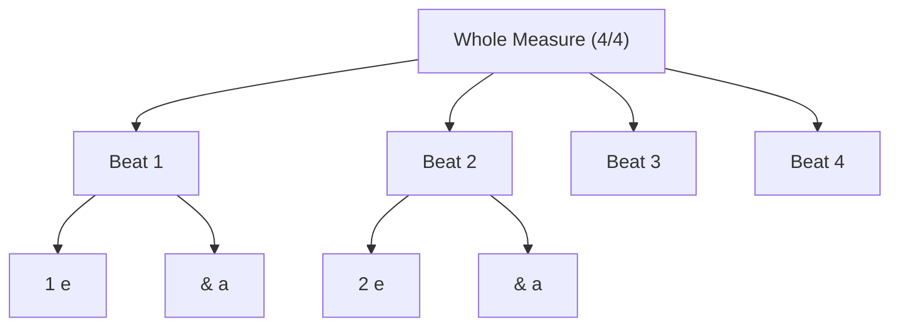
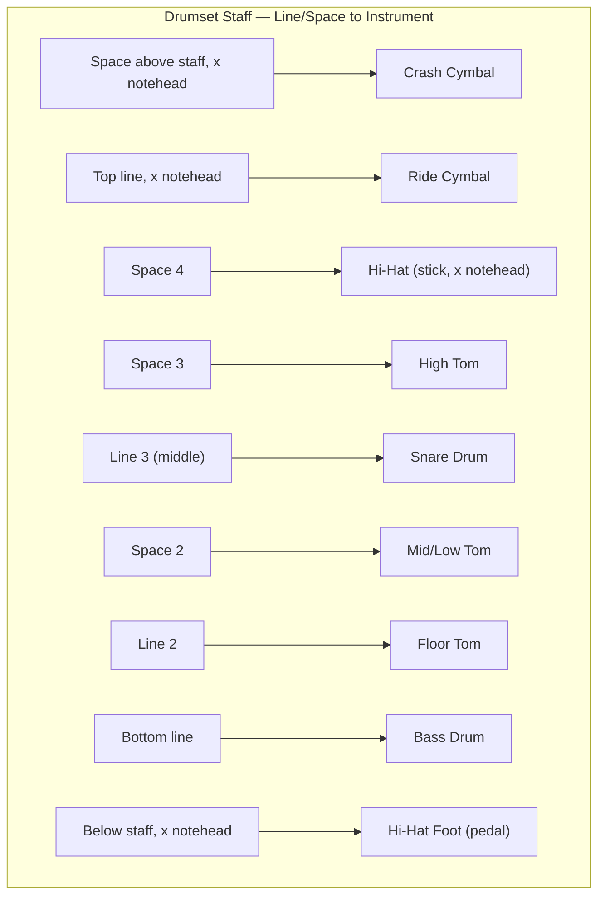
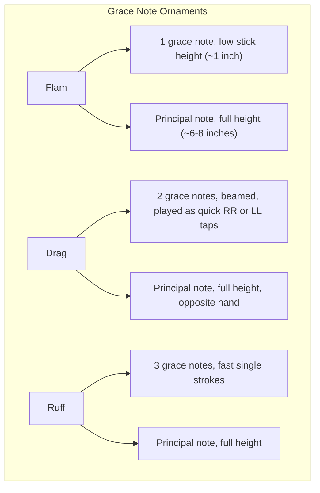

# Lesson 3: Reading Drum Notation — From Staff to Sticks

## 1. Why This Lesson Matters

You cannot play what you cannot read, and you cannot read fast enough to keep up with a chart if you're decoding symbols instead of recognizing them instantly. This lesson builds that recognition from the ground up: the rhythmic grid, the drumset staff, sticking, rolls, ornaments, and the practice method that turns a page of notation into clean sticks on the pad at tempo.

The acoustic fact that shapes everything here: a drum doesn't sustain a pitch the way a guitar string or a voice does. You strike the head, the sound blooms and decays in milliseconds, and that's it — duration past the attack is mostly irrelevant except for rolls. Because of this, percussion notation cares enormously about **exactly when** a stroke lands and **which surface/technique** produces it, and comparatively little about sustained duration. That's why reading drum notation is really reading a grid of attack points, not a melody of held tones. Keep that frame in mind — it explains every notation convention in this lesson.

---

## 2. The Rhythmic Grid: Build Your Internal Metronome First

Before you can read *what* to play, you need the subdivision grid locked into your body. This is non-negotiable — sight-reading failures are almost always rhythm failures, not symbol failures.

### 2.1 The Beat Tree

A 4/4 measure subdivides like this:



Say this out loud while tapping your foot on the quarter note: **"1 e & a, 2 e & a, 3 e & a, 4 e & a."** This counting system (used by every drum method book from Chaffee to Riley) gives each 16th-note slot a verbal name. If you can't count a rhythm out loud at tempo, you cannot play it accurately — the voice is your rhythm debugger.

### 2.2 Note Values You Actually Need

| Symbol | Counts as (4/4) | Spoken count |
|---|---|---|
| Quarter note | 1 beat | "1" |
| Eighth note | 1/2 beat | "1 &" |
| Sixteenth note | 1/4 beat | "1 e & a" |
| Eighth-note triplet | 1/3 beat × 3 | "1 trip-let" |
| Dotted eighth + sixteenth | 3/4 + 1/4 | "1___ a" |
| Sixteenth rest | silence, 1/4 beat | (silent, but still counted) |

**Drill 1 — Subdivision Internalization (do this before touching a drum):**
1. Metronome at 60 BPM. Clap quarter notes for 1 minute while counting "1 2 3 4" aloud.
2. Same tempo, clap eighth notes, counting "1 & 2 & 3 & 4 &."
3. Same tempo, clap sixteenths, counting "1 e & a 2 e & a..."
4. Now clap only the "a" of each beat (the 4th sixteenth) while still *counting* every subdivision aloud. This isolates off-beat placement — the skill syncopation depends on.

Progress the metronome 60 → 80 → 100 → 120 BPM only after each step is clean, not rushed, not dragging.

### 2.3 Ties and Rests Matter as Much as Notes

A rest is not "nothing happens" — it's a precisely timed silence that sets up the next attack and lets the drum's decay breathe. A tie across a barline on a crash cymbal or roll means "let it continue ringing/rolling," not "strike again." On a snare or tom, a tie is essentially meaningless because the sound has already decayed — composers use ties on unpitched drums mainly to notate awkward beat groupings legibly (e.g., a note starting on the "a" of beat 2 and lasting into beat 3).

---

## 3. The Drumset Staff: Your Map of the Kit

### 3.1 Standard Layout (Hal Leonard / PAS Convention)



**The two things to memorize cold before anything else:** the snare lives on the **middle line**, and the bass drum lives on the **bottom space/line**. Everything else you'll absorb through repetition, but those two are your anchor points — find them first on every new chart.

### 3.2 Stem Direction Tells You Hands vs. Feet

- **Stem up** = played by a hand (snare, toms, hi-hat with stick, cymbals)
- **Stem down** = played by a foot (bass drum, hi-hat pedal)

This lets a composer stack a bass drum note and a snare note on the same beat and you instantly know one note is a kick and the other a hand stroke, without needing separate staves.

### 3.3 Notehead Shapes = Which Surface, Which Technique

| Notehead | Meaning |
|---|---|
| Filled oval (●) | Standard stroke: snare, tom, bass drum |
| × (cross) | Cymbal (hi-hat, ride, crash) |
| ○ (open circle) above an × | Open hi-hat |
| + above the × | Closed hi-hat (choke) |
| Diamond (◇) | Cowbell, cymbal bell, bell of ride |
| Note in parentheses (●) | Ghost note — played very soft |
| × through a normal notehead, or circled × | Rim shot (stick cracks rim and head together) |
| Small × on the snare line | Cross-stick / rim click |

**Drill 2 — Staff Recognition Speed Test:** Write (or print) 20 random single notes on a drumset staff, mixing all the positions above. Time yourself naming the instrument + technique out loud for all 20. Beginner target: under 30 seconds with zero errors. This is flashcard training — do it daily for a week before attempting full grooves from new charts.

---

## 4. Reading and Playing Your First Grooves

### 4.1 Basic Rock Beat — Read It, Then Play It

```
Hi-Hat:  x   x   x   x   x   x   x   x    (steady 8th notes)
Snare:       ●           ●                (beats 2 and 4)
Kick:    ●               ●                (beats 1 and 3)
Count:   1   &   2   &   3   &   4   &
```

**Sticking:** Right hand on hi-hat throughout, left hand strikes the snare on 2 and 4, right foot on kick for 1 and 3. No left foot needed yet — keep it resting on the hi-hat pedal, pressed down to keep the hats closed.

**Practice sequence:**
1. 60 BPM: hi-hat only, right hand, 8th notes, 2 minutes straight, no drift.
2. 60 BPM: add kick on 1 and 3 only (hi-hat + kick, no snare).
3. 60 BPM: add snare on 2 and 4 (full groove). This is the moment most beginners rush — don't. Lock it first.
4. Progress 60 → 70 → 80 → 90 → 100 BPM, only advancing once 16 consecutive bars are clean.

### 4.2 Adding the Backbeat Ghost Note

```
Hi-Hat:  x   x   x   x   x   x   x   x
Snare:   (●) ●   (●) ●   (●) ●   (●) ●     ((parens) = ghost note, soft)
Kick:    ●               ●
Count:   1   &   2   &   3   &   4   &
```

The ghost note on the "&" before beats 2 and 4 is played at near-silent volume — barely more than brushing the head. This is a **stroke-height** exercise, not a different technique: ghost notes use a very low stick height (an inch or two off the head) while the backbeat uses full height (6–10 inches). The dynamic contrast between ghost and backbeat is what creates the groove's "pocket." Practice isolating just the right-hand/left-hand height difference on a pad before adding the kick and hi-hat back in.

---

## 5. Rolls — Reading and Executing

### 5.1 Notation

- **One slash through the stem** (𝅘𝅥 with one tremolo mark) = play the written note value as two single strokes at double speed (e.g., a quarter note with one slash = two eighth notes R-L or L-R).
- **Two slashes** = double-stroke roll at the next subdivision level (R-R-L-L pattern filling the note value).
- **Three slashes**, often labeled "buzz" or "roll" = a closed/buzz roll: each stroke is a controlled multiple-bounce, alternating hands, sustained for the full written duration.

### 5.2 Playing the Buzz Roll

The buzz roll works because you let the stick rebound multiple times per stroke instead of a single clean bounce — you apply slight downward pressure into the head immediately after the initial strike, which causes the tip to chatter 3–6 times before you lift for the next hand's stroke.

**Drill 3 — Buzz Roll Build:**
1. Single stroke, let it buzz: drop the stick, press gently into the head for a half-second, lift. Repeat right hand only, 20 times.
2. Same with left hand, 20 times.
3. Alternate R-buzz, L-buzz at 60 BPM quarter notes, each buzz filling the full beat.
4. Compress: play the same alternating buzz pattern as eighth notes, then sixteenths, keeping volume even between hands — the classic failure point is the weak hand's buzz being thinner than the strong hand's.

A roll notated across a tied barline means: don't stop and restart, keep the buzz continuous through the bar change. Lift off only where the tie ends.

---

## 6. Flams, Drags, and Ruffs

These are the core PAS rudiment ornaments. Learn the sound first, the notation second — the notation is just a picture of a sound you should already recognize by ear.



### 6.1 The Flam

**Mechanics:** Both sticks start moving toward the head at the same instant, but one stick starts from a low height (~1 inch) and the other from a full height (~6–8 inches). Because the low stick has less distance to travel, it arrives first — the slight offset (roughly 20–40 ms) is what you hear as the "flat" flam sound rather than two separate hits.

**Notation:** A small grace notehead (often flagged, no rhythmic value counted) sits just to the left of a full-size principal notehead.

**Drill 4 — Flam Isolation:**
1. Pad only, no metronome. Right hand low (1 inch), left hand high (6 inches), drop both at once. Listen for "fla-AM" — one soft click immediately followed by the loud stroke.
2. Switch: left low, right high. Both hands must sound identical in flam quality — most players have a weaker "flam hand," usually the non-dominant one. Spend extra reps there.
3. Metronome 60 BPM, play a flam on every quarter note, alternating which hand leads (flam-tap pattern: Flam-R, Tap-L, Flam-L, Tap-R).

### 6.2 The Drag (Ruff in British usage)

**Mechanics:** Two quick, quiet taps from one hand immediately before the principal stroke from the opposite hand — like a tiny double-stroke rebound compressed right before the main hit. Think "dru-up-A" rhythm.

**Notation:** Two small beamed grace notes before the principal note.

**Drill 5 — Drag-Tap Rudiment:**
- Sticking: `rr L rr L rr L rr L` where lowercase `rr` = the two quiet grace taps (right hand, double bounce) and `L` = the accented principal stroke.
- Start at 60 BPM, one drag per beat (quarter notes). Grace notes must land ahead of the beat, not on it — they are a pickup, not downbeat content.
- Progress 60 → 72 → 84 → 96 BPM.

### 6.3 The Three-Stroke Ruff

Same mechanics as the drag but with three grace notes instead of two — typically played as three fast alternating or single-hand strokes leading into the principal. Practice the same way: isolate the grace cluster at slow tempo until it's rhythmically even, then attach the principal stroke.

---

## 7. Sticking Notation — Read the Letters

- **R** above/below a note = right hand
- **L** above/below a note = left hand
- Default assumption with no letters marked: **strict alternation** (R-L-R-L...)

When a chart explicitly marks sticking, it's usually solving one of these problems: setting up a specific accent pattern, avoiding a cross-body stick collision, or preparing your hands for the next measure's sticking. **Always honor marked sticking on first read-through** — composers mark it for a reason, usually because the "obvious" alternating sticking creates an awkward cross or a weak accent.

**Drill 6 — Sticking Discipline:** Take any single-stroke 16th-note pattern and play it three ways: (1) strict alternating RLRL, (2) all single-hand lead changes marked explicitly, (3) a double-stroke variant (RRLL). Notice how the accent placement and feel shift with each — this builds the ear/hand connection that makes marked sticking make sense instead of feeling arbitrary.

---

## 8. Dynamics in Practice

| Marking | Meaning | Practical stick height (snare) |
|---|---|---|
| *ppp – pp* | Barely audible to very soft | Under 1 inch |
| *p – mp* | Soft to moderate-soft | 1–3 inches |
| *mf* | Moderate | 4–6 inches |
| *f* | Loud | 6–10 inches |
| *ff – fff* | Very loud to extreme | 10+ inches, full arm |

Stick height is your actual control knob — dynamics on a drum aren't just "louder," they change the entire tone because higher velocity drives more of the head's higher partials and (on snare) more snare-wire buzz. A *ff* backbeat isn't just a bigger *mf* — it's a different timbre.

**Ghost notes** `(●)` sit near-silent inside a groove, usually just louder than the drum's natural resonance. They exist to add rhythmic density without adding perceived accents — critical for funk and R&B drumming (study Bernard Purdie, Clyde Stubblefield grooves for this).

---

## 9. Practice Methodology for Reading New Charts

This is the field-tested sequence professional readers use. Don't skip steps even when a chart looks easy — the skipped step is where sight-reading errors hide.

**Step 1 — Set the tempo and subdivision.** Find the time signature and tempo marking. At the given BPM, say the subdivision count ("1 e & a...") out loud for one full measure before playing anything.

**Step 2 — Map the staff.** Scan the chart (or legend, if nonstandard instruments are used) and confirm snare line, bass drum line, hi-hat position, and any cymbal notation before playing note one.

**Step 3 — Play the rhythm on one surface.** Tap the entire rhythmic pattern on your snare or a practice pad — ignore which limb plays what. This isolates timing errors from coordination errors. If you can't play it rhythmically correct on one drum, adding limb independence will only compound the error.

**Step 4 — Add orchestration (which limb plays what).** Re-read with full instrument mapping: hands on their assigned voices, feet on kick/hi-hat pedal.

**Step 5 — Add dynamics and ornaments.** Layer in accents, ghost notes, flams, rolls last — these are the highest cognitive load additions and should only go on top of an already-secure rhythmic and orchestral foundation.

**Step 6 — Build your read-ahead buffer.** At slow tempo, deliberately force your eyes to scan one full beat ahead of the notes your hands are currently executing. This is trainable: practice reading charts at 60% of target tempo specifically to build the habit of eye-lead before pushing speed. Expert sight-readers maintain a 2–4 beat lead; a 1-beat minimum is required just to avoid rhythmic train-wrecks on tempo changes or syncopation.

---

## 10. Quick-Reference Troubleshooting

| Symptom | Likely Cause | Fix |
|---|---|---|
| Rushing through fast subdivisions | Internal subdivision not locked | Drop metronome 20 BPM, re-drill Section 2.2 counting aloud |
| Flam sounds like two separate hits, not one "flat" sound | Grace note height too close to principal height | Lower grace stick height to ~1 inch, exaggerate the gap |
| Ghost notes bleeding into full volume | Insufficient stick-height contrast | Isolate ghost-note-only reps at near-zero height before reintegrating groove |
| Losing the groove when adding hi-hat foot | Foot ostinato not independently automatic | Isolate hi-hat foot pattern alone for 2 minutes before layering hands back in |
| Sight-reading falls apart at tempo jumps | No read-ahead buffer | Practice at 50–60% tempo specifically targeting 2-beat eye-lead, not speed |
| Buzz roll sounds thin on weak hand | Uneven bounce control between hands | Isolate weak-hand buzz drills (Section 5.2) daily, doubling reps vs. strong hand |

---

## 11. Summary

Percussion notation encodes **when** (the rhythmic grid), **what** (staff position and notehead shape), **how** (sticking, dynamics, ornaments), and **how long** (rolls, ties). Master each layer separately before combining them — rhythm first, then orchestration, then dynamics and ornaments, then full-speed read-ahead. This staged approach is not slower; it is the fastest reliable path to clean sight-reading, because each layer you secure removes a source of error from the layers you add afterward.
