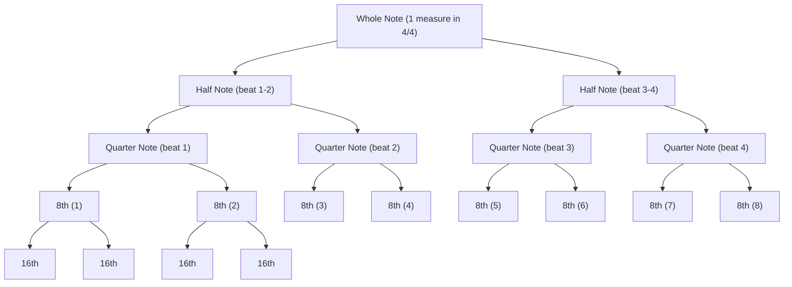
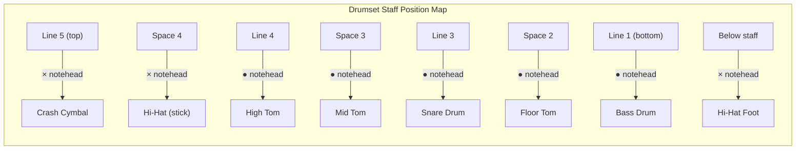
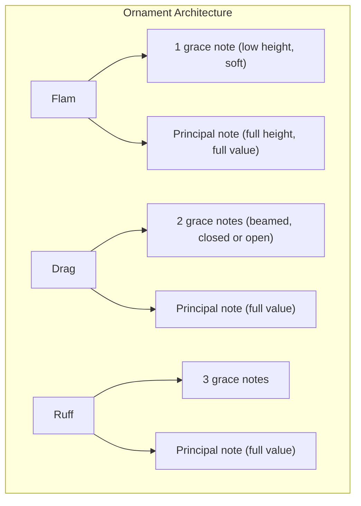
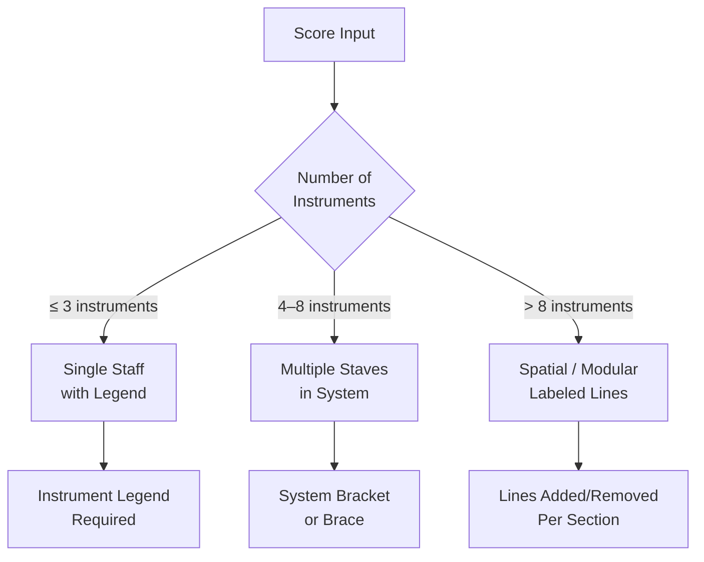
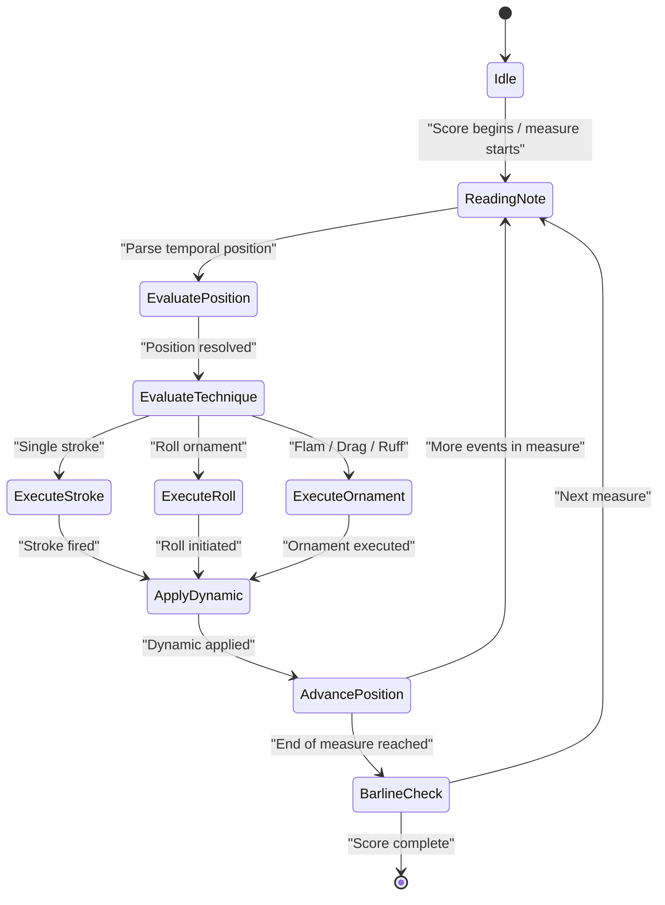

# Lesson 3: Reading and Notation in Percussion

## 1. First-Principles Intuition & Invariants

Percussion instruments are defined acoustically by their **transient envelope**: a sharp onset (attack), a brief sustain, and a decay that is determined primarily by the instrument's physical construction and damping characteristics. Unlike string or wind instruments, where pitch is maintained by continuous energy input, a percussion instrument is excited impulsively — a single mechanical event propagates through the resonant body and dissipates. The resulting sound is characterized by a broadband frequency spectrum at attack, often inharmonic, that filters and decays according to the material properties of the instrument. A snare drum's initial crack contains significant high-frequency energy from the stick impact on the head, followed by the characteristic buzz of the snare wires against the resonant head — a layered transient, not a sustained tone.

This acoustic reality imposes a fundamental constraint on notation: **timing is the primary carrier of musical information**. For a pianist, a note held for two beats sounds different from two separate notes; for a snare drummer, duration is largely irrelevant beyond "stroke" versus "roll" (a sustained series of alternating strokes). The notation system must therefore encode the **onset** of each event with high precision while remaining flexible about duration, and it must encode **timbral differentiation** — which instrument, which playing technique, which part of the instrument — through symbol assignment rather than through pitch.

Mathematically, a percussion score is a **discrete-time event sequence**. Define a measure of *n* beats subdivided into *d* divisions per beat as a grid of *n × d* time slots. Each slot can contain zero or more note events. For a 4/4 measure at the sixteenth-note level, this yields a 16-slot grid — directly analogous to a digital sampler's step sequencer. The time signature is therefore a **modular arithmetic framework**: beat positions are integers modulo *n*, and subdivisions are integers modulo *d*. The concept of *syncopation* is precisely the placement of note events on off-grid positions — that is, positions that do not coincide with the primary beat nodes at index *k × d* for integer *k*.

The concept of **timbral mapping** is the mechanism by which the notation system resolves the absence of a chromatic pitch axis in unpitched percussion. Standard orchestral notation assigns each percussion instrument a fixed staff position, chosen by convention or editorial decision. A snare drum might occupy the center space of a single-line or five-line staff; a bass drum occupies a different space or staff. The assignment is arbitrary with respect to pitch but rigid within a given score, functioning as a **symbol table** in which each staff position is a key that maps to an instrument identifier. The performer must consult a legend (the instrument key, typically printed at the beginning of the work) to decode the mapping, exactly as a programmer must consult an interface definition to understand an opaque type.

**Symbolic abstraction** in this context means that a notehead on a staff is not a direct encoding of a physical action — it is a symbolic token that the performer's trained cognition expands into a full motor program: which hand, which stick angle, what stroke velocity, how much rebound. The notation is therefore a **compressed representation**, and the decompression algorithm lives in the performer's embodied knowledge. This is analogous to a compiled bytecode instruction: the instruction `ADD` does not specify which ALU circuits fire; that translation is handled by the microarchitecture.

The invariants of any valid percussion notation system are:

**Temporal precision.** Every event must be unambiguously locatable within the rhythmic grid. Ambiguity in placement is a critical error, not a stylistic choice.

**Symbol consistency.** The same notehead shape, stem direction, or staff position must mean the same thing throughout the score (or its redefinition must be explicitly marked). Inconsistency breaks the symbol table contract.

**Instrumental specificity.** The notation must resolve, to sufficient precision for performance, which instrument produces the sound and by what technique. A generic "drum" notation is acceptable only where the specific instrument is contextually unambiguous or intentionally left to the performer's discretion.

**Articulatory completeness.** For techniques that alter the sound significantly — rim shots, dead strokes, flams, drags, buzzes — the notation must carry a symbol that the performer can decode. Absence of such markings implies a default stroke, which must itself be defined by convention.

These invariants are not stylistic preferences. They are necessary conditions for the notation to function as a **lossless communication channel** between composer and performer.

---

## 2. The Rhythmic Grid: Meter, Division, and Subdivision

The staff in percussion notation is a **temporal coordinate system**. The horizontal axis encodes time; the vertical axis encodes instrument identity (for multi-instrument setups) or playing technique (for single-instrument writing). Understanding notation therefore requires understanding the hierarchical structure of musical time before examining the symbols that populate it.

### 2.1 Meter and the Beat Lattice

A time signature $\frac{N}{D}$ communicates two independent facts: $N$ is the number of **beats per measure**, and $D$ is the **note value that receives one beat** (expressed as the denominator of a fraction of a whole note — so $D = 4$ means a quarter note, $D = 8$ means an eighth note). A measure of $\frac{4}{4}$ contains four quarter-note beats. A measure of $\frac{6}{8}$ contains six eighth-note beats, but is typically *conducted* and *felt* in two dotted-quarter-note pulses, making the relationship between notated beat count and perceptual pulse non-trivial.

The beat lattice is a hierarchical subdivision tree:



Each level of this tree doubles the number of available time slots. At the 32nd-note level, a single 4/4 measure contains 32 slots — the resolution at which most drumset notation is written, though 16th notes suffice for the majority of popular music patterns. Triplet subdivisions introduce a parallel tree rooted at each beat that divides each note value by three rather than two, creating a **ternary branch** that coexists with the binary tree above.

### 2.2 Note Values and Rest Values

Every rhythmic duration in Western notation is a **power-of-two fraction of a whole note**, optionally extended by **augmentation dots**. A single dot adds half the note's value; a double dot adds three-quarters. The complete set of common note values:

| Symbol Name | Fraction of Whole | Beats in 4/4 |
|---|---|---|
| Whole note | 1 | 4 |
| Half note | 1/2 | 2 |
| Quarter note | 1/4 | 1 |
| Dotted quarter | 3/8 | 1.5 |
| Eighth note | 1/8 | 0.5 |
| Dotted eighth | 3/16 | 0.75 |
| Sixteenth note | 1/16 | 0.25 |
| Sixteenth triplet | 1/24 | 0.1667 |
| Thirty-second note | 1/32 | 0.125 |

Each note value has a corresponding rest of identical duration. In percussion notation, rests are as structurally important as notes: they define the space in which the instrument decays, and they establish the phase relationships that make rhythmic patterns perceptually coherent. A measure must sum to exactly the duration specified by the time signature — this is the **measure completeness constraint**, and violation of it is a notation error.

### 2.3 Ties and Slurs

A **tie** connects two noteheads of the same pitch (or the same staff position in unpitched percussion) and indicates that the second note is not re-struck — the first note's duration is simply extended. In percussion notation, ties across barlines are common when a note value would otherwise cross the barline illegibly, but ties do not suppress an attack on an unpitched instrument the way they do on a keyboard instrument. For a cymbal roll tied across a barline, the tie indicates continuation of the roll, not a new stroke. For a snare hit, a tie is contextually meaningless unless the instrument can sustain (like a cymbal).

A **slur** in percussion notation is rare and context-specific, used primarily for mallet instruments to indicate legato phrasing on a keyboard percussion instrument such as marimba or vibraphone, where the performer uses dampening to shorten note durations and create a connected melodic line.

---

## 3. The Staff: Architecture for Percussion

### 3.1 Five-Line Staff for Pitched Percussion

Pitched percussion instruments — marimba, xylophone, vibraphone, glockenspiel, crotales, tubular bells — use the standard five-line treble or bass clef staff, following the same pitch-to-line/space mapping as any other pitched instrument. The treble clef is used for high-register instruments (glockenspiel, crotales, xylophone); the bass clef for low-register instruments (bass marimba, contrabass marimba). Concert marimba and vibraphone frequently use a **grand staff** (treble and bass connected by a brace), mirroring piano notation, because the performer's left and right hands operate independently across the instrument's range.

One common source of confusion: the glockenspiel sounds **two octaves higher** than written, and the xylophone sounds **one octave higher** than written. These are transposing instruments by notational convention, not by acoustic necessity — the convention exists to keep the written notes within a comfortable staff range rather than requiring excessive ledger lines.

### 3.2 Single-Line Staff for Unpitched Percussion

A single horizontal line (or a staff marked with a neutral clef — a vertical rectangle rather than a treble or bass clef symbol) is used for instruments with no definable pitch: woodblock, castanets, tambourine, bass drum (in many contexts), and similar instruments. The line is a **temporal axis only**, carrying no pitch information. Noteheads are placed on, above, or below the line to differentiate between playing techniques on the same instrument (e.g., open vs. closed on a tambourine) or between different instruments assigned to the same performer.

### 3.3 Multi-Line Staff for Drumset

Drumset notation uses a five-line staff in which each line and space is assigned to a specific component of the kit. This assignment is not entirely standardized across publishers, but the following represents the most widely observed convention (as codified by the Percussive Arts Society and reflected in widely used method books by Gary Chaffee, John Riley, and others):

```
Space 4 (top)  : Hi-hat (with stick, open or closed)
Line  4        : High tom
Space 3        : Mid tom / Hi tom 2
Line  3        : Snare drum
Space 2        : Floor tom (sometimes line 2 or space 1)
Line  2        : (varies by publisher)
Space 1        : Bass drum
Line  1        : Bass drum (alternate)
Below staff    : Hi-hat with foot pedal (x notehead below staff)
```

**Stem direction** is a critical disambiguation tool: notes played by the hands use **upward stems**; notes played by the feet (bass drum, hi-hat pedal) use **downward stems**. This allows simultaneous hand and foot events to be notated on the same beat position without ambiguity.

**Notehead shapes** differentiate between sound sources:

- Filled oval (standard): snare, toms, bass drum
- × (cross): hi-hat, ride cymbal, crash cymbal (open hi-hat sometimes uses an open circle or ○)
- Diamond: cowbell, specific cymbal techniques
- Triangle: hi-hat partially open (publisher-dependent)



### 3.4 The Percussion Clef

The percussion clef (neutral clef) is a pair of thick vertical lines placed at the left of the staff. It signals that the staff is used for unpitched notation and that no pitch-to-line mapping applies. Its presence obligates the score to include an **instrument legend** — a labeled list that maps each staff position and notehead variant to a specific instrument or technique. Without a legend, percussion clef notation is semantically incomplete.

---

## 4. Notation of Specific Techniques

### 4.1 Dynamics

Dynamic markings in percussion notation follow the standard Italian terminology used across all Western music notation:

| Marking | Term | Approximate Level |
|---|---|---|
| *ppp* | pianississimo | Barely audible |
| *pp* | pianissimo | Very soft |
| *p* | piano | Soft |
| *mp* | mezzo-piano | Moderately soft |
| *mf* | mezzo-forte | Moderately loud |
| *f* | forte | Loud |
| *ff* | fortissimo | Very loud |
| *fff* | fortississimo | Extremely loud |

**Crescendo** (*cresc.*) and **decrescendo/diminuendo** (*decresc.* / *dim.*) are indicated by hairpin symbols (< and >) placed beneath the staff. For percussion, dynamic markings are particularly consequential because the primary control variable for a percussionist is **stroke velocity** — the speed at which the stick or mallet travels at the moment of impact. Velocity is the dominant determinant of both loudness and timbre: a *ff* snare hit produces not just more volume but a qualitatively different spectrum (more high-frequency content, more rimshot potential, more snare wire activation) compared to a *pp* ghost note.

**Ghost notes** — extremely soft notes, typically on snare drum — are indicated by parentheses surrounding the notehead: `(●)`. They occupy a metrically specific position in the bar but are intended to be barely audible, creating textural density without metric emphasis.

### 4.2 Rolls

A **roll** is a sustained sound produced on a percussion instrument by a rapid alternation of strokes. The notation depends on whether the roll is **closed** (press roll or buzz roll, where each stroke produces multiple rebounds to create a near-continuous sound) or **open** (double-stroke roll, where individual strokes are distinct):

- **Tremolo lines** through the stem of a note indicate a roll. Three slashes (or tremolo marks) through the stem is the standard notation for an indeterminate, sustained roll. Two slashes indicate a double-stroke roll (each beam representing one subdivision level). One slash indicates single alternating strokes at the next shorter note value.
- **Closed roll (buzz roll)**: Three or more tremolo lines on the stem, sometimes with the abbreviation *tr* or *roll* written above. The notation implies that the duration of the roll equals the duration of the note value shown.
- **Roll with tie**: When a roll must be sustained across multiple beats or barlines, the initial note with tremolo marks is tied to subsequent notes. The tie means "continue the roll"; it does not re-trigger the roll.

The **orchestral roll notation** for timpani and mallet instruments uses identical tremolo-stem notation, but the acoustic mechanism differs: a marimba roll is produced by alternating single strokes between two or four mallets, not by buzz rebounds. The notation is the same; the technique is entirely different.

### 4.3 Flams, Drags, and Ruffs

These are **grace note ornaments** specific to snare drum and percussion — the foundational components of the **Standard American Rudiments** as codified by the Percussive Arts Society (40 essential rudiments).

**The Flam** consists of a grace note (small notehead, no rhythmic value) immediately followed by a principal note (full-size notehead, full rhythmic value). The grace note is played slightly before the principal note with a low stick height, producing a "flat" or "wide" sound. In notation, the grace note is an eighth note with a flag, placed immediately to the left of the principal note. The two notes are played nearly simultaneously but not perfectly — the slight offset is what creates the characteristic "flam" sound. The interval between grace note and principal note is a matter of musical taste and style, typically 15–50 milliseconds in performance.

**The Drag** (also called a **ruff** in some traditions) consists of two grace notes before a principal note. The two grace notes are notated as a beamed pair of sixteenth-note grace notes preceding the principal. In a closed drag, the two grace notes are played as a buzz stroke (single stroke producing multiple rebounds); in an open drag, they are played as two distinct alternating strokes.

**The Ruff** in modern American notation refers to a three-stroke ruff: three grace notes before the principal note. In historical British notation, "ruff" can mean the drag. Context and regional convention determine interpretation.



### 4.4 Sticking Notation

**Sticking** refers to which hand plays which note, and it is one of the most practically important aspects of percussion notation that is nonetheless frequently omitted from scores. Standard sticking notation uses:

- **R** (above or below notehead): Right hand
- **L** (above or below notehead): Left hand
- **B** or **RH+LH**: Both hands (unison)

For timpani and mallet instruments, **R** and **L** indicate mallet hand assignment. For drumset, sticking is typically left to the performer's discretion except in pedagogical contexts.

The **alternating stroke** (R-L-R-L) is the default assumption. When a composer or arranger requires a specific sticking — to achieve a particular accent pattern, to execute a cross-sticking technique, or to manage a physical setup — the sticking must be explicitly marked.

### 4.5 Special Techniques and Extended Notation

Modern percussion scores, particularly in the contemporary classical repertoire, require notation for techniques that have no standard historical symbol. Common conventions:

| Technique | Notation Convention |
|---|---|
| Rim shot | Note with an X through the notehead, or ⊕ |
| Cross stick (rim click) | × notehead on snare line, or small circle |
| Dead stroke (muffled) | + symbol above notehead, or notehead in parentheses with accent |
| Brush sweep | Wavy line above/below note, with "brush" text |
| Mallet on bell (glockenspiel edge) | ◇ (diamond notehead) with text instruction |
| Bow on cymbal | Wavy line + "arco" or bow symbol |
| Scrape | Jagged line through note duration |
| Gradually damp | Diminuendo hairpin + "damp" text |

The absence of a universal standard for extended techniques makes **textual performance notes** (at the top of the score or in a legend) an essential component of any score that ventures beyond conventional technique.

---

## 5. Multi-Percussion Notation Systems

### 5.1 The Problem of Instrument Assignment

A solo percussionist in a contemporary concert work may manage 10–30 individual instruments simultaneously. The notation system must solve the **instrument assignment problem**: given *n* instruments played by one performer, create an unambiguous, readable mapping between staff positions and instruments. Three approaches dominate:

**Approach 1: Multiple staves.** Each instrument or instrument group receives its own staff, and the staves are connected into a **system** (a grand staff equivalent). This maximizes clarity but consumes vertical space and can make a score with many instruments nearly unreadable at a full-system view.

**Approach 2: Single staff with legend.** A single five-line or single-line staff is used, with a comprehensive legend defining each position and notehead variant. This is compact but requires the performer to hold the entire legend in working memory during performance. Used widely in drumset notation and in scores with stable instrumentation.

**Approach 3: Spatial staff with instrument labels.** Individual lines are added or removed as the texture demands, with each line labeled by instrument name. This is flexible for changing setups but requires careful score layout and can be difficult to follow in rapid passages.



### 5.2 Score Layout Conventions

In an orchestral percussion section with multiple players, each player's part is written on a separate staff system. The **conductor's score** stacks all percussion staves in a vertical system, typically grouped after the brass and before the string sections. The percussion section is internally ordered by family: timpani first, then keyboard percussion (marimba, vibraphone, xylophone, glockenspiel), then pitched hand percussion, then unpitched battery (snare, bass drum, cymbals, etc.).

---

## 6. Formal Data Representation of Percussion Notation

The hierarchical structure of percussion notation maps directly onto formal data models, which is relevant both for understanding the system's logical architecture and for implementing it in music notation software, DAWs, and educational tools.

### 6.1 The Note Event as a Data Structure

A complete percussion note event carries the following fields. This is not a theoretical abstraction — it is the actual data model used by notation programs such as Sibelius, Finale, and LilyPond, and by MIDI-based systems:

```c
/* Percussion note event — C representation */
typedef enum {
    NOTEHEAD_FILLED,       /* Standard: snare, tom, bass drum */
    NOTEHEAD_CROSS,        /* Hi-hat, ride, crash */
    NOTEHEAD_DIAMOND,      /* Bell of cymbal, special techniques */
    NOTEHEAD_GHOST,        /* Parenthesized — very soft */
    NOTEHEAD_RIMSHOT,      /* X-through or circle-X */
    NOTEHEAD_CROSS_STICK,  /* Rim click */
} NoteheadType;

typedef enum {
    DYNAMIC_PPP = 0,
    DYNAMIC_PP,
    DYNAMIC_P,
    DYNAMIC_MP,
    DYNAMIC_MF,
    DYNAMIC_F,
    DYNAMIC_FF,
    DYNAMIC_FFF,
} DynamicLevel;

typedef enum {
    ORNAMENT_NONE,
    ORNAMENT_FLAM,
    ORNAMENT_DRAG,
    ORNAMENT_RUFF,
    ORNAMENT_ROLL,       /* Closed/buzz roll */
    ORNAMENT_OPEN_ROLL,  /* Double-stroke open roll */
    ORNAMENT_ACCENT,
    ORNAMENT_MARCATO,
} OrnamentType;

/*
 * Rational representation of rhythmic duration.
 * A quarter note = { 1, 4 }; a dotted quarter = { 3, 8 }.
 * This avoids floating-point imprecision in timing calculations.
 */
typedef struct {
    int numerator;
    int denominator; /* Always a power of 2 for standard values */
} RhythmicValue;

typedef struct {
    int measure;           /* 1-indexed measure number */
    int beat;              /* 1-indexed beat within measure */
    int subdivision;       /* Subdivision offset within beat (0-indexed) */
    int subdivision_total; /* Total subdivisions per beat at this resolution */
} TemporalPosition;

typedef struct {
    int             instrument_id;   /* Index into InstrumentTable */
    int             staff_position;  /* Line/space encoding: 0=bottom line, 1=first space, etc. */
    NoteheadType    notehead;
    RhythmicValue   duration;
    TemporalPosition position;
    DynamicLevel    dynamic;
    OrnamentType    ornament;
    int             sticking;        /* 0=unspecified, 1=right, 2=left, 3=both */
    int             is_roll_continue;/* Non-zero if this note is a tied roll continuation */
} PercussionNoteEvent;
```

### 6.2 The Instrument Table

The instrument table is the **symbol table** for percussion notation — the data structure that maps abstract staff positions and notehead types to concrete instrument identities and default MIDI note numbers. In General MIDI (GM), channel 10 is reserved for percussion, and each note number maps to a specific instrument by convention:

```python
# GM Percussion Channel 10 — Note-to-instrument mapping (partial)
# Source: General MIDI Level 1 specification (MMA RP-003)

GM_PERCUSSION_MAP = {
    35: "Acoustic Bass Drum",
    36: "Bass Drum 1",
    37: "Side Stick",
    38: "Acoustic Snare",
    39: "Hand Clap",
    40: "Electric Snare",
    41: "Low Floor Tom",
    42: "Closed Hi-Hat",
    43: "High Floor Tom",
    44: "Pedal Hi-Hat",
    45: "Low Tom",
    46: "Open Hi-Hat",
    47: "Low-Mid Tom",
    48: "Hi-Mid Tom",
    49: "Crash Cymbal 1",
    50: "High Tom",
    51: "Ride Cymbal 1",
    52: "Chinese Cymbal",
    53: "Ride Bell",
    54: "Tambourine",
    55: "Splash Cymbal",
    56: "Cowbell",
    57: "Crash Cymbal 2",
    58: "Vibraslap",
    59: "Ride Cymbal 2",
    # ... continues to note 81
}

def staff_position_to_gm_note(staff_pos: int, notehead: str) -> int:
    """
    Maps a drumset staff position + notehead type to a GM note number.
    Uses the most widely observed convention (PAS/Hal Leonard standard).
    Returns -1 if the combination is unresolvable without a score legend.
    """
    mapping = {
        # (staff_position, notehead_type) -> GM note number
        (8, "cross"):    49,  # Crash cymbal (above staff)
        (7, "cross"):    46,  # Open hi-hat
        (6, "cross"):    42,  # Closed hi-hat
        (6, "filled"):   50,  # High tom
        (5, "filled"):   48,  # Hi-mid tom
        (4, "filled"):   38,  # Snare drum
        (3, "filled"):   45,  # Low tom
        (2, "filled"):   43,  # Floor tom
        (1, "cross"):    51,  # Ride cymbal
        (0, "filled"):   36,  # Bass drum
        (-1, "cross"):   44,  # Hi-hat pedal
    }
    return mapping.get((staff_pos, notehead), -1)
```

### 6.3 Temporal Representation and Tick Resolution

MIDI and most DAWs represent time in **ticks** (also called **pulses per quarter note**, PPQN). A common resolution is 480 PPQN, which allows the following exact integer representations of note values:

```python
def note_value_to_ticks(numerator: int, denominator: int, ppqn: int = 480) -> int:
    """
    Converts a rational note value (numerator/denominator of a whole note)
    to an integer tick count at a given PPQN resolution.

    A quarter note = 1/4 of a whole note = ppqn ticks.
    A whole note = 4 * ppqn ticks.
    A sixteenth note = ppqn // 4 ticks.
    A triplet eighth = (ppqn * 2) // 3 ticks (requires ppqn divisible by 3).

    With ppqn=480:
      Whole note:      1920 ticks
      Half note:        960 ticks
      Quarter note:     480 ticks
      Eighth note:      240 ticks
      Sixteenth:        120 ticks
      32nd note:         60 ticks
      Triplet eighth:   160 ticks  (480 * 2 / 3 = 320 / 2 — wait, see below)
      Triplet quarter:  320 ticks  (480 * 2 / 3)

    Note: triplet eighth = 1/12 of a whole note = 4*480/12 = 160 ticks. Correct.
    """
    whole_note_ticks = ppqn * 4
    # Integer arithmetic — denominator must divide evenly into whole_note_ticks
    # for lossless representation. PPQN=480 supports all values up to 128th notes
    # and all triplets (480 is divisible by 3).
    if whole_note_ticks % denominator != 0:
        raise ValueError(
            f"PPQN={ppqn} cannot exactly represent note value {numerator}/{denominator}. "
            f"Try PPQN={denominator * (ppqn // denominator + 1)} or higher."
        )
    ticks_per_denominator_unit = whole_note_ticks // denominator
    return numerator * ticks_per_denominator_unit


# Verification table at PPQN=480
ppqn = 480
test_cases = [
    (1, 1,   "Whole note"),
    (1, 2,   "Half note"),
    (1, 4,   "Quarter note"),
    (3, 8,   "Dotted quarter"),
    (1, 8,   "Eighth note"),
    (1, 12,  "Triplet eighth"),
    (1, 16,  "Sixteenth note"),
    (1, 24,  "Triplet sixteenth"),
    (1, 32,  "32nd note"),
]
for num, den, name in test_cases:
    ticks = note_value_to_ticks(num, den, ppqn)
    print(f"  {name:20s}: {ticks:5d} ticks")
```

Output at PPQN=480:
```
  Whole note          :  1920 ticks
  Half note           :   960 ticks
  Quarter note        :   480 ticks
  Dotted quarter      :   720 ticks
  Eighth note         :   240 ticks
  Triplet eighth      :   160 ticks
  Sixteenth note      :   120 ticks
  Triplet sixteenth   :    80 ticks
  32nd note           :    60 ticks
```

### 6.4 Score Validation as a Constraint Satisfaction Problem

A well-formed percussion score must satisfy a set of hard constraints. These can be expressed as a formal validation pass over the event stream:

```python
from fractions import Fraction
from typing import List, NamedTuple
from collections import defaultdict


class NoteEvent(NamedTuple):
    measure: int
    tick_offset: int   # Offset from start of measure, in ticks
    duration_ticks: int
    instrument_id: int
    notehead: str
    dynamic: int       # 0–7 (ppp to fff)


def validate_measure_completeness(
    events: List[NoteEvent],
    measure_duration_ticks: int,
    ppqn: int = 480,
) -> List[str]:
    """
    Validates that every measure in the event stream sums to exactly
    measure_duration_ticks, accounting for simultaneous events (chords/unisons)
    correctly by evaluating coverage as a union of intervals.

    Returns a list of error strings. Empty list = valid score.
    """
    errors = []
    by_measure = defaultdict(list)
    for ev in events:
        by_measure[ev.measure].append(ev)

    for measure_num, measure_events in sorted(by_measure.items()):
        # Build coverage intervals — simultaneous strokes do not "add" duration
        # They must all begin and end within the measure duration.
        coverage = set()
        for ev in measure_events:
            start = ev.tick_offset
            end = start + ev.duration_ticks

            # Hard constraint: no event may begin before measure start
            if start < 0:
                errors.append(
                    f"Measure {measure_num}: event at tick {start} begins before measure."
                )
            # Hard constraint: no event may end after measure end
            if end > measure_duration_ticks:
                errors.append(
                    f"Measure {measure_num}: event at tick {start} with duration "
                    f"{ev.duration_ticks} extends {end - measure_duration_ticks} "
                    f"ticks beyond the barline."
                )
            for tick in range(start, min(end, measure_duration_ticks)):
                coverage.add(tick)

        covered = len(coverage)
        if covered < measure_duration_ticks:
            missing = measure_duration_ticks - covered
            errors.append(
                f"Measure {measure_num}: {missing} ticks ({Fraction(missing, ppqn * 4)} "
                f"of a whole note) unaccounted for. Likely missing rest(s)."
            )
    return errors
```

---

## 7. The State Machine Model of Performance

Reading percussion notation in real time is a **state machine execution**. The performer's cognitive and motor system maintains an internal state — current measure position, active dynamics, sticking hand, roll status — and transitions that state at each note event.



Each transition in this state machine has an associated **latency budget**: in live performance, the performer must execute the transition within the time defined by the tempo. At 120 BPM (quarter note = 500 ms), a sixteenth note allows 125 ms between strokes. Expert sight-reading requires that the state machine transitions occur in advance of the event — the performer must be reading ahead by at least one to two beats to maintain temporal accuracy. This **read-ahead buffer** is a cognitive working memory constraint, not a stylistic preference.

---

## 8. Historical Development of Percussion Notation

Understanding the present state of percussion notation requires knowing its historical trajectory, because many current conventions are path-dependent — they exist because of historical constraints, not because they represent the optimal solution to the notation problem.

**Medieval and Renaissance period.** Percussion notation was essentially absent from written music. Drums and cymbals were improvised or played from memory, following verbal instruction. The tabor and military drum existed as functional instruments without notated repertoire.

**17th–18th centuries.** Military drum manuals began to appear, using a rudimentary tablature notation: letters (R and L) or symbols to indicate right and left hand strokes. The 1778 *Méthode pour la Musette* by Pierre Dupont and similar French military drum manuals used letter-based notation, establishing the R/L convention that persists to the present day.

**19th century.** Orchestral percussion gained notated parts as composers began to integrate percussion into the symphonic texture more precisely. Berlioz's *Treatise on Instrumentation* (1844) is a landmark: it treats the timpani and orchestral percussion as fully notated instruments and discusses their acoustic properties and notation requirements in systematic detail. The five-line staff was adopted for timpani and tuned percussion; battery percussion received informal, composer-specific notation.

**Early 20th century.** The emergence of jazz and later the drumset created a notation problem without precedent: a single performer playing five or more instruments simultaneously, with complex interlocking rhythmic patterns. No standard existed. Publishers and educators developed competing conventions through the 1920s–1950s, resulting in the fragmented landscape of drumset notation conventions that still generates confusion today.

**1984.** The Percussive Arts Society (PAS) published its **Standard Drum Rudiments**, codifying 26 (later expanded to 40) essential rudiments with standardized notation. This represented the most significant standardization effort in percussion notation history, though it addressed rudiment notation specifically rather than full score notation.

**Contemporary period.** The proliferation of extended techniques in the concert percussion repertoire (Xenakis, Cage, Ferneyhough, Lachenmann) has pushed notation well beyond any standardized framework. Contemporary scores frequently include multi-page performance notes, proprietary symbol systems, and graphical notation elements. The field of **New Music notation** treats the percussion staff as a substrate for semiotic experimentation, often abandoning the conventional symbol set entirely in favor of visual metaphors for sound.

---

## 9. Practical Reading Methodology

Developing facility with percussion notation requires a systematic approach. The following methodology applies to learning a new piece from a written score:

**Step 1: Establish the rhythmic framework.** Before examining individual notes, identify the time signature, any meter changes, and the tempo marking. Calculate the duration of each subdivision at the given tempo. At 90 BPM (quarter = 667 ms), a sixteenth note is 167 ms — a useful concrete anchor for the internal metronome.

**Step 2: Identify the instrument layout.** Read the instrument legend or the staff position guide at the beginning of the score. Map each staff position to an instrument before playing a single note. This is the equivalent of importing a module's namespace before calling its functions.

**Step 3: Parse rhythm before technique.** On a practice pad or a neutral surface, perform the rhythmic skeleton of the piece — correct note values and rests, without worrying about instrument differentiation. This isolates the temporal dimension from the timbral dimension and allows errors in rhythm to surface without the cognitive overhead of instrument switching.

**Step 4: Add instrument differentiation.** Once the rhythmic skeleton is secure, re-read the score with instrument mapping applied. Practice the instrument transitions in isolation before integrating them into the full texture.

**Step 5: Add dynamics and articulation.** The final layer is dynamic shaping and articulatory detail — ghost notes, accents, flams, rolls. These are the most cognitively demanding to integrate because they require real-time modification of motor programs that have already been conditioned without them.

**Step 6: Develop read-ahead.** During slow practice, deliberately train the eye to scan ahead of the currently executing event. A minimum read-ahead of one beat is required for clean sight-reading; two to four beats is the target for expert readers. This is a trainable cognitive skill, not an innate talent.

---

## 10. Summary: The Notation System as a Formal Specification

Percussion notation is a **domain-specific formal language** with a precisely defined syntax (note values, staff positions, notehead shapes, dynamic markings) and a semantic layer that maps syntactic tokens to physical actions in a performance context. Its invariants — temporal precision, symbol consistency, instrumental specificity, articulatory completeness — are the properties that make the language functional as a communication channel.

The system is hierarchical: measures contain beats, beats contain subdivisions, subdivisions contain note events, note events contain technique and dynamic parameters. This hierarchy maps cleanly onto tree data structures and event streams in digital systems. The same formal constraints that make a score readable also make it validatable, processable, and executable by software systems — from MIDI sequencers to music notation engravers to educational assessment tools.

A percussionist reading a score is executing a real-time state machine, consuming a formal specification and producing a physical performance. The quality of that execution depends on the precision of the specification, the internalization of the symbol table, and the development of the read-ahead buffer that allows the cognitive system to stay ahead of the temporal demands of live performance. These are not metaphors. They are accurate descriptions of the computational and cognitive architecture underlying one of music's most precisely notated disciplines.
