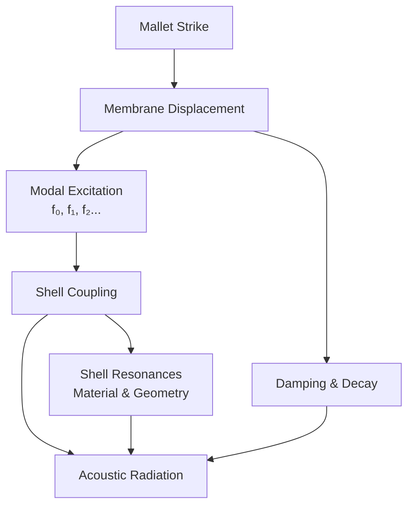
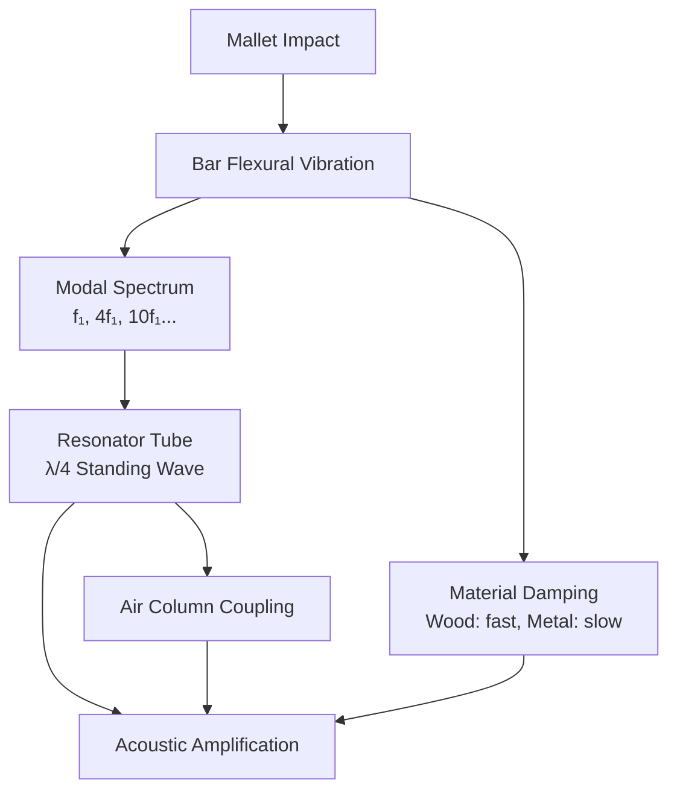
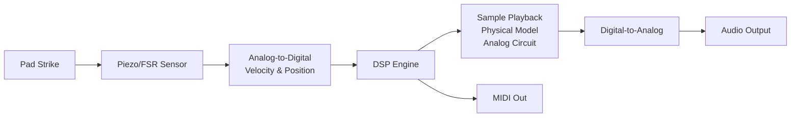

# Lesson 4: Percussion Instrument Families

## 1. First-Principles: The Physics of Struck, Shaken, and Scraped Sound

Percussion encompasses any instrument that produces sound through impact, friction, or concussion. Unlike wind instruments that couple to standing waves in air columns, or strings that establish harmonic modes on a tensioned line, percussion instruments generate sound through the vibrational modes of two- and three-dimensional bodies—membranes, bars, plates, shells, and bells. The fundamental physics governing all percussion falls into three regimes: membrane vibration (drums), bar/plate vibration (mallet instruments), and complex shell vibration (bells, gongs). Each regime exhibits distinct modal behavior, inharmonicity, and decay characteristics.

The wave equation for a circular membrane fixed at its boundary yields Bessel function solutions with eigenfrequencies proportional to the zeros of J₀ and J₁. These modes are inherently inharmonic: the first overtone of an ideal circular drumhead sits at roughly 1.59 times the fundamental, not the integer multiples found in strings. This inharmonicity is the signature of two-dimensional vibrators and defines the "pitched" versus "unpitched" character of drums. Timpani achieve near-harmonic behavior by loading the membrane with a parabolic tension profile, aligning the first six modes into an approximate harmonic series and producing a clear pitch.

Bar instruments—xylophone, marimba, vibraphone—rely on the flexural vibration of beams. An ideal uniform bar exhibits overtones at ratios 1 : 2.76 : 5.40 : 8.93, far from harmonic. To achieve musicality, bars are undercut in an arch or parabolic profile beneath the nodal points (typically 22.4% from each end), thinning the center to lower the second partial into a 4:1 ratio with the fundamental. This tuning renders the timbre consonant and allows the bar to function as a melodic instrument. Resonators placed below each bar couple to the fundamental, amplifying sound and extending decay.

Bells and gongs represent the most complex case: three-dimensional shells with thickness variations, curvature, and asymmetries that produce dense, inharmonic spectra. Church bells are tuned by careful metal removal to align specific partials (hum, prime, tierce, quint, nominal) into near-consonant relationships. The strike tone—the perceived pitch—is a psychoacoustic phenomenon arising from the interaction of partials, not a physical fundamental.

## 2. Taxonomy: Membranophones, Idiophones, and Electrophones

The Hornbostel-Sachs classification divides percussion into membranophones (sound from vibrating membrane) and idiophones (sound from vibrating solid body). Modern practice adds electrophones (electronic sound generation) and hybrid electromechanical instruments.

### Membranophones: Drums and Timpani

Membranophones span cylindrical drums (snare, tom-tom, bass drum), bowl drums (timpani, tabla), frame drums (tambourine, bodhran), and friction drums (cuica). The membrane—animal skin or synthetic polymer—is tensioned over a shell or frame. Shell material (wood, metal, acrylic) and geometry (depth, diameter, bearing edge profile) shape the overtone content and decay. Deep shells emphasize low-frequency modes and produce longer sustain; shallow shells favor attack transients and high-frequency clarity.

The snare drum employs a secondary set of metal coils (snares) tensioned against the bottom head. When the top batter head is struck, the bottom resonant head vibrates sympathetically, driving the snares into rapid, chaotic collision that produces the characteristic buzzing timbre. Snare tension, head tuning, and strainer adjustment allow continuous timbral variation from crisp and dry to loose and rattling.

Timpani use a parabolic copper or fiberglass bowl and a pedal-operated tensioning mechanism that uniformly adjusts membrane tension across the entire head. This allows real-time pitch changes across a perfect fifth or more. The strike location is critical: dead center produces maximum fundamental with slow attack, while striking 3–4 inches from center emphasizes clarity and articulation. Timpanists choose felt, wood, or cork mallets to control transient sharpness and harmonic content.

### Idiophones: Bars, Plates, and Shells

Idiophones produce sound from the vibration of their entire solid body. This family includes struck idiophones (xylophone, vibraphone, chimes, triangle, cymbals, gongs), shaken idiophones (maracas, cabasa, shakers), scraped idiophones (guiro, ratchet), plucked idiophones (kalimba, jaw harp), and concussion idiophones (claves, castanets).

Mallet percussion—xylophone, marimba, vibraphone, glockenspiel—consists of tuned bars arranged chromatically. Xylophones use hardwood (rosewood, padauk) with bars 35–40 mm thick, producing bright, penetrating tone rich in high partials. Marimbas use larger, thinner bars (20–25 mm) undercut more deeply, yielding a mellow, darker timbre with emphasized fundamental. Vibraphones employ aluminum alloy bars with motor-driven resonator discs (pulsators) that open and close the resonator tubes at 1–12 Hz, producing amplitude modulation perceived as vibrato. Glockenspiels use steel bars, producing brilliant, glass-like tone with strong high partials and long sustain.

Bar suspension is critical to modal purity. Bars rest on felt or cord at the vibrational nodes (22.4% from each end for the fundamental mode), allowing free vibration. Striking zone selection trades off fundamental energy (center strike) versus clarity and overtone content (off-center strike). Mallet hardness—from soft yarn-wrapped to hard plastic—determines the force-time profile of the impulse, which shapes the spectral envelope through Fourier duality: short, hard impacts excite broad bandwidth; long, soft impacts emphasize low partials.

Cymbals and gongs are curved plates exhibiting dense, inharmonic modal structures. Cymbal alloys (typically B20 bronze: 80% copper, 20% tin) are cold-worked and heat-treated to control crystalline structure and damping. Hammering patterns, lathing depth, and edge thickness determine modal density, decay time, and frequency centroid. Ride cymbals emphasize a clear "ping" with defined pitch; crash cymbals favor rapid onset and dense shimmer. Suspended cymbals radiate omnidirectionally; hi-hats use two cymbals face-to-face with pedal-controlled spacing, enabling timbral variation from tight, dry articulation (closed) to washy sustain (open).

### Electrophones and Hybrid Instruments

Electronic percussion ranges from purely synthetic (drum machines, sample pads) to electromechanical hybrids (vibraphone pickups, electronic tabla). Drum machines generate sound via sample playback, analog synthesis (e.g., 808 kick from bridged-T oscillator with pitch envelope), or physical modeling. Electronic drum pads use piezoelectric or force-sensing resistor (FSR) transducers to convert mechanical impact into voltage, which triggers samples or synthesis engines with velocity and positional sensitivity.

The Roland TR-808 kick drum circuit exemplifies analog percussion synthesis: a bridged-T oscillator sweeps from ~80 Hz to ~50 Hz over 100–300 ms, creating the characteristic pitch drop. The circuit consists of a Wien bridge oscillator with exponential control voltage shaping the decay envelope. The 808 snare combines two triangle-wave oscillators (180 Hz, 330 Hz) with a six-oscillator noise source, bandpass-filtered and summed. These circuits produce sounds impossible with acoustic instruments—perfect consistency, extreme pitch ranges, independent control of attack, decay, and pitch envelope.

Physical modeling synthesis (e.g., Yamaha VL-series, Modartt Pianoteq) solves discretized wave equations in real time, simulating membrane or bar physics. Modal synthesis decomposes the impulse response into a sum of damped sinusoids, each representing one vibrational mode. This approach captures the natural inharmonicity and complex decay of real instruments while allowing parameter manipulation beyond physical constraints—negative damping, variable shell material, impossible geometries.

## 3. Performance Technique and Timbral Control

Percussionists control timbre, dynamics, and articulation through strike location, implement choice, grip, and stroke technique. These parameters map directly to the physics of excitation and modal coupling.

### Strike Location and Modal Excitation

The spatial distribution of vibrational modes determines which modes are excited by a given strike location. Striking a membrane or bar at a nodal line for a particular mode will not excite that mode; striking at an antinode maximizes excitation. For a circular drum, the center is an antinode for all modes, producing maximum low-frequency energy but slow attack. Striking near the rim emphasizes higher modes, yielding brighter tone and faster transient. Timpanists strike 3–4 inches from center to balance clarity and sustain. Snare drummers use rim shots—striking head and rim simultaneously—to couple shell resonances directly, producing a loud, sharp crack.

On mallet instruments, center strikes produce maximum fundamental with minimal overtones and slow attack. Striking near the nodal point (the suspension cord) emphasizes higher partials and produces faster attack but weaker fundamental. Professional marimbists vary strike location continuously to shape phrasing and color.

### Implement Selection: Mallets, Sticks, Brushes

The force-time profile of the strike impulse determines the spectral content of the excited sound. A Dirac delta impulse (infinitely short, infinite peak) would excite all modes equally. Real implements produce finite-duration impulses; the Fourier transform of the impulse envelope acts as a spectral filter.

Hard mallets (plastic, wood, hard rubber) produce short-duration impulses with broad spectral bandwidth, emphasizing high partials and attack transients. Soft mallets (yarn-wrapped, felt) produce longer-duration impulses with low-pass characteristics, emphasizing fundamental and low partials. The contact time must be shorter than the period of the highest frequency of interest; otherwise, that partial cannot be excited efficiently.

Drum sticks are rigid levers amplifying hand velocity through moment arm mechanics. Grip choice (matched vs. traditional) and fulcrum location (index finger, middle finger) affect rebound control and articulation speed. Brushes—wire or nylon bristles—produce diffuse, continuous contact rather than discrete impacts, exciting a noise-like spectrum with reduced transient energy, ideal for soft, sustained textures.

### Damping and Articulation

Percussionists control sustain through selective damping. Timpanists damp with the fingertips to stop sustain cleanly; mallet percussionists use "dead sticking"—allowing the mallet to rest on the bar after impact—to prevent resonance. Cymbal players grab the edge to stop vibration instantly. Indian tabla technique employs continuous finger pressure modulation during and after the stroke to shape the decay envelope and pitch bend in real time.

Concert bass drums use controlled resonance: a light touch after the stroke allows partial sustain for warmth while preventing excessive ringing. Snare drummers vary snare tension and use dampening gels or fabric on the batter head to control overtone content and decay in studio recording.

## 4. Ensemble Role: Rhythm, Color, and Architecture

Percussion functions across three dimensions in ensemble texture: rhythmic foundation, timbral color, and structural articulation.

### Rhythmic Foundation and Metric Hierarchy

Drum kit and orchestral percussion establish the metric grid and drive rhythmic momentum. The bass drum marks downbeats and primary metric divisions; the snare drum provides backbeats (beats 2 and 4 in 4/4) and rhythmic accents; hi-hats articulate subdivisions (eighth notes, sixteenth notes). This layered hierarchy of pulse, division, and subdivision creates a perceptual scaffold for the ensemble.

Polyrhythmic traditions—West African drumming, Afro-Cuban clave, Brazilian batucada—layer multiple independent metric streams with different period lengths. A 3:2 polyrhythm (three pulses against two) creates a six-beat cycle with maximum metric tension at the midpoint. Skilled ensemble players lock these layers into phase, creating a unified composite rhythm greater than the sum of parts.

### Timbral Palette and Orchestration

Percussionists provide the widest timbral range of any instrument family, from the crystalline clarity of crotales (antique cymbals) to the thunderous roar of tam-tam. Orchestrators use percussion to punctuate climaxes (cymbal crash, timpani roll), add shimmer and atmosphere (suspended cymbal, triangle, wind chimes), define character (wood block, temple blocks for ostinato), and create special effects (thunder sheet, slapstick).

Timbre combinations follow principles of spectral masking and blend. Bright, high-frequency instruments (triangle, glockenspiel) cut through dense orchestration without dynamic force. Dark, fundamental-rich instruments (marimba, timpani) blend and support harmonic structure. Inharmonic, noise-like instruments (cymbals, tam-tam) fill spectral gaps and add density without defined pitch.

### Structural Articulation and Form

Percussion delineates formal boundaries—transitions, climaxes, cadences—through dynamic and timbral contrast. A timpani roll crescendo signals an impending arrival; a single cymbal crash marks a structural downbeat; a tambourine ostinato defines a section. Film composers use percussion to underscore action, build tension (accelerating snare roll), and release energy (orchestral bass drum).

In contemporary classical music, percussion often drives formal innovation. Iannis Xenakis used probabilistic models to generate dense, statistical textures of pitched and unpitched percussion. Steve Reich's Drumming (1971) explores phase relationships and timbral transformation across four sections, each featuring a different percussion family (bongos, marimbas, glockenspiels, voice). Percussion serves as the medium for exploring time, pattern, and the boundary between pitch and noise.

## 5. Tuning, Intonation, and Acoustic Challenges

### Timpani Tuning and Intonation

Timpani require precise tuning to defined pitches, typically tuned to tonic, dominant, and subdominant of the key. Tuning involves pedal adjustment to achieve uniform membrane tension. Percussionists verify pitch by lightly tapping and listening for the fundamental, then fine-tuning with the pedal. Temperature and humidity affect membrane tension; a drop in temperature flattens pitch, requiring continuous monitoring during performance.

Glissandi on timpani exploit the pedal mechanism to sweep pitch during or after a roll, creating dramatic pitch bends spanning a perfect fourth or fifth. The effect requires careful coordination of pedal motion and stick roll to maintain even dynamic and clear pitch trajectory.

### Temperature, Humidity, and Material Stability

Wooden percussion instruments (marimba, xylophone) are sensitive to humidity changes. Wood swells in high humidity, lowering pitch; dry conditions raise pitch. Professional instruments use seasoned tropical hardwoods (rosewood, padauk) with stable dimensional characteristics. Synthetic bars (fiberglass, kelon) offer immunity to climate but sacrifice tonal complexity.

Metal instruments—vibraphone, glockenspiel, cymbals—exhibit thermal expansion that shifts pitch with temperature. A 10°C change can shift pitch by several cents. Orchestral percussion sections in outdoor venues contend with rapid temperature swings that detune instruments mid-performance.

Drum heads—especially natural calfskin—are highly sensitive to humidity. Calfskin loosens in humid conditions, lowering pitch and reducing attack clarity. Synthetic heads (Mylar, Kevlar) offer tuning stability at the cost of reduced tonal warmth and complexity. Professional timpanists touring in varying climates prefer synthetic heads for reliability.

## 6. Extended Techniques and Contemporary Practice

Contemporary composers and performers have expanded the technical and sonic vocabulary of percussion far beyond traditional methods.

### Prepared Instruments

Cage's prepared piano technique extends to percussion: placing objects on drumheads (paper, cloth, chains) to create buzzing, rattling, or muted timbres; bowing cymbals and tam-tams with contrabass bows to produce sustained, eerie tones; using unconventional implements (fingers, hands, credit cards, brushes) on mallet instruments.

### Bowing and Sustaining Techniques

Vibraphone players use cello or bass bows on bars to produce sustained tones, bypassing the natural decay envelope. The bow excites the bar into continuous vibration, analogous to a bowed string. This technique requires rosining the bow and bowing near the node to minimize damping.

Crotales (antique cymbals) are small, thick bronze discs that produce clear, bell-like pitches. Bowing crotales produces crystalline, sustained tones used extensively in film scores for ethereal, mystical atmospheres. The technique requires slow, steady bow pressure and control to avoid slipping.

### Multi-Percussion Setups and Theatrical Integration

Solo percussion repertoire often calls for multi-percussion setups: arrays of dozens of instruments arranged for rapid switching and complex timbral sequences. Xenakis's Psappha (1975) requires 70+ instruments; the performer choreographs movement through the setup as part of the compositional structure.

Theatrical percussion integrates movement, gesture, and visual spectacle. Japanese taiko ens
