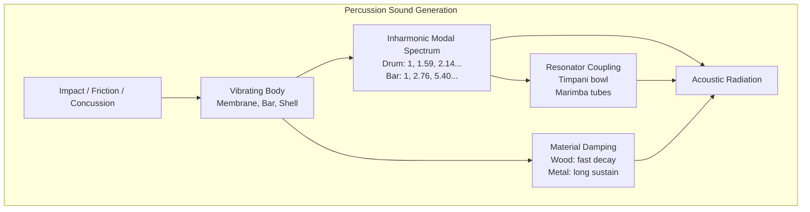
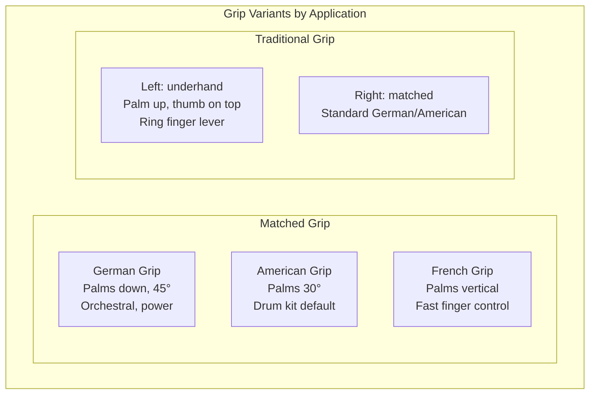
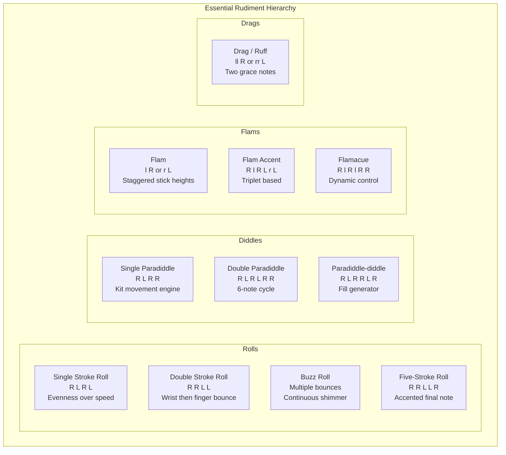
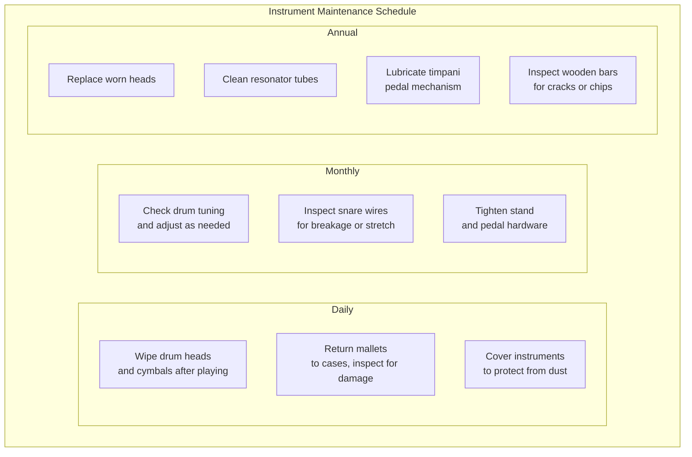
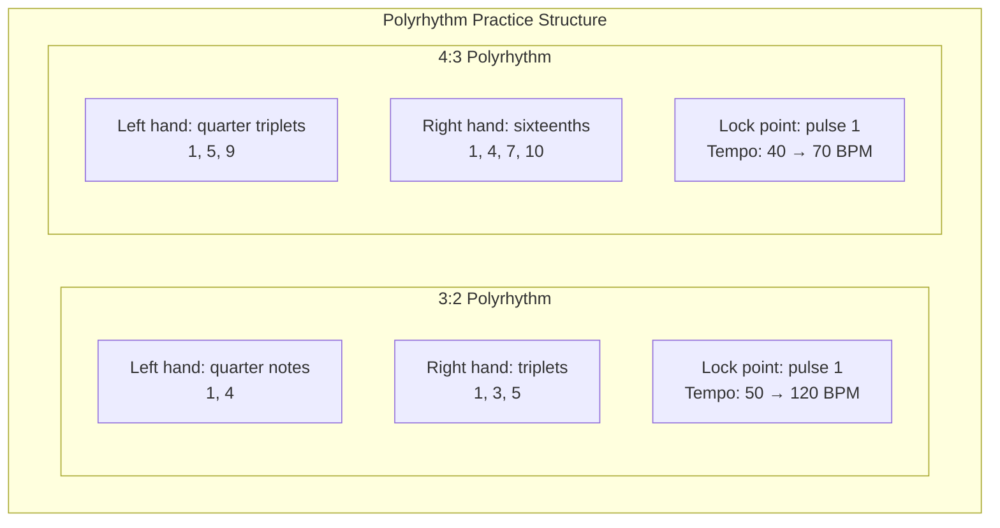

# Lesson 4: Percussion — Hands, Sticks, Surfaces, and Sound

## 1. Acoustic Intuition: Why Percussion Sounds the Way It Does

Strings and air columns vibrate in one dimension, so their overtones stack at clean integer multiples of the fundamental — that's why a plucked string or a blown pipe reads as a clear musical note. Percussion instruments vibrate in two or three dimensions (membranes, bars, plates, shells), so their overtones land at non-integer ratios. That inharmonicity is exactly what makes a tom sound like "pitched noise" rather than a note, and what gives cymbals and bells their shimmer instead of a clean pitch.

A circular drumhead's first overtone sits around 1.59× the fundamental, not 2×. Timpani cheat this: the parabolic kettle couples air mass to the membrane and pulls the first several modes into near-harmonic alignment, which is why timpani (unlike toms) can be tuned to a specific pitch you match against the orchestra. Bar instruments (marimba, xylophone, vibraphone) have an arched undercut on the underside of each bar — this isn't a builder's detail you need to calculate, but knowing it's there tells you why the bar's second partial lands close to a musical 4th above the octave instead of a dissonant smear, which is why struck bars sound "in tune" rather than clangy.

The practical takeaway for a player: wood decays fast (short sustain, percussive attack — marimba, xylophone), metal rings long (cymbals, bells, vibraphone bars), and membranes sit in between and respond heavily to where you strike them. Everything in this lesson — strike location, mallet hardness, damping — is you manipulating this physics by hand in real time.



## 2. Grip Mechanics: How You Hold the Stick Controls Everything

### Matched Grip (Standard for Kit, Orchestral, and Mallets)

Both hands hold the stick identically. Three variants serve different musical needs.

**German Grip** (palms face down, ~45° from floor): The workhorse for orchestral snare and full-volume kit playing. Fulcrum formed by thumb and index finger; middle finger supports from below. Maximizes power because the whole forearm can load into the stroke.

**American Grip** (palms ~30° from floor): The default on drum kit. Splits the difference — enough power for backbeats, enough finger control for ghost notes and fills.

**French Grip** (palms face each other, roughly vertical): For fast, quiet finger control — bell patterns, soft timpani rolls, fast single-stroke passages at low volume. The stick pivots mainly at the thumb-index fulcrum while the middle/ring/pinky execute small finger bounces.

**Fulcrum setup drill:**
1. Hold the stick in your right hand, palm up. Butt end extends about one inch past the wrist crease.
2. Pinch the stick lightly between the pad of your thumb and the side of your index finger's first knuckle — this is the pivot.
3. Wrap fingers 2–5 around the stick without squeezing. It should rest in a cradle, not a fist.
4. Rotate palm down (German/American position). Fingers stay relaxed. A tense wrist means you're gripping too hard.
5. Rest the stick tip on a practice pad and press down lightly with the index finger. The stick should rebound off the pad on its own — that rebound is your entire stroke engine.

**Checkpoint:** Look at both hands in a mirror mid-stroke. Both sticks should form a symmetric V or A shape. An asymmetric angle means uneven grip and an uneven sound between hands — fix this before building speed on top of it.

### Traditional Grip (Snare Drum, Jazz, Marching)

Comes from military drummers who carried the drum on an angled sling, so the left hand approached from underneath. Still standard in pipe band, drum corps, and much jazz playing.

**Left hand setup:**
1. Rest the stick palm-up in the web between thumb and index finger.
2. Butt of the stick extends to roughly the base of the palm.
3. Thumb rests on top of the stick, applying gentle downward pressure.
4. Ring finger curls underneath — this is your primary lever.
5. Pinky supports the ring finger; middle finger floats beside the stick for direction.
6. To strike: pronate the forearm (rotate inward) and let the stick fall. The head's rebound bounces the stick back up into your fingers — you catch it, you don't lift it.

**Right hand:** standard matched grip (German or American).

**Known weak point:** the left hand has less raw leverage than a matched-grip hand. Drill it alone, at low tempo, before combining — don't let the right hand mask a weak left in alternating patterns.



### Posture and Seating

**Kit posture:** stool height should put your thighs angling slightly *down* from hip to knee. Thighs level or angled up means the stool is too low — this compresses hip flexors and slows your kick pedal. Snare height should put the batter head at or just below navel level. Too high raises the elbows and locks the shoulders; too low collapses the wrists. Aim the stick at roughly 15° downward into the head.

**Mallet instrument posture:** feet shoulder-width, weight even. The instrument's rail sits around belt height. Step the left foot slightly forward and shift weight onto it when reaching for low bars. Adjust the instrument, never hunch to meet it — hunching costs you stroke control and gives you a sore neck after a 90-minute rehearsal.

## 3. Stroke Mechanics: The Four Fundamental Strokes

**Full Stroke (Rebound Stroke):** starts high (8–12 in above the pad), returns to the same height. The head does the work of sending the stick back up — your hand just guides it. Loudest, most resonant stroke, and the one that teaches you to trust rebound instead of muscling the stick back up yourself.

**Down Stroke:** starts high, ends low (~1 in above head). Full-velocity strike, then catch the stick at the bottom with your fingers, killing the rebound. Loud note immediately followed by a soft one, no re-lift needed. This is what makes accent-then-tap patterns (flam accents, accent-taps) possible at speed.

**Up Stroke:** starts low (~1 in), ends high. Quiet strike from the low position, then ride the stick's own rebound plus a small wrist lift back up to the ready position for the next loud stroke. The quiet partner of the down stroke — it's preparation disguised as a note.

**Tap Stroke:** starts low, ends low. Quiet, finger-driven, minimal wrist. Your softest stroke, used for ghost notes and quiet subdivisions.

**Stroke practice drill:**

| Exercise | Pattern (R/L) | Tempo Range | Purpose |
|---|---|---|---|
| Full stroke alternation | R L R L R L R L | 60 → 80 → 100 → 120 BPM | Rebound control, even sound |
| Down-tap alternation | R(r) L(r) R(l) L(l) | 50 → 70 → 90 BPM | Accent-to-tap dynamic contrast |
| Up-down alternation | R(↑) L(↑) R(↓) L(↓) | 50 → 70 BPM | Rebound capture and preparation |
| Tap-tap-full cycle | R(l) L(l) R(r) | 60 → 80 → 100 BPM | Three-level dynamic control |

Notation: (r) = full/rebound stroke, (l) = tap, (↑) = up stroke, (↓) = down stroke.

**Troubleshooting:** if your full strokes sound "slappy" with no sustain, you're decelerating into the head instead of releasing. Think "drop and get out of the way," not "hit."

## 4. The Moeller Stroke: Your Speed and Endurance Engine

Sanford Moeller's whip technique gets multiple notes out of a single arm motion by using gravity and rebound instead of muscling every stroke individually. It's the core technique behind fast rudimental passages and long endurance passages without tension.

**The three-part whip:** (1) forearm and wrist lift in one fluid motion (the prep), (2) gravity plus a wrist snap drives the stick down for the primary accented stroke, (3) the stick's own rebound produces the secondary tap(s) as your hand relaxes.

**Single Moeller** (1 accent + 1 tap): lift, snap down for the accent, let rebound give you one quiet tap. Two notes per motion.
Pattern: R(r) R(l) R(r) R(l) — 60 → 80 → 100 → 120 BPM.

**Double Moeller** (1 accent + 2 taps): three notes per motion.
Pattern: R(r) R(l) R(l) R(r) R(l) R(l) — 50 → 70 → 90 BPM.

**Triple Moeller** (1 accent + 3 taps): four notes per motion.
Pattern: R(r) R(l) R(l) R(l) — 40 → 60 → 80 BPM.

**Practice sequence:**
1. Single Moeller at 60 BPM, eighth notes. Feel the whip: lift–snap–bounce. Wrist loose, not locked.
2. Move to 80, 100, 120 BPM. The motion compresses as speed increases — smaller lift, faster snap.
3. Weak hand only, 5 minutes. Strong hand only, 5 minutes. The weak hand will feel clumsy at first; that's expected, not a sign you're doing it wrong.
4. Combine both hands: R(single Moeller) + L(single Moeller) = RLRL at 100 → 120 → 140 → 160 BPM. Accents fall on beats 1 and 3.

**Common errors:**
- **Tensing on the snap** kills the rebound. The wrist whips, then goes slack immediately.
- **Lifting the stick by hand instead of catching the bounce.** The stick should feel like it's doing some of the work for you.
- **Flat dynamics across all notes** means you're not whipping — you're just playing even singles. The accent must audibly outweigh the taps, or the technique isn't engaged yet.

## 5. Rudiments: The Vocabulary of Snare and Kit Playing

The Percussive Arts Society codifies 40 standard rudiments. These are the non-negotiable core.

### Roll Rudiments

**Single Stroke Roll:** R L R L R L R L. Alternate hands for maximum *evenness*, not maximum speed — identical volume, spacing, and tone between hands. Practice at 60, 80, 100, 120, 140, 160 BPM in sixteenths. Record yourself: you should not be able to tell when the hand switches from R to L.

**Double Stroke Roll (Open Roll):** R R L L R R L L. First stroke of each pair is wrist-driven, second comes from rebound. At slow tempos both strokes are wrist-driven; at fast tempos the second becomes pure finger bounce. Practice at 60 (wrist-wrist), 80 (wrist-finger transition), 120 (finger bounce), 160 (crush roll) BPM.

**Buzz Roll (Closed/Press Roll):** press the stick into the head for 3–5 bounces per stroke, alternating hands seamlessly into a continuous "shhhh," not a machine-gun chatter. Start at 60 BPM quarter notes, then eighths, then triplets.

**Five-Stroke Roll:** RRLLR — LLRRL. Two doubles plus an accented single. Play as a quarter-note triplet at 60 BPM (all five strokes fit in one beat), then 80, 100, 120 BPM.

**Seven-Stroke Roll:** RRLLRRL — LLRRLLR. Three doubles plus an accented single, typically starting on the "and" of the beat in 4/4. Practice 60 → 80 → 100 BPM.

### Paradiddle Rudiments

**Single Paradiddle:** R L R R — L R L L (single-single-double). The double is the identifying feature and gives you a natural moment to reposition hands around the kit.

Practice at 60 → 80 → 100 → 120 → 140 BPM:
- Eighths: R L R R L R L L (one paradiddle per beat)
- Sixteenths: same pattern, two paradiddles per beat
- Accent only the lead note: **R** l r r **L** r l l

**Double Paradiddle:** R L R L R R — L R L R L L. Practice 60 → 80 → 100 → 120 BPM.

**Triple Paradiddle:** R L R L R L R R — L R L R L R L L. Practice 60 → 80 → 100 BPM.

**Paradiddle-diddle:** R L R R L R L L (single-double-double, six notes). The engine of many kit fills. Practice as triplets: RLR R (beat 1) — LRL L (beat 2), accenting the first note of each group. 80 → 100 → 120 → 140 BPM.

### Flam Rudiments

**Flam:** a quiet grace note from one hand landing almost simultaneously with a loud primary stroke from the other. Grace-note stick starts low (~1 in); primary stick starts high (~8 in). Right flam: l **R**. Left flam: r **L**.

**Practice:** alternate R-flam / L-flam at 60 → 80 → 100 → 120 BPM, quarters then eighths. If both notes sound the same volume, your stick heights aren't different enough — raise the primary stick.

**Flam Accent:** R l R L r L, as triplets: **R** l r **L** r l. Practice 60 → 80 → 100 BPM.

**Flamacue:** **R** l **R** l R R — **L** r **L** r L L. Tests switching between accent levels and flam heights inside one pattern. Practice 50 → 70 → 90 BPM.

### Drag Rudiments

**Drag (Ruff):** two quiet grace notes played as a fast double bounce by one hand, followed by a primary stroke from the other. Right drag: ll **R**. Left drag: rr **L**.

**Single Drag Tap:** ll **R** rr **L**, drag occupying the space just before the beat. Practice 60 → 80 → 100 BPM.



## 6. Four-Limb Independence: Drum Kit Coordination

Four limbs, four jobs: right hand (ride/hi-hat), left hand (snare), right foot (kick), left foot (hi-hat pedal). Build independence by holding one or two limbs on a steady ostinato while the others vary — never try to learn two moving parts simultaneously from scratch.

### Grid 1: Ride + Hi-Hat Ostinato (Jazz Independence)

Right hand plays the jazz ride pattern (the "spang-a-lang"): quarter note on beat 1, eighth note on the "and" of 2, quarter on beat 3, eighth on the "and" of 4. Left foot plays hi-hat chick on beats 2 and 4. This is your fixed anchor — it does not change while you add snare variations below, one at a time, at 60 → 80 → 100 BPM:

| Exercise | Snare placement (4/4) | Difficulty |
|---|---|---|
| A | Beat 1 | Easy |
| B | "And" of 1 | Easy |
| C | Beat 2 | Easy |
| D | "And" of 2 (with ride) | Medium |
| E | Beat 3 | Easy |
| F | "And" of 3 | Medium |
| G | Beat 4 | Easy |
| H | "And" of 4 (with ride) | Medium |
| I | Beats 1 and 3 | Easy |
| J | "And" of 1 and "and" of 3 | Medium |
| K | All four "ands" | Hard |
| L | Triplets on beats 1 and 3 | Hard |

Then layer bass drum independently: beat 1 only → beats 1 and 3 → all four quarters → syncopated ("and" of 1, "and" of 3).

### Grid 2: Rock Ostinato (Eighth-Note Hi-Hat Independence)

Fixed pattern: right hand eighth notes on hi-hat, right foot bass drum on 1 and 3, left hand snare on 2 and 4 — the basic rock beat. Vary the bass drum while keeping hi-hat and snare locked:

| Exercise | Bass drum pattern | Tempo |
|---|---|---|
| A | 1, 3 | 60 → 80 → 100 BPM |
| B | 1, "and" of 2, 3 | 60 → 80 BPM |
| C | 1, "and" of 1, 3, "and" of 3 | 60 → 80 BPM |
| D | 1, "and" of 1, "and" of 2, 3, "and" of 4 | 60 → 80 BPM |
| E | All eighth notes (doubles) | 60 → 80 BPM |
| F | 1, "e" of 2, 3, "e" of 4 (16th syncopation) | 50 → 70 BPM |

### Grid 3: Hi-Hat Foot Independence

Add the left foot to the rock ostinato: open the hi-hat on the "and" of each beat, close it on the downbeat, creating a pulsing open-close feel. Right hand stays on eighths, left hand stays on backbeats, right foot stays on 1 and 3. Practice 50 → 60 → 70 → 80 BPM. This is the hardest limb to isolate — stay at 50 BPM as long as it takes for the foot to stop "leaking" into the hands' timing.

### Ghost Notes: The Secret to Groove

Ghost notes are quiet tap-stroke snare hits (about 1 in stick height) filling the space between backbeats. They build textural density without competing with the accented hits — this is what separates a "flat" groove from one that feels alive.

**Purdie Shuffle skeleton:**

| Beat | 1 | & | 2 | & | 3 | & | 4 | & |
|---|---|---|---|---|---|---|---|---|
| Hi-hat | x | x | x | x | x | x | x | x |
| Snare | | g | **X** | g | | g | **X** | g |
| Bass | B | | | | B | | | |

**X** = accented backbeat, **g** = ghost note, **B** = bass drum.

Practice 50 → 60 → 70 → 80 → 90 → 100 BPM. If you can clearly hear the ghost notes above the hi-hat, they're too loud — they should feel like a whisper underneath the groove, not a separate voice.

## 7. Mallet Instruments: Marimba, Xylophone, Vibraphone, Glockenspiel

### Mallet Grip: Traditional, Stevens, Burton

**Traditional Grip (two-mallet, one hand):** inside mallet between thumb and index, outside mallet between index and middle. Thumb controls inside, middle finger controls outside. Good independence between the two mallets; limited interval stretch.

**Stevens Grip (four-mallet, Leigh Howard Stevens):** the modern marimba standard. Each hand holds two mallets crossing in the palm, inside mallet below outside. Thumb controls the inside mallet's angle; ring finger controls the outside mallet.

**Setup:**
1. Inside mallet between thumb and index finger, about one-third up from the mallet head.
2. Outside mallet between index and middle finger, shaft crossing the palm.
3. Outside mallet's shaft rests against the base of the ring finger, which controls its vertical movement.
4. Thumb controls the inside mallet's vertical movement independently.
5. To widen the interval between the two mallets: push the thumb forward. To narrow: pull it back.

**Burton Grip (four-mallet, jazz, Gary Burton):** mallets held more parallel, outside mallet on top, cross point closer to the hand. Favors speed and jazz phrasing on vibraphone over maximum interval stretch.

### Stroke Technique on Bars

Unlike a taut drumhead, a bar doesn't rebound the mallet for you the same way — you "drop" the mallet with a relaxed wrist and let it bounce off naturally. Motion comes from the wrist; the forearm stays relatively still.

**Stroke height by dynamic:**
- **pp:** mallet starts ~2 in above the bar, wrist drop only.
- **mp:** ~4 in, wrist drop with slight forearm follow-through.
- **mf:** ~6 in, wrist and forearm together — your standard playing height.
- **f:** ~8–10 in, full arm involvement, wrist still leads.
- **ff:** 12+ in, full arm stroke. Let the mallet bounce — don't bury it in the bar, which kills the attack and chokes the tone.

**Strike location:** center of the bar gives the warmest, most fundamental-heavy tone. Near the cord/node gives a brighter, faster-attack sound — useful for sharper xylophone articulation. Default to center unless you need the brighter edge.

**Dead sticking:** leave the mallet resting on the bar after the strike instead of lifting it — this damps the bar immediately for staccato passages.

### Four-Mallet Independence Exercises

**Single independent stroke (Stevens grip):** strike with only the inside mallet, then only the outside, alternating, to build independent thumb/ring-finger control.

```
Exercise: R(inside) R(outside) L(inside) L(outside)
Tempo: 50 → 60 → 70 → 80 BPM, eighth notes
```

**Double vertical strokes:** both mallets in one hand strike simultaneously, same interval. Practice major 3rds, 4ths, 5ths, octaves. The target is simultaneity and equal volume between the two mallets, not just hitting two notes.

```
Exercise: RH (C-E) — LH (G-C) — RH (C-E) — LH (G-C)
Tempo: 50 → 60 → 70 → 80 BPM
```

**Rolls:** on marimba, sustained sound comes from fast alternating single strokes, not a drum-style buzz. Keep mallets close to the bar (2–3 in) for fast, light contact. On vibraphone, the motor can supplement a slower hand roll.

```
Roll exercise on one note (e.g. middle C):
R(in) L(in) R(in) L(in) — eighths at 60 BPM
same pattern as triplets at 60 BPM
same pattern as sixteenths at 60 BPM
then increase tempo: 60 → 70 → 80 → 90 → 100 BPM
```

### Vibraphone-Specific Technique

**Pedal:** works like a piano damper — down lets bars ring, up damps them. Depress as you strike, release between phrases to prevent unwanted bleed into the next chord.

**Motor (pulsator) speed:** typically 1–12 Hz. Slow (1–2 Hz) gives a gentle ballad vibrato; medium (4–6 Hz) is the standard "jazz vibe" sound; fast (10+ Hz) produces tremolo. Match the speed to the tune, don't leave it at one default setting for everything.

**Bowing:** use a cello or bass bow, rosined, drawn across the node of a bar (roughly 22.4% in from the end) for a sustained, ethereal tone.
1. Rosin the bow hair.
2. Place the hair flat against the bar at the nodal point.
3. Draw slowly and steadily in one direction.
4. The bar "speaks" after about a second — maintain bow speed to keep it going.
5. Lift cleanly to stop.

## 8. Timpani: Pitch, Pedal, and Stroke

### Setup and Mallet Selection

Four standard drum sizes, each covering roughly a fifth:

| Drum | Range | Typical Key Role |
|---|---|---|
| 32" | D2–A2 | Lowest voice, tonic in low keys |
| 29" | F2–C3 | Dominant, subdominant |
| 26" | A2–E3 | Middle voice |
| 23" | D3–A3 | High voice, leading tone |

**Mallet selection:**
- **Hard felt:** clear attack, defined pitch — classical articulation, rhythmic passages.
- **Medium felt:** balanced attack and tone — the default for most repertoire.
- **Soft felt:** maximum fundamental, minimal attack — rolls, legato, soft entrances.
- **Wood/cork:** sharp, percussive attack — rare orchestral use (Bartók and similar special effects).

### Stroke Technique

**Strike location:** 3–4 in from the rim, about a third of the way from rim to center. Dead center sounds muddy and pitch-indistinct; too near the rim sounds thin and slappy.

**Stroke motion:** drop the mallet from 6–8 in with a relaxed wrist and let it rebound naturally. For louder strokes, raise the drop height and add forearm weight — don't push into the head.

**The roll:** timpani rolls are alternating single strokes, never a buzz — a buzz roll smears the pitch and sounds muddy on a tuned drum. Find the speed where discrete strokes just barely fuse into a sustained tone: start eighth notes at 60 BPM, then triplets, sixteenths, sextuplets.

**Roll dynamic control:**
- **pp roll:** mallets ~2 in from head, light wrist only, fast sixteenths at 60 BPM.
- **mf roll:** ~4 in, moderate wrist drop, sixteenths at 70 BPM.
- **f roll:** ~6–8 in, forearm involvement, sixteenths at 80 BPM.
- **Crescendo roll:** start pp at 2 in, increase stroke height and arm involvement over 4–8 beats up to ff. Roll speed stays constant — only the height changes.

### Pedal Technique and Tuning

**Tuning procedure:**
1. Depress the pedal to lowest position as your reference.
2. Tap lightly near the playing spot and listen for the fundamental.
3. Raise the pedal slowly with your toes against a tuner or reference pitch.
4. Lock with the toe clamp at the target pitch.
5. Verify with a soft stroke against a reference tone; fine-tune with small pedal moves.

**Pedal glissando:**
1. Start a roll at a moderate dynamic.
2. Push the pedal forward (raise pitch) or back (lower it) smoothly with your foot.
3. Keep roll speed and dynamic constant through the pitch change — no jerky steps.

**Damping:** place two or three fingertips gently on the head near the playing spot right after the stroke. No slapping.

### Ensemble Awareness

Check tuning during rests by tapping lightly and comparing to a reference. Natural skin heads drift with humidity far more than synthetic heads. Arrive early, tune to the orchestra's A (440 or 442 Hz), and recheck every 20–30 minutes in long rehearsals or hot stage lighting.

## 9. Orchestral Percussion: Cymbals, Bass Drum, Triangle, and Accessories

### Cymbal Technique

**Crash cymbals (hand cymbals, 18–20 in):**
1. Hold the straps, arms extended, cymbals vertical and facing each other.
2. Left cymbal stationary, right cymbal moves.
3. Right cymbal sweeps down and slightly past the left at a slight angle — not a flat, head-on collision, which chokes the sound.
4. Immediately pull apart slightly after contact to let them ring.
5. Bigger sweep and velocity for forte; small, gentle touch for piano.

**Suspended cymbal:**
- **Felt mallet:** warm, sustained crash — strike near the edge.
- **Snare stick:** brighter, more defined attack — strike ~2 in from the edge.
- **Triangle beater / timpani stick butt:** sharp, penetrating — special effects.
- **Bowed cymbal:** rosined contrabass bow drawn across the thinnest point of the edge, slow and even pressure, for a sustained glassy tone.

**Hi-hat articulation (kit):**
- **Closed:** tight, dry "chick" — funk, rock, hip-hop.
- **Open:** washy sustain — jazz ride patterns, ballads.
- **Semi-open:** sizzle with partial sustain — groove playing.
- **Foot splash:** quick down-up-down with the pedal for a brief burst — accents and fills.

### Concert Bass Drum

**Stroke:** full-arm motion to the center of the head. Let the mallet "sink" slightly into the head rather than bounce off hard — this excites the deep fundamental. Rest the mallet briefly after impact to avoid double-bounce.

**Damping:** place your free hand or the mallet itself on the head immediately after striking if you need a short, punchy note. Let it ring for a sustained, resonant note.

**Rolls:** two soft mallets, alternating singles. Roll speed should stay relatively slow given the drum's size — eighths at 60 BPM, then triplets, then sixteenths — aiming for a continuous wave of low-frequency energy, not a buzz.

### Triangle

Small instrument, deceptively demanding — a shimmering, consistent tone takes real control.

**Beaters:** thicker rods for louder/brighter sound, thinner for delicate shimmer.

**Holding:** suspend by a clip or string in your left hand, letting it hang and vibrate freely. Gripping the frame itself chokes it.

**Striking:** on the bottom leg, about a third of the way from the closed corner — the point of maximum resonance. Quick, light tap, let the beater rebound off the metal.

**Rolls:** move the beater rapidly back and forth between the bottom leg and the right-side leg (not up-and-down on one spot) for a continuous shimmer. Sixteenths at 60 → 80 → 100 → 120 BPM.

**Dynamic control:** the triangle carries enormously in a hall — a pp roll can cut through a full orchestra. Practice playing far quieter than feels natural, especially with thin beaters.

### Tambourine

**Playing position:** left hand holds it at chest height, slightly angled.

**Stroke types:**
- **Finger taps:** soft, rhythmic passages near the edge.
- **Knuckle stroke:** louder, more defined attack.
- **Shake:** continuous jingle sound for rolls, not discrete rattles.
- **Thumb roll:** rub the thumb around the rim/frame edge (rosin helps grip) for a sustained roll without shaking.

### Congas, Bongos, and Hand Drums

- **Open tone (tono):** four fingers strike near the rim and pull away immediately for a clear, resonant, pitched tone.
- **Slap (chapu):** whipping motion, fingertips hit near the center, hand bounces off instantly for a sharp crack.
- **Bass tone (golpe bajo):** full palm on the center, hand stays briefly to emphasize the fundamental.
- **Muffled tone:** fingers strike while the other hand lightly damps the head, for dry, rhythmic patterns.

**Clave pattern (3-2):**

```
3-2 Clave (in 4/4):
Beat:  1  e & a 2  e & a 3  e & a 4  e & a
Clave: X . . . X . . . X . . . . . X . . .

2-3 Clave (reversed):
Beat:  1  e & a 2  e & a 3  e & a 4  e & a
Clave: . . X . . . X . X . . . X . . . . .
```

Practice at 80 → 100 → 120 → 140 → 160 BPM. The clave is a timeline every other part locks against — learn to feel it internally before you try to layer anything on top.

## 10. Extended Techniques and Contemporary Practice

### Prepared and Modified Percussion

- **Paper sheet on batter head:** dry, short attack, reduced sustain.
- **Coins on the head:** sizzling metallic rattle on each stroke.
- **Cloth/towel draped on head:** dead, muffled thud.
- **Chain on the head:** continuous sizzle, snare-like but with a different texture.

**Bowing metals (cymbals, tam-tams, crotales, vibraphone bars):**
1. Rosin the bow (cello or bass bow).
2. Find the thinnest edge or nodal point — cymbal edge, crotale flat side, bar node (~22.4% in from the end).
3. Place the bow hair flat against the surface.
4. Draw slowly and steadily; the instrument speaks after about a second.
5. Keep even speed and pressure — too fast breaks up the tone, too slow fails to excite it.
6. Lift cleanly to stop.

**Superball mallets:** rub across a drumhead, bar, or cymbal for a friction-driven sustained tone, different in character from bowing. Especially effective on bass drum, timpani, and tam-tam.

### Multi-Percussion Setups

Works like Xenakis's *Psappha* demand 70+ instruments with rapid switching between them — physical choreography is part of the performance.

**Setup principles:**
1. Most-used instruments closest to center.
2. Group by type: metals together, woods together, drums together.
3. Place instruments requiring the same mallet adjacent to cut switching time.
4. Walk through the piece and mark every instrument change; drill transitions as deliberately as the notes.
5. Use trap tables within reach for resting mallets/sticks.
6. Keep sightlines to the conductor from every position in the setup.

### Body Percussion

- **Stomp:** low, resonant. Heel for extra depth.
- **Clap:** crisp and bright; flat hands = sharp, cupped hands = hollow.
- **Pat:** palm on thigh/chest, muffled mid tone.
- **Snap:** high, sharp click.
- **Brush:** soft, diffuse sliding sound.

**Intermediate 4/4 pattern:**

```
Beat: 1     2    3     4
R:    Stomp Clap Stomp Clap
L:    Pat   -    Pat   -
H:    Snap  -    Snap  -
```

Layer a clave on top:

```
Beat:  1  e & a 2  e & a 3  e & a 4  e & a
Stomp: X  . . . .  . . . X  . . . .  . . .
Clap:  .  . X . .  . X . .  . X . .  . X .
Pat:   .  X . . .  . . . .  X . . .  . . .
```

Practice 60 → 80 → 100 → 120 BPM.

## 11. Practice Methodology and Routine

### Structured Practice Session (60 Minutes)

| Block | Duration | Content |
|---|---|---|
| Warm-up | 10 min | Stick control on pad: eighth-note singles each hand, accent taps, single stroke roll slow-to-medium |
| Rudiments | 15 min | 3 rudiments × 3 tempos (slow/medium/fast). Evenness before speed. |
| Independence | 15 min | One coordination grid — hold the ostinato, add one new limb pattern |
| Repertoire | 15 min | One excerpt, 2–4 bar chunks, metronome then without |
| Free play | 5 min | No structure — apply technique musically to cement muscle memory |

### Metronome Strategy

**Slow practice (40–60 BPM):** reveals every imperfection — uneven spacing, dynamic imbalance, sloppy flams. Always start here.

**Tempo ladder:**
1. Start comfortable (60 BPM).
2. Climb in 10 BPM steps.
3. When the technique breaks down, drop back 10 BPM and hold for 2 minutes.
4. Retry the breakdown tempo. If it holds, push 5 BPM further; if not, repeat the previous step.
5. End the session back at 60 BPM to lock in clean execution.

**No-metronome check:** play the same material without the click, record it, and listen for rushing or dragging.

### Common Technical Problems and Solutions

**Weak non-dominant hand.** Lead every exercise with it for the first 5 minutes of each session.

**Rolls sound like machine-gun fire.** Drop to 60 BPM, play as discrete even sixteenths, match volume and spacing exactly before speeding up. For buzz rolls, count 3–5 clean bounces per hand, not 2 and not 7.

**Tension in wrist/forearm/shoulder.** Drop to 40 BPM, maximum relaxation. Check your fulcrum — a squeezed grip chokes the rebound and forces your muscles to do all the work. Loosen until the stick nearly falls out of your hand, then tighten just enough to retain control.

**Inconsistent mallet dynamics.** Practice with eyes closed — visual mallet height can fool you into thinking volume is consistent when it isn't. Adjust by ear.

**Weak or choked cymbal crashes.** Check follow-through (separate slightly after contact) and strike angle (glancing beats flat-on for shimmer).

## 12. Instrument Maintenance and Tuning

### Snare Drum Tuning

1. Remove the head, clean the bearing edge with a cloth.
2. Seat the new head: finger-tighten all tension rods.
3. Press the center firmly with your palm to stretch it in — you'll hear cracking as it seats.
4. Cross-tension in a star pattern (12 o'clock, 6, 3, 9, 1:30, 7:30, 4:30, 10:30), half-turn per rod per pass.
5. Tap-tune 1 in from each tension rod, adjusting until all spots match pitch.
6. Batter head: tune to your target pitch, typically medium-high for snare clarity. Resonant head: tune slightly higher than the batter to maximize snare response.
7. Strainer tension: snares should buzz clearly on a strike but not rattle at rest. Too tight sounds dry and choked; too loose sounds floppy.

### Mallet Instrument Maintenance

Never strike marimba/xylophone bars with drum sticks or hard objects not designed for the instrument — rosewood cracks, aluminum dents. Store wooden bar instruments at 40–60% relative humidity; extreme swings flatten (swelling) or sharpen/crack (shrinking) the pitch. Clean resonator tubes annually and check for anything that may have fallen in.

### Timpani Head Maintenance

**Synthetic heads:** wipe dry after each use; mild soap on a damp cloth for marks; never alcohol or solvents.

**Natural skin heads:** very humidity-sensitive — loosen (pitch drops) in humidity, tighten sharply (risking a crack) in dry air. Climate-controlled storage, away from direct sun and heat.

**Pedal mechanism:** lubricate linkage and spring annually with light machine oil, check felt wear at contact points. Fix a squeaky pedal before it shows up in a concert.



## 13. Ensemble Integration: Listening and Balancing

### Orchestral Percussion Section

**Watch the conductor's prep beat.** Its size and speed tells you the dynamic and character of your entrance before a single note sounds. A large, slow prep means a loud, broad entrance; small and quick means sharp and light.

**Breathe with the prep**, whether or not you need air — it synchronizes your body with the ensemble and locks your entrance to the downbeat.

**Count rests obsessively.** Pencil in cue instruments ("clarinet enters here," "horns here") and count by watching those cues, not just numbers.

**Balance within the section:** bass drum is the loudest voice — everything else balances against it. Triangle and suspended cymbal project further than you'd expect; play softer than feels natural. Timpani blends with cellos/basses in tutti, not over them.

### Drum Kit in Rhythm Sections

**Listening priority:** bass player first, lead vocal/instrument second, rest of the band third. Lock your kick pattern to the bass player's note placements — if the bass hits beat 1 and the "and" of 2, your kick mirrors it.

**Timekeeping discipline:** the drummer is the band's clock. Practice with a metronome that drops out for 4 bars and returns, to check you haven't rushed or dragged.

**Fill vocabulary:**
- **Single-stroke fill:** R L R L R L R L across snare → tom 1 → tom 2 → floor tom, sixteenths over one bar.
- **Paradiddle fill:** R L R R L R L L around the toms, triplets or sixteenths.
- **Flam fill:** flam on beat 4, drag on the "and" of 4, single stroke into beat 1 of the next bar.
- **Crash + roll:** crash on the downbeat of the fill, roll down the toms for three beats, crash on the downbeat of the new section.

Practice each at 80 → 100 → 120 → 140 BPM. The fill must land exactly on the new section's downbeat — no rushing to get there, no gap before it.

### Polyrhythm in Practice

**3:2 polyrhythm:** over a 6-pulse cycle, the "2" side hits pulses 1 and 4; the "3" side hits pulses 1, 3, 5.

```
Pulse:  1  2  3  4  5  6
Side 2: X  .  .  X  .  .
Side 3: X  .  X  .  X  .
```

Left hand taps steady quarters (the 2-side) at 60 BPM; right hand taps triplets against the same pulse (the 3-side). Feel the "lock" where both land together on beat 1. Progress 50 → 60 → 70 → 80 → 100 → 120 BPM.

**4:3 polyrhythm:** over a 12-pulse cycle, "3" hits pulses 1, 5, 9; "4" hits pulses 1, 4, 7, 10.

```
Pulse:  1  2  3  4  5  6  7  8  9  10  11  12
Side 3: X  .  .  .  X  .  .  .  X  .   .   .
Side 4: X  .  .  X  .  .  X  .  .  X   .   .
```

Left hand plays quarter-note triplets (3-side), right hand plays sixteenths (4-side), aligning on beat 1. Harder than 3:2 — practice 40 → 50 → 60 → 70 BPM.



## Summary

Percussion technique rests on three pillars: **grip** (how you hold the implement), **stroke** (how you generate and control impact), and **independence** (how you layer patterns across limbs and instruments). Master the four stroke types, drill rudiments with the tempo-ladder method, and build four-limb coordination through ostinato grids. On mallet instruments, prioritize relaxed wrist drop, precise strike location, and four-mallet independence. On timpani, strike location and pedal technique define pitch clarity. In ensemble playing, listen first and watch the conductor's prep. Everything starts slow — 60 BPM, perfectly even, perfectly relaxed. Speed is a byproduct of accuracy, not a goal in itself.
