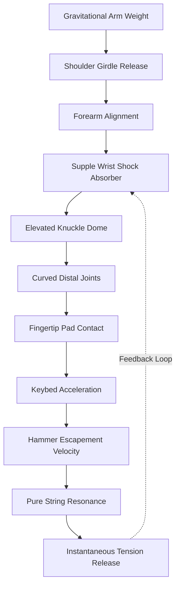

# Beginner Foundation: Piano Ergonomics, Hand Posture & Keyboard Geometries

## 1. The Core Mental Model & First Principles
To play the piano with expressive freedom and mechanical endurance, you must begin by discarding the intuitive assumption that sound is created by the fingers themselves. Anatomically, your fingers are hollow levers consisting of bones, joints, and ligaments; they contain not a single muscle capable of generating independent power. Every motion you make at the keyboard is driven by long flexor and extensor tendons that run through the carpal tunnel of your wrist and connect to the muscular engines located in your forearm. When an untrained student attempts to press keys by straining these small tendons in isolation, the body immediately compensates by tightening the wrist and clamping down the forearm muscles. This chronic tension limits velocity, destroys nuance, and rapidly leads to physical pain.

The true physiological engine of piano playing is the coordinated transfer of gravitational arm weight. Your upper arm and shoulder girdle weigh several kilograms—far more than enough kinetic energy to depress any piano key without ever requiring muscular tension. When seated at the instrument, your arm should feel like a freely suspended pendulum anchored at the shoulder. By allowing this natural arm weight to fall forward through a supple, flexible wrist and channel directly through the arched fingertips into the keybed, you produce a rich, resonant tone with virtually zero effort. The fingers do not strike the keys; they simply stand firm as curved pillars that transmit the resting weight of the arm into the wooden levers of the instrument.

Tone production on an acoustic piano is governed entirely by physics. Inside the piano cabinet, an intricate balance of levers known as the escapement action connects each key to a felt-covered hammer. Once you depress a key past its escapement point, the hammer is propelled upward by momentum alone and flies freely through the air to strike the steel strings. This means that after the key has reached the bottom of its travel, no amount of pushing, squeezing, or pressing into the keybed can alter the sound that has already been launched into the acoustic chamber. Once you hear the note speak, your body must immediately release all downward pressure, maintaining only the feather-light resting weight necessary to keep the damper off the vibrating string.

```
Gravitational Weight Flow Architecture
======================================

     [ Shoulder & Back Girdle ]  <--- Primary Gravitational Anchor
                 |
                 v  (Suspended Kinetic Mass)
          [ Upper Arm ]
                 |
                 v
          [ Forearm ]
                 |
                 v  (Active Dynamic Shock Absorber)
           [ Supple Wrist ]
                 |
                 v  (Structural Keystone Arch)
          [ Knuckle Bridge ]
                 |
                 v  (Curved Conductive Pillars)
          [ Firm Fingertips ]
                 |
                 v  (Hammer Escapement Velocity)
          [ Piano Keybed ]  ======> [ Soundboard Resonance ]
```

## 2. Foundational Architecture & Mechanics
Building an ergonomic hand position begins away from the piano. If you stand up and let your arms hang completely loose at your sides, observe the natural shape your fingers assume. They do not hang flat and rigid, nor do they curl into clenched fists; they rest naturally in a gentle, relaxed curve, with your thumb resting lightly beside the index finger. This natural curvature is the exact architectural posture required at the keyboard. When you place your hand on the keys, imagine holding an invisible orange or resting your palm over a smooth wooden sphere. This natural dome creates an organic arch that supports weight effortlessly.

The anatomical foundation of this dome is the metacarpophalangeal joint, commonly known as the knuckle bridge. In proper playing position, these large knuckles must always form the highest elevation of your hand, remaining gently elevated above the level of the keys. When beginners play, a common structural failure is the collapse of these knuckles downward into the palm, which causes the wrist to drop below the keybed and forces the small finger joints to buckle backward. To prevent this collapse, your distal finger joints (the knuckles closest to your fingernails) must remain curved and firm, striking the keys with the fleshy pad of the fingertip just below the nail.

Your wrist serves as the vital kinetic mediator between the heavy mass of your forearm and the delicate framework of your hand. Think of your wrist as an active shock absorber on a luxury automobile: it must remain fluid, supple, and constantly mobile. A rigid wrist acts like a closed gate that traps tension in the forearm, preventing arm weight from reaching the keys. As your fingers play, your wrist should exhibit subtle, continuous breathing motions—gently flexing downward as weight is transferred into a chord, and floating upward as phrases conclude. Furthermore, the wrist must execute smooth lateral adjustments to keep your forearm in a straight, neutral line behind whichever finger is currently playing, avoiding unnatural bends toward the pinky or thumb.

```
Hand Bridge Structural Architecture
===================================

           (Highest Point)
           Knuckle Bridge
             [MCP Joint]
              /       \
             /         \
    Supple  /           \  Curved Finger
    Wrist  /             \ [PIP & DIP Joints]
    =====                 \
                           \   (Fleshy Pad Contact)
                            [ Fingertip ]
                                 |
                          ===============  Keybed Surface
```

## 3. Visual System Flow & Keyboard Topography
The layout of the piano keyboard is an asymmetric two-tier spatial map comprising seven white natural keys and five black accidental keys within each repeating octave. This two-tier elevation means that the keys do not exist on a single flat plane; they represent a three-dimensional terrain of varying heights and depths. The white keys are broad and low, whereas the black keys are narrow, elevated, and recessed further away from your body. Because human fingers are naturally of unequal length—with the middle finger being longest and the thumb and pinky being shortest—this topographic landscape requires continuous spatial navigation.

Your shorter digits (the thumb, designated as finger 1, and the little finger, finger 5) naturally reach their optimal ergonomic strike point on the outer, wider territory of the white keys. Your longer fingers (2, 3, and 4) naturally extend deeper into the keyboard, resting comfortably between and atop the raised black keys. When you practice navigating melodies, your hand must move freely along the depth axis—sliding slightly forward into the black-key zone when fingers 2, 3, or 4 strike accidentals, and drifting smoothly backward toward the outer edge when the thumb or pinky plays a natural note. Attempting to keep your hand frozen at a fixed distance from the fallboard forces your shorter fingers to strain and causes your longer fingers to curl excessively.



## 4. Subtle Misconceptions & Mental Traps
The most pervasive mental trap encountered by beginning pianists is the visual illusion of the keys as buttons that must be pushed down to the bottom with sustained force. In computing or operating machinery, pressing harder often ensures an electrical contact, but on an acoustic piano, the key is merely an accelerator for an unattached wooden hammer. Once the hammer strikes the string, holding the key down with muscular force achieves nothing except the waste of physical energy and the introduction of isometric strain. The sole purpose of holding a key down after it sounds is to keep the felt damper elevated above the string; this requires no more than a few grams of gentle resting weight.

A second critical misconception is the belief that fingers must be raised high into the air before striking a key to achieve clarity or volume. In older historical pedagogies, students were sometimes taught to lift fingers like miniature hammers while keeping a coin balanced on the back of their hand. Modern physiological research has proven this approach to be deeply destructive. Lifting non-playing fingers high into the air co-activates opposing extensor muscles in the forearm, creating internal muscular conflict that severely impedes speed and causes rapid fatigue. Your fingers should always rest in gentle contact with the key surfaces, remaining quiet and relaxed until their moment of weight transfer arrives.

Finally, students frequently misunderstand the role of the thumb in scalar movement. The thumb moves on a different anatomical axis than the other four fingers, pivoting horizontally from the wrist joint. When passing the thumb underneath the palm during a scale transition, many beginners twist their entire elbow out to the side or lurch their wrist upward in an exaggerated spasm. In true ergonomic technique, the thumb passes underneath the hand through an early, relaxed inward sweep that begins the moment finger 2 strikes its key, complemented by a gentle lateral glide of the wrist that smoothly carries the arm across the keyboard without disrupting the overarching tempo.

## 5. Socratic Discussion Inquiries
1. **Kinetic Energy vs. Static Pressure:** Why is it physically impossible to alter the tonal color of a piano note after the key has reached the bottom of its travel, and how does this physical invariant fundamentally dictate the timing of muscular tension and relaxation in your forearm?
2. **Topographic Depth and Hand Contortion:** When executing a passage that alternates rapidly between white and black keys, what biomechanical disadvantages arise from keeping the elbow pinned at a fixed angle to your torso, and how does freedom in the shoulder joint resolve these geometric constraints?
3. **The Role of the Opposable Thumb:** How does the anatomical orientation of the human thumb's carpometacarpal saddle joint differ from the hinge joints of your other four fingers, and why does this difference require a completely distinct approach to weight transfer and horizontal motion?
