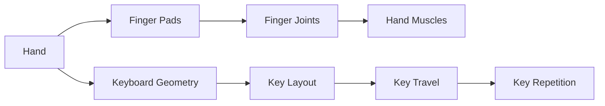

# Lesson 4: Individual Variation and Adaptation

As pianists, we often overlook the profound impact of individual differences on hand posture and keyboard geometry usage. The nuances of hand size, strength, and flexibility can significantly influence our technique, leading to inefficiencies and potential injuries. This lesson delves into the intricacies of hand posture and keyboard geometry, exploring how to adapt to individual variations and optimize performance.

## First-Principles Intuition & Invariants

When considering hand posture, it is essential to understand the biomechanical principles governing finger movement. The human hand is a complex system comprising 27 bones, 29 joints, and over 100 muscles, tendons, and ligaments. The fingers, in particular, are designed for dexterity and precision, with each digit capable of independent movement.

The key to efficient hand posture lies in the concept of "finger independence," which refers to the ability of each finger to move freely without being influenced by the others. In piano playing, finger independence is crucial for executing complex passages, arpeggios, and chord progressions. Mathematically, finger independence can be represented as a vector space, where each finger is a dimension. The ideal hand posture is one where each finger is positioned to minimize overlap and maximize independence, achieved through a combination of finger stretching, strengthening, and coordination exercises.

## Core Architecture & Mechanics

Let us dissect the internal components governing hand posture and keyboard geometry in piano playing. The hand can be thought of as a complex system comprising multiple components:

- **Finger pads**: The sensitive areas at the tips of each finger, responsible for detecting key presses.
- **Finger joints**: The articulations between each finger and the hand, allowing for flexion, extension, and rotation.
- **Hand muscles**: The groups of muscles responsible for finger movement, strength, and coordination.

The keyboard geometry, in turn, consists of:

- **Key layout**: The spatial arrangement of keys, including spacing, curvature, and layout.
- **Key travel**: The distance each key travels when pressed, affecting finger movement and key press accuracy.
- **Key repetition**: The rate at which keys repeat when held down, influencing finger independence and dexterity.

## High-Performance Optimization & Failure Modes

As pianists, we strive for optimal performance, but individual variations can lead to inefficiencies and potential injuries. To mitigate these risks, we must consider high-performance optimization and failure modes. Concurrency, the ability to perform multiple tasks simultaneously, such as playing complex passages while maintaining a steady rhythm, is essential. Resource scaling, the capacity to adapt to changing demands, such as increasing finger strength and dexterity with practice, is also crucial. Understanding the boundary edge cases, the limits of hand posture and keyboard geometry beyond which injuries or inefficiencies occur, is vital. Finally, failure mitigations, strategies for preventing or recovering from injuries, such as warm-ups, cool-downs, and regular practice, are necessary.

By understanding individual variations and adapting to them, pianists can optimize their performance, reduce the risk of injury, and achieve greater musical expression.
