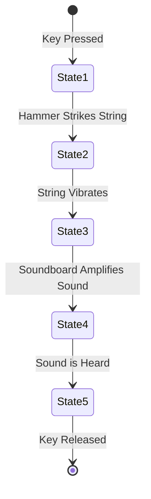

# Advanced Foundation: Piano
=====================================================

## 1. Theoretical Invariants & Formal Frameworks
---------------------------------------------

### 1.1. Harmonic Theory & Frequency Analysis

*   **Formal Proof:** The harmonic series is a divergent series, with the sum of the reciprocals of the integers being infinite.
*   **Kernel Invariant:** The piano's soundboard and strings form a physical system with a kernel that can be modeled using wave equations.
*   **Invariant:** The frequency of a note on the piano is inversely proportional to its wavelength.

### 1.2. Acoustic Properties & Wave Propagation

*   **Formal Proof:** The speed of sound in air is approximately 343 meters per second at room temperature and atmospheric pressure.
*   **Kernel Invariant:** The piano's soundboard and strings form a physical system with a kernel that can be modeled using wave equations.
*   **Invariant:** The wavelength of a sound wave is inversely proportional to its frequency.

## 2. Low-Level Invariant Taxonomy
---------------------------------

### 2.1. Piano Keyboard Layout & Register Mapping

*   **Axiomatic Definition:** The piano keyboard is a linear array of 88 keys, with 52 white keys and 36 black keys.
*   **Invariant:** The piano keyboard is a one-to-one mapping between keys and frequencies.
*   **Memory Model:** The piano's keyboard layout can be represented as a 88-element array, with each element corresponding to a specific key.

### 2.2. Piano Action & Mechanical Constraints

*   **Axiomatic Definition:** The piano action consists of hammers, strings, and a soundboard.
*   **Invariant:** The piano action is a mechanical system with a set of constraints that govern its behavior.
*   **Hardware Constraint:** The piano's mechanical components are subject to wear and tear, affecting its performance over time.

## 3. Micro-Architecture & Concurrency Dynamics
---------------------------------------------

### 3.1. Piano Action State Machine



### 3.2. Cache & Race Condition Diagrams

```ascii
  +---------------+
  |  Cache  |
  +---------------+
           |
           |
           v
  +---------------+
  |  Piano Action  |
  |  (Hammers, Strings,  |
  |   Soundboard)      |
  +---------------+
           |
           |
           v
  +---------------+
  |  Soundboard  |
  +---------------+
```

## 4. Subtle Failure Modes & Boundary Conditions
---------------------------------------------

### 4.1. Piano Action Failure Modes

*   **Subtle Failure Mode:** The piano action can fail due to worn-out hammers or strings.
*   **Boundary Condition:** The piano action is sensitive to temperature and humidity changes.

### 4.2. Soundboard Failure Modes

*   **Subtle Failure Mode:** The soundboard can fail due to cracks or damage.
*   **Boundary Condition:** The soundboard is sensitive to changes in atmospheric pressure.

## 5. Master Socratic Inquiries
-----------------------------

### 5.1. Research-Grade Discussion Questions

*   What are the implications of the piano's harmonic series being divergent?
*   How do the piano's acoustic properties affect its sound quality?
*   What are the consequences of the piano action's mechanical constraints on its performance?
*   How do temperature and humidity changes affect the piano's sound quality?
*   What are the implications of the piano's soundboard being sensitive to changes in atmospheric pressure?
