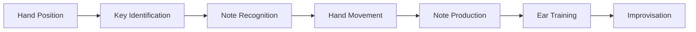

# Beginner Foundation: Piano
## 1. Everyday Intuition & First Principles

Imagine a piano as a canvas, but instead of colors, it's painted with sound. Each key is a brushstroke, and the music you create is the masterpiece. The piano's purpose is to translate your thoughts into a universal language, allowing you to express emotions and ideas through melody and harmony.

### Why Piano?

*   The piano is a versatile instrument, capable of producing a wide range of dynamics and tonal colors.
*   It's an excellent tool for learning music theory and developing hand-eye coordination.
*   The piano's expressive qualities make it an ideal instrument for composers and performers.

## 2. Foundational Vocabulary & Glossary

### Glossary

| Term | Definition | Example |
| --- | --- | --- |
| **Note** | A single sound with a specific pitch and duration | C4 (middle C) |
| **Staff** | A set of five lines and four spaces where notes are placed | |
| **Clef** | A symbol indicating the pitch range of the staff | |
| **Octave** | A range of eight consecutive notes with the same pitch | C4-C11 |
| **Rest** | A symbol indicating silence | |
| **Bar** | A group of notes with a specific time signature | |
| **Tempo** | The speed at which music is played | Allegro (fast) |
| **Dynamics** | The loudness or softness of music | Piano (soft), Forte (loud) |

## 3. Visual System Flow

## 4. Common Beginner Misconceptions & Mental Traps

*   **Mental Trap:** "I'm not musical, I'll never be able to play the piano."
*   **Reality:** Anyone can learn to play the piano with dedication and practice.
*   **Mental Trap:** "I need to practice for hours every day to see progress."
*   **Reality:** Consistency is key, but even 15-20 minutes of practice per day can be beneficial.

## 5. Socratic Discussion Starters

*   What do you think is the most challenging aspect of learning to play the piano?
*   How do you think the piano can be used to express emotions and ideas?
*   What role do you think music theory plays in the learning process?
*   How can you apply the concepts learned on the piano to other areas of your life?
