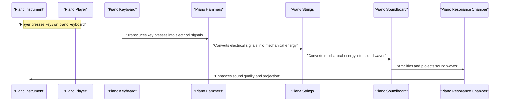

# Intermediate Foundation: Piano
=====================================

## 1. Architectural Mental Model
-----------------------------

### 1.1. Production Architecture

*   **Instrumental Layers**: Piano keyboard, hammers, strings, soundboard, and resonance chamber.
*   **Signal Flow**: Key presses → Hammer strikes → String vibrations → Soundboard amplification → Resonance chamber enhancement.
*   **Performance Loop**: Player input → Instrument processing → Sound output → Feedback loop (player adjusts input based on sound output).

### 1.2. Performance Modes

*   **Solo**: Single instrument performance with accompaniment (e.g., piano solo with orchestral backing).
*   **Ensemble**: Multiple instruments performing together (e.g., piano trio or piano quartet).
*   **Accompaniment**: Instrument providing harmonic and rhythmic support for a vocalist or other instrumentalist.

## 2. Systems Taxonomy & Component Protocols
------------------------------------------

### 2.1. Component Taxonomy

*   **Input Components**:
    *   **Keyboard**: Transduces player input into electrical signals.
    *   **Pedals**: Modulate sound characteristics (sustain, sostenuto, soft).
*   **Processing Components**:
    *   **Hammers**: Convert electrical signals into mechanical energy.
    *   **Strings**: Convert mechanical energy into sound waves.
    *   **Soundboard**: Amplifies and projects sound waves.
*   **Output Components**:
    *   **Resonance Chamber**: Enhances sound quality and projection.

### 2.2. Standard Interfaces & Protocols

*   **Key-Press Protocol**: Standardized notation for key presses (e.g., MIDI, Music21).
*   **Sound Wave Protocol**: Standardized representation of sound waves (e.g., WAV, MP3).

## 3. Multi-Component Interaction Flow
--------------------------------------

### 3.1. Detailed Sequence Diagram



### 3.2. ASCII Sequence Diagram

```
  +---------------+
  |  Player      |
  +---------------+
           |
           |
           v
  +---------------+
  |  Keyboard    |
  |  (transduces  |
  |   key presses) |
  +---------------+
           |
           |
           v
  +---------------+
  |  Hammers     |
  |  (converts    |
  |   electrical  |
  |   signals into |
  |   mechanical  |
  |   energy)     |
  +---------------+
           |
           |
           v
  +---------------+
  |  Strings     |
  |  (converts    |
  |   mechanical  |
  |   energy into  |
  |   sound waves) |
  +---------------+
           |
           |
           v
  +---------------+
  |  Soundboard  |
  |  (amplifies   |
  |   and projects |
  |   sound waves) |
  +---------------+
           |
           |
           v
  +---------------+
  |  Resonance   |
  |  Chamber     |
  |  (enhances    |
  |   sound quality|
  |   and projection)|
  +---------------+
```

## 4. Architectural Trade-offs & Production Pitfalls
---------------------------------------------------

*   **Trade-offs**:
    *   Balance between sound quality and volume.
    *   Trade-off between resonance chamber size and sound projection.
*   **Pitfalls**:
    *   Inadequate soundboard amplification.
    *   Insufficient resonance chamber enhancement.

## 5. Socratic Discussion Starters
---------------------------------

*   How do different piano designs impact sound quality and projection?
*   What are the implications of using different materials for the soundboard and resonance chamber?
*   How do the performance modes (solo, ensemble, accompaniment) influence the design of the piano instrument?
