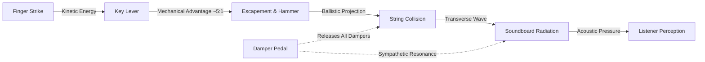

# Operational Verification Labs: Piano Performance Mechanics

## Objective & Laboratory Configuration

This laboratory provides systematic, empirical training in foundational piano performance mechanics, grounded in the biomechanics of the human motor system and the acoustic physics of the modern piano. The exercises address four core domains: kinematic control and weight transfer, finger independence through targeted motor unit recruitment, harmonic resonance manipulation via damper dynamics, and cross-limb temporal decoupling for polyrhythmic execution.

**Required apparatus:**

- Concert grand piano (9-foot Steinway Model D preferred) or high-grade digital piano with fully weighted, graded hammer-action keys (minimum 88 keys, triple-sensor key detection)
- Programmable metronome with subdivision display (capable of compound meters and polyrhythmic click tracks)
- High-fidelity audio recording system: condenser microphone pair in spaced or ORTF stereo configuration, 24-bit/96kHz minimum resolution
- Spectrogram analysis software (Audacity, Sonic Visualiser, or MATLAB with Signal Processing Toolbox)
- Video recording device for postural and kinematic review

**Environmental conditions:** Ambient temperature 20–22°C (68–72°F), relative humidity 40–50% to maintain stable action regulation and soundboard response.

## Acoustic and Mechanical Architecture of the Piano

Before commencing laboratory exercises, establish conceptual grounding in the instrument's transduction chain. The modern acoustic piano transforms mechanical energy into sound through a sequence of coupled subsystems:



The key lever operates as a class-one lever with a mechanical advantage of approximately 5:1, amplifying finger displacement while reducing force transmission. At the moment of escapement, the hammer is released into ballistic flight; the performer has no direct control over the hammer after escapement, making pre-escapement velocity the sole determinant of dynamic level.

String vibration couples to the soundboard through the bridge, which acts as an impedance transformer matching the high mechanical impedance of the steel strings (~10⁷ N/m) to the low acoustic impedance of air (~400 Pa·s/m). The soundboard's bending-wave modes radiate sound efficiently below ~1 kHz; above this frequency, longitudinal string modes and case reflections dominate the timbral spectrum.

The damper system provides temporal control over decay. When the sustain pedal is depressed, all dampers lift simultaneously, enabling three distinct acoustic phenomena:

1. **Extended decay:** The struck strings continue vibrating beyond the key release.
2. **Sympathetic resonance:** Undamped strings whose fundamental or overtones match the struck note's spectrum vibrate in sympathy, enriching the harmonic content.
3. **Cross-string coupling:** Nonlinear interaction between vibrating strings at shared overtones introduces sum and difference frequencies, perceived as subtle timbral shifts.

## Exercise 1: Biomechanical Posture and Kinematic Control

### 1.1 Postural Alignment and Ergonomic Foundation

Sit at the piano bench such that your torso is centered on middle C (C4, ~261.63 Hz). Adjust bench height so that with your hands resting on the white keys, your forearms are parallel to the floor or slope slightly downward toward the keyboard. Feet rest flat on the floor, with the right foot positioned over the sustain pedal and the left foot free or over the una corda pedal.

The spine maintains its natural S-curve; avoid anterior pelvic tilt or thoracic kyphosis, both of which restrict scapular mobility and induce premature fatigue in the shoulder girdle. Shoulders rest in neutral retraction—neither protracted forward nor excessively retracted. Elbows hang freely from the shoulder joint, creating a continuous kinematic chain from scapula to fingertip.

### 1.2 Weight Transfer and Gravitational Acceleration

The piano action requires approximately 50–60 grams of force to depress a key to the point of escapement. This force can be generated through active finger flexion (intrinsic hand muscles and flexor digitorum profundus/superficialis) or by releasing the potential energy stored in the elevated forearm, converting gravitational potential energy into kinetic energy.

**Procedure:**

1. Elevate your right hand approximately 5 cm above the keyboard, fingers in a relaxed, naturally curved position (proximal interphalangeal joints flexed ~45°, metacarpophalangeal joints ~30°).
2. Without active finger flexion, allow the hand to descend under gravity, contacting the C4 key with the fingertip (distal phalanx of digit 3, the middle finger).
3. The forearm and hand remain a single kinematic unit during descent; the wrist does not collapse into flexion or extension upon contact.
4. Upon key depression, the arm continues its downward trajectory for an additional 1–2 cm, ensuring full key travel (~10 mm on a grand piano) and optimal hammer velocity.
5. Repeat with digits 2, 3, 4, and 5 independently, observing the sensation of gravitational transfer rather than active pressing.

**Diagnostic criteria:**

- Audible tone onset is smooth, without percussive "clicking" from excessive finger velocity or insufficient follow-through.
- Forearm remains relaxed; palpate the flexor digitorum superficialis tendon at the wrist—it should not cord visibly during key depression.
- Visual inspection confirms wrist stability; no flexion or ulnar/radial deviation exceeds 10° from neutral.

Extend this exercise to scalar motion: ascend the C major scale (C–D–E–F–G–A–B–C) using the thumb-under technique (digits 1-2-3-1-2-3-4-5). Transfer weight from finger to finger via subtle lateral shifts of the forearm, maintaining continuous gravitational loading. The forearm traces a shallow arc in the horizontal plane; the wrist serves as a floating pivot, never a rigid anchor.

### 1.3 Finger Independence and Motor Unit Recruitment

The human hand evolved for manipulation and grasping, not for independent, rapid digit actuation. The flexor digitorum superficialis and profundus tendons exhibit mechanical coupling, particularly between digits 4 and 5 (ring and little fingers). Training finger independence requires selective motor unit recruitment and interhemispheric coordination.

**Procedure: Five-Finger Position (Czerny Op. 599, No. 1)**

Position the right hand over C4–G4 (digits 1 through 5 on C–D–E–F–G). Execute the following pattern at ♩ = 60 BPM:

```
Right hand: 1-2-3-4-5-4-3-2 | 1-2-3-4-5-4-3-2 | ...
(C-D-E-F-G-F-E-D | C-D-E-F-G-F-E-D)
```

Each note receives one quarter-note duration. Ensure:

- Each finger strikes independently; inactive fingers remain lightly in contact with their assigned keys but do not depress them.
- No sympathetic motion: when digit 4 strikes, digit 5 must not lift or flex involuntarily. Observe in a mirror or via video recording.
- Evenness of articulation: the inter-onset interval (IOI) between successive notes remains constant. Record and analyze IOI variance using a digital audio workstation (DAW) with MIDI export; standard deviation should not exceed 10 ms at this tempo.

**Procedure: Hanon Exercise No. 1 (Extended Independence)**

Hanon Exercise No. 1 spans two octaves and systematically stresses finger independence through repeated extension-contraction patterns:

```
Right hand ascent:  C-E-D-F-E-G-F-A-G-B-A-C-B-D-C-E (continue to C6)
Left hand descent:  C-A-B-G-A-F-G-E-F-D-E-C-D-B-C-A (continue to C2)
```

Begin at ♩ = 60 BPM. Each note is articulated with a distinct attack and immediate release (staccato). The wrist remains level; finger curvature is maintained throughout. Gradually increase tempo by 4 BPM increments over successive sessions, targeting ♩ = 120–144 BPM as a long-term goal.

**Neurophysiological rationale:** Repetitive, structured practice induces long-term potentiation in the primary motor cortex (M1) and strengthens corticospinal tract efficacy. Myelin sheath thickening in the corpus callosum facilitates bilateral coordination. Measurable outcomes include reduced reaction time, increased maximum tapping frequency, and decreased motor variability.

### 1.4 Sustain Pedal Mechanics and Harmonic Resonance

The damper (sustain) pedal controls a mechanical linkage that simultaneously lifts all 88 dampers from their respective strings. This action has profound acoustic implications:

**Experiment: Sympathetic Resonance Verification**

1. Depress the C4 key silently (slowly, avoiding hammer strike) and hold.
2. While holding C4, strike C3 (one octave below) fortissimo and immediately release the key (not the pedal, if engaged).
3. Release C4 and listen: you will hear C4 sounding faintly, excited by sympathetic resonance from C3's second harmonic (which matches C4's fundamental at 261.63 Hz).

Repeat with other intervals:

- C3 → G4 (a twelfth above): G4 resonates due to the third harmonic of C3.
- C3 → E4 (a major tenth above): E4 resonates due to the fifth harmonic of C3.

**Quantitative analysis:** Record the sympathetic resonance using a spectrum analyzer. Plot the frequency-domain representation and identify peaks at the fundamental and overtones of the struck note, plus additional peaks at the sympathetic resonators. The magnitude of sympathetic resonance depends on the quality factor (Q) of the string system; a well-maintained piano exhibits Q values of 1000–5000 for the mid-range strings.

**Half-pedaling technique:** The sustain pedal mechanism allows partial damper lift, enabling selective decay control. Depress the pedal halfway (~1 cm travel on most grand pianos); this lifts the dampers sufficiently to reduce contact force but not eliminate it entirely, resulting in ~50% decay time extension. Half-pedaling permits harmonic clarity in contrapuntal passages while avoiding excessive reverberation.

### 1.5 Polyrhythmic Independence: 3-Against-2 and Beyond

Polyrhythms challenge the brain's temporal prediction and motor sequencing systems. The canonical 3-against-2 pattern requires simultaneous execution of triplet subdivision in one hand and duple subdivision in the other.

**Procedure:**

1. Right hand: Play a steady quarter-note pulse on C4 (♩ = 60 BPM). Count aloud: "1, 2, 3, 1, 2, 3, ..."
2. Left hand: Play dotted-quarter notes on C3, yielding two notes per three right-hand attacks. Count aloud: "1, 2, 1, 2, ..." with each "1" aligned with right-hand beats 1 and 3.
3. Use a metronome with triplet subdivision enabled. The right hand plays on every triplet subdivision; the left hand plays on subdivisions 1 and 4 of a six-subdivision cycle.

**Temporal alignment diagram:**

```mermaid
gantt
    title 3-Against-2 Polyrhythm Over One Measure
    dateFormat X
    axisFormat %L

    section Right Hand (Triplets)
    Beat 1 :milestone, 0, 0
    Beat 2 :milestone, 333, 333
    Beat 3 :milestone, 667, 667
    Beat 4 :milestone, 1000, 1000
    Beat 5 :milestone, 1333, 1333
    Beat 6 :milestone, 1667, 1667

    section Left Hand (Duplets)
    Beat 1 :milestone, 0, 0
    Beat 2 :milestone, 1000, 1000
    Beat 3 :milestone, 2000, 2000
```



**Advanced polyrhythms:** Progress to 4-against-3, 5-against-4, and 5-against-3 patterns. For 4-against-3, the least common multiple is 12; thus, both hands' attacks are distributed across 12 subdivisions per cycle. The right hand plays on subdivisions {0, 3, 6, 9}, and the left hand on subdivisions {0, 4, 8}.

**Neurological substrate:** fMRI studies demonstrate that polyrhythmic performance activates the supplementary motor area (SMA), cerebellum, and basal ganglia. The SMA encodes hierarchical temporal structures; cerebellar Purkinje cells provide precise timing signals; and the basal ganglia gate motor program execution.

## Exercise 2: Parameter Variation and Empirical Analysis

### 2.1 Keystroke Velocity and Tonal Dynamics

The velocity of the hammer at string impact determines both the amplitude (loudness) and the spectral envelope (brightness) of the resulting tone. Higher velocities increase the amplitude of all partials but disproportionately emphasize higher harmonics, yielding a brighter, more penetrating timbre.

**Hypothesis:** Keystroke velocity correlates linearly with radiated sound pressure level (SPL) and nonlinearly with spectral centroid (a measure of brightness).

**Procedure:**

1. Position the microphone 1 meter from the piano soundboard, directed at the treble bridge.
2. Play a C major scale (C4–C5) at three dynamic levels:
   - *Pianissimo* (pp): Finger velocity ~0.5 m/s at escapement
   - *Mezzo-forte* (mf): Finger velocity ~1.5 m/s at escapement
   - *Fortissimo* (ff): Finger velocity ~3.0 m/s at escapement
3. Record each scale in isolation at 24-bit/96kHz resolution.

**Analysis protocol:**

1. Import recordings into a DAW or signal analysis platform (Python with `librosa`, MATLAB, or Sonic Visualiser).
2. For each note, extract:
   - **Peak SPL (dB):** Maximum RMS amplitude in a 50 ms window following onset.
   - **Spectral centroid (Hz):** Center of mass of the magnitude spectrum, computed as:
     $$\text{Centroid} = \frac{\sum_{k} f_k \cdot |X(f_k)|}{\sum_{k} |X(f_k)|}$$
     where $X(f_k)$ is the magnitude spectrum.
   - **Attack time (ms):** Duration from onset to peak amplitude.

**Expected results:**

- SPL increases approximately logarithmically with hammer velocity: a doubling of velocity yields ~6 dB increase.
- Spectral centroid increases nonlinearly, often doubling from pp to ff (e.g., 800 Hz → 1600 Hz).
- Attack time decreases with increasing velocity, reflecting more abrupt string displacement.

**Graphical representation:** Plot SPL and spectral centroid versus dynamic marking. Overlay waveforms and spectrograms for pp, mf, and ff iterations of the same note to visualize harmonic enrichment.

### 2.2 Pedaling Strategies and Decay Envelopes

The sustain pedal modulates the decay phase of each note's envelope. Without pedal, dampers arrest string vibration within 50–200 ms of key release. With full pedal, decay times extend to 5–15 seconds depending on register and string length.

**Procedure:**

1. Program a C major triad (C4–E4–G4) arpeggiated as quarter notes: C, E, G, C (one octave higher).
2. Perform under three pedaling conditions:
   - **No pedal:** Dampers engage immediately upon key release.
   - **Full pedal:** Depress pedal before first note, hold throughout.
   - **Half-pedal:** Depress pedal 50%, hold throughout.
   - **Syncopated pedal:** Depress pedal immediately after each note onset, release just before the next note.
3. Record each performance in a quiet environment (ambient noise floor <30 dB SPL).

**Analysis protocol:**

1. Extract the decay envelope for the final C5 note in each condition.
2. Fit an exponential decay model: $A(t) = A_0 \cdot e^{-t/\tau}$, where $\tau$ is the decay time constant.
3. Compute the RT60 (reverberation time): duration for SPL to decrease by 60 dB.

**Expected results:**

| Condition       | Decay Time $\tau$ (s) | RT60 (s) | Subjective Quality                  |
|-----------------|-----------------------|----------|-------------------------------------|
| No pedal        | 0.1–0.2               | 0.5–1.0  | Dry, articulated, staccato          |
| Full pedal      | 2.0–4.0               | 8.0–15.0 | Lush, blended, potential muddiness  |
| Half-pedal      | 0.8–1.5               | 3.0–6.0  | Balanced, controlled resonance      |
| Syncopated pedal| 1.0–2.0               | 4.0–8.0  | Clear attacks, sustained harmony    |

**Spectral analysis:** Generate spectrograms for each pedaling condition. Observe that full pedal introduces dense clusters of sympathetic resonances across the entire frequency range, whereas no pedal yields isolated spectral lines corresponding only to the struck notes.

### 2.3 Touch Weight and Action Regulation

Modern piano actions exhibit a down-weight (force required to depress a key slowly) of 45–55 grams and an up-weight (force required to prevent a depressed key from returning) of 20–30 grams. These parameters are adjustable via action regulation and significantly affect the performer's biomechanical efficiency and tonal control.

**Diagnostic experiment:** Use a precision gram scale to measure the down-weight of five keys spanning the keyboard (A0, C2, C4, C6, C8). Record variations; deviations exceeding ±5 grams indicate regulation inconsistencies requiring technician intervention.

## Exercise 3: Fault Injection and Stress Testing

### 3.1 Fatigue-Induced Motor Degradation

Sustained practice induces peripheral fatigue in the intrinsic hand muscles (lumbricals, interossei) and extrinsic flexors. Fatigue manifests as increased motor variability, decreased maximum voluntary contraction (MVC), and altered kinematic strategies (e.g., increased wrist motion to compensate for diminished finger strength).

**Procedure:**

1. Establish baseline: Record yourself performing Hanon Exercise No. 1 at ♩ = 108 BPM for two minutes. Analyze inter-onset interval variance and dynamic consistency.
2. Induce fatigue: Perform the same exercise continuously for 20 minutes without rest, gradually increasing tempo to ♩ = 132 BPM.
3. Immediate post-fatigue: Record the exercise again at the baseline tempo (♩ = 108 BPM).
4. Quantify degradation:
   - **Timing variability:** Compute coefficient of variation (CV) of inter-onset intervals. Expect CV to increase by 30–100% post-fatigue.
   - **Dynamic variability:** Measure standard deviation of MIDI velocity values. Expect increased variance post-fatigue as fine motor control deteriorates.
   - **Kinematic compensation:** Video analysis may reveal increased wrist elevation, shoulder hiking
