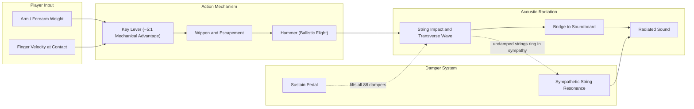
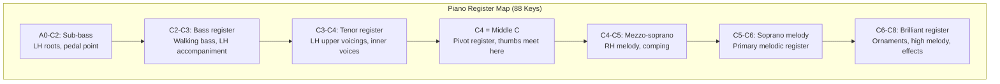
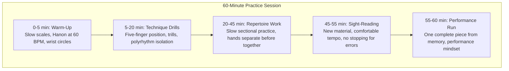
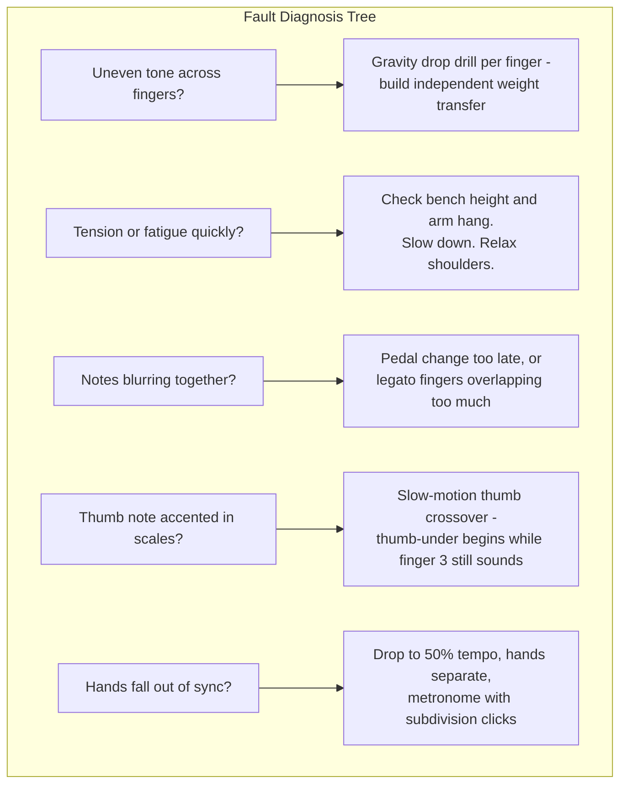

```mermaid
gantt
    title 3-Against-2 — Six-Unit Grid (One Measure)
    dateFormat X
    axisFormat %L

    section sub_rh ["Right Hand: Triplet, 3 Notes"]
    RH Note 1 : milestone, 0, 0
    RH Note 2 : milestone, 666, 666
    RH Note 3 : milestone, 1333, 1333

    section sub_lh ["Left Hand: Duplet, 2 Notes"]
    LH Note 1 : milestone, 0, 0
    LH Note 2 : milestone, 1000, 1000
```

# Piano Performance Masterclass: Mechanics, Technique, and Artistry

## Overview and Learning Objectives

This masterclass trains four pillars of piano mastery: posture and weight transfer, finger independence, pedaling artistry, and polyrhythmic two-hand independence. Every drill is executable at your bench today. Theory appears only where it directly changes what your hands do.

By the end of this module you will be able to:

- Produce a singing *cantabile* tone through gravitational arm weight rather than muscular pressing
- Play Hanon No. 1 and Czerny Op. 599 No. 1 cleanly at ♩ = 120 BPM with even inter-onset timing
- Execute syncopated pedaling through a I–IV–V–I progression with zero harmonic smear
- Play a 3:2 polyrhythm with full hand independence at ♩ = 80 BPM

**What you need:**

- 88-key acoustic piano or fully weighted digital action (graded hammer, triple-sensor detection preferred)
- Metronome with subdivision/polyrhythm click modes (Soundbrenner, or any metronome app with subdivision accents)
- Optional: recording device (phone is fine) for tone and posture self-review

---

## Part 1: The Instrument's Energy Chain (Why Touch Shapes Sound)

You don't need to study piano acoustics to play beautifully, but one mechanical fact changes how you approach the keys permanently.

> **The hammer leaves your control at escapement.** Roughly 2–3 mm before the key bottom, the escapement mechanism releases the hammer into free flight toward the string. From that instant you cannot add or remove energy — the hammer is a ballistic projectile. The *only* variable you control is the velocity you gave it before release.

This is why pressing harder after the key is already down does nothing to the sound, and why two pianists can play the same note at the same final key-bottom position with completely different tone — the difference lives entirely in the approach, not the destination.



**Practical takeaway:** Arm weight released smoothly into the key through escapement gives a warm, full tone. Fingers stabbing down from above the keys give a thin, percussive click regardless of final loudness. Every drill in Part 3 is built around training the first sensation and eliminating the second.

---

## Part 2: Posture and Ergonomic Foundation

Wrong bench height causes wrist injury over months of practice. Wrong bench distance forces shoulder compensation that caps your velocity control permanently. Fix this before anything else.

### 2.1 Bench Height and Seating Position

**Setup checklist:**

1. Sit on the front half of the bench, not pressed against the backrest (there usually isn't one). This frees the hip joint and lets you lean into the keys when a passage needs it.
2. Adjust height so your forearms are level, or angled very slightly downward, from elbow to keyboard. Forearms rising above horizontal means your wrists are collapsing to compensate. Forearms dropping steeply means your shoulders are doing work they shouldn't.
3. Sit close enough that your elbows hang just in front of your torso. Extend your arms forward — your fingertips should land on the keys without reaching or hunching your shoulders forward.
4. Right foot rests over the sustain pedal, heel on the floor, pedaling from the ankle, not the whole leg. Left foot flat on the floor or resting on the soft pedal.
5. Spine in a neutral S-curve, as if a string pulls the crown of your head upward. Shoulders hang loose — don't raise or round them forward.

**Quick self-test:** Hands in C major position, eyes closed. Scan from neck to fingertips. Any tension you find, fix the setup before you play a single note.

### 2.2 Hand Arch and Finger Curvature

- Fingers curved as if lightly holding a tennis ball — the first knuckle from the fingertip (DIP) bent gently, the knuckle at the hand (MCP) bent more, around 30°.
- Thumb angled in at roughly 45° to the key surface, striking with the outer corner of the tip, not the flat pad.
- The knuckle bridge across the back of the hand (where fingers meet the palm) stays raised. If it collapses inward, your fingers lose leverage and every note becomes a push instead of a controlled drop.
- Trim nails short. Clicking on the keys means nail contact before fingertip contact — that click is baked into your tone whether you want it or not.

**Common fault — the flat hand:** letting fingers straighten locks the wrist and kills dynamic control. If you notice your fingertips sliding instead of rolling off the key, your hand has flattened. Reset the arch and continue.

---

## Part 3: Weight Transfer and Tone Production

### 3.1 Gravity Drop Exercise (Free-Fall Tone)

This isolates the sensation of letting arm weight fall into the key rather than pressing it down. Target: a round *mezzo-forte* tone with zero percussive edge on attack.

**Drill procedure:**

1. Raise your right hand about 5 cm above middle C (C4), fingers relaxed in their natural curve.
2. Without actively flexing the finger, let the whole hand fall under gravity. Finger 3 makes contact first.
3. As the key descends, let the arm's downward motion continue through the key bottom rather than stopping dead at contact — think of your hand sinking into the key, not bouncing off it.
4. After full key travel (~10 mm grand, ~6–8 mm digital), the finger rests at the bottom and the forearm goes slack.
5. Lift and repeat.

**What you should hear:** a warm tone with no edge. A percussive click means your finger was moving too fast relative to your arm at the moment of contact — slow the drop and let gravity, not muscle, do the work.

**Extend to all five fingers** on C4: 1, 2, 3, 4, 5 individually. Fingers 4 and 5 will feel weaker and less controlled — that's the shared flexor tendon anatomy, not a flaw in your technique. The drill is training the sensation of release, not building strength.

**Metronome target:** ♩ = 40 BPM, one drop per beat. Slow is deliberate here — speed is the last thing you add, never the first.

### 3.2 Lateral Weight Transfer Across a Scale

Good scale technique is a continuous lateral shift of forearm weight from finger to finger. The thumb-under crossing is a forearm rotation (supination), not a wrist flick.

**C Major Scale — Right Hand:**

```text
Key:    C   D   E   F   G   A   B   C
Finger: 1   2   3   1   2   3   4   5
                    ↑
         Thumb tucks under while finger 3 is still sounding E
```

**C Major Scale — Left Hand:**

```text
Key:    C   B   A   G   F   E   D   C
Finger: 5   4   3   2   1   3   2   1
                     ↑
         Finger 3 crosses over the thumb as thumb plays F
```

**Execution cues:**

- Forearm glides horizontally like a single continuous stroke — no stop-and-restart between notes.
- Wrist is a floating pivot, not a fixed anchor — it drifts slightly toward whichever finger is about to play.
- The thumb starts moving under the palm *while finger 3 is still playing E*, not after. If you wait, you get a hiccup in the scale.
- No accent on the thumb note. This is the single most common scale fault: players unconsciously brace for the crossing and the thumb lands harder than its neighbors.

**Tempo progression — practice hands separately until Phase 3 before combining:**

| Phase | Tempo | Focus |
|---|---|---|
| 1 | ♩ = 50 BPM | Gravity drop on each note, zero tension |
| 2 | ♩ = 72 BPM | Smooth lateral shift, even tone across all 8 notes |
| 3 | ♩ = 100 BPM | Thumb-under invisible, no accent on the crossing |
| 4 | ♩ = 120 BPM | Add phrasing — shape a crescendo on the ascent |

---

## Part 4: Finger Independence Drills

Fingers 4 and 5 share a branch of the flexor digitorum profundus tendon, which is why finger 4 feels sluggish and drags finger 5 along with it when you try to move it alone. This is anatomy, not weakness — you train around it with deliberate isolation, not brute repetition.

### 4.1 Five-Finger Position — Czerny Op. 599 No. 1

Right hand in C major five-finger position: thumb on C4, fingers 2–5 on D–E–F–G.

```text
RH: 1-2-3-4-5-4-3-2 | 1-2-3-4-5-4-3-2 | ...
    C-D-E-F-G-F-E-D | C-D-E-F-G-F-E-D

LH: 5-4-3-2-1-2-3-4 | 5-4-3-2-1-2-3-4 | ...
    C-D-E-F-G-F-E-D | C-D-E-F-G-F-E-D   (one octave lower)
```

One note per quarter note at target tempo.

**Watch for:**

- **Sympathetic lift:** when finger 4 plays F, finger 5 should stay resting lightly on G, not pop up. That involuntary lift is the clearest sign of insufficient independence — check it in a mirror or on video.
- **Uneven tone:** fingers 2 and 5 tend to sound louder than 3 and 4 by default. Record yourself and level them out.
- **Wrist pumping:** the wrist stays level. Pumping is a compensation for weak fingers trying to borrow arm momentum — resist the urge.

**Tempo progression:**

| Phase | Tempo | Hands |
|---|---|---|
| 1 | ♩ = 60 BPM | Separate |
| 2 | ♩ = 72 BPM | Together |
| 3 | ♩ = 88–100 BPM | Together, staccato variant |
| 4 | ♩ = 112 BPM | Legato, full dynamic range pp to ff |

### 4.2 Hanon Exercise No. 1 — Two-Octave Pattern

The ascending figure stresses the 1-2 and 4-5 stretches; the descent stresses 5-4 and 2-1 coordination.

```text
RH Ascending (C4 → C6):
C-E-D-F-E-G-F-A-G-B-A-C-B-D-C...
1-3-2-4-3-5-4-5-4-5-4-5-4-5-4

LH Ascending (one octave lower, mirrored motion):
C-A-B-G-A-F-G-E-F-D-E-C-D-B-C...
```

**Execution rules:**

1. Each note non-legato — a slight separation between attacks, not staccato and not fully connected. This keeps each note's clarity audible for self-assessment.
2. Wrist level, no bobbing.
3. Fingers stay compact over the keys — no more than 1–2 cm of lift between strikes. Flying fingers cost you speed later.
4. Hands move in rhythmic unison. If they drift apart, slow down immediately rather than pushing through the misalignment — misalignment practiced is misalignment learned.

**Tempo progression:**

| Session | Tempo | Daily duration |
|---|---|---|
| Week 1 | ♩ = 60 BPM | 5 min |
| Week 2 | ♩ = 72 BPM | 5 min |
| Week 3 | ♩ = 84 BPM | 7 min |
| Week 4 | ♩ = 96 BPM | 7 min |
| Month 2+ | ♩ = 108–120 BPM | 10 min |

**Stop and assess:** tension anywhere — forearm, wrist, shoulder — means stop immediately, shake the hands out loosely, and drop the tempo next time. Tension pushed through gets practiced into the motor pattern, and then you have to un-learn it later, which costs far more time than slowing down now.

### 4.3 Trilled Finger Isolation

**Procedure per finger pair:**

1. Hold down the fingers NOT in the trill silently on their keys. To drill 3-4: press and hold 1, 2, and 5 silently while only 3 and 4 alternate.
2. Trill the pair as evenly and fast as you can hold for 15 seconds.
3. Rest 30 seconds. Repeat 3 times.

**Pairs in order of difficulty:**

| Pair | Keys (RH) | Difficulty |
|---|---|---|
| 1–2 | C–D | Easy |
| 2–3 | D–E | Easy |
| 1–3 | C–E | Moderate |
| 3–4 | E–F | Hard — tendon coupling |
| 4–5 | F–G | Hardest — tendon coupling |

For 3-4 and 4-5, expect slow, uneven results at first. This is normal anatomy, not poor technique. Four to six weeks of daily short sessions produces measurable, audible improvement in trill evenness — track it by recording a 10-second trill each week and comparing.

---

## Part 5: Sustain Pedal Technique

The sustain pedal is not an on/off switch for "more sound" — it's a tool for legato connection and harmonic resonance, and misused it turns a clean passage into mud.

### 5.1 Sympathetic Resonance — Ear Training Experiment

**Procedure:**

1. Silently depress C4 — press the key slowly enough that the hammer never strikes the string, only the damper lifts. Hold it down.
2. Strike C3 fortissimo and release the key immediately (keep C4 held).
3. Release C4 and listen. You'll hear C4 ringing faintly on its own. C3's second harmonic matches C4's fundamental, so C4's string picked up the vibration sympathetically through the soundboard.

**Extend the experiment:**

| Strike | Hold silently | Interval | Why it resonates |
|---|---|---|---|
| C3 | G4 | 12th | G4 matches C3's 3rd harmonic |
| C3 | E4 | 10th (major) | E4 approximates C3's 5th harmonic |
| C3 | Bb4 | Minor 10th | Bb4 approximates C3's 7th harmonic |

**Musical application:** every note you play while the pedal is down turns every other undamped string into a potential resonator for it. This is the acoustic basis of *resonant pedaling* (holding the pedal to build a harmonic bloom under a melody) versus *dry pedaling* (using short pedal touches purely for legato, minimizing resonance buildup).

### 5.2 Syncopated (Legato) Pedaling

The pedal changes *after* the new chord attacks, never before. This clears the old harmony while preserving the legato connection into the new one.

**Foot mechanics for a I–IV–V–I cadence (C–F–G–C):**

```text
Hands:   C (strike)    F (strike)    G (strike)    C (strike)
Foot:    ↓hold    ↑↓hold      ↑↓hold      ↑↓hold     ↑
                  release+re-depress   release+re-depress   release+re-depress
                  (immediately AFTER   (immediately AFTER   (immediately AFTER
                   F sounds)            G sounds)            C sounds)
```

**Step-by-step:**

1. Strike C major, depress the pedal at the same instant.
2. Strike F major. At the exact moment your fingers hit F, release the pedal and re-depress it in one fast motion — under 100 ms total.
3. That brief release clears the C harmony before the pedal recaptures F. The overlap between finger attack and pedal change is what makes it sound legato instead of choppy.
4. Repeat into G, then back to C.

**Common fault — early pedal change:** lifting the pedal *before* the new chord creates an audible dry gap in the middle of a phrase that's supposed to sound continuous. The new note triggers the pedal change — it never anticipates it.

**Practice sequence:**

| Step | Exercise | Tempo |
|---|---|---|
| 1 | I–IV–V–I, whole notes | ♩ = 50 BPM |
| 2 | I–ii–V–I, half notes | ♩ = 60 BPM |
| 3 | Alberti bass LH + melody RH, C major | ♩ = 66 BPM |
| 4 | Mozart Sonata K. 331, Theme, with syncopated pedal | ♩ = 76 BPM |

### 5.3 Half-Pedaling

Half-pedaling lifts the dampers only partially, adding shimmer without the full blur of a complete lift. Essential for Baroque transcriptions and Classical sonatas, where full pedal smears the voice-leading you worked to make clear.

**How to execute:** depress the pedal to roughly 1 cm of travel on a grand — about halfway down. You'll feel more resistance than free air, but the dampers stay close enough to the strings to partially damp them. The result: longer decay than no pedal, but far less resonance buildup than a full lift.

**Ear test:** play a C major scale with constant half-pedal. Each note should ring slightly longer than dry, but you should still hear each pitch distinctly, not a wash. If it blurs, you've pressed too deep — back off until the scale stays transparent.

---

## Part 6: Harmonic Voicing and Chord Comping

### 6.1 Root Position vs. Inversions — Voice Leading

Root position on every chord change is the fastest way to sound amateur. The ear tracks the top voice of a chord most strongly, then the bass line. Smooth voice leading means moving each inner voice the minimum distance necessary.

**C major → F major, two approaches:**

```text
Root position (leaps):         C-E-G  →  F-A-C
First inversion (smooth):      C-E-G  →  C-F-A    (C stays, E→F, G→A, all by step or held)
```

**Four-voice SATB, C major → G major:**

```text
Soprano: E → D   (step down)
Alto:    C → B   (step down)
Tenor:   G → G   (common tone, held)
Bass:    C → G   (fifth down, conventional root motion)
```

### 6.2 Rootless Jazz Voicings — A and B Forms

Jazz comping drops the root (the bassist covers it) to pack more color into the mid-register. Two forms cover every ii–V–I.

```text
Cmaj7:
A Form (3rd on bottom): LH: E-G-B-D   (3-5-7-9)
B Form (7th on bottom): LH: B-D-E-G   (7-9-3-5)

G7:
A Form: LH: B-D-F-A   (3-5-b7-9)
B Form: LH: F-A-B-D   (b7-9-3-5)
```

**ii–V–I in C, rootless:**

```text
Dm7 (A Form)     G7 (B Form)      Cmaj7 (A Form)
LH: F-A-C-E  →   LH: F-A-B-D  →   LH: E-G-B-D
```

Notice F and A are literally held between Dm7 and G7 — only C moves to B and E stays put between the last two chords. This near-stationary voice leading is why rootless voicings sound so smooth; your hand barely moves while the harmony changes completely underneath.

**Practice drill:** cycle of fourths (C→F→Bb→Eb→Ab→Db→Gb→B→E→A→D→G→C), ii–V–I rootless in each key. Start ♩ = 60 BPM, target ♩ = 100 BPM over four weeks.

### 6.3 Keyboard Geometry — The Register Map



---

## Part 7: Polyrhythmic Independence

Polyrhythms are not a trick — they're foundational to jazz, West African percussion traditions, and Romantic-era piano writing (Chopin and Brahms lean on 3:2 constantly). The fastest route is replacing abstract counting with a shared subdivision grid both hands lock into.

### 7.1 Three Against Two (3:2)

3 even attacks in one hand against 2 even attacks in the other, both spanning the same measure.

**The chant method — do this before touching the keys:**

Speak aloud: **"Not-dif-fi-cult"** (four syllables, but the rhythm maps to a 6-unit grid):

```text
6-unit grid:   1    2    3    4    5    6
RH (triplet):  X         X         X
LH (duplet):   X              X
```

"NOT" and the midpoint land together — that's your sync check. Clap both hands against your own voice until it's automatic, then move to the keyboard.

**At the keyboard:**

```text
RH: C5 three times evenly across one measure (triplet feel)
LH: C3 two times evenly across the same measure (duplet feel)
```



**Practice sequence:**

| Step | Action | Tempo |
|---|---|---|
| 1 | Chant and clap both rhythms together | No metronome |
| 2 | RH alone, C5, triplets | ♩ = 60 BPM |
| 3 | LH alone, C3, duplets | ♩ = 60 BPM |
| 4 | Both hands together | ♩ = 60 BPM |
| 5 | Add musical content — RH melody, LH block chords | ♩ = 72 BPM |
| 6 | Fluency target | ♩ = 88–100 BPM |

### 7.2 Four Against Three (4:3)

LCM of 4 and 3 is 12 — both hands' attacks land on a shared 12-unit grid.

```text
12-unit grid:  1  2  3  4  5  6  7  8  9  10 11 12
RH (4 notes):  X        X        X        X
LH (3 notes):  X           X           X
```

RH plays on units {1, 4, 7, 10}. LH plays on units {1, 5, 9}.

**Chant method:** "Pas-sa-ca-glia" in the right hand's four-feel overlaid against the same word stretched across a triplet feel in the left — or simply count aloud to 12 while tapping both patterns against the numbers. The 12-grid makes every attack's placement exact rather than approximate.

**Metronome setting:** set the click to the 12-subdivision unit itself, not the quarter-note beat. At ♩ = 60 BPM subdivided into 12, that's a click every 83 ms. Land both hands' attacks exactly on their assigned clicks — this is slower and more mechanical than the chant method but removes all ambiguity once the feel starts to drift.

### 7.3 Polyrhythm Reference and Practice Order


Master 3:2 completely before starting 4:3 — the chant-and-grid method transfers directly, and skipping ahead just means re-learning the method under a harder ratio.

---

## Part 8: Dynamic Control and Touch Varieties

### 8.1 The Five Touch Types

| Touch Type | Mechanism | Sound | Typical Use |
|---|---|---|---|
| Legato | Next finger depresses before the previous lifts | Seamless, connected | Melodic lines, slow passages |
| Non-legato | Slight gap between notes (~10 ms) | Clear, articulate | Classical and Baroque style |
| Staccato | Note held to roughly 50% of written value | Detached, bouncy | Light textures, dance rhythms |
| Tenuto | Full value, slight extra weight | Emphasized | Important melodic notes |
| Portato | Between legato and staccato — separated but not short | Sighing, gently detached | Romantic phrasing |

**Drill:** play C–D–E–F–G–F–E–D–C five times, a different touch type each pass, no metronome. Record and check whether all five passes sound distinguishable from each other — if two sound the same, slow down and isolate what's different about the mechanism.

### 8.2 Dynamic Staircase Drill

**Ascending:** C2–C3 *ppp*, C3–C4 *pp*, C4–C5 *mp*, C5–C6 *mf*, C6–C7 *f*.
**Descending:** C7–C6 *ff*, C6–C5 *f*, C5–C4 *mf*, C4–C3 *mp*, C3–C2 *p*.

Each octave transition should feel seamless, no sudden jump at the crossover.

**Physical mechanism per level:**

- *ppp–pp*: finger barely lifts off the key surface. Gravity does all the work; the arm's weight is completely released from the hand.
- *mp–mf*: a small amount of intentional forearm weight added on top of gravity. The arm supports its own weight rather than hanging slack.
- *f–ff*: active forearm and upper-arm engagement, shoulder girdle included. The feel is a controlled throw of weight into the key, never a stab from the fingers alone.

---

## Part 9: Sight-Reading and Practice Methodology

### 9.1 Sight-Reading Protocol

Dedicate a minimum of 10 minutes per session exclusively to material you've never played before. Sight-reading is a separate skill from repertoire learning and atrophies fast without dedicated practice.

**Five-second preview, before the first note:**

1. Key signature — which accidentals are in force?
2. Time signature — what's the underlying subdivision feel?
3. Tempo and character marking.
4. Highest and lowest notes — where do your hands need to be positioned?
5. Any repeating rhythmic motif you can identify in advance.

**Eyes-ahead reading:** train your eyes to stay 1–2 beats ahead of what your hands are currently playing. Practice this on familiar pieces first: deliberately keep your eyes 2 beats forward of the current note, forcing your hands to play from short-term memory while your eyes scout ahead. Gradually extend the gap.

### 9.2 Structured 60-Minute Practice Session



**The four-stage learning model for any new passage:**

1. Hands separate, slow (50% target tempo) — understand each hand's part independently.
2. Hands separate, faster (75% target tempo) — secure the motor pattern.
3. Hands together, slow (50% target tempo) — integrate coordination from scratch.
4. Hands together, gradually faster (75% → 90% → 100%) — build toward performance tempo.

Never jump to step 3 until 1 and 2 are solid. Combining hands too early, before each hand's motor pattern is independently secure, is the single most common cause of practice time that doesn't translate into progress.

### 9.3 Deliberate Error Correction — Shrink and Surround

1. Identify the exact note where the error occurs (e.g., the thumb crossing at beat 3).
2. Isolate a 3–4 note window around it: 1–2 notes before, 1–2 after.
3. Practice only that micro-passage at 40% target tempo until flawless — 20 repetitions minimum.
4. Expand the window to 8 notes, repeat the process.
5. Expand to the full phrase, then play at 60%, 80%, 100% tempo in sequence.

Repeating the full piece hoping the error resolves itself just re-practices the surrounding context around a mistake that never gets isolated — it's slower and less reliable than shrink-and-surround.

---

## Part 10: Performance Faults and Corrections

### 10.1 Fault Diagnosis



### 10.2 Injury Prevention

| Warning Sign | Immediate Action | Likely Cause |
|---|---|---|
| Sharp pain in wrist or finger | Stop immediately, no playing through it | Possible tendon strain — see a physician |
| Dull forearm ache after practice | Reduce intensity, recheck bench height, lengthen warm-up | Overuse of extrinsic flexors |
| Numbness in fingers 4–5 | Check elbow resting position | Ulnar nerve pressure, cubital tunnel risk |
| Shoulder or neck tension while playing | Reset posture, drop tempo 20%, add shoulder stretches | Bench too low or too far from keyboard |
| Finger 3–4 trill feels locked | Don't force speed — do slow isolation work instead | Normal tendon coupling, needs patience not force |

**Daily warm-up (before playing):**

1. Wrist circles, 10 each direction.
2. Finger spread stretch — spread all five wide, hold 5 sec, 5 repetitions.
3. Prayer stretch — palms together, fingers up, lower hands until mild wrist stretch, hold 20 sec.
4. Slow C major scale, hands separate, ♩ = 50 BPM, pure proprioceptive warm-up, zero effort.

**Cooldown (after playing):**

1. Forearm shake-out, loose gravity-led wrist shake, 30 sec.
2. Fingers interlaced, reverse prayer stretch (fingers pointing down), 20 sec.
3. Shoulder rolls, 5 forward, 5 back.

---

## Appendix: Tempo Targets and Benchmarks

| Exercise | Beginner | Intermediate | Advanced |
|---|---|---|---|
| C Major Scale, hands separate | ♩ = 60 | ♩ = 100 | ♩ = 144 |
| C Major Scale, hands together | ♩ = 50 | ♩ = 88 | ♩ = 132 |
| Czerny Op. 599 No. 1 | ♩ = 60 | ♩ = 100 | ♩ = 120 |
| Hanon No. 1 | ♩ = 60 | ♩ = 100 | ♩ = 120–144 |
| Trill, 3–4 finger pair | 4 notes/sec | 6 notes/sec | 8+ notes/sec |
| 3:2 Polyrhythm | ♩ = 60 | ♩ = 80 | ♩ = 100 |
| ii–V–I rootless, all 12 keys | 2 min/cycle | 90 sec/cycle | 60 sec/cycle |
| Sight-reading rhythmic accuracy | 70% | 85% | 95% |

Move through these at your own pace. The numbers exist to give concrete targets, not to create pressure — consistency across months outweighs tempo achieved in any single session.
