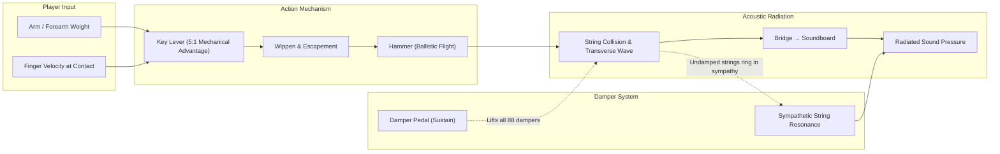
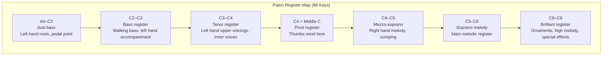
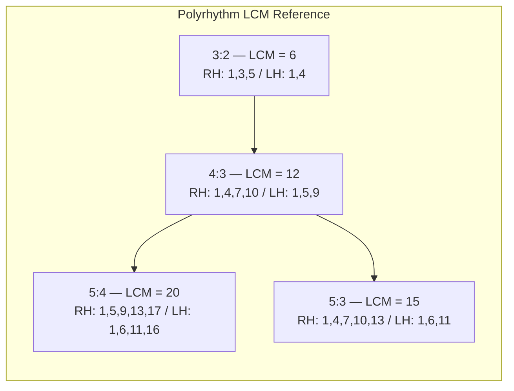
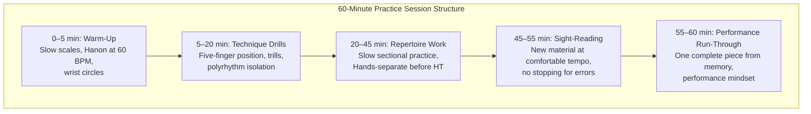
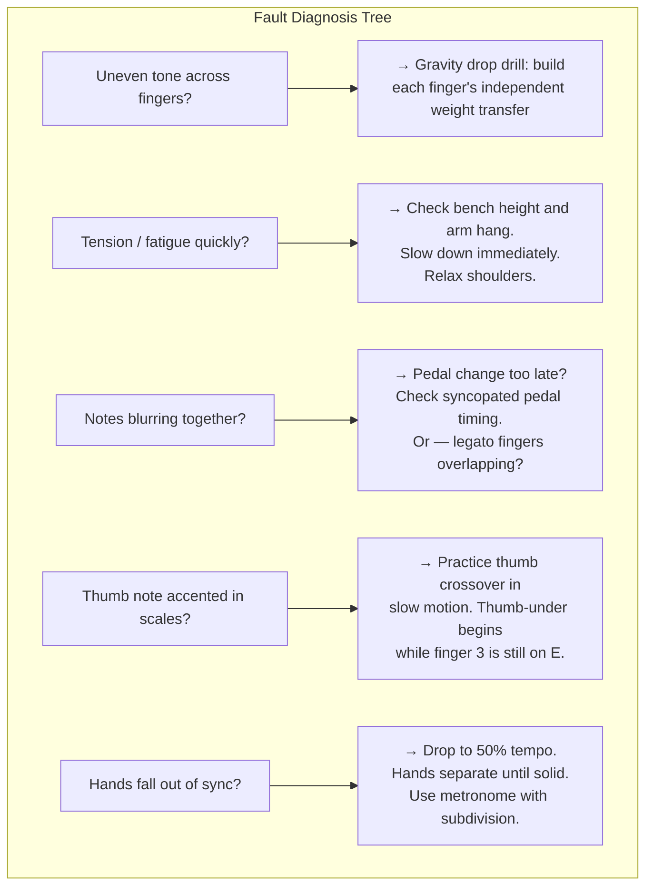

# Piano Performance Masterclass: Mechanics, Technique, and Artistry

## Overview and Learning Objectives

This masterclass delivers hands-on, biomechanically grounded training across four pillars of piano mastery: posture and weight transfer, finger independence, pedaling artistry, and polyrhythmic two-hand independence. Every exercise is immediately executable at your bench. Theory appears only where it directly informs your physical execution.

By the end of this module you will be able to:

- Produce a singing *cantabile* tone through gravitational arm weight rather than muscular pressing
- Play Hanon No. 1 and Czerny Op. 599 exercises cleanly at ♩ = 120 BPM with even inter-onset intervals
- Demonstrate syncopated pedaling through a I–IV–V–I progression without harmonic smearing
- Execute a 3:2 polyrhythm independently in each hand at ♩ = 80 BPM

**What you need:**

- 88-key acoustic or digital piano (fully weighted, graded-hammer action; triple-sensor detection strongly preferred)
- Programmable metronome with subdivision modes (compound and polyrhythmic click capability)
- Optional: DAW or MIDI interface to analyze inter-onset interval (IOI) variance
- Optional: mirror or phone on a stand for posture and kinematic self-review

---

## Part 1: The Instrument's Energy Chain (Why Touch Shapes Sound)

You do not need to understand piano acoustics to play beautifully — but understanding *one* key fact will immediately change how you approach the keys.

> **The hammer leaves your control at escapement.** At roughly 2–3 mm before the key bottom, the escapement mechanism releases the hammer into free flight. From that moment, you cannot add or subtract energy. Pre-escapement velocity is the *only* variable you control.

This means tone quality is determined by *how you approach* the key, not by how hard you press once it is down. The mermaid diagram below maps the energy path from your fingertip to the listener's ear.



**Practical takeaway:** Heavy, gravity-led arm weight reaching the escapement point smoothly → warm, full sound. Fingers stabbing down from above → thin, percussive click. Keep this in mind through every drill below.

---

## Part 2: Posture and Ergonomic Foundation

### 2.1 Bench Height and Seating Position

Getting posture right is not cosmetic. Wrong bench height causes wrist injury; wrong seat distance forces shoulder compensation that ruins your velocity control.

**Setup checklist:**

1. Sit on the front half of the bench — not all the way back. This frees your hip joint and lets you lean into the keyboard when needed.
2. Adjust height so your **forearms are level or angled very slightly downward** to the keyboard when your hands rest on the keys. Forearms above horizontal = wrists collapsing. Forearms angled steeply downward = shoulder tension.
3. Distance from the keyboard: your elbows should hang just in front of your torso, not behind it. Extend your arms — fingertips should land naturally around middle C without reaching or hunching.
4. Right foot covers the sustain pedal. Left foot rests flat on the floor (or on the una corda pedal).
5. Spine in neutral S-curve. Imagine a string pulling the crown of your head straight upward. Shoulders hang — do not raise or round them.

**Quick self-test:** Place both hands on the keys in C major position. Close your eyes. If you feel tension anywhere between your neck and your fingertips, adjust before proceeding.

### 2.2 Hand Arch and Finger Curvature

Your resting hand shape over the keyboard determines how efficiently force transfers to the keys.

**Correct hand position:**

- Fingers gently curved as if holding a small orange — proximal interphalangeal joints bent approximately 45°, metacarpophalangeal joints approximately 30°
- Thumb angled in naturally at roughly 45° to the key surface — it strikes with the outer corner of the fingertip, not the flat pad
- No knuckle collapse: the bridge of your hand (metacarpal arch) stays elevated; if it caves in, your fingers lose leverage
- Nails trimmed short — if you hear clicking on the keys, the nail is hitting before the fingertip

**Common fault — the flat hand:** Many beginners let fingers straighten on the keys. This locks the wrist, kills dynamic nuance, and leads to tendinitis. Maintain the arch throughout all drills below.

---

## Part 3: Weight Transfer and Tone Production

### 3.1 Gravity Drop Exercise (Free Fall Tone)

This drill isolates the sensation of *letting arm weight fall* rather than actively pressing. The goal is a round, singing tone onset — no percussive click.

**Drill procedure:**

1. Raise your right hand approximately 5 cm above middle C (C4), fingers relaxed and naturally curved.
2. Without any active finger flexion, let the hand fall under gravity. Middle finger (finger 3) contacts the key.
3. As the key depresses, follow through — let the arm continue its downward arc 1–2 cm beyond key bottom. Do not arrest the motion at contact.
4. After full key travel (~10 mm on a grand, ~6–8 mm on a digital), the finger rests at the key bottom. The forearm is relaxed.
5. Lift and repeat.

**What you should hear:** A warm, round *mezzo-forte* tone without an aggressive edge. If you hear a percussive click, your finger velocity at contact was too high — slow the drop and focus on smoothness.

**Extend to all five fingers:** Repeat the gravity drop on each finger individually — 1 (thumb), 2, 3, 4, 5 — on the note C4. Finger 4 and 5 will feel weaker; that is normal. The drill trains the sensation, not the strength.

**Metronome target:** ♩ = 40 BPM — one gravity drop per beat. This is slow on purpose. Speed comes later.

### 3.2 Lateral Weight Transfer Across a Scale

Good scale playing is not individual finger punching — it is a continuous lateral shift of forearm weight from finger to finger, with the thumb-under rotation executed as a smooth forearm supination, not a wrist jerk.

**C Major Scale — Right Hand Fingering:**

```
Key:   C   D   E   F   G   A   B   C
Finger: 1   2   3   1   2   3   4   5
        ↑
        Thumb tucks under finger 3 as finger 3 plays E
```

**C Major Scale — Left Hand Fingering:**

```
Key:   C   B   A   G   F   E   D   C
Finger: 5   4   3   2   1   3   2   1
                        ↑
                        Finger 3 crosses over thumb as thumb plays F
```

**Execution cues:**

- Imagine your forearm is a paintbrush gliding along the keys — continuous horizontal motion, no stopping between notes
- The wrist acts as a floating pivot, not a rigid anchor. It shifts slightly toward each active finger
- Thumb-under: the thumb begins moving under the palm *while finger 3 is still playing E* — do not wait until after E sounds
- No accent on the thumb note (F). This is the most common scale fault — the thumb strike is heavier than the other fingers because players rush the crossover

**Scale practice tempo progression:**

| Phase | Tempo | Focus |
|---|---|---|
| Phase 1 | ♩ = 50 BPM | Gravity drop on each note; zero tension |
| Phase 2 | ♩ = 72 BPM | Smooth lateral shift; even tone across all 8 notes |
| Phase 3 | ♩ = 100 BPM | Thumb-under invisible; no accent on crossover |
| Phase 4 | ♩ = 120 BPM | Musical phrasing; shape the phrase dynamically |

Practice hands separately until Phase 3 before combining.

---

## Part 4: Finger Independence Drills

The human hand was designed for grasping, not for rapid independent finger actuation. Fingers 4 and 5 share a common flexor tendon branch, which is why the ring finger feels sluggish. The following drills systematically build selective motor control through deliberate repetition.

### 4.1 Five-Finger Position — Czerny Op. 599 No. 1

Place the right hand in C major five-finger position: thumb on C4, fingers 2–5 on D–E–F–G respectively.

**Pattern:**

```
RH: 1-2-3-4-5-4-3-2 | 1-2-3-4-5-4-3-2 | ...
     C-D-E-F-G-F-E-D | C-D-E-F-G-F-E-D
```

```
LH: 5-4-3-2-1-2-3-4 | 5-4-3-2-1-2-3-4 | ...
     C-D-E-F-G-F-E-D | C-D-E-F-G-F-E-D  (one octave lower)
```

Each note = one quarter note at target tempo.

**What to watch for:**

- **Inactive finger discipline:** When finger 4 plays F, finger 5 must remain gently resting on G — it must not lift sympathetically. This involuntary lift is the main tell of insufficient independence. Use a mirror to monitor it.
- **Even tone across all five fingers:** Record yourself and listen back. The D (finger 2) and G (finger 5) often sound louder than the inner fingers. Work to level them.
- **No wrist pumping:** The wrist stays level throughout. Pumping is a compensation for weak fingers — resist it.

**Tempo progression:**

| Phase | Tempo | Hands |
|---|---|---|
| Phase 1 | ♩ = 60 BPM | Separate hands |
| Phase 2 | ♩ = 72 BPM | Hands together |
| Phase 3 | ♩ = 88–100 BPM | Hands together, staccato variant |
| Phase 4 | ♩ = 112 BPM | Legato, full dynamic range (pp to ff) |

### 4.2 Hanon Exercise No. 1 — Full Two-Octave Pattern

Hanon No. 1 is the foundational independence builder. The ascending figure stresses the 1-2 and 4-5 stretches; the descending figure stresses 5-4 and 2-1 coordination.

**Ascending figure (C4 → C6, then descending back):**

```
RH Ascending:  C-E-D-F-E-G-F-A-G-B-A-C-B-D-C  (continue up)
Fingers:       1-3-2-4-3-5-4-5-4-5-4-5-4-5-4-5

LH Ascending (one octave lower, mirror motion):
               C-A-B-G-A-F-G-E-F-D-E-C-D-B-C
```

> **Note on fingering:** The standard Hanon fingering uses all five fingers in repeating extension-contraction groups. Fingers 4 and 5 carry the highest melodic notes — consciously bring them out to the same volume as fingers 1–3.

**Execution rules:**

1. Each note is **non-legato** (slight separation between notes) — not staccato, not fully legato. This keeps each attack distinct and aids clarity analysis.
2. Wrist stays level — no bobbing.
3. The hand position stays compact over the keys; fingers do not fly up dramatically between strikes. Aim for no more than 1–2 cm of finger lift.
4. Both hands move in rhythmic unison. If the hands fall out of sync, slow down immediately — do not push through misalignment.

**Tempo progression:**

| Session | Tempo | Duration |
|---|---|---|
| Week 1 | ♩ = 60 BPM | 5 min/day |
| Week 2 | ♩ = 72 BPM | 5 min/day |
| Week 3 | ♩ = 84 BPM | 7 min/day |
| Week 4 | ♩ = 96 BPM | 7 min/day |
| Month 2+ | ♩ = 108–120 BPM | 10 min/day |

**Stop and assess:** If tension appears anywhere — forearm, wrist, shoulder — stop immediately. Shake out the hands gently. Tension is the enemy of speed; pushing through it cements bad mechanics.

### 4.3 Trilled Finger Isolation — The Trill Drill

Trills require ultra-rapid alternation between two adjacent fingers. This drill isolates finger pairs systematically.

**Procedure for each finger pair:**

1. Hold down all fingers NOT involved in the trill. For example, to drill fingers 3-4: press and hold fingers 1, 2, and 5 silently on the keys while only fingers 3 and 4 alternate.
2. Trill the designated pair as evenly and rapidly as possible for 15 seconds.
3. Rest 30 seconds. Repeat 3 times.

**Finger pairs to drill (in order of difficulty):**

| Pair | Keys (RH) | Difficulty |
|---|---|---|
| 1–2 | C–D | Easy |
| 2–3 | D–E | Easy |
| 3–4 | E–F | Hard (tendon coupling) |
| 4–5 | F–G | Hardest |
| 1–3 | C–E | Moderate |

For pairs 3–4 and 4–5, expect initial slowness and unevenness — this is normal. Daily consistent work over 4–6 weeks produces measurable improvement in trill evenness.

---

## Part 5: Sustain Pedal Technique

The sustain pedal is the third hand of the pianist. Used well, it creates legato connections impossible with fingers alone and adds harmonic richness through sympathetic resonance. Used carelessly, it creates harmonic mud.

### 5.1 Sympathetic Resonance — Ear Training Experiment

This experiment makes the acoustic physics of the pedal tangible and immediately useful.

**Procedure:**

1. Silently depress C4 (press the key down slowly so the hammer does not strike — just lift the damper). Hold it down.
2. Strike C3 fortissimo and immediately release the key (keep holding C4).
3. Release C4 and listen: you will hear C4 ringing faintly. The second harmonic of C3 (which equals the fundamental of C4) excited C4's string sympathetically.

**Extend the experiment:**

| Strike | Hold silently | Interval | Harmonic relationship |
|---|---|---|---|
| C3 | G4 | 12th (octave + fifth) | 3rd harmonic of C3 = G4 |
| C3 | E4 | 10th (octave + third) | 5th harmonic of C3 ≈ E4 |
| C3 | B♭4 | Minor 10th | 7th harmonic of C3 ≈ B♭4 |

**Musical application:** When you depress the sustain pedal, all undamped strings become potential sympathetic resonators. Every note you play enriches every other note still ringing. This is the acoustic foundation of *resonant pedaling* — holding the pedal to cultivate harmonic bloom — versus *dry pedaling*, which uses the pedal only for legato connections.

### 5.2 Syncopated (Legato) Pedaling Technique

Syncopated pedaling is the professional default for all legato passage work. The pedal changes *after* each new harmonic attack — not before — so the legato connection is maintained while the previous harmony is cleared.

**Foot mechanics:**

```
Timing diagram for I–IV–V–I cadence (C–F–G–C):

Hands:   C (down)      F (down)      G (down)      C (down)
         |             |             |             |
Foot:    ↓ hold  ↑↓   hold   ↑↓   hold   ↑↓   hold  ↑
         (depress on  (release+     (release+     (release+
          beat 1)      re-depress    re-depress    re-depress
                       just AFTER F) just AFTER G) just AFTER C)
```

**Step-by-step:**

1. Play the C major chord with your hands. Simultaneously depress the pedal.
2. Play the F major chord. At the exact moment your fingers strike F, release the pedal and immediately re-depress it. The pedal change is a single fluid down-up-down motion that takes less than 100 ms.
3. The brief pedal release clears the C harmony before the F harmony is captured. The brief overlap at the moment of change creates a seamless legato.
4. Repeat for G and return C.

**Common fault — early pedal change:** Lifting the pedal *before* striking the new chord creates an audible gap — a dry staccato moment in the middle of a supposedly legato phrase. The pedal change must be triggered *by* the new note, not anticipated before it.

**Practice sequence:**

| Step | Exercise | Tempo |
|---|---|---|
| 1 | I–IV–V–I cadence, whole notes | ♩ = 50 BPM |
| 2 | I–ii–V–I, half notes | ♩ = 60 BPM |
| 3 | Alberti bass LH + melody RH, C major | ♩ = 66 BPM |
| 4 | Mozart Sonata K. 331, Theme, with syncopated pedal | ♩ = 76 BPM |

### 5.3 Half-Pedaling for Contrapuntal Clarity

Half-pedaling (partial damper lift) adds shimmer and resonance without the full harmonic blur of a complete damper lift. It is essential in Baroque transcriptions and Classical-period sonatas where full pedal would obscure voice-leading.

**How to execute:** Depress the pedal approximately halfway — roughly 1 cm of travel on a grand piano. You will feel increased resistance compared to free air but the dampers will not fully lift. The result is approximately 40–60% extended decay with significantly less sympathetic resonance build-up than full pedal.

**Ear test:** Play a C major scale with half-pedal throughout. Each note should decay noticeably longer than without pedal, but the scale should remain harmonically transparent — you should be able to hear each note as a distinct pitch, not a wash of sound. If it blurs, reduce pedal depth.

---

## Part 6: Harmonic Voicing and Chord Comping

### 6.1 Root Position vs. Inversions — Voice Leading Foundations

Playing chords in root position for every chord change is the fastest way to sound like a beginner. The ear follows the *top voice* of a chord most prominently, and the bass line most prominently after that. Smooth voice leading means moving each inner voice the minimum necessary distance.

**C major → F major: compare root position vs. first inversion:**

```
Root position (bad voice leading):
LH: C-E-G  →  F-A-C   (every voice leaps)

First inversion F / smooth voice leading:
LH: C-E-G  →  C-F-A   (C stays, E rises to F, G rises to A)
```

The second voicing is smoother because common tones are retained and other voices move by step.

**Four-voice SATB voice leading — C major → G major:**

```
Soprano: E  → D    (step down)
Alto:    C  → B    (step down)
Tenor:   G  → G    (common tone, stays)
Bass:    C  → G    (fifth down — conventional bass motion)
```

### 6.2 Rootless Jazz Voicings — A and B Forms

Jazz piano comping uses rootless left-hand voicings (the bass player covers the root) to maximize harmonic richness in the mid-register. Two standard forms cover all situations.

**Cmaj7 voicings:**

```
A Form (3rd on bottom):   LH: E-G-B-D   (3-5-7-9)
B Form (7th on bottom):   LH: B-D-E-G   (7-9-3-5)
```

**G7 voicings (dominant):**

```
A Form: LH: B-D-F-A   (3-5-♭7-9)
B Form: LH: F-A-B-D   (♭7-9-3-5)
```

**ii–V–I in C major using rootless voicings:**

```
Dm7         G7          Cmaj7
A Form:     B Form:     A Form:
LH: F-A-C-E  LH: F-A-B-D  LH: E-G-B-D
```

The voice leading between these three chords is exceptionally smooth because adjacent voicings share common tones and the remaining voices move by half step or whole step. This is the standard jazz comping foundation.

**Practice drill — ii–V–I in all 12 keys:**

Move through the cycle of fourths (C → F → B♭ → E♭ → A♭ → D♭ → G♭ → B → E → A → D → G → C), playing the ii–V–I rootless voicing in each key. At ♩ = 60 BPM to start, targeting ♩ = 100 BPM over four weeks.

### 6.3 Keyboard Geometry — The Grand Staff Position Map

Knowing the keyboard by geography is as important for piano as the CAGED system is for guitar. The diagram below anchors the registers to their practical functions.



---

## Part 7: Polyrhythmic Independence

Polyrhythms are not a trick — they are the foundation of jazz, West African, and much classical music. The key to learning them is replacing abstract counting with an *internalized pulse subdivision* that both rhythms share.

### 7.1 Three Against Two (3:2)

The 3:2 polyrhythm places 3 equal beats in one hand against 2 equal beats in the other, both spanning the same time window.

**The chant method — learn this before touching the keyboard:**

Speak aloud: **"Not dif-fi-cult"** — four syllables. Clap or tap on the following syllables:

```
Syllables: NOT   dif   fi   cult
           |     |     |    |
LH (2):    1               2
RH (3):    1         2         3
```

- "NOT" and "cult" mark the strong beats of BOTH hands simultaneously (subdivision 1 and 4 of a 6-unit grid)
- "dif" and "fi" mark the second and third beats of the right hand (triplet)
- "cult" marks the second beat of the left hand (duplet)

Once you can clap it comfortably while speaking, transfer to the piano.

**At the keyboard:**

```
Right hand (triplet feel): plays C5 three times evenly across one measure
Left hand (duplet feel):   plays C3 two times evenly across the same measure

Time subdivisions (6-unit grid):
Unit:      1    2    3    4    5    6
RH plays:  X         X         X
LH plays:  X              X
```


**Practice sequence:**

| Step | Action | Tempo |
|---|---|---|
| 1 | Chant "Not-dif-fi-cult" and clap both rhythms | No metronome |
| 2 | RH alone on C5 (triplets) with metronome | ♩ = 60 BPM |
| 3 | LH alone on C3 (duplets) with metronome | ♩ = 60 BPM |
| 4 | Both hands together | ♩ = 60 BPM |
| 5 | Add musical content: RH melody, LH block chords | ♩ = 72 BPM |
| 6 | Target fluency | ♩ = 88–100 BPM |

### 7.2 Four Against Three (4:3)

The least common multiple of 4 and 3 is 12. Both hands' attacks distribute across a 12-unit grid.

```
12-unit grid:
Unit:       1  2  3  4  5  6  7  8  9  10 11 12
RH (4 notes): X        X        X        X
LH (3 notes): X           X           X
```

Numerical positions:
- RH plays on units {1, 4, 7, 10}
- LH plays on units {1, 5, 9}

**Chant method for 4:3:** "Pas-sa-ca-glia" (4 syllables) overlaid with "pas-sa-ca-glia" in triplet feel. Or simply count aloud in 12 while tapping both patterns. The 12-subdivision grid makes the placement exact.

**Metronome setting:** Set the metronome to the 12-subdivision unit as the click (not the beat). Set tempo to ♩ = 60 BPM subdivided into 12 — this gives you a click every 83 ms. Place both hands' attacks exactly on their prescribed clicks.

### 7.3 Polyrhythm Grid Reference



Work through these in order. Do not proceed to 4:3 until 3:2 is completely automatic.

---

## Part 8: Dynamic Control and Touch Varieties

### 8.1 The Five Touch Types

Piano touch is not binary (loud vs. soft). There are five distinct touch types, each producing a different tonal and dynamic result.

| Touch Type | Mechanism | Sound Character | Typical Use |
|---|---|---|---|
| **Legato** | Each new finger depresses before the previous lifts | Seamless, singing, connected | Melodic lines, slow passages |
| **Non-legato** | Slight gap between notes (~10 ms) | Clear, articulate | Classical style, baroque |
| **Staccato** | Note duration ≈ 50% of written value | Detached, bouncy | Light textures, dance music |
| **Tenuto** | Full note value with slight weight emphasis | Weighted, emphasized | Important melodic notes |
| **Portato** | Between legato and staccato; notes separated but not short | Sighing, slightly detached | Romantic phrasing |

**Drill — Touch Type Contrast Exercise:**

Play C–D–E–F–G–F–E–D–C four times in a row, using a different touch type each pass. No metronome — focus entirely on audible contrast between passes. Record yourself and listen: can you hear the difference between all five types?

### 8.2 Dynamic Staircase Drill

This drill builds precise dynamic control through the full range from *ppp* to *fff*.

**Procedure:**

1. Play a C major scale ascending, one dynamic level per octave:
   - C2–C3: *ppp* (barely audible)
   - C3–C4: *pp*
   - C4–C5: *mp*
   - C5–C6: *mf*
   - C6–C7: *f*
2. Descend back:
   - C7–C6: *ff*
   - C6–C5: *f*
   - C5–C4: *mf*
   - C4–C3: *mp*
   - C3–C2: *p*

Each octave transition should be seamless — no sudden jump in volume at the crossover point.

**The physical mechanism for each level:**

- *ppp–pp*: Finger barely lifts from the key surface; gravity alone does the work. Arm weight is completely released.
- *mp–mf*: Slight intentional forearm weight added to gravity. The arm supports itself rather than hanging freely.
- *f–ff*: Active forearm and upper arm engagement. The shoulder girdle participates. The feel is a controlled throw of arm weight, not a stab with the fingers.

---

## Part 9: Sight-Reading and Practice Methodology

### 9.1 Sight-Reading Protocol

Sight-reading is a skill trained separately from repertoire learning. Dedicate a minimum of 10 minutes per practice session exclusively to material you have never seen before.

**The five-second preview rule:**

Before you play a single note, spend five seconds scanning:
1. Key signature — which accidentals are in force?
2. Time signature — what is the subdivision feel?
3. Tempo and character marking
4. The highest and lowest notes — where do your hands need to be?
5. Any rhythmic patterns that repeat — identify the base rhythmic motif

**Eyes-ahead reading:** Train your eyes to read 1–2 beats *ahead* of what your hands are playing. This is the professional standard. Develop it by playing familiar pieces while keeping your eyes 2 beats forward of your current position, gradually extending the preview window.

### 9.2 Structured Practice Session Design

A productive 60-minute practice session follows this architecture:



**The four-stage learning model for any new passage:**

1. **Hands separate, slow** (50% of target tempo): Understand each hand's part independently before combining
2. **Hands separate, faster** (75% of target tempo): Secure the motor pattern
3. **Hands together, slow** (50% of target tempo): Integrate the coordination
4. **Hands together, gradually faster** (75% → 90% → 100%): Build toward performance tempo

Never jump to step 3 until steps 1 and 2 are completely solid. The temptation to combine hands too early is the single most common cause of slow progress.

### 9.3 Deliberate Error Correction

When a passage consistently contains the same mistake, targeted practice is required — not simply repeating the passage hoping it fixes itself.

**The shrink-and-surround method:**

1. Identify the exact note where the error occurs (e.g., the thumb crossover at beat 3).
2. Isolate a 3–4 note window around the error (1–2 notes before, 1–2 after).
3. Practice only that micro-passage at 40% of target tempo until it is flawless — 20 repetitions minimum.
4. Expand the window to 8 notes and repeat.
5. Expand to the full phrase and play at 60% tempo, then 80%, then 100%.

This is significantly more efficient than repeatedly playing the full piece and hoping the error disappears.

---

## Part 10: Performance Faults and Corrections Reference

### 10.1 Diagnostic Chart — Common Technical Faults



### 10.2 Injury Prevention Protocol

| Warning Sign | Immediate Action | Underlying Cause |
|---|---|---|
| Sharp pain in wrist or finger | Stop immediately — no "playing through it" | Likely tendon strain; see a physician |
| Dull ache in forearm after practice | Reduce intensity, check bench height, increase warm-up duration | Overuse of extrinsic flexors |
| Numbness in fingers 4–5 | Check elbow resting position (ulnar nerve pressure) | Cubital tunnel syndrome risk |
| Shoulder or neck tension during playing | Reset posture; drop tempo 20%; add shoulder release stretches | Bench too low or too far from keyboard |
| Finger 3–4 trill feels "locked" | Do NOT force rapid repetition — do slow targeted independence work | Normal tendon coupling; patience required |

**Daily warm-up and cooldown routine:**

Before playing:
1. Wrist circles — 10 rotations each direction
2. Finger extension stretch — spread all five fingers wide, hold 5 seconds, repeat 5 times
3. Prayer stretch — press palms together, fingers pointing up, lower hands until mild wrist stretch is felt, hold 20 seconds
4. Slow C major scale, hands separate, ♩ = 50 BPM — no effort, pure proprioception warm-up

After playing:
1. Forearm shake-out — loose, gravity-led wrist shake for 30 seconds
2. Fingers interlaced — gentle reverse prayer stretch (fingers pointing down) for 20 seconds
3. Shoulder rolls — 5 forward, 5 backward

---

## Appendix: Tempo Targets and Benchmark Chart

| Exercise | Beginner Target | Intermediate Target | Advanced Target |
|---|---|---|---|
| C Major Scale, hands separate | ♩ = 60 BPM | ♩ = 100 BPM | ♩ = 144 BPM |
| C Major Scale, hands together | ♩ = 50 BPM | ♩ = 88 BPM | ♩ = 132 BPM |
| Czerny Op. 599 No. 1 | ♩ = 60 BPM | ♩ = 100 BPM | ♩ = 120 BPM |
| Hanon No. 1 | ♩ = 60 BPM | ♩ = 100 BPM | ♩ = 120–144 BPM |
| Trill (3–4 finger pair) | 4 notes/sec | 6 notes/sec | 8+ notes/sec |
| 3:2 Polyrhythm | ♩ = 60 BPM | ♩ = 80 BPM | ♩ = 100 BPM |
| ii–V–I rootless voicings (all keys) | 2 min/cycle | 90 sec/cycle | 60 sec/cycle |
| Sight-reading rhythmic accuracy | 70% | 85% | 95% |

Progress through each benchmark at your own pace — the numbers exist to give you concrete targets, not to create anxiety. Consistency over months matters far more than tempo in any single session.
