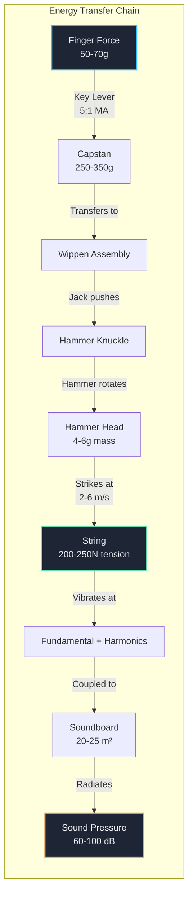
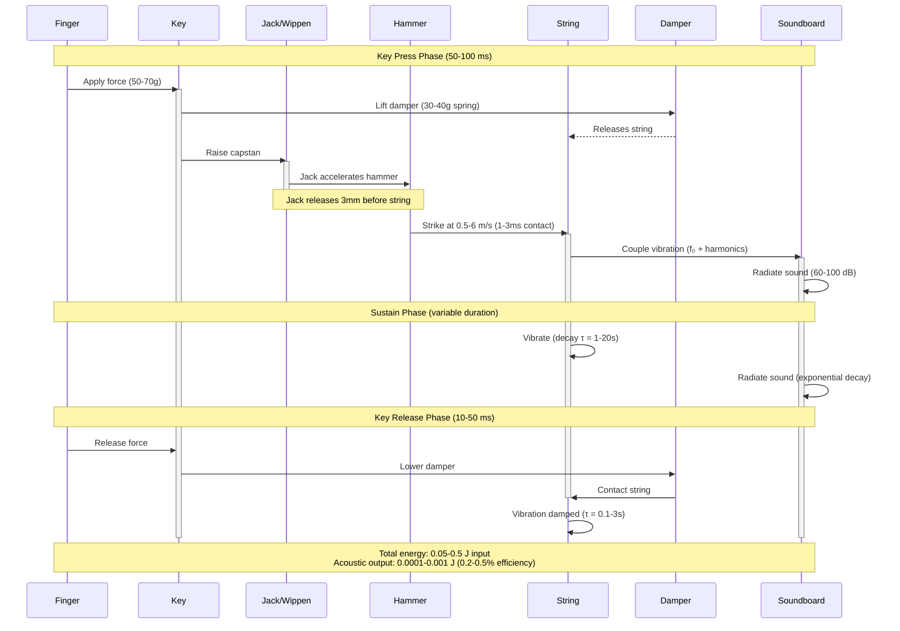

# Lesson 2: Overview of Keyboard Geometry

## 1. First-Principles Intuition & Invariants

The modern piano keyboard comprises 88 keys spanning 7¼ octaves (A0 at 27.5 Hz to C8 at 4186 Hz), a range crystallized in the 1880s by Steinway that balances the physiological limits of human hearing (approximately 20 Hz to 20 kHz) against the mechanical constraints of string construction and soundboard resonance. This standardization emerged from the convergence of three fundamental constraints: the physics of harmonic overtones, the biomechanics of human hand anatomy, and the material science of steel wire under tension.

### Equal Temperament and the Logarithmic Frequency Lattice

The keyboard embodies equal temperament, a tuning system that divides the octave into twelve logarithmically equal semitones. Each semitone represents a frequency ratio of $2^{1/12} \approx 1.05946$. For any key $n$ semitones above a reference pitch with frequency $f_0$:

$$f_n = f_0 \cdot 2^{n/12}$$

This logarithmic spacing creates transposition invariance: a major third (four semitones) produces the same frequency ratio regardless of starting pitch. Equal temperament approximates just intonation ratios—a perfect fifth in just intonation is exactly 3:2 (1.5000), while equal temperament yields $2^{7/12} \approx 1.4983$, a difference of approximately 2 cents. This compromise enables unlimited modulation across all keys.

The keyboard's linear spatial layout maps this exponential frequency spectrum uniformly: each white key occupies approximately 23.5 mm, each black key 13.7 mm. This creates a logarithmic ruler where equal distances correspond to equal frequency *ratios*. The octave from A0 (27.5 Hz) to A1 (55 Hz) spans the same physical distance as A7 (3520 Hz) to A8 (7040 Hz).

### Ergonomic Geometry and the Diatonic-Chromatic Dual Layer

The alternating pattern of white and black keys reflects the diatonic scale (seven notes per octave: C, D, E, F, G, A, B) with chromatic inflections (five sharps/flats) superimposed as raised keys. Black keys, elevated 13 mm above white keys and recessed 5 mm from the keyboard front edge, align with the natural arc of the relaxed hand. When fingers rest in their curved position, fingertips contact white keys while knuckles and finger pads access black keys without wrist elevation.

The standard white key dimensions—150 mm length, 23.5 mm width at the playing surface—accommodate the average adult hand span (190–210 mm from thumb to fifth finger). The octave span of 164.5 mm (seven white keys) represents an optimal compromise: smaller hands can reach a full octave with modest stretch, while larger hands avoid excessive crowding.

### Mechanical Invariants: Leverage, Inertia, and Energy Transfer

Each key acts as a third-class lever with the fulcrum (balance rail) positioned approximately 110 mm from the front edge. When you depress a key with typical force of 50–70 grams, the mechanical advantage (approximately 5:1) amplifies this to 250–350 grams at the capstan. The key dip—standardized at 10 mm (±0.5 mm)—must be consistent across all 88 keys.

Key weighting employs lead weights to establish precise down-weight (47–50 grams for middle C) and up-weight (20–23 grams). This 2:1 ratio ensures reliable key return under damper spring pressure while providing sufficient resistance for dynamic control.

## 2. Core Architecture & Mechanics

### The Action Mechanism: A Six-Stage Energy Conversion Chain

The piano action transforms kinetic energy from your finger into acoustic energy through a precisely timed sequence. Modern grand piano actions contain approximately 8,000 parts across 88 keys, each key assembly comprising 70–90 individual components.

**1. Key and Balance Rail (Initial Energy Capture)**

The key pivots on a balance rail felt bushing, creating a low-friction rotation point. The front rail felt provides a second contact point preventing lateral wobble. When you depress a key, its rear end rises, lifting the capstan screw that contacts the wippen assembly above.

**2. Wippen and Jack (Energy Transfer and Timing)**

The wippen translates the key's vertical motion into the hammer's rotational motion. The jack—a small wooden lever within the wippen—pushes against the hammer knuckle. As the key descends, the jack accelerates the hammer toward the string. At a critical point approximately 3 mm before the string, the jack encounters the regulating button (adjustable via the regulating screw) and pivots away from the knuckle, *releasing* the hammer to strike in free flight.

This release mechanism is essential. If the jack remained in contact during string impact, the hammer would choke the string, producing muted tone. The free-flight distance and release timing determine responsiveness: too early and the hammer lacks energy; too late and repetition speed suffers.

**3. Hammer Assembly (Kinetic to Acoustic Conversion)**

The hammer consists of a wooden molding (typically maple or hornbeam) covered with compressed wool felt, graded from dense and hard in the treble (producing bright, articulate tone) to softer and more elastic in the bass (producing warm, sustained tone). Hammer mass increases from approximately 4 grams in the highest treble to 12 grams in the lowest bass.

Upon release, the hammer travels the final 3 mm at velocities ranging from 0.5 m/s (pianissimo) to 6 m/s (fortissimo), striking the string for approximately 1–3 milliseconds. The hammer-string collision is highly inelastic (coefficient of restitution ≈ 0.2–0.4), transferring most kinetic energy to the string. The hammer immediately rebounds approximately 50% of the initial distance, caught by the backcheck that prevents secondary strikes while positioning for rapid repetition.

**4. Damper System (Vibration Gating)**

Each note from A0 to approximately F7 (76 keys) features a damper: a wooden block fitted with two wedges of felt that rest against the strings under spring pressure (approximately 30–40 grams). When you press a key, a damper lever lifts the damper 2–3 mm off the strings, permitting vibration. The damper lift occurs fractionally *before* the hammer strikes, ensuring no energy is lost to immediate damping.

Upon key release, the damper returns within 10–20 milliseconds, damping vibration exponentially. Damping time varies with register: bass strings exhibit longer decay (1–3 seconds) due to greater mass and lower tension, while treble strings damp rapidly (0.1–0.5 seconds). The highest 12 notes (F♯7 to C8) omit dampers entirely—their brief natural decay (50–100 ms) renders mechanical damping unnecessary.

**5. Repetition Lever (Grand Piano Specific)**

Grand piano actions incorporate a repetition lever (Érard double-escapement mechanism, patented 1821) beneath the hammer knuckle. After the hammer rebounds and the backcheck captures it, the repetition lever catches the knuckle at an intermediate position, allowing the jack to reset *without the key returning fully to rest*. This enables rapid note repetition (up to 14–16 notes per second) by reducing the key reset distance from 10 mm to approximately 3 mm.

**6. Pedal Systems (Global State Modifiers)**

The sustain pedal (rightmost) lifts all dampers simultaneously via a trapwork linkage, allowing all strings to vibrate sympathetically. The una corda pedal (leftmost) shifts the entire action 3–5 mm laterally in grands, reducing the number of strings struck (trichords become bichords) and altering tonal color. The sostenuto pedal (center, grands only) selectively sustains only those notes already held when the pedal is depressed.

### String Geometry and Tension Distribution

Piano strings span from 50 mm (C8) to 2050 mm (A0) in speaking length, arranged in three distinct sections:

**Bass Section (A0–C3, 28 keys):** Utilizes single or double copper-wound steel strings with core diameters of 1.0–1.5 mm and copper winding adding 3–5 mm total diameter. Tensions range from 75–90 kg per string. These strings cross diagonally over treble strings (overstringing), positioning their coupled soundboard area over the acoustically efficient central region.

**Tenor Section (C3–C5, 24 keys):** Transitions to unwound steel strings, typically bichords (two strings per note) or trichords (three strings per note), with diameters from 0.9–1.1 mm and tensions of 80–90 kg per string. The increased number of strings per note enhances sustain and tonal richness through slight detuning (0.1–0.5 Hz difference between unison strings creates beating that adds warmth).

**Treble Section (C5–C8, 36 keys):** Employs trichord unwound steel strings with diameters decreasing from 0.9 mm to 0.8 mm, maintaining tensions of 70–80 kg per string. The speaking length decreases approximately exponentially, halving with each octave rise.

Total string tension in a concert grand approaches 20–25 metric tons (200,000–250,000 N), resisted by the cast iron frame and thick wooden rim. This immense tension explains the structural mass of concert grands (480–560 kg).

### Soundboard Coupling and Acoustic Radiation

Strings alone produce negligible sound pressure; their small cross-sectional area couples inefficiently to air. The soundboard—a 5–9 mm thick tapered panel of close-grained spruce with 8–12 annual rings per centimeter—acts as an acoustic transformer. Each string contacts the soundboard via the bridge, a hardwood (maple or beech) structure glued to the soundboard crown (a permanent 5–10 mm convex curvature).

When a string vibrates, it exerts oscillating downward force on the bridge (typically 0.1–10 N amplitude depending on dynamics). This force excites flexural waves in the soundboard, which propagates at velocities of 500–2000 m/s. The soundboard's large surface area (2.0–2.5 m² for grands) enables efficient acoustic radiation.

Soundboard vibration modes exhibit hundreds of resonances between 50 Hz and 5 kHz. Lower-frequency modes (50–300 Hz) involve global soundboard bending, while higher modes (300 Hz+) produce localized nodal patterns. Acoustic efficiency—the ratio of radiated acoustic power to mechanical power input—varies from 0.2% in the lowest bass to 0.5% in the mid-treble, peaking around 500–1000 Hz. This explains the piano's characteristic tonal balance: midrange notes project efficiently, while extreme bass and treble require greater mechanical input for equivalent perceived loudness.

## 3. High-Performance Optimization & Failure Modes

### Regulation: Precision Adjustment for Uniform Response

Piano regulation encompasses the systematic adjustment of 40+ parameters per key to achieve uniform touch, tone, and response. Critical regulation parameters include:

**Key Level and Dip:** All white keys must rest at a uniform height (±0.2 mm tolerance), with consistent 10.0 mm (±0.5 mm) dip depth. Variations cause uneven tactile feedback and disrupt your proprioceptive calibration.

**Let-Off Distance:** The gap between the jack and hammer knuckle at the moment of release must be 2.5–3.5 mm before string contact. Excessive let-off causes weak tone and missed notes at low velocities; insufficient let-off prevents proper release, causing double-strikes or blocked repetition.

**Hammer Blow Distance:** The resting position of the hammer relative to the string (typically 45–50 mm) affects both tone and mechanical reliability. Closer positioning reduces the acceleration distance, limiting maximum velocity and dynamic range; excessive distance increases inertia and slows repetition.

**Backcheck Positioning:** The backcheck must capture the rebounding hammer at approximately 15–18 mm from the string—close enough to enable rapid repetition, but far enough to prevent inadvertent string contact during soft playing.

**Damper Lift Timing:** Dampers must lift 1–2 mm before hammer strike to prevent premature damping, yet not so early that excessive mechanical noise is audible. Damper return must engage firmly (30–40 grams contact force) without excessive impact noise.

Concert technicians regulate instruments before performances to compensate for humidity-induced dimensional changes (wooden components expand/contract 0.1–0.5%), felt compression from playing, and temperature-dependent elasticity changes in felt and leather.

### Voicing: Shaping Hammer Hardness for Tonal Color

Voicing modifies the density and elasticity profile of hammer felt to achieve target tonal characteristics. Hammers gradually harden with use as felt fibers compress and interlock under repeated high-velocity string impacts. Hardened hammers produce bright, percussive tone with emphasized upper harmonics; excessively soft hammers yield weak, muddy tone lacking clarity.

**Needling (Softening):** Inserting fine needles (0.4–0.6 mm diameter) into hammer felt at controlled depths (2–5 mm) and densities (5–20 punctures per cm²) disrupts fiber interlocking, reducing stiffness and emphasizing fundamental frequencies over harmonics. Deep needling near the molding softens the hammer globally; shallow needling near the striking surface provides targeted timbral adjustment.

**Hardening:** Applying dilute solutions of lacquer, shellac, or proprietary hardeners (typically 5–15% solids in alcohol carrier) to the hammer surface cross-links wool fibers, increasing stiffness and brightness. This technique compensates for excessive needling or restores hammers worn too soft through extended use.

**Filing and Shaping:** Reshaping hammer profiles with sandpaper (150–220 grit) to restore the proper elliptical striking surface (typically 4–6 mm wide contact patch) ensures optimal string contact duration and harmonic balance. Worn hammers develop flat spots or grooves that produce thin, nasal tone due to shortened contact time.

### Common Mechanical Failures and Diagnostic Procedures

**Sluggish or Sticking Keys:**
- **Symptom:** Key fails to return promptly or requires excessive force to depress.
- **Diagnosis:** Check balance rail and front rail bushings for binding (excessive friction from humidity swelling or dust accumulation). Verify key frame alignment—misaligned keys rub against neighbors.
- **Repair:** Remove key, clean bushings with alcohol (90% isopropyl), apply graphite lubricant (never oil—it attracts dust). If binding persists, ream bushings with sizing tool to restore 0.05–0.1 mm clearance.

**Double-Striking or Bubbling:**
- **Symptom:** Single key press produces multiple audible hammer strikes.
- **Diagnosis:** Insufficient let-off distance allows jack to re-engage knuckle after initial strike. Check backcheck distance—if too far, hammer rebounds excessively and re-contacts jack.
- **Repair:** Adjust regulating screw to increase let-off distance to 3.0 mm. Verify backcheck captures hammer at 15–18 mm from string.

**Weak or Missing Notes:**
- **Symptom:** Note produces significantly lower volume than neighbors or fails to sound.
- **Diagnosis:** Broken string (immediate silence), broken hammer shank (hammer flops freely), or disconnected action part (wippen assembly, jack spring failure).
- **Repair:** For broken string, remove action, release string tension via tuning pin, install replacement string (match gauge and material), bring to pitch in stages over 24 hours to allow settling. For broken shank, remove hammer, glue replacement shank with hot hide glue, clamp 24 hours, reshape felt if necessary.

**Sustain Pedal Fails to Lift All Dampers:**
- **Symptom:** Some notes continue to damp when sustain pedal is depressed.
- **Diagnosis:** Trapwork linkage misalignment, broken damper lift rod, or individual damper lever disconnected from lift rail.
- **Repair:** Inspect trapwork for bent rods or loose connections. Verify damper lift rail rises uniformly (measure both ends—should lift 8–10 mm simultaneously). Reconnect or replace broken damper lever springs.

## 4. Hands-On Practice & Keyboard Navigation Drills

### Drill 1: Physical Key Geometry Awareness

**Objective:** Develop tactile awareness of white/black key topography without visual reference.

**Procedure:**
1. Sit at the keyboard with eyes closed. Place right hand thumb on middle C (locate by finding the center of the keyboard, then the leftmost key of the two-black-key group).
2. Execute ascending major scale (C-D-E-F-G-A-B-C) with fingers 1-2-3-1-2-3-4-5 (thumb crosses under after E).
3. Maintain consistent 10 mm key depression depth—develop kinesthetic sense of bottoming out without slamming.
4. **Tactile checkpoint:** Notice that E and B have no black key to their right (identify scale-tone position by finger shape, not visual cue).

**Progression:**
- Week 1: C major scale, hands separate, 60 BPM quarter notes, eyes closed.
- Week 2: C major scale, hands together one octave apart, 72 BPM, eyes closed.
- Week 3: G major scale (introduces F♯ black key), hands separate, 60 BPM, eyes closed.
- Week 4: All white-key and one-sharp scales (C, G, D major), hands together, 80 BPM, eyes closed.

### Drill 2: Octave Span Calibration

**Objective:** Establish accurate proprioceptive calibration for octave reach (164.5 mm span).

**Procedure:**
1. Place right hand with thumb on C4, fifth finger on C5. Relax wrist so hand forms natural arch—knuckles should be highest point, fingers gently curved.
2. Depress both keys simultaneously with equal force (50 grams each). Listen for balanced tone—if one key dominates, you are overweighting that finger.
3. Release and repeat 10 times, focusing on maintaining hand shape. Do not flatten fingers or collapse wrist.
4. Repeat with left hand (thumb C3, fifth finger C2). Verify same hand shape mirrors right hand.

**Progression:**
- Week 1: Single octave C4-C5 and C3-C2, 10 repetitions each, 60 BPM quarter notes.
- Week 2: Ascending octaves C-D-E-F-G-A-B-C, hands separate, 60 BPM. Notice hand rotation required for white-key to black-key transitions (e.g., C-D octave requires slight forearm rotation to align fifth finger over D).
- Week 3: Descending octaves, hands separate, 72 BPM.
- Week 4: Octave scales hands together (parallel motion), 80 BPM.

### Drill 3: Finger Independence and Evenness

**Objective:** Eliminate unintentional volume disparities between fingers (common issue: weak 4th and 5th fingers).

**Procedure:**
1. Place right hand fingers 1-2-3-4-5 on C-D-E-F-G (thumb on C).
2. Execute five-finger pattern C-D-E-F-G-F-E-D-C (ascending and descending) at 60 BPM eighth notes.
3. Use metronome accent on beat 1. Match accent volume exactly on all fingers—use arm weight transfer, not isolated finger striking.
4. Record yourself (phone audio sufficient). Listen for unintentional accents—typically 4th and 5th fingers either lag in timing or produce softer tone.

**Correction technique for weak 4th/5th fingers:**
- Isolate 4-5 finger pair: play E-F-E-F-E-F repeatedly, 60 BPM eighth notes, 2 minutes. Focus on lifting 5th finger from knuckle joint (metacarpophalangeal joint), not just curling fingertip.
- Add resistance: place opposite hand gently on back of practicing hand, providing 50-gram downward resistance. This forces stronger recruitment of extensor muscles.

**Progression:**
- Week 1: Single five-finger position (C-D-E-F-G), hands separate, 60 BPM eighth notes.
- Week 2: Five-finger position on all white keys (C major, D major, etc.), hands separate, 72 BPM.
- Week 3: Five-finger position, hands together parallel motion, 80 BPM.
- Week 4: Five-finger position with dynamic contrast: first pass mf, second pass p, third pass f. Target ±10 dB range.

### Drill 4: Black Key Navigation and Thumb Rotation

**Objective:** Execute smooth thumb crossings and rotations when transitioning between white and black keys.

**Procedure:**
1. Right hand: play C♯-D♯-E (fingers 2-3-1). Notice thumb must rotate under 3rd finger *before* 3rd finger releases E—simultaneous motion, not sequential.
2. Execute scale fragment C♯-D♯-E-F♯-G♯ (fingering 2-3-1-2-3), 60 BPM quarter notes. Focus on minimizing vertical hand motion—forearm rotates horizontally, wrist remains level.
3. Common error: lifting wrist and reaching down to strike thumb note. Correct technique: forearm rotates, thumb naturally arrives at target key via arc motion.

**Progression:**
- Week 1: B major scale (5 sharps), hands separate, 60 BPM quarter notes. All black-key scale forces thumb rotation mastery.
- Week 2: D♭ major scale (5 flats), hands separate, 60 BPM. Mirror image of B major—emphasizes opposite rotation direction.
- Week 3: B and D♭ major scales, hands together parallel motion, 72 BPM.
- Week 4: Chromatic scale (all 12 semitones), fingering 1-3-1-3-1-2-3-1-3-1-3-1, 80 BPM sixteenth notes.

### Drill 5: Pedal Coordination—Syncopated Damper Lift

**Objective:** Execute syncopated pedal technique (lift damper *after* key strike, release *during* subsequent key strike) to achieve legato without blurring harmonies.

**Procedure:**
1. Right hand plays C major triad (C-E-G) with fingers 1-3-5, whole note duration.
2. Depress sustain pedal *after* keys are fully down (not simultaneously). Listen—no change in sound if pedal timing is correct.
3. While holding pedal, play next chord (F major: F-A-C). At the *exact moment* new keys bottom out, release and re-depress pedal in one quick motion. The dampers lift from the previous chord only during the brief pedal release, eliminating harmonic blur.
4. Common error: releasing pedal too early (gap in sound) or too late (excessive harmonic overlap).

**Checkpoint:** Record yourself executing progression I-IV-V-I (C-F-G-C triads) with syncopated pedal, 60 BPM whole notes. Verify no audible gaps and no harmonic mud when played back.

**Progression:**
- Week 1: Single progression (I-IV-V-I), 60 BPM whole notes, focus on pedal timing precision.
- Week 2: Multiple progressions (I-vi-IV-V, I-V-vi-IV), 60 BPM whole notes.
- Week 3: Same progressions, 80 BPM half notes (requires faster pedal reflexes).
- Week 4: Alberti bass pattern (C-G-E-G) with pedal changes every measure, 100 BPM eighth notes.

### Drill 6: Dynamic Control via Arm Weight Transfer

**Objective:** Produce consistent pianissimo (40–50 dB) and fortissimo (90–100 dB) dynamics through arm weight modulation, not finger striking force.

**Procedure:**
1. Right hand plays C major scale, one octave, 60 BPM quarter notes.
2. **Pianissimo technique:** Wrist slightly higher than knuckles, fingers contact keys with minimal velocity (0.5 m/s hammer velocity target). Use only the weight of the relaxed hand—approximately 300 grams—no additional arm pressure.
3. **Fortissimo technique:** Wrist level with or slightly below knuckles, transfer full arm weight (3–5 kg) through fingertips into keys. Finger joints firm (not rigid), allowing efficient energy transfer. Hammer velocity target: 5–6 m/s.
4. Common error: fortissimo achieved by tensing hand and striking keys with isolated finger force. This produces harsh, percussive tone and risks injury. Correct technique: drop arm weight into key, finger merely directs force vector.

**Checkpoint:** Play C major scale alternating extreme dynamics: C (fff) – D (ppp) – E (fff) – F (ppp), etc. Verify ≥40 dB dynamic range using phone dB meter app (place phone 1 meter from soundboard).

**Progression:**
- Week 1: Major scales hands separate, extreme dynamics on each note, 60 BPM.
- Week 2: Major scales hands together, crescendo ascending / diminuendo descending, 72 BPM.
- Week 3: Chopin Prelude Op. 28 No. 4 (E minor), measures 1–8, target 50 dB dynamic range, 60 BPM eighth notes.
- Week 4: Full dynamic spectrum exercise: play 5-note pattern (C-D-E-F-G) starting ppppp, add one dynamic level each repetition until fffff, then reverse. Target 9 distinct audible levels.

### Drill 7: Rhythmic Precision and Subdivision Internalization

**Objective:** Develop internal pulse stability and accurate subdivision execution without metronome reliance.

**Procedure:**
1. Set metronome to 60 BPM. Play C major scale in quarter notes (one note per click), hands separate.
2. Switch to eighth notes (two notes per click). Maintain *exact* subdivision—second eighth note occurs precisely halfway between clicks.
3. Switch to triplets (three notes per click). Common error: middle note of triplet rushed. Correct by vocalizing "trip-a-let" rhythm while playing.
4. Remove metronome. Play same scale in eighth notes at self-determined tempo. Record yourself. Place recording into DAW (Audacity, GarageBand, etc.), analyze timing deviations from grid. Target: ≤10 ms RMS deviation.

**Progression:**
- Week 1: Major scales, quarter/eighth/triplet subdivisions, hands separate, 60 BPM.
- Week 2: Same exercise, 80 BPM (requires faster subdivision processing).
- Week 3: Add sixteenth notes (four notes per click), 60 BPM. Vocalize "1-e-and-a" while playing.
- Week 4: Polyrhythmic exercise: right hand plays triplets (3 per beat), left hand plays duplets (2 per beat), both hands playing C major scale pattern simultaneously. This forces independent subdivision circuits in each hemisphere.

## 5. Applied Repertoire Integration

### Beginner Repertoire: Keyboard Geography Anchoring

**Bach: Minuet in G Major, BWV Anh. 114**
- **Focus:** Basic hand position shifts, binary form recognition, even finger independence.
- **Geometric challenge:** Measures 1–8 remain within single five-finger position (right hand G-A-B-C-D, left hand D-B-G-D). Reinforces position stability before introducing shifts.
- **Practice protocol:** Hands separate first, 60 BPM quarter note pulse. Add hands together once each hand achieves zero errors for three consecutive passes. Target tempo: 100 BPM.

**Clementi: Sonatina Op. 36 No. 1, First Movement**
- **Focus:** Alberti bass patterns, tonic-dominant harmonic motion, articulation (staccato vs. legato).
- **Geometric challenge:** Left hand executes repeating broken chord patterns (C-G-E-G) requiring wrist rotation and thumb pivot. Right hand navigates scale runs with thumb crossings.
- **Practice protocol:** Isolate left hand Alberti bass measures 1–4, 60 BPM eighth notes. Master wrist rotation so hand appears to "float" above keys. Add right hand at 70% target tempo, increase 5 BPM weekly. Target tempo: 112 BPM.

### Intermediate Repertoire: Expanded Range and Voicing

**Chopin: Prelude Op. 28 No. 4 in E Minor**
- **Focus:** Voicing (bringing out melodic line embedded in chords), syncopated pedal, rubato timing flexibility.
- **Geometric challenge:** Left hand spans 10ths (E2-G3), requiring hand extension or arpeggiation depending on span capacity. Right hand executes chromatic voice leading in tight spacing.
- **Practice protocol:** Left hand alone, 40 BPM half notes, focus on connecting bass line smoothly via pedal. Right hand alone, 40 BPM quarter notes, bring out top voice 10 dB louder than inner voices (use arm weight differential). Combine hands at 50 BPM. Target tempo: 60 BPM (marked Largo).

**Debussy: Clair de Lune**
- **Focus:** Wide dynamic range (pppp to ff), harp-like arpeggiation, pedal blending of non-adjacent harmonies.
- **Geometric challenge:** Measures 27–35 require right hand 10th spans (D♭4-F5) and left hand arpeggios spanning two octaves. Opening measures demand independent dynamic control: right hand melody forte, left hand accompaniment piano.
- **Practice protocol:** Measures 1–14 (opening theme) hands separate, 50 BPM. Establish melody dominance in right hand—top note of each chord 15 dB louder than accompaniment notes. Left hand arpeggios: rotate wrist smoothly through span, avoid "stepping" through each note. Target tempo: 66 BPM (marked Andante très expressif).

### Advanced Repertoire: Virtuosic Demands and Mechanical Limits

**Chopin: Étude Op. 10 No. 1 in C Major**
- **Focus:** Right hand arpeggiation across two octaves, endurance, hand expansion/contraction.
- **Geometric challenge:** Right hand executes continuous arpeggios (C3-E3-G3-C4-E4-G4-C5-E5) at 176 BPM, requiring 10–12 notes per second. Thumb-5th finger span reaches 15th (two octaves), near maximum extension for average hand.
- **Practice protocol:** Do NOT attempt full tempo until mechanical fluency achieved. Week 1: measures 1–2 only, 60 BPM sixteenth notes, focus on wrist rotation arc (hand describes smooth elliptical path). Week 2–4: increase tempo 10 BPM weekly, add two measures. Week 5–8: assemble full étude. Target tempo: 176 BPM (marked Allegro).

**Liszt: Hungarian Rhapsody No. 2 in C♯ Minor**
- **Focus:** Octave technique (rapid repeated octaves), double-note passages, extreme dynamic contrasts.
- **Geometric challenge:** Friska section (fast portion) requires right hand repeated octaves at 120+ BPM, sustaining 8–12 octaves per second for extended passages. Left hand executes stride bass (alternating bass notes with chords spanning 10ths).
- **Practice protocol:** Octave technique drill (separate from repertoire): play C octave 10 times, rotate hand minimally between strikes, use forearm rotation not wrist flexion. Gradually increase speed: 60 → 80 → 100 → 120 BPM. Once 120 BPM achievable for 30 seconds, begin integrating into repertoire. Target tempo: 140 BPM Friska.

**Ravel: Gaspard de la Nuit, "Scarbo"**
- **Focus:** Extreme technical and musical demands across all parameters—widely considered one of the most difficult solo piano works.
- **Geometric challenge:** Requires simultaneous execution of wide leaps (two-octave jumps), dense chords (up to 12-note clusters), rapid repeated notes (single-finger trills), and polyrhythmic independence. Measures 335–349 demand right hand repeated note at 152 BPM sixteenth notes (10 notes per second) while left hand plays independent melodic line.
- **Practice protocol:** This work should only be attempted after mastering advanced technical études (Chopin Op. 10/25, Liszt Transcendental). Isolate each technical challenge separately: repeated note drill (single finger repetition, 80 → 120 BPM), wide leap drill (blind octave jumps, ±2 cm accuracy), polyrhythmic coordination (3:2, 4:3, 5:4 ratios). Target tempo: Variable, 60–152 BPM depending on section.

## 6. Maintenance, Tuning, and Climate Control

### Environmental Stability Requirements

Piano regulation and tuning stability depend critically on maintaining stable temperature (20–22°C / 68–72°F) and relative humidity (40–50% RH). Dimensional changes in wooden components from humidity fluctuation cause:

- **Soundboard crown collapse/expansion:** 1% RH change causes ≈0.1 mm crown height change, altering string tension and pitch (≈1 cent per mm crown change).
- **Key bushing binding:** 5% RH increase causes key bushings to swell, increasing friction and causing sluggish key return.
- **Hammer compression:** High humidity softens hammer felt, reducing brightness; low humidity hardens felt, producing brittle tone.

**Climate control recommendations:**
- Install hygrometer near piano. Monitor daily, log fluctuations.
- Maintain 42–48% RH via Piano Life Saver System (Dampp-Chaser) or room humidifier/dehumidifier.
- Position piano away from heating vents, air conditioning ducts, windows, and exterior walls.
- In winter (low RH), use humidifier to prevent soundboard cracks. In summer (high RH), use dehumidifier to prevent key binding and felt swelling.

### Tuning Stability and Pitch Drift Mechanisms

Equal temperament tuning requires all intervals to deviate slightly from just intonation ratios, distributing the Pythagorean comma (≈24 cents) across all keys. Piano tuners use electronic tuning devices (Sanderson Accu-Tuner, CyberTuner) or tuning forks (A440 reference) combined with aural beatless-interval verification.

**Tuning frequency recommendations:**
- Home instruments, moderate use: 1–2 times per year.
- Home instruments, heavy use or extreme climate: 3–4 times per year.
- Concert instruments: Before each performance, plus quarterly maintenance tuning.
- New instruments: Monthly for first year (strings stretch and settle), then standard schedule.

**Pitch drift mechanisms:**
- **String stretching:** Steel wire exhibits plastic deformation under sustained tension, causing pitch to flatten 2–5 cents over months. More pronounced in first year after stringing.
- **Tuning pin slip:** Tuning pins (5–6 mm diameter steel) driven into laminated hardwood pinblock rely on friction. Humidity-induced pinblock swelling/shrinkage causes pins to creep, flattening pitch.
- **Soundboard crown change:** As described above, humidity-induced crown changes alter string speaking length, causing pitch drift proportional to crown displacement.

### Hammer Maintenance and Voicing Intervals

Hammers require periodic reshaping and voicing to maintain tonal consistency:

**Reshaping (filing) interval:** Every 500–1000 hours of playing, or when visible grooves appear in hammer felt. Use 220-grit sandpaper to restore smooth elliptical profile, removing minimal material (≤1 mm).

**Voicing interval:** Every 2–3 years for home instruments, annually for concert instruments. Perform needling to soften excessively bright hammers, hardening to restore worn-soft hammers.

**Hammer replacement interval:** 10–20 years depending on use intensity. Complete hammer set replacement (88 hammers plus voicing) costs $2,000–$4,000 USD plus labor (8–12 hours technician time).

### Action Regulation Inspection Checklist

Perform semi-annual regulation inspection focusing on:

1. **Key level uniformity:** Place straightedge across white keys. All keys should contact straightedge simultaneously (±0.2 mm tolerance). Adjust key frame shims as needed.
2. **Key dip consistency:** Measure key dip using key dip block (10.0 mm reference). Adjust front rail punching or key leads to restore 10.0 mm ±0.5 mm.
3. **Let-off distance verification:** Depress key slowly until hammer releases. Measure gap between hammer and string at release point (target: 3.0 mm). Adjust regulating screw as needed.
4. **Backcheck distance verification:** Observe hammer rebound after strike. Backcheck should capture hammer at 15–18 mm from string. Adjust backcheck position via bending wire or adjusting backcheck position on wire.
5. **Damper lift timing:** Verify dampers lift 1–2 mm before hammer strikes string. Adjust damper lever spoon-to-damper-wire distance.

## 7. Further Study and Technical Resources

### Essential Method Books

- **Hanon: The Virtuoso Pianist in 60 Exercises** — Foundational technical patterns for finger independence, evenness, and endurance. Execute daily at 60–120 BPM.
- **Czerny: School of Velocity Op. 299** — Progressive études targeting specific technical challenges (scales, arpeggios, octaves, double notes).
- **Alfred's Adult All-in-One Course** — Comprehensive method for adult beginners covering reading, technique, and repertoire in integrated progression.

### Biomechanics and Injury Prevention

- **Taubman Approach** — Systematic methodology for injury-free technique emphasizing forearm rotation, in-out motion, and elimination of isolated finger striking. Essential for preventing overuse injuries (tendinitis, carpal tunnel syndrome).
- **Dorothy Taubman Institute** — Offers workshops and certification in Taubman Approach principles.

### Historical Tuning Systems and Acoustics

- **Owen Jorgensen: Tuning (1991)** — Comprehensive mathematical treatment of historical temperaments, well-temperament varieties, and equal temperament optimization.
- **Arthur H. Benade: Fundamentals of Musical Acoustics (1976)** — Physics of vibrating systems, harmonic series, soundboard radiation, and room acoustics.

### Piano Technology and Regulation

- **Piano Technicians Guild (PTG)** — Professional organization offering technician certification, annual conference, and technical journal (Piano Technicians Journal).
- **Larry Fine: The Piano Book (4th ed.)** — Consumer guide covering acoustic piano brands, quality assessment, and maintenance recommendations.
- **Floyd Stevens: Voicing the Performer (2003)** — Detailed guide to hammer voicing techniques, felt density modification, and tonal regulation.

### Digital Tools for Practice and Analysis

- **DAW software (Audacity, GarageBand, Reaper)** — Record practice sessions, analyze timing accuracy via waveform visualization, identify dynamic inconsistencies.
- **Tempo Slow Mo (iOS/Android)** — Slow down audio recordings without pitch shift, useful for transcribing rapid passages.
- **MuseScore (free notation software)** — Create practice exercises, transpose repertoire, generate playback for aural reference.
- **Piano Marvel / Playground Sessions** — Interactive software providing real-time feedback on pitch accuracy and rhythm precision via MIDI keyboard connection.
