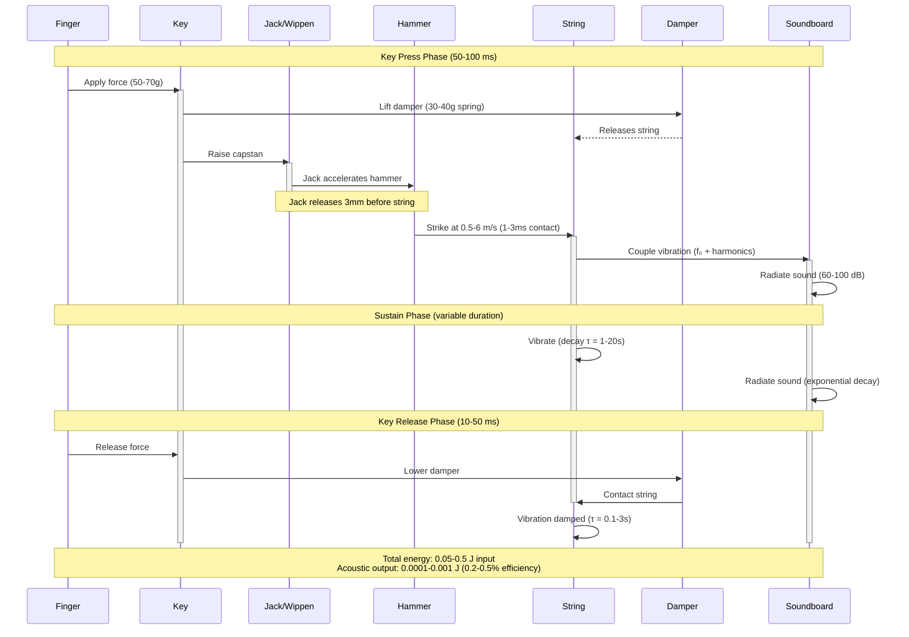

# Lesson 2: Overview of Keyboard Geometry

## 1. First-Principles Intuition & Invariants

The modern piano keyboard comprises 88 keys spanning 7¼ octaves (A0 at 27.5 Hz to C8 at 4186 Hz), a range crystallized in the 1880s by Steinway that balances the physiological limits of human hearing (approximately 20 Hz to 20 kHz) against the mechanical constraints of string construction and soundboard resonance. This standardization emerged not from arbitrary convention but from the convergence of three fundamental constraints: the physics of harmonic overtones, the biomechanics of human hand anatomy, and the material science of steel wire under tension.

### Equal Temperament and the Logarithmic Frequency Lattice

The keyboard embodies equal temperament, a tuning system that divides the octave into twelve logarithmically equal semitones. This geometric series ensures that each semitone represents a frequency ratio of $2^{1/12} \approx 1.05946$. For any key $n$ semitones above a reference pitch with frequency $f_0$, the frequency is:

$$f_n = f_0 \cdot 2^{n/12}$$

This logarithmic spacing has profound consequences. First, it makes all intervals transposition-invariant: a major third (four semitones) produces the same frequency ratio regardless of starting pitch, enabling modulation to any key without retuning. Second, it approximates—but intentionally compromises—just intonation ratios. A perfect fifth in just intonation is exactly 3:2 (1.5000), while equal temperament yields $2^{7/12} \approx 1.4983$, a difference of approximately 2 cents. This slight impurity, replicated across all intervals, is the trade-off for unlimited modulation.

The keyboard's linear spatial layout maps this exponential frequency spectrum into a uniform physical space where each key occupies approximately 23.5 mm (white keys) or 13.7 mm (black keys) of horizontal span. This creates a logarithmic ruler: equal distances correspond to equal frequency *ratios*, not equal frequency *differences*. The octave from A0 (27.5 Hz) to A1 (55 Hz) spans the same physical distance as A7 (3520 Hz) to A8 (7040 Hz), despite the latter representing a 3520 Hz difference versus 27.5 Hz.

### Ergonomic Geometry and the Diatonic-Chromatic Dual Layer

The alternating pattern of white and black keys reflects the historical primacy of the diatonic scale (seven notes per octave: C, D, E, F, G, A, B) with chromatic inflections (five sharps/flats) superimposed as raised keys. This two-tier geometry is not merely visual but biomechanically optimized. The black keys, elevated 13 mm above white keys and recessed 5 mm from the keyboard front edge, align with the natural arc of the relaxed hand. When fingers rest in their curved, natural position, fingertips contact white keys while the slightly higher knuckles and finger pads access black keys without requiring wrist elevation or excessive finger extension.

The standard white key dimensions—approximately 150 mm length, 23.5 mm width at the playing surface, tapering to 13.7 mm at the tail—emerged from centuries of empirical refinement. These proportions accommodate the average adult hand span (190–210 mm from thumb to fifth finger in maximum extension) while maintaining sufficient separation to prevent accidental adjacent key strikes. The octave span of 164.5 mm (seven white keys) represents an optimal compromise: children and pianists with smaller hands can reach a full octave with modest stretch, while larger hands avoid excessive crowding.

### Mechanical Invariants: Leverage, Inertia, and Energy Transfer

The keyboard functions as a lever array, each key acting as a third-class lever with the fulcrum (balance rail) positioned approximately 110 mm from the front edge of the white key. When a pianist depresses a key with typical force of 50–70 grams at the key front, the mechanical advantage (approximately 5:1) amplifies this to 250–350 grams at the capstan (the small brass screw that transfers motion to the action). The key dip—standardized at 10 mm (±0.5 mm)—must be consistent across all 88 keys to ensure uniform tactile feedback.

Key weighting employs lead weights embedded in the key body to establish precise down-weight (the force required to initiate key descent, typically 47–50 grams for middle C) and up-weight (the force required to prevent key return, typically 20–23 grams). This 2:1 ratio ensures that keys return reliably under damper spring pressure while providing sufficient resistance to enable dynamic control. The moment of inertia of each key, determined by weight distribution along its length, governs the key's responsiveness to rapid repetition: too much inertia and the key feels sluggish; too little and it becomes overly sensitive to vibration and player movement.

## 2. Core Architecture & Mechanics

### The Action Mechanism: A Six-Stage Energy Conversion Chain

The piano action transforms kinetic energy from the pianist's finger into acoustic energy radiated by the soundboard through a precisely timed sequence of mechanical events. Modern grand piano actions contain approximately 8,000 parts across 88 keys, each key assembly comprising 70–90 individual components. The critical components and their functions are:

**1. Key and Balance Rail (Initial Energy Capture)**

The key pivots on a balance rail felt bushing, creating a low-friction rotation point. The front rail felt provides a second contact point that prevents the key from wobbling laterally. When depressed, the key's rear end rises, lifting the capstan screw that contacts the wippen assembly above.

**2. Wippen and Jack (Energy Transfer and Timing)**

The wippen, a pivoting assembly mounted above the key, translates the key's vertical motion into the hammer's rotational motion. The jack—a small wooden lever within the wippen—pushes against the hammer knuckle (a felt-covered leather pad on the hammer shank). As the key descends, the jack accelerates the hammer toward the string. At a critical point approximately 3 mm before the string, the jack encounters the regulating button (adjustable via the regulating screw) and pivots away from the knuckle, *releasing* the hammer to strike the string in free flight.

This release mechanism is essential. If the jack remained in contact with the hammer during string impact, the hammer would remain pressed against the string, damping vibration and producing a muted, choked tone. The free-flight distance and release timing determine the instrument's responsiveness: too early and the hammer lacks energy; too late and repetition speed suffers.

**3. Hammer Assembly (Kinetic to Acoustic Conversion)**

The hammer consists of a wooden molding (typically maple or hornbeam) covered with compressed wool felt, graded from dense and hard in the treble (producing bright, articulate tone) to softer and more elastic in the bass (producing warm, sustained tone). Hammer mass increases from approximately 4 grams in the highest treble to 12 grams in the lowest bass, scaled to match string tension and optimize energy transfer.

Upon release, the hammer travels the final 3 mm at velocities ranging from 0.5 m/s (pianissimo) to 6 m/s (fortissimo), striking the string for a contact duration of approximately 1–3 milliseconds. The hammer-string collision is highly inelastic (coefficient of restitution ≈ 0.2–0.4), meaning most kinetic energy transfers to the string rather than rebounding. The hammer immediately rebounds approximately 50% of the initial distance, caught by the backcheck (a felt-covered pad) that prevents secondary strikes while positioning the hammer for rapid repetition.

**4. Damper System (Vibration Gating)**

Each note from A0 to approximately F7 (76 keys) features a damper: a wooden block fitted with two wedges of felt that rest against the strings under spring pressure (approximately 30–40 grams). When a key is pressed, a damper lever lifts the damper 2–3 mm off the strings, permitting vibration. The damper lift occurs fractionally *before* the hammer strikes, ensuring no energy is lost to immediate damping.

Upon key release, the damper returns to the strings within 10–20 milliseconds, damping vibration exponentially. The damping time constant varies with register: bass strings exhibit longer decay (1–3 seconds damping time) due to greater mass and lower tension, while treble strings damp rapidly (0.1–0.5 seconds). The highest 12 notes (F♯7 to C8) omit dampers entirely, as their brief natural decay (50–100 ms) renders mechanical damping unnecessary.

**5. Repetition Lever (Grand Piano Specific)**

Grand piano actions incorporate a repetition lever (also called the Érard double-escapement mechanism, patented 1821) beneath the hammer knuckle. After the hammer rebounds and the backcheck captures it, the repetition lever catches the knuckle at an intermediate position, allowing the jack to reset *without the key returning fully to rest*. This mechanism enables rapid note repetition (up to 14–16 notes per second) by reducing the key reset distance from 10 mm to approximately 3 mm.

**6. Pedal Systems (Global State Modifiers)**

The sustain pedal (rightmost) lifts all dampers simultaneously via a trapwork linkage, allowing all strings to vibrate sympathetically and sustain indefinitely. The una corda pedal (leftmost) shifts the entire action 3–5 mm laterally in grands (or moves hammers closer to strings in uprights), reducing the number of strings struck (trichords become bichords) and altering tonal color. The sostenuto pedal (center, grands only) selectively sustains only those notes already held when the pedal is depressed, captured by a rod that intercepts specific damper levers.

### String Geometry and Tension Distribution

Piano strings span from 50 mm (C8) to 2050 mm (A0) in speaking length, arranged in three distinct sections optimized for acoustic efficiency:

**Bass Section (A0–C3, 28 keys):** Utilizes single or double copper-wound steel strings with core diameters of 1.0–1.5 mm and copper winding adding 3–5 mm total diameter. Total mass per unit length increases to compensate for limited length, achieving target fundamental frequencies despite physical constraints. Tensions range from 75–90 kg per string. These strings cross diagonally over treble strings (overstringing or cross-stringing), positioning their coupled soundboard area over the acoustically efficient central region.

**Tenor Section (C3–C5, 24 keys):** Transitions to unwound steel strings, typically bichords (two strings per note) or trichords (three strings per note), with diameters from 0.9–1.1 mm and tensions of 80–90 kg per string. The increased number of strings per note enhances sustain and tonal richness through slight detuning (0.1–0.5 Hz difference between unison strings creates beating that adds warmth).

**Treble Section (C5–C8, 36 keys):** Employs trichord unwound steel strings with diameters decreasing from 0.9 mm to 0.8 mm, maintaining tensions of 70–80 kg per string despite reduced length. The speaking length decreases approximately exponentially, halving with each octave rise, maintaining the frequency relationship $f = \frac{1}{2L}\sqrt{\frac{T}{\mu}}$ where $f$ is frequency, $L$ is length, $T$ is tension, and $\mu$ is mass per unit length.

Total string tension in a concert grand approaches 20–25 metric tons (200,000–250,000 N), resisted by the cast iron frame (harp) and thick wooden rim. This immense tension explains the structural mass of concert grands (480–560 kg) and the requirement for rigid construction.

### Soundboard Coupling and Acoustic Radiation

Strings alone produce negligible sound pressure; their small cross-sectional area couples inefficiently to air. The soundboard—a 5–9 mm thick tapered panel of close-grained spruce (Sitka or European) with 8–12 annual rings per centimeter—acts as an acoustic transformer. Each string contacts the soundboard via the bridge, a hardwood (maple or beech) structure glued to the soundboard crown (a permanent 5–10 mm convex curvature induced during manufacture by ribs glued to the underside).

When a string vibrates, it exerts oscillating downward force on the bridge (typically 0.1–10 N amplitude depending on playing dynamics). This force excites flexural waves in the soundboard, which propagates as bending waves at velocities of 500–2000 m/s (dependent on frequency and grain direction). The soundboard's large surface area (2.0–2.5 m² for grands) and velocity-matched impedance to air enable efficient acoustic radiation.

Soundboard vibration modes are complex, exhibiting hundreds of resonances between 50 Hz and 5 kHz. Lower-frequency modes (50–300 Hz) involve global soundboard bending, while higher modes (300 Hz+) produce localized nodal patterns. The bridge acts as both a mechanical coupler and a partial vibration isolator: its stiffness ensures efficient energy transfer at fundamental frequencies while attenuating excessive high-frequency energy that would produce harsh tone.

Acoustic efficiency—the ratio of radiated acoustic power to mechanical power input—varies from 0.2% in the lowest bass to 0.5% in the mid-treble, peaking around 500–1000 Hz where soundboard radiation resistance matches string impedance optimally. This explains the piano's characteristic tonal balance: midrange notes project efficiently, while extreme bass and treble require greater mechanical input for equivalent perceived loudness.

## 3. High-Performance Optimization & Failure Modes

### Regulation: Precision Adjustment for Uniform Response

Piano regulation encompasses the systematic adjustment of 40+ parameters per key to achieve uniform touch, tone, and response across the entire keyboard. Critical regulation parameters include:

**Key Level and Dip:** All white keys must rest at a uniform height (±0.2 mm tolerance), with consistent 10.0 mm (±0.5 mm) dip depth. Variations cause uneven tactile feedback and disrupt the pianist's proprioceptive calibration.

**Let-Off Distance:** The gap between the jack and hammer knuckle at the moment of release must be 2.5–3.5 mm before string contact. Excessive let-off causes weak tone and missed notes at low velocities; insufficient let-off prevents proper release, causing double-strikes or blocked repetition.

**Hammer Blow Distance:** The resting position of the hammer relative to the string (typically 45–50 mm) affects both tone and mechanical reliability. Closer positioning reduces the acceleration distance, limiting maximum velocity and dynamic range; excessive distance increases inertia and slows repetition.

**Backcheck Positioning:** The backcheck must capture the rebounding hammer at approximately 15–18 mm from the string—close enough to enable rapid repetition, but far enough to prevent inadvertent string contact during soft playing or sympathetic vibration.

**Damper Lift Timing:** Dampers must lift 1–2 mm before hammer strike to prevent premature damping, yet not so early that excessive mechanical noise is audible. Damper return must engage firmly (30–40 grams contact force) without excessive impact noise.

Concert technicians regulate instruments before performances to compensate for humidity-induced dimensional changes (wooden components expand/contract 0.1–0.5%), felt compression from playing, and temperature-dependent elasticity changes in felt and leather.

### Voicing: Shaping Hammer Hardness for Tonal Color

Voicing (also called tone regulation or hammer conditioning) modifies the density and elasticity profile of hammer felt to achieve target tonal characteristics. Hammers gradually harden with use as felt fibers compress and interlock under repeated high-velocity string impacts (10⁴–10⁶ strikes over years). Hardened hammers produce bright, percussive tone with emphasized upper harmonics; excessively soft hammers yield weak, muddy tone lacking clarity.

**Needling (Softening):** Inserting fine needles (0.4–0.6 mm diameter) into hammer felt at controlled depths (2–5 mm) and densities (5–20 punctures per cm²) disrupts fiber interlocking, reducing stiffness and emphasizing fundamental frequencies over harmonics. Deep needling near the molding softens the hammer globally; shallow needling near the striking surface provides targeted timbral adjustment.

**Hardening:** Applying dilute solutions of lacquer, shellac, or proprietary hardeners (typically 5–15% solids in alcohol carrier) to the hammer surface cross-links wool fibers, increasing stiffness and brightness. This technique compensates for excessive needling or restores hammers worn too soft through extended use.

**Filing and Shaping:** Reshaping hammer profiles with sandpaper (150–220 grit) to restore the proper elliptical striking surface (typically 4–6 mm wide contact patch) ensures optimal string contact duration and harmonic balance. Worn hammers develop flat spots or grooves that produce thin, nasal tone due to shortened
