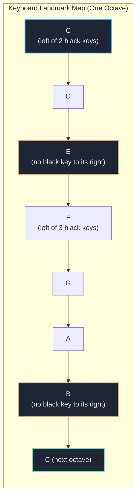
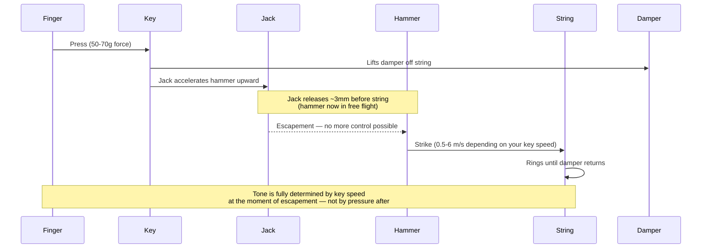

# Lesson 2: Keyboard Geometry — Mapping the Hand to the Instrument

## 1. Why the Keyboard Is Shaped This Way (Read Once, Apply Forever)

Before touching fingerings, you need the keyboard's layout in your body, not just your eyes. Three facts drive everything in this lesson:

**The pattern repeats every octave.** Each group of 12 keys (7 white, 5 black) is identical in shape to the next. The two black keys and three black keys are your only landmarks — find them by feel, and you can locate any note blind. C is always the white key immediately left of the two-black-key group. F is always the white key immediately left of the three-black-key group.

**Equal distances = equal musical intervals, anywhere on the keyboard.** A major third played starting on any key has the same finger shape and the same sound-relationship four semitones later, whether you're at the bottom of the keyboard or the top. This is why fingerings and chord shapes are *movable* — learn one shape, transpose it anywhere.

**Black keys sit higher and further back than white keys, by design.** They're raised about 13 mm above the white key surface and set back from the front edge. This isn't cosmetic — it matches the natural arc of a relaxed hand. When your hand hangs loosely and you curl the fingers inward, your fingertips land on the white key surface while your fingerpads naturally reach the black keys without lifting the wrist. Fighting this geometry — jabbing down at black keys with a flat hand — is the root cause of tension injuries in beginners.

One number worth internalizing: an octave (8 white keys, thumb to pinky) spans about 164 mm. Most adult hands can cover this with a *relaxed* span, not a stretched one. If you feel your palm flattening or your wrist lifting to reach an octave, your hand position is wrong, not your hand size.



**Finding Middle C without looking:** Locate the middle of the keyboard physically (roughly where the brand nameplate sits on most pianos). Find the group of two black keys nearest that point. Middle C is the white key directly to the left of that pair. This should become automatic within your first week — you should never need to count up from the bottom of the keyboard.

---

## 2. Hand Posture and Key Contact Mechanics

### The Neutral Hand Shape

1. Let your arm hang at your side completely relaxed. Notice the natural curl of your fingers — this is your default hand shape at the keyboard.
2. Raise the forearm to keyboard height without changing that curl. Your fingers should look like they're gently holding a small ball (a tennis ball is a good mental image, not a grip, just the shape).
3. Wrist stays level with, or very slightly below, the knuckles — never cocked upward, never collapsed downward.
4. Fingertips (not nails, not the first pad) make contact with the key. Flat-fingered playing transfers force inefficiently and causes the wrist to compensate with tension.

### Key Dip and Touch Depth

Every key travels about 10 mm from rest to fully depressed ("bottoming out"). Your job is to feel that full travel without slamming into the keybed.

- **Drill:** Press middle C slowly until you feel it stop (the keybed). Notice the resistance increases gradually, then stops hard. Practice landing on that stop with just enough force to produce sound — no extra downward push after the key has bottomed. Extra push after bottoming wastes energy and is the single most common cause of harsh, tense tone in beginners.
- **Target feel:** the key should feel "caught," not "crashed into."

### Finger-to-Key Force Mapping

A typical note at a comfortable mezzo-forte requires about 50–70 grams of finger force. For reference:
- A relaxed hand resting on the keys (no active pressing) already weighs roughly 300 grams — this is your pianissimo resource. You don't need to add force for soft playing; you need to *subtract* effort and let the hand's own weight speak.
- Fortissimo comes from dropping arm weight (several kilograms available) through a stable, non-collapsing finger joint, not from muscular finger-striking. More on this in Drill 6 below.

---

## 3. Core Fingering Systems You Must Memorize

### Five-Finger Position (The Foundation Shape)

Right hand, thumb on C: 1-2-3-4-5 sit naturally on C-D-E-F-G. This is your home base shape — every scale and most beginner pieces start from a variant of it.

### Major Scale Fingering — The Two Patterns You Need First

**C Major (both hands), right hand ascending:**
```text
Finger:  1  2  3  1  2  3  4  5
Note:    C  D  E  F  G  A  B  C
```
Thumb crosses under after finger 3 (on E) to reach F with the thumb again.

**C Major, left hand ascending:**
```text
Finger:  5  4  3  2  1  3  2  1
Note:    C  D  E  F  G  A  B  C
```
Thumb crosses under after finger 1 (on G) to continue up with finger 3 on A.

**Why the crossing happens where it does:** the thumb is short and needs room to tuck under the palm. Crossing on E→F (right hand) and G→A (left hand) places the tuck at a point where the hand's natural rotation carries it smoothly, rather than at an awkward stretch.

**G, D, A, E major (one sharp through four sharps):** use the identical fingering pattern as C major — this is the payoff of equal-tempered, geometrically uniform keyboard layout. Learn the C major shape once; it transposes directly.

**F major (one flat) is the exception:** right hand uses finger 4 on B♭ instead of the expected finger pattern:
```text
Finger:  1  2  3  4  1  2  3
Note:    F  G  A  B♭ C  D  E  (then 4 again on F)
```
Left hand: 4-3-2-1-3-2-1 (thumb crosses under after B♭).

### CAGED-Equivalent for Piano: Moveable Chord Shapes

Piano doesn't have a direct CAGED system, but you should drill the three core triad shapes until they're automatic in all keys:

**Root position triad:** 1-3-5 (e.g., C-E-G)
**First inversion:** 1-2-5 for the bottom-to-top shape when the root moves to the top (E-G-C fingered 1-2-5 in right hand)
**Second inversion:** 1-3-5 again but spans a 6th at the bottom (G-C-E)

Drill these as a block: play all three inversions of C major ascending, then immediately transpose to G, D, F, B♭ — hands separate first, then together.

---

## 4. The Mechanical Chain: What Happens When You Press a Key

Understanding the action mechanism isn't academic trivia — it explains *why* certain touches produce certain sounds, and why certain techniques (like fast repetition) require specific hand motions.

**The short version:** your finger moves the key, the key moves a lever system (the wippen and jack), the jack throws the hammer at the string and then gets out of the way (this is called "escapement" or "let-off"), the hammer strikes and immediately bounces off, and a damper lifts off the string just before impact so it's free to ring.

The critical practical consequence: **the hammer is in free flight for the final few millimeters before it hits the string.** This means that once you've thrown the hammer, you have no further control over the attack — all your expressive control happens in the *speed* at which you depress the key, not in any continued pressure afterward. This is why pressing harder after the note sounds does nothing acoustically (it can only affect the key's *resting* contact for repetition speed, not the tone already produced).



**Grand pianos add a repetition lever** (the double-escapement mechanism) that catches the hammer partway down after it rebounds, letting the jack reset without the key fully rising. This is why you can repeat a note on a grand by only partially releasing the key — a technique worth drilling directly (see Drill 8 below). Upright pianos lack this and require a fuller key release for repeated notes, which is why fast repeated-note passages feel different on an upright.

---

## 5. Hands-On Practice Drills

### Drill 1: Blind Landmark Navigation

**Goal:** Locate any key by feel alone, without looking at the keyboard or counting from an end.

1. Close your eyes. Find any group of two black keys. Place your thumb on the white key immediately to its left — that's a C.
2. Find any group of three black keys. Place a finger on the white key immediately to its left — that's an F.
3. Play, in random order as called out by a partner or metronome app: "Find A," "Find E," "Find B♭." Use only the black-key-group landmarks to navigate — never count up from the bottom.

**Progression:**
- Week 1: Locate all white keys from landmarks, eyes closed, no time pressure.
- Week 2: Locate all white keys within 2 seconds of being named, eyes closed.
- Week 3: Locate black keys (sharps/flats) by their position relative to the nearest white key landmark.
- Week 4: Full chromatic naming drill — random note called every 2 seconds at 60 BPM, eyes closed, 90% accuracy target.

### Drill 2: Scale Fingering Automation

**Goal:** Make the C-major fingering pattern (and its one-flat/one-sharp transpositions) fully automatic, hands separate then together.

1. Right hand alone: C major scale, one octave, finger pattern 1-2-3-1-2-3-4-5, ascending and descending.
2. Left hand alone: same scale, fingering 5-4-3-2-1-3-2-1.
3. Hands together, two octaves apart (right hand starts on middle C, left hand starts an octave below).

**Progression:**
- Week 1: Hands separate, 60 BPM quarter notes, one octave, C major only.
- Week 2: Hands together, 60 BPM, C major, two octaves apart.
- Week 3: Add G, D, A major (same fingering pattern), hands together, 72 BPM.
- Week 4: Add F major (exception fingering), all five keys in rotation, 80 BPM, no pauses between key changes.

### Drill 3: Octave Span Calibration

**Goal:** Build accurate muscle memory for the octave reach without tension.

1. Right hand: thumb on C4, fifth finger on C5. Let the hand form its natural relaxed arch — don't force the stretch.
2. Press both keys simultaneously with equal, light force. Listen for balance: if one note is louder, you're biasing weight toward that finger.
3. Release completely between repetitions — don't hold tension in the span.

**Progression:**
- Week 1: Static octave C4-C5 and C3-C2, 10 reps each hand, 60 BPM.
- Week 2: Walk the octave up the white keys (C-D-E-F-G-A-B-C), hands separate, 60 BPM. Notice the forearm needs to rotate slightly as the top finger crosses from white to black-adjacent positions.
- Week 3: Same walk descending, 72 BPM.
- Week 4: Hands together in parallel octaves, 80 BPM.

### Drill 4: Finger Independence (Fixing Weak 4th/5th Fingers)

**Goal:** Equalize tone across all five fingers — the 4th and 5th fingers lag in nearly every beginner.

1. Right hand, fingers 1-2-3-4-5 on C-D-E-F-G. Play ascending and descending (C-D-E-F-G-F-E-D-C) at 60 BPM eighth notes.
2. Record yourself. Listen specifically for the 4th and 5th finger notes — are they softer or later than the others?
3. **Isolation fix:** repeat only the 4-5 finger pair (E-F-E-F-E-F) for 2 minutes, focusing on lifting the 5th finger from the knuckle (not just curling the tip). Weakness here is almost always a lifting problem, not a pressing problem.

**Progression:**
- Week 1: Single five-finger position, hands separate, 60 BPM eighth notes.
- Week 2: Same pattern moved to every white-key starting note, 72 BPM.
- Week 3: Hands together, parallel motion, 80 BPM.
- Week 4: Dynamic contrast pass — same pattern played mf, then p, then f — target at least 10 dB of audible difference between passes, verified with a phone decibel meter app.

### Drill 5: Black Key Crossings (Thumb Rotation)

**Goal:** Smooth thumb-under motion when a scale crosses from black to white keys.

1. Right hand: play C♯-D♯-E with fingers 2-3-1. The thumb must *already be rotating toward* E while finger 3 is still playing D♯ — this is a simultaneous motion, not a stop-and-reach.
2. Extend to C♯-D♯-E-F♯-G♯ with fingering 2-3-1-2-3 at 60 BPM quarter notes. Keep the wrist level — the forearm rotates horizontally, it doesn't dip down to "reach" the thumb note.
3. Common error: lifting the wrist and dropping down onto the thumb note. Fix by exaggerating the horizontal rotation and minimizing any vertical wrist movement — record from the side on your phone to self-check.

**Progression:**
- Week 1: B major scale (all five sharps, heavy black-key content), hands separate, 60 BPM.
- Week 2: D♭ major scale (mirror-image fingering, all flats), hands separate, 60 BPM.
- Week 3: B and D♭ together, hands together parallel, 72 BPM.
- Week 4: Full chromatic scale, fingering 1-3-1-3-1-2-3-1-3-1-3-1 (right hand ascending), 80 BPM sixteenth notes.

### Drill 6: Dynamic Control Through Arm Weight

**Goal:** Produce real pianissimo and fortissimo through weight transfer, not muscular effort.

1. Right hand, one-octave C major scale, 60 BPM quarter notes.
2. **Pianissimo:** wrist very slightly raised, let only the hand's own resting weight (roughly 300 g) fall into each key — no added push from the arm.
3. **Fortissimo:** wrist level or slightly lower, drop arm weight (think of releasing, not pushing) through a firm but not locked finger joint into the key.
4. Common failure: achieving loudness by tensing the hand and hitting the key harder with isolated finger muscle. This produces a harsh, brittle tone and is a direct path to tendon strain. The fix is always to add *weight*, not *force*.

**Progression:**
- Week 1: Scales hands separate, alternating extreme soft/loud on each note, 60 BPM.
- Week 2: Scales hands together, crescendo ascending / diminuendo descending, 72 BPM.
- Week 3: Apply to a real piece (any piece with a written dynamic range — e.g., a Clementi sonatina movement), target at least 30 dB measured range.
- Week 4: Nine-level dynamic ladder — play a 5-note pattern starting at the softest audible level, add one perceptible volume step on each repetition up to the loudest safe level, then reverse.

### Drill 7: Repetition Technique (Grand Piano Double Escapement)

**Goal:** Learn to repeat a single note rapidly using partial key release, exploiting the grand action's repetition lever.

1. Play middle C and let it ring. Instead of releasing the key fully, release only about one-third of its travel — just enough to let the damper catch slightly and the jack reset — then press again immediately.
2. Repeat at 60 BPM eighth notes, gradually tightening the release distance as you find the minimum needed for a clean re-strike.
3. If you're on an upright piano, this technique has a lower ceiling — upright actions reset less efficiently with a partial release, so expect to need closer to a full release for reliable repetition.

**Progression:**
- Week 1: Single-note repetition, 60 BPM, full key release.
- Week 2: Same, partial release (~⅓ key travel), 60 BPM.
- Week 3: Increase tempo to 80 BPM, partial release.
- Week 4: Apply to a tremolo or repeated-note passage from repertoire (e.g., the opening of Beethoven's "Für Elise" trill figures), 100 BPM.

### Drill 8: Pedal Timing — Syncopated Legato

**Goal:** Use the sustain pedal to connect harmonies smoothly without blurring them together.

1. Play a C major triad (C-E-G), fingers 1-3-5. *After* the keys are fully down, depress the sustain pedal — there should be no audible change if your timing is right, since the notes are already sounding.
2. While holding the pedal, play the next chord (F major: F-A-C). At the exact instant the new keys bottom out, quickly release and re-press the pedal in one fast motion. This clears the previous chord's dampers only during that brief release, avoiding harmonic blur.
3. Common error: releasing too early (an audible gap) or too late (chords smear together).

**Progression:**
- Week 1: Single I-IV-V-I progression (C-F-G-C), 60 BPM whole notes, focus entirely on pedal timing.
- Week 2: Add I-vi-IV-V and I-V-vi-IV progressions, same tempo.
- Week 3: Same progressions at 80 BPM half notes — faster pedal reflexes required.
- Week 4: Apply to an Alberti bass pattern (C-G-E-G repeating), changing pedal once per measure, 100 BPM.

---

## 6. Common Problems and Fixes

**"My hand hurts after 10 minutes of practice."**
Almost always caused by one of: wrist cocked upward or collapsed downward, flat fingers instead of curved, or pressing into the keybed after the key has already bottomed out. Stop immediately, reset to the neutral hand shape in Section 2, and rebuild from Drill 1 at a slower tempo. Pain is a stop signal, not something to push through.

**"My thumb crossings are jerky or I hear a bump in the scale."**
The thumb is arriving late, after the previous finger releases, instead of rotating into position *during* that note. Slow the tempo to 40 BPM and exaggerate the forearm rotation until the motion feels continuous, then speed back up.

**"My left hand always sounds weaker than my right."**
This is normal early on — most people have a less-trained non-dominant hand. Don't compensate by practicing hands-together before each hand is independently solid. Give the left hand 60% of your isolated drill time until the gap closes.

**"I can't tell if I'm using arm weight or finger force for loud playing."**
Test: play a loud note, then immediately try to lift your hand with zero preparation. If your hand feels "stuck" or tense at the keybed, you were gripping with muscle. If it releases freely, you used weight correctly. Use this test after every fortissimo passage during practice.

---

## 7. Applied Repertoire for This Lesson

**Bach: Minuet in G Major, BWV Anh. 114**
Stays within a single five-finger position for the first 8 measures — ideal for reinforcing Drill 1-2 position stability before any hand shifts are introduced. Practice hands separate at 60 BPM quarter notes; combine only once each hand plays three consecutive error-free passes. Target tempo: 100 BPM.

**Clementi: Sonatina Op. 36 No. 1, First Movement**
The left-hand Alberti bass (C-G-E-G repeating pattern) is a direct application of Drill 8's pedal work and requires the wrist-rotation skill from Drill 5. Isolate the left hand alone at 60 BPM eighth notes until the wrist rotation feels like floating, not stepping, then add the right hand at 70% tempo. Target tempo: 112 BPM.

---

## 8. Practice Resources

- **Hanon: The Virtuoso Pianist in 60 Exercises** — daily finger-independence drills; pairs directly with Drill 4 above. Practice at 60–120 BPM depending on exercise.
- **Taubman Approach** — if you experience recurring tension or pain, this method's focus on forearm rotation and eliminating isolated finger-striking is worth seeking out from a certified teacher.
- **MuseScore (free)** — generate transposed versions of the scale drills above in any key, with metronome playback.
- **A phone decibel meter app** — essential for Drill 6; place the phone about 1 meter from the piano and track your actual dynamic range in dB rather than guessing.
- **Any DAW (Audacity, GarageBand)** — record practice sessions to self-check timing evenness (Drill 2, 4) and dynamic balance (Drill 6) against what you actually hear versus what you assume you're playing.
