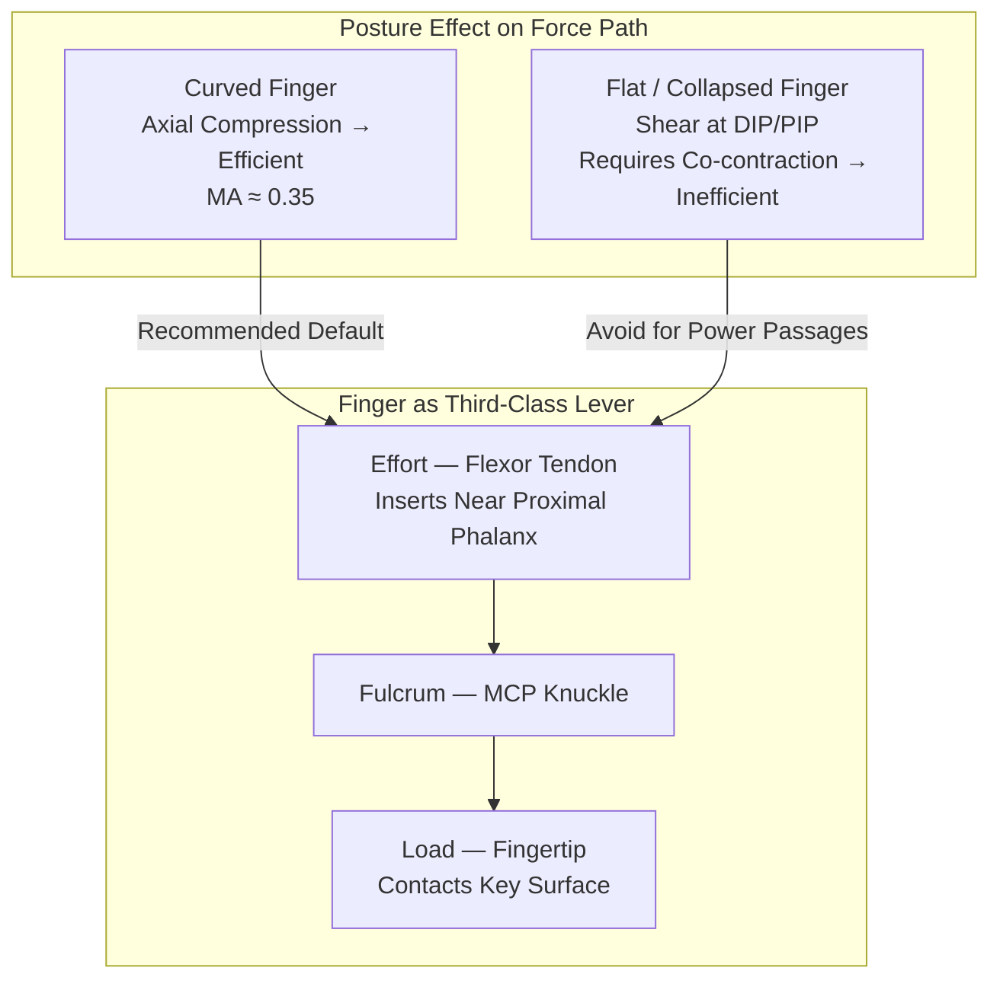
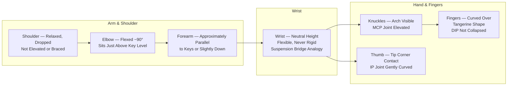
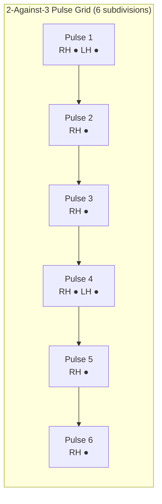

# Lesson 1: Finger Independence — From Anatomy to the Keys

## 1. Why This Matters Before You Touch the Piano

Finger independence is the single biggest bottleneck between a beginner and a fluent pianist. Your hand is not a flute with five equal, isolated tubes — it is a system of mechanically coupled levers sharing tendons, muscles, and neural wiring. The good news: that coupling is trainable. The challenge: you have to work *with* the anatomy, not against it.

This lesson gives you the biomechanical intuition to understand *why* certain fingers fail, then immediately translates that into drills you can run at the keyboard today.

---

## 2. The Anatomy You Actually Need to Know

You do not need to memorize every muscle name. You need to understand three constraints that directly affect what happens under your fingers.

### Constraint 1 — The Ring Finger Problem (FDP Coupling)

Your four fingers share a single deep flexor muscle (Flexor Digitorum Profundus, FDP). Its tendons for fingers 2–5 branch from a *common muscle belly*. When you try to press your ring finger (4) while holding the middle (3) or pinky (5) down, the shared belly pulls all three. This is why the ring finger is the last to gain independence — it has the strongest anatomical coupling in both directions.

**What this means at the keyboard:** Ring finger weakness in passages like a held 3–5 with a moving 4 is not weakness of will — it is a biomechanical starting condition. Training creates neural compensation, not anatomical change.

### Constraint 2 — Extensor Crosstalk (Juncturae Tendinum)

On the back of your hand, tiny fibrous bridges (juncturae tendinum) connect the extensor tendons. Lifting one finger passively pulls its neighbors upward. Again, the ring and middle fingers are the worst offenders. The index and pinky have dedicated extensors (Extensor Indicis Proprius, Extensor Digiti Minimi) that give them partial independence for free.

**What this means at the keyboard:** When you try to lift finger 4 alone off a held key, fingers 3 and 5 will want to come with it. Practice of independent *lifting* (not just pressing) is essential.

### Constraint 3 — The Finger as a Third-Class Lever

Each finger is a third-class lever: the MCP knuckle is the fulcrum, the tendon inserts near the base of the proximal phalanx (effort), and the fingertip is the load. Mechanical advantage ≈ 0.3–0.4, meaning your flexor must generate 2.5–3× the desired key force. A *curved* finger posture transmits force axially through the bone column, minimizing joint shear. A flat, collapsed finger adds lateral stress at the DIP and requires extra stabilizing co-contraction — wasting energy and degrading control.



---

## 3. Hand Posture — The Non-Negotiable Foundation

Before any drill, establish correct hand position. Every practice session starts here.

### The Setup Checklist

**Seat height:** Adjust so your forearms are approximately parallel to the floor or angled very slightly downward toward the keys. Elbows should sit just above key level.

**Arm weight, not finger pressure:** Let the natural weight of your forearm rest into the keys. Place your palm flat on your thigh and feel that weight — that is the sensation you are transferring to the keyboard. You are not pushing *down* from the fingertips; you are *releasing* arm weight *through* them.

**Curved fingers:** Imagine holding a small tangerine in your palm. Your fingers should curve over the top of it, with the distal phalanx (last segment) roughly perpendicular to the key surface. The nail joint (DIP) should *never* collapse inward (hyperextend).

**Wrist neutral:** The wrist sits level or very slightly elevated — never dropped below key level (which loads the carpal tunnel) and never arched sharply upward (which locks the finger motion). Think of the wrist as a suspension bridge, not a ramp.

**Thumb angle:** The thumb contacts keys at the outer corner of its tip, not the flat pad. The thumb joint (IP) should be gently curved, not locked straight. The first metacarpal runs roughly parallel to the keys during scale passages.

**Relaxed shoulder:** The shoulder sits down and back. Any shrugging indicates compensatory tension somewhere in the chain.



### The Quick Posture Reset (Do This Every 10 Minutes)

1. Lift both hands off the keys and shake them loosely from the wrists for 5 seconds.
2. Let arms hang at your sides — feel the weight.
3. Float arms back up and place hands in position *without* gripping.
4. Play a single middle C with finger 3 (middle finger) using only arm weight release. No push — just let gravity win.

If the note sounds, your posture is working. If you are straining, you are over-working it.

---

## 4. The Core Independence Drills

These drills build from isolation to coordination. Work each one to the target tempo *before* moving on. Use a metronome — it is non-negotiable.

### Drill 1 — Static Hold + Moving Finger (The Ring Finger Unlocking Drill)

This directly addresses the FDP coupling problem.

**Setup:** Right hand on C major pentascale position (C4–G4, fingers 1–5).

**Exercise A — Hold 1+2+3, Move 4:**
Hold fingers 1, 2, 3 firmly down (do not let them release). Now depress finger 4 (ring, D) and release it repeatedly. The held fingers must not move or release pressure.

```
Right Hand — C Major Pentascale Position
Finger:  1    2    3    4    5
Note:    C    D    E    F    G
         ●    ●    ●    ↕    ●
         (held)  (held) (move) (held)
```

**Start:** 60 BPM, one press per beat
**Target:** 80 BPM, clean and even, no lifting of held fingers
**Common error:** Finger 3 or 5 releasing — stop, re-establish holds, slow down to 50 BPM

**Exercise B — Hold 2+3+5, Move 4:**
This is harder because finger 4 is coupled to both neighbors simultaneously.

```
Finger:  1    2    3    4    5
Note:    C    D    E    F    G
              ●    ●    ↕    ●
         (free)(held)(held)(move)(held)
```

**Start:** 50 BPM
**Target:** 72 BPM
**Left hand:** Mirror the same drill on LH, same fingering.

---

### Drill 2 — Hanon No. 1 Adapted: Legato Independence Builder

Hanon's exercises are often dismissed as mechanical. Used correctly with *specific attention targets*, they are potent independence builders.

**The pattern (C position, RH):**

```
Fingers:  1  2  3  4  5  4  3  2  | 1  2  3  4  5  4  3  2
Notes:    C  D  E  F  G  F  E  D  | C  D  E  F  G  F  E  D
Beat:     1  +  2  +  3  +  4  +  | (repeat ascending by step)
```

**The attention target — not speed, but evenness of tone:**

Play this passage and *listen* for the F (finger 4). It almost always sounds quieter than the surrounding notes. Your job is to make finger 4's volume identical to fingers 2, 3, and 5.

| Tempo | Focus |
|-------|-------|
| 60 BPM | Feel each finger land independently; zero sympathetic ringing from held fingers |
| 72 BPM | Smooth legato connection; no gap between notes |
| 84 BPM | Even tone across all five fingers; F = G in volume |
| 100 BPM | Maintain relaxed wrist; no forearm tension creeping in |

**Left hand:** Same pattern, same tempos. Then hands together at 60 BPM before increasing.

---

### Drill 3 — Trill Development (Fingers 3-4 and 4-5)

Trills between adjacent fingers expose the stiffest coupling points. The 3-4 trill is the hardest on the piano.

**The mechanics:** A trill is not rapid pressing — it is controlled *rebound*. The key drops, hits the keybed, and your finger catches the elastic bounce back. You are timing your *next* attack to coincide with the natural rebound of the previous finger.

**3-4 Trill Protocol — Right Hand (play on E-F, white keys):**

```
RH, fingers 3-4, notes E-F
3:  ↓  ↑  ↓  ↑  ↓  ↑  ↓  ↑
4:     ↓  ↑  ↓  ↑  ↓  ↑  ↓
Beat: 1  +  2  +  3  +  4  +
```

| Step | Tempo | Method |
|------|-------|--------|
| 1 | 50 BPM | Play as slow repeated notes, full key travel, feel each rebound |
| 2 | 72 BPM | Allow natural rebound — do not force the lift |
| 3 | 88 BPM | Wrist makes tiny up-down rotation to assist the alternation |
| 4 | 108 BPM | Wrist rotation takes over; fingers just guide direction |
| 5 | 126 BPM | Surface-contact trill; fingers barely leave keys |

**4-5 Trill Protocol:** Same method, notes F-G, fingers 4-5. The 4-5 pair has less independence than 3-4 at first but responds quickly to the wrist rotation assist.

---

### Drill 4 — The Contrary Motion Scale (Two-Hand Independence Starter)

This is the entry point to true two-hand independence. Both hands play C major simultaneously, moving in opposite directions. Because the motion is *mirrored*, the neural load is lower than independent motion — but it trains bilateral coordination.

```
LH: C4  B3  A3  G3  F3  E3  D3  C3   (descending)
RH: C4  D4  E4  F4  G4  A4  B4  C5   (ascending)
Both start on middle C simultaneously.

Fingering:
RH: 1   2   3   1   2   3   4   5
LH: 1   2   3   1   2   3   4   5
                ↑
           Both thumbs cross under/over simultaneously at F/G
```

| Tempo | Target |
|-------|--------|
| 52 BPM (quarter note = one key) | Legato, even tone, thumb crossings are smooth |
| 66 BPM | Continuous flow, no hesitation at thumb crossing |
| 80 BPM | Full octave in one musical gesture |

---

### Drill 5 — Polyrhythm Foundation: 2-Against-3

This is the first real two-hand independence challenge. Right hand plays 3 notes per beat, left hand plays 2 notes per beat — simultaneously.

**The subdivision trick:** Count in groups of 6. Both hands align on beat 1 and beat 4 (of 6).

```
Subdivide into 6 equal pulses:
Pulse:  1    2    3    4    5    6
RH(3): [1]       [2]       [3]
LH(2): [1]            [2]
        ↑ Both together    ↑ LH alone    ↑ RH alone
```

**Step-by-step learning sequence:**

1. **Learn each hand separately** at 60 BPM. RH plays 3 even notes per bar; LH plays 2 even notes per bar. Single-note repetitions on middle C.

2. **Clap the combined rhythm.** Clap the full 6-pulse pattern with one hand: beats 1, 3, 4, 6 for RH triplets; beats 1, 4 for LH duplets. Feel how they fit together.

3. **Play RH + mouth the LH.** RH plays its triplet, while you say "1 — 4" aloud at the LH pulse points. This trains the anticipatory timing before engaging both hands.

4. **Hands together at 50 BPM.** Accept that it will feel lopsided — that is correct. The goal is accurate pulse placement, not evenness of feel.

5. **Target tempo: 72 BPM** for clean execution. 88 BPM for fluency.



---

## 5. The Arm Weight Delivery System

This is the single most important physical concept after posture. Most beginners play with *finger pressure* (muscular pushing from the fingertip). Advanced pianists play with *arm weight* (releasing the forearm's mass through a relaxed finger).

### Why Arm Weight Sounds Better

A key driven by finger pressure alone receives a short, sharp impulse — the finger punches the key from above. The hammer strikes the string with a bright, often harsh attack. A key driven by arm weight release receives a smooth acceleration — the forearm drops through a relaxed wrist, and the finger guides that fall. The hammer accelerates gradually, producing a warmer, more controlled tone.

The forearm weighs approximately 1.5–2 kg. Without any muscle engagement, it can depress a piano key (which requires only 50–60 grams of activation force) with significant surplus. You have mechanical power to spare — the skill is in modulating and directing it.

### The Arm Weight Delivery Drill

**Step 1 — Single-Note Drop:**
Lift your right forearm about 10 cm above middle C. Completely release it — let it fall freely onto finger 3. Do not push. The note should sound with medium-forte volume from the fall alone. If it sounds too loud, your release point was too high. Too soft, too low.

**Step 2 — Graduated Release:**
Now play middle C pp, mp, mf, f with the *same technique* — only the release height (and therefore velocity) changes. No finger pushing.

| Dynamic | Approximate release height |
|---------|---------------------------|
| pp | 1–2 cm |
| mp | 3–4 cm |
| mf | 6–8 cm |
| f | 10–12 cm |
| ff | Full forearm lift from elbow |

**Step 3 — Transfer Across Fingers:**
Play C–D–E–F–G (fingers 1–5) as a slow legato, transferring the arm weight from finger to finger like pouring water from cup to cup. Each finger receives the weight, the previous finger releases passively.

---

## 6. Voice Leading and Finger Independence in Context: The Alberti Bass

The Alberti bass (a broken-chord accompaniment pattern in the left hand) is in every Classical sonata and is the first real-world test of LH independence while RH carries a melody.

### The Pattern

```
LH — C Major Alberti Bass (C3-E3-G3)
Finger:  5    3    1    3    5    3    1    3
Note:    C    E    G    E    C    E    G    E
Beat:    1    +    2    +    3    +    4    +
Dynamic: p              p              p
```

The challenge: fingers 1, 3, 5 must play strictly *piano* and evenly while the RH melody has its own independent dynamic contour.

### The Two-Phase Practice Method

**Phase 1 — Isolate LH, evenness drill:**
Play the Alberti pattern alone at 60 BPM. Every note must be identical in volume. Record yourself on your phone — the human ear tolerates unevenness that a recording exposes immediately.

**Phase 2 — Hands together, dynamic independence:**
Add a simple RH melody (play the C major scale, one note per beat). Crescendo the melody from C to C (8 notes, pp to mf). The LH *must remain at a constant p*. This is two-hand dynamic independence — the actual skill tested in Haydn, Mozart, and Clementi.

| Phase | Tempo | Target |
|-------|-------|--------|
| LH alone | 60 → 84 BPM | Perfect evenness, no accent on beat 1 |
| HT with static LH dynamic | 60 BPM | LH stays p regardless of RH |
| HT with RH crescendo | 60 → 72 BPM | Completely independent dynamic contours |

---

## 7. Troubleshooting: What Went Wrong and How to Fix It

| Symptom | Root Cause | Fix |
|---------|-----------|-----|
| Ring finger consistently quiet in scales | FDP coupling pulling 4 back during flex | Drill 1 (static hold + moving 4) daily for 2 weeks |
| Forearm tightens after 10 minutes | Gripping with extrinsic forearm flexors | Drop wrist, shake out, slow down 20 BPM, check thumb tension |
| Trill between 4-5 is uneven | Insufficient wrist rotation assist | Add micro-rotation from wrist (up on 4, down on 5) |
| Notes in LH Alberti are uneven in volume | Using finger pressure instead of consistent arm weight release | Arm weight drop drill on each individual Alberti note, then reassemble |
| 2-against-3 polyrhythm collapses | Trying to feel both hands simultaneously | Return to 6-subdivision counting; slow to 44 BPM |
| DIP (nail joint) collapses on black keys | Insufficient finger curve; arm weight aimed too far back | Recheck tangerine grip; aim fingertip directly down at key |
| Shoulder tension builds during forte passages | Shoulder bracing to generate force instead of arm weight | Play forte with forearm drop only; shoulder must remain loose |

---

## 8. Neural Rewiring: How Practice Actually Works

One paragraph of physiology is worth knowing because it directly shapes *how* you should practice.

Your brain's motor cortex maps individual finger movements to distinct (but overlapping) neural columns. At the beginning, fingers 3, 4, and 5 share heavily overlapping maps — their activations bleed into each other. Repeated, *accurate*, *slow* practice of isolated finger motion expands the non-overlapping regions of those maps and strengthens dedicated pathways. This is cortical reorganization, and it requires three conditions: **accuracy first** (sloppy repetition wires sloppy patterns), **rest** (consolidation happens during sleep and rest, not during playing), and **distributed sessions** (four 20-minute sessions beats one 80-minute session for skill retention).

The practical rules:
- **Never practice errors.** The moment a note is wrong or a held finger releases, stop — do not play through it.
- **Stop before fatigue.** When your ring finger starts lagging, your neural signal quality has degraded. Five more minutes of degraded playing embeds the wrong pattern. Rest 5–10 minutes.
- **Slow is not easy — slow is hard.** Playing Drill 1 at 50 BPM with perfect held fingers requires more neural precision than racing through it at 90 BPM incorrectly.

---

## 9. Practice Session Blueprint

A complete 30-minute session structure for Lesson 1 material:

| Time | Activity | Tempo / Goal |
|------|----------|-------------|
| 0–3 min | Posture setup + single-note arm weight drops | Feel the weight, not the push |
| 3–8 min | Drill 1A: Hold 1+2+3, move 4 (RH, then LH) | 60 → 72 BPM |
| 8–13 min | Drill 2: Hanon No. 1 adapted, evenness focus | 60 → 84 BPM |
| 13–18 min | Drill 3: 3-4 trill (then 4-5 trill) | 50 → 100 BPM step ladder |
| 18–23 min | Drill 4: Contrary motion C major scale | 52 → 72 BPM |
| 23–28 min | Drill 5: 2-against-3 polyrhythm | 50 → 72 BPM |
| 28–30 min | Alberti bass + RH melody (HT) | 60 BPM, dynamic independence |

**After every session:** Shake hands out. Briefly stretch the finger extensors (gently press fingers backward one at a time, 5 seconds each). Do not stretch aggressively — the goal is circulation, not force.

---

## 10. Benchmarks: Where You Should Be

After **1 week** of daily 30-minute sessions:
- Drill 1A clean at 72 BPM with zero held-finger releases
- Hanon No. 1 at 84 BPM with audibly even finger 4

After **2 weeks:**
- 3-4 trill reaching 108 BPM with wrist rotation assist
- Contrary motion C major scale clean at 72 BPM
- 2-against-3 hands together at 60 BPM without counting aloud

After **1 month:**
- All drills at their top target tempos
- Alberti bass + independent RH melody dynamic at 72 BPM
- Ring finger no longer noticeably weaker in Hanon passages

These are conservative benchmarks for a motivated adult beginner practicing daily. If you are ahead, increase tempos by 4–8 BPM increments. If behind, slow down and check the troubleshooting table — the problem is almost always posture or practicing through fatigue.
