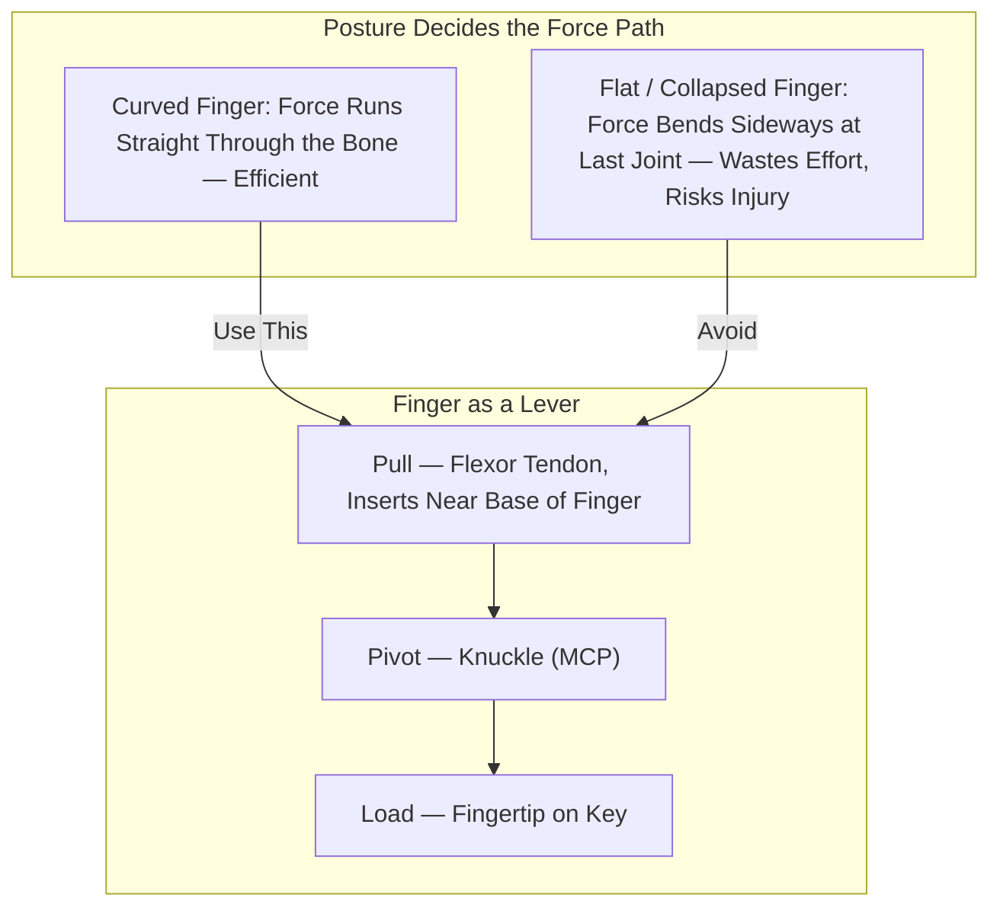
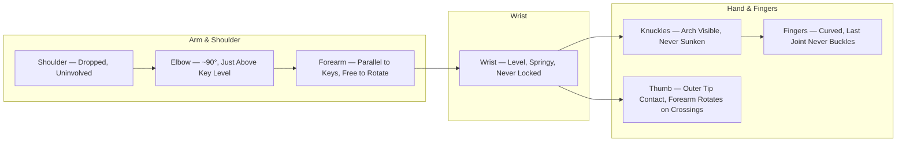

# Lesson 1: Finger Independence — From Anatomy to the Keys

## 1. Why This Matters Before You Touch the Piano

Finger independence is the single biggest bottleneck between a beginner and a fluent pianist. Your hand is not five equal, isolated levers — it's a system of mechanically coupled tendons and muscles sharing a common wiring loom. The coupling is real, it's permanent, and it's also trainable. You don't fix it by willpower; you build a neural detour around it.

This lesson gives you the minimum biomechanical intuition needed to understand *why* finger 4 betrays you, then puts you straight at the keyboard with drills sequenced for immediate execution. Read section 2 once. After that, every session starts in section 3.

---

## 2. The Anatomy You Actually Need to Know

Three structural facts explain nearly everything that goes wrong under your fingers.

### Constraint 1 — The Ring Finger Problem (FDP Coupling)

Fingers 2 through 5 share one deep flexor muscle (flexor digitorum profundus). Its tendons branch off a common muscle belly. Pull finger 4 down while 3 and 5 are held, and the shared belly drags on all three. The ring finger has the strongest coupling of any finger in both directions, which is why it lags behind in every beginner's hand.

**At the keyboard:** a held 3–5 with an independently moving 4 is not a test of willpower, it's a test against anatomy. Training builds neural compensation — your brain learns to send an inhibitory signal to the neighbors while 4 moves. That takes repetition at a slow, clean tempo, not brute force at a fast one.

### Constraint 2 — Extensor Crosstalk (Juncturae Tendinum)

On the back of the hand, small fibrous bridges link the extensor tendons. Lift one finger and its neighbors get pulled up with it. Again, 3 and 4 are the worst-connected pair. Fingers 1 and 5 have dedicated extensor muscles (extensor indicis, extensor digiti minimi) and get partial independence for free, which is why passages built on 1-2-5 always feel easier than passages built on 3-4.

**At the keyboard:** training the *lift* is a separate skill from training the *press*, and almost nobody drills it. Drill 1C below exists specifically to close that gap.

### Constraint 3 — The Finger as a Lever, and Why Curved Beats Flat

Each finger works as a third-class lever: the knuckle (MCP) is the pivot, the flexor tendon pulls near the base of the first bone segment, and the fingertip is the load. Because the tendon inserts close to the pivot, your flexor muscle has to pull several times harder than the force you actually want at the key. A curved finger routes that pulling force straight down through the bone column into the key — efficient, stable, and injury-resistant. A flat or collapsed finger bends that force sideways at the last joint, which the body resists by co-contracting stabilizer muscles you don't need. Net result: more effort, worse control, and over months, tendon irritation. The curved "tangerine grip" isn't an aesthetic — it's the posture that gets the most tone for the least strain.



### Constraint 4 — The Thumb's Perpendicular Problem

The thumb sits in a different plane than the four fingers — it flexes toward the palm, not parallel to the keys. Every thumb crossing in a scale needs a small inward forearm rotation to keep the thumb striking the key straight-on instead of sideways. Sideways thumb pressure, repeated for years, is a direct path to carpal tunnel irritation.

**At the keyboard:** the fix lives in the forearm, not the thumb. Just before the thumb crosses under in a scale, the forearm rotates slightly inward (pronates) to carry the thumb into position. The thumb doesn't reach for the key — the arm delivers it.

---

## 3. Hand Posture — The Non-Negotiable Foundation

Every session starts here, with no exceptions. Speed built on bad posture is not a skill, it's an injury with a delay timer.

### The Setup Checklist

**Seat height.** Forearms roughly parallel to the floor, elbows just above key level. Test: lay a ruler across both forearms — level, or sloping gently toward the keys. If elbows sit below the keys, the wrist has to arch up to compensate, and that arch loads the carpal tunnel every single note.

**Arm weight, not finger push.** Rest your palm on your thigh and feel its dead weight. That's the sensation you're transferring to the key — you release weight *through* the finger, you don't push *from* it. This is the entire foundation of piano tone; everything expressive downstream depends on this one habit.

**Curved fingers — the tangerine grip.** Hold an imaginary tangerine in your palm; fingers curl over the top, fingertip meeting the key close to perpendicular. The last joint (DIP, nearest the nail) must never buckle inward under pressure. Check it every time you sit down for the first two weeks — it's the single most common beginner fault and the fastest route to tendinitis.

**Wrist neutral — the suspension bridge.** Level or very slightly raised. Never dropped below key level (loads the carpal tunnel), never arched sharply up (locks finger motion and kills trill speed). Flexible under load, like a suspension bridge — never a rigid ramp.

**Thumb angle.** Contact the key with the outer corner of the thumb tip, the side nearest the index finger — not the flat pad. The thumb's middle joint stays gently curved; locked straight, it transmits shock directly into the wrist.

**Relaxed shoulder.** Down and back, doing nothing. Any shrug during playing is a signal that tension is leaking in somewhere else in the chain, almost always a gripping forearm. Treat shoulder rise as a diagnostic, not a cosmetic issue.

**Bench distance.** Close enough that elbows sit at or just in front of your torso. Test: with hands in playing position, elbows should swing side to side without hitting your body. Too far back and you reach, losing wrist control; too close and the elbows fold in, blocking arm-weight transfer.



### The 10-Minute Posture Reset

Tension creeps in below conscious notice during practice. Interrupt it on a timer, not when you happen to feel sore.

1. Lift both hands off the keys. Shake them loosely from the wrist for 5 seconds.
2. Drop your arms to your sides. Feel their full dead weight for a moment.
3. Roll shoulders back and down once, then let them fall.
4. Float your hands back into position without gripping the air as you lift them.
5. Play one middle C with finger 3, using arm-weight release only — no push.

Medium volume with no strain means your posture is working. Straining for tone means you're over-muscling it. Too loud means you dropped from too high.

### Common Posture Errors and Fixes

| Error | What You Feel | Fix |
|---|---|---|
| Wrist below key level | Ache on underside of wrist after ~20 min | Raise the bench, or move closer to the keys |
| Last finger joint buckling | Fingertip bends backward under load | Curl more; aim the knuckle directly over the key |
| Thumb pressing flat-pad | Thumb fatigue, lateral wrist ache | Rotate so the outer tip corner hits the key |
| Shoulders rise in forte | Neck tension, forearm lock | Play forte from forearm drop only, zero shoulder |
| Wrist rigid | Can't control trill speed | Unlock deliberately; small rotation drill before trilling |
| Reaching too far forward | Upper arm and shoulder strain | Slide the bench in until elbows sit at the torso line |

---

## 4. The Core Independence Drills

Work each drill to its target tempo before advancing. The metronome is not optional — without it you unconsciously rush the easy notes and drag the hard ones, which wires exactly the wrong unevenness into muscle memory.

---

### Drill 1 — Static Hold + Moving Finger (Ring Finger Unlocking Protocol)

This is the most important drill in the lesson for most players. Give it the most time.

**Setup:** right hand in C major five-finger position, C4–G4, fingers 1–5. Fingers rest on the keys with steady, light contact — not hammered down.

#### 1A — Hold 1+2+3, Move 4

```
Key:     C4   D4   E4   F4   G4
Finger:   1    2    3    4    5
         hold hold hold MOVE hold
```

Press finger 4 to the keybed and release, repeatedly. Fingers 1, 2, 3 must not lift, lighten, or shift at all.

| Stage | Tempo | Target |
|---|---|---|
| Start | 60 BPM | Each press even and audible; zero release from held fingers |
| Progress | 72 BPM | Same quality, wrist stays still |
| Target | 80 BPM | No sympathetic movement in fingers 3 or 5 |

**If finger 3 or 5 lifts on the downstroke, stop immediately.** Don't play through it — that trains the error. Reset the hold, drop to 50 BPM, rebuild from there.

#### 1B — Hold 2+3+5, Move 4

```
Key:     C4   D4   E4   F4   G4
Finger:   1    2    3    4    5
         free hold hold MOVE hold
```

Harder: holding 5 as well removes the escape route of letting 4 and 5 move together as a pair.

| Stage | Tempo | Target |
|---|---|---|
| Start | 50 BPM | It should feel almost impossible — that's correct |
| Progress | 60 BPM | Full key travel on 4; held fingers show zero movement |
| Target | 72 BPM | Clean, even, wrist neutral throughout |

#### 1C — Independent Lifting (the half everyone skips)

Most players train the press and never train the lift, leaving extensor crosstalk completely unaddressed.

```
Hold fingers 2, 3, 5 lightly on their keys.
Lift finger 4 off F4 as high as you comfortably can — held fingers must not move.
Lower it back to the key surface WITHOUT pressing.
That's one rep (lift → hover at surface).
Once clean: add a press. Full cycle = lift, lower, press, release.
```

**Start:** 40 BPM — this is a slow isolation drill, not a speed exercise.
**Target:** 60 BPM clean cycle, finger 4 lifting visibly higher than its resting height.

**Left hand:** mirror all three exercises, same fingering. LH finger 4 has identical coupling and needs the same dose.

---

### Drill 2 — Hanon No. 1, Adapted: Legato Independence Builder

Dismissed as mechanical when practiced mindlessly. Used with a specific listening target, it's a precision tool.

**Pattern (C position, right hand ascending):**

```
Finger:  1  2  3  4  5  4  3  2  |  1  2  3  4  5  4  3  2
Note:    C  D  E  F  G  F  E  D  |  C  D  E  F  G  F  E  D
Beat:    1  +  2  +  3  +  4  +  |  (repeat, shifting up a step each bar)
```

Ascend to C5, then descend back to C4 using the mirrored fingering pattern.

**The attention target isn't speed or correctness — it's tonal evenness.** Listen specifically for the F (finger 4) going up and the E (finger 3) coming back down. Finger 4's note is almost always 20–30% quieter than its neighbors because it's mechanically weaker. Your only job in this drill is making finger 4 match the volume of 2, 3, and 5.

**To actually hear the problem:** record 30 seconds on your phone and play it back with eyes closed. The weak note jumps out in playback even when you couldn't catch it live — during real-time playing your attention is split between motor execution and listening, and the ear loses that fight.

| Tempo | Focus | Listen For |
|---|---|---|
| 60 BPM | Independent attacks, no sympathetic ringing | Do released fingers keep vibrating sound from the previous note? |
| 72 BPM | Smooth legato connection | Any micro-gap or smear around the F? |
| 84 BPM | Tonal equality, F = G = E in volume | Does the phrase dip on the F? |
| 96 BPM | Wrist stays loose | Does the forearm tighten past 84? |
| 108 BPM | Musical shape: slight swell up, slight taper down | Musical, or robotic and flat? |

**Left hand:** same pattern, same tempo ladder.
