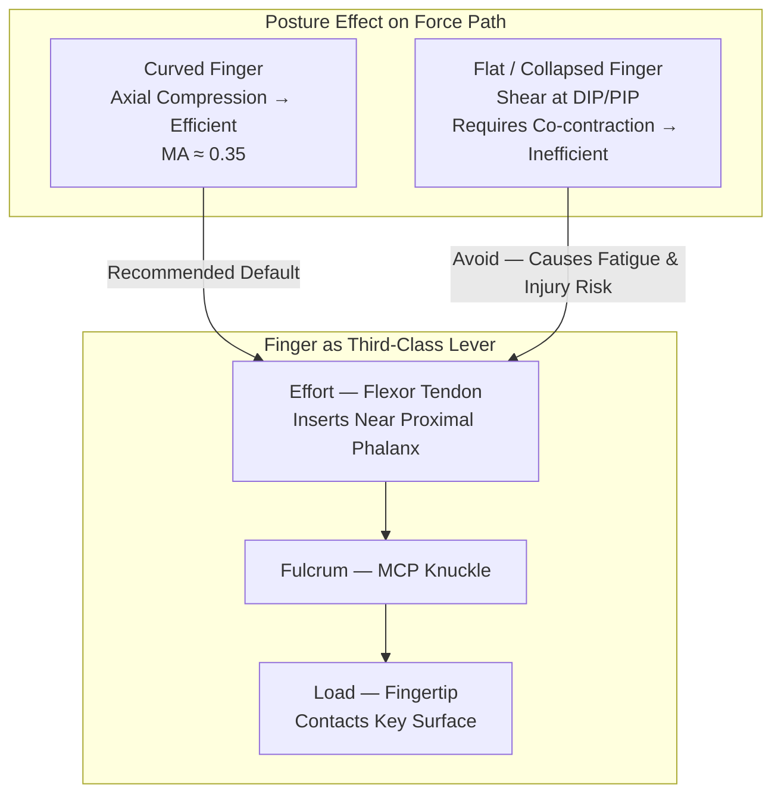
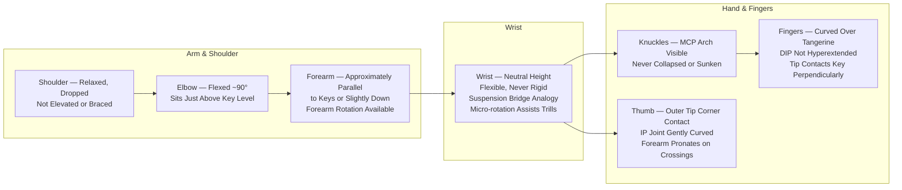

# Lesson 1: Finger Independence — From Anatomy to the Keys

## 1. Why This Matters Before You Touch the Piano

Finger independence is the single biggest bottleneck between a beginner and a fluent pianist. Your hand is not a flute with five equal, isolated tubes — it is a system of mechanically coupled levers sharing tendons, muscles, and neural wiring. The good news: that coupling is trainable. The challenge: you have to work *with* the anatomy, not against it.

This lesson gives you the biomechanical intuition to understand *why* certain fingers fail, then immediately translates that into drills you can run at the keyboard today. Everything here is sequenced so you can open the lesson, sit at the piano, and execute it in real time.

---

## 2. The Anatomy You Actually Need to Know

You do not need to memorize every muscle name. You need to understand three constraints that directly affect what happens under your fingers.

### Constraint 1 — The Ring Finger Problem (FDP Coupling)

Your four fingers share a single deep flexor muscle (Flexor Digitorum Profundus, FDP). Its tendons for fingers 2–5 branch from a *common muscle belly*. When you try to press your ring finger (4) while holding the middle (3) or pinky (5) down, the shared belly pulls all three. This is why the ring finger is the last to gain independence — it has the strongest anatomical coupling in both directions.

**What this means at the keyboard:** Ring finger weakness in passages like a held 3–5 with a moving 4 is not weakness of will — it is a biomechanical starting condition. Training creates neural compensation, not anatomical change. This distinction matters: you are not trying to fix a flaw, you are building a detour around a structural constraint.

### Constraint 2 — Extensor Crosstalk (Juncturae Tendinum)

On the back of your hand, tiny fibrous bridges (juncturae tendinum) connect the extensor tendons. Lifting one finger passively pulls its neighbors upward. Again, the ring and middle fingers are the worst offenders. The index and pinky have dedicated extensors (Extensor Indicis Proprius, Extensor Digiti Minimi) that give them partial independence for free — which is why passages dominated by fingers 1, 2, and 5 feel naturally easier.

**What this means at the keyboard:** When you try to lift finger 4 alone off a held key, fingers 3 and 5 will want to come with it. Practice of independent *lifting* (not just pressing) is essential and is a separate skill from pressing. Many players train the down-stroke but never train the controlled return.

### Constraint 3 — The Finger as a Third-Class Lever

Each finger is a third-class lever: the MCP knuckle is the fulcrum, the tendon inserts near the base of the proximal phalanx (effort), and the fingertip is the load. Mechanical advantage ≈ 0.3–0.4, meaning your flexor must generate roughly 2.5–3× the desired key force. A *curved* finger posture transmits force axially through the bone column, minimizing joint shear. A flat, collapsed finger adds lateral stress at the DIP joint and requires extra stabilizing co-contraction — wasting energy and degrading control. The practical upshot: the tangerine-grip posture is not an aesthetic preference; it is mechanically efficient force transmission.



### Constraint 4 — The Thumb's Perpendicular Problem

The thumb lies in a different anatomical plane from the four fingers. Its MCP and IP joints flex toward the palm, not parallel with the keys. This means every thumb crossing in a scale or arpeggio requires a subtle forearm rotation to keep the thumb tip angled into the key rather than pressing sideways across it. Lateral thumb pressure compresses the carpal tunnel over time. The fix is in the forearm, not the thumb itself.

**What this means at the keyboard:** During scale thumb crossings, the forearm rotates slightly inward (pronates) just before the thumb passes under. The thumb does not reach — the arm brings it into position.

---

## 3. Hand Posture — The Non-Negotiable Foundation

Before any drill, establish correct hand position. Every practice session starts here, without exception. Poor posture practiced at speed becomes an injury, not a skill.

### The Setup Checklist

**Seat height:** Adjust so your forearms are approximately parallel to the floor or angled very slightly downward toward the keys. Elbows should sit just above key level. If your elbows drop below the keys, your wrists must arch up to compensate — loading the carpal tunnel. Test: place a ruler flat across both forearms; it should be level or slope gently downward toward the keys.

**Arm weight, not finger pressure:** Let the natural weight of your forearm rest into the keys. Place your palm flat on your thigh and feel that weight — that is the sensation you are transferring to the keyboard. You are not pushing *down* from the fingertips; you are *releasing* arm weight *through* them. This distinction is the entire foundation of expressive piano tone.

**Curved fingers — the tangerine grip:** Imagine holding a tennis ball or small tangerine in your palm. Your fingers curve over the top of it, with the distal phalanx (last segment) roughly perpendicular to the key surface. The nail joint (DIP) must *never* collapse inward (hyperextend) — this is the single most common beginner error and the fastest route to tendinitis. Check DIP alignment every time you sit down for the first week.

**Wrist neutral — the suspension bridge:** The wrist sits level or very slightly elevated — never dropped below key level (which loads the carpal tunnel) and never arched sharply upward (which locks finger motion). The wrist must remain springy and responsive, never rigid. Think of it as a suspension bridge: flexible under load, not a ramp or a brick.

**Thumb angle:** The thumb contacts keys at the outer corner of its tip — the side closest to the index finger — not the flat pad. The IP joint should be gently curved, not locked straight (a locked straight thumb transmits shock directly to the wrist). The first metacarpal runs roughly parallel to the keys during scale passages.

**Relaxed shoulder:** The shoulder sits down and back, completely uninvolved in key depression. Any shrugging indicates compensatory tension somewhere in the chain — usually a forearm that is gripping rather than releasing. When you notice shoulder elevation, it is a diagnostic signal, not just an aesthetic problem.

**Distance from the keyboard:** Sit close enough that your elbows are roughly at or slightly forward of your torso. Reaching forward extends the arm and reduces wrist control. Too close and the elbows fold backward, restricting arm weight transfer. The classic test: with hands in position, your elbows should be able to swing freely side-to-side without hitting your body.



### The Quick Posture Reset (Do This Every 10 Minutes)

This is not optional filler — the progressive tension creep during practice is real and happens below conscious awareness. Reset before it compounds.

1. Lift both hands off the keys. Shake them loosely from the wrists for 5 seconds — like shaking water off.
2. Let arms hang completely at your sides. Feel the dead weight of them.
3. Roll your shoulders back and down once. Let them drop.
4. Float arms back up and place hands in position *without gripping the air* as you raise them.
5. Play a single middle C with finger 3 (middle finger) using only arm weight release. No push — just let gravity win.

If the note sounds at medium volume, your posture is working. If you are straining to get a tone, you are over-muscling it. If the note is too loud, your release height was too high.

### Common Posture Errors and Their Immediate Fixes

| Error | What You Feel | Immediate Fix |
|-------|---------------|---------------|
| Wrist below key level | Ache on underside of wrist after 20 min | Raise bench; adjust forward distance from keys |
| DIP (nail joint) collapsing | Fingertip bending backward under pressure | Curl finger more; aim knuckle directly over key |
| Thumb pressing flat-pad | Thumb fatigue; lateral wrist ache | Rotate thumb so outer corner tip contacts key |
| Shoulders rising in forte | Neck tension; forearm lock | Play forte with *only* forearm drop; zero shoulder involvement |
| Wrist rigid/locked | Inability to control trill speed | Consciously unlock wrist; small rotation drill before trilling |
| Reaching too far forward | Upper arm tension; shoulder strain | Slide bench closer until elbows are at torso line |

---

## 4. The Core Independence Drills

These drills build from isolation to coordination. Work each one to the target tempo *before* moving on. The metronome is non-negotiable — it is not a crutch, it is your quality-control system. Without it, you will unconsciously rush the easy notes and linger on the hard ones, which wires exactly the wrong unevenness into muscle memory.

---

### Drill 1 — Static Hold + Moving Finger (The Ring Finger Unlocking Protocol)

This directly addresses the FDP coupling problem. It is the most important drill in this lesson for most players and deserves the most time.

**Setup:** Right hand on C major pentascale position (C4–G4, fingers 1–5). Press each finger down gently but firmly — not hammering, just maintaining steady contact pressure.

#### Exercise 1A — Hold 1+2+3, Move 4

Hold fingers 1, 2, 3 firmly down (do not let them release or lighten pressure). Depress finger 4 (ring finger, playing F4) and release it repeatedly. The held fingers must not move, lighten, or release at any point.

```
Right Hand — C Major Pentascale Position
String/Key: C4   D4   E4   F4   G4
Finger:      1    2    3    4    5
             ●    ●    ●    ↕    ●
           (hold)(hold)(hold)(move)(hold)

One repetition = finger 4 presses F4 to keybed and returns to surface.
Count: press = "down", release = "up"
Metronome: each "down" = one beat
```

| Stage | Tempo | Quality Target |
|-------|-------|----------------|
| Start | 60 BPM | Each press audible and even; zero release from held fingers |
| Progress | 72 BPM | Same quality; wrist remains still |
| Target | 80 BPM | No sympathetic movement in fingers 3 or 5 |

**Common error:** Finger 3 or 5 releasing on the downstroke. If this happens, stop immediately — do not play through it. Reset holds, slow to 50 BPM, and rebuild. Playing through the error trains the error.

#### Exercise 1B — Hold 2+3+5, Move 4

This is significantly harder because finger 4 is coupled to both its neighbors simultaneously. The pinky hold (5) prevents the ring finger from "cheating" by using 4-5 as a unit.

```
Right Hand
Key:  C4   D4   E4   F4   G4
Finger: 1    2    3    4    5
           (free)(hold)(hold)(move)(hold)
```

| Stage | Tempo | Quality Target |
|-------|-------|----------------|
| Start | 50 BPM | Accept that it feels almost impossible at first — this is correct |
| Progress | 60 BPM | Finger 4 makes full key travel; held fingers show no movement |
| Target | 72 BPM | Clean, even repetition; wrist neutral throughout |

#### Exercise 1C — Independent Lifting (The Missing Half)

Most players train the press but never the lift. This addresses extensor crosstalk directly.

```
Right Hand — same C major pentascale position
Hold fingers 2, 3, 5 on their keys with light pressure.
Lift finger 4 (from F4) as HIGH as you can while held fingers stay down.
Then lower it back to the key surface WITHOUT pressing.
One rep = lift up, lower to surface (no press yet).
Then add: lift, lower, press, release. Full cycle.
```

**Start:** 40 BPM (this is a slow, deliberate isolation exercise)
**Target:** 60 BPM clean cycle, with finger 4 lifting noticeably higher than its resting position

**Left hand:** Mirror all three exercises on LH, same fingering. The LH ring finger has the same coupling problem and needs equal attention.

---

### Drill 2 — Hanon No. 1 Adapted: Legato Independence Builder

Hanon's exercises are often dismissed as mechanical. Practiced mindlessly, they are. Used with *specific attention targets*, they are precision tools.

**The pattern (C position, RH ascending):**

```
Fingers:  1  2  3  4  5  4  3  2  | 1  2  3  4  5  4  3  2
Notes:    C  D  E  F  G  F  E  D  | C  D  E  F  G  F  E  D
Beat:     1  +  2  +  3  +  4  +  | (repeat, moving up by step each bar)
Duration: ascend to C5, descend back to C4
```

**The critical attention target — not speed, not correctness, but tonal evenness:**

Play this passage and *listen specifically for the F* (finger 4) on the way up and the E (finger 3 on return) on the way down. Finger 4's note almost always sounds 20–30% quieter than its neighbors. Your sole job is to make finger 4's volume identical to fingers 2, 3, and 5. Everything else is secondary.

**How to identify the problem:** Record 30 seconds of this exercise on your phone. Play it back with your eyes closed. The quiet note will stand out immediately in the playback even if you could not hear it while playing — real-time attention is split between motor execution and listening. Recording separates the two.

| Tempo | Specific Focus | What to Listen For |
|-------|---------------|-------------------|
| 60 BPM | Each finger lands independently; zero sympathetic ringing | Do held-over fingers ring from previous note? |
| 72 BPM | Smooth legato connection; no gap or smear between notes | Is there a micro-gap before or after F? |
| 84 BPM | Tonal equality — F = G = E in perceived volume | Does the phrase "dip" on the F? |
| 96 BPM | Relaxed wrist; no forearm tension creeping in | Does your forearm tighten above 84? |
| 108 BPM | Musical phrasing: slight crescendo up, slight decrescendo down | Does it sound musical, or robotic and even? |

**Left hand:** Same pattern, same tempos.
