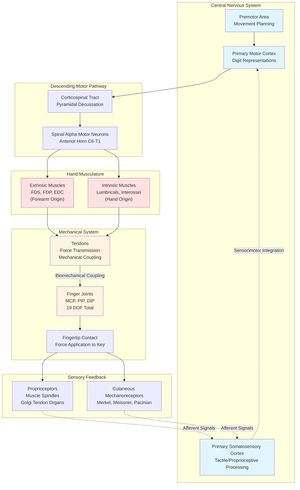
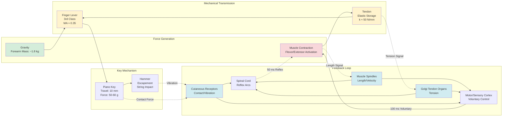

# Lesson 1: Finger Independence Basics

## 1. First-Principles Intuition & Invariants

Finger independence in piano performance represents a fundamental biomechanical challenge: controlling five mechanically coupled appendages as if they were independent actuators. This capability emerges from the interaction of three subsystems—skeletal structure, neuromuscular control, and sensorimotor feedback—each governed by physical and physiological constraints that establish the boundaries of achievable technique.

### Anatomical Constraints and Mechanical Coupling

The human hand contains 27 bones organized into three functional regions: the carpals (wrist), metacarpals (palm), and phalanges (fingers). Each finger comprises three phalanges (proximal, middle, distal) except the thumb, which has two. The intrinsic muscles of the hand—lumbricals, interossei, and thenar/hypothenar groups—originate and insert within the hand itself, enabling fine motor control. The extrinsic muscles—flexor digitorum superficialis (FDS), flexor digitorum profundus (FDP), extensor digitorum communis (EDC), and extensor indicis—originate in the forearm and control finger flexion and extension through long tendons.

The critical constraint for finger independence arises from the anatomy of these extrinsic tendons. The FDP tendons, which flex the distal interphalangeal joints, share common muscle bellies for digits 2-5 (index through pinky). This anatomical coupling means that activating the FDP to flex one finger inherently generates tension in adjacent fingers. The ring finger (digit 4) exhibits the strongest coupling, as its FDP tendon is mechanically linked to both the middle and pinky finger tendons. This explains why isolating ring finger movement is biomechanically more challenging than isolating index or middle finger movement.

The extensor digitorum communis exhibits similar coupling through juncturae tendinum—fibrous interconnections between the extensor tendons on the dorsal hand. These connections create mechanical crosstalk: extending one finger exerts passive extension force on adjacent fingers. The index and pinky fingers possess dedicated extensors (extensor indicis proprius and extensor digiti minimi), granting them greater independence than the middle and ring fingers.

### Neuromuscular Control Architecture

Motor control of finger movement originates in the primary motor cortex (M1), where individual fingers possess distinct but overlapping cortical representations. Neurophysiological studies using transcranial magnetic stimulation demonstrate that the cortical motor maps for adjacent fingers overlap by approximately 50-70%, reflecting the shared neural circuitry that coordinates multi-finger movements. This overlap is adaptive for most hand functions—grasping, pinching—but constrains independent finger control.

The motor command pathway follows this hierarchy:

1. **Motor Planning (Premotor/Supplementary Motor Area)**: Movement sequences are planned and temporally organized
2. **Motor Execution (Primary Motor Cortex)**: Pyramidal neurons in M1 generate action potentials
3. **Descending Pathways (Corticospinal Tract)**: Axons decussate at the medullary pyramids and descend to the spinal cord
4. **Spinal Motor Neurons (Anterior Horn)**: Alpha motor neurons directly innervate muscle fibers
5. **Neuromuscular Junction**: Acetylcholine release triggers muscle contraction
6. **Sensory Feedback (Proprioception/Tactile)**: Muscle spindles, Golgi tendon organs, and cutaneous mechanoreceptors relay position and force information back to the CNS

Finger independence training fundamentally rewires this system through two mechanisms:

**Cortical Reorganization**: Repeated practice of independent finger movements expands the non-overlapping regions of cortical motor maps and strengthens synaptic connections between M1 neurons and spinal motor neurons innervating specific intrinsic hand muscles. Longitudinal fMRI studies of pianists demonstrate measurable expansion of M1 finger representations and increased functional connectivity between motor and sensory cortices.

**Spinal Facilitation/Inhibition**: The spinal cord contains interneuron networks that modulate motor neuron excitability. Training enhances reciprocal inhibition—when one finger's flexors are active, the corresponding extensors are inhibited, and vice versa. Additionally, lateral inhibition between motor neuron pools for adjacent fingers can be strengthened, reducing unwanted co-activation.

### Physical Invariants of Finger Movement

Three fundamental principles constrain efficient finger movement in piano performance:

**Conservation of Energy**: The metabolic cost of muscle contraction scales with the product of force and duration. Efficient technique minimizes isometric contraction (muscle tension without movement) and maximizes isotonic contraction (movement under controlled tension). Excessive gripping or forearm tension wastes metabolic energy and increases fatigue. The optimal movement strategy employs gravity and momentum—the forearm's mass provides potential energy that can be converted to kinetic energy during key descent, reducing the muscular work required.

**Mechanical Advantage**: The finger acts as a third-class lever, where the fulcrum (metacarpophalangeal joint) lies between the effort (muscle insertion) and the load (fingertip). This configuration sacrifices force for range and speed of motion. The thumb operates as a first-class lever when abducted, providing greater mechanical advantage for fortissimo playing. Understanding these lever mechanics explains why curved finger posture (utilizing the stronger proximal and middle phalanx flexors) generates more force than flat-fingered posture (relying primarily on distal flexors).

**Minimum Jerk Trajectory**: Computational motor control theory demonstrates that the CNS plans reaching movements to minimize jerk (the time derivative of acceleration). This principle extends to finger movements: smooth, bell-shaped velocity profiles minimize mechanical stress and maximize control. Jerky, discontinuous movements arise from antagonistic muscle co-contraction and indicate incomplete motor learning.

### Mathematical Framework: Degrees of Freedom and Control Dimensionality

Each finger possesses three rotational degrees of freedom (DOF) at the metacarpophalangeal, proximal interphalangeal, and distal interphalangeal joints, plus abduction/adduction at the MCP joint. For five fingers, this yields 19 kinematic DOF (the thumb has 5 DOF due to its saddle joint). However, the neuromuscular system does not control each DOF independently. Instead, the CNS employs motor synergies—coordinated activation patterns of multiple muscles—that reduce the effective control dimensionality.

Research using principal component analysis on multi-finger force production tasks reveals that approximately 3-4 principal components account for 85-90% of variance in untrained subjects. Piano training increases this dimensionality to 5-7 components, reflecting enhanced finger independence. The mathematical representation of finger independence can be formalized as:

Let **q** ∈ ℝ¹⁹ represent the joint angle vector for all finger DOF. The actual control signal **u** ∈ ℝᵐ (where m < 19) lies in a lower-dimensional subspace. Training expands m, increasing the span of achievable postures and force patterns. The Jacobian matrix J = ∂**x**/∂**q** (where **x** is fingertip position) maps joint velocities to endpoint velocities. Finger independence corresponds to increasing the rank of this Jacobian within task-relevant subspaces.

### Biomechanical Invariants: Force Transmission and Damping

Piano keys require approximately 50-60 grams of force to overcome the return spring and activate the escapement mechanism (varying by manufacturer and regulation). The key travel distance is approximately 10mm, with a working depth of 9-10mm from key surface to letoff. The mechanical energy transferred from finger to key is:

E = F × d = 0.05 kg × 9.81 m/s² × 0.01 m ≈ 0.005 J

This energy must be supplied by muscle contraction or gravitational potential energy from the arm/hand mass. For fortissimo playing requiring faster hammer velocity, peak forces can reach 200-300 grams. The pianist must modulate force production across this dynamic range while maintaining independence across all active fingers.

The viscoelastic properties of muscles, tendons, and ligaments introduce damping into the system. The effective impedance of the finger during striking can be modeled as a spring-damper system:

F = kx + bẋ

where k is stiffness (N/m), b is damping coefficient (N·s/m), x is displacement, and ẋ is velocity. Training increases the range of achievable stiffness and damping values, allowing the pianist to produce tones ranging from crisp staccato (high stiffness, low damping) to legato (moderate stiffness, higher damping).

## 2. Core Architecture & Mechanics

### The Biomechanical Lever System

Piano technique exploits the hierarchical lever system formed by the finger, hand, forearm, upper arm, and shoulder. Each segment can rotate about proximal joints, creating a kinematic chain. The effective inertia and mechanical advantage of this chain determine the force and velocity achievable at the fingertip.

**Finger (Third-Class Lever)**: The metacarpophalangeal (MCP) joint acts as the fulcrum. The flexor tendons insert on the proximal phalanx (effort point), and the load is applied at the fingertip. Since the effort is between the fulcrum and load, this configuration maximizes speed and range of motion at the expense of force. The mechanical advantage MA = d_load / d_effort < 1. For a typical finger geometry, MA ≈ 0.3-0.4, meaning the muscle must generate 2.5-3.3 times the desired fingertip force.

**Wrist (Load Transfer Point)**: The wrist does not act as a lever in conventional finger striking but serves as a load transfer mechanism. By adjusting wrist height and angle, the pianist alters the orientation of the finger lever system and the distribution of arm weight across the fingers. Wrist flexion/extension also modulates the effective length of the extrinsic flexor and extensor tendons, altering their force-generating capacity via the length-tension relationship.

**Forearm and Arm Weight Transfer**: The forearm's mass (approximately 1.5-2 kg) and center of mass location create a gravitational torque about the elbow joint. By controlling shoulder and elbow joint impedance, the pianist can regulate how much of this gravitational force is transmitted to the keys. In relaxed playing, the forearm essentially "floats" above the keyboard, with minimal muscular effort required to maintain position—gravity provides the downward force, and the key resistance provides the upward support reaction.

The principle of arm weight transfer can be quantified. If the forearm mass is m = 1.8 kg and the elbow is flexed such that the center of mass is horizontally displaced from the fingertip by distance r, the gravitational torque about the fingertip is:

τ = mgr

For r ≈ 0.2 m, τ ≈ 3.5 N·m. Distributing this across five fingertips gives approximately 0.7 N·m per finger. If the finger lever has an effective moment arm of 0.05 m, this translates to 14 N (1.4 kg) of downward force available from arm weight alone—far exceeding the 0.5 N required for key depression. This surplus allows the pianist to play with minimal muscular effort, reserving active muscle contraction for dynamic accents and rapid articulation.

### The Curved vs. Flat Finger Debate: A Mechanical Analysis

Pedagogical literature often advocates a curved finger position, with the distal phalanx approximately perpendicular to the key surface. This recommendation has biomechanical justification:

**Force Transmission Efficiency**: A curved posture aligns the finger bones such that compressive forces are transmitted axially through the phalanges, minimizing bending moments at the interphalangeal joints. This reduces the stabilizing muscle force required and decreases the risk of joint hyperextension. In contrast, a flat-fingered posture creates a shear force component at the DIP and PIP joints, requiring increased co-contraction of flexors and extensors to maintain joint stability.

**Muscle Length-Tension Optimization**: The flexor digitorum profundus and superficialis generate maximum force at intermediate muscle lengths. A moderately curved finger position maintains these muscles near their optimal length. Extreme extension (flat finger) shortens the flexors, moving them onto the ascending limb of the length-tension curve where force capacity is reduced. Conversely, extreme flexion compromises extensor function.

**Control Bandwidth**: A curved finger position provides greater control resolution. The moment arm of the fingertip force about the MCP joint is larger, meaning small changes in flexor activation produce smaller changes in key velocity. This increased "gear ratio" enhances fine motor control at the cost of maximum speed—an acceptable tradeoff for most musical contexts.

However, flat-fingered technique is advantageous in specific contexts:

- **Legato Playing**: A flatter finger allows the fingertip to slide smoothly from one key to the adjacent key without lifting, facilitating true legato.
- **Octave Passages**: A flatter thumb position increases thumb span and reduces wrist rotation requirements.
- **Certain Tonal Colors**: Some pianists achieve a mellower tone with flatter fingers, possibly due to altered contact area and impulse duration.

The optimal finger curvature varies dynamically based on musical context, individual hand anatomy, and personal preference. Dogmatic adherence to a single posture is biomechanically unjustified.

### Tendon Mechanics and Elastic Energy Storage

Tendons behave as viscoelastic structures, storing elastic potential energy during stretch and releasing it during recoil. The Achilles tendon in running famously returns approximately 35% of mechanical energy per stride cycle. Finger tendons, though shorter and less elastic, exhibit similar behavior.

During key descent, the finger flexor tendons lengthen slightly as the finger extends to follow the key. This eccentric contraction stores elastic energy. Upon key release or during rapid repeated notes, this stored energy assists the subsequent flexion, increasing efficiency. Advanced pianists exploit this mechanism in rapid trills and tremolos, timing their muscle activation to coincide with tendon recoil.

The stress-strain relationship for tendon can be approximated as:

σ = E·ε

where σ is stress (Pa), E is Young's modulus (≈1.5 GPa for tendon), and ε is strain. For a tendon with cross-sectional area A and length L, the spring constant is:

k = EA/L

Typical finger tendon dimensions (A ≈ 5 mm², L ≈ 150 mm) yield k ≈ 50 N/mm. A 2mm tendon elongation stores energy:

U = (1/2)kx² = (1/2)(50 N/mm)(2 mm)² = 100 mJ

This is approximately 2% of the energy required for a fortissimo keystrike (assuming 5 J for a full hand chord), but can be significant in rapid passages where elastic rebound supplements muscle contraction.

### Proprioceptive Feedback and Sensorimotor Control

Finger independence relies critically on real-time sensory feedback. Three classes of mechanoreceptors provide complementary information:

**Muscle Spindles**: Embedded within muscle fibers, these receptors signal muscle length and rate of length change via Ia and II afferent fibers. Spindles enable the stretch reflex and contribute to kinesthesia (sense of limb position). Piano training enhances spindle sensitivity and the precision of cortical body schema representations.

**Golgi Tendon Organs (GTOs)**: Located at the myotendinous junction, GTOs signal muscle tension via Ib afferents. They provide force feedback and protect against excessive load by triggering autogenic inhibition (relaxation of the agonist muscle). Pianists learn to recalibrate GTO thresholds, allowing greater force production without protective inhibition interfering with performance.

**Cutaneous Mechanoreceptors**: Four receptor types populate the fingertip skin:
- **Merkel cells**: Slow-adapting Type I (SAI), encode pressure magnitude and fine spatial detail
- **Meissner corpuscles**: Fast-adapting Type I (FAI), detect low-frequency vibrations and slip
- **Ruffini endings**: Slow-adapting Type II (SAII), respond to skin stretch and lateral forces
- **Pacinian corpuscles**: Fast-adapting Type II (FAII), sensitive to high-frequency vibrations (40-400 Hz)

The fingertip's mechanoreceptor density exceeds 2,500 per cm², providing extremely high spatial resolution. During piano playing, Merkel cells signal static key contact, Meissner corpuscles detect key descent onset, and Pacinian corpuscles encode the transient vibrations from hammer-string impact. This rich tactile information allows the pianist to perceive subtle tonal differences and adjust technique in real-time.

The sensorimotor control loop operates with a latency of approximately 50-100 ms for voluntary corrections, but the spinal stretch reflex has a latency of only 30-50 ms. Skilled pianists develop anticipatory control strategies that minimize reliance on feedback-driven corrections, instead using internal models to predict sensory consequences of motor commands. When predicted and actual sensory feedback match, the movement proceeds smoothly; mismatches trigger corrective updates to the motor plan.

### Coordination Dynamics: Coupled Oscillators and Syncopation

The challenge of polyrhythmic independence—playing different rhythms simultaneously with each hand or even different fingers of the same hand—can be understood through the theory of coupled oscillators. Each finger can be modeled as a dynamical system with a preferred oscillation frequency. When multiple oscillators are mechanically or neurally coupled, they exhibit phase-locking and entrainment phenomena.

The Haken-Kelso-Bunz (HKB) model describes bimanual coordination as coupled nonlinear oscillators:

φ̇ = Δω - a·sin(φ) - 2b·sin(2φ)

where φ is the relative phase between the two hands, Δω is the frequency difference, and a, b are coupling strengths. This model predicts two stable coordination modes: in-phase (φ = 0, both hands synchronized) and anti-phase (φ = π, hands alternating). Intermediate phases are unstable and require active neural control to maintain.

Piano training strengthens interhemispheric inhibition (reducing coupling) and enhances the prefrontal cortex's ability to impose top-down control over the inherent coupling dynamics. Advanced pianists can sustain 3:2, 4:3, and even more complex polyrhythms by internally subdividing the beat structure and using attentional focus to prevent entrainment.

Neurophysiologically, this corresponds to desynchronization of beta-band (13-30 Hz) oscillations between motor cortices. Beta desynchronization is associated with active movement and reduced cortico-cortical coupling, enabling independent timing control for each hand.

### Fatigue and Recovery: Metabolic and Neural Factors

Extended practice sessions challenge both metabolic and neural systems. Muscle fatigue arises from:

1. **Depletion of ATP and phosphocreatine** reserves in muscle fibers
2. **Accumulation of metabolic byproducts** (H⁺ ions, inorganic phosphate) that interfere with cross-bridge cycling
3. **Impaired calcium release** from the sarcoplasmic reticulum

For the small intrinsic hand muscles, glycogen stores are limited, and fatigue can occur within 15-30 minutes of continuous high-intensity playing. The extrinsic forearm muscles have larger mass and glycogen reserves but are also susceptible to fatigue, particularly in repertoire demanding sustained forte dynamics.

Neural fatigue manifests as:

1. **Reduced motor unit recruitment**: The CNS fails to fully activate high-threshold motor units
2. **Increased synaptic noise**: Variability in motor neuron firing rates increases, degrading precision
3. **Attentional fatigue**: The prefrontal cortex's ability to maintain focus and inhibit irrelevant movements degrades

Effective practice schedules incorporate rest intervals to allow metabolic recovery (typically 5-10 minutes every 30-45 minutes) and task variation to prevent neural fatigue in specific motor programs. Research on motor learning demonstrates that distributed practice (shorter sessions spread over multiple days) produces superior long-term retention compared to massed practice (long sessions concentrated in fewer days).

### Summary of Core Mechanical Principles

1. **Finger independence is constrained by anatomical tendon coupling**, particularly in the FDP and EDC, requiring neural compensation through cortical reorganization and spinal interneuron modulation.

2. **The finger operates as a third-class lever**, sacrificing force for speed. Curved posture optimizes force transmission and muscle length-tension relationships.

3. **Arm weight transfer exploits gravitational potential energy**, reducing metabolic cost. The forearm's mass provides sufficient force for normal playing without active muscle contraction.

4. **Tendons store elastic energy** during eccentric loading, contributing 1-2% of keystrike energy in rapid passages.

5. **Sensorimotor feedback from muscle spindles, GTOs, and cutaneous mechanoreceptors** operates on timescales from 30 ms (spinal reflexes) to 100 ms (voluntary corrections), enabling real-time adjustment of technique.

6. **Polyrhythmic independence requires desynchronization of coupled oscillator dynamics** through interhemispheric inhibition and prefrontal top-down control.

7. **Metabolic and neural fatigue limit sustained performance**, necessitating strategic rest intervals and distributed practice schedules.
