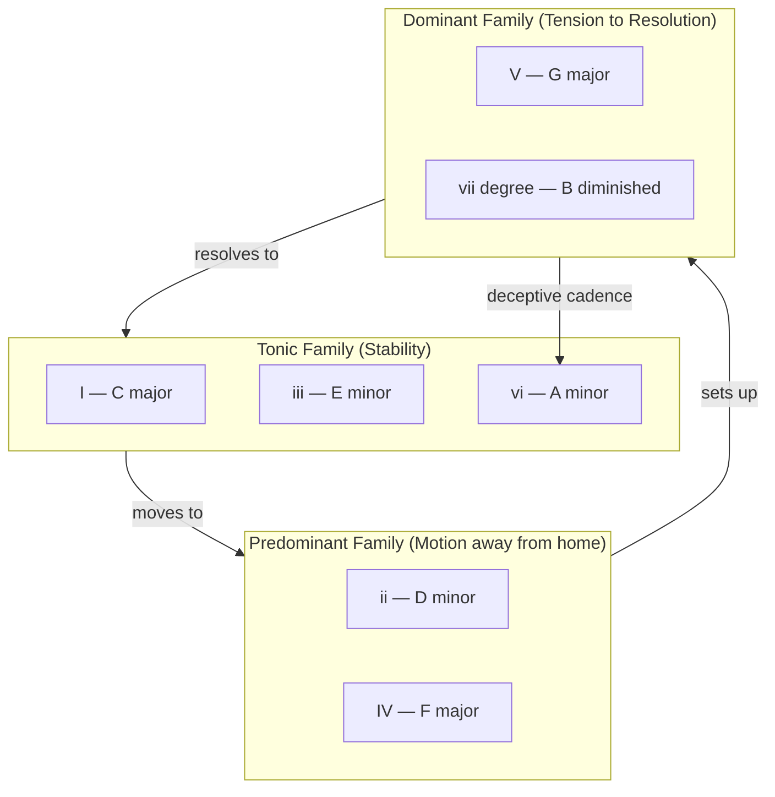
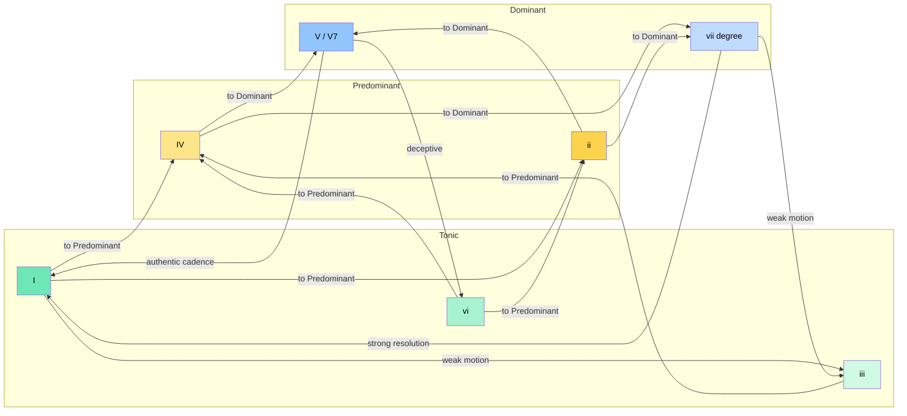
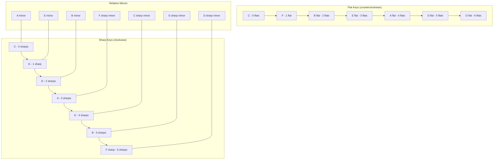

# Lesson 1: Diatonic Chords at the Piano — From Keyboard Geometry to Musical Fluency

## 1. First-Principles Intuition (The 15%)

Diatonic chords are the seven chords built entirely from the notes of one key — no accidentals, no borrowed tones. You build each one by stacking every other note of the scale: root, skip one, third, skip one, fifth. The size of each third decides the chord's color. A major third (4 semitones) stacked under a minor third (3 semitones) gives a major chord. A minor third under a major third gives a minor chord. Two minor thirds stacked gives a diminished chord.

This connects to the overtone series. A struck string vibrates at its fundamental frequency but also at whole-number multiples of it — the octave, then a fifth above that, then another octave, then a major third above that. The major triad (root–major 3rd–5th) mirrors that natural overtone stack almost exactly, which is why it sounds complete and requires no "explanation" to the ear. The minor triad flattens the third relative to that natural stack, creating a slight pull inward — its characteristic darker color. The diminished triad stacks two minor thirds and lands on a tritone (exactly half an octave) between its outer notes — the most unstable interval in the system, which is why vii° chords demand resolution.

That's the physics. Everything from here is hands-on.

---

## 2. Keyboard Geometry: Where Diatonic Chords Live

Forget memorizing "C–E–G" as abstract letters. Learn the chords as **hand shapes anchored to black-key landmarks**. Every white key sits in a fixed position relative to the two-black-key group (C–D) or the three-black-key group (F–G–A–B). Use that geometry to find your hand position without looking down.

### Landmark rule
- The two-black-key group sits directly above C and D.
- The three-black-key group sits directly above F, G, A, and B.
- Any white key with **no black key on its right** (E and B) creates a tighter, "collapsed" interval to its neighbor — this is where chord shapes change width.

### The Seven Triads as Hand Shapes (C major)

| Chord | Thumb (1) | Middle (3) | Pinky (5) | Hand feel |
|---|---|---|---|---|
| C (I) | C | E | G | Normal major arc — reference shape |
| Dm (ii) | D | F | A | Slightly wider than C; minor-3rd lower gap |
| Em (iii) | E | G | B | Same width as Dm, shifted right |
| F (IV) | F | A | C | Widest reach — spans the 3-black-key group |
| G (V) | G | B | D | **Use 1–2–5**, not 1–3–5 (see below) |
| Am (vi) | A | C | E | Identical shape/width to C major |
| B° (vii°) | B | D | F | Tightest shape — two minor 3rds stacked |

**Why G major breaks the 1–3–5 pattern:** B and D are only a minor third apart with zero black key between B and C. Fingering 1–3–5 crushes fingers 3 and 5 together uncomfortably. Switch to **1–2–5**: finger 2 on B gives your hand a natural arch over the tight interval, freeing finger 5 to land cleanly on D.

### Full Diatonic Chord Map — C Major

| Roman | Chord | Pitches | Quality | RH Fingering (root pos.) |
|-------|-------|---------|---------|--------------------------|
| I | C | C E G | Major | 1–3–5 |
| ii | Dm | D F A | Minor | 1–3–5 |
| iii | Em | E G B | Minor | 1–3–5 |
| IV | F | F A C | Major | 1–3–5 |
| V | G | G B D | Major | 1–2–5 |
| vi | Am | A C E | Minor | 1–3–5 |
| vii° | B° | B D F | Diminished | 1–3–5 |

### Full Diatonic Chord Map — A Natural Minor

| Roman | Chord | Pitches | Quality | RH Fingering |
|-------|-------|---------|---------|--------------|
| i | Am | A C E | Minor | 1–3–5 |
| ii° | B° | B D F | Diminished | 1–3–5 |
| III | C | C E G | Major | 1–3–5 |
| iv | Dm | D F A | Minor | 1–3–5 |
| v | Em | E G B | Minor | 1–3–5 |
| VI | F | F A C | Major | 1–3–5 |
| VII | G | G B D | Major | 1–2–5 |

> **Harmonic minor raises the 7th:** in A harmonic minor, the v chord becomes **V major** (E–G♯–B). The raised G♯ is now a leading tone that pulls strongly up to A, giving minor keys the same authentic-cadence punch major keys have natively. Fingering stays 1–3–5.

### Drill: Find Every Chord Blind

Close your eyes. Place your thumb anywhere on a white key. Without looking, play the triad built on that key using the shape table above, relying only on the feel of the black-key landmarks. Open your eyes and check. Repeat until you get 7/7 correct three times in a row — this is the single fastest way to stop reading letters and start reading shapes.

---

## 3. Hand Posture and Ergonomics at the Piano

Get this right before you play a single chord. Bad posture here causes tendinitis within months of serious practice, not years.

**Bench height.** Forearms roughly parallel to the floor, elbows at or just below keybed level. Too high forces the wrist to angle downward into the keys; too low forces it to angle upward. Both load the tendons instead of the muscles.

**Wrist position.** The wrist floats — never collapses below the keybed, never locks rigid above it. Think of it as a suspension bridge carrying the weight of the arm, not a hinge that jerks the hand up and down.

**Finger curve and contact point.** Strike with the fleshy pad of the fingertip, not the flat pad or the nail. Each finger curves into a small arch shape (like holding a ping-pong ball loosely). This curve lets you transfer forearm weight straight down through the fingertip into the key-bed — that's where a full, singing tone comes from, not from finger strength.

**Thumb (finger 1).** Plays on its side-tip, angled slightly inward, never flat-faced or sticking straight out. A thumb that sticks out horizontally bangs the key and destabilizes the whole hand position.

**Forearm weight transfer, not attack.** To sound a chord with resonance: let the weight of the relaxed forearm *drop* into the keys through the fingers, then release that weight as the keys rise. You are not pushing or hammering — you are briefly removing support from the arm and letting gravity do the work, then catching the arm's weight again on release.

**Wrist cushion on release.** After every chord, let the wrist lift very slightly — a few millimeters — before the next attack. This tiny float is what prevents tension from accumulating bar after bar across a practice session. Skipping it is the #1 cause of forearm fatigue in beginners.

---

## 4. Chord Inversions: Same Notes, Different Bass

Every triad has three positions: **root position** (root on the bottom), **1st inversion** (3rd on the bottom), **2nd inversion** (5th on the bottom).

### C Major Through All Inversions

```
Root Position      1st Inversion      2nd Inversion
   G (5th)             C (8va)            E (8va)
   E (3rd)             G (5th)            C (5th)
   C (Root)            E (3rd)            G (Root)

RH: 1–3–5           RH: 1–2–5          RH: 1–3–5
LH: 5–3–1           LH: 5–3–1          LH: 5–2–1
```

**Why this matters physically:** root position alone forces your hand to relocate for every chord change — a C-to-F-to-G progression played entirely in root position makes your hand jump around the keyboard with no shared fingers. Inversions let you park your hand in one five-finger zone and move only the fingers that actually need to change pitch. This is the single biggest jump in fluency a beginner makes.

### I – IV – V – I with Smooth Voice Leading (C Major, RH)

The most important inversion exercise in this lesson. Goal: no finger moves more than a step between chords.

```
  I (root)      IV (2nd inv.)    V (1st inv.)     I (root)
  G             C (held)         B                G
  E             F                G (held)         E
  C (held)      C                G                C

Fingers:
  1–3–5         1–2–5            1–2–5            1–3–5
```

**What's happening:** C is a common tone between I and IV — hold it, don't replay it. Between IV and V, G is a common tone — hold it; F drops a half-step to E... wait, trace it carefully at the keyboard: F (finger 3 of IV) moves down a half-step to E is NOT what happens here — F moves to G (up a step) while C drops to B (down a half-step). Play it slowly and watch which finger actually moves. This is the voice-leading skeleton behind thousands of songs — internalize it in every key before moving to Section 9's drills.

---

## 5. Harmonic Function: Tonic, Subdominant, Dominant

Every diatonic chord belongs to one of three functional families.



**Tonic (I, iii, vi).** Feels like home. I is the strongest tonic. vi (Am) shares two notes with C major and can act as a weaker tonic substitute — the ear sometimes hears it as "home enough." iii is rarely a destination chord; it mostly passes through on the way to IV or vi.

**Predominant (ii, IV).** Pulls away from home toward the dominant. IV has a warm, hymn-like "plagal" pull. ii is the harmonically stronger of the two because it sets up a full ii–V–I motion, the backbone of jazz harmony.

**Dominant (V, vii°).** Generates the strongest tension. V contains the leading tone (B in C major), which pulls by half-step into the tonic. vii° is functionally an incomplete V7 — B, D, F are three of the four notes in G7 — so it resolves to I with almost the same pull as V7.

---

## 6. Voice Leading Rules — The Four That Matter

**Rule 1 — Hold common tones.** When two chords share a note, keep it in the same finger/voice rather than replaying it. C major → F major share C: hold C, move E down a step to F, move G up a step to A.

**Rule 2 — Move by step, not leap.** If a voice can resolve by half-step or whole step into the next chord tone, do that instead of jumping a fourth or fifth. Smaller motion sounds smoother and is easier to play reliably at speed.

**Rule 3 — No parallel fifths or octaves.** If two voices move in the same direction by the same interval (both sliding up a fifth, or both sliding up an octave), your ear fuses them into a single line and the texture collapses from two voices into one. Avoid this when voicing any progression by hand.

**Rule 4 — Resolve the tritone.** In G7 (G–B–D–F), the tritone sits between B and F. B (the leading tone) resolves **up** to C. F (the chord's 7th) resolves **down** to E. Any G7 → C voicing that doesn't honor this motion will sound evasive or unresolved, even if the notes are "technically correct."

---

## 7. Seventh Chords on the Keyboard

Stack a seventh above the root of any diatonic triad and you get a seventh chord. In C major:

| Roman | Chord | Pitches | Quality | RH Fingering |
|-------|-------|---------|---------|--------------|
| Imaj7 | Cmaj7 | C E G B | Major 7th | 1–2–3–5 |
| ii7 | Dm7 | D F A C | Minor 7th | 1–2–3–5 |
| iii7 | Em7 | E G B D | Minor 7th | 1–2–3–5 |
| IVmaj7 | Fmaj7 | F A C E | Major 7th | 1–2–3–5 |
| V7 | G7 | G B D F | Dominant 7th | 1–2–3–5 or 1–2–4–5 |
| vi7 | Am7 | A C E G | Minor 7th | 1–2–3–5 |
| viiø7 | Bm7♭5 | B D F A | Half-dim 7th | 1–2–3–5 |

**Fingering note on G7:** root-position G–B–D–F is a wide stretch for smaller hands. Use 1–2–3–5 if an octave spans comfortably; switch to 1–2–4–5 if D and F feel cramped under fingers 3 and 5.

### V7 → I Resolution — Feel the Tritone Snap

```
G7 (V7)        Cmaj (I)
   F        →     E       (down a half-step)
   D        →     C       (down a step)
   B        →     C       (up a half-step — the leading tone)
   G        →     C       (down a fifth, or hold if doubled)
```

Play full root-position G7, then resolve to C major. Feel B pull up and F pull down simultaneously — that two-note tug is the acoustic engine driving almost all tonal cadences.

---

## 8. Harmonic Progressions Map



---

## 9. Practice Drills — Metronome Targets

Work these in order. Do not advance to the next drill until the current one is effortless at the target tempo — "effortless" means you can hold a conversation while playing it without losing time.

### Drill 1: Block Chord Diatonic Cycle (Root Position)

Play all seven diatonic chords up the scale in root position, both hands together, then back down. Legato touch; listen for even volume across all three notes of each chord.

```
RH: C/E/G — D/F/A — E/G/B — F/A/C — G/B/D — A/C/E — B/D/F — back down
LH: mirrors one octave lower, fingering 5–3–1 on each chord

Tempo: quarter note = 60 BPM (one chord per beat)
Target: quarter note = 80 BPM
```

**Listen for:** the top note (finger 5) tends to go soft and get buried. Deliberately lean forearm weight toward the 5th finger until the top voice projects slightly above the rest — this is the "melody on top" skill you'll need in every piece.

### Drill 2: I – IV – V – I with Inversions (Voice-Led)

The fundamental harmonic motion of tonal music. Start RH alone, then add LH bass.

```
I (root)   →  IV (2nd inv.)  →  V (1st inv.)  →  I (root)
C/E/G      →  C/F/A          →  B/G/D          →  C/E/G

LH plays single bass notes (roots): C — F — G — C, one octave below RH

Tempo: quarter note = 60 BPM, one chord per beat, chord lands on beat 1 of each bar
Target: quarter note = 100 BPM
Advanced: quarter note = 120 BPM, arpeggiate RH chords in a 1-3-5-3 pattern per bar
```

Transpose to G major, D major, F major, and A minor before moving on. Each transposition should take less time than the last — that's the shape-memory from Section 2 taking hold.

### Drill 3: ii – V – I (The Jazz Cadence)

The single most important three-chord cell in jazz and pop harmony.

```
Key of C, with 7ths:
ii7 (Dm7)   →   V7 (G7)   →   Imaj7 (Cmaj7)

Voice-led (keep common tones, move the rest by step):
LH root:  D         →   G         →   C
RH:       F/A/C      →   F/B/D     →   E/G/B
          (hold F)       (B held→   (F resolves down to E,
                           from Dm7)  D resolves down to B... 
                           — trace each voice individually
                           at the keyboard before judging by eye)

Tempo: quarter note = 60 BPM
Target: quarter note = 90 BPM
Then run it around the full circle of fifths:
C → F → B♭ → E♭ → A♭ → D♭ → G♭ → B → E → A → D → G → C
```

### Drill 4: The Four Standard Cadences

Practice in C major first, then transpose to three keys of your choice.

```
1. Authentic (Perfect): V → I
   G (1st inv: B/G/D) → C (root: C/E/G)
   The strongest possible full stop.

2. Half Cadence: I → V
   C/E/G → G/B/D
   Ends on tension — functions like a question mark mid-phrase.

3. Plagal: IV → I
   F/A/C → C/E/G
   The "Amen" cadence — warmer, less urgent than authentic.

4. Deceptive: V → vi
   G/B/D → A/C/E
   The ear expects I, gets vi instead — a harmonic surprise.

Tempo: quarter note = 60 BPM, hold each chord 2 full beats.
```

### Drill 5: Alberti Bass + Melody

The low–high–middle–high broken-chord pattern in the LH, under a sustained RH melody note, is the foundational Classical-era texture (Mozart sonatas run on this pattern).

```
Key of C, 4/4, one chord per bar:
LH pattern per bar (Alberti on C major): C2 – G2 – E2 – G2
RH: sustain E4 for bar 1, then G4, then G4, then C4

Chord progression underneath: I — V — IV — I

LH fingering: 5 – 2 – 1 – 2  (thumb always lands on the middle note)
RH fingering: finger 3 for E, finger 5 for G, finger 1 for C

Tempo: quarter note = 60 BPM
Target: quarter note = 100 BPM, clean and even
```

---

## 10. Circle of Fifths as a Practice Map



Use the circle as a transposition schedule. After Drills 1–4 feel automatic in C major, move to G major (F♯), then D major (F♯, C♯), and so on around the circle. Each new key is harder for about ten minutes, then suddenly easy — that's your hand switching from reading letter names to reading the shape and distance patterns from Section 2.

**Priority order:**
1. C major — build every pattern here first
2. G major / E minor
3. F major / D minor
4. D major / B minor
5. B♭ major / G minor
6. A major / F♯ minor

---

## 11. Common Mistakes and How to Fix Them

**Chords sound uneven — the bottom note drowns the top.**
Isolate each voice. Play just the top note of the chord through the whole progression, then just the middle, then just the bass, listening for a smooth line in each case. Recombine, consciously directing forearm weight toward finger 5 so the top voice (the "melody" in most real music) projects above the rest.

**The hand tenses up between chords.**
After every chord, consciously release weight and let the wrist float up a few millimeters before the next attack (Section 3's wrist cushion). Skipping this release is the most common cause of forearm fatigue in the first few months of practice.

**The thumb bangs notes and destabilizes the hand.**
The thumb should strike on its side-tip, curled slightly inward, never flat-faced or sticking straight out. Practice forming a loose fist, then opening only as far as the chord shape requires — this keeps the thumb naturally angled.

**Voice leading sounds jumpy, with big leaps everywhere.**
You're probably playing every chord in root position. Switch to the inversions from Section 4 — Drill 2 is built specifically to cure this.

**V7 → I sounds muddy in the low register.**
Keep four-note V7 voicings above roughly C3 (an octave below middle C). Below that, overtones clash and the chord reads as mud rather than harmony. In the bass register, split the voicing: single bass note alone in the LH, full upper-structure chord tones spread an octave higher in the RH.

---

## 12. Applying Diatonic Chords: Real Song Structures

Three progression templates that account for a huge share of recorded popular music. Learn each in C major, then transpose.

### Template A: I – V – vi – IV (The Pop Axis)

```
C major: C — G — Am — F

Voicing (inversions chosen for smooth voice leading):
  C  (root):       C/E/G   fingers 1–3–5
  G  (1st inv.):   B/G/D   fingers 1–2–5
  Am (root):       A/C/E   fingers 1–3–5
  F  (2nd inv.):   C/F/A   fingers 1–2–5

LH: single bass notes C – G – A – F, one per bar, half or whole notes.
Metronome: quarter note = 70 BPM, 4/4, one chord per bar.
```

### Template B: i – VII – VI – VII (Natural Minor Loop)

```
A minor: Am — G — F — G

  Am (root): A/C/E   1–3–5
  G  (root): G/B/D   1–2–5
  F  (root): F/A/C   1–3–5
  G  (root): G/B/D   1–2–5

LH: single bass notes A – G – F – G.
Metronome: quarter note = 72 BPM.
```

### Template C: ii – V – I (Jazz Cadence, Rootless Voicings)

```
Dm7 — G7 — Cmaj7

LH: single roots D — G — C
RH rootless voicings (3rd-5th-7th of each chord above the LH root):
  Dm7:    F / A / C   (3rd, 5th, 7th of D)
  G7:     F / B / D   (7th, 3rd, 9th — contains the B–F tritone)
  Cmaj7:  E / G / B   (3rd, 5th, 7th of C)

Metronome: quarter note = 80 BPM, swing feel (eighth notes long-short, not even).
```

This is the standard "A-form" rootless voicing used throughout jazz piano comping — the LH plays only the root (or nothing, if a bassist is present), and the RH carries the harmonic color.

---

## 13. Diatonic Chord Reference — Key of C Major (Full Summary)

| Roman | Name | Pitches (root pos.) | Quality | Function | Resolves To |
|-------|------|----------------------|---------|----------|-------------|
| I | Tonic | C E G | Major | Stability | — |
| ii | Supertonic | D F A | Minor | Predominant | V |
| iii | Mediant | E G B | Minor | Weak tonic | vi or IV |
| IV | Subdominant | F A C | Major | Predominant | V or I |
| V | Dominant | G B D | Major | Dominant tension | I or vi |
| V7 | Dominant 7th | G B D F | Dom. 7th | Strongest tension | I |
| vi | Submediant | A C E | Minor | Tonic substitute | ii or IV |
| vii° | Leading tone | B D F | Diminished | Dominant substitute | I |
| Imaj7 | Tonic 7th | C E G B | Maj7 | Color tonic | — |
| IVmaj7 | Subdominant 7th | F A C E | Maj7 | Rich predominant | V |

---

## Summary

You now have the complete toolkit for diatonic harmony at the piano: keyboard geometry for all seven chords in major and minor keys, correct hand posture and forearm-weight mechanics that prevent injury, all three inversions with smooth voice leading, the functional family model (tonic / predominant / dominant), the four cadence types, and five progressive drills with metronome targets.

The single most important thing to do right now: sit at the keyboard and play Drill 2 (I–IV–V–I with inversions) in C major at quarter note = 60 BPM until the voice leading is completely automatic. Then transpose it to G major. That loop is the DNA of Western harmony — muscle memory in it unlocks every progression that follows.
